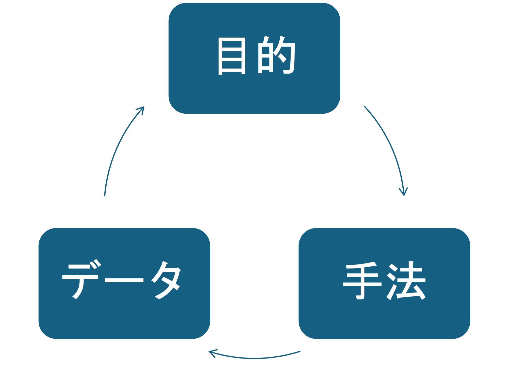

# 小さな問いを文献で調べる {#search-literature}

[問いの立て方](material:question)では, 自分の中心の問いを探し, 1 年間で探究する問いの候補を 3 つ挙げました ([Exercise DSPJ4-2](material:question#exercise-dspj4-2)). 研究計画では, 候補から 1 つを選び, その問いに答えるための[地図](material:question#map)を作ります. 地図の小さな問いを文献で調べてから, 1 年間で答える小さな問いを選び, データで答えられる形に書き直して, 目的, データ, 手法を決めます. 目的, データ, 手法の一般的な決め方は, 参考資料の分析設計の[モデルとデータ](block:design-process#models-and-data)から[目的・データ・手法から分析を組み立てる](block:design-process#目的データ手法から分析を組み立てる)までで説明しています. 先に読んでから, この回に進んでください.

自分の問いに答えるには, 地図に並べた多くの小さな問いに答える必要があります. ただし, そのすべてに自分でデータを集めて答える必要はありません. 小さな問いの多くは, 既に誰かが研究していて, 答えが文献に書かれています. 小さな問いの答えを文献で確かめ, 順序立てて説明していくと, 大きな問いに答えられます. 自分でデータを集めて答えるのは, 文献を調べても答えが出なかった問いです.

小さな問いへの答えを順序立てて説明し, 問いに答える文書が**論文**です. 研究の成果は, 一部の人文系の研究を除いて, 基本的に論文としてまとめられます. そのため, ある問いについてどのような研究が行われ, 何が分かっているかを知るには, 論文を読みます. 論文は, 分野ごとに学会や大学, 研究機関が発行しています. 学会が定期的に発行する学会誌に載る論文, 学会の大会での報告をまとめた論文 (プロシーディングス), 大学などが発行する紀要に載る論文などがあります. 論文には, その分野の専門家が内容の確からしさを確かめる**査読**を経たものと, 査読を経ていないものがあります.

論文のほかに, 学術書, 政府や企業のレポート, 新聞記事も文献として使えます. 使える文献は, 著者 (法人でも構いません) が分かり, 著者が信頼でき, 一次情報 (調査や研究をした本人が書いた情報) を含むものです. ただし, ある論争が起きたことを示すときのように, 事実や事例として示すだけなら, 匿名の投稿やブログも使えます.

::: warn

用語の定義を検索すると, Wikipedia などの解説のページが上位に出ることがあります. LLM の回答にも, このようなページをもとにしたものがあります. 解説のページには, 挙げている出典が少なく, 一次情報をほとんど含まないものがあります. そのようなページは, 挙げられた出典をたどり, 元の文献で確かめてから使います.

:::

最初に調べるのは, 問いに使う用語の定義や, 対象の現状のように, 調べればすぐに答えが出そうな小さな問いです. 例えば, [教員が 1 人で 3 回繰り返した例](material:question#example)の 3 回目に出た「仕事と作業の違いは何か」は, 用語の定義を尋ねる問いです. 地図からこのような問いを 2 つ以上選び, その問いについて今分かっていることが書かれた論文を探します. 文献を検索する手順と, LLM が挙げた文献を確かめる手順は, [先行研究を探し, 本文を確かめる](material:llm#literature)にあります. 見つけた文献は, 後で研究計画と論文に使えるように, 小さな問いごとに次の項目を記録します.

| 項目 | 書く内容 |
|---|---|
| 小さな問い | 文献で調べた問い |
| 文献の情報 | 著者, 発行年, 題名, 掲載誌か発行元など, 論文の参考文献の欄に書く情報 |
| 文献の内容 | 文献が扱った対象, データ, 手法と, 分かったこと |
| 問いへの答え | 文献に書かれていた, 小さな問いへの答え. 書かれていた箇所 (頁や節) と, その抜粋か要約 |

::: note

論文には, 読むのに料金がかかるものがあります. 有料の論文が必要になったときは, 教員か図書館に相談してください. 大学の図書館が契約しているサービスで読めるものや, 図書館を通じて複写を取り寄せられるものがあります.

:::

文献を調べても答えが出なかった問いのうち, 中心の問いに近いものから, 1 年間で答える小さな問いを選びます. 文献を調べるのは, この段階の 1 回では終わりません. 研究計画を書き, 分析し, 論文を書く途中で, 根拠が足りない所が見つかるたびに, 文献を調べ直します.

# 小さな問いを, データで答えられる形に書き直す {#data-question}

文献で答えが出なかった問いから選んだ小さな問いは, 多くの場合, まだデータで答えられる形になっていません. 例えば, [教員が 1 人で 3 回繰り返した例](material:question#example)の 1 回目に出た「いくつまでなら並行しても問題ないのか」を選んだとします. この問いは, 何を数え, 何を見れば答えになるのかが決まっていません.

データで答えられる問いにするには, 参考資料の[分析目的の設定](block:design-process#analysis-goals)と同じく, 問いを**対象**, **結果**, **要因の候補**の 3 つが決まる形に書き直します. 上の問いなら, 次のようになります.

- 対象: 企業で働く人.
- 結果: 働く人が感じる仕事の負担.
- 要因の候補: 同時に担当している仕事の数と, 職種.

書き直した問いは「企業で働く人が感じる仕事の負担は, 同時に担当している仕事の数と職種によってどう変わるか」です. この形になると, 集めるデータ (働く人への質問紙調査で, 負担の感じ方, 担当している仕事の数, 職種を尋ねる) と, 使える手法 ([回帰分析](block:reg-intro)など) の候補が決まります. この例では, 企業で働く人から回答を集める方法も要ります. 集める方法が見つからないときの対応は, [目的, データ, 手法を行き来して決める](#purpose-data-method)で扱います.

::: note

対象, 結果, 要因の候補の形は, 結果が何によって変わるかを調べる問いの形です. 対象をいくつかのグループに分ける問い (例えば, 企業で働く人を, 仕事の進め方が似た人どうしに分けると, どのようなグループがあるか) では, 結果と要因の候補の代わりに, 対象と, グループに分けるときに比べる特徴 (同時に担当している仕事の数, 1 つの仕事に続けて使う時間など) を書きます. このような問いには, [クラスタリング](block:ml-clustering)などの手法を使います.

:::

次に, 分析の前に, 結果の予想を書きます. 仕事の負担の問いなら, 予想は「同時に担当している仕事の数が多いほど, 負担を強く感じる」です. 予想と合わせて, 分析の結果を次の 3 つに分け, それぞれがどのような結果かを書いておきます.

- 予想に沿う結果: 仕事の数が多いほど, 負担を強く感じる関係が見られる.
- 予想が外れた結果: 仕事の数が多いほど負担を弱く感じる関係が見られるか, 仕事の数と負担の感じ方にほとんど関係が無いと言える.
- 判断を保留する結果: 回答が少ないなどの理由で, 関係があるとも無いとも言えない.

::: warn

予想が外れた結果と判断を保留する結果を分けておくのは, 関係が見られないことが, 関係が無いことを意味するとは限らないからです. 回答が少ないと, 関係があっても分析で見分けられません.

:::

予想を先に書いておくのは, 分析の結果を見てから立てた仮説を最初から立てていたかのように報告すること (**HARKing**) を避けるためです ([HARKing について](block:design-process#harkingについて)). 予想と, その後に予想を変えた経緯は, 研究のノートに日付を付けて記録します.

書き直すと, 中心の問いの一部が抜け落ちます. 上の例でも, 中心に近い「人間は何を一連の作業として捉えるのか」という問いには, 負担の感じ方のデータだけでは答えられません. 抜け落ちた部分は, 論文の考察で, 分析の結果から中心の問いについて何が言えて, 何が言えないかとして書きます.

# 目的, データ, 手法を行き来して決める {#purpose-data-method}

書き直した問いで目的が決まったら, データと手法を決めます. 参考資料の[目的・データ・手法から分析を組み立てる](block:design-process#目的データ手法から分析を組み立てる)で説明しているとおり, 3 つは互いに制約し合い, どれか 1 つを決めると残りの 2 つの候補が絞られます. 本科目では問いから出発するので, 目的を最初に決めます.

データと手法の候補は, LLM に挙げさせても構いません. ただし, 挙げられたデータが実在して手に入るか, 手法が自分のデータの種類 (量的なデータか, カテゴリーか, 文章か, 時刻の順に並んだデータか) に合うかは, 自分で確かめます ([LLM を研究に使う条件](material:llm#conditions)).

実際に決めていくと, 3 つのどこかで行き詰まります. 特別講義では, 1 年間で研究を終えるために, 行き詰まったら取り組みやすいデータ, 手法, 目的に替えるよう勧めていました. 本科目では中心の問いを替えず, LLM を使って行き詰まりを越えることを試みます. 主な行き詰まりと, 2 つの科目の対応は次のとおりです.

| 行き詰まり | 特別講義での対応 | 本科目での対応 |
|---|---|---|
| 目的と手法は決まったが, データが無い | 昨年の講義で使ったデータ, 手に入りやすいデータ, 教員が示したデータに替える | データを自分で集める. 質問紙調査 ([質問紙調査の設計](block:survey-design)) や API ([データの取得](block:api-intro)) による集め方を参考資料で学び, 集めるプログラムは LLM に書かせる |
| データと手法は決まったが, 分かることが既に知られている, 面白くない | 既に知られていることでも, 一通りの流れを体験するために行う | [小さな問いを文献で調べる](#search-literature)で文献を調べ直す. 文献で答えが出なかった問いから, 中心の問いに近い別の小さな問いを選び直す |
| 目的とデータはあるが, 手法が難しすぎる | 授業で扱った基礎的な手法に限る | 手法を参考資料と文献で学び, 分析のプログラムは LLM に書かせる. 手法の仮定と結果の読み方を, 自分で説明できるようになるまで学ぶ |

::: note

必要な手法を学ぶ資料が参考資料に無い場合は, 教員に相談してください. 文献を示すか, 参考資料を新しく作ります.

:::

LLM を使っても縮まらない時間もあります. 質問紙調査には倫理審査が必要で, API には取得できる量の上限があります. 手法を自分で説明できるようになるまで学ぶ時間も要ります. それでも 1 年間で答えられない大きさなら, [問いに答えるための地図](material:question#map)から, 中心の問いにつながる別の小さな問いを選び, 範囲を狭めます. 特別講義の妥協では, 本人の関心から離れた取り組みやすい問いに替えることがありました. 本科目では, 中心の問いとのつながりを保ったまま範囲を狭めます. 中心から外れた問いで研究を始めると, 進めても面白いと感じられないからです ([自分の問いを中心に置く](material:question#own-question)).

# 研究計画にまとめる {#proposal}

問い, 目的, データ, 手法が決まったら, 研究計画として 1 つの文書にまとめます. 研究計画は, 教員と話しながら直していくもので, 研究の途中で変わることがあります. 変えたときは, 研究のノートに理由を残します. 研究計画には次の項目を書きます.

| 項目 | 書く内容 |
|---|---|
| 問い | 中心の問いと, 1 年間で答える小さな問い. 小さな問いが, 中心の問いのどの部分にあたるか |
| 目的 | 対象, 結果, 要因の候補 (グループに分ける問いでは, 対象と, グループに分けるときに比べる特徴) |
| 先行研究 | 同じ問いか近い問いを扱った研究. 分かっていることと, 分かっていないこと |
| データ | 何のデータを, どこから, どのように集めるか. 個人に関わるデータを含むか |
| 手法 | どの手法で分析するか. その手法で何が言えて, 何が言えないか |
| 予想 | 分析の前の予想と, 予想に沿う結果, 予想が外れた結果, 判断を保留する結果がそれぞれどのような結果か |
| 予定 | データの収集, 分析, 論文の執筆の時期 |

先行研究の欄には, 本文を確かめた文献だけを書きます ([先行研究を探し, 本文を確かめる](material:llm#literature)). 本科目では厳密な新規性は求めませんが, 自分の研究が先行研究とどこで同じで, どこが違うか (対象, データ, 時期, 手法) は書けるようにします. 論文の序論で研究の位置づけを書くときに, この欄を使います. 先行研究の欄の文献は, [小さな問いを文献で調べる](#search-literature)で記録した文献から選べます.

予定の欄には, 倫理審査の期間も含めます. 個人に関わるデータを集める調査は, 始める前に倫理審査が必要だからです. ゼミと研究の内容を共通にする場合は, 審査を申請する前に教員に伝えてください ([研究倫理と成果の利用](material:guide#ethics)). 夏休みの奨学論文コンテストで発表する場合は, 夏休みまでに分析の結果をまとめる予定にします. 論文と発表の締切は, [論文と発表](material:writing)で扱います.

# 演習 {#exercises}

## Exercise DSPJ5-1 {#exercise-dspj5-1}

**過去の研究事例を, 対象, 結果, 要因の候補, データ, 手法に分ける**

[過去の研究事例](/slds_papers.html)から 1 つを選んで読み, 次の 5 つをそれぞれ 1 行で書いてください. 主な研究事例と, それぞれが明らかにした構造は, 参考資料の[分析目的の設定](block:design-process#analysis-goals)にも挙げています.

- 対象
- 結果
- 要因の候補
- データ: どのようなデータを, どのように集めたか.
- 手法: どの手法で分析したか (手法の名前だけで構いません).

グループに分ける研究では, 結果と要因の候補の代わりに, グループに分けるときに比べた特徴を書きます. 加えて, その研究のデータと手法を自分の研究で使うとしたら, 何を学び, 何を用意する必要があるかを書いてください. 講義で説明できるようにしておきます.

## Exercise DSPJ5-2 {#exercise-dspj5-2}

**研究計画を書く**

[Exercise DSPJ4-2](material:question#exercise-dspj4-2) で挙げた問いの候補から 1 つを選び, その問いに答えるための[地図](material:question#map)を作ってください. 地図の小さな問いのうち 2 つ以上を文献で調べ, [小さな問いを文献で調べる](#search-literature)の表の項目を記録します. 文献で答えが出なかった問いから, 1 年間で答える小さな問いを選んでください. 選んだ小さな問いについて, [研究計画にまとめる](#proposal)の表の項目を埋めます. 先行研究には, 本文を確かめた文献を 3 件以上挙げます. 埋められない項目は空けたままにし, 何が分からないために埋められないのかを書いてください. 研究計画は, 講義で教員と話しながら直していきます.
