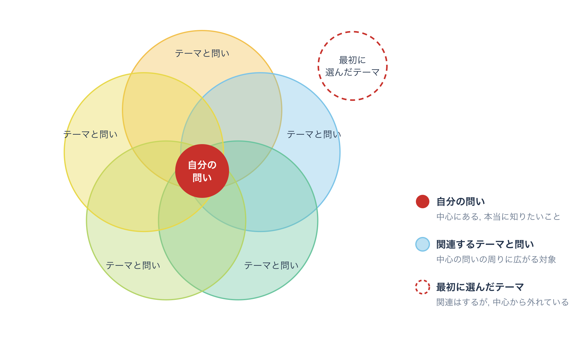
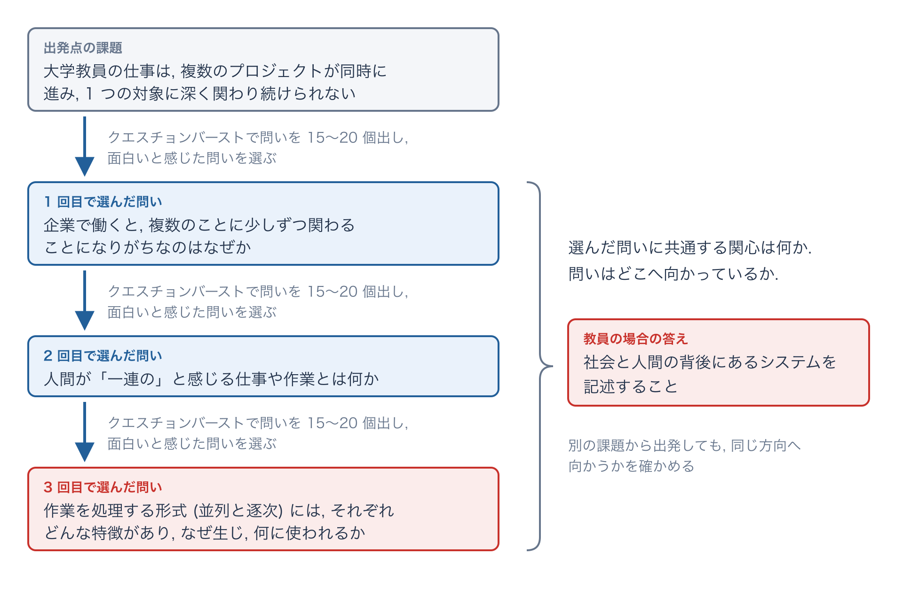

# テーマと問いの違い {#theme-and-question}

研究を始めるとき, 多くの学生が最初に挙げるのは, 「SNS と若者の消費」「地域の観光」のような**テーマ**です. テーマは研究の対象を名詞で示したもので, その対象について何を知りたいかは示しません. これに対して**問い**は, 知りたいことを疑問文で示したものです. 例えば「SNS で話題になった商品は, 話題になる前と後で, 売上の伸び方が変わるのか」は, 「SNS と若者の消費」というテーマから立てた問いの 1 つです.

マラニーとレアは, テーマと問いの違いを次のように整理しています [@mullaney2023research, p. 35]. テーマは名詞で, 修飾語を伴うことが多く, 好奇心の対象を示します. テーマからは無数の問いが生じますが, それらの問いの方向は定まらず, テーマ自体には答えがありません. 問いは疑問符で終わる文で, 好奇心の対象に加えて, その好奇心をどう満たしたいかという意向もある程度示します. 問いはより具体的な関連する問いを生み, 答えがあります (答えが複数あることもあります).

この整理を受けて, 本科目では, 自分の関心を問いの形に直すときに次の点を確かめます.

- 名詞のテーマを, 疑問文に直す.
- 「〇〇を検討する」「〇〇を調査する」「〇〇を学習する」は, 何をするかを述べた文で, 疑問文ではない.
- 「現代的な」「伝統的な」「合理的に」「効果的に」のような形容詞や副詞を付けただけでは, 問いにならない.
- できれば, 検証や反証ができる問いにする. 「〇〇は良いか」「〇〇は重要か」「〇〇は影響を与えたか」「〇〇とは何か」は抽象的すぎて, 何を確かめれば答えになるのかが分からない. 例えば「SNS は若者の消費に影響を与えたか」は, どの消費を, 何と比べて確かめるのかを決めると, 上の売上の伸び方の問いになります.

# 自分の問いを中心に置く {#own-question}

テーマを問いの形に直せても, その問いが自分の本当に知りたいことだとは限りません. 次の図は, 1 人の学生の関心を表した模式図です (説明のための図で, 実データは使用していません). 中心に自分の問いがあり, その周りに, 中心の問いと関連する多くのテーマと問いが重なり合って広がっています. 最初に選んだテーマは, 関連はしていても中心から外れていることがあります. そのようなテーマで研究を始めると, 興味はありそうなのに, 進めてもそれほど面白くないと感じます.

中心にある自分の問いに, 直接取り組めるかは分かりません. 多くの場合, 中心の問いはとても大きく, 一生をかけて取り組むような問いです. それでも, 1 年間かけて研究をするなら, 楽しく, 本当に興味があり, 将来につながる研究にするほうがよいはずです. そのために, 自分の関心がどこにあるかをはっきりさせ, 中心に近い問いに取り組みます.

自分の問いを探す手がかりは, 自分が選んだテーマについて「なぜそれを研究するのか」「なぜそれが面白いと感じるのか」を考えることです. このとき, 人に向けた理由ではなく, 自分にとっての理由を考えます. マラニーとレアも, 研究の最初の段階で必要なのは, 「先行研究に空白がある」「重要である」のような外部からの評価に向けた理由づけではなく, なぜ自分がとくにそのテーマに惹かれるのかという, きわめて個人的な問いに答えることだと述べています [@mullaney2023research]. 本科目の方針 ([特別講義との違い](material:guide#research-stance)) も, 本人の関心から出発する点でこの考え方と同じです.

# 問いを集めて共通点を探す {#common-ground}

自分の問いは, 1 つの問いを考え込むよりも, 関心のある問いを多く並べて共通点を探すほうが見つけやすくなります. マラニーとレアは, 次の手順を挙げています [@mullaney2023research, pp. 98-99].

1. 関心のある問いを, すべて目の前に並べる.
2. どの問いにもまだ答えようとせず, それらの問いに共通する関心事は何かを自問する.
3. 他人になったつもりで, これらの小さな問いを結びつける, より深い問いは何かを考える.
4. 思いついた問いを書き出す.
5. 必要なら, 具体的か一般的かの度合いで, 中くらいの水準の問い, 高い水準の問い, と順位を付ける. ここで出た問いは, それまでの具体的な問いより一般的になっているはずです.

この手順には, 並べる問いが多く要ります. 次の節のクエスチョンバーストは, その問いを短い時間で大量に出す方法です.

# クエスチョンバースト {#question-burst}

本科目では, グレガーセンが提案した**クエスチョンバースト** (1 つの課題について, 答えを出さずに問いだけを短い時間で大量に出す方法) を使います [@gregersen2020questions]. 本科目での手順は次のとおりです.

1. 関心のある課題か問いを 1 つ選ぶ.
2. 手伝ってくれる数人に, 2 分でその課題を説明する.
3. 4 分間で, その課題についての問いを 15〜20 個出してもらう. 説明した人は, 出た問いをひたすら記録する. 答えや解決策は出さない. 他の人の問いに反対しない.
4. 出た問いを読み返し, 新しい方向を示している問いや, 興味を惹かれる問いを複数選ぶ.
5. 選んだ問いがなぜ新しく感じられ, なぜ興味を惹かれるのかを分析する. その問いからどのような研究になるかも考える.
6. 選んだ問いを新しい課題にして, 1〜5 を 3 回程度繰り返す.

手伝ってくれる人がいないときは, LLM を相手にできます. 頼み方は[問いを広げる](material:llm#questions)にあります.

## 教員が 1 人で 3 回繰り返した例 {#example}

手順を, 担当教員が自分の課題で 1 人で行った例で示します. 出発点の課題は「大学教員の仕事は, 複数のプロジェクトが同時に進み, 特定の対象に深く継続して関われない」でした.

1 回目には, 「具体的にどのような業務があるか」「なぜ深く継続して関わる必要があるのか」「他の仕事も同じではないか」「だとすると, なぜ人は複数のことを並行して行う必要があるのか」「並行して行うことに何かメリットがあるのではないか」「いくつまでなら並行しても問題ないのか」など, 20 個ほどの問いが出ました. 元の課題から考えられる研究は「日本の大学教員の業務の形態と研究成果の関係」ですが, 調べ物で終わりそうで, 大学教員という狭い話にとどまり, 面白くなさそうでした. 一方, 「他の仕事も同じではないか」から先の問いには面白さを感じたので, 次の課題を「企業で働くと, 複数のことに並行して少しずつ関わることになりがちなのはなぜか」にしました. この問いからは「仕事の分け方が業務の成果に与える影響」のような研究が考えられ, 人間の働き方一般の話になって, 少し面白くなりました.

2 回目には, 「本当にそうなりがちなのか」「そうなる職とならない職の違いは何か」「狩猟採集や農耕でも同じではないか」「日本に固有なのか」「人間は何を一連の作業, ひとまとまりとして捉えるのか」「つながりが切れたと感じるのはどのようなときか」などの問いが出ました. ここから選んだ次の課題は「人間が『一連の』と感じる仕事や作業とは何か」です. 考えられる研究は「作業における連続, 分断, 並行」で, 認知心理学や哲学の領域に入り, 1 つの研究には収まらない大きさになりました.

3 回目には, 「仕事や作業とはそもそも何か」「人間に限った話なのか」「コンピュータでも一連の作業が定義されているのではないか」「人間とは別の処理の仕方があるのか. あるとしたら, なぜ人間はそれを採用していないのか」などの問いが出ました. 選んだ課題は「作業を処理する形式 (並列と逐次) には, それぞれどんな特徴があり, なぜ生じ, 何に使われるか」です. 考えられる研究は「人間社会における並列と逐次」で, 最初の課題よりは明らかに面白そうな研究になりました.

次の図は, この 3 回の流れを模式的に示したものです. 3 回ほど繰り返すと, 問いは最初の課題より本質的になり, 本人にとって面白そうな話になります. 選んだ問いを並べて, 共通する関心は何か, 問いがどこに向かっているかを考えると, 中心の問いが見えてきます. この例の教員の場合, 中心にあるのは「社会と人間の背後にあるシステムを記述すること」でした. 別の課題から出発して同じ手順を行い, 同じ方向に向かうかどうかも確かめます.

{.wide}

この例の問いは, 3 回目で計算科学や認知科学の問いに向かいました. 本科目で扱うのはデータサイエンスに属する研究です ([扱う研究の範囲](material:guide#scope)). そのため, 見つけた中心の問いから, データを集めて分析すれば答えられる問いを, [研究計画](material:plan)の段階で取り出します.

# 問いに答えるための地図 {#map}

自分の問いが見つかったら, その問いに答えるために何ができるかを考えます. 自分の問いに答えるには, 多くの小さな問いに答える必要があります. 小さな問いごとに, 次のことを調べます.

- その問いは, どの学問分野 (経済学, 心理学, 社会学など) で研究されているか.
- その分野で, 何が分かっていて, 何が分かっていないか.
- どのようなデータと手法で答えられるか.

これを並べると, 自分の問いに答えるための地図になります. 地図ができたら, 最初にどの小さな問いを明らかにするべきかを決めます. 1 年間の研究で答えるのは, 多くの場合この小さな問いの 1 つです.

問いを出し, 問いを膨らませ, 文献を調べ, また問いを出す. この過程を繰り返すほど, 自分のやりたいことの中心に近づき, 研究も深まっていきます. 研究計画を立てた後も, 文献を読んで新しい問いが出たら, この過程に戻ります.

# 演習 {#exercises}

## Exercise DSPJ4-1 {#exercise-dspj4-1}

**クエスチョンバーストを 3 回繰り返す**

自分の関心のある課題を 1 つ選び, [クエスチョンバースト](#question-burst)を 3 回繰り返してください. 各回について, 出た問いのすべて, 選んだ問いとそれを選んだ理由, その問いから考えられる研究を, PC のファイルに書き残してください. 手伝ってくれる人がいる場合は, 共有のファイルに問いを直接書き込んでもらっても構いません.

## Exercise DSPJ4-2 {#exercise-dspj4-2}

**1 年間で探究する問いの候補を 3 つ挙げる**

Exercise DSPJ4-1 の記録から, [問いを集めて共通点を探す](#common-ground)の手順で自分の問いの分析を進め, 本科目の 1 年間で探究する問いの候補を 3 つ挙げてください. それぞれについて, なぜ自分にとって面白いのか, 自分の中心の問いとどう関わるのかを, 講義で説明できるようにしておきます.
