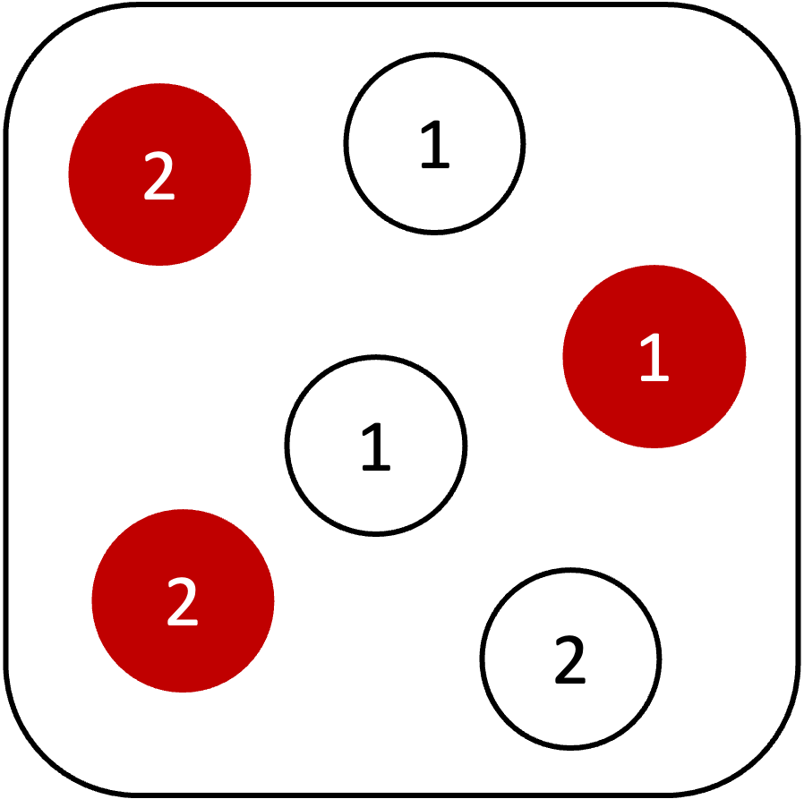
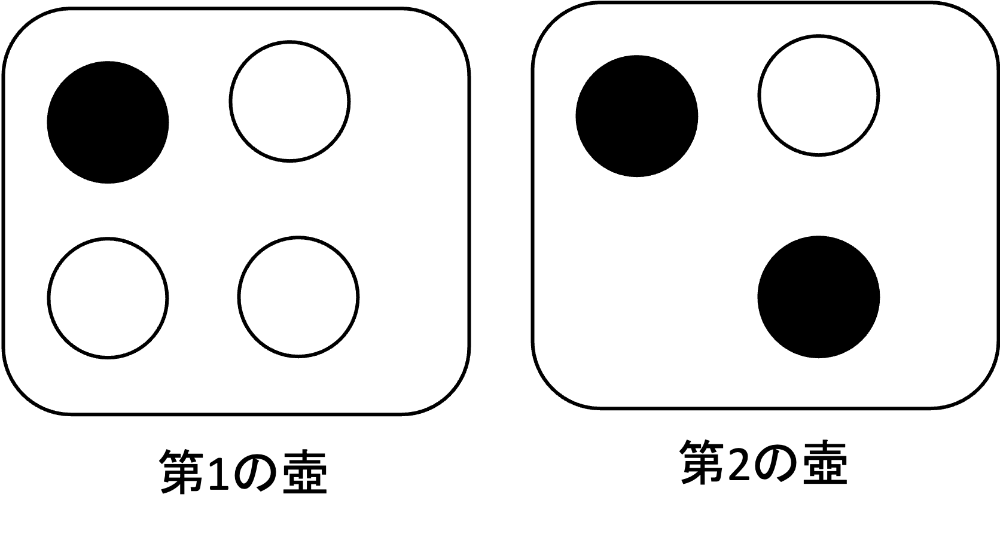

## 統計モデリング {#統計モデリング}

[GPA の重回帰分析](block:reg-gpa)では線形の重回帰を利用して, ある程度正確な説明/予測が可能となりました.
しかし, これが最善のモデルであるとは限りません.
また, 線形回帰でうまく表せないからと言って, 関係がないと断定することもできません.
より正確に説明できるより良いモデルが存在する可能性があります.

[GPA の重回帰分析の事例](block:reg-gpa)に即して考えると, 例えば,

::: note

- Scholarship の有無によって, それぞれの傾きが異なるのでは?

奨学金をもらっている人のほうがそもそも勉強時間あたりの GPA の伸び率が高いなど, 層ごとに異なるパラメータを持つ可能性があります.

- 残差の分布が正規分布ではないのでは?

重回帰分析では残差が正規分布であるという仮定のもと分析を行っていますが, そのような検証は行われていません.

:::

基本的にはデータを特定のモデルで表現する場合には, グラフや特徴量などから考えられる幾つかの可能性を考慮・比較検討し, 最善のモデルを選択することが必要になります.
このような行為をモデル選択/統計モデリングといいます.

このような, 重回帰分析では扱えないモデリング技法として, ベイズ統計学に基づいた[一般化線形モデル](block:bayes-modeling#一般化線形モデル-glm)について学習してみましょう.

# []{#基礎知識-ベイズ統計学概要}基礎知識 ベイズ統計学概要 {#bayesian-basics}

統計的仮説検定や回帰分析は無限回試行を行った際に収束する相対度数 (**客観確率**) を確率の定義とする**頻度主義**に基づいた統計的手法です (詳細は「統計学入門 (データ活用の統計学)」などに譲ります). そのような前提にたった統計学を**伝統的統計学**とも呼びます.

一方で, 2000 年代初頭から, 計算機の性能向上と, MCMC などのアルゴリズムの開発によって, 分析者の情報, 知識, 経験などによる主観によって定められる**主観確率**に基づく確率的定義 (**ベイズ主義**) を前提とした手法が用いられるようになりました.

## ベイズの定理 {#ベイズの定理}

まずは, ベイズ統計学の中核となる**ベイズ確率 (逆確率)**, **ベイズの定理**などの基礎概念の概要を把握しましょう.

::: warn

ここでは, 最低限の記法の意味などについて概要を解説します.
基本的な確率計算や定義に関しては「統計学入門」, 「データ活用の統計学」などを,
ベイズやアルゴリズムの詳細に関しては「データ活用の統計学実践」などの講義を受講してください.

:::

ベイズ確率やベイズの定理は, 1740 年代に数学好きの牧師であったトーマス・ベイズによってまとめられました. ベイズは, 神学への興味から, 「世界が原初神によって作られたこと」を「現在の事象」によって証明できるか, という問題に関心を寄せていました. ベイズはこのような問題を解くために, 仮の確率を今現在の情報によって更新し, 過去の出来事を推測するというアイデア (逆確率) をまとめました.

しかし, ベイズ自身はこれを発表せず, 1763 年にリチャード・プライスによってベイズの遺稿が発表されたことで再注目されました (このことによって近年では, ベイズの定理が**ベイズ・プライスの定理**と呼ばれることもあります).

古典的確率の定立に貢献したラプラスも同様の観点に注目した時期があり, ベイズの定理から確率的な推論を実施する方法などがまとめられましたが, 当時の計算・データ環境などからそれ以上深められることはなく, 古典的確率に則った頻度主義や伝統的統計学が発展していきます.

(cf. シャロン・バーチュ マグレイン (著), 異端の統計学 ベイズ, 草思社, 2013)

それでは, 逆確率やベイズの定理がどのようなものかを見ていきましょう.

### 条件付き確率 {#条件付き確率}

事象 A の下での事象 B の条件付き確率

$$P(B|A) = \frac{P(B \cap A)}{P(A)}$$

 を変形した

 $$P(B \cap A) = P(A) P(B | A) $$

を乗法定理と呼びます.

このとき 積事象は対称 ($A \cap B = B \cap A$) なので,

 $$P(B \cap A) = P(A \cap B) = P(B) P(A | B)  $$

も成り立ちます.

### ベイズの定理 {#ベイズの定理-1}

$A$ を得られた結果, $H_1,H_2,...,H_k$ を原因としたとき, 事象 A の下での事象 $H_i$ の条件付き確率は,

$$ P(H_i | A) = \frac{P(H_i \cap A)}{P(A)}$$

となります.

ただし, ここで $H_i$ は互いに排反で, $$ \bigcup_{i=1} H_i = \Omega $$ かつ $$ \sum_{i=1} P(H_i) =1 $$

このとき, 乗法定理から

$$ P(H_i \cap A) = P(H_i)P(A | H_i)$$

が求まります. これを代入して,

$$ P(H_i | A) = \frac{P(H_i)P(A | H_i)}{P(A)} $$

となり, これをベイズの定理といいます.

また,

$$ P(A) = \sum_{i=1}^{k} P(A \cap H_i) = \sum_{i=1}^{k} P(H_i)P(A|H_i) $$

であるから,

$$ P(H_i |A) = \frac{P(H_i)P(A|H_i)}{\sum_{i=1}^{k} P(H_i)P(A|H_i) }$$

と表す場合もあります.

このとき, $P(H_i)$ を (A が起こる) **事前確率**, $P(H_i|A)$ を (A が起こる) **事後確率**といいます. ベイズ統計学ではしばしば事前確率に**主観確率**が用いられ, これを基礎とする統計的方法を**ベイズ統計学**といいます.

::: note

- 客観確率

頻度説では, 事象 $A$ の起こる確率 $P(A)$ を生起回数の相対頻度で求めています. これは誰が計算しても同一の客観的な値といえます.

- 主観確率

研究者が主観的にある確率を与えて分析を行います. この場合確率は, 研究者の経験, 情報, 知識によって異なる値が用いられます.
当然, 主観確率によって結果は異なります. ただし, 後に見るように多量のデータによって主観性を減らせます.

- 事前確率と事後確率の意味

**事前確率 $P(H_i)$** は, データ $A$ が観測される**前**の, 仮説 $H_i$ に対する (主観的な) 確信度を表します. つまり, データを観測する前に, どの仮説が真である可能性が高いかを表す確率です.

**事後確率 $P(H_i|A)$** は, データ $A$ が観測された**後**の, 仮説 $H_i$ に対する確信度を表します. つまり, データ $A$ が得られたという情報を踏まえた上で, どの仮説が真である可能性が高いかを表す確率です.

:::

ベイズの定理は, 事前確率とデータから事後確率を計算する方法を提供します. この過程では, データが得られることで, 仮説に対する確信度が更新されます. 例えば, 事前確率が低かった仮説でも, データがその仮説を支持するものであれば, 事後確率は高くなります. 逆に, 事前確率が高かった仮説でも, データがその仮説と矛盾するものであれば, 事後確率は低くなります.

条件付き確率の範囲では, 「原因から結果の確率を計算」しますが, ベイズの定理では結果から原因を考えています.

### 条件付き確率 {#条件付き確率-1}

事象 A が起こったと分かっている場合に事象 B の起こる確率

$$ P(B|A) = \frac{P(A \cap B)}{P(A)}$$

例: 選ばれた壺から出る玉の確率を計算

壺に白, 赤それぞれ 3 つの玉が入っています. 白玉には 1,1,2 と数字, 赤玉には 1,2,2 と数字が書かれています.
次に出る玉が白であることがわかっている場合に 1 の玉がでる確率は?

$$
P(1 | 白) = \frac{P(白 \cap 1)}{P(白)} = \frac{2 / 6}{ 1/ 2} = \frac{2}{3}
$$

𝑃(玉の色|選んだ壺) であり, 𝑃(結果|原因) の計算

### ベイズ確率 {#ベイズ確率}

事象 A が起こったと分かっている場合に, 原因 $H_i$ が起きている確率

$$ P(H_i | A) = \frac{P(H_i)P(A | H_i)}{P(A)} $$

例: 出た玉から壺が選ばれている確率を計算

2 つの壺があり,

- 第 1 の壺には白玉が 3 個, 黒玉が 1 個

- 第 2 の壺には白玉が 1 個, 黒玉が 2 個

- $𝐻_1$: 第 1 の壺から取り出す

- $𝐻_2$: 第 2 の壺から取り出す

- $A$: 白玉が出たという事象

とすると, いずれかの壺から玉を 1 個取り出したところ白玉でした. どちらの壺から取り出した確率が高いでしょうか.

まず, どちらの壺から取り出すかは**五分五分**であると仮定します. ここでこの仮定が完全に分析者の主観に基づくのであれば**主観確率**であり, 何らかの実験等によって確率 0.5 であると確かめられている場合には**客観確率**とみなされます.

$$P(H_1) = P(H_2) = \frac{1}{2}$$

$$P(A|H_1) = \frac{3}{4}, \quad P(A|H_2) = \frac{1}{3}$$

であるから,

$$P(H_1|A) = \frac{\frac{1}{2} \cdot \frac{3}{4}}{\frac{1}{2} \cdot \frac{3}{4} + \frac{1}{2} \cdot \frac{1}{3}} = \frac{9}{13}$$

$$P(H_2|A) = \frac{\frac{1}{2} \cdot \frac{1}{3}}{\frac{1}{2} \cdot \frac{3}{4} + \frac{1}{2} \cdot \frac{1}{3}} = \frac{4}{13}$$

この「$H_1$ の壺が選ばれている」という結果は, 壺が選ばれる確率が等しいという主観確率が正しければ正しいと言えます.

この事例で計算されているのは 𝑃(選んだ壺|玉の色) であり, 𝑃(原因|結果) という計算をしていることになります.

このように事例を見てみると, 主観確率を利用した計算は, 主観確率の正しさに依存しているためあまり実用性があるようには思えません.
そこで重要になってくるのが, **ベイズ更新**という概念です.

## ベイズ更新 {#ベイズ更新}

### 独立性 {#独立性}

事象 $A$ の起こる確率が他の事象 $B$ に影響されない場合, 事象 $A$ と事象 $B$ は**独立である**といいます.

このとき

$$P(A) = P(A|B)$$

が成り立ちます. 乗法定理 $P(A \cap B) = P(B)P(A|B)$ より,

$$P(A \cap B) = P(A)P(B)$$

が成り立ちます.

**例:** サイコロを 2 回投げて連続で 1 の目が出る確率を考えます.

- 事象 $A$: 1 回目 1 が出る
- 事象 $B$: 2 回目 1 が出る

$$P(A \cap B) = \frac{1}{36}, \quad P(A) \cdot P(B) = \frac{1}{6} \cdot \frac{1}{6} = \frac{1}{36}$$

なので, 事象 $A$ と $B$ は独立といえます.

ベイズの目的は, 複数のデータを利用して事後確率の推定を更新していくことにあります.

### 複数の事象からなる条件付き確率 {#複数の事象からなる条件付き確率}

複数の事象 $A, B, C$ がある場合の条件付き確率は以下のように表されます.

$$P(B \cap C | A) = \frac{P(A \cap B \cap C)}{P(A)}$$

この式は, 乗法定理 (積の法則) により以下のように書き換えられます.

$$\Leftrightarrow P(A \cap B \cap C) = P(B \cap C | A)P(A)$$

同様に, $A$ が $B \cap C$ の条件下で起こる確率は以下のとおりです.

$$P(A | B \cap C) = \frac{P(A \cap B \cap C)}{P(B \cap C)}$$

これも積の法則として以下のように書き換えられます.

$$\Leftrightarrow P(A \cap B \cap C) = P(A | B \cap C)P(B \cap C)$$

これらの式を代入して整理すると, 以下の関係が得られます.

$$P(A | B \cap C) = \frac{P(B \cap C | A)P(A)}{P(B \cap C)}$$

### ベイズ更新の適用 {#ベイズ更新の適用}

原因 $H$ と, 現在の状況 $B, C$ があるとき, 事後確率 $P(H | B \cap C)$ はベイズの定理により以下のように計算されます.

$$P(H | B \cap C) = \frac{P(B \cap C | H)P(H)}{P(B \cap C)}$$

もし事象 $B$ と $C$ が $H$ のもとで条件付き独立であり, さらに $B$ と $C$ が独立でもあれば, 条件付き確率 $P(B \cap C | H)$ は $P(B | H)P(C | H)$ となり, 分母の $P(B \cap C)$ は $P(B)P(C)$ となります. 単に $B$ と $C$ が独立というだけでは, $H$ のもとでの分解 $P(B \cap C | H)=P(B | H)P(C | H)$ は成り立たないことに注意してください. さらに, $P(H | C) = \frac{P(C | H)P(H)}{P(C)}$ の関係を利用すると, 上記の式は以下のように変形できます.

$$P(H | B \cap C) = \frac{P(B | H)P(C | H)P(H)}{P(B)P(C)} = \frac{P(B | H)P(H | C)}{P(B)}$$

ここで, 情報 $C$ によって既に求められた事後確率 $P(H | C)$ を新しい事前確率 $P(H)^*$ とすると, ベイズ更新の式はより簡潔に表現できます.

$$P(H | B \cap C) = \frac{P(B | H)P(H)^*}{P(B)}$$

この方法により, 情報が与えられるたびに事後確率を計算し, それを次のデータに対する事前分布として利用することで, 分布の推定を逐次的に更新していくことができます.

### ベイズ統計学の性質 {#ベイズ統計学の性質}

事前確率に関する情報がなく, $P(H)$ が完全に主観的に決められたとしても, データ ($A,B,C, \dots$) が大量にある場合は,

$$P(H|A \cap B \cap C \cap D \dots) = \frac{P(A \cap B \cap C \cap D \dots|H) P(H)}{P(A \cap B \cap C \cap D \dots)}$$

以下のように段階的に更新を実施することができます.

まず, データ $A$ が得られたとき:

$$P(H|A) = \frac{P(A|H)P(H)}{P(A)}$$

次に, データ $B$ が得られたとき, 前の事後確率 $P(H|A) = \frac{P(A|H)P(H)}{P(A)} = P(H)^*$ を新しい事前確率として利用:

$$P(H|A \cap B) = \frac{P(B|H)P(H|A)}{P(B)} = \frac{P(B|H)P(H)^*}{P(B)} $$

さらに, データ $C$ が得られたとき, 前の事後確率 $P(H|A \cap B) = P(H)^{**}$ を新しい事前確率として利用:

$$P(H|A \cap B \cap C) = \frac{P(C|H)P(H)^{**}}{P(C)} $$

このように, データ $D, E, \dots$ が得られるたびに, 前の事後確率を事前確率として利用して更新を続けていきます. データ ($A,B,C,D, \dots$) を大量に集めれば, 最初に設定した事前確率 $P(H)$ の影響が少なくなり, 事後確率 $P(H|A \cap B \cap C \cap D \dots)$ が安定することが知られています. 

::: note

この性質は, **ベイズ的一致性 (Bayesian consistency)** と呼ばれます. 具体的には以下のような性質が成り立ちます:

- **一致性**: データが増えるにつれて, 事後確率分布は真のパラメータ値に収束します. つまり, サンプルサイズが無限大に近づくと, 事後確率は真の値に集中していきます.

- **事後確率の安定性**: 異なる事前分布から出発しても, データが十分に多ければ, 最終的な事後分布はほぼ同じ結果になります. これは, データが増えるにつれて, 尤度関数 $P(A \cap B \cap C \cap D \dots|H)$ の影響が事前確率 $P(H)$ の影響を上回るためです.

- **事前確率の影響の減少**: データが少ないときは事前確率 $P(H)$ の選択が結果に大きく影響しますが, データが増えるにつれて, その影響は相対的に小さくなります. 最終的には, データの情報が支配的になり, 事前確率の選択が結果に与える影響は限定的になります.

:::

しかし, このような更新には大量のデータが必要であることに加えて, データごとに分布を推定し直すには膨大な計算が必要となるため, ラプラスらの時代には現実的ではありませんでした.

現代では, 情報通信技術の発展によって大量のデータと, 大量の計算が可能になりました. また, 計算のためのアルゴリズム (マルコフ連鎖モンテカルロ法など) が発明されたことで, ベイズ更新に基づく推定が現実的な選択肢となりベイズ統計学が利用されるようになっています.

## マルコフ連鎖モンテカルロ法 {#マルコフ連鎖モンテカルロ法}

### 尤度 (Likelihood) {#尤度-likelihood}

尤度とは, 観測されたデータが得られる確からしさを, モデルのパラメータの関数として見たものです. データを固定してパラメータを動かすので, データから計算する統計量とは異なり, パラメータの関数になります.

- $\theta$ を母数とする確率分布から観測データ $y_i$ が発生した場合, その確率は $P(y_i|\theta)$ と表されます.
- 尤度 $L(\theta|Y)$ は, 観測されたデータ $Y = \{y_1, y_2, \dots, y_n\}$ が与えられたときの, 特定のパラメータ $\theta$ の「もっともらしさ」を示す関数で, 以下のように定義されます.

$$L(\theta|Y) = \prod_{i} P(y_i|\theta)$$

尤度はそのままでは計算しにくい場合が多いため, 対数化した対数尤度を用いることが一般的です.

$$\log L(\theta|Y) = \sum_{i} \log P(y_i|\theta)$$

前段で説明したベイズ更新と尤度には密接な関係があります.

ベイズの定理は以下のように表されました:

$$P(H|A) = \frac{P(A|H)P(H)}{P(A)}$$

この式において, $P(A|H)$ は「仮説 $H$ が真であるときにデータ $A$ が観測される確率」であり, これは**尤度関数**に対応します.

一般的な尤度の説明ではパラメータを $\theta$ で表しましたが, ベイズ統計学では仮説 $H$ をパラメータとみなすことができます. 複数のデータ $Y = \{y_1, y_2, \dots, y_n\}$ が得られた場合, ベイズの定理は以下のようになります:

$$P(H|Y) = \frac{P(Y|H)P(H)}{P(Y)} = \frac{L(H|Y)P(H)}{P(Y)}$$

ここで, $P(Y|H) = \prod_{i} P(y_i|H)$ は尤度関数 $L(H|Y) = \prod_{i} P(y_i|H)$ と一致します. したがって, ベイズの定理は尤度関数を用いて以下のように表現できます:

$$P(H|Y) \propto L(H|Y)P(H)$$

つまり, 事後確率は「尤度×事前確率」に比例します. この関係から以下のことがわかります:

- 尤度 $L(H|Y)$ が大きいほど, その仮説 $H$ の事後確率 $P(H|Y)$ も大きくなります.
- データが増えるにつれて, 尤度関数の影響が事前確率の影響を上回り, 事後確率が安定していきます.
- ベイズ更新では, 新しいデータが得られるたびに尤度関数を計算し, それと事前確率を組み合わせて事後確率を更新していきます.

### 最尤推定 (Maximum Likelihood Estimation) {#最尤推定-maximum-likelihood-estimation}

この対数尤度を最大にするようなパラメータの推定量 $\hat{\theta}$ を推定することを**最尤推定**といいます.

$\hat{\theta}$ は数理的に求めることが可能な場合もありますが, モデルが複雑な場合は困難なので, ニュートン法などの数値最適化で尤度が最大になる値を探すことが多くなります. 次に説明するマルコフ連鎖モンテカルロ法 (MCMC) は, これとは目的の異なる方法です.

### マルコフ連鎖モンテカルロ法 MCMC (Markov chain Monte Carlo Method) {#マルコフ連鎖モンテカルロ法-mcmc-markov-chain-monte-carlo-method}

前段で説明したベイズ統計学において, 事後確率 $P(H|Y) \propto L(H|Y)P(H)$ を計算するには, 分母の正規化定数 $P(Y)$ を求める必要があります. しかし, モデルが複雑な場合やパラメータが多変数の場合, この正規化定数の計算は解析的に困難です.

このような場合に用いられるのが, 計算機による繰り返し計算で少しずつパラメータの値を変化させ, 事後分布に従うパラメータの値 (サンプル) を大量に集める方法である**マルコフ連鎖モンテカルロ法 (MCMC)** です. 集めたサンプルのヒストグラムが事後分布の近似になるので, 正規化定数 $P(Y)$ を計算せずに, 事後分布の平均や区間を求められます. 最尤推定が尤度を最大にする 1 つの値を探すのに対し, MCMC は分布全体を描き出す点が異なります.

::: note

- MCMC の基本的な仕組み

**メトロポリス法**は, MCMC の一種です.

1. 事後分布で確率または密度が正となる値を, パラメータ $\theta$ の初期値に選びます.

2. 今の値 $\theta$ に, ゼロを中心とする対称な分布から選んだ小さな変化量を足して, 候補 $\theta'$ を作ります. 例えば, $\theta$ が 1 変数なら, 同じ幅だけ右に動く場合と左に動く場合が同じ確率になります.

3. 候補と今の値のそれぞれで, 尤度と事前確率 (連続の場合は事前密度) の積を計算します. 候補での積 $L(\theta'|Y)P(\theta')$ を今の値での積 $L(\theta|Y)P(\theta)$ で割ります. この比では共通の正規化定数 $P(Y)$ が打ち消し合うため, $P(Y)$ の計算は不要です.

4. 比が 1 以上なら必ず候補に移り, 1 未満ならその比を確率として候補に移ります. 移った場合は候補を記録し, 移らなかった場合は今の値をもう 1 つのサンプルとして記録します.

5. 手順 2 から 4 を繰り返します. 初期値の影響を抑えるため, 最初の **バーンイン期間**に得たサンプルを捨てます. 比に応じて確率や密度が低い候補にも移るため, 事後確率の小さい範囲からもサンプルを得られます. 連鎖が事後分布に収束すれば, サンプルを増やすにつれて, ある範囲に入るサンプルの割合はその範囲の事後確率に近づきます.

:::

MCMC により, ベイズ統計学における複雑な事後分布の推定を, 計算機上で効率的に行えるようになりました.

