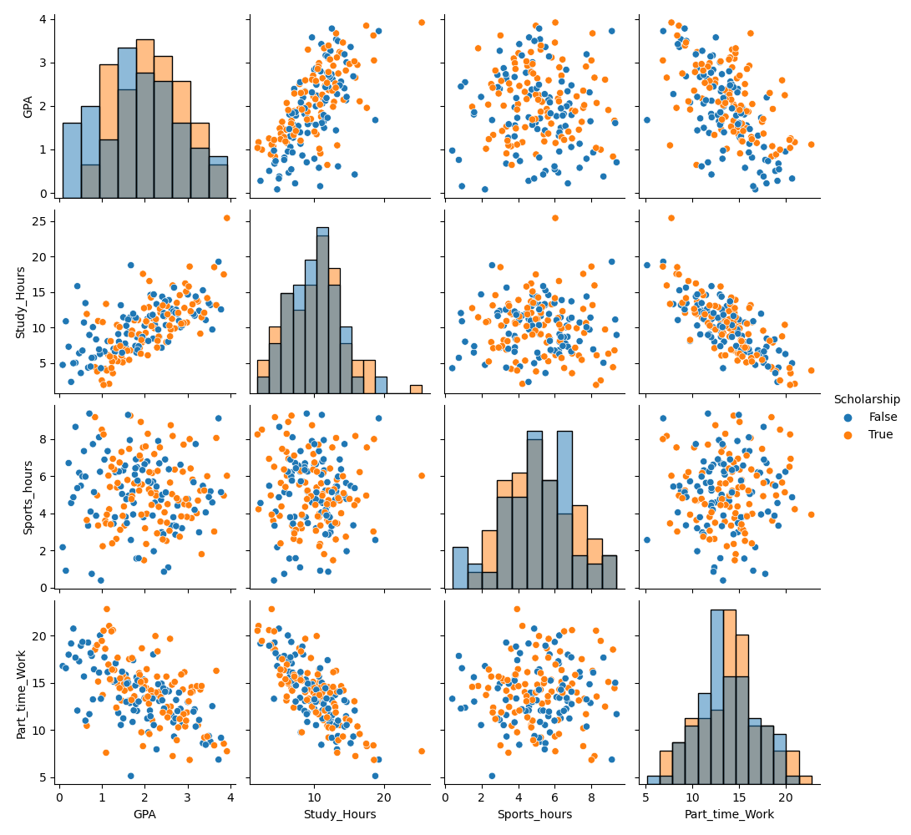
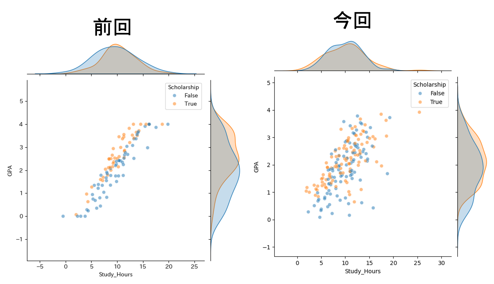
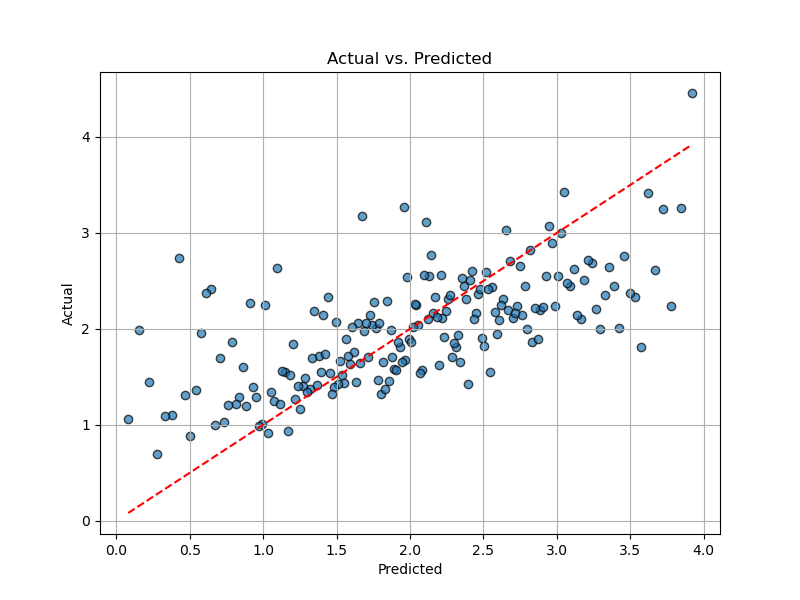
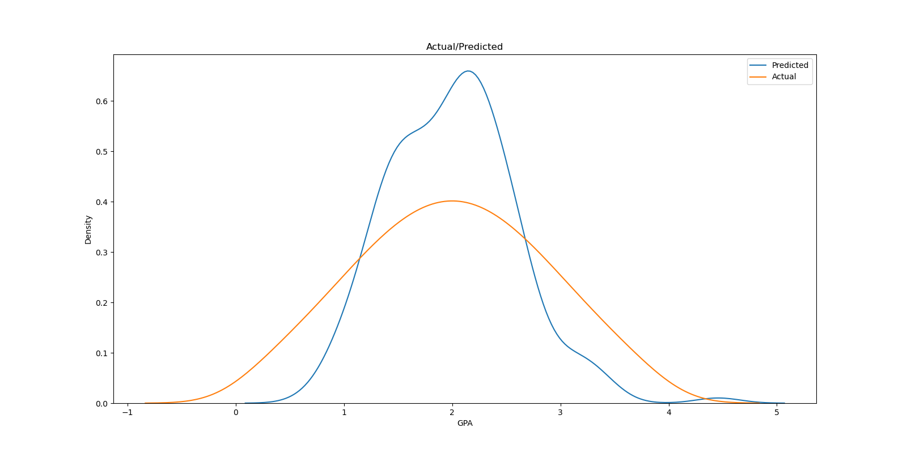
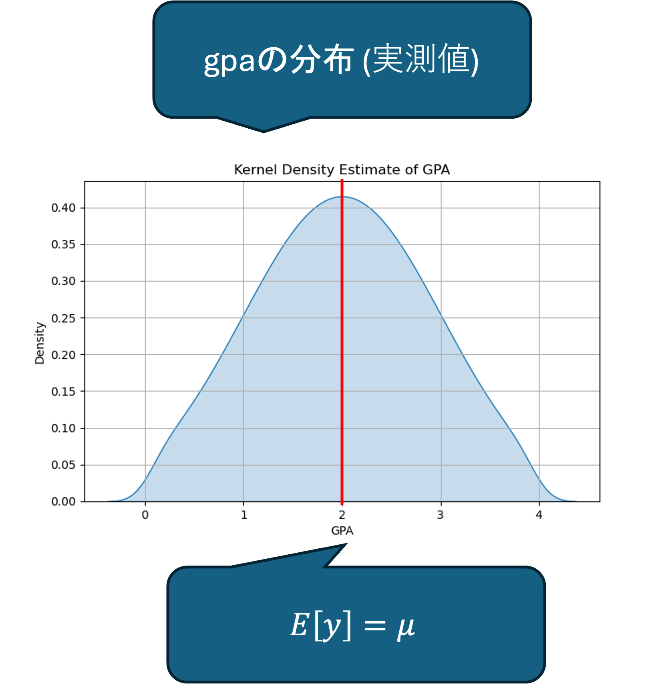
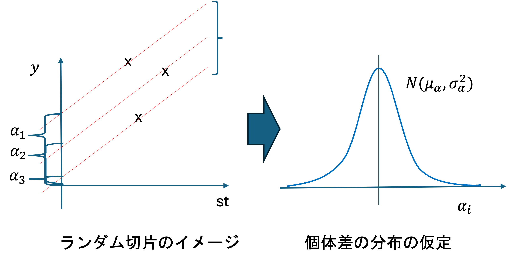
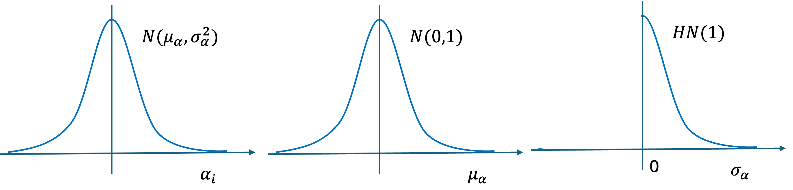
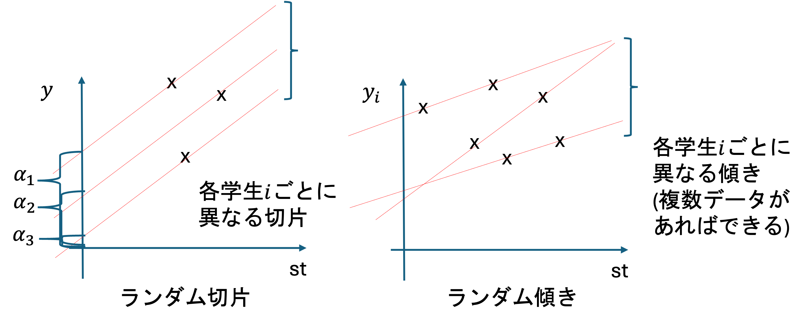
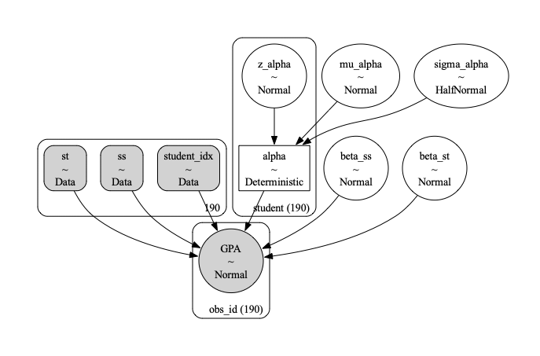

## ベイズ統計学による統計モデリング実践 {#ベイズ統計学による統計モデリング実践}

それでは, 実際にベイズ統計学に基づいた統計モデリングを実施してみましょう.
[GPA の重回帰分析](block:reg-gpa)で使ったものとよく似た[データ (hierarchical_regression.csv)](https://github.com/yakagika/yakagika.github.io/blob/main/slds_data/ch12/hierarchical_regression.csv) を事例として利用します.

| GPA | Scholarship | Study_Hours | Sports_hours | Part_time_Work | StudentID |
|-----|-------------|-------------|--------------|----------------|-----------|
| 1.348928 | True | 10.348188 | 5.398119 | 14.944201 | 0 |
| 1.968662 | False | 8.803971 | 3.799566 | 15.340118 | 1 |
| 2.246881 | True | 10.367043 | 5.139604 | 19.937536 | 2 |
| 1.167275 | True | 2.049724 | 4.229373 | 21.009315 | 3 |
| 3.295929 | True | 9.121312 | 5.227035 | 14.271377 | 4 |
| ... | ... | ... | ... | ... | ... |
| 0.974230 | False | 4.256551 | 0.396158 | 13.299289 | 185 |
| 2.208293 | False | 14.652655 | 1.969618 | 10.523032 | 186 |
| 0.786660 | False | 10.040932 | 7.733749 | 13.232559 | 187 |
| 2.068987 | True | 6.073965 | 8.289935 | 13.540597 | 188 |
| 2.531604 | True | 11.848414 | 4.501928 | 11.335318 | 189 |

各自でダウンロードして利用してください.

# []{#重回帰での結果確認}重回帰での結果確認 {#linear-regression-fit}

まずは, データの読み込みを行います. 必要なライブラリは各自で `pip install` してください.

~~~ py
import matplotlib.pyplot as plt
import numpy as np
import pandas as pd
import matplotlib.pyplot as plt
import seaborn as sns
import statsmodels.api as sm
from sklearn.metrics import mean_squared_error, r2_score, mean_absolute_error

df = pd.read_csv('hierarchical_regression.csv'
                ,dtype={'GPA': float
                       ,'Scholarship': bool
                       ,'Study_Hours': float
                       ,'Sports_hours': float
                       ,'Part_time_Work': float
                       ,'StudentID':int})

print(df)

"""
          GPA  Scholarship  Study_Hours  Sports_hours  Part_time_Work  StudentID
0    1.348928         True    10.348188      5.398119       14.944201          0
1    1.968662        False     8.803971      3.799566       15.340118          1
2    2.246881         True    10.367043      5.139604       19.937536          2
3    1.167275         True     2.049724      4.229373       21.009315          3
4    3.295929         True     9.121312      5.227035       14.271377          4
..        ...          ...          ...           ...             ...        ...
185  0.974230        False     4.256551      0.396158       13.299289        185
186  2.208293        False    14.652655      1.969618       10.523032        186
187  0.786660        False    10.040932      7.733749       13.232559        187
188  2.068987         True     6.073965      8.289935       13.540597        188
189  2.531604         True    11.848414      4.501928       11.335318        189
"""

~~~

まずはデータを可視化してみます.

~~~ py

# ペアプロット
sns.pairplot(df
            ,vars=["GPA", "Study_Hours", "Sports_hours", "Part_time_Work"]
            ,hue="Scholarship"
            ,diag_kind="hist")
plt.suptitle("Pairplot with Scholarship", y=1.02)
plt.savefig('PairplotwithScholarship.png')
plt.close()

#joinplotで男女別に密度プロットを表示
fig = sns.jointplot(df
               ,x ="Study_Hours"
               ,y ="GPA"
               ,hue='Scholarship'
               ,joint_kws = dict(alpha=0.5))
plt.savefig('kde.png')
plt.close()
~~~

[重回帰分析で使ったデータ](block:reg-gpa#gpa-stratified)と概ね似た傾向 (奨学金ありが少し高い, 勉強時間と GPA に相関, 勉強時間とバイト時間に負の相関など) が確認できます.
ただし, [重回帰分析で使ったデータ](block:reg-gpa#gpa-stratified)と比べるとデータ全体のばらつきが大きいことが分かります.

[GPA の重回帰分析](block:reg-gpa)と同様の手法で, 線形重回帰の実施と結果の確認を行います.

~~~ py

# 数量化
df = pd.get_dummies(df, columns=['Scholarship'], dtype='int')

#標準化
from sklearn.preprocessing import StandardScaler
scaler = StandardScaler()
df[['Scholarship_True'
   ,'Study_Hours'
   ,'Part_time_Work'
   ,'Sports_hours']] = scaler.fit_transform(df[['Scholarship_True'
                                               ,'Study_Hours'
                                               ,'Part_time_Work'
                                               ,'Sports_hours']])

#線形回帰
# 説明変数(X)と目的変数(y)に分割
X = df[['Scholarship_True', 'Study_Hours']]
y = df['GPA']

# 切片(定数項)を追加
X = sm.add_constant(X)
lm = sm.OLS(y, X).fit()
print("\n[通常の線形回帰の結果]\n")
print(lm.summary())
lm_preds = lm.predict(X)

plt.figure(figsize=(8, 6))
plt.scatter(df['GPA'], lm_preds, alpha=0.7, edgecolors="k")
plt.xlabel("Predicted")
plt.ylabel("Actual")
plt.title("Actual vs. Predicted")
plt.plot([df['GPA'].min(), df['GPA'].max()], [df['GPA'].min(), df['GPA'].max()], color="red", linestyle="--")  # 完全一致のライン
plt.grid()
plt.savefig('lm.png')
plt.close()

plt.figure(figsize=(16,8))
sns.kdeplot(lm_preds, label = 'Predicted')
sns.kdeplot(df['GPA'], label = 'Actual')
plt.title('Actual/Predicted')
plt.xlabel('GPA')
plt.ylabel('Density')
plt.legend()
plt.savefig('lm_kde.png')
plt.close()

"""
                            OLS Regression Results                            
==============================================================================
Dep. Variable:                    GPA   R-squared:                       0.444
Model:                            OLS   Adj. R-squared:                  0.438
Method:                 Least Squares   F-statistic:                     74.76
Date:                Tue, 04 Nov 2025   Prob (F-statistic):           1.38e-24
Time:                        16:50:17   Log-Likelihood:                -187.55
No. Observations:                 190   AIC:                             381.1
Df Residuals:                     187   BIC:                             390.8
Df Model:                           2                                         
Covariance Type:            nonrobust                                         
====================================================================================
                       coef    std err          t      P>|t|      [0.025      0.975]
------------------------------------------------------------------------------------
const                2.0000      0.047     42.122      0.000       1.906       2.094
Scholarship_True     0.1385      0.047      2.917      0.004       0.045       0.232
Study_Hours          0.5620      0.047     11.835      0.000       0.468       0.656
==============================================================================
Omnibus:                       11.718   Durbin-Watson:                   1.974
Prob(Omnibus):                  0.003   Jarque-Bera (JB):               14.133
Skew:                          -0.457   Prob(JB):                     0.000853
Kurtosis:                       3.975   Cond. No.                         1.01
==============================================================================
"""
~~~

全般的に有意ではあるものの, 精度がそれほど高くありません.

グラフを見てみると, 元のデータは予測値に対して分散が大きくデータの分散を予測モデルが説明しきれていないことが分かります.
決定係数 $R^2$ を確認しても, データに含まれている変数では全体の変動のうち 44% ほどしか説明できていません.

# []{#過分散と個体差}過分散と個体差 {#overdispersion}

このように, 観察データの分散が, モデルの予測から逸脱しており, モデルではデータの分散が説明できていない状態を**過分散**といいます.

モデルの説明力を上げるためには, このようなモデルによって説明できていないばらつきを説明する拡張が必要となります.

ここでは, 「データ (の観測対象)=学生」なので, 「ばらつき=学生差」と仮定してみます.
例えば, そもそも過去の学習経験, 勉強環境などにより, ベースとなる学力が学生それぞれで異なるなど, 学生差によるばらつきを表現するために, 線形モデルを拡張した**一般化線形モデル**を土台とし, そこに学生ごとのランダム効果を加えた階層モデルを構築してみましょう.

# []{#一般化線形モデル-glm}一般化線形モデル (GLM) {#generalized-linear-models}

**一般化線形モデル (Generalized Linear Model, GLM)** は, 線形回帰分析を一般化した統計モデルです. 線形回帰分析では以下の式における

$$
Y_i = \beta_0 + \beta_1 X_i + \epsilon_i \quad (i=1,2,\dots,n)
$$

**誤差項** $\epsilon_i$ のみが**正規分布**に従うと仮定して分析を実施していました.

$$
\epsilon_i \sim N(0, \sigma^2)
$$

これに対し, 一般化線形モデルは以下の 3 つの要素から構成されます:

1. **確率分布**: 目的変数 $y_i$ が従う確率分布 (正規分布, ポアソン分布, 二項分布など)
2. **線形予測子**: 説明変数の線形結合 $\eta_i = \beta_0 + \beta_1 X_{1i} + \beta_2 X_{2i} + \cdots$
3. **リンク関数**: 目的変数の期待値 $E[y_i]$ と線形予測子 $\eta_i$ を結び付ける関数 $g(E[y_i]) = \eta_i$

線形回帰は, 一般化線形モデルの特殊ケース (正規分布 + 恒等リンク関数) として捉えることができます. 一般化線形モデルにより, 正規分布以外の分布や, 非線形な関係もモデル化できるようになります.

推定する対象は, モデルの母数 $\theta$ です.
まずデータの分布を観察し, その分布を再現するモデルを組み立てます.

そこで, 今回の目的変数である GPA の分布を確認してみましょう.

~~~ py
plt.figure(figsize=(8, 5))
sns.kdeplot(df["GPA"], fill=True, bw_adjust=0.5)
plt.title("Kernel Density Estimate of GPA")
plt.xlabel("GPA")
plt.ylabel("Density")
plt.grid(True)
plt.savefig('kde-gpa.png')
plt.close()
~~~

カーネル密度プロットの結果から, 今回のデータは正規分布していると仮定して問題なさそうです.

$$ y_i \sim N(\mu_i, \sigma^2) $$

ここで, 今回は正規分布の母数である平均 $\mu$ を推定の目的とします.

::: warn 

モデルの設計では分散 $\sigma$ を推定の目的とすることも可能ですが, 単純化のために固定とします.
今回は説明用の単純なモデルですが, 必要に応じてより複雑なモデルを資料に追加していきます.

:::

このとき, 説明変数として GPA に影響するものを以下のように仮定します.

- $S_t$ (Study Hours): 勉強時間
- $S_s$ (Scholarship): 奨学金
- $\alpha_i$: 学生個別のもともとの学力 (ランダム切片)

これらの変数を用いて, $\mu$ を表す式を以下のように立てます.

$$\mu_i = \alpha_i + \beta_{st} \cdot S_t + \beta_{ss} \cdot S_s$$

このような式を, **線形予測子 (linear predictor)** といいます.

::: note

線形予測子は, 説明変数とパラメータの線形結合で構成される式です. 

一般化線形モデル (GLM) では, 線形予測子 $\eta_i$ と目的変数の期待値 $E[y_i]$ をリンク関数 $g(\cdot)$ で結び付けます:

$$g(E[y_i]) = \eta_i = \alpha_i + \beta_{st} \cdot S_t + \beta_{ss} \cdot S_s$$

今回は正規分布を仮定しているため, 恒等リンク関数 (identity link function) $g(x) = x$ を使用します. 恒等リンク関数では,

$$g(E[y_i]) = E[y_i] = \mu_i = \eta_i$$

となり, $\mu_i = E[y_i] = \eta_i$ という関係が成り立ちます. これにより, 線形回帰と同じ形式になります.

他の分布では, 例えば:

- ポアソン分布: 対数リンク関数 $g(E[y_i]) = \log(E[y_i]) = \eta_i$
- 二項分布: ロジットリンク関数 $g(E[y_i]) = \log\left(\frac{E[y_i]}{1-E[y_i]}\right) = \eta_i$ (目的変数が 2 値のときのロジスティック回帰. 例は[回帰分析](block:reg-intro)の[ロジスティック回帰](block:reg-glm#logistic-regression))

などが用いられます.
分布とリンク関数の組の全体像と選び方は, 回帰分析の[一般化線形モデルの全体像](block:reg-glm#glm-family)にまとめています.

今回は線形モデルとの接続のために, 正規分布を仮定していますが, そもそもデータが正規分布では説明できないことが明らかな場合には, 適した分布を選択することでモデルの精度が格段に上がります.

:::

ここで, 解くべき問題は,

$$E[y_i] = \mu_i = \alpha_i + \beta_{st} \cdot S_t + \beta_{ss} \cdot S_s$$

となるような $\alpha_i, \beta_{st}, \beta_{ss}$ を推定することです.

# []{#個体差のモデリング}個体差のモデリング {#modeling-individual-variation}

恒等リンク関数を用いたモデリングでは, 線形回帰と同じ形式の式となります. 一般化線形モデル単体では, 個体ごとの切片 $\alpha_i$ を安定して推定することはできません. 個体差を扱えるのは, 一般化線形モデルに個体ごとのランダム効果を加えた階層モデル (一般化線形混合モデル, GLMM) です. 以下では, その理由と構成を見ていきます.

## 線形回帰での問題 {#線形回帰での問題}

個体差をモデルに取り込もうとする場合, 線形回帰では以下のような問題が発生します:

- **ダミー変数の導入**: 各学生の個別の学力を推定するために, 学生ごとにダミー変数を導入する方法が考えられます.

- **データ数が少ない場合の問題**: 各学生毎にデータ数が少ない場合 (今回は 1 人 1 データ), 各ダミー変数は誤差と等しくなります.

- **過学習の問題**: 結果として, データ = 予測値 ($\hat{y}_i = y_i$) としているのと変わらなくなります. これは推定の意味がなく, **過学習**を起こしている状態です.

## ベイズ推論による解決 {#ベイズ推論による解決}

ベイズ統計学では, この問題を以下のように解決します:

- **階層構造の導入**: 各学生の学力 $\alpha_i$ に対して, 事前分布として正規分布 $\alpha_i \sim N(\mu_{\alpha}, \sigma_{\alpha}^2)$ を設定します. これにより, **階層ベイズモデル (hierarchical Bayesian model)** または**ランダム効果モデル (random effects model)** を構築します.

- **分布の母数を推定**: 推定するのは個別の学力 $\alpha_i$ ではなく, その分布の母数 $(\mu_{\alpha}, \sigma_{\alpha})$ です. これにより, データ数が少なくても, 全体の分布から情報を借用 (**borrowing strength**, 情報の共有) して推定を行うことができます. 各学生のデータが少なくても, 他の学生のデータと組み合わせることで, より安定した推定が可能になります.

- **新しいデータへの対応**: 分布の母数 $(\mu_{\alpha}, \sigma_{\alpha})$ が推定されているため, 新しい学生のデータが得られた場合でも, 推定された分布 $N(\mu_{\alpha}, \sigma_{\alpha}^2)$ に基づいて学力を推定することが可能になります. これにより, 汎化性能の高いモデルを構築できます.

それでは実際に, モデルを構築してみましょう.

## モデルの仮定 {#モデルの仮定}

階層ベイズモデルでは, 仮説に従って以下のように分布を設定します.

- **仮説: 基礎学力は学生によって異なる**
  - 個別に異なる $\alpha_i$

- **仮定: 基礎学力は正規分布に従う**
  - $\alpha_i \sim N(\mu_{\alpha}, \sigma_{\alpha}^2)$
  - これを**事前分布 (prior distribution)** といいます.

- **更にそれぞれの母数の分布を仮定する**
  - $\mu_{\alpha} \sim N(0, 1)$
  - $\sigma_{\alpha} \sim HN(1)$
  - ここで, $HN$ は**半正規分布 (Half-Normal distribution)** を表します.

このように, パラメータの分布のパラメータ (超パラメータ) についても分布を仮定することで, 階層的な構造を持つベイズモデルを構築します. これは**階層事前分布 (hierarchical prior)** と呼ばれます.

## ランダム傾きとランダム切片 {#ランダム傾きとランダム切片}

これまで, 学生の基礎学力の違い (ランダム切片 $\alpha_i$) について考えてきましたが, 他にも個体差として考慮できる要素があります.

- **仮説: 勉強時間による効果は人によって違う**

ただし, 学生個別の個体差 $\alpha_i$ (ランダム切片) のように, 学生個別の勉強時間あたりの GPA の上昇率 $\beta_{st,i} \cdot S_t$ という推定は, 今回のデータではモデル化**できません**.

このような個別の傾きを**ランダム傾き (random slope)** といいます.

### なぜモデル化できないのか? {#なぜモデル化できないのか}

- **学生 1 人につき 1 つしかデータがない**: 今回のデータでは, 各学生について 1 つの観測値しかありません.

- **切片はそれぞれの値から推定できる**: 切片 $\alpha_i$ は, 以下のように各学生のデータから直接推定できます:
  $$\alpha_i = y_i - \beta_{st} \cdot S_t - \beta_{ss} \cdot S_s$$

- **傾きは複数の観測点が必要**: 傾きは「変化の傾向 (勾配)」なので, 推定には複数の観測点が必要です. 傾き $\beta_{st,i}$ を推定するには, 少なくとも 2 点以上のデータが必要で, 以下のように計算されます:
  $$\beta_{st,i} = \frac{y_i - y_j}{S_{t,i} - S_{t,j}}$$

そのため, 1 人 1 データしかない今回のケースでは, 学生ごとのランダム傾きを推定することはできません. ランダム傾きをモデル化するには, 各学生について複数の時点でのデータ (縦断データ) が必要になります.

したがって今回は, 学生個別の学習能力は全体で同一 (固定効果) として扱います. また, 奨学金についても同様に学生ごとの差は無いものとして扱います (ランダム傾きモデルに関しては, 今後学生の需要があれば資料に追加します).

# []{#モデル全体像}モデル全体像 {#hierarchical-model-specification}

これまで説明してきた内容を整理すると, 以下のような階層ベイズモデルになります:

## 推定する分布 {#推定する分布}

$$y_i \sim N(\mu_i, \sigma^2)$$

ここで, $y_i$ は学生 $i$ の GPA です. 誤差の標準偏差 $\sigma$ は, 今回は固定値 $\sigma = 0.3$ として扱います.

## 線形予測子 {#線形予測子}

$$\mu_i = \alpha_i + \beta_{st} \cdot S_t + \beta_{ss} \cdot S_s$$

ここで:

- $S_t$ は勉強時間 (Study Hours)
- $S_s$ は奨学金受給の有無 (Scholarship, 0 または 1)
- $\alpha_i$ は学生 $i$ の基礎学力 (ランダム切片)
- $\beta_{st}$ は勉強時間の効果 (固定効果)
- $\beta_{ss}$ は奨学金の効果 (固定効果)

## 尤度関数 {#尤度関数}

$$p(y | \alpha, \beta_{st}, \beta_{ss}, \sigma) = \prod_{i=1}^{N} N(y_i | \mu_i, \sigma^2)$$

ここで, $\mu_i = \alpha_i + \beta_{st} \cdot S_t + \beta_{ss} \cdot S_s$ です.

## 事前分布 {#事前分布}

### ランダム切片 (階層構造) {#ランダム切片-階層構造}

- $\alpha_i \sim N(\mu_{\alpha}, \sigma_{\alpha}^2)$: 学生個別の基礎学力 (ランダム切片)

  これは非中心パラメータ化により以下のように表現されます:
  
  $$z_{\alpha,i} \sim N(0, 1)$$
  $$\alpha_i = \mu_{\alpha} + \sigma_{\alpha} \cdot z_{\alpha,i}$$

::: note

- 非中心パラメータ化 (non-centered parameterization)

階層ベイズモデルにおいて, ランダム切片 $\alpha_i$ を表現する方法には 2 通りあります:

1. **中心パラメータ化 (centered parameterization)**:
   $$\alpha_i \sim N(\mu_{\alpha}, \sigma_{\alpha}^2)$$
   これは, 直接 $\alpha_i$ を平均 $\mu_{\alpha}$ と標準偏差 $\sigma_{\alpha}$ を持つ正規分布から生成する方法です.

2. **非中心パラメータ化 (non-centered parameterization)**:
   $$z_{\alpha,i} \sim N(0, 1)$$
   $$\alpha_i = \mu_{\alpha} + \sigma_{\alpha} \cdot z_{\alpha,i}$$
   これは, 標準正規分布 $N(0, 1)$ から $z_{\alpha,i}$ を生成し, それを線形変換して $\alpha_i$ を生成する方法です.

数学的には, 両者は同じ分布 $\alpha_i \sim N(\mu_{\alpha}, \sigma_{\alpha}^2)$ を生成しますが, MCMC サンプリングにおける挙動が大きく異なります.

**MCMC サンプリングにおける効果:**

非中心パラメータ化は, 以下の理由から MCMC サンプリングの効率を大幅に向上させます:

1. **パラメータ間の相関の低減**: 中心パラメータ化では, $\alpha_i$ と $(\mu_{\alpha}, \sigma_{\alpha})$ の間に強い相関が生じます. 特に, $\sigma_{\alpha}$ が小さい場合, $\alpha_i$ の値は $\mu_{\alpha}$ に近くなり, パラメータ空間の探索が困難になります. 非中心パラメータ化では, $z_{\alpha,i}$ は標準正規分布から独立に生成されるため, パラメータ間の相関が低減され, 効率的な探索が可能になります.

2. **ファネル形状の問題の回避**: 階層モデルでは, パラメータ空間が「ファネル (funnel)」形状になることがあります. $\sigma_{\alpha}$ が小さい領域では, 許容される $\alpha_i$ の範囲が狭くなり, サンプリングが困難になります. 非中心パラメータ化により, この問題を回避できます.

3. **収束の改善**: パラメータ間の相関が低減されることで, マルコフ連鎖がより速く混合し, 収束が改善されます. 特に, 階層モデルでは, 非中心パラメータ化を使用することで, 発散 (divergence) の発生を大幅に減らすことができます.

4. **ESS (Effective Sample Size) の向上**: パラメータ間の相関が低減されることで, サンプル間の自己相関が減少し, 実質的なサンプルサイズ (ESS) が向上します. これにより, より少ないサンプル数で, より信頼性の高い推定が可能になります.

ただし, すべての場合に非中心パラメータ化が最適というわけではありません. データが十分に多い場合や, $\sigma_{\alpha}$ が大きい場合には, 中心パラメータ化でも問題なく動作することがあります. しかし, 一般的には, 階層モデルでは非中心パラメータ化を使用することが推奨されます.

:::

### 固定効果 {#固定効果}

- $\beta_{st} \sim N(0, 1)$: 勉強時間の効果 (固定効果, 学生間で同じ値)
- $\beta_{ss} \sim N(0, 1)$: 奨学金の効果 (固定効果, 学生間で同じ値)

## 超事前分布 {#超事前分布}

- $\mu_{\alpha} \sim N(0, 1)$: ランダム切片の平均
- $\sigma_{\alpha} \sim HN(1)$: ランダム切片の標準偏差 (半正規分布)

以下は[PyMC によるモデルの実装](block:bayes-pymc#pymc-実装)のコードから生成されるモデル全体像を表す図です. 

このモデルにより, 学生間の基礎学力の個体差を考慮しながら (ランダム切片), 勉強時間と奨学金が GPA に与える影響を固定効果として推定することができます.

