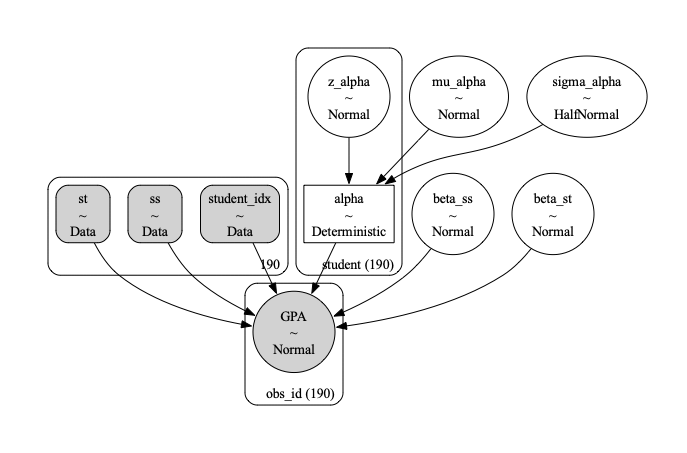
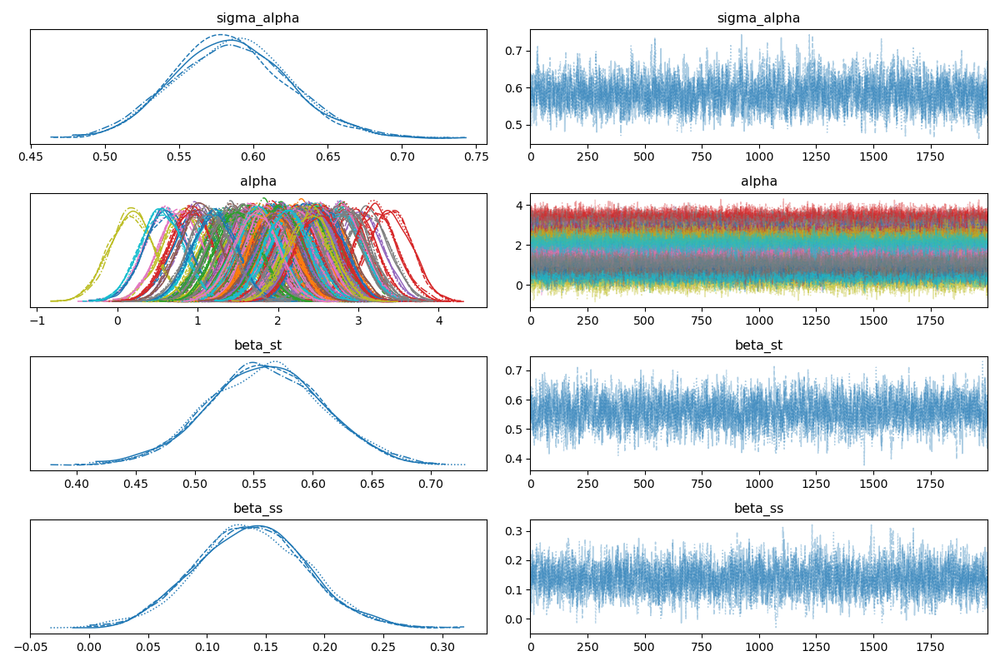
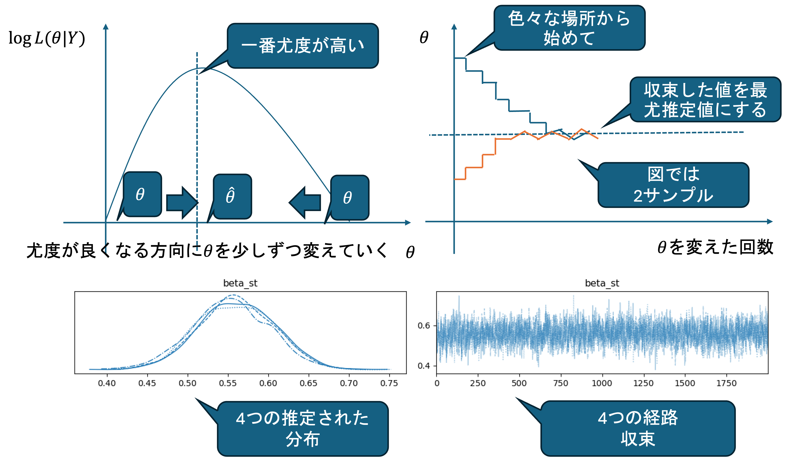
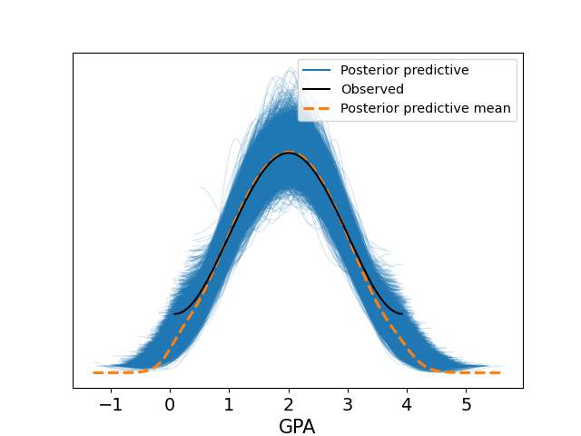
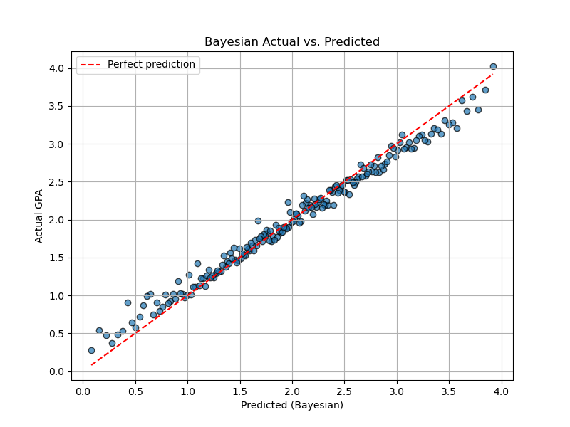
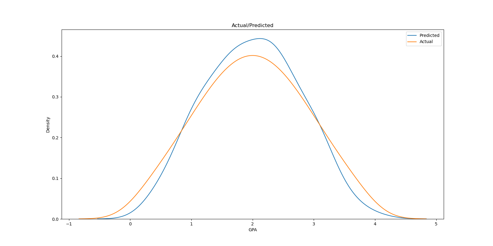
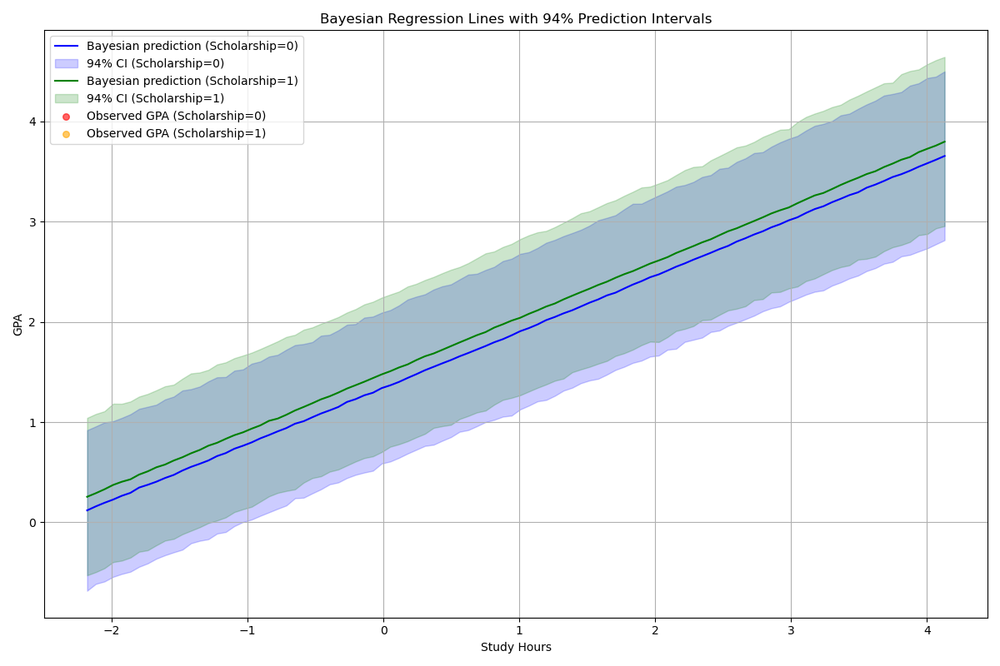
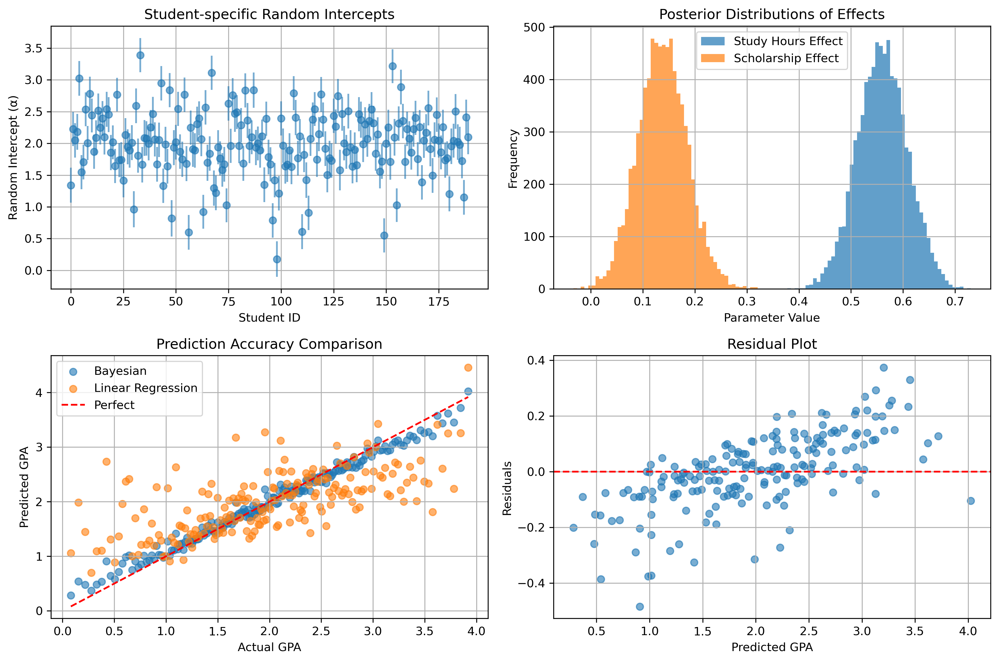

## MCMC {#mcmc}

続いて, 作成したモデルを MCMC によって, 推定します.

~~~py
        # MCMCサンプリングの実行
        trace = pm.sample(draws =2000, tune=2000, chains=4, target_accept=0.95, return_inferencedata=True)
        # 事後予測分布のサンプリング (trace に posterior_predictive グループを追加)
        pm.sample_posterior_predictive(trace, extend_inferencedata=True)
~~~

::: note

- MCMC サンプリングの仕組み

1. **初期値の設定**: 各チェーンは異なる初期値から開始します.

2. **ウォームアップ期間**: `tune` 期間中, サンプラーはパラメータ空間を探索し, 効率的なサンプリングのために調整されます.

3. **サンプリング期間**: `draws` 期間中, 事後分布からサンプルを取得します. 各ステップで, 現在のパラメータ値から新しい値を提案し, 受容/棄却を決定します.

4. **収束の確認**: 複数のチェーンが同じ分布に収束しているか確認します. これにより, サンプリングが適切に行われたかを診断できます.

- MCMC サンプリングの基本概念

**`pm.sample()`** は, MCMC サンプリングを実行し, パラメータの事後分布を推定します. 各パラメータの意味は以下のとおりです.

- **`draws=2000`**: 各チェーンから取得するサンプル数です. この例では, 各チェーンから 2000 個のサンプルを取得します. 合計では `chains × draws = 4 × 2000 = 8000` 個のサンプルが得られます.

- **`tune=2000`**: **バーンイン期間 (burn-in period)** または**ウォームアップ期間**です. この期間中に取得されたサンプルは破棄されます. MCMC は初期値から開始するため, 初期のサンプルは事後分布に収束していない可能性があります. この期間でサンプラーが適切に動作するよう調整されます.

- **`chains=4`**: 並列に実行する**マルコフ連鎖**の数です. 複数のチェーンを実行することで, 収束の診断が可能になります. 通常は 4 つのチェーンを使用し, それぞれ異なる初期値から開始します. すべてのチェーンが同じ分布に収束すれば, 適切にサンプリングできていると判断できます.

- **`target_accept=0.95`**: サンプリングアルゴリズムの**受容率 (acceptance rate)** の目標値です. NUTS (No-U-Turn Sampler) などの適応型 MCMC アルゴリズムでは, この受容率を調整しながらサンプリングを行います. 目標を 0.95 のように高くすると, サンプラーの歩幅が小さくなり, 1 回のサンプリングにかかる時間は長くなりますが, 発散 (divergence) が減って推定が安定します.

- **`return_inferencedata=True`**: 結果を `arviz` の `InferenceData` 形式で返します. これにより, 可視化や診断が容易になります.

**`pm.sample_posterior_predictive(trace, extend_inferencedata=True)`** は, 推定された事後分布から新しいデータを生成します. これにより, モデルの予測性能を評価したり, 予測区間を計算したりできます. `extend_inferencedata=True` を指定すると, 生成された事後予測サンプルが既存の `trace` (`InferenceData`) に `posterior_predictive` グループとして追加されます. なお, 以前のバージョンの解説では `idata = trace.copy(); idata.extend(posterior_predictive)` という書き方を使っていましたが, 新しい `arviz`/`xarray` では `trace.copy()` が `DataTree` を返すため `extend` メソッドが使えず `AttributeError` になります. そのため, 本講義では `extend_inferencedata=True` を推奨します.

:::

上記のサンプリングを実行することで, 標準出力に以下のような表示がなされます.

~~~ sh
Initializing NUTS using jitter+adapt_diag...
Multiprocess sampling (4 chains in 2 jobs)
NUTS: [z_alpha, mu_alpha, sigma_alpha, beta_st, beta_ss]
  Progress                                   Draws   Divergences   Step size   Grad evals   Sampling Speed   Elapsed   Remaining
 ────────────────────────────────────────────────────────────────────────────────────────────────────────────────────────────────
  ━━━━━━━━━━━━━━━━━━━━━━━━━━━━━━━━━━━━━━━━   4000    0             0.205       15           326.43 draws/s   0:00:12   0:00:00
  ━━━━━━━━━━━━━━━━━━━━━━━━━━━━━━━━━━━━━━━━   4000    0             0.222       31           340.23 draws/s   0:00:11   0:00:00
  ━━━━━━━━━━━━━━━━━━━━━━━━━━━━━━━━━━━━━━━━   4000    0             0.203       15           151.86 draws/s   0:00:26   0:00:00
  ━━━━━━━━━━━━━━━━━━━━━━━━━━━━━━━━━━━━━━━━   4000    0             0.182       15           158.16 draws/s   0:00:25   0:00:00
~~~

### 標準出力の解説 {#標準出力の解説}

この出力は, MCMC サンプリングの実行状況を示しています. 各項目の意味は以下のとおりです:

- **`Initializing NUTS using jitter+adapt_diag...`**: NUTS (No-U-Turn Sampler) アルゴリズムを初期化しています. `jitter+adapt_diag` は初期値の設定方法と, ステップサイズの調整方法を表します.

- **`Multiprocess sampling (4 chains in 2 jobs)`**: 4 つのチェーンを 2 つの並列ジョブで実行しています. これにより, 計算時間を短縮できます.

- **`NUTS: [z_alpha, mu_alpha, ...]`**: NUTS アルゴリズムでサンプリングするパラメータのリストです. モデルで定義したすべての確率変数が表示されます.

::: note

- NUTS アルゴリズム

**NUTS (No-U-Turn Sampler)** は, ハミルトニアンモンテカルロ法 (HMC) の一種で, PyMC では, デフォルトで NUTS アルゴリズムが使用されるため, ユーザーはアルゴリズムの詳細を意識せずに, 効率的なベイズ推定を行うことができます.

通常の MCMC アルゴリズム (メトロポリス法など) と比べて以下の特徴があります.

**通常の MCMC (メトロポリス法など):**

- **ランダムウォーク**: 現在のパラメータ値からランダムに近くの値を提案します.
- **ステップサイズの固定**: ステップサイズを手動で設定する必要があります.
- **効率の低さ**: パラメータ空間をゆっくりと探索するため, 多くのサンプルが必要です.
- **高次元での非効率**: パラメータ数が増えると, 探索が非常に非効率になります.

**NUTS アルゴリズム:**

- **勾配情報の利用**: 対数事後分布の勾配 (微分) を計算して, パラメータ空間を効率的に探索します.
- **適応的ステップサイズ**: ステップサイズを自動的に調整します. これにより, 手動での調整が不要になります.
- **長距離の移動**: 1 ステップでパラメータ空間を大きく移動できるため, 少ないサンプル数で効率的に探索できます.
- **「U ターン」の回避**: パラメータ空間を探索する際に, 同じ方向に戻ることを避けます. これが「No-U-Turn」という名前の由来です.
- **高次元での効率**: 高次元のパラメータ空間でも効率的にサンプリングできます.

:::

各行は 1 つのチェーンの進捗状況を表します (この例では 4 つのチェーンが表示されています). 各列の意味は以下のとおりです:

- **`Progress`**: サンプリングの進捗状況を視覚的に表示します. `━` が表示されるほど, サンプリングが進んでいます.

- **`Draws`**: 現在までに取得したサンプル数です. `tune + draws = 2000 + 2000 = 4000` となるため, 合計 4000 ステップが実行されます.

- **`Divergences`**: **発散 (divergence)** の発生回数です. 発散は, サンプラーがパラメータ空間の困難な領域に遭遇した際に発生します. 発散が多い場合 (通常は 100 を超える場合), モデルやサンプリング設定を見直す必要があります. この例では, すべてのチェーンで発散が 0 回となっており, 良好なサンプリングが行われていることを示しています. これは, 非中心パラメータ化により, パラメータ間の相関が低減され, 効率的なサンプリングが実現された結果です.

- **`Step size`**: サンプリングの**ステップサイズ**です. これが大きいほど, 1 ステップで大きくパラメータ空間を移動します. NUTS アルゴリズムは, このステップサイズを自動的に調整します. この例では, 0.182-0.222 の範囲で調整されており, 適切なステップサイズでサンプリングが行われています. 値はチェーンごとに異なる場合があります.

- **`Grad evals`**: 1 ステップあたりの**勾配評価回数**です. NUTS アルゴリズムは, 対数事後分布の勾配を計算して効率的にサンプリングします. この値が大きいほど, より多くの探索を行っていることを意味します. この例では, 15-31 回となっており, 効率的な探索が行われています.

- **`Sampling Speed`**: サンプリングの速度 (1 秒あたりのサンプル数) です. この値が大きいほど, 高速にサンプリングできます. モデルの複雑さやパラメータ数によって大きく変わります. この例では, 151.86-340.23 draws/s となっており, 比較的高速にサンプリングが行われています.

::: warn 

- **発散について:**

発散が多く発生している場合は, モデル等がデータに上手く適合していない状況を表しています.
今回は実施しませんが, そのような場合には以下の対処によって, サンプリング手法やモデルを修正する必要があります.

- モデルの再パラメータ化 (非中心パラメータ化の使用)
- `target_accept` の調整 (通常は 0.8-0.9 が推奨されます)
- 事前分布の見直し
- データの再検討

ただし, 発散が少ない場合でも, 以下で行うモデル診断 (トレースプロット) で収束を確認することが重要です.

:::

# []{#モデル診断と可視化}モデル診断と可視化 {#mcmc-diagnostics}

まずは作成したモデルを確認します.

~~~ py
    graph = model_to_graphviz(model)
    graph.render(filename= save_dir + "hierarchical_bayes_model", format="pdf")
~~~

上記のコードで, モデルの全体像が pdf ファイルとして保存されます.

論文等に掲載することもできるので, コードとの対応関係を確認しましょう.

続いて, モデルの診断結果を確認します. `az.plot_trace()` を用いることで, 指定した変数のサンプリング過程を可視化することができます.

~~~ py
    # alpha は学生数分の次元を持つため,
    # trace プロットでは代表 10 名分にサブセットして可視化する
    sample_students = list(trace.posterior.coords["student"].values[:10])

    az.plot_trace(trace
                 ,var_names=["sigma_alpha"
                            ,"alpha"
                            ,"beta_st"
                            ,"beta_ss"]
                 ,coords={"student": sample_students})
    plt.tight_layout()
    plt.savefig(save_dir + 'trace.png')
    plt.close()
~~~

この図では, 左側に 4 つのチェーンごとに推定された分布の形状, 右側にトレースの過程が表示されています. 

大まかには,

- 左側の分布が全てのサンプルで概ね同じ形状になっている
- 右側のトレースが一箇所に収束している

ことから, 概ね良好に推定できていることが分かります.

ただし, alpha に関しては学生数が多いため (`coords` で **代表 10 名分のみを表示** している), 学生別の分布が異なる色で表示されている点に注意してください.
学生それぞれの基礎学力の分布が異なっている様が表現されています.

(全学生分のトレースを確認したい場合は `coords` を省略すればよいですが, `arviz>=1.0` では `az.rcParams['plot.max_subplots']` をデフォルトの 40 より大きな値に引き上げる必要があります).

グラフでは大まかな印象しかわからないので更に, `az.summary()` を利用してサンプリング結果を数値で確認してみます.

~~~ py
    print(az.summary(trace
                    ,var_names=["sigma_alpha"
                               ,"alpha"
                               ,"beta_st"
                               ,"beta_ss"]))
    summary_df = az.summary(trace
                           ,var_names=["sigma_alpha"
                                      ,"alpha"
                                      ,"beta_st"
                                      ,"beta_ss"])
    summary_df.to_csv("bayesian_summary.csv"
                     ,encoding="utf-8-sig")
~~~

結果は学生別の alpha が出力されており非常に長いため, 抜粋したものが以下になります.

| パラメータ | mean | sd | hdi_3% | hdi_97% | mcse_mean | mcse_sd | ess_bulk | ess_tail | r_hat |
|-----------|------|----|--------|---------|-----------|---------|----------|----------|-------|
| sigma_alpha | 0.586 | 0.039 | 0.514 | 0.659 | 0.001 | 0.001 | 2193 | 4123 | 1 |
| alpha[0] | 1.337 | 0.276 | 0.826 | 1.851 | 0.003 | 0.002 | 9277 | 5519 | 1 |
| alpha[1] | 2.23 | 0.272 | 1.725 | 2.759 | 0.003 | 0.002 | 9863 | 6118 | 1 |
| alpha[2] | 2.044 | 0.267 | 1.541 | 2.543 | 0.003 | 0.002 | 9771 | 5823 | 1 |
| alpha[3] | 2.177 | 0.278 | 1.644 | 2.683 | 0.003 | 0.002 | 6533 | 5528 | 1 |
| alpha[4] | 3.02 | 0.27 | 2.506 | 3.512 | 0.003 | 0.002 | 10929 | 6162 | 1 |
| alpha[5] | 1.543 | 0.276 | 1.036 | 2.054 | 0.003 | 0.002 | 9980 | 5880 | 1 |
| alpha[6] | 1.709 | 0.275 | 1.184 | 2.22 | 0.003 | 0.002 | 7096 | 4980 | 1 |
| alpha[7] | 2.535 | 0.273 | 1.985 | 3.023 | 0.003 | 0.002 | 8866 | 5628 | 1 |
| alpha[8] | 2.003 | 0.265 | 1.503 | 2.498 | 0.003 | 0.002 | 8334 | 6208 | 1 |
| alpha[9] | 2.783 | 0.27 | 2.247 | 3.267 | 0.003 | 0.002 | 8919 | 4931 | 1 |
| alpha[10] | 2.443 | 0.271 | 1.944 | 2.977 | 0.003 | 0.002 | 8207 | 5363 | 1 |
| alpha[180] | 1.205 | 0.283 | 0.666 | 1.724 | 0.003 | 0.002 | 8038 | 5827 | 1 |
| alpha[181] | 1.952 | 0.274 | 1.443 | 2.463 | 0.003 | 0.002 | 7932 | 6444 | 1 |
| alpha[182] | 2.039 | 0.272 | 1.529 | 2.552 | 0.003 | 0.002 | 9013 | 5407 | 1 |
| alpha[183] | 2.503 | 0.265 | 2.018 | 3.006 | 0.003 | 0.002 | 10853 | 6100 | 1 |
| alpha[184] | 2.017 | 0.277 | 1.481 | 2.519 | 0.003 | 0.002 | 6437 | 5893 | 1 |
| alpha[185] | 1.985 | 0.274 | 1.483 | 2.521 | 0.003 | 0.002 | 7264 | 6106 | 1 |
| alpha[186] | 1.729 | 0.279 | 1.198 | 2.251 | 0.003 | 0.002 | 8657 | 5455 | 1 |
| alpha[187] | 1.153 | 0.274 | 0.65 | 1.68 | 0.003 | 0.002 | 11005 | 5637 | 1 |
| alpha[188] | 2.412 | 0.272 | 1.898 | 2.918 | 0.003 | 0.002 | 7896 | 5719 | 1 |
| alpha[189] | 2.093 | 0.269 | 1.588 | 2.6 | 0.003 | 0.002 | 7705 | 5726 | 1 |
| beta_st | 0.559 | 0.048 | 0.473 | 0.651 | 0.001 | 0.001 | 1889 | 3833 | 1 |
| beta_ss | 0.139 | 0.048 | 0.044 | 0.225 | 0.001 | 0.001 | 1957 | 3460 | 1 |

::: note

- MCMC サンプリング統計量

この表には, MCMC サンプリングの結果を要約する統計量が含まれています.

- **`mean`**: 事後分布の**平均値**です. パラメータの点推定値として使用されます.

- **`sd`**: 事後分布の**標準偏差**です. パラメータの不確実性を表します.

- **`hdi_3%`, `hdi_97%`**: **最高密度区間 (Highest Density Interval, HDI)** の下限と上限です. 事後分布の 94% が含まれる区間を表します. これはベイズの信用区間の一種で, データと事前分布のもとでパラメータがこの区間に入る確率が 94% であることを示します (頻度主義の信頼区間とは意味が異なります).

- **`mcse_mean`, `mcse_sd`**: **モンテカルロ標準誤差 (Monte Carlo Standard Error)** です. MCMC サンプリングによる推定の不確実性を表します. この値が小さいほど, 推定が安定しています.

- **`ess_bulk`, `ess_tail`**: **有効サンプルサイズ (Effective Sample Size, ESS)** です. MCMC サンプルには自己相関があるため, 実際に独立な情報を含むサンプル数を表します. `ess_bulk` は分布の中心部分, `ess_tail` は分布の尾部の有効サンプルサイズです. 通常, 400 以上であることが推奨されます.

- **`r_hat`**: **$\hat{R}$ 統計量 (Gelman-Rubin 統計量)** です. 複数のチェーンが同じ分布に収束しているかを示す指標です. 1.0 に近いほど良好で, 通常 1.01 以下が推奨されます. 1.01 を超える場合は, サンプリングが不十分である可能性があります.

:::

**収束の診断:**
- すべてのパラメータで `r_hat = 1.0` となっており, 良好な収束を示しています. これは, 4 つのチェーンがすべて同じ分布に収束していることを意味します.

- 有効サンプルサイズ (`ess_bulk`) は, すべてのパラメータで 400 を大きく超えており, サンプリングは適切に行われています. 特に, `alpha[i]` の多くは 6000-11000 の範囲で, 非常に良好なサンプリングが行われています. `beta_st` と `beta_ss` は 1889 と 1957 となっており, やや低めですが, 推奨値 (400) を大きく上回っており, 問題ありません.

**パラメータの推定値:**

- **`sigma_alpha = 0.586`**: 学生間の基礎学力のばらつきの標準偏差です. この値が大きいほど, 学生間の学力差が大きいことを示します. HDI 区間 [0.514, 0.659] は比較的狭く, 推定の不確実性は小さいです.

- **`alpha[i]`**: 各学生の基礎学力です. 例えば, `alpha[4] = 3.02` は, 学生 4 の基礎学力が高いことを示しています. 一方, `alpha[187] = 1.153` は, 学生 187 の基礎学力が低いことを示しています. 学生間で基礎学力に大きなばらつきがあることが分かります.

- **`beta_st = 0.559`**: 勉強時間の効果です. この値は正で, 勉強時間が 1 単位増加すると, GPA が平均的に 0.559 増加することを示しています. HDI 区間 [0.473, 0.651] は 0 を含まないため, 統計的に有意な正の効果があります. この区間は比較的狭く, 推定の不確実性は小さいです.

- **`beta_ss = 0.139`**: 奨学金の効果です. この値も正で, 奨学金を受給している学生の GPA が平均的に 0.139 高いことを示しています. HDI 区間 [0.044, 0.225] は 0 を含まないため, 統計的に有意な正の効果があります. この区間も比較的狭く, 推定の不確実性は小さいです.

# []{#結果の可視化}結果の可視化 {#bayesian-results-visualization}

続いて今回のモデルの説明能力について可視化していきます.

## 事後予測チェック (Posterior Predictive Check, PPC) {#事後予測チェック-posterior-predictive-check-ppc}

**事後予測チェック**は, 推定されたモデルが実際のデータをどれだけよく説明できるかを確認するための手法です. 具体的には, 推定された事後分布から新しいデータを生成し, その分布が実際の観測データとどの程度一致しているかを可視化します.

~~~ py
    idata = trace

    # 事後予測サンプルを (chain, draw) で平らに並べる
    ppc_samples = idata.posterior_predictive["GPA"].stack(sample=("chain", "draw"))
    n_show = min(100, ppc_samples.sizes["sample"])
    rng = np.random.default_rng(0)
    sample_idx = rng.choice(ppc_samples.sizes["sample"], size=n_show, replace=False)

    fig, ax = plt.subplots(figsize=(10, 6))
    for i in sample_idx:
        sns.kdeplot(ppc_samples.isel(sample=int(i)).values,
                    color="C0", alpha=0.1, lw=1, ax=ax)
    ax.plot([], [], color="C0", alpha=0.6, label="Posterior predictive draws")

    ppc_mean = idata.posterior_predictive["GPA"].mean(dim=("chain", "draw")).values
    sns.kdeplot(ppc_mean, color="C1", label="Posterior predictive mean", lw=2, ax=ax)
    sns.kdeplot(df["GPA"], color="black", label="Observed", lw=2, ax=ax)

    ax.set_title("Posterior Predictive Check")
    ax.set_xlabel("GPA")
    ax.legend()
    plt.savefig(save_dir + 'ppc.png')
    plt.close()
~~~

- `idata = trace`: 直前の `pm.sample_posterior_predictive(trace, extend_inferencedata=True)` によって, `trace` (`InferenceData`) には既に `posterior_predictive` グループが含まれています. そのまま参照を別名で受けるだけで, 事後予測分布にアクセスできます.
- `idata.posterior_predictive["GPA"].stack(sample=("chain", "draw"))`: `(chain, draw)` という 2 つの軸を 1 本の `sample` 軸にまとめて, 1 サンプル単位で取り出しやすい形に整えます.
- `for i in sample_idx`: ランダムに選んだ 100 本の事後予測サンプルを KDE で薄く重ね描きします. これが「事後予測分布の範囲」を表す青い帯になります.
- `ppc_mean = ... .mean(dim=("chain", "draw"))`: すべてのチェーン・ドローを平均した「事後予測平均」をオレンジで描き, 観測データを黒で重ねます.

::: note

`arviz>=1.0` では `plot_ppc` が `arviz-plots` サブパッケージに切り出されたため, バージョンによっては `import arviz as az` した状態で `az.plot_ppc` が見つからず

~~~ sh
AttributeError: module 'arviz' has no attribute 'plot_ppc'
~~~

というエラーになります. 上記のコードでは, バージョン依存を避けるために `matplotlib`/`seaborn` で同等のプロットを直接構築しています.

なお, 以前の解説で使っていた `idata = trace.copy(); idata.extend(posterior_predictive)` という書き方は, 新しい `arviz`/`xarray` では `trace.copy()` が `DataTree` を返すため `AttributeError: 'DataTree' object has no attribute 'extend'` が発生します. 本講義では `sample_posterior_predictive` に `extend_inferencedata=True` を渡して `trace` へ直接追加する書き方を採用しています.

:::

この図は, 観測データ (黒い実線) と事後予測分布 (青い領域) を比較しています.

- **黒い実線**: 実際に観測された GPA データの分布です.
- **青い領域**: 推定されたモデルから生成された事後予測分布です. 複数のサンプルから生成された分布の範囲を示しています.
- **オレンジの実線**: 青い実線の平均値

観測データの分布が事後予測分布の範囲内 (青い線の範囲) に収まっている場合, モデルはデータを適切に説明していると判断できます. 一方, 観測データの分布が事後予測分布から大きく外れている場合, モデルの仮定や構造を見直す必要があります.

この例では, 観測データの分布が事後予測分布の範囲内に収まっており, モデルがデータを適切に説明していることが確認できます.

## 予測値の確認 {#予測値の確認}

つぎに, 線形回帰と同様に予測値と実測値の関係と kde プロットを見てみましょう. まずは予測値を取り出します.

~~~ py
    # 事後予測分布から予測値(平均)を取り出す
    posterior_mean = idata.posterior_predictive["GPA"].mean(dim=("chain", "draw")).values
    # MSEを計算
    bayes_mse = mean_squared_error(df["GPA"], posterior_mean)
    print(f"[階層ベイズモデルのMSE] {bayes_mse:.4f}\n")
~~~

- **`idata.posterior_predictive["GPA"]`**: 事後予測分布から生成された GPA のサンプルです. このデータは, 複数のチェーン (`chain`) と複数のドロー (`draw`) から構成される多次元配列です.

- **`.mean(dim=("chain", "draw"))`**: すべてのチェーンとドローにわたって平均を計算します. これにより, 各観測値について, 事後予測分布の平均値 (期待値) を取得できます. つまり, 各学生の GPA について, モデルが予測する平均的な値を計算しています.

- **`.values`**: `xarray` のデータ配列を NumPy 配列に変換します. これにより, 後続の計算や可視化で使用しやすくなります.

- **`mean_squared_error(df["GPA"], posterior_mean)`**: 実測値 (`df["GPA"]`) と予測値 (`posterior_mean`) の間の平均二乗誤差 (MSE) を計算します. この値が小さいほど, モデルの予測精度が高いことを示します.

~~~ py
    # プロット
    plt.figure(figsize=(8, 6))
    plt.scatter(df['GPA'], posterior_mean, alpha=0.7, edgecolors="k")
    plt.xlabel("Predicted (Bayesian)")
    plt.ylabel("Actual GPA")
    plt.title("Bayesian Actual vs. Predicted")
    plt.plot([df['GPA'].min(), df['GPA'].max()],
             [df['GPA'].min(), df['GPA'].max()],
             color="red", linestyle="--", label="Perfect prediction")
    plt.grid()
    plt.legend()
    plt.savefig(save_dir + 'bayes.png')
    plt.close()

    plt.figure(figsize=(16,8))
    sns.kdeplot(posterior_mean, label = 'Predicted')
    sns.kdeplot(df['GPA'], label = 'Actual')
    plt.title('Actual/Predicted')
    plt.xlabel('GPA')
    plt.ylabel('Density')
    plt.legend()
    plt.savefig(save_dir + 'bayes_kde.png')
    plt.close()
~~~

予測値, 分布共に大幅に改善されていることが分かります.

## 予測範囲の可視化 {#予測範囲の可視化}

線形モデルとは異なり, 分布を推定しているため, 勉強時間と奨学金の有無による GPA の予測値と, その不確実性 (94% 予測区間) を可視化することが可能です.
奨学金の有無で異なる予測線を描画し, モデルの説明能力を確認します.

~~~ py
    # x軸用の study_hours の範囲（100点）
    study_grid = np.linspace(df["Study_Hours"].min(), df["Study_Hours"].max(), 100)

    # 奨学金なしの予測
    predict_df_0 = pd.DataFrame({
        "Study_Hours": study_grid,
        "Scholarship_True": 0,
        "StudentID": 0
    })

    # 奨学金ありの予測
    predict_df_1 = pd.DataFrame({
        "Study_Hours": study_grid,
        "Scholarship_True": 1,
        "StudentID": 0
    })

    # より簡単な方法：事後分布から直接予測
    # 事後分布のサンプルを取得（新しいAPIを使用）
    posterior_samples = az.extract(trace)
    
    # 予測計算
    n_samples = len(posterior_samples.draw)
    n_grid = len(study_grid)
    
    # 予測値を格納する配列（奨学金なし・あり）
    predictions_0 = np.zeros((n_samples, n_grid))
    predictions_1 = np.zeros((n_samples, n_grid))
    
    # パラメータを一度に取得
    mu_alpha_vals = posterior_samples.mu_alpha.values
    sigma_alpha_vals = posterior_samples.sigma_alpha.values
    z_alpha_vals = posterior_samples.z_alpha.values  # 全学生のz_alpha    
    beta_st_vals = posterior_samples.beta_st.values    
    beta_ss_vals = posterior_samples.beta_ss.values
    
    for i in range(n_samples):
        # 各サンプルでのパラメータ（学生0の切片を計算）
        alpha_0 = mu_alpha_vals[i] + sigma_alpha_vals[i] * z_alpha_vals[0, i]  # 学生0の切片
        
        # 奨学金なしの予測値の計算
        mu_pred_0 = alpha_0 + beta_st_vals[i] * study_grid + beta_ss_vals[i] * predict_df_0["Scholarship_True"]
        predictions_0[i, :] = np.random.normal(mu_pred_0, 0.3)
        
        # 奨学金ありの予測値の計算
        mu_pred_1 = alpha_0 + beta_st_vals[i] * study_grid + beta_ss_vals[i] * predict_df_1["Scholarship_True"]
        predictions_1[i, :] = np.random.normal(mu_pred_1, 0.3)

    # 平均と予測区間（94%）
    mean_pred_0 = np.mean(predictions_0, axis=0)
    lower_pred_0 = np.percentile(predictions_0, 3, axis=0)
    upper_pred_0 = np.percentile(predictions_0, 97, axis=0)
    
    mean_pred_1 = np.mean(predictions_1, axis=0)
    lower_pred_1 = np.percentile(predictions_1, 3, axis=0)
    upper_pred_1 = np.percentile(predictions_1, 97, axis=0)

    # 実データも合わせて表示（奨学金の有無で色分け）
    plt.figure(figsize=(12, 8))
    
    # 奨学金なしの予測線
    plt.plot(study_grid, mean_pred_0, color="blue", label="Bayesian prediction (Scholarship=0)")
    plt.fill_between(study_grid, lower_pred_0, upper_pred_0, color="blue", alpha=0.2, label="94% CI (Scholarship=0)")
    
    # 奨学金ありの予測線
    plt.plot(study_grid, mean_pred_1, color="green", label="Bayesian prediction (Scholarship=1)")
    plt.fill_between(study_grid, lower_pred_1, upper_pred_1, color="green", alpha=0.2, label="94% CI (Scholarship=1)")
    
    # 奨学金の有無で実測値を色分け
    scholarship_0 = df[df["Scholarship_True"] == 0]
    scholarship_1 = df[df["Scholarship_True"] == 1]
    
    plt.scatter(scholarship_0["Study_Hours"], scholarship_0["GPA"], 
                color="red", alpha=0.6, label="Observed GPA (Scholarship=0)", s=30)
    plt.scatter(scholarship_1["Study_Hours"], scholarship_1["GPA"], 
                color="orange", alpha=0.6, label="Observed GPA (Scholarship=1)", s=30)
    
    plt.xlabel("Study Hours")
    plt.ylabel("GPA")
    plt.title("Bayesian Regression Lines with 94% Prediction Intervals")
    plt.legend()
    plt.grid(True)
    plt.tight_layout()
    plt.savefig(save_dir + "bayes_prediction_band.png")
    plt.close()
~~~

予測区間内に実測値が多く含まれており, モデルがデータを適切に説明していることが確認できます. 
また, 奨学金ありのグループの予測線が上に位置しており, 奨学金の正の効果が可視化されています.

## その他の可視化手法 {#その他の可視化手法}

最後にその他によく利用される手法として, ランダム切片の可視化手法として学生の個別の能力値の分布, 推定された分布の可視化手法として各パラメータの推定された分布, Residual Plot などをまとめて掲載します. 論文執筆などの際には, 必要なものをピックアップしてグラフ化しましょう.

~~~ py
    # パラメータの解釈可能性を向上
    print("\n=== モデル結果の解釈 ===")
    print(f"勉強時間の効果 (beta_st): {np.mean(beta_st_vals):.3f} ± {np.std(beta_st_vals):.3f}")
    print(f"奨学金の効果 (beta_ss): {np.mean(beta_ss_vals):.3f} ± {np.std(beta_ss_vals):.3f}")
    print(f"学生間のばらつき (sigma_alpha): {np.mean(sigma_alpha_vals):.3f} ± {np.std(sigma_alpha_vals):.3f}")
    #
    ## 効果量の計算
    effect_size_study = np.mean(beta_st_vals) / np.mean(sigma_alpha_vals)
    effect_size_scholarship = np.mean(beta_ss_vals) / np.mean(sigma_alpha_vals)
    print(f"勉強時間の標準化効果量: {effect_size_study:.3f}")
    print(f"奨学金の標準化効果量: {effect_size_scholarship:.3f}")
    #
    ## 予測精度の詳細評価
    r2 = r2_score(df["GPA"], posterior_mean)
    mae = mean_absolute_error(df["GPA"], posterior_mean)
    print(f"\n=== 予測精度 ===")
    print(f"R²: {r2:.4f}")
    print(f"MAE: {mae:.4f}")
    print(f"MSE: {bayes_mse:.4f}")
    
    # 階層効果の可視化
    plt.figure(figsize=(12, 8))
    
    # 学生別の切片分布
    alpha_means = np.mean(posterior_samples.alpha.values, axis=1)
    alpha_stds = np.std(posterior_samples.alpha.values, axis=1)
    
    plt.subplot(2, 2, 1)
    plt.errorbar(range(len(alpha_means)), alpha_means, yerr=alpha_stds, fmt='o', alpha=0.6)
    plt.xlabel("Student ID")
    plt.ylabel("Random Intercept (α)")
    plt.title("Student-specific Random Intercepts")
    plt.grid(True)
    
    # パラメータの事後分布
    plt.subplot(2, 2, 2)
    plt.hist(beta_st_vals, bins=50, alpha=0.7, label='Study Hours Effect')
    plt.hist(beta_ss_vals, bins=50, alpha=0.7, label='Scholarship Effect')
    plt.xlabel("Parameter Value")
    plt.ylabel("Frequency")
    plt.title("Posterior Distributions of Effects")
    plt.legend()
    plt.grid(True)
    
    # 予測精度の比較
    plt.subplot(2, 2, 3)
    plt.scatter(df["GPA"], posterior_mean, alpha=0.6, label='Bayesian')
    plt.scatter(df["GPA"], lm_preds, alpha=0.6, label='Linear Regression')
    plt.plot([df["GPA"].min(), df["GPA"].max()], 
             [df["GPA"].min(), df["GPA"].max()], 'r--', label='Perfect')
    plt.xlabel("Actual GPA")
    plt.ylabel("Predicted GPA")
    plt.title("Prediction Accuracy Comparison")
    plt.legend()
    plt.grid(True)
    
    # 残差分析
    plt.subplot(2, 2, 4)
    residuals = df["GPA"] - posterior_mean
    plt.scatter(posterior_mean, residuals, alpha=0.6)
    plt.axhline(y=0, color='r', linestyle='--')
    plt.xlabel("Predicted GPA")
    plt.ylabel("Residuals")
    plt.title("Residual Plot")
    plt.grid(True)
    
    plt.tight_layout()
    plt.savefig(save_dir + "comprehensive_results.png", dpi=300, bbox_inches='tight')
    plt.close()
    
    # 結果の要約をCSVに保存
    results_summary = {
        'Metric': ['R²', 'MAE', 'MSE', 'Study_Effect_Mean', 'Study_Effect_Std', 
                  'Scholarship_Effect_Mean', 'Scholarship_Effect_Std', 'Student_Variability'],
        'Value': [r2, mae, bayes_mse, np.mean(beta_st_vals), np.std(beta_st_vals),
                 np.mean(beta_ss_vals), np.std(beta_ss_vals), np.mean(sigma_alpha_vals)]
    }
    
    results_df = pd.DataFrame(results_summary)
    results_df.to_csv("model_results_summary.csv", index=False, encoding='utf-8-sig')
  ~~~

  

# []{#まとめ-線形回帰-vs-ベイズモデリング}まとめ (線形回帰 VS ベイズモデリング) {#linear-and-bayesian-models}

線形回帰分析とベイズ統計モデリング, および固定効果モデルとランダム効果モデル (階層ベイズ) を, 以下の観点で比較します.

# []{#線形回帰-頻度主義-と統計モデリング-ベイズ主義-の比較}線形回帰 (頻度主義) と統計モデリング (ベイズ主義) の比較 {#frequentist-bayesian-comparison}

頻度主義的な線形回帰分析とベイズ主義的な統計モデリングには, 以下のような根本的な違いがあります.

| 比較項目 | 線形回帰 (頻度主義) | 統計モデリング (ベイズ主義) |
|---------|------------------|------------------------|
| **分布の使い方** | 誤差のみが正規分布に従うと仮定 $\epsilon_i \sim N(0, \sigma^2)$ | 出力もパラメータも分布として扱う $y_i \sim N(\mu_i, \sigma^2)$ $\theta \sim F$ (パラメータの事前分布) |
| **制約** | 誤差のみに制約がある | パラメータにも制約がある |
| **推定方法** | 最小二乗法 | ベイズ更新 (MCMC など) |
| **結果の解釈** | 点推定と検定 (区間推定) | 事後分布に基づく不確実性の推定 |

## 詳細な説明 {#詳細な説明}

**分布の使い方:**

頻度主義的な線形回帰では, 誤差項 $\epsilon_i$ のみが正規分布に従うと仮定します. パラメータ ($\beta_0, \beta_1$ など) は固定値として扱われ, 分布を持ちません.

一方, ベイズ統計モデリングでは, 出力変数 $y_i$ だけでなく, パラメータ自体も確率分布として扱います. 事前分布を設定し, データを観測した後の事後分布を推定することで, パラメータの不確実性を表現できます.

**制約:**

線形回帰では, 誤差項に対してのみ分布の仮定 (正規分布, 等分散性など) が課されます. パラメータには特別な制約はありません.

ベイズ統計モデリングでは, パラメータに対して事前分布を設定することで, パラメータの取りうる範囲や値に制約を課すことができます. これにより, データが少ない場合でも, 事前の知識を活用した推定が可能になります.

**推定方法:**

線形回帰では, 最小二乗法により誤差の二乗和を最小化するパラメータを求めます. この方法は解析的に解を求めることができ, 計算が比較的簡単です.

ベイズ統計モデリングでは, ベイズの定理に基づいて事後分布を計算します. 複雑なモデルでは解析的に解を求めることが困難なため, MCMC (マルコフ連鎖モンテカルロ法) などの数値計算手法を用いて事後分布をサンプリングします.

**結果の解釈:**

線形回帰では, 推定されたパラメータの点推定値と, その信頼区間や検定結果を解釈します. 頻度主義ではパラメータの真の値は定数とみなすので, 95% 信頼区間は「同じ手順でデータを取り直して区間を何度も作ると, そのうち約 95% の区間が真の値を含む」という意味になります. 一度計算した特定の区間について, 真の値が含まれる確率が 95% という意味ではありません.

ベイズ統計モデリングでは, 事後分布全体を解釈します. パラメータの不確実性を確率分布として表現できるため, 95% 信用区間は「データと事前分布のもとで, パラメータがこの区間に入る確率が 95%」と, 手元の区間について直接確率を述べる解釈が可能になります. また, 予測区間の計算も容易で, 予測の不確実性も表現できます.

# []{#固定効果-ダミー変数-とランダム効果-階層ベイズ-の比較}固定効果 (ダミー変数) とランダム効果 (階層ベイズ) の比較 {#fixed-and-random-effects}

個体差を考慮する際に, 固定効果モデルとランダム効果モデルでは, 推定方法や結果の解釈が大きく異なります.

| 比較項目 | ダミー変数 (固定効果) | ランダム効果 (階層ベイズ) |
|---------|-------------------|----------------------|
| **各個体の推定値** | 各個体は独立に自由に推定される (制約なし) | 分布からのサンプルとして推定される (制約あり) |
| **パラメータ数** | 個体数分のパラメータが必要 | 分布の平均と分散のみ (+個体ごとの潜在変数) |
| **新しい個体の予測** | 不可能 (その個体のダミーがないため) | 可能 (分布からのサンプルとして扱えるため) |
| **過学習のリスク** | 高い (特にデータが少ない個体で顕著) | 縮小推定により抑制される |
| **モデルの柔軟性** | 高すぎる (過剰適合の可能性) | 適度に制約された柔軟性 |

## 詳細な説明 {#詳細な説明-1}

**各個体の推定値:**

固定効果モデルでは, 各個体 (例: 学生) に対して独立したパラメータ (例: 切片 $\alpha_i$) を推定します. 各パラメータには特別な制約がなく, データから直接推定されます.

ランダム効果モデルでは, 各個体のパラメータが, より大きな分布 (例: $\alpha_i \sim N(\mu_{\alpha}, \sigma_{\alpha}^2)$) からサンプリングされると仮定します. この仮定により, 個体間で情報を共有し, より安定した推定が可能になります.

**パラメータ数:**

固定効果モデルでは, 個体数 $N$ に対して $N$ 個のパラメータを推定する必要があります. 個体数が増えると, パラメータ数も線形に増加します.

ランダム効果モデルでは, 分布のパラメータ (平均 $\mu_{\alpha}$ と分散 $\sigma_{\alpha}^2$) のみを推定すればよく, 個体数に関わらずパラメータ数は一定です. これにより, 個体数が多くても効率的に推定できます.

**新しい個体の予測:**

固定効果モデルでは, モデルに含まれていない新しい個体に対して予測を行うことはできません. その個体のダミー変数が存在しないため, パラメータを推定できないからです.

ランダム効果モデルでは, 新しい個体も既存の分布からサンプリングされると仮定することで, 予測が可能です. 推定された分布 $N(\mu_{\alpha}, \sigma_{\alpha}^2)$ に基づいて, 新しい個体のパラメータを推定できます.

**過学習のリスク:**

固定効果モデルでは, 特に各個体のデータが少ない場合, 過学習が発生しやすくなります. 各パラメータが個別に推定されるため, データに過度に適合します.

ランダム効果モデルでは, 「縮小推定 (shrinkage estimation)」が働きます. 各個体の推定値が, 全体の平均 $\mu_{\alpha}$ に向かって「縮小」されるため, 過学習が抑制されます. データが少ない個体でも, 他の個体の情報を活用して安定した推定が可能になります.

**モデルの柔軟性:**

固定効果モデルは, 各個体に対して完全に独立したパラメータを許容するため, 非常に柔軟です. しかし, この柔軟性が過剰適合を引き起こす可能性があります.

ランダム効果モデルは, 分布の仮定により適度に制約された柔軟性を持ちます. 個体間で情報を共有しながらも, 個体差を適切に表現できます.

# []{#まとめ}まとめ {#bayesian-modeling-summary}

ベイズ統計モデリングは, パラメータの不確実性を表現し, 事前知識を活用できる点で, 頻度主義的な線形回帰を一般化した手法といえます. 特に, 階層ベイズモデル (ランダム効果モデル) は, 個体差を考慮しながらも, 過学習を抑制し, 新しいデータに対する予測も可能にする優れた手法です.

ただし, ベイズ統計モデリングは計算コストが高く, モデルの設定や事前分布の選択が結果に影響を与えるため, 適切な知識と経験が必要です. 研究の目的やデータの特性に応じて手法を選択してください.

