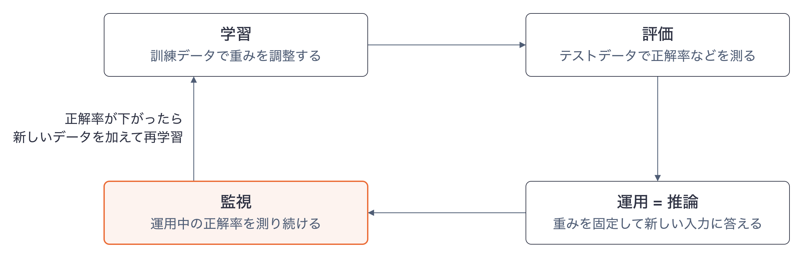

## AI の学習と推論, 評価, 再学習 {#ai-の学習と推論-評価-再学習}

ニューラルネットワークの重みをデータから決める作業を**学習**, 学習が終わったモデルで新しい入力に答えることを**推論 (inference)** といいます. [第8章](/lectures/dsp8.html)で例にした手書き数字の認識なら, 学習はたくさんの数字の画像と正解から重みを決める作業, 推論は学習済みのモデルに新しい数字の画像を入れて「これは 7」と答えさせる作業です.

| | 学習 | 推論 |
|---|---|---|
| 目的 | 重みを決める | 新しい入力に答える |
| 使うデータ | 正解付きの訓練データ | 正解の分からない新しい入力 |
| 重み | 更新する | 固定したまま使う |
| 計算 | 順伝播, 損失の計算, 逆伝播, 重みの更新を繰り返す | 順伝播を 1 回 |
| 計算量 | 大きい (大規模なモデルでは多数の GPU で数週間以上) | 小さい (1 回の入力ごとに順伝播だけ) |

推論では重みを固定しているので, 学習の後に起きたことはモデルに反映されません. 対話型の生成 AI が, 検索などの外部の仕組みを使わない限り, 学習に使ったデータより後の出来事を知らないのはこのためです.

# []{#モデルの評価}モデルの評価 {#model-evaluation}

学習したモデルを使ってよいかは, 学習に使っていないデータで確かめます. [第6章](/lectures/dsp6.html)と同じく, 正解付きのデータを**訓練データ**と**テストデータ**に分け, 訓練データだけで学習し, テストデータで性能を測ります.

学習に使ったデータで性能を測らないのは, モデルが訓練データの細かい癖まで覚え込み, 新しいデータには通用しないことがあるからです. 訓練データでは正解率が高いのに, テストデータでは低くなる状態を, [第6章](block:ml-classification#訓練データとテストデータ)と同じく**過学習**といいます. テストデータは, 学習の間は一度も使わずに取っておく「初めて見る問題」の役割をします.

分類の性能は, [第6章](block:ml-classification#混同行列)と同じく, テストデータの正解と予測を数えた**混同行列**で確かめます. 正解のクラスを行, 予測したクラスを列にとり, 該当するデータの数を並べた表です. 手書き数字のうち「1」「4」「9」の 3 種類だけを分類するモデルを, テストデータ 300 枚で評価したとします.

| 正解 \\ 予測 | 1 | 4 | 9 |
|---|---|---|---|
| 1 | 98 | 1 | 1 |
| 4 | 1 | 90 | 9 |
| 9 | 0 | 12 | 88 |

対角線上の数が正しく分類できた枚数です. **正解率** (全体のうち正しく分類できた割合) は次のようになります.

$$
\text{正解率} = \frac{98 + 90 + 88}{300} = \frac{276}{300} = 0.92
$$

正解率だけでなく表の中身を見ると, 「4」と「9」の取り違えが誤りの大部分 (24 枚中 21 枚) を占めていると分かります. 形の似た数字の区別が, このモデルの弱点です. 回帰のモデルなら, 予測と実測の差の 2 乗の平均 ([第8章](/lectures/dsp8.html)の[ニューラルネットワークの学習](block:ml-network#ニューラルネットワークの学習)の平均二乗誤差 MSE) で評価します.

# []{#運用中の監視と再学習}運用中の監視と再学習 {#monitoring-retraining}

テストデータで十分な性能を確かめたモデルも, 使い続けるうちに性能が下がることがあります. 手書き数字の例で, モデルを紙の申込書に書かれた数字で学習し, テストデータでも正解率 0.92 を確かめたとします. その後, 申込みの多くがタブレットでのペン入力に変わると, 細い線や崩れた形の数字が増えます. モデルは学習したことのない書き方の数字にも答え続けますが, 誤りが増え, 正解率が例えば 0.80 まで下がります.

このように, 運用中に入ってくるデータの傾向が学習時と変わることを**データの分布の変化 (データドリフト)** といいます. 推論では重みが固定されているので, モデルが自分で新しい書き方に合わせることはありません. そこで, 次の流れで運用します.

1. **監視**: 運用中のデータの一部に正解を付け, 正解率を定期的に測ります.
2. **再学習**: 正解率が基準を下回ったら, 新しい傾向のデータ (ペン入力の数字) に正解を付けて訓練データに加え, 学習をやり直します.
3. **再評価**: 再学習したモデルを, 新しい傾向のデータを含むテストデータで評価し, 前のモデルより良いことを確かめてから入れ替えます.

再学習では, 事前学習済みのモデルを新しいデータでファインチューニングすることもよくあります. 大規模なモデルを最初から学習し直すより, 必要な計算がずっと少なくて済むからです.

この節に対応する演習は, 章末の[Exercise DSP10-1](#exercise-dsp10-1)です.

# []{#演習}演習 {#exercises}

## Exercise DSP10-1 {#exercise-dsp10-1}

**学習と推論, 評価, 再学習**

対応する節: [AI の学習と推論, 評価, 再学習](#ai-の学習と推論-評価-再学習)

1. 次の (a) から (d) を, 「学習」と「推論」に分けてください.
    - (a) 手書き数字の画像 6 万枚と正解から, 重みを決める.
    - (b) 郵便物に書かれた数字をカメラで読み取り, 学習済みのモデルで数字を答える.
    - (c) 大量の文章で次トークン予測の問題を解かせ, 重みを更新する.
    - (d) 対話型の生成 AI に質問を入力し, 回答を得る.
2. 訓練データでの正解率は 0.99 なのに, テストデータでの正解率は 0.70 でした. この状態を何といいますか. また, テストデータを学習に使わない理由を答えてください.
3. 本文の混同行列で, 正解率 0.92 だけからは分からず, 表の中身から分かることを答えてください.
4. 運用を始めて半年後, 手書き数字のモデルの正解率が 0.92 から 0.80 に下がりました. 考えられる原因と, 取るべき対応の流れを答えてください.

    
 回答例 

1. 学習は (a) と (c), 推論は (b) と (d) です. 重みを更新するのが学習, 重みを固定したまま新しい入力に答えるのが推論です.
2. 過学習です. テストデータは, モデルが初めて見るデータでどれだけ正しく答えられるかを測るために取っておくものです. 学習に使うと, モデルがテストデータの癖まで覚え込み, 新しいデータでの性能より高い値が出るので, 性能を正しく測れなくなります.
3. 誤りの大部分が「4」と「9」の取り違えであることです. 同じ正解率 0.92 でも, 誤りが特定のクラスの組に集中しているのか, 全体に散らばっているのかは表を見ないと分かりません.
4. 運用中に入ってくる数字の書き方が, 学習時と変わった (データの分布の変化) ことが考えられます. 運用中のデータの一部に正解を付けて正解率を監視し, 新しい書き方のデータを訓練データに加えて再学習します. 再学習したモデルは, 新しい書き方のデータを含むテストデータで前のモデルより良いことを確かめてから入れ替えます.

