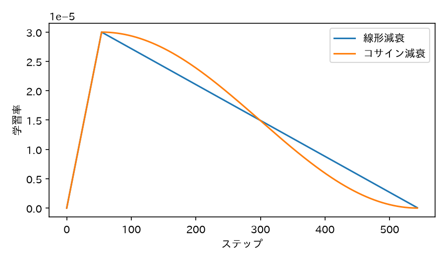
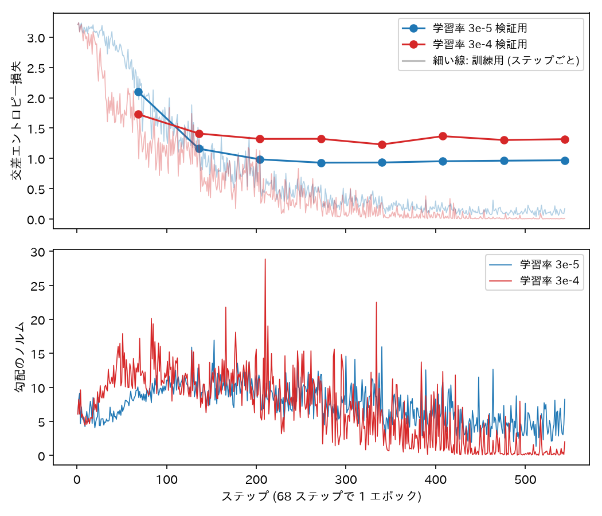

::: warn

[事例: 自然言語の Transformer を学習する](#事例-自然言語の-transformer-を学習する)の節は, 見出しと扱う内容の予定だけを載せています. それ以外の節は書き終えています.

:::

## Transformer の学習の手順 {#transformer-の学習の手順}

[事例: 品目名から製造業の中分類を当てる](block:dl-training-case#事例-品目名から製造業の中分類を当てる)では, 交差エントロピー損失, AdamW, ウォームアップと線形減衰, 損失の推移の監視と早期終了を使って BERT を追加学習しました. これらの手順を事前学習を含む Transformer の学習一般に広げて説明します. 学習手順のコード例は, 品目名の事例のコードを実行したあとに続けて実行する前提です.

## 学習の目的関数 {#学習の目的関数}

学習で小さくする関数を**目的関数**といいます. Transformer の学習では, 事前学習でも追加学習でも, 目的関数は予測した確率に対する交差エントロピー損失です. 違うのは, 1 つの文から作る問題の数と, クラスの数と, 正解の作り方です.

品目名の事例では, 1 つの品目名から「24 の中分類のどれか」を当てる問題を 1 つ作り, 正解の中分類に付けた確率 $p$ から損失 $-\log p$ を求めました. [自己教師あり学習の次トークン予測](block:dl-transformer#自己教師あり学習)では, 文のトークンの並び $x_1, x_2, \dots, x_n$ の各位置で, それまでのトークンから次のトークンを当てる問題を作ります. クラスは語彙 (モデルが扱うトークンの一覧) のすべてのトークンです. 1 つの文から $n-1$ 個の問題ができるので, 損失はその平均です.

$$
L = -\frac{1}{n-1} \sum_{t=1}^{n-1} \log p(x_{t+1} \mid x_1, \dots, x_t)
$$

$p(x_{t+1} \mid x_1, \dots, x_t)$ は, $x_1$ から $x_t$ までを読んだモデルが, 実際の次のトークン $x_{t+1}$ に付けた確率です. マスク予測では, `[MASK]` に置き換えた位置だけで, 元のトークンに付けた確率の対数を平均します.

| | 追加学習 ([品目名の事例](block:dl-training-case#事例-品目名から製造業の中分類を当てる)) | 事前学習 (次トークン予測) | 事前学習 (マスク予測) |
|:---|:---|:---|:---|
| 1 つの文から作る問題の数 | 1 | トークンの数 - 1 | `[MASK]` にしたトークンの数 |
| クラスの数 | 24 | 語彙の大きさ | 語彙の大きさ ([BERT](block:nlp-bert#ニューラル言語モデル) では 32,000) |
| 正解 | 人が付けた中分類 | 文の次のトークン | 隠した元のトークン |

事前学習は正解を文そのものから作るので, 人が正解を付けなくても大量の文章で学習できます. 追加学習には人が付けた正解が必要ですが, 事前学習で語の使われ方を学んだ重みから始めるので, [品目名の分類事例](block:dl-training-case#事例-品目名から製造業の中分類を当てる)のように 2,000 件程度の例でも学習できます.

## 学習率とスケジューラ {#学習率とスケジューラ}

学習率をステップごとに変える仕組みを**スケジューラ**といいます. [品目名の分類事例](block:dl-training-case#学習の手順を実行する)では, ウォームアップの後に学習率を直線的に下げる線形減衰を使いました. 事前学習では, **コサイン減衰**もよく使われます. ウォームアップが終わったステップを $t_w$, 最後のステップを $T$, 学習率の最大値を $\eta_{\max}$ とすると, ステップ $t$ の学習率 $\eta_t$ は次の式で決まります.

$$
\eta_t = \frac{\eta_{\max}}{2} \left( 1 + \cos \left( \pi \frac{t - t_w}{T - t_w} \right) \right)
$$

$t = t_w$ で $\cos 0 = 1$ なので $\eta_t = \eta_{\max}$, $t = T$ で $\cos \pi = -1$ なので $\eta_t = 0$ になります. [品目名の分類事例](block:dl-training-case#学習の手順を実行する)と同じ 544 ステップ (8 エポック) で, 2 つの減衰の仕方を比べます.

~~~ py
from transformers import get_cosine_schedule_with_warmup

def learning_rates(make_scheduler, total_steps=544):
    """スケジューラを total_steps 回進め, 各ステップの学習率を返す."""
    parameter = torch.nn.Parameter(torch.zeros(1))  # 学習率の変化を見るためだけの重み
    optimizer = torch.optim.AdamW([parameter], lr=LEARNING_RATE)
    scheduler = make_scheduler(optimizer, int(WARMUP_RATIO * total_steps), total_steps)
    rates = []
    for _ in range(total_steps):
        rates.append(scheduler.get_last_lr()[0])
        optimizer.step()
        scheduler.step()
    return rates

fig, ax = plt.subplots(figsize=(6, 3.5))
ax.plot(learning_rates(get_linear_schedule_with_warmup), label='線形減衰')
ax.plot(learning_rates(get_cosine_schedule_with_warmup), label='コサイン減衰')
ax.set_xlabel('ステップ')
ax.set_ylabel('学習率')
ax.legend()
fig.tight_layout()
plt.show()
plt.close(fig)
~~~

コサイン減衰は, ウォームアップの直後は線形減衰よりゆっくり下がり, 大きな学習率を長く保ちます. 終わりに近づくと線形減衰より速く下がり, 最後は 0 になだらかに近づきます. どちらが良いかは問題によって変わるので, 学習率の値と同じく, 検証用のデータで比べて選びます. [事例: 自然言語の Transformer を学習する](#事例-自然言語の-transformer-を学習する)では, コサイン減衰を使います.

### 勾配のクリッピング {#勾配のクリッピング}

学習の途中で, あるバッチの勾配だけが急に大きくなることがあります. その勾配でそのまま更新すると, 重みが一度に大きく動き, 損失が跳ね上がって元に戻らなくなることがあります. これを学習の**発散**といいます. **勾配のクリッピング (gradient clipping)** は, 発散を防ぐための方法です. すべての重みの勾配を並べて 1 つのベクトルとみなし, その長さ (**勾配のノルム**) が上限 $c$ を超えたときは, 向きを変えずに長さを $c$ まで縮めます. 勾配のベクトルを $g$, その長さを $\|g\|$ とすると, 次の式になります.

$$
g \leftarrow g \cdot \min \left( 1, \frac{c}{\|g\|} \right)
$$

PyTorch では, `loss.backward()` と `optimizer.step()` の間に 1 行加えます. 上限には 1.0 がよく使われます.

~~~ py
loss.backward()
norm = torch.nn.utils.clip_grad_norm_(model.parameters(), max_norm=1.0)
optimizer.step()
~~~

`clip_grad_norm_` は, 縮める前の勾配のノルムを返します. この値は[学習の監視](#学習の監視)にも使います.

### バッチサイズと勾配の蓄積 {#バッチサイズと勾配の蓄積}

1 回の更新に使う例の数 (バッチサイズ) を大きくすると, 勾配の平均をとる例が増えるので, 勾配の揺れが小さくなります. その代わり, 1 回の順伝播と逆伝播で一度に計算する量が増え, 必要なメモリも増えます. メモリが足りず大きなバッチを一度に計算できないときは, **勾配の蓄積 (gradient accumulation)** を使います. 小さなバッチで逆伝播を何回か行って勾配を足し合わせ, 決めた回数ごとに 1 回だけ重みを更新する方法です.

PyTorch では, `loss.backward()` を呼ぶたびに, 各重みの勾配が前の値に足されます. `optimizer.zero_grad()` を呼ぶまで勾配は消えないので, 勾配の蓄積は次のように書けます. 損失を `ACCUMULATION` で割るのは, 足し合わせた勾配を, 大きなバッチ全体の損失の平均に対する勾配に合わせるためです.

~~~ py
ACCUMULATION = 4  # 何回分の勾配を足してから更新するか
SMALL_BATCH_SIZE = BATCH_SIZE // ACCUMULATION  # 一度に計算する数 (32 / 4 = 8)

for step, i in enumerate(range(0, len(train_index), SMALL_BATCH_SIZE)):
    encoding, y = make_batch(train_index[i : i + SMALL_BATCH_SIZE])
    loss = loss_function(model(**encoding), y) / ACCUMULATION
    loss.backward()  # 勾配は前の値に足される
    if (step + 1) % ACCUMULATION == 0:
        optimizer.step()  # 4 回分の勾配で 1 回だけ更新する
        scheduler.step()
        optimizer.zero_grad()
~~~

ドロップアウトを外した状態 (`model.eval()`) で, 32 個の品目名の勾配を一度に求めた場合と, 8 個ずつ 4 回に分けて足し合わせた場合を比べると, 勾配の値の最大は 8.37, 2 つの差の最大は $9.5 \times 10^{-7}$ でした. 差は計算の丸めの誤差の大きさで, 2 つの方法は同じ勾配を求めています. 学習の途中ではドロップアウトの乱数が変わるので, 結果は完全には一致しません.

## 学習の監視 {#学習の監視}

[品目名の分類事例](block:dl-training-case#学習の手順を実行する)では, エポックごとに訓練用と検証用の損失を記録しました. 学習が長くなるほど, エポックの途中で起きた問題に早く気づく必要があります. そこで, ステップごとの訓練用の損失と勾配のノルムも記録します. 品目名の事例の学習のループで, `loss.backward()` の後を次のように書き換えます. 上限を無限大 (`float('inf')`) にすると, 勾配を縮めずにノルムだけを測れます.

~~~ py
step_history = []  # ステップごとの (訓練用の損失, 勾配のノルム)

# 学習のループの中で, loss.backward() の後に次を加える
norm = torch.nn.utils.clip_grad_norm_(model.parameters(), max_norm=float('inf'))
step_history.append((loss.item(), norm.item()))
~~~

次の図は, [品目名の分類事例](block:dl-training-case#学習の手順を実行する)で学習率を 3e-5 と 3e-4 にして, 早期終了をせずに 8 エポック学習したときの記録です. 細い線がステップごとの訓練用の損失, 丸がエポックの終わりの検証用の損失です.

学習率 3e-4 では, 最初のエポックで損失が 3e-5 より速く下がり, 1 エポック目の検証用の損失も 3e-5 より小さくなります (3e-4 が 1.73, 3e-5 が 2.10). しかし, 検証用の損失はその後 1.2〜1.4 で止まり, 訓練用の損失だけが 0.01 まで下がります. 勾配のノルムも 3e-5 より大きく揺れ, 最大は 28.9 です (3e-5 は 16.9). 学習率 3e-4 に上限 1.0 の勾配のクリッピングを加えても, 検証用の損失の最小は 1.24 で, クリッピングなし (1.23) と変わりませんでした. この学習率で起きているのは発散ではないからです. 訓練用の損失は下がり続けており, 大きな学習率で重みが大きく動いたため, 事前学習で得た語の使われ方が崩れ, 訓練用の品目名だけに合わせた状態になったと考えられます. 対処は学習率を下げることです.

監視の記録に表れる症状と, 考えられる原因と対処を表にまとめます.

| 症状 | 考えられる原因 | 対処 |
|:---|:---|:---|
| 訓練用の損失が急に跳ね上がり, 元に戻らない. 損失が `nan` (計算できない値) になる | 学習率が大きい. あるバッチの勾配が急に大きくなった | 学習率を下げる. ウォームアップを長くする. 勾配のクリッピング |
| 訓練用の損失は下がるのに, 検証用の損失が早い段階で下がらなくなる | 学習率が大きい. 過学習 | 学習率を下げる. 早期終了 |
| 訓練用の損失も検証用の損失もゆっくりしか下がらない | 学習率が小さい. 学習が短い | 学習率を上げる. エポックを増やす |

### チェックポイントの保存と再開 {#チェックポイントの保存と再開}

[品目名の分類事例](block:dl-training-case#学習の手順を実行する)では, 検証用の損失が最小のときの重みをメモリ上に取っておきました. 学習が長くなると, 途中で PC が止まったり, Colab の接続が切れたりすることがあります. そこで, 学習の途中の状態を**チェックポイント**としてファイルに保存しておき, 止まったときはそこから再開します. 再開するには, モデルの重みだけでなく, AdamW が重みごとに覚えている過去の勾配の情報と, スケジューラが進めたステップの数も必要です.

~~~ py
# 保存する (例えば, エポックの終わりごとに)
torch.save(
    {
        'epoch': epoch + 1,
        'model': model.state_dict(),
        'optimizer': optimizer.state_dict(),
        'scheduler': scheduler.state_dict(),
    },
    'checkpoint.pt',
)

# 再開する (モデル, optimizer, scheduler を同じ設定で作り直した後に)
checkpoint = torch.load('checkpoint.pt')
model.load_state_dict(checkpoint['model'])
optimizer.load_state_dict(checkpoint['optimizer'])
scheduler.load_state_dict(checkpoint['scheduler'])
start_epoch = checkpoint['epoch']  # for epoch in range(start_epoch, EPOCHS): で続ける
~~~

## 計算量とモデルの規模 {#計算量とモデルの規模}

### 自己注意の計算量 {#自己注意の計算量}

[Transformer の自己注意](block:dl-transformer#自己注意と-transformer-の構成)では, 系列のトークンのすべての組について注意の重みを計算します. 系列の長さを $n$ とすると, 注意の重みは $n \times n$ の表になるので, 計算量と必要なメモリは $n^2$ に比例します. 一方, 各トークンに同じ変換を施す全結合層の計算量は $n$ に比例します. BERT base と同じ大きさ (ベクトルの次元 768, ヘッド 12 個) で, 系列の長さを変えて計算時間を測ります.

~~~ py
import time

torch.manual_seed(0)
torch.set_num_threads(4)  # 測るたびに使う CPU の数が変わらないように固定する

D_MODEL, N_HEADS = 768, 12  # BERT base と同じ大きさ
D_HEAD = D_MODEL // N_HEADS
ffn = torch.nn.Sequential(  # Transformer の全結合層 (768 → 3072 → 768)
    torch.nn.Linear(D_MODEL, 4 * D_MODEL), torch.nn.GELU(), torch.nn.Linear(4 * D_MODEL, D_MODEL)
)

def attention(q, k, v):
    """ヘッドごとに softmax(QK^T / sqrt(d)) V を計算する."""
    scores = q @ k.transpose(-2, -1) / D_HEAD**0.5  # (ヘッド, n, n) の注意の重み
    return torch.softmax(scores, dim=-1) @ v

def measure(f, *args, repeat=5):
    """f を repeat 回実行し, かかった時間の中央値 (ミリ秒) を返す."""
    times = []
    for _ in range(repeat):
        start = time.perf_counter()
        f(*args)
        times.append((time.perf_counter() - start) * 1000)
    return sorted(times)[repeat // 2]

with torch.no_grad():
    for n in [256, 512, 1024, 2048, 4096]:
        x = torch.randn(n, D_MODEL)
        q, k, v = (torch.randn(N_HEADS, n, D_HEAD) for _ in range(3))
        t_attention = measure(attention, q, k, v)
        t_ffn = measure(ffn, x)
        memory = N_HEADS * n * n * 4 / 2**20  # 注意の重みの表 (32 ビットの数) の大きさ
        print(f'n={n:5d}  自己注意 {t_attention:7.1f} ms  全結合層 {t_ffn:6.1f} ms  注意の重み {memory:6.0f} MB')
~~~

Apple M5 Max の Mac の CPU で測った結果は次のとおりです.

| 系列の長さ $n$ | 自己注意 | 全結合層 | 注意の重みの表の大きさ |
|---:|---:|---:|---:|
| 256 | 7.3 ミリ秒 | 24.4 ミリ秒 | 3 MB |
| 512 | 12.1 ミリ秒 | 34.7 ミリ秒 | 12 MB |
| 1,024 | 37.6 ミリ秒 | 60.4 ミリ秒 | 48 MB |
| 2,048 | 131.9 ミリ秒 | 108.4 ミリ秒 | 192 MB |
| 4,096 | 515.6 ミリ秒 | 206.6 ミリ秒 | 768 MB |

系列の長さが 2 倍になると, 長い系列では, 自己注意の時間はおよそ 4 倍 (2,048 から 4,096 で 3.9 倍), 全結合層の時間はおよそ 2 倍 (1.9 倍) になります. 短い系列では全結合層の方が時間がかかりますが, 2,048 で逆転します. 注意の重みの表は, 1 つの層の 1 つの文だけで, 4,096 トークンでは 768 MB になります. BERT が読める長さを 512 トークンまでにしているのも, 計算量とメモリを抑えるためです. 長い文書を扱うモデルでは, 注意を計算するトークンの組を減らす方法や, 表をメモリに一度に置かずに計算する方法が使われています.

### パラメータ数と必要なメモリ {#パラメータ数と必要なメモリ}

[マルチラベル分類に使った日本語 BERT](block:nlp-bert#マルチラベル分類) のパラメータ (重み) の数は約 1.1 億 (110,617,344) です. 1 つの重みを 32 ビット (4 バイト) の浮動小数点数で持つと, 重みだけで約 0.44 GB になります. 学習では, 重みと同じ数の勾配と, AdamW が重みごとに覚えておく 2 つの値 (過去の勾配の平均と, 勾配の 2 乗の平均) も必要です.

| 学習で必要なもの | 1 つの重みあたり | BERT base 全体 |
|:---|---:|---:|
| 重み | 4 バイト | 0.44 GB |
| 勾配 | 4 バイト | 0.44 GB |
| AdamW の 2 つの値 | 8 バイト | 0.88 GB |
| 合計 | 16 バイト | 1.77 GB |

これに加えて, 逆伝播のために順伝播の途中の値 (各層の出力や注意の重み) を保存しておくメモリが, バッチサイズと系列の長さに比例して必要になります. 推論では勾配と AdamW の値は要らないので, 重みの 0.44 GB と途中の値だけで済みます. [AI の学習と推論, 評価, 再学習](block:dl-lifecycle#ai-の学習と推論-評価-再学習)で, 学習の計算量が推論よりずっと大きいと説明したのは, このためです.

**混合精度 (mixed precision)** による学習は, 順伝播と逆伝播の計算の多くを 16 ビットの浮動小数点数で行い, メモリと計算時間を減らす方法です. 16 ビットの数は 32 ビットの数の半分のメモリで済み, 対応した GPU では計算も速くなります. 16 ビットの数は表せる桁数が少ないので, 重みの更新は 32 ビットのまま行います. PyTorch では, 順伝播と損失の計算を `torch.autocast` の中に書きます. `bfloat16` は, 表せる値の範囲が 32 ビットの数と同じ 16 ビットの形式です.

~~~ py
with torch.autocast(device_type=device.type, dtype=torch.bfloat16):
    loss = loss_function(model(**encoding), y)
loss.backward()  # 逆伝播と重みの更新は autocast の外で行う
optimizer.step()
~~~

[品目名の分類事例](block:dl-training-case#学習の手順を実行する)の 1 エポックの学習時間は, Apple M5 Max の Mac の MPS で, 32 ビットの 9.1 秒に対し, 混合精度で 6.2 秒でした (それぞれ 2 回目の計測). 1 回目の計測では準備の時間が入り, 混合精度の方が遅くなりました. 速くなるかどうかは GPU によるので, 使う環境で確かめてから使います.

### モデルの大きさ, データの量, 計算量 {#モデルの大きさ-データの量-計算量}

言語モデルでは, モデルを大きくするほど, 学習に使うデータを増やすほど, 学習に使う計算量を増やすほど, 交差エントロピー損失が下がることが知られています. Kaplan らは, 損失がモデルの大きさ, データの量, 計算量のそれぞれのべき乗 (累乗) に従って下がる関係を, 多数の言語モデルを学習して確かめました ([Kaplan et al., 2020](https://arxiv.org/abs/2001.08361)). この関係を**スケーリング則**といいます.

使える計算量が決まっているときに, モデルの大きさとデータの量をどう配分すればよいかを調べたのが Hoffmann らです ([Hoffmann et al., 2022](https://arxiv.org/abs/2203.15556)). 400 以上のモデルを学習した結果, モデルの大きさを 2 倍にするなら, 学習に使うトークンの数も 2 倍にするのがよいと報告しました. 当時の大きな言語モデルの多くは, 約 3,000 億トークンで学習されていました. 例えば Gopher は 2,800 億パラメータを 3,000 億トークンで学習しています. これに対し, 同じ程度の計算量で 700 億パラメータのモデル (Chinchilla) を 1.4 兆トークンで学習すると, Gopher より高い性能が得られました. 1 パラメータあたり 20 トークンほどです.

この比で考えると, 1.1 億パラメータの BERT base には約 22 億トークンの文章が必要です. [自然言語の Transformer を学習する事例](#事例-自然言語の-transformer-を学習する)で扱う文章はこれよりずっと少ないので, 大規模なモデルを一から学習するには足りません. そのため, [事例: 自然言語の Transformer を学習する](#事例-自然言語の-transformer-を学習する)では数百万パラメータの小さなモデルを一から学習し, 実務では事前学習済みのモデルを追加学習して使います.

## 事前学習済みモデルの追加学習 {#事前学習済みモデルの追加学習}

品目名の事例では, BERT のすべての重みと, 出力の線形変換を更新しました. この比較では, 更新する範囲, 元の能力への影響, 訓練データの量を変えて, 追加学習の性質を確かめます.

### 追加学習で元の能力が失われる {#追加学習で元の能力が失われる}

追加学習では, 品目名を分類しやすいように BERT の重みも変わります. その結果, 事前学習で身に付けたマスク予測の能力がどう変わるかを確かめます. 事前学習済みの BERT にマスク予測の出力層を付けたモデル (`BertForMaskedLM`) を読み込み, `[MASK]` に入るトークンの候補を表示します. 次に, その BERT の部分を, [品目名の分類事例](block:dl-training-case#学習の手順を実行する)で追加学習した重みに入れ替えて, 同じ文で比べます. 出力層は事前学習のときのままです.

~~~ py
from transformers import BertForMaskedLM

mlm = BertForMaskedLM.from_pretrained(MODEL_NAME).to(device)
mlm.eval()

def fill_mask(sentence, top=5):
    """[MASK] の位置に入るトークンの候補を, 確率の高い順に返す."""
    encoding = tokenizer(sentence, return_tensors='pt').to(device)
    position = (encoding['input_ids'][0] == tokenizer.mask_token_id).nonzero()[0, 0]
    with torch.no_grad():
        probability = torch.softmax(mlm(**encoding).logits[0, position], dim=-1)
    best = probability.topk(top)
    return [
        (tokenizer.convert_ids_to_tokens(int(i)), round(float(p), 2))
        for p, i in zip(best.values, best.indices)
    ]

sentences = ['東京は日本の[MASK]です。', '私は毎朝[MASK]を飲みます。']
for sentence in sentences:
    print(sentence, fill_mask(sentence))

# BERT の部分を, 品目名の事例で追加学習した重みに入れ替える
mlm.bert.load_state_dict(model.bert.state_dict(), strict=False)
for sentence in sentences:
    print(sentence, fill_mask(sentence))
~~~

`strict=False` は, 品目名のモデルにだけある重み (`[CLS]` の出力を変換する層) を無視して読み込む指定です. 結果は次のとおりです. 括弧の中は確率です.

| 文 | 追加学習の前 | 追加学習の後 |
|:---|:---|:---|
| `東京は日本の[MASK]です。` | 地名 (0.16), 首都 (0.14), 中学校 (0.08), 大学 (0.07), 小学校 (0.06) | 小学校 (0.44), 中学校 (0.14), 首都 (0.06), 大学 (0.05), 都 (0.03) |
| `私は毎朝[MASK]を飲みます。` | コーヒー (0.35), 酒 (0.16), ビール (0.11), ワイン (0.08), お茶 (0.06) | `[UNK]` (0.12), `、` (0.11), お (0.05), コーヒー (0.04), 水 (0.03) |

追加学習の前は, 2 つの文とも文脈に合う語が上位に並びます. 追加学習の後は, 「飲みます」の前に入る語の候補に, 未知のトークン `[UNK]` や読点が上位に来ます. 品目名の分類に合わせて重みが動いたため, 事前学習で身に付けた語の予測の能力の一部が失われたのです. この現象を**破滅的忘却 (catastrophic forgetting)** といいます.

2 文だけでなく, [自然言語の Transformer を学習する事例](#事例-自然言語の-transformer-を学習する)で使う夏目漱石の『こころ』の 300 行で, 15% のトークンを `[MASK]` にしてマスク予測の損失を測りました. 追加学習の前は 2.68, 追加学習の後は 2.92〜2.97 でした (種を 3 通りに変えた範囲). 1 つの課題に合わせて追加学習したモデルは, 別の課題では事前学習済みのモデルより性能が下がることがあります. 別の課題に使うときは, 元の事前学習済みのモデルから追加学習をやり直します.

### 更新する範囲を変える {#更新する範囲を変える}

BERT の重みの一部を固定し (更新しないようにし), 残りだけを学習することもできます. 固定する重みは `requires_grad` を `False` にして, 勾配を計算しないようにします. 次のコードは, BERT の 12 層のうち上位 2 層と出力の線形変換だけを学習する設定です.

~~~ py
model = BertForClassification(MODEL_NAME, num_classes=len(classes)).to(device)
model.bert.set_attn_implementation('eager')  # 重みを固定した層でもドロップアウトを使えるようにする

# BERT の重みをすべて固定する
for parameter in model.bert.parameters():
    parameter.requires_grad = False
# 上位 2 層だけ固定を外す (線形変換だけを学習するときは, この 3 行を消す)
for layer in model.bert.encoder.layer[-2:]:
    for parameter in layer.parameters():
        parameter.requires_grad = True

n_trainable = sum(p.numel() for p in model.parameters() if p.requires_grad)
n_total = sum(p.numel() for p in model.parameters())
print(f'学習する重み: {n_trainable:,} / {n_total:,}')

# 固定していない重みだけを AdamW に渡す
optimizer = torch.optim.AdamW(
    [p for p in model.parameters() if p.requires_grad], lr=LEARNING_RATE
)

"""
学習する重み: 14,194,200 / 110,635,800
"""
~~~

2 行目の `set_attn_implementation('eager')` は, 注意の計算を PyTorch の基本的な演算で行う指定です. これがないと, MPS では, 重みを固定した層でドロップアウトを使う計算がエラーになる場合があります. この後の学習のループ (スケジューラの作成を含む) は, [品目名の分類事例](block:dl-training-case#学習の手順を実行する)と同じです.

更新する範囲を 3 通りに変え, それぞれ学習率を検証用の損失で選んで比べました. 線形変換だけを学習する場合は, 更新する重みが少なく学習が進みにくいので, `EPOCHS` を 20 にしています. 時間を公平に比べるため, 3 通りとも `set_attn_implementation('eager')` を指定しました. 種を 3 通りに変えた範囲を示します.

| 更新する範囲 | 学習する重み | 学習率 | 1 エポックの時間 | 検証用の損失 | Accuracy | Recall の平均 | マスク予測の損失 |
|:---|---:|---:|---:|---:|---:|---:|---:|
| 全部 | 110,635,800 | 3e-5 | 10〜11 秒 | 0.93〜0.99 | 0.72〜0.76 | 0.69〜0.75 | 2.92〜2.97 |
| 上位 2 層と線形変換 | 14,194,200 | 1e-4 | 6〜7 秒 | 1.01〜1.03 | 0.72〜0.74 | 0.70〜0.72 | 3.07〜3.09 |
| 線形変換だけ | 18,456 | 3e-3 | 5 秒 | 1.17〜1.19 | 0.65〜0.67 | 0.64〜0.66 | 2.68 |

学習率の候補は, 上位 2 層では 3e-5, 1e-4, 3e-4, 線形変換だけでは 1e-3, 3e-3, 1e-2 で, 検証用の損失が最も小さいものを選びました. 更新する範囲が狭いほど, 大きな学習率が合います.

- **上位 2 層と線形変換**: 学習する重みは全体の 13% ですが, Accuracy と Recall の平均は全部を更新した場合と重なる範囲に入ります. 1 エポックの時間は 6 割ほどです. 逆伝播で下位の 10 層の勾配を計算しなくて済むからです. 一方, マスク予測の損失は, 全部を更新した場合より大きくなりました. マスク予測の出力層が読むのは最上位の層の出力なので, 上位の層だけを大きな学習率で動かすと, その出力が大きく変わるためと考えられます.
- **線形変換だけ**: BERT の重みは変わらないので, マスク予測の損失も変わりません. Accuracy は 0.65〜0.67 で, BERT を更新する場合より低くなります. それでも, [追加学習しない分類と比べる](block:dl-training-case#発展-追加学習しない分類と比べる)で訓練データの平均と比べた方法 (0.52) よりは高くなります.

元の能力を保つことを重視するなら一部だけを更新し, 課題の性能を重視するなら全部を更新する, というように目的に合わせて選びます. 大規模な言語モデルでは, 全部を更新するとメモリが足りないことが多いので, 一部の重みだけを更新する方法が広く使われています.

### 訓練データの量を変える {#訓練データの量を変える}

訓練データの量を変えると, 性能がどう変わるかを確かめます. 学習用のデータから, 中分類の割合をそろえて 10% と 30% を抜き出します.

~~~ py
FRACTION = 0.1  # 学習用のデータのうち使う割合
train_index, _ = train_test_split(
    train_index, train_size=FRACTION, stratify=labels[train_index], random_state=0
)
train_index = list(train_index)
~~~

データを減らすと, 1 エポックのステップの数も減ります. 8 エポックでは学習が足りなかったので, `EPOCHS` を 10% では 50, 30% では 30 にし, 早期終了で止めました. 検証用とテスト用のデータは同じです. 全部を更新し, 種を 3 通りに変えた範囲を示します.

| 訓練データ | 品目の数 | Accuracy | Recall の平均 |
|:---|---:|---:|---:|
| 10% | 216 | 0.47〜0.49 | 0.39〜0.42 |
| 30% | 650 | 0.64〜0.65 | 0.59〜0.62 |
| 100% | 2,169 | 0.72〜0.76 | 0.69〜0.75 |

10% の 216 品目は, 1 つの中分類あたり 9 品目ほどです. この量では, 学習を長くしても Accuracy は 0.5 に届きません. Recall の平均はさらに低く, 品目の少ない中分類はほとんど当たらなくなります. [感情の分類](block:nlp-bert#マルチラベル分類)では, 640 文で正解率 0.73〜0.75, 1,929 文で 0.87 でした. ただし, 感情の分類は 3 つのラベルの分類で, 24 クラスの品目名の分類とは課題の難しさが違うので, 数字をそのまま比べることはできません. 追加学習に必要なデータの量は, 課題ごとに, データの量を変えて確かめます.

# []{#事例-自然言語の-transformer-を学習する}事例: 自然言語の Transformer を学習する {#language-model-case}

## 文章を数値の列にする: トークナイザ {#文章を数値の列にする-トークナイザ}

- トークンの単位: 単語, 文字, サブワード
- サブワードの分割方法: BPE, WordPiece, SentencePiece (Unigram)
- 語彙の大きさと, 日本語の分割の難しさ ([形態素解析](block:nlp-processing#トークン化と形態素解析)との違い)
- 特別なトークン (`[MASK]`, `[CLS]` など)
- 学習用のデータでトークナイザ自体を学習する手順

## 文章の事前学習で解かせる問題 {#文章の事前学習で解かせる問題}

- マスク予測 (masked language modeling): BERT の事前学習
- 次トークン予測 (自己回帰): GPT などの事前学習
- 評価指標としてのパープレキシティ (検証データでの値の推移を学習の監視に使う)
- 事前学習に使うコーパスの集め方と前処理 (重複の除去など)

## 小さな Transformer を一から学習する {#小さな-transformer-を一から学習する}

- モデルの構成要素の実装: 埋め込み層, 位置エンコーディング, 自己注意, マルチヘッド注意, 全結合層, 残差接続, 層正規化
- 次トークン予測用の因果マスク
- 小さなコーパスで学習し, 損失が下がる様子を確認する
- 学習したモデルで文章を生成する (貪欲法, 温度, サンプリングの方法)

