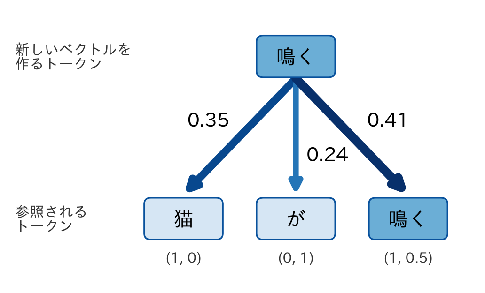
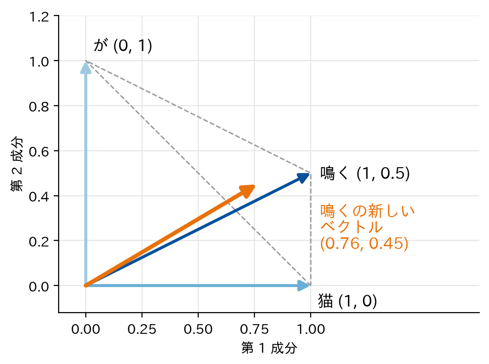
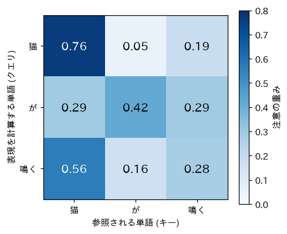
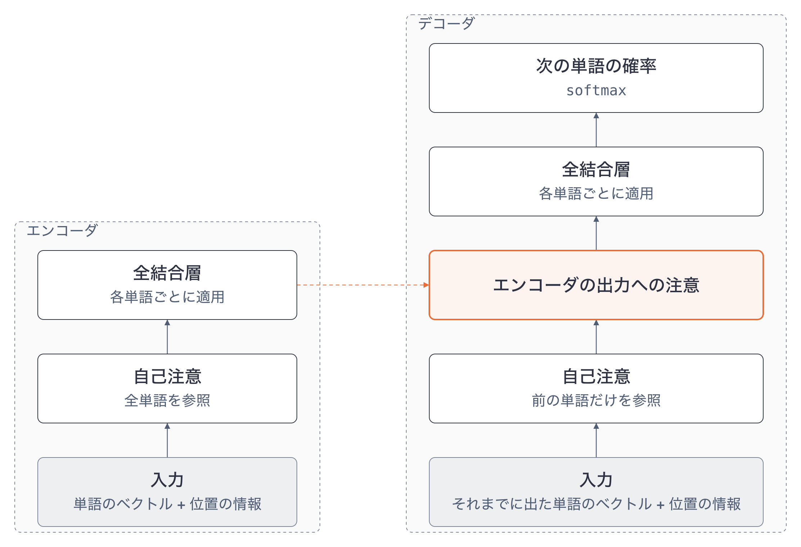

## Transformer と注意機構 {#transformer-と注意機構}

**Transformer** は, 文章のような並びのデータを扱うために 2017 年に提案されたニューラルネットワークの構成です. [BERT](block:nlp-bert#ニューラル言語モデル) も, 対話型の生成 AI の中で動いている大規模言語モデルも, Transformer を土台にしています. Transformer の中心にあるのが**注意機構 (attention)** です.

## 系列データと注意機構 {#系列データと注意機構}

文章, 音声, 株価の推移のように, 要素の並び順に意味があるデータを**系列データ**といいます. 文章は単語 (正確には**トークン**と呼ばれる, 単語や文字の断片) の並びとして扱います. 例として, 「猫が鳴く」という文を「猫」「が」「鳴く」の 3 つのトークンに分けて扱います.

ニューラルネットワークは数値しか扱えないので, 各トークンを数値の組 (ベクトル) で表します. このベクトルは, 意味の近いトークンほど近くなるように学習で決まります ([距離と類似度](block:num-distance#距離と類似度)を参照). この例では手計算のために, 2 つの数値の組で表すことにします.

| トークン | ベクトル |
|---|---|
| 猫 | $\boldsymbol{x}_1 = (2, 0.5)$ |
| が | $\boldsymbol{x}_2 = (0, 1)$ |
| 鳴く | $\boldsymbol{x}_3 = (1, 0.5)$ |

### 固定したベクトルの限界と注意機構の目的 {#固定したベクトルの限界と注意機構の目的}

このベクトルはトークンごとに 1 つに決まり, どの文に現れても同じです. しかし, 単語の意味は周りの単語によって変わります. 「鳴く」は「猫が鳴く」と「鳥が鳴く」で思い浮かべる声が違いますし, 「かける」は「電話をかける」と「眼鏡をかける」で意味が違います.

文の中での役割も, 他の単語との関係で決まります. 英語の The animal didn't cross the street because it was too tired. の it は animal を指しますが, 最後の tired を wide に変えると street を指します. it が何を指すかは, it 自身ではなく文中の他の単語との関係から決まります. トークンごとに 1 つに決めたベクトルでは, 意味や役割が文脈によって変わることを表せません.

**注意機構**の目的は, 各トークンのベクトルを, 同じ文の中の他のトークンとの関係に基づいて作り直し, 文脈に応じたベクトルにすることです. 作り直すのはトークンごとで, 文全体から 1 つの値を取り出すわけではありません. 「猫が鳴く」なら, 「鳴く」は鳴いているのが猫だという情報を含んだベクトルに作り直され, 「猫」と「が」もそれぞれ作り直されます.

Transformer より前は, **RNN (再帰型ニューラルネットワーク)** が文を扱う主な方法でした. RNN は文を先頭から 1 トークンずつ読み, それまでに読んだ内容を 1 つのベクトルに書き足していきます. 離れたトークンの情報は何回もの書き足しを経て届くので薄まりやすく, 前のトークンを読み終えるまで次のトークンの計算に進めないので, 並列に計算できません. 注意機構では, 各トークンが距離に関係なく文中のどのトークンも直接参照でき, すべてのトークンの計算を同時に行えます.

### 注意の重みの計算 {#注意の重みの計算}

ベクトルを作り直すには, 2 つの計算が要ります. 1 つは, あるトークンにとって文中の各トークン (自分自身を含む) がどれだけ関係が深いかを数値で測ることです. もう 1 つは, 関係の深いトークンほど大きな割合で情報を取り込んで, 新しいベクトルを作ることです. 「猫が鳴く」の「鳴く」なら, 誰が鳴くのかを表す「猫」の情報を最も大きな割合で取り込みます. 次の図は, 「鳴く」が各トークンから情報を取り込む割合を, 矢印の太さと数値で表したものです. 3 つの割合の合計は 1 で, この割合を**注意の重み**といいます.

図の上段が新しいベクトルを作るトークン, 下段が参照されるトークンです. 「鳴く」は「猫」を 0.56, 自分自身を 0.28, 「が」を 0.16 の割合で取り込みます. これらの数値の求め方は, この後の手順で計算します. 取り込むとは, 各トークンのベクトルを注意の重みで重み付けして足し合わせ, 「鳴く」の新しいベクトルとすることです. 重みの合計が 1 なので, これは全トークンのベクトルの重み付きの平均になります.

関係の深さは, 2 つのトークンのベクトルがどれだけ似ているかで測ります. 文のトークンの数を $n$, トークン $i$ のベクトルを $\boldsymbol{x}_i$, ベクトルの次元の数を $d$ とし, $\boldsymbol{x}_i$ の $k$ 番目の成分を $x_{ik}$ と書きます. トークン $i$ の新しいベクトルは, 次の手順で求めます. 「鳴く」なら $i = 3$, $n = 3$, $d = 2$ です.

1. トークン $i$ のベクトルと, 各トークン $j$ ($j = 1, \dots, n$. 自分自身を含む) のベクトルの内積を求めます. 内積は, 対応する成分同士を掛けて足した値で, 2 つのベクトルの向きが揃っていて長いほど大きくなります ([コサイン類似度](block:num-distance#コサイン類似度)の分子にあたります).

    $$
    \boldsymbol{x}_i \cdot \boldsymbol{x}_j = x_{i1} x_{j1} + x_{i2} x_{j2} + \dots + x_{id} x_{jd}
    $$

2. 内積を次元の数 $d$ の平方根 $\sqrt{d}$ で割り, その値を $s_{ij}$ とします. 次元が大きいほど内積は大きな値になりやすく, 大きすぎると 3 の softmax が 1 つのトークンにほぼ全部の重みを付けて学習が進みにくくなるので, 値の大きさをそろえる調整です. この割り算がなくても 3 以降の計算の仕組みは変わりません.

    $$
    s_{ij} = \frac{\boldsymbol{x}_i \cdot \boldsymbol{x}_j}{\sqrt{d}}
    $$

3. $s_{i1}, \dots, s_{in}$ を softmax 関数 ([ニューラルネットワークの構成](block:ml-network#ニューラルネットワークの構成)の出力層で使った関数) に通し, トークン $i$ がトークン $j$ に付ける注意の重み $a_{ij}$ に変えます. 分母は $l = 1$ から $n$ までの和なので, $a_{i1} + \dots + a_{in} = 1$ になります.

    $$
    a_{ij} = \frac{\exp(s_{ij})}{\sum_{l=1}^{n} \exp(s_{il})}
    $$

4. 注意の重みで各トークンのベクトルを重み付けして足し合わせ, トークン $i$ の新しいベクトル $\boldsymbol{z}_i$ とします.

    $$
    \boldsymbol{z}_i = \sum_{j=1}^{n} a_{ij} \boldsymbol{x}_j
    $$

4 つの手順をまとめると, 処理全体は, $n$ 個のトークンのベクトルをすべて受け取り, トークン $i$ の新しいベクトルを返す次の関数になります.

$$
\boldsymbol{z}_i = \sum_{j=1}^{n} \frac{\exp\left( \boldsymbol{x}_i \cdot \boldsymbol{x}_j / \sqrt{d} \right)}{\sum_{l=1}^{n} \exp\left( \boldsymbol{x}_i \cdot \boldsymbol{x}_l / \sqrt{d} \right)} \, \boldsymbol{x}_j
$$

「鳴く」($\boldsymbol{x}_3$) について, 実際に計算してみましょう. $\sqrt{2} \approx 1.414$ です.

| 参照するトークン | 1. 内積 | 2. $\sqrt{2}$ で割る | $e^{(2 の値)}$ | 3. 注意の重み |
|---|---|---|---|---|
| 猫 | $1 \times 2 + 0.5 \times 0.5 = 2.25$ | $1.591$ | $4.909$ | $4.909 / 8.753 \approx 0.56$ |
| が | $1 \times 0 + 0.5 \times 1 = 0.5$ | $0.354$ | $1.424$ | $1.424 / 8.753 \approx 0.16$ |
| 鳴く | $1 \times 1 + 0.5 \times 0.5 = 1.25$ | $0.884$ | $2.420$ | $2.420 / 8.753 \approx 0.28$ |
| 合計 | | | $8.753$ | $1$ |

4 の重み付きの和 $\boldsymbol{z}_3$ は次のようになります.

$$
\boldsymbol{z}_3 = 0.56 \times (2, 0.5) + 0.16 \times (0, 1) + 0.28 \times (1, 0.5) \approx (1.40, 0.58)
$$

次の図は, 3 つのトークンのベクトルと, 「鳴く」の新しいベクトルを, 2 次元の平面に矢印で描いたものです.

新しいベクトル $(1.40, 0.58)$ (橙) は, 0 以上で合計が 1 の重みを付けた平均なので, 3 つのベクトルの先端を結ぶ三角形 (破線) の内側に入ります. 最も大きな重み 0.56 を「猫」に付けたので, もとの $(1, 0.5)$ から「猫」の $(2, 0.5)$ の方向へ動いています. 第 1 成分は「猫」の 2 が大きな割合で混ざって 1 から 1.40 に増え, 第 2 成分は「が」の 1 が混ざった分だけ 0.5 から 0.58 に増えています. こうして「鳴く」は, 鳴いているのが猫であるという情報を含んだベクトルになります.

同じ計算を「猫」と「が」についても行うと, 注意の重みは次の図のようになります. 行が新しいベクトルを計算するトークン, 列が参照されるトークンで, 各行の重みの合計は 1 です.

### 学習で決まるもの {#学習で決まるもの}

この例では, 「鳴く」から見て「猫」との内積が最も大きくなるように, ベクトルを手で決めました. 実際のモデルでは, ベクトルを人が決めることはせず, トークンのベクトルと, [クエリとキーによる関係の測り方](block:dl-transformer#クエリ-キー-バリュー) (ベクトルの変換) を学習で決めます. 注意の重みそのものは, 学習で保存される値ではありません. 文が入力されるたびに, その文のトークンのベクトルから計算されます. 関係の測り方を学習しておくので, 初めて見る文にも, その文に合った重みが付きます.

モデルに文法や単語の意味を教えることもしません. 学習では, 文の一部を隠して当てる問題 ([自己教師あり学習](#自己教師あり学習)) の損失を小さくします. 「鳴く」の意味を決めるには誰が鳴いているかが役立ち, it を含む文の続きを当てるには it が何を指すかが役立ちます. そのため学習の結果として, 述語から主語へ, 代名詞からそれが指す名詞へ大きな重みを付ける関係の測り方が得られます. 学習済みのモデルでは, このような重みの付き方が実際に観察されています. ただし, すべての重みが人に解釈できる関係になるわけではありません.

この節に対応する演習は, [Exercise DSP8-2](#exercise-dsp8-2)です.

## 自己注意と Transformer の構成 {#自己注意と-transformer-の構成}

### クエリ, キー, バリュー {#クエリ-キー-バリュー}

[注意の重みの計算](#注意の重みの計算)では, 1 つのベクトルを 3 つの役割で使っていました. 重みを計算する側 (「鳴く」), 重みを計算される側 (各トークン), 足し合わされる中身 (各トークン) です. Transformer では, 各トークンのベクトル $\boldsymbol{x}_i$ から, 役割ごとに別のベクトルを作ります.

- **クエリ (Query)** $\boldsymbol{q}_i = W_Q \boldsymbol{x}_i$: 重みを計算する側のベクトル. 「どんな情報を探しているか」を表す.
- **キー (Key)** $\boldsymbol{k}_j = W_K \boldsymbol{x}_j$: 重みを計算される側のベクトル. 「どんな情報を持っているか」を表す.
- **バリュー (Value)** $\boldsymbol{v}_j = W_V \boldsymbol{x}_j$: 足し合わされる中身のベクトル.

$W_Q, W_K, W_V$ は, [ニューラルネットワークの構成](block:ml-network#ニューラルネットワークの構成)の重み行列 $W$ と同じく, 学習で決まる行列です. [学習で決まるもの](#学習で決まるもの)で述べた関係の測り方は $W_Q$ と $W_K$ にあたり, $W_V$ は取り込む情報の中身を決めます. トークン $i$ の新しいベクトル $\boldsymbol{z}_i$ は, [注意の重みの計算](#注意の重みの計算)の式の内積 $\boldsymbol{x}_i \cdot \boldsymbol{x}_j$ をクエリとキーの内積 $\boldsymbol{q}_i \cdot \boldsymbol{k}_j$ に, 足し合わせる $\boldsymbol{x}_j$ をバリュー $\boldsymbol{v}_j$ に置き換えて計算します.

$$
a_{ij} = \frac{\exp\left( \boldsymbol{q}_i \cdot \boldsymbol{k}_j / \sqrt{d} \right)}{\sum_{l=1}^{n} \exp\left( \boldsymbol{q}_i \cdot \boldsymbol{k}_l / \sqrt{d} \right)}, \qquad \boldsymbol{z}_i = \sum_{j=1}^{n} a_{ij} \boldsymbol{v}_j
$$

ここで $n$ はトークンの数, $a_{ij}$ はトークン $i$ がトークン $j$ に付ける注意の重みです. 全トークンのクエリ, キー, バリューを行に並べた行列を $Q, K, V$ とすると, 全トークン分の計算を 1 つの式で書けます.

$$
\text{Attention}(Q, K, V) = \text{softmax}\left( \frac{Q K^{\top}}{\sqrt{d}} \right) V
$$

$Q K^{\top}$ は, すべてのクエリとキーの組の内積を並べた $n \times n$ の表で, 「猫が鳴く」の注意の重みの図のもとになる値です. softmax は行ごとに適用します. [注意の重みの計算](#注意の重みの計算)の手計算は, $W_Q, W_K, W_V$ をすべて単位行列 (ベクトルを変えない行列) にした場合にあたります.

この式は, 文のトークンのベクトルから直接書くこともできます. トークンのベクトル $\boldsymbol{x}_1, \dots, \boldsymbol{x}_n$ を行に並べた $n \times d$ の行列を $X$ とします ($d$ はベクトルの次元). $X$ の行に対しては, $\boldsymbol{q}_i = W_Q \boldsymbol{x}_i$ は $X$ に右から $W_Q^{\top}$ を掛けることにあたるので, $Q = X W_Q^{\top}$, $K = X W_K^{\top}$, $V = X W_V^{\top}$ です. これを Attention の式に入れると, 自己注意 1 段分の出力 $Z$ ($i$ 行目が $\boldsymbol{z}_i$) は $X$ と 3 つの行列だけで決まります.

$$
Z = \text{softmax}\left( \frac{(X W_Q^{\top})(X W_K^{\top})^{\top}}{\sqrt{d}} \right) X W_V^{\top}
$$

同じ文の中のトークン同士で注意の重みを計算するので, この仕組みを**自己注意 (self-attention)** といいます. 実際の Transformer では, 異なる $W_Q, W_K, W_V$ の組を複数用意して自己注意を並列に計算し, 結果をつなげて使います (**マルチヘッド注意**). 組ごとに, 主語と述語の関係, 近くの単語との関係のように, 異なる種類の関係を捉えられます.

自己注意の計算には, トークンの並び順が入っていません. 「猫が鳴く」と「鳴くが猫」で, 各トークンが受け取る重み付きの和は同じになります. そこで, 各トークンのベクトルに「文の何番目か」を表すベクトルを足してから入力します. これを**位置の情報 (位置エンコーディング)** といいます.

### エンコーダとデコーダ {#エンコーダとデコーダ}

Transformer は, 自己注意と, トークンごとに同じ全結合層を適用する層を 1 組として, これを何段も積み重ねた構成です. 全体は, 入力の文を読み取る**エンコーダ**と, 出力の文を 1 トークンずつ作る**デコーダ**に分かれます.

- **エンコーダ**の自己注意は, 文中のすべてのトークンを参照します. 文の前後の両方から文脈を取り込めるので, 文の意味を読み取るのに向きます. [BERT](block:nlp-bert#ニューラル言語モデル) は, エンコーダだけを積み重ねたモデルです.
- **デコーダ**の自己注意は, 自分より前のトークンだけを参照します. これから作るトークンは, 作る時点ではまだ存在しないからです. 1 トークンずつ文を作っていく生成に向き, 対話型の生成 AI で使われる大規模言語モデル (GPT など) は, デコーダだけを積み重ねたモデルです. GPT などはエンコーダを持たないので, 図の「エンコーダの出力への注意」を除いたデコーダを積み重ねます. 生成の仕組みは[事前学習と生成](block:nlp-generation#pretraining-and-generation)で扱います.

もとの Transformer は機械翻訳のために作られ, エンコーダで翻訳前の文を読み取り, デコーダがその出力に注意を向けながら翻訳後の文を作ります (図の破線).

### Transformer 全体が学習で決めるもの {#transformer-全体が学習で決めるもの}

Transformer 全体は, 自己注意と全結合層を何段も重ね, 最後に出力層の softmax で各トークンの確率を出す関数です. 入力の文 $\boldsymbol{x}$ からその確率への対応を $f_{\theta}(\boldsymbol{x})$ と書きます. $\theta$ は学習で決まるものをまとめた記号で, 各トークンのベクトル (埋め込み), 各段の $W_Q, W_K, W_V$, 全結合層の重みとバイアス, 出力層の重みがすべて入ります. 自己注意の式に入る $X$ も, 文の各トークンに対応するベクトルに位置の情報を足したものなので, $\theta$ から決まります.

このとき学習は, $N$ 個の訓練データについて, 損失の平均が最小になる $\theta$ を求めることです. $s$ 番目の訓練データの入力 (トークンの並び) を $\boldsymbol{x}^{(s)}$, 正解を $\boldsymbol{y}^{(s)}$ とします.

$$
\hat{\theta} = \arg\min_{\theta} \; \frac{1}{N} \sum_{s=1}^{N} L\left( f_{\theta}(\boldsymbol{x}^{(s)}), \boldsymbol{y}^{(s)} \right)
$$

$L$ は[ニューラルネットワークの学習](block:ml-network#ニューラルネットワークの学習)の損失関数で, 1 つのデータについて, モデルの出力 $f_{\theta}(\boldsymbol{x}^{(s)})$ と正解 $\boldsymbol{y}^{(s)}$ のずれを表します. $\arg\min_{\theta}$ は, 続く値を最小にする $\theta$ を表す記号です. 実際には, 同じ節の勾配降下法で $\theta$ を繰り返し更新し, 損失の平均が十分に小さくなった $\theta$ を $\hat{\theta}$ として使います. $\boldsymbol{x}^{(s)}$ の $(s)$ は訓練データの番号で, トークンの番号 $i$ とは別です. 何を $\boldsymbol{x}^{(s)}$ と $\boldsymbol{y}^{(s)}$ に置くかは, [自己教師あり学習](#自己教師あり学習)で扱います. 文の一部を隠した文が入力 $\boldsymbol{x}^{(s)}$, 隠したトークンが正解 $\boldsymbol{y}^{(s)}$ です.

この節に対応する演習は, [Exercise DSP8-2](#exercise-dsp8-2)です.

# []{#自己教師あり学習}自己教師あり学習 {#self-supervised-learning}

[教師あり学習](block:ml-classification#教師あり学習-1)では, データと正解のペア (訓練データ) から学習します. 正解は人が付ける必要があるので, 大量のデータを用意するには時間と費用がかかります. 画像ごとに写っているものを書き込む, 文章ごとに肯定的か否定的かを判定する, といった作業です.

**自己教師あり学習 (self-supervised learning)** は, データの一部を隠し, 隠した部分を残りから当てる問題を作って学習する方法です. 隠した部分そのものが正解になるので, 人が正解を付ける必要がありません. 文章なら, インターネット上の大量の文章をそのまま訓練データにできます. 文章での代表的な問題の作り方は 2 つあります.

| 問題の作り方 | 入力 | 正解 | 使うモデル |
|---|---|---|---|
| **マスク予測**: 文の途中のトークンを隠して当てる | 猫 が [MASK] | 鳴く | エンコーダ (BERT) |
| **次トークン予測**: それまでのトークンから次のトークンを当てる | 猫 が | 鳴く | デコーダ (GPT など) |

`[MASK]` は「ここを隠した」ことを表す特別なトークンです. マスク予測では隠した位置の前後を参照できるので, 前後の両方を見るエンコーダで学習します. 次トークン予測では前のトークンだけを参照するので, デコーダで学習します.

どちらの問題も, [教師あり分類](block:ml-classification#predictive-modeling)と同じ形をしています. モデルは語彙 (モデルが扱うトークンの一覧) のそれぞれについて「隠したトークンがこれである確率」を softmax で出力し, 正解のトークンの確率が大きくなるように重みを調整します. 損失関数には, [ニューラルネットワークの学習](block:ml-network#ニューラルネットワークの学習)で紹介した交差エントロピー損失を使います. 正解が 1 つのトークンのときは, 正解のトークンに付けた確率を $p$ として, 損失は次の式になります.

$$
L = -\log p
$$

語彙が「猫」「が」「鳴く」「走る」の 4 つだけだとして, 「猫 が [MASK]」に対するモデルの出力が次のようだったとします.

| トークン | 猫 | が | 鳴く | 走る |
|---|---|---|---|---|
| モデル A の確率 | 0.05 | 0.05 | 0.70 | 0.20 |
| モデル B の確率 | 0.05 | 0.05 | 0.20 | 0.70 |

正解は「鳴く」なので, モデル A の損失は $-\log 0.70 \approx 0.36$, モデル B の損失は $-\log 0.20 \approx 1.61$ です. 正解に大きな確率を付けたモデルほど損失が小さくなります. 学習では, 大量の文から作った問題すべてについて損失の平均を求め, 勾配降下法でこれを小さくする方向に重みを更新します.

自己教師あり学習で身に付くのは, 特定の課題の解き方ではなく, 「どんな文脈でどんなトークンが来やすいか」という言語全体の傾向です. そのため, 大量の文章で自己教師あり学習をしたモデル (**事前学習**済みのモデル) を出発点にして, 少量の正解付きデータで個別の課題に合わせて追加の学習 (**ファインチューニング**) をする, という 2 段階の使い方が広く行われています. [BERT のファインチューニング](block:nlp-bert#マルチラベル分類)では, 事前学習済みの BERT を, 文章の感情を分類する課題にファインチューニングします.

この節に対応する演習は, [Exercise DSP8-3](#exercise-dsp8-3)です.

# []{#学習したモデルの評価と再学習}学習したモデルの評価と再学習 {#model-evaluation-retraining}

学習と推論 (学習が終わったモデルで新しい入力に答えること) の区別, 学習したモデルの評価, 運用中の監視と再学習は, Transformer の学習に関わる[AI の学習と推論, 評価, 再学習](block:dl-lifecycle#ai-の学習と推論-評価-再学習)にまとめてあります.

# []{#演習}演習 {#exercises}

計算は不要です. 各問に対応する節の説明を読み返しながら答えてください.

## Exercise DSP8-2 {#exercise-dsp8-2}

**注意機構と Transformer**

対応する節: [系列データと注意機構](#系列データと注意機構), [自己注意と Transformer の構成](#自己注意と-transformer-の構成)

1. 注意機構で, あるトークンの新しいベクトルは何と何から作られますか. 「注意の重み」という語を使って説明してください.
2. 注意の重みを計算する最後の段階で softmax 関数を使う理由を答えてください.
3. 自己注意だけでは「猫が鳴く」と「鳴くが猫」を区別できません. その理由と, Transformer での対処を答えてください.
4. BERT (エンコーダ) と GPT (デコーダ) の自己注意は, 参照できるトークンの範囲が違います. それぞれの範囲と, その違いがどんな用途の違いにつながるかを答えてください.

    
 回答例 

1. 文中のすべてのトークンのベクトル (Transformer ではバリュー) を, 注意の重みで重み付けして足し合わせて作ります. 注意の重みは, そのトークンのクエリと各トークンのキーの内積から計算します.
2. 内積をそのまま使うと, 負の値や合計がばらばらの値になります. softmax 関数に通すと, どの重みも 0 以上で合計が 1 になるので, 各トークンからどれだけの割合で情報を取り込むかとして扱えます.
3. 自己注意の計算 (内積, softmax, 重み付きの和) には, トークンが何番目にあるかが入っていないからです. Transformer では, 各トークンのベクトルに文中の位置を表すベクトル (位置エンコーディング) を足してから入力します.
4. BERT のエンコーダは文中のすべてのトークンを参照でき, 前後の両方の文脈を使えるので, 文の意味を読み取る用途 (分類, 文のベクトル化など) に向きます. GPT のデコーダは自分より前のトークンだけを参照するので, 1 トークンずつ続きを作る文章の生成に向きます.

## Exercise DSP8-3 {#exercise-dsp8-3}

**自己教師あり学習**

対応する節: [自己教師あり学習](#自己教師あり学習)

1. 次の (a) から (c) のうち, 自己教師あり学習にあたるものを選び, 理由を答えてください.
    - (a) 人が 1 枚ずつ「犬」「猫」と書き込んだ画像から, 写っている動物を当てるモデルを学習する.
    - (b) ニュース記事の文章から単語を 1 つずつ隠し, 隠した単語を当てるモデルを学習する.
    - (c) 売店の会員の購買記録を, 買い方の似た会員同士にまとめる ([クラスタリングの例](block:ml-clustering#クラスタリング)).
2. [自己教師あり学習](block:dl-transformer#自己教師あり学習)のモデル A とモデル B では, どちらの損失が小さいですか. 損失の大小が何を表すかも答えてください.
3. 事前学習とファインチューニングの 2 段階に分けると, 正解付きのデータが少ない課題でもモデルを作りやすくなります. その理由を答えてください.

    
 回答例 

1. (b) です. 隠した単語そのものが正解になるので, 人が正解を付けずに, データから問題と正解を自動で作れます. (a) は人が付けた正解を使うので教師あり学習です. (c) は正解を使わずに似たデータをまとめる教師なし学習 (クラスタリング) で, 隠した部分を当てる問題を作っていないので自己教師あり学習ではありません.
2. モデル A の損失が小さくなります. 損失 $-\log p$ は, 正解のトークンに付けた確率 $p$ が大きいほど小さくなるので, 損失が小さいほど正解をより強く予測していることを表します.
3. 事前学習で, 大量の文章から言語全体の傾向 (どんな文脈でどんなトークンが来やすいか) をすでに身に付けているからです. ファインチューニングでは, その上に個別の課題の解き方を少し足すだけで済むので, 少ない正解付きデータでも学習できます.

