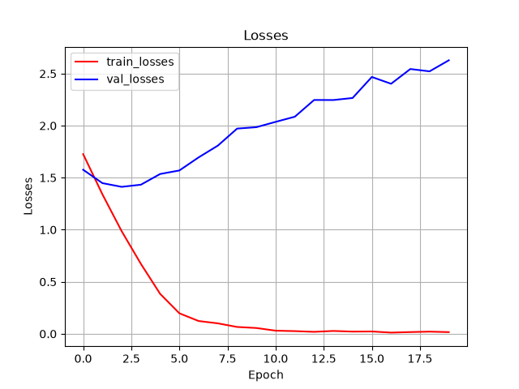
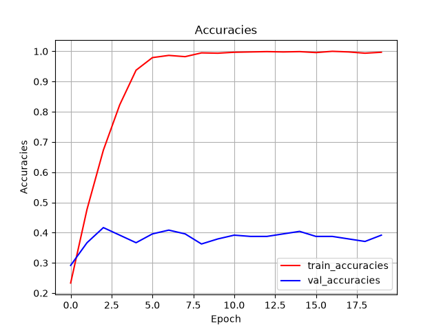
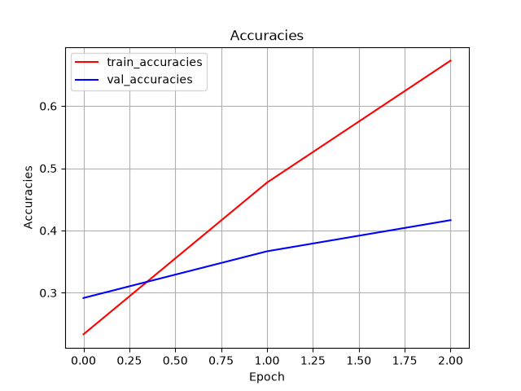
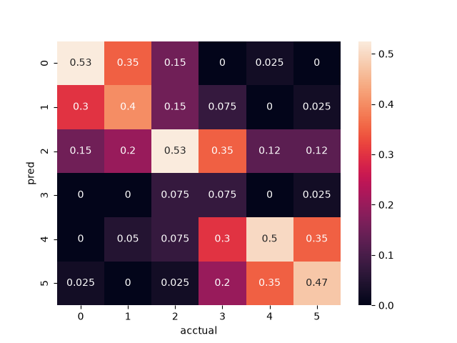

## 顔による年齢識別 {#age-classification}

**画像分類**の事例として, 顔の画像から年代を当てるモデルを作ります. 10 代から 60 代までの 6 クラスへの分類です. データには, 顔の画像約 10 万枚に年齢, 性別, 人種のラベルを付けたデータセット [FairFace](https://github.com/joojs/fairface) (Kärkkäinen & Joo, 2021) を使います. 画像は写真共有サイト Flickr に公開された写真などから顔の部分を切り出したもので, データセットは配布元で [CC BY 4.0](https://creativecommons.org/licenses/by/4.0/deed.ja) (出典を示せば再配布や改変ができるライセンス) と表示されています. ただし論文によると, 元の写真は撮影者が「表示」(CC BY) か「表示 - 継承」(CC BY-SA) のライセンスで公開したものです. また, クリエイティブ・コモンズのライセンスは, 写っている人の肖像権やプライバシーまでは許諾しません. このデータセットの画像を自分の資料に載せるときは出典を示し, 写っている人を特定したり, 人物を評価したりする使い方はしないでください. 年齢は, 年齢そのものではなく `0-2`, `3-9`, `10-19`, `20-29`, `30-39`, `40-49`, `50-59`, `60-69`, `more than 70` の 9 つの階級で付いています.

FairFace の GitHub のページを開き, `Data` の項にある次のリンクから, 画像とラベルをダウンロードしてください. いずれも Google ドライブのページが開くので, 右上のダウンロードのボタンを押します. 画像のファイルは約 550 MB あるので, 通信環境に注意してください. 画像のファイルでは, サイズが大きいので「このファイルのウイルス スキャンを実行できません」という確認の画面が出ます. 「このままダウンロード」を押してください.

- `Images (train + validation set)` の `[Padding=0.25]`: 画像 (`fairface-img-margin025-trainval.zip`)
- `Labels` の `Train`: 訓練用の画像のラベル (`fairface_label_train.csv`)

`Padding=0.25` は顔の周りの余白の少ない版で, 余白の多い `Padding=1.25` の版もあります. `Labels` の `Validation` は検証用の画像のラベルですが, 顔による年齢識別の事例では使いません.

プログラムを置くディレクトリの中に `data` ディレクトリを作り, `fairface_label_train.csv` を保存します. `fairface-img-margin025-trainval.zip` も `data` ディレクトリに移してから展開します. Windows ではファイルを右クリックして「すべて展開」を, macOS ではファイルをダブルクリックします. どちらの場合も `fairface-img-margin025-trainval` というフォルダができ, その中の `train` と `val` のフォルダに画像が入っています.

## 画像ファイルの形式 {#image-file-format}

機械学習で使うラベル付きの画像データには, 画像と CSV などのラベルの表の組み合わせ, ラベル名のフォルダごとに分けた画像ファイル, MATLAB の `.mat` ファイルのように画像とラベルをまとめた形式など, いくつかの形式があります. いずれにも対応できるようにしておく必要がありますが, 年齢識別の事例では最も単純な, ラベル名を付けたフォルダに画像ファイルを保存する形式を使います.

FairFace は, 画像とラベルの表を組み合わせた形式です. 画像のファイル名は `1.jpg`, `2.jpg` のような通し番号で, どの画像がどの年齢の階級かは, ラベルの表 `fairface_label_train.csv` に書かれています. ラベルの表に従って, 年代別に画像をフォルダに保存してみましょう.

~~~ sh
> ls
face_image.py
data

> ls data
fairface-img-margin025-trainval
fairface_label_train.csv
~~~

::: note
- ### CSV ファイルのラベルの表 {#csv-ファイルのラベルの表}
    - 1 行が 1 枚の画像に対応し, 画像のファイル名 (パス) の列と, ラベルの列が並ぶ.
    - `pandas` の `read_csv` で `DataFrame` として読み込む.
    - `fairface_label_train.csv` の列は, `file` (画像のパス), `age` (年齢の階級), `gender` (性別), `race` (人種), `service_test` (データセットの作者の実験で使った画像かどうか).
:::

まずは `fairface_label_train.csv` を読み込み, 中身を確認してみましょう.

::: warn
次のライブラリが必要になるので, `uv add` しておいてください.

- `torch`
    - CNN 用のライブラリ (PyTorch)
- `torchvision`
    - PyTorch の画像, 動画処理用のライブラリ
- `pillow`
    - 画像処理用のライブラリ
- `opencv-python`
    - 画像処理用のライブラリ ([Grad-CAM と Guided Backpropagation](block:img-more#grad-cam)で使います. `import` するときには `cv2` と書きます)

`pandas`, `matplotlib`, `seaborn`, `scikit-learn` も使います. ファイル操作に使う `shutil` は Python の標準ライブラリなので, 追加は要りません.
:::

~~~ py
import os
import pandas as pd
from PIL import Image #画像の表示/保存/書き込みなどを扱うライブラリ

#画像データの保存先
image_dir = 'data/fairface-img-margin025-trainval'

# ラベルの表 (CSV ファイル) の読み込み
labels = pd.read_csv('data/fairface_label_train.csv')

# 先頭の5行を表示する
print(labels.head())
"""
          file    age  gender        race  service_test
0  train/1.jpg  50-59    Male  East Asian          True
1  train/2.jpg  30-39  Female      Indian         False
2  train/3.jpg    3-9  Female       Black         False
3  train/4.jpg  20-29  Female      Indian          True
4  train/5.jpg  20-29  Female      Indian          True
"""

# 行数と列数を表示する
print(labels.shape)
# >>> (86744, 5)

# 年齢の階級ごとの枚数を表示する
print(labels['age'].value_counts())
"""
age
20-29           25598
30-39           19250
40-49           10744
3-9             10408
10-19            9103
50-59            6228
60-69            2779
0-2              1792
more than 70      842
Name: count, dtype: int64
"""

# 画像データの取得と表示
## file列のパスを利用して画像をいくつか開いてみます.
for n in labels['file'][:3]:
    img_path = os.path.join(image_dir, n)  # パスを結合する
    if os.path.exists(img_path):
        img = Image.open(img_path)  # 画像ファイルを開く
        print(img_path, img.size)   # パスと画像の大きさ (幅, 高さ) を表示
        img.show()  # 画像を表示
    else:
        print(f"Image file not found: {img_path}")
"""
data/fairface-img-margin025-trainval/train/1.jpg (224, 224)
data/fairface-img-margin025-trainval/train/2.jpg (224, 224)
data/fairface-img-margin025-trainval/train/3.jpg (224, 224)
>>> 画像が表示されます
"""
~~~

訓練用の画像は 86,744 枚あり, 画像の大きさはすべて 224 × 224 画素にそろえられています. 階級ごとの枚数には偏りがあり, 最も多い 20 代 (`20-29`) は 25,598 枚, 60 代 (`60-69`) は 2,779 枚です.

それでは, `fairface_label_train.csv` をもとに, 年代別にフォルダを分けて画像を保存します. 使うのは `10-19` から `60-69` までの 6 つの階級で, 保存先のフォルダの名前は `10s`, `20s`, ..., `60s` とします. 10 歳未満 (`0-2`, `3-9`) と 70 歳以上 (`more than 70`) の画像は使いません.

研究であれば画像の枚数は多いほど良いのですが, この例では一通りの流れを体験することが目的なので, 手元の PC でも扱いやすいように各年代 200 枚だけコピーします. どの 200 枚を選ぶかは, `DataFrame` の `sample` で, 乱数の種 (`random_state`) を固定してランダムに決めます.

~~~ py
import os
import shutil
import pandas as pd

# 画像ディレクトリの設定
image_dir = 'data/fairface-img-margin025-trainval'
output_dir = 'data/sorted_images'

# ラベルの表の読み込み
labels = pd.read_csv('data/fairface_label_train.csv')

# 年齢の階級と保存先のフォルダ名の対応 (0-2, 3-9, more than 70 は使わない)
age_groups = {'10-19': '10s', '20-29': '20s', '30-39': '30s',
              '40-49': '40s', '50-59': '50s', '60-69': '60s'}

# 年代別のフォルダに画像をコピー（各年代最大200枚）
for age, folder in age_groups.items():
    # この階級の行だけを取り出し, ランダムに最大200行を選ぶ
    rows = labels[labels['age'] == age]
    rows = rows.sample(n=min(200, len(rows)), random_state=42)

    folder_path = os.path.join(output_dir, folder)
    os.makedirs(folder_path, exist_ok=True)

    for file in rows['file']:
        src_path = os.path.join(image_dir, file)                     # 例: data/fairface-img-margin025-trainval/train/123.jpg
        dst_path = os.path.join(folder_path, os.path.basename(file)) # 例: data/sorted_images/10s/123.jpg
        shutil.copy(src_path, dst_path)

    print(folder, len(rows))
"""
10s 200
20s 200
30s 200
40s 200
50s 200
60s 200
"""
~~~

`file` 列の値は `train/123.jpg` のように `train` フォルダからのパスになっています. `os.path.basename` はパスの最後のファイル名 (`123.jpg`) だけを取り出す関数で, 保存先ではフォルダを付けずにファイル名だけを使っています.

結果を確認してみます.

::: warn

シェルのコマンドの `|` は**パイプ**といい, `|` の左側のコマンドの標準出力を右側のコマンドに渡します. `head -20` は, 受け取った出力の先頭 20 行だけを表示するコマンドです.

次の例では, `ls data/sorted_images/10s` で表示される結果の先頭 20 個だけを表示しています.

:::

~~~ sh
> ls data/sorted_images
10s 20s 30s 40s 50s 60s
> ls data/sorted_images/10s |head -20
10085.jpg
10370.jpg
10516.jpg
10599.jpg
1183.jpg
12699.jpg
13286.jpg
13594.jpg
13800.jpg
14253.jpg
14267.jpg
1553.jpg
15592.jpg
15838.jpg
15876.jpg
15916.jpg
15964.jpg
16005.jpg
16037.jpg
16535.jpg
~~~

`ls` はファイル名を文字の順に並べるので, 数値の大きさの順にはなりません. 各フォルダに画像が保存できていることが分かります.

[手書き数字の認識](block:img-recognition#digit-recognition)と同じく, モデルの性能を評価するために, 学習に使う訓練データと, 学習の結果を確かめるテストデータに分けます. 続いて, 訓練用とテスト用でフォルダを分けます.

各年代 200 枚の画像のうち, 8 割 (160 枚) を訓練データ, 2 割 (40 枚) をテストデータにします.

データの分割には, 指定した割合でデータを分ける `sklearn` の `train_test_split` を使います. `os.listdir` が返すファイルの順序は OS によって異なるので, `sorted` でファイル名の順に並べてから分けます. 並べておかないと, 同じ `random_state` でも, PC によって分け方が変わります.

~~~ py
import os
import shutil
from sklearn.model_selection import train_test_split

data_dir = 'data/sorted_images'
output_dir = 'data/sorted_images_split'

# 画像ファイルのパスを収集し,年齢別に分類
age_groups = ['10s', '20s', '30s', '40s', '50s', '60s']
for age_group in age_groups:
    images = sorted(os.listdir(os.path.join(data_dir, age_group)))  # ファイル名の順に並べる
    train_images, val_images = train_test_split(images
                                               ,test_size=0.2 #2割をテスト用データにする
                                               , random_state=42)

    train_dir = os.path.join(output_dir, 'train', age_group)
    val_dir = os.path.join(output_dir, 'val', age_group)
    os.makedirs(train_dir, exist_ok=True)
    os.makedirs(val_dir, exist_ok=True)

    for image in train_images:
        shutil.copy(os.path.join(data_dir, age_group, image), os.path.join(train_dir, image))
    for image in val_images:
        shutil.copy(os.path.join(data_dir, age_group, image), os.path.join(val_dir, image))
~~~

次のような形でデータが保存されていることを確認しましょう.

~~~ sh
data/sorted_images_split
├── train
│      ├── 10s
│      ├── 20s
│      ├── 30s
│      ├── 40s
│      ├── 50s
│      └── 60s
└── val
        ├── 10s
        ├── 20s
        ├── 30s
        ├── 40s
        ├── 50s
        └── 60s
~~~

ここで作ったフォルダの `val` はテストデータです. FairFace に含まれる `val` フォルダ (データセットの作者が分けた検証用の画像) とは別のものです.

## 画像認識の実施 {#run-convnext}

CNN の学習のコードで扱う基本的な概念を説明します.

::: note
- ### **ハイパーパラメータ** {#ハイパーパラメータ}
機械学習では, 学習そのものはプログラムが自動で進めますが, 良い性能を得るには, 人がいくつかのパラメータを設定する必要があります. このように学習の前に人が決めるパラメータを**ハイパーパラメータ**といいます. 改善の手法も多いので, モデルがうまく学習できない場合は, 経験をもとにそれらを調整していきます.

年齢識別の例では細かな調整には踏み込まず, 基本的な処理とパラメータを説明します.

- ### **前処理とデータ拡張 (Data Augmentation)** {#前処理とデータ拡張-data-augmentation}
学習の前に, 画像の大きさをそろえ, 内容と無関係な情報を減らして, 画像を統一した形式にそろえます. また, 反転などで画像を加工して訓練データの種類を増やします. このような加工で訓練データを増やすことを**データ拡張 (Data Augmentation)** といいます.

    - **リサイズ (Resize)**

    画像の大きさをそろえます. ここでは 224 × 224 画素に統一します.

    - **画像反転 (Horizontal Flip)**

    画像を左右に反転させて, データに多様性を加えます.

    - **色調の変化 (Color Jitter)**

    画像の明るさ (`brightness`) とコントラスト (`contrast`) をランダムに変えます. `0.2` は, 元の画像の 0.8 倍から 1.2 倍の範囲で変えることを表します.

    - **テンソル (Tensor) 変換**

    数値の多次元配列を **Tensor** (テンソル) と呼びます. データをテンソルに変換すると, 効率的に学習を行えます.
    例えば, 画像は, 高さ, 幅, チャンネル数 (RGB カラーなどの色) の 3 次元のテンソルとして表します.

    - **正規化 (Normalize)**

    画像データを特定の範囲や分布に変換して, モデルが効率的に学習できるようにする手法を正規化といいます. 画像データは 0 から 255 の範囲の画素の値 (色や濃淡の数値) で表されますが, 値のばらつきが大きすぎると学習が不安定になります. そこで `ToTensor` で 0 から 1 の範囲に変換し, さらに `Normalize` で, 各チャンネルから平均を引いて標準偏差で割ります.

::: warn
正規化に使っている平均 (`[0.485, 0.456, 0.406]`) と標準偏差 (`[0.229, 0.224, 0.225]`) は, ConvNeXt の学習に使われた大規模な画像データベース [ImageNet](https://www.image-net.org) の値です.

本来は**使用するデータの**平均と標準偏差を使います. ここでは事例の紹介なので, 便宜的に ImageNet の値を使っています.

試作のコードでは, すべて `0.5` にすることもよく行われていますが, 本来は使用するデータに合わせて変更すべき値です.
:::

該当部分 (全体のインデントは省略)

~~~py
# データ変換（前処理）
data_transforms = {
    'train': transforms.Compose([
        transforms.Resize((224, 224)),     #画像のリサイズ
        transforms.RandomHorizontalFlip(), #画像をランダムに反転
        transforms.ColorJitter(brightness=0.2, contrast=0.2),  # 色調変化
        transforms.ToTensor(),             #テンソル(多次元配列)に変換
        transforms.Normalize(mean=[0.485, 0.456, 0.406]
                            ,std=[0.229, 0.224, 0.225]), #正規化(本来は値を変更する必要あり.
    ]),
    'val': transforms.Compose([
        transforms.Resize((224, 224)),
        transforms.ToTensor(),
        transforms.Normalize([0.485, 0.456, 0.406]
                            ,[0.229, 0.224, 0.225]),
    ]),
}

~~~

このほかにも, 画像の彩度や明るさの調整, ランダムな回転, 拡大縮小など, さまざまな前処理の手法があり, 状況に応じて使い分けます.

- ### **バッチ (batch) 処理** {#バッチ-batch-処理}

訓練データのすべてを一度に処理するとメモリを大量に消費するので, データを小さなグループに分けて学習します ([ミニバッチ学習](block:ml-network#ニューラルネットワークの学習)). このような分割処理を**バッチ処理**といいます.

分けた 1 グループあたりのデータの数を**バッチサイズ**といいます. バッチサイズが 32 の場合は, 32 個のデータ (ここでは画像ファイル) を同時に処理します.

バッチ内のデータは並列に計算できるので, 速度の面でも効率的に学習できます.

- ### **エポック (epoch) 数** {#エポック-epoch-数}

モデルの性能を高めるために, 同じ訓練データを何度も繰り返して学習します. 訓練データを 1 巡して学習する回数を**エポック数**といいます. 例えば, 10 エポックの場合は, 各年代 160 枚の訓練データを 10 回学習します.

エポック数を増やすと一般に性能は高まりますが, 多すぎると**過学習**が起きます. エポック数を変えて学習し, 誤差がある程度安定する適切なエポック数を見つけます.

過学習を防ぐために学習を途中で自動で打ち切る [早期終了 (`Early Stopping`)](block:dl-training-case#学習の手順を実行する) という方法もあります. 年齢識別の例では指定したエポック数で学習を終えます.

[画像の分類のコード全体](block:img-age-code#age-full-code)では, エポックごとの誤差を記録して, グラフを出力します.

- ### **損失関数 (Loss Function)** {#損失関数-loss-function}
モデルの予測と実際のラベルとの誤差 (損失) を計算する関数を**損失関数**といいます. 損失関数で求めた誤差が大きいほど, モデルの予測が不正確であることを表します.

損失関数にはいくつかの種類がありますが, 年齢識別には**[交差エントロピー損失 (Cross-Entropy Loss)](block:ml-network#ニューラルネットワークの学習)**を使います. 予測された確率分布と実際のラベルとの食い違いの大きさを測る関数です.

- ### **オプティマイザ (Optimizer)** {#オプティマイザ-optimizer}
損失関数の値を最小にするために, モデルのパラメータをどのように更新するかを決めるアルゴリズムを**オプティマイザ**といいます.

基本的には, 損失関数で求めた誤差の勾配 (パラメータについての誤差の微分) を計算し, バッチごとに誤差が減る方向へパラメータを調整します ([勾配降下法](block:ml-network#ニューラルネットワークの学習)).

よく使われるアルゴリズムには, **SGD (Stochastic Gradient Descent)** や **Adam (Adaptive Moment Estimation)** などがあります.

あるオプティマイザでうまくいかない場合は, パラメータやアルゴリズムを変更します.

該当部分 (全体のインデントは省略)

~~~ py
# 損失関数とオプティマイザ
    criterion = nn.CrossEntropyLoss() #クロスエントロピー損失
    optimizer = optim.Adam(model.parameters() #Adam
                          ,lr=0.0001) #Learning rate (学習率)

    #SGDを利用する場合
    #optimizer = optim.SGD(model.parameters(), lr=0.001, momentum=0.9)
~~~

- ### **学習率 (learning rate)** {#学習率-learning-rate}
モデルが重み (パラメータ) を更新するときの更新幅を決めるハイパーパラメータを**学習率 (learning rate)** といいます. 学習では誤差 (損失) を小さくするように重みを調整していきますが, 学習率はその 1 回あたりの調整量を決めます.

学習率が大きいと, 1 回の更新で重みが大きく変わるので, 学習が速く進むことがあります. その反面, 最適な解の前後を行き来して, 解に収束しないことがあります.

学習率が小さいと, 更新幅が小さいので, 安定して最適な解に近づきやすくなります. その反面, 学習に時間がかかります.

一般には `0.001` 程度から始めて調整するのが良いとされています. [画像の分類のコード全体](block:img-age-code#age-full-code)では, 調整の結果 `0.0001` を採用しています.

SGD などのオプティマイザでは学習率の設定が性能を大きく左右するので, 学習の途中で学習率を変えるスケジューリングなどの技法が使われることがあります. 一方で Adam は, 学習率をある程度自動で調整するので, SGD ほど学習率の初期値が結果に影響しません.

- ### **ランダムシード (Random Seed)** {#ランダムシード-random-seed}
CNN は, 重みの初期値, 訓練データのシャッフル, オプティマイザなどで乱数 (ランダムな値) を使うので, 実行するたびに結果が変わるのが普通です.

乱数は, 毎回異なる値になるように, 通常はプログラムを実行したときの PC の内部の時刻などの外部の情報をもとに作られます.

したがって, 通常は, この例と同じデータで同じコードを実行しても, 結果は異なります. それでは検証や例の再現に不便なので, 同じ乱数を使って, できるだけ同じ結果を再現できるようにします.

[画像の分類のコード全体](block:img-age-code#age-full-code)では, 乱数を生成するもとになる値 (**ランダムシード**) を固定しています.

シードの値は適当な数値で構いません. 西暦 (`2024`), 適当な連番 (`1234` など), 特定のミームの数字 (`42` など) がよく使われます.

ただし, 実行環境などの違いにより, ランダムシードを固定しても完全に同じ値にはなりません.

`set_seed()` の行をコメントアウトすると通常の乱数が使われるので, 研究に使う場合などは適宜変更してください.

該当部分 (全体のインデントは省略)

~~~py
# 乱数シードを設定
def set_seed(seed):
    torch.manual_seed(seed)
    np.random.seed(seed)              # Numpy用の乱数シードを設定
    random.seed(seed)                 # Pythonの標準乱数シードを設定

    # 再現性を完全に保証するために以下も設定（ただし、若干のパフォーマンス低下の可能性あり）
    torch.backends.cudnn.deterministic = True
    torch.backends.cudnn.benchmark = False

def main():
    # シードを設定する
    #(自分の研究でやる場合は以下の行は消しても問題ない.)
    set_seed(2024)
~~~

- ### **GPU の使い方** {#gpu-の使い方}
GPU を使って計算する設定 (CUDA と MPS) は, [BERT の GPU 設定](block:nlp-bert#cuda-compute-unified-device-architecture)と同じです. [年齢識別のコード](block:img-age-code#age-full-code)でも, CUDA か MPS が使える場合はそれを使い, 使えない場合は CPU を使います.

:::

分割した画像を使って, ConvNeXt による学習を行います. コードの全体は, [画像の分類のコード全体](block:img-age-code#age-full-code)に載せています. そのコードは, 学習の後に, [特徴量の次元圧縮](block:img-more#feature-embedding), [特徴マップ](block:img-more#feature-maps), [Grad-CAM](block:img-more#grad-cam)の図も出力します. ImageNet で事前学習した ConvNeXt の重みを読み込み, 最後の全結合層だけを 6 クラスの出力に付け替えてから学習するので, [ファインチューニング](block:dl-transformer#自己教師あり学習)にあたります.

::: warn
このコードを実行すると, PC の性能によっては, 10 分以上にわたって CPU や GPU のほぼすべてが使われます. 例えば, Apple M5 Max を搭載した Mac (MPS を使用) では, 3 エポックの学習と図の出力に約 4 分, 20 エポックでは約 18 分かかりました. GPU を使えない PC では, これより大幅に長くかかります. ほかの不要なアプリを閉じて, 時間に余裕があるときに, 電源につないだ状態で実行しましょう. このコードは手元の PC でも動くように作ってありますが, うまくいかない場合は [Google Colaboratory](/lectures/colab.html) で試してみましょう.

:::

::: warn

コードを実行して次のような Warning が表示される場合は, 環境によって対処が異なるので, 教員に相談してください.

~~~ sh
Found Intel OpenMP ('libiomp') and LLVM OpenMP ('libomp') loaded at
the same time. Both libraries are known to be incompatible and this
can cause random crashes or deadlocks on Linux when loaded in the
same Python program.
Using threadpoolctl may cause crashes or deadlocks. For more
information and possible workarounds, please see
    https://github.com/joblib/threadpoolctl/blob/master/multiple_openmp.md
~~~
:::

[年齢識別のコード](block:img-age-code#age-full-code)が出力する `convnext_loss.png` と `convnext_acc.png` は, エポックごとの損失 (`loss`) と正解率 (`acc`) の推移を表しています. `acc` はモデルが予測したラベルが実際のラベルと一致した割合で, `1` なら予測がすべて正解です. 10 代から 60 代までの 6 ラベルなので, ランダムにラベルを予測しても, 正解率は $1/6 \approx 0.17$ 程度になります.

次の 2 つのグラフは, `num_epochs` を `20` にして学習したときのものです.

グラフの横軸は 0 から数えたエポックの番号です. 訓練データの損失 (赤) は 7 エポック目までに `0.12` まで下がり, その後も 0 の近くにとどまります. 横軸の 16 (17 エポック目) では, 訓練データの正解率が `1.0` に達しています. 一方で, テストデータの損失 (青) は横軸の 2 (3 エポック目) の `1.41` が最も低く, その後はおおむね増え続けて, 20 エポック目には `2.63` になります. テストデータの正解率も 3 エポック目の `0.417` が最も高く, その後は `0.36` から `0.41` の間で上下するだけです. 訓練データの損失が下がったまま, テストデータの損失だけが増えるのは, [エポック (epoch) 数](#エポック-epoch-数)の説明で挙げた過学習の典型的な形です. 各年代 160 枚の訓練データは, ConvNeXt のパラメータの数 (約 2,800 万) と比べてはるかに少ないので, モデルは訓練データの 1 枚 1 枚に特有の特徴まで覚えて訓練データの損失を下げ, その特徴は新しい画像には通用しません.

損失の比較を踏まえ, テストデータの損失が最も低かった `3` に `num_epochs` を変更して, もう一度学習します ([画像の分類のコード全体](block:img-age-code#age-full-code)は `3` にしてあります). ランダムシードを固定しているので, 3 エポック目までは 20 エポックの場合と同じ値が出力されます.

~~~ sh
Epoch 1/3
----------
train Loss: 1.7262 Acc: 0.2333
val Loss: 1.5763 Acc: 0.2917
Epoch 2/3
----------
train Loss: 1.3405 Acc: 0.4771
val Loss: 1.4478 Acc: 0.3667
Epoch 3/3
----------
train Loss: 0.9863 Acc: 0.6729
val Loss: 1.4121 Acc: 0.4167
~~~

最終的に, テストデータでの正解率は `0.417` (240 枚のうち 100 枚が正解) になりました. それほど高い値ではありませんが, ランダムな予測 ($1/6 \approx 0.17$) の 2 倍以上なので, この例ではこのモデルで先へ進みます. 実際の研究などでは, データを増やす, ハイパーパラメータやアルゴリズムを変更するなどして, より良い値を目指します. FairFace には各年代に 2,000 枚以上の画像があるので, 1 クラスあたりの枚数の上限を増やすのが最初に試せる方法です.

出力される `pred_acctual_heatmap.png` は, テストデータについて, 実際のラベル (横軸) ごとに, どのラベルと予測したか (縦軸) を数え, 列ごとの相対度数にしたヒートマップです. 縦と横が入れ替わっていますが, [手書き数字の混同行列](block:img-recognition#digits-errors)と同じ表です. すべて正しく予測できていれば, 度数は対角線上に集中します. 軸の番号の 0 から 5 は, 10 代から 60 代に対応します.

ヒートマップを見ると, 度数は対角線とその両隣に集まっています. 実際のラベルが 10 代と 20 代 (横軸の 0, 1) のとき, 50 代か 60 代と予測した割合は合わせて 0.05 以下で, 実際のラベルが 60 代 (横軸の 5) のとき, 10 代と予測した割合は 0 です. 年齢の大きく離れた年代とはほとんど取り違えていません.

誤りの多くは隣の年代との取り違えです. 実際のラベルが 10 代のときに 20 代と予測した割合は 0.3, 20 代のときに 10 代と予測した割合は 0.35 で, 50 代と 60 代の間でも 0.35 ずつ取り違えています. 最も識別できていないのは 40 代 (横軸の 3) で, 40 代と正しく予測した割合は 0.075 しかありません. 40 代の画像は, 30 代 (0.35), 50 代 (0.3), 60 代 (0.2) と予測されています. 縦軸の 3 の行を見ると, どの年代の画像も 40 代とはほとんど予測されておらず, モデルは 40 代というラベル自体をほとんど使っていません.

