## 畳み込みニューラルネットワーク {#cnn}

手書き数字の認識では, 画像を 64 個の値の並びにして全結合層に入力しました. 画像認識や音声認識のニューラルネットワークでは, 全結合層だけでなく, 画像の形を活かす**畳み込みニューラルネットワーク (Convolutional Neural Network, CNN)** が広く使われています.

[第8章](block:ml-network#ニューラルネットワークの構成)で説明した基本的なニューラルネットワークは, 入力層, 全結合層と ReLU などの活性化関数による隠れ層, softmax 関数などによる出力層から構成されていました.

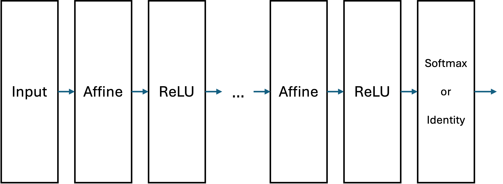

全結合層 (Affine Layer) では, 入力のすべてのニューロンが次の層のすべてのニューロンと結合します. そのため, 入力はすべて 1 列のベクトルに並べ直します. しかし画像データは, 縦, 横, チャンネル (RGB なら 3 チャンネル) の 3 次元の構造を持ちます. 例えば, 28 × 28 画素のグレースケール画像 (1 チャンネル) は, $28 \times 28 \times 1$ という構造です.

画像を 1 列に並べ直すと, どの画素とどの画素が隣り合っているかという空間的な構造の情報が使われなくなります. 手書き数字の MLP にとって, 左上の画素と右隣の画素は, 左上の画素と右下の画素と同じく「64 個のうちの 2 つ」にすぎません. そのため, 近くの画素がつくる線や角のような局所的な特徴を捉えにくくなります.

そこで CNN では, **畳み込み層 (Convolution Layer)** と**プーリング層 (Pooling Layer)** を加えて, データの空間的な構造を取り込みます.

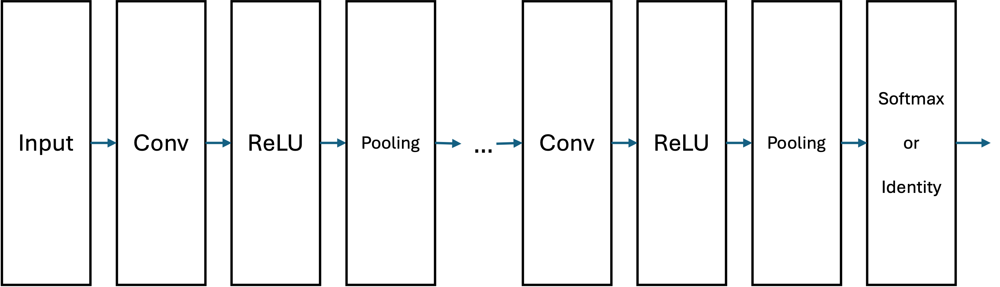

::: note

- ### 畳み込み層 (Convolution Layer) {#畳み込み層-convolution-layer}

畳み込み層は, 入力データ $I$ にフィルタ (カーネル) $K$ を適用して, 特徴マップ $F$ を生成します. 畳み込みの演算は次の式で表されます.

$$
F(x, y) = \sum_{i=1}^{m} \sum_{j=1}^{n} I(x+i, y+j) \cdot K(i, j)
$$

$I(x, y)$: 入力画像の画素の値 (例: グレースケール画像なら 0 から 255 の値), $K(i, j)$: フィルタ (カーネル) の要素, $m \times n$: フィルタの大きさ (例: $3 \times 3$).

フィルタを画像の上で少しずつずらしながら適用することで, 画像の中の特徴 (エッジや模様など) を取り出します.

例として, $4 \times 4$ のグレースケール画像を考えます. 各要素は 0 から 255 の画素の値を持ちます.

入力画像 $I$:

$$
I =
\begin{bmatrix}
1 & 2 & 3 & 0 \\
0 & 1 & 2 & 3 \\
1 & 0 & 1 & 2 \\
2 & 1 & 0 & 1
\end{bmatrix}
$$

フィルタ $K$:

$$
K =
\begin{bmatrix}
1 & 0 & -1 \\
1 & 0 & -1 \\
1 & 0 & -1
\end{bmatrix}
$$

このフィルタは, **垂直方向のエッジ (輪郭)** を検出するカーネルとしてよく使われます.

- ### 畳み込み演算の手順 {#畳み込み演算の手順}

畳み込み演算では, フィルタ $K$ を入力画像 $I$ に適用し, 次の手順を繰り返します.

1. フィルタ $K$ を入力画像 $I$ の一部 (局所領域) に重ねます.
2. 重なった要素同士を掛け算し, その結果を合計します.
3. 合計値を特徴マップ $F$ の対応する位置に記録します.
4. フィルタをストライド (移動量) の分だけずらし, 同じ計算を繰り返します.

ストライドは 1 (1 画素ずつ移動) とします. 入力画像が $4 \times 4$, フィルタの大きさが $3 \times 3$, ストライドが 1 の場合, 出力の特徴マップの大きさは次の式で計算されます.

$$
F_{\text{Size}} = \left( I_{\text{Size}} - K_{\text{Size}} \right) / \text{Stride} + 1
$$

$$
F_{\text{Size}} = (4 - 3) / 1 + 1 = 2
$$

したがって, 出力の特徴マップ $F$ の大きさは $2 \times 2$ になります.

**ステップ 1: フィルタを左上に重ねる**

入力画像の左上の $3 \times 3$ の領域:

$$
\begin{bmatrix}
1 & 2 & 3 \\
0 & 1 & 2 \\
1 & 0 & 1
\end{bmatrix}
$$

フィルタ $K$ を適用します.

$$
F(1, 1) =
\begin{bmatrix}
1 & 2 & 3 \\
0 & 1 & 2 \\
1 & 0 & 1 \\
\end{bmatrix}
\cdot
\begin{bmatrix}
1 & 0 & -1 \\
1 & 0 & -1 \\
1 & 0 & -1
\end{bmatrix} \\
=
(1 \cdot 1) + (0 \cdot 2) + (-1 \cdot 3) +
(1 \cdot 0) + (0 \cdot 1) + (-1 \cdot 2) +
(1 \cdot 1) + (0 \cdot 0) + (-1 \cdot 1) \\
= 1 + 0 - 3 + 0 + 0 - 2 + 1 + 0 - 1 = -4
$$

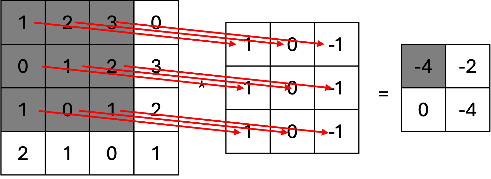

**ステップ 2: フィルタを右に 1 つ移動する**

入力画像の次の領域:

$$
\begin{bmatrix}
2 & 3 & 0 \\
1 & 2 & 3 \\
0 & 1 & 2
\end{bmatrix}
$$

フィルタ $K$ を適用します.

$$
F(1, 2) =
\begin{bmatrix}
2 & 3 & 0 \\
1 & 2 & 3 \\
0 & 1 & 2 \\
\end{bmatrix}
\cdot
\begin{bmatrix}
1 & 0 & -1 \\
1 & 0 & -1 \\
1 & 0 & -1
\end{bmatrix}
= -2
$$

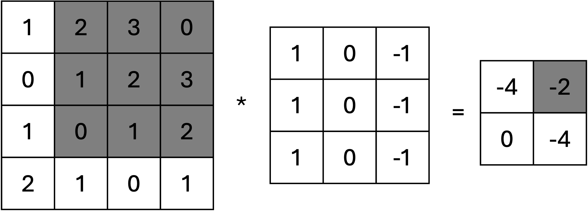

**ステップ 3: フィルタを左下に移動する**

入力画像の次の領域:

$$
\begin{bmatrix}
0 & 1 & 2 \\
1 & 0 & 1 \\
2 & 1 & 0
\end{bmatrix}
$$

フィルタ $K$ を適用します.

$$
F(2, 1) =
\begin{bmatrix}
0 & 1 & 2 \\
1 & 0 & 1 \\
2 & 1 & 0 \\
\end{bmatrix}
\cdot
\begin{bmatrix}
1 & 0 & -1 \\
1 & 0 & -1 \\
1 & 0 & -1
\end{bmatrix}
= 0
$$

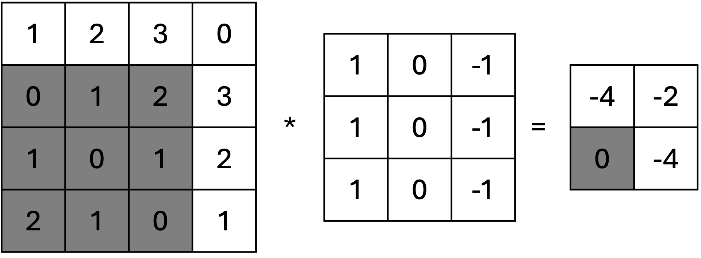

**ステップ 4: フィルタを右下に移動する**

入力画像の次の領域:

$$
\begin{bmatrix}
1 & 2 & 3 \\
0 & 1 & 2 \\
1 & 0 & 1
\end{bmatrix}
$$

同様に計算します.

$$
F(2, 2) =
\begin{bmatrix}
1 & 2 & 3 \\
0 & 1 & 2 \\
1 & 0 & 1
\end{bmatrix}
\cdot
\begin{bmatrix}
1 & 0 & -1 \\
1 & 0 & -1 \\
1 & 0 & -1
\end{bmatrix}
= -4
$$

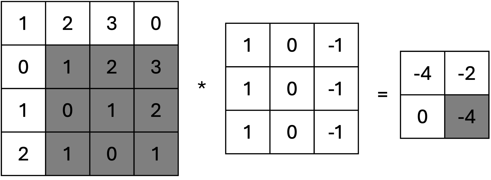

**特徴マップの結果**

畳み込み演算の結果として得られる特徴マップ $F$ は次のとおりです.

$$
F =
\begin{bmatrix}
-4 & -2 \\
0  & -4
\end{bmatrix}
$$

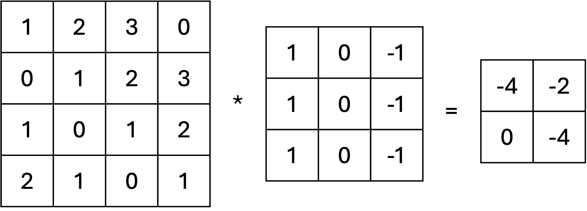

この例の画像にカーネルを適用すると次のようになります.

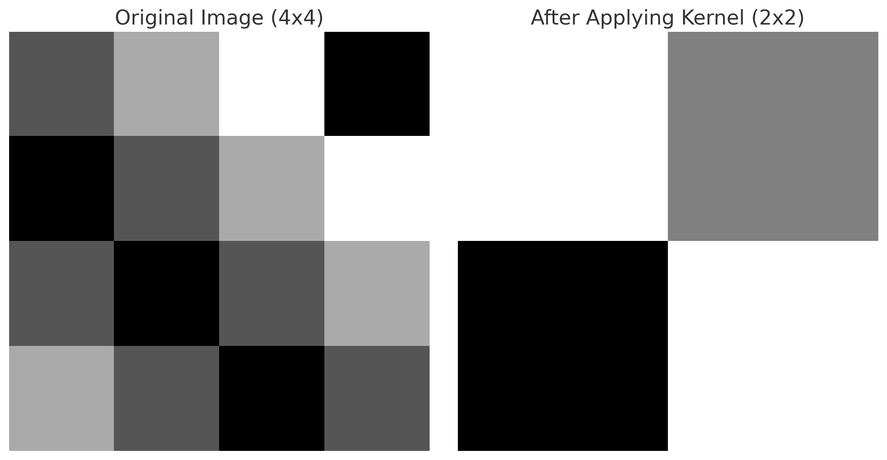

4 × 4 の画像では単純すぎて効果が分かりにくいので, 我が家の犬の画像をグレースケールにしたものに, 同じカーネルを適用したのが次の画像です. 物体の垂直方向のエッジ (輪郭) だけが強調されています.

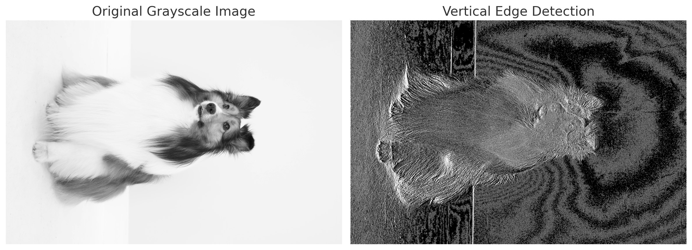

ほかの代表的なカーネルには, 次のようなものがあります.

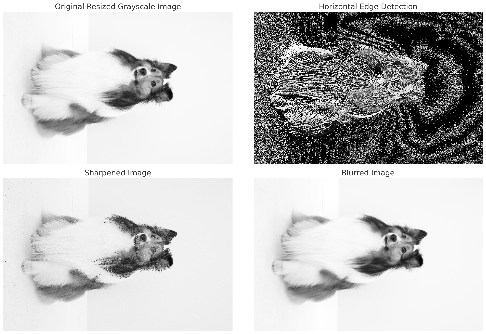

- ### 水平エッジ検出カーネル (Horizontal Edge Detection Kernel) {#水平エッジ検出カーネル-horizontal-edge-detection-kernel}

$$
K_{\text{horizontal}} =
\begin{bmatrix}
1 & 1 & 1 \\
0 & 0 & 0 \\
-1 & -1 & -1
\end{bmatrix}
$$

このカーネルは, 画像の中の水平方向のエッジを検出します. 上部の値 ($+1$) と下部の値 ($-1$) の符号が逆なので, 上下で明るさの違う境界で大きな値になります. 地平線や階段の段差のような水平の線を取り出すのに向いています.

- ### シャープ化カーネル (Sharpen Kernel) {#シャープ化カーネル-sharpen-kernel}

$$
K_{\text{sharpen}} =
\begin{bmatrix}
0 & -1 & 0 \\
-1 & 5 & -1 \\
0 & -1 & 0
\end{bmatrix}
$$

中央の値 ($5$) が大きく, 周囲の値 ($-1$) が小さいので, 注目する画素と周囲の画素との明るさの差が強調されます. その結果, 画像のエッジや細部が際立ちます. エッジを目立たせたい場合や, ぼやけた画像を鮮明にする場合に使います.

- ### ぼかし (ブラー) カーネル (Blur Kernel) {#ぼかし-ブラー-カーネル-blur-kernel}

$$
K_{\text{blur}} =
\frac{1}{9}
\begin{bmatrix}
1 & 1 & 1 \\
1 & 1 & 1 \\
1 & 1 & 1
\end{bmatrix}
$$

このカーネルは, 隣接する画素の平均値を計算して, 画像全体を滑らかにします. 画素間の明るさの差が緩やかになるので, ノイズの低減に役立ちます. 背景の処理やノイズの軽減に使います.

このように, フィルタの形や値によって, 異なる特徴 (エッジ, 模様など) を捉えられます. 畳み込みフィルタの各セルの値は, これまでのニューラルネットワークの重み $W$ と同じ働きをし, CNN ではその値が学習の対象になります.

:::

::: note

- ### プーリング層 (Pooling Layer) {#プーリング層-pooling-layer}

プーリング層は, 特徴マップを縮小して計算量を減らすとともに, 特徴の位置が少しずれても結果が変わりにくくする役割を持ちます. 例えば, **最大プーリング (Max Pooling)** は次の式で表されます.

$$
P(x, y) = \max_{i=1}^{m} \max_{j=1}^{n} F(x+i, y+j)
$$

$F(x, y)$: 入力の特徴マップ, $P(x, y)$: プーリング後の特徴マップ, $m \times n$: プーリングのウィンドウの大きさ (例: $2 \times 2$).

最大プーリングは, 各ウィンドウ内の最大値を取り出して, 特徴が最も強く表れた部分を残します. 画像中のエッジや明るい部分を強調するのに向いています.

例として, $4 \times 4$ の行列に, $2 \times 2$ のウィンドウで最大プーリングを適用します.

入力の行列:

$$
I =
\begin{bmatrix}
1 & 3 & 2 & 1 \\
4 & 6 & 5 & 0 \\
7 & 8 & 9 & 2 \\
3 & 4 & 1 & 6
\end{bmatrix}
$$

各 $2 \times 2$ のウィンドウ内の最大値を取り, 縮小された行列を作ります.

$$
\begin{bmatrix}
1 & 3 \\
4 & 6
\end{bmatrix}
\quad \text{最大値: } 6
$$

$$
\begin{bmatrix}
2 & 1 \\
5 & 0
\end{bmatrix}
\quad \text{最大値: } 5
$$

$$
\begin{bmatrix}
7 & 8 \\
3 & 4
\end{bmatrix}
\quad \text{最大値: } 8
$$

$$
\begin{bmatrix}
9 & 2 \\
1 & 6
\end{bmatrix}
\quad \text{最大値: } 9
$$

出力の行列:

$$
P_{\text{max}} =
\begin{bmatrix}
6 & 5 \\
8 & 9
\end{bmatrix}
$$

:::

CNN の全体のデータの流れを式でまとめると, 次のようになります.

::: note

1. 畳み込み層:

$$
F^{(l)} = f(W^{(l)} * F^{(l-1)} + b^{(l)})
$$

$W^{(l)}$: 畳み込みフィルタ (重み), $F^{(l-1)}$: 前の層の特徴マップ, $b^{(l)}$: バイアス, $f$: 活性化関数 (例: ReLU).

2. プーリング層:

$$
P^{(l)} = \text{Pooling}(F^{(l)})
$$

3. 全結合層:

$$
Y = \text{Softmax}(WX + B)
$$

$W$: 全結合層の重み行列, $X$: プーリング層の出力, $B$: バイアス.

:::

CNN は, 畳み込み層で特徴を取り出し, プーリング層でデータの次元を縮小し, 全結合層で最終的な予測を行います. [パターン認識: 特徴抽出と識別](block:img-recognition#pattern-recognition)の 2 つの段階でいえば, 畳み込み層とプーリング層が特徴抽出に, 最後の全結合層が識別にあたります. 畳み込み層を何段も重ねると, 前の段で取り出したエッジを組み合わせて角や曲線を, さらにそれらを組み合わせて目や鼻のような部品を, というように, 段を追って複雑な特徴を取り出せるようになります.

# 代表的な CNN モデル {#cnn-models}

CNN を使った主な画像認識モデルの歴史は, 次のようにまとめられます.

| 年代 | モデル名 | 特徴・概要 | 主な貢献や革新点 |
|---|---|---|---|
| 1998 | LeNet | 手書き数字の認識に使われた初期の CNN. 主に MNIST データセットで使われた. | 畳み込み層とプーリング層を使った初期の画像認識モデル. |
| 2012 | AlexNet | 画像認識の競技会 ImageNet で CNN を使い, 上位 5 候補の誤り率を大幅に改善した. | ReLU 活性化関数の使用, GPU による学習の導入. |
| 2014 | VGGNet | 小さな 3 × 3 のフィルタを多層に積み重ねた構成. VGG16 と VGG19 が特に有名. | モデルの深さが精度に大きく寄与することを示した. |
| 2014 | GoogLeNet (Inception) | Inception モジュールを採用し, 計算効率と精度を両立した. | 異なる大きさの畳み込みフィルタを同時に適用する Inception モジュール. |
| 2015 | ResNet | 残差ブロックを使い, 100 層を超えるネットワークの学習を可能にした. ImageNet で優勝. | 層を飛ばす接続 (スキップ接続) で勾配消失を抑え, 152 層のネットワークを学習した. |
| 2016 | DenseNet | 各層がそれより前のすべての層から入力を受け取る密結合の構成. | パラメータの効率が良く, 勾配の流れが改善される. |
| 2017 | Xception | 通常の畳み込みの代わりに深さ方向の畳み込み (Depthwise Separable Convolution) を使う. | 計算コストの削減と精度の向上. |
| 2017 | MobileNet | 軽量で効率的な CNN の構成. モバイル機器向けに最適化されている. | 計算量を減らし, モバイル環境でのリアルタイムの推論を可能にした. |
| 2020 | Vision Transformer (ViT) | 画像をパッチに分割し, Transformer の構成で処理するモデル. | Transformer が画像認識でも有効であることを示した. |
| 2021 | Swin Transformer | 局所的な窓 (ウィンドウ) を使う階層的な Transformer による画像認識モデル. | Transformer の拡張性を改善し, 高い精度を達成した. |
| 2022 | ConvNeXt | Vision Transformer のアイデアを取り入れた, 畳み込みネットワークの発展版. | 畳み込みベースのモデルが再び最先端の性能を達成できることを示した. |

Vision Transformer は CNN ではありませんが, CNN と比べられる画像認識のモデルとして表に含めています. 仕組みは, 続く[Vision Transformer](block:img-more#vision-transformer)で説明します.

ここでは, ConvNeXt を使った[画像認識を実行](block:img-age#age-classification)します.

[ConvNeXt](https://github.com/facebookresearch/ConvNeXt) は Meta (旧 Facebook) が発表したモデルで, Swin Transformer を参考にしつつ, ResNet (Residual Network) を基盤として作られた CNN です.

ConvNeXt では, 畳み込み層に `Depthwise Convolution` を使っています. これは, 畳み込みを入力画像のチャンネルごとに独立して計算する手法です. 通常の畳み込みでは, 入力画像の複数のチャンネルを同時に処理するので, 計算コストが大きくなります. 一方, Depthwise Convolution では, 1 つのチャンネルに 1 つのフィルタで畳み込みを行い, それを全チャンネル分繰り返した後に, 別の 1 × 1 の畳み込み (Pointwise Convolution と呼ぶことが多い) でチャンネル間の情報を組み合わせます. 計算コストを抑えながら性能を高めたことが, ConvNeXt の大きな特徴です.

プーリング層には, `Adaptive Average Pooling` (アダプティブ平均プーリング) を採用しています. 普通の平均プーリングでは, プーリングの領域の大きさを固定して画素を平均します. Adaptive Average Pooling では, 最終的に出力したい大きさを指定します. すると, 入力画像の大きさに合わせて区切り方が自動で調整され, 均等に平均がとられます. そのため, 入力画像の解像度が変わっても, ネットワークの最終的な出力ベクトルの大きさを一定に保てます.

また, 活性化関数として, ReLU の発展形である `GELU (Gaussian Error Linear Unit)` を採用しています.

$$
\mathrm{GELU}(x) = \frac{x}{2} \left[ 1 + \mathrm{erf}\left(\frac{x}{\sqrt{2}}\right) \right]
$$

ここで $\mathrm{erf}(x)$ は**誤差関数 (error function)** と呼ばれる関数です.

$$
\mathrm{erf}(x) = \frac{2}{\sqrt{\pi}}\int_{0}^{x} e^{-t^2} dt
$$

GELU は, 入力が小さい (特に 0 より負の側の) ときは出力を小さく抑え, 入力が大きくなるにつれて徐々に出力を増やしていく, なめらかな活性化関数です. ReLU と比べると, 入力が 0 の付近で緩やかに変化するので, 勾配が急に 0 になることがなく, 学習を安定させる効果が期待できます.

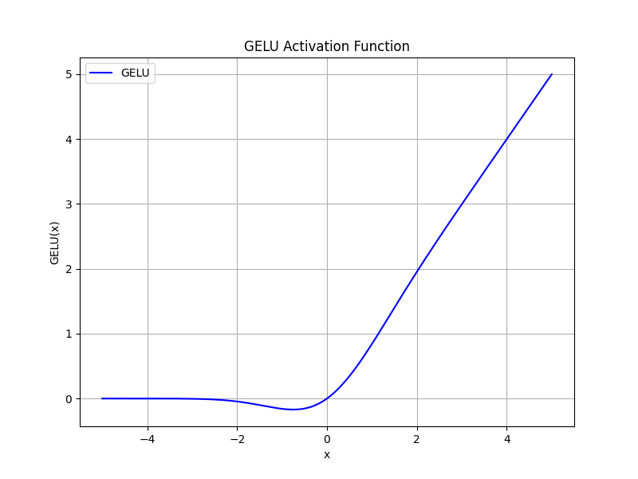

Python の CNN のライブラリはいくつかありますが, ConvNeXt は Meta が開発した `PyTorch` の上で実装されています.

