## Vision Transformer {#vision-transformer}

**Vision Transformer (ViT)** は, [第8章](block:dl-transformer#自己注意と-transformer-の構成)の Transformer を画像の認識に使うモデルです (2020 年). 文章をトークンの並びとして扱ったのと同じように, 画像を小さな正方形の区画 (**パッチ**) の並びとして扱います.

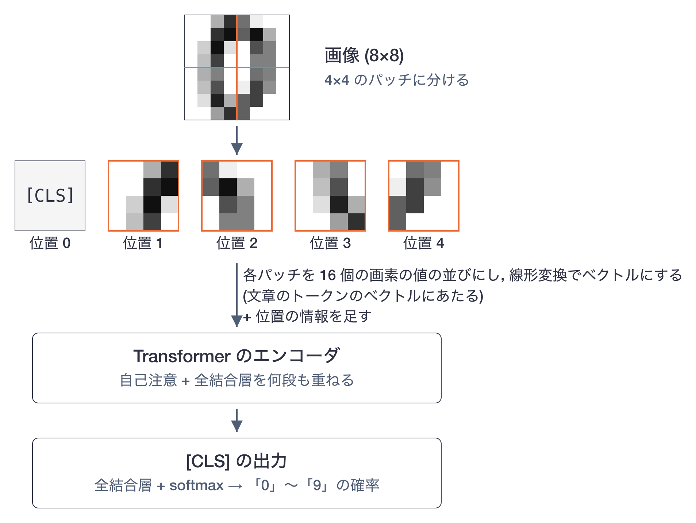

図は, 手書き数字の「0」の画像 (8 × 8 画素) を例に, ViT の処理の流れを描いたものです.

1. 画像をパッチに分けます. 図では 4 × 4 画素のパッチ 4 つに分けています. もとの ViT では, 224 × 224 画素の画像を 16 × 16 画素のパッチに分けるので, パッチは $14 \times 14 = 196$ 個になります.
2. 各パッチの画素の値を 1 列に並べ (図では 16 個の値), 学習で決まる行列を掛けてベクトルにします. このベクトルが, 「猫が鳴く」の各トークンのベクトル ([第8章](block:dl-transformer#系列データと注意機構)) にあたります. 画像はパッチの並びという「文」になり, 各パッチが「単語」の役割をします.
3. 先頭に, 分類のための特別なトークン `[CLS]` を加えます. `[CLS]` のベクトルも学習で決まります.
4. 各ベクトルに, 何番目のパッチかを表す位置の情報を足します. 自己注意の計算には並び順が入らないので, 位置の情報がないと, パッチの配置を入れ替えた画像と区別できません. 文章で「猫が鳴く」と「鳴くが猫」を区別するために位置エンコーディングを足したのと同じ理由です.
5. Transformer のエンコーダ (自己注意と全結合層の組) を何段も重ねて通します. 各段の自己注意で, 各パッチのベクトルは, すべてのパッチのベクトルを注意の重みで足し合わせたものに更新されます.
6. 最後の段の `[CLS]` のベクトルを全結合層と softmax 関数に通し, 各クラスの確率を出します. `[CLS]` は, 自己注意を通してすべてのパッチから情報を集めるので, 画像全体を要約したベクトルになります.

CNN と ViT の違いは, 1 つの層で参照する範囲にあります. CNN の畳み込み層は, フィルタの大きさの範囲 ($3 \times 3$ など) の近くの画素だけを見て, 層を重ねるごとに参照する範囲を少しずつ広げます. ViT の自己注意は, 最初の層から, 画像の離れた位置にあるパッチ同士の関係も直接扱えます. 例えば顔の画像なら, 目のパッチと口のパッチの関係を 1 段目から計算できます.

その反面, ViT には「近くの画素ほど関係が深い」という画像の性質が, 仕組みとして組み込まれていません. この性質も学習で身に付ける必要があるので, CNN よりも多くの訓練データが必要になります. もとの ViT は, 1000 万枚を超える規模の画像で事前学習したときに, CNN と同等以上の精度に達しました. [代表的な CNN モデル](block:img-cnn#cnn-models)の表にある ConvNeXt は, 逆に ViT の工夫を CNN に取り入れて, CNN でも同等の精度を出せることを示したモデルです.

ViT では, `[CLS]` から各パッチへの注意の重みを画像の上に重ねて表示すると, モデルが画像のどの部分に注目したかを可視化できます. [Grad-CAM と Guided Backpropagation](#grad-cam)と同じく, モデルの判断の根拠を調べる手がかりになります.

# 学習した特徴量の次元圧縮 (PCA と t-SNE) {#feature-embedding}

[年齢識別のコード全体](block:img-age-code#age-full-code)は, 学習したモデルが訓練データの各画像について出力した値を特徴量として取り出し, PCA と t-SNE で 2 次元に圧縮した散布図も出力します (`convnext_pca.png` と `convnext_tsne.png`). PCA (主成分分析) は, データのばらつきが大きい方向から順に軸を取り直し, 上位の軸だけを残して次元を減らす手法です. t-SNE は, 高い次元で近くにある点同士が 2 次元でも近くに来るように配置する手法です. 2 つの手法の仕組みと違いは, [第7章](/lectures/dsp7.html)の[次元削減: 主成分分析](block:ml-clustering#pca)と[非線形の次元削減: t-SNE](block:ml-clustering-more#t-sne)で説明しています.

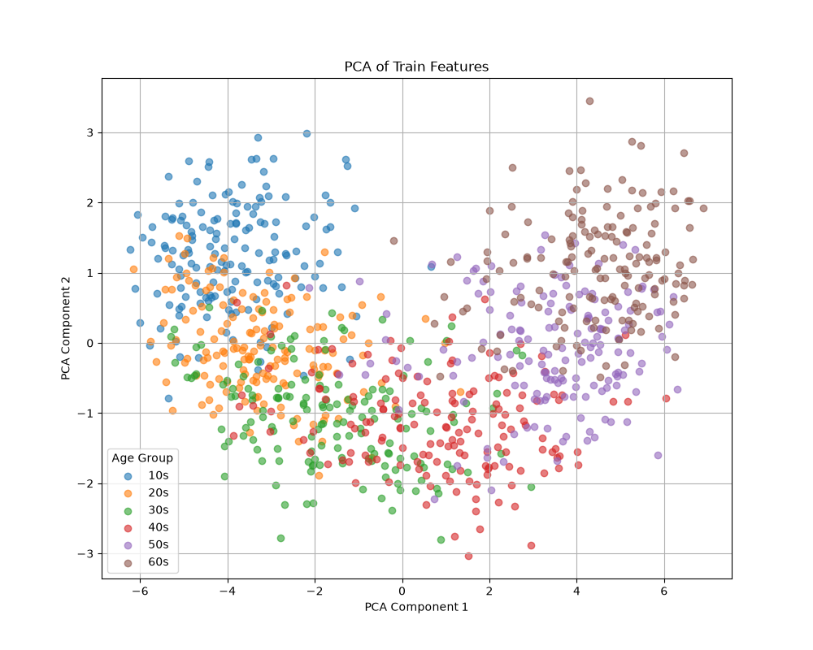

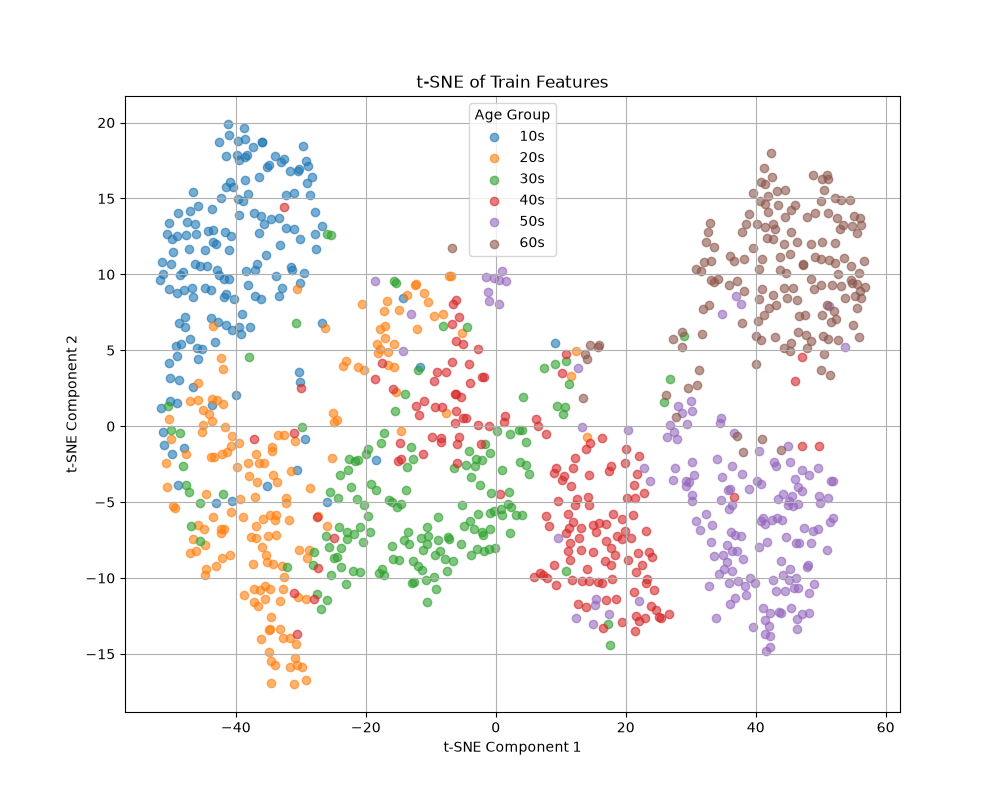

いずれの図でも, 左から右へ行くにつれて年代が高くなっており, モデルが年代をある程度識別できていることが分かります. PCA の図では, 10 代 (青) が左上に, 60 代 (茶) が右上に集まり, 20 代から 50 代はその間を U 字の形につないでいます. 20 代と 30 代, 50 代と 60 代は重なる範囲が広く, 40 代 (赤) は 30 代と 50 代の間に散らばっています. t-SNE の図では, 10 代, 50 代, 60 代がそれぞれまとまっています. 20 代, 30 代, 40 代もそれぞれの集まりを作りますが, 中央付近 (横軸の -20 から 10 のあたり) では 3 つの年代の点が入り混じっています. 30 代と 40 代の区別が難しいことは, [画像認識の実施](block:img-age#run-convnext)のヒートマップで 40 代の正解の割合が低かったことと合っています.

ただし, これらの図は訓練データの特徴量から描いたものです. モデルは訓練データに合わせて学習しているので, テストデータで描くよりも年代ごとにまとまって見えます. テストデータで同じ図を描くには, `val_features` と `val_labels` を `plot_tsne` と `plot_pca` に渡します.

学習したモデルの特徴量をこのように分析すると, それぞれのクラスの特徴がある程度見えてきます.

# 特徴マップ {#feature-maps}

学習したモデルがどのような基準で判断しているかを説明するのは難しいのですが, いくつかの方法があります. まずは基本的な方法として, 各層でどのような特徴を取り出しているかを可視化した**特徴マップ**を見てみましょう.

ここでは, 畳み込み層の出力を年代 (10s から 60s) ごとに可視化します. 特徴マップは, 最初の層から最終層に近づくにつれて抽象度が上がり, 解釈が難しくなります. `target_layers_indices = [0,5,-1]` で指定した 0 層, 5 層, 最終層 (`-1`) を対象にしていますが, 必要であれば可視化する層を増やしてみましょう.

次のコードは, [年齢識別のコード全体](block:img-age-code#age-full-code)の `main` 関数から, 特徴マップを描く部分を抜き出したものです. 画像は次のようなフォルダ構成で保存されます.

~~~ sh
❯ tree -d data/result
data/result
├── feature_maps
│   ├── 10s
│   │   ├── features_-1
│   │   ├── features_0
│   │   ├── features_5
│   │   └── last_conv
│   ├── 20s
│   │   ├── features_-1
│   │   ├── features_0
│   │   ├── features_5
│   │   └── last_conv
│   ├── 30s
│   │   ├── features_-1
│   │   ├── features_0
│   │   ├── features_5
│   │   └── last_conv
│   ├── 40s
│   │   ├── features_-1
│   │   ├── features_0
│   │   ├── features_5
│   │   └── last_conv
│   ├── 50s
│   │   ├── features_-1
│   │   ├── features_0
│   │   ├── features_5
│   │   └── last_conv
│   └── 60s
│       ├── features_-1
│       ├── features_0
│       ├── features_5
│       └── last_conv

~~~

コードは次のとおりです.

~~~ py
#------------------------------------------------------------------
#特徴マップの描画
#------------------------------------------------------------------
# 中間層のフックを設定する層リストの設定例
target_layers_indices = [0, 5, -1]  # お好みで変更可能

# フックで取り出した特徴マップを保持する辞書
intermediate_feature_maps = {}

def get_intermediate_hook(name):
    def hook_fn(m, input, output):
        # output: [B, C, H, W]
        intermediate_feature_maps[name] = output.detach().cpu()
    return hook_fn

# 対象層にフックを登録
hooks = []
for idx in target_layers_indices:
    layer_name = f"features_{idx}"
    h = model.features[idx].register_forward_hook(get_intermediate_hook(layer_name))
    hooks.append(h)

# --- 最後の畳み込み層のフック ---
feature_maps_last_conv = []
def get_feature_map_hook_conv(self, input, output):
    feature_maps_last_conv.append(output.detach().cpu())

hook_conv = model.features[-1].register_forward_hook(get_feature_map_hook_conv)

# 抽出したいクラス (0:10s,1:20s,...,5:60s)
target_classes = [0,1,2,3,4,5]
# 各クラスから9枚ずつ取得するためのカウンタ
images_per_class = 9
extracted_counts = {cls: 0 for cls in target_classes}

# 保存ディレクトリの用意
base_dir = 'data/result/feature_maps'
if not os.path.exists(base_dir):
    os.makedirs(base_dir)

# クラスごとのフォルダを作成 (10s～60s)
for cls in target_classes:
    class_label_str = f"{(cls+1)*10}s"
    class_dir = os.path.join(base_dir, class_label_str)
    if not os.path.exists(class_dir):
        os.makedirs(class_dir)
    # 中間層用のサブフォルダを用意
    for idx in target_layers_indices:
        layer_name = f"features_{idx}"
        layer_dir = os.path.join(class_dir, layer_name)
        if not os.path.exists(layer_dir):
            os.makedirs(layer_dir)

    # 最終Conv層用のフォルダ
    last_conv_dir = os.path.join(class_dir, 'last_conv')
    if not os.path.exists(last_conv_dir):
        os.makedirs(last_conv_dir)

model.eval()
val_iter = iter(dataloaders['val'])
with torch.no_grad():
    # 全クラスが指定枚数分揃うまで繰り返す
    while not all(count == images_per_class for count in extracted_counts.values()):
        try:
            inputs, labels = next(val_iter)
        except StopIteration:
            # データがなくなったら終了
            break

        inputs = inputs.to(device)
        # フック用リストをクリア
        feature_maps_last_conv.clear()
        intermediate_feature_maps.clear()

        # 順伝播：フックで特徴マップ取得
        outputs = model(inputs)

        fm_batch = feature_maps_last_conv[0]   # [B, C, H, W] 最終Conv層出力

        for i in range(inputs.size(0)):
            cls = labels[i].item()
            if cls in target_classes and extracted_counts[cls] < images_per_class:

                class_label_str = f"{(cls+1)*10}s"
                class_dir = os.path.join(base_dir, class_label_str)

                # 中間層特徴マップ可視化
                for idx in target_layers_indices:
                    layer_name = f"features_{idx}"
                    fm_intermediate = intermediate_feature_maps[layer_name][i] # shape: [C, H, W]
                    num_channels_to_plot = min(8, fm_intermediate.shape[0])

                    fig, axes = plt.subplots(2, 4, figsize=(12, 6))
                    axes = axes.flatten()
                    for ch in range(num_channels_to_plot):
                        ax = axes[ch]
                        ax.imshow(fm_intermediate[ch].numpy(), cmap='viridis')
                        ax.axis('off')
                    plt.suptitle(f'Intermediate Layer {layer_name} Feature Maps: Class {(cls+1)*10}s (Image {extracted_counts[cls]+1})')

                    layer_dir = os.path.join(class_dir, layer_name)
                    out_path = os.path.join(layer_dir, f'feature_map_{extracted_counts[cls]+1}.png')
                    plt.savefig(out_path)
                    plt.close()

                # 最終Conv層特徴マップ可視化
                fm = fm_batch[i]  # shape: [C, H, W]
                num_channels_to_plot = min(8, fm.shape[0])
                fig, axes = plt.subplots(2, 4, figsize=(12, 6))
                axes = axes.flatten()
                for ch in range(num_channels_to_plot):
                    ax = axes[ch]
                    ax.imshow(fm[ch].numpy(), cmap='viridis')
                    ax.axis('off')
                plt.suptitle(f'Last Conv Feature Maps: Class {(cls+1)*10}s (Image {extracted_counts[cls]+1})')
                last_conv_dir = os.path.join(class_dir, 'last_conv')
                out_path = os.path.join(last_conv_dir, f'feature_map_{extracted_counts[cls]+1}.png')
                plt.savefig(out_path)
                plt.close()

                extracted_counts[cls] += 1

                if all(count == images_per_class for count in extracted_counts.values()):
                    break

# フックを削除
hook_conv.remove()
for h in hooks:
    h.remove()
print('特徴マップ描画完了')
~~~

生成した画像のうち, 10 代 (10s) と 60 代 (60s) の 1 枚目 (テストデータの `DataLoader` から最初に取り出された画像. [Grad-CAM と Guided Backpropagation](#grad-cam)で使う画像とは別のもの) の特徴マップを確認してみましょう (画像の出典: [FairFace](https://github.com/joojs/fairface) (Kärkkäinen & Joo, 2021), [CC BY 4.0](https://creativecommons.org/licenses/by/4.0/deed.ja). 特徴マップの図は, 元の画像をモデルに入力して得た中間層の出力を描いたもので, 元の画像を加工しています).

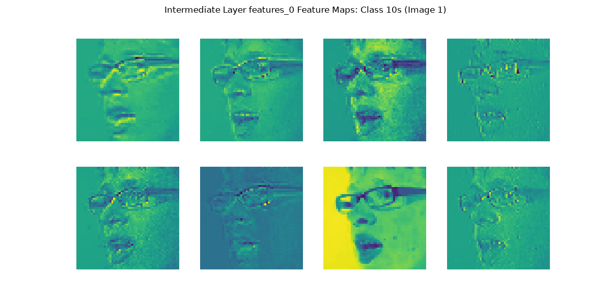
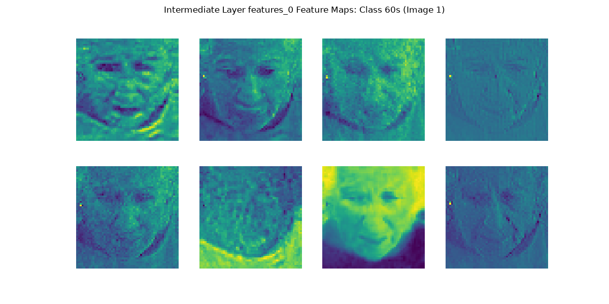

最初の層の特徴マップは抽象化が進んでおらず, 入力画像に近い形状や明暗を捉えています. 10 代の画像では眼鏡の縁や唇の輪郭, 60 代の画像では顔の輪郭や目の周りの線が, チャンネルによって明るく, あるいは暗く表れています. この段階ではまだ「顔」「目」「鼻」などのまとまった対象は捉えておらず, 画素の単位での色, 明るさ, エッジなどの低次の特徴 (輪郭や縞模様, 明るい部分や暗い部分など) を取り出している段階に見えます.

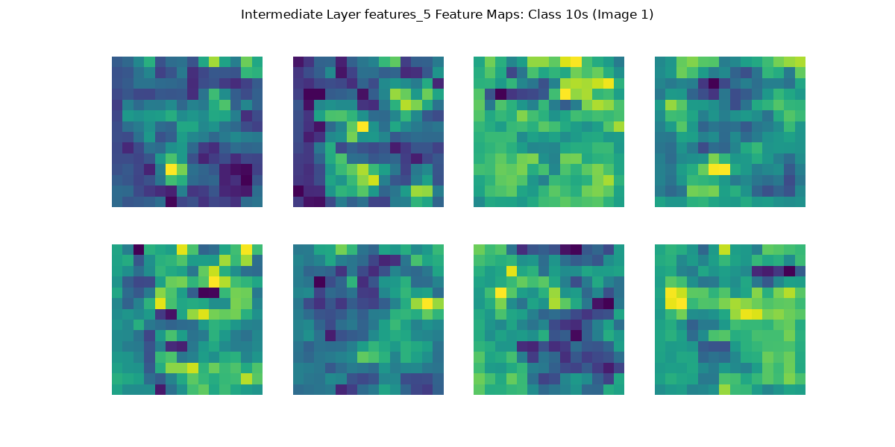
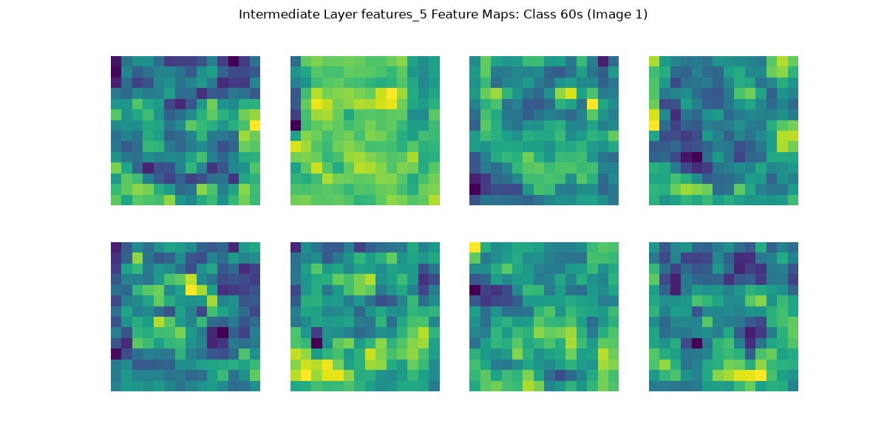

5 層の特徴マップは 14 × 14 の粗い解像度になり, 人物の顔そのものは読み取れません. モザイク状の特徴マップの中に, 一部のマスだけが明るいものがあり, 特定の領域に強く反応するフィルタがあることが分かります.

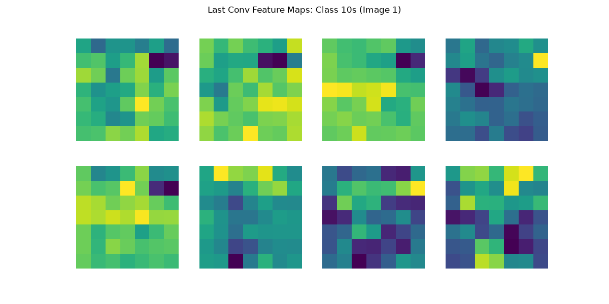
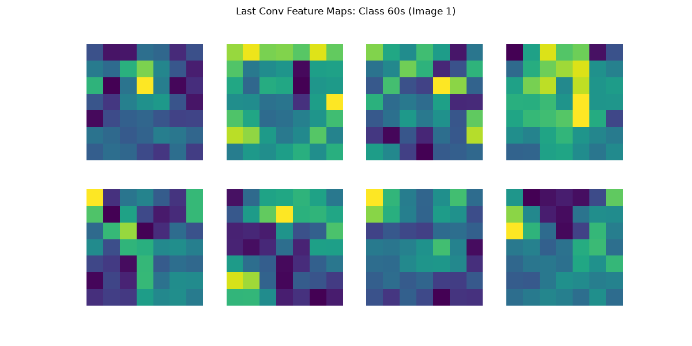

最終層の特徴マップは 7 × 7 になり, 人が見ても元の画像との対応は分からなくなります. それでも, ネットワークにとって意味のある特徴 (特定の配置や模様, 対象物のおおよその形など) がチャンネルごとに表されていると考えられます. この段階では, 分類に役立つ特徴が少数の値に凝縮されています. なお, コードの `features_-1` と `last_conv` は, どちらも `model.features[-1]` の出力なので, 同じ特徴マップが保存されます.

# Grad-CAM と Guided Backpropagation {#grad-cam}

特徴マップで, 学習した CNN の内部を可視化できました. しかし, 特徴マップを人が見て, CNN の判断の基準を説明するのは困難です. そこで, CNN の判断を人が説明できるように, 特徴マップの情報を元の画像の上に重ねて示す技法がいくつかあります.

::: note
1. `Grad-CAM (Gradient-weighted Class Activation Mapping)`

    Grad-CAM は, 予測するクラスについての勾配の情報を, CNN の中間層 (通常は最後の畳み込み層) の特徴マップに結び付けて, 画像のどの領域がクラスの識別に最も寄与しているかを可視化する手法です. 対象のクラスの得点の勾配を特徴マップまで逆伝播させてチャンネルごとの重みを求め, その重みで特徴マップを足し合わせて, 元の画像の上にクラスに特有の注目領域を示すヒートマップを作ります. ネットワークが判断の際に注目した画像の箇所が, 目で見て分かるようになります.

2. `Guided Backpropagation`

    Guided Backpropagation は, ネットワークの内部を逆向きに伝わる勾配を, 活性化関数 (ReLU など) を通るたびに, 入力が正の位置にある正の値だけを通すように制限して, 入力画像のどの画素が予測に大きく寄与しているかを可視化する手法です. 正の影響だけを残すので, 予測したクラスを支持する特徴に焦点を当てられます.

3. `Guided Grad-CAM`

    Grad-CAM と Guided Backpropagation を組み合わせた手法です. CNN が出力した予測に対して, どの画素がどの程度そのクラスの予測に貢献しているかを, より細かく可視化することを目指しています.

:::

ここでは 10s と 60s に限定して, これらの手法を実行してみましょう. 次のコードも, [年齢識別のコード全体](block:img-age-code#age-full-code)の `main` 関数から抜き出したものです (`nonlocal` を使っているので, 単独では動きません).

~~~py
#------------------------------------------------------------------
# Grad-CAM, Guided Backprop, Guided Grad-CAM の実行 (10s, 60sに限定)
#------------------------------------------------------------------
import cv2

# 対象クラスIDとクラス名
target_cam_classes = {0:'10s', 5:'60s'}

# valデータからサンプル画像を取得
base_val_dir = os.path.join(data_dir, 'val')
sample_images = {}
for cls_id, cls_name in target_cam_classes.items():
    cls_dir = os.path.join(base_val_dir, cls_name)
    img_name = sorted(os.listdir(cls_dir))[0]  # ファイル名の順で最初の画像
    img_path = os.path.join(cls_dir, img_name)
    sample_images[cls_id] = img_path

# Grad-CAM用フック設定
target_layer = model.features[-1]
features = None
gradients = None

def forward_hook(module, input, output):
    nonlocal features
    features = output

def backward_hook(module, grad_input, grad_output):
    nonlocal gradients
    gradients = grad_output[0]

forward_h = target_layer.register_forward_hook(forward_hook)
backward_h = target_layer.register_full_backward_hook(backward_hook)

# Guided Backprop用: ConvNeXtの活性化関数GELUの逆伝播を書き換える
# ReLUのGuided Backpropと同じ規則で, 入力が正の位置にある正の勾配だけを通す
gelu_inputs = {}  # moduleをキーにしてforwardの入力を保存

def gelu_forward_hook(module, input, output):
    gelu_inputs[module] = input[0]

def gelu_backward_hook(module, grad_input, grad_output):
    # grad_output[0]: GELUの出力についての勾配 (上の層から届いた勾配)
    # 返した値が, GELUの入力についての勾配として下の層へ伝わる
    positive_input = (gelu_inputs[module] > 0).float()  # 入力が正の位置だけ1
    positive_grad = torch.clamp(grad_output[0], min=0)  # 負の勾配を0にする
    return (positive_grad * positive_input,)

# GELU層にフックを登録
guided_hooks = []
for m in model.modules():
    if isinstance(m, nn.GELU):
        fh = m.register_forward_hook(gelu_forward_hook)
        bh = m.register_full_backward_hook(gelu_backward_hook)
        guided_hooks.append(fh)
        guided_hooks.append(bh)

def preprocess_image(img_path):
    img = Image.open(img_path).convert('RGB')
    img = img.resize((224, 224))
    img_tensor = data_transforms['val'](img).unsqueeze(0).to(device)
    return img, img_tensor

def generate_gradcam():
    pooled_gradients = torch.mean(gradients, dim=[0,2,3])
    cam = torch.zeros(features.shape[2:], dtype=features.dtype, device=features.device)
    for i in range(features.shape[1]):
        cam += pooled_gradients[i] * features[0,i,:,:]
    cam = cam.cpu().data.numpy()
    cam = np.maximum(cam, 0)
    if np.max(cam) != 0:
        cam = cam / np.max(cam)
    return cam

def normalize_gradient(grad):
    # 平均が0.5, 標準偏差が0.15になるように揃えて, 0〜1の範囲に収める
    # (最小値と最大値で0〜1に揃えると, 少数の極端な値に合わせて全体がほぼ灰色になる)
    grad = (grad - grad.mean()) / (grad.std() + 1e-8)
    return np.clip(grad * 0.15 + 0.5, 0, 1)

def do_guided_backprop(model, img_tensor, target_class):
    # 勾配リセット
    model.zero_grad()
    img_tensor.grad = None
    # forward
    output = model(img_tensor)
    loss = output[0, target_class]
    model.zero_grad()
    loss.backward()
    # 入力画像についての勾配 (正規化する前の値) を返す
    guided_grad = img_tensor.grad.data[0].cpu().numpy().transpose(1,2,0)
    return guided_grad

def apply_colormap_on_image(org_img, cam, alpha=0.5):
    H_org, W_org, _ = org_img.shape
    cam_resized = cv2.resize(cam, (W_org, H_org))

    heatmap = cv2.applyColorMap(np.uint8(255*cam_resized), cv2.COLORMAP_JET)
    heatmap = np.float32(heatmap)/255.0
    org_img = np.float32(org_img)/255.0

    cam_img = heatmap * alpha + org_img
    cam_img = cam_img / np.max(cam_img)
    return np.uint8(255*cam_img)

def guided_gradcam(guided_grad, cam):
    # 正規化する前の勾配にGrad-CAMを掛けてから, 表示用に正規化する
    H, W, _ = guided_grad.shape
    cam_resized = cv2.resize(cam, (W, H))
    guided_gradcam = guided_grad * cam_resized[..., np.newaxis]
    return normalize_gradient(guided_gradcam)

gradcam_dir = 'data/result/gradcam_guided'
if not os.path.exists(gradcam_dir):
    os.makedirs(gradcam_dir)

model.eval()
from PIL import Image
for cls_id, img_path in sample_images.items():
    # original画像読み込み
    org_img, img_tensor = preprocess_image(img_path)
    org_img_np = np.array(org_img)  # RGB, 224x224
    img_tensor.requires_grad = True

    # Grad-CAM
    model.zero_grad()
    output = model(img_tensor)
    target_score = output[0, cls_id]
    target_score.backward()
    cam = generate_gradcam()

    # Grad-CAM画像
    org_img_cv = org_img_np[:,:,::-1].copy()
    gradcam_img = apply_colormap_on_image(org_img_cv, cam)
    gradcam_img_rgb = gradcam_img[:,:,::-1]

    # Guided Backprop
    gb = do_guided_backprop(model, img_tensor, cls_id) # 正規化前の勾配
    g_gradcam = guided_gradcam(gb, cam) # 0-1 float

    original_uint8 = org_img_np
    gradcam_uint8 = gradcam_img_rgb
    gb_uint8 = (normalize_gradient(gb)*255).astype(np.uint8)
    g_gradcam_uint8 = (g_gradcam*255).astype(np.uint8)

    combined = np.hstack([original_uint8, gradcam_uint8, gb_uint8, g_gradcam_uint8])
    plt.imsave(os.path.join(gradcam_dir, f'class_{cls_id}_combined.png'), combined)

forward_h.remove()
backward_h.remove()
for h in guided_hooks:
    h.remove()

print("Grad-CAM, Guided Backprop, Guided Grad-CAM 完了")
~~~

10 代と 60 代のテストデータから, ファイル名の順で最初の画像を 1 枚ずつ選び, 年齢識別のモデルにこれらの手法を適用した結果が次のとおりです. 左から元の画像, `Grad-CAM`, `Guided Backpropagation`, `Guided Grad-CAM` の順に並べています. どちらの画像も, モデルは正しい年代を予測しています (6 つの年代のうち, 正しい年代の確率が最も高く, どちらも 0.48 です).

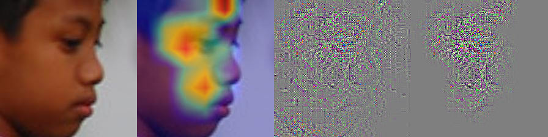

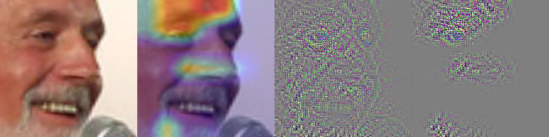

画像の出典: [FairFace](https://github.com/joojs/fairface) (Kärkkäinen & Joo, 2021), [CC BY 4.0](https://creativecommons.org/licenses/by/4.0/deed.ja). 元の画像に Grad-CAM のヒートマップを重ねる, Guided Backpropagation の結果を掛け合わせるなどの加工をしています.

`Grad-CAM` を見ると, 学習したモデルは, 10 代の画像では目の周りと, 鼻の横から口にかけての頬に, 60 代の画像では額と鼻, 顎のひげに注目しています. 60 代の画像で注目している額は, しわの寄りやすい場所です. 人が年齢を推測するときにも額のしわやひげの白さを手がかりにすることがあるので, それなりに納得できる結果です. ただし, 1 枚ずつの画像から言えることは限られます. 実際の研究では, 多くの画像を比べて, モデルが何に注目しているかを分析します.

`Guided Backpropagation` の画像は, どちらも細かい粒状の模様が全体に広がり, 目や鼻の輪郭がかすかに分かる程度です. `Guided Grad-CAM` では, その模様のうち `Grad-CAM` が注目した領域にあるものだけが残ります.

`Guided Backpropagation` が何を映すかは, 輪郭のはっきりした物体の画像で確かめると分かりやすくなります. 次の図は, ImageNet で事前学習した ConvNeXt-Tiny (分類層を 6 クラス用に置き換える前のモデル) に猫とコーヒーカップの画像を入れ, モデルが予測したクラス (ImageNet のクラス番号 285 の Egyptian cat と 967 の espresso) について, 上のコードを実行した結果です. 左から元の画像, `Grad-CAM`, `Guided Backpropagation`, `Guided Grad-CAM` の順に並べています. 画像は scikit-image に付属するサンプル画像 (`skimage.data.chelsea`, `skimage.data.coffee`) です.

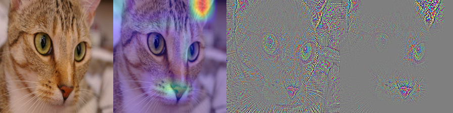

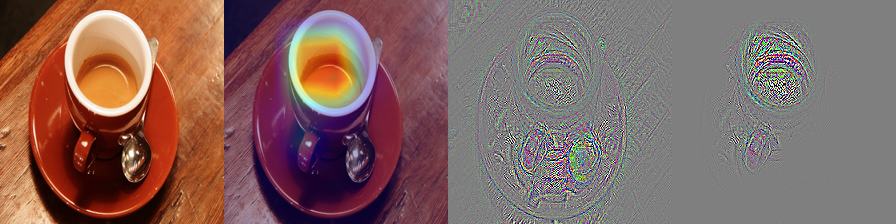

`Guided Backpropagation` の画像には, 猫の目, 鼻, ひげや, カップと受け皿の縁のように, 予測したクラスを支える輪郭が画素の単位で表れます. `Guided Grad-CAM` では, それらの輪郭のうち, `Grad-CAM` が注目した領域 (猫の鼻と目, カップの中) にあるものだけが残ります.

::: note
Guided Backpropagation の実装で次の 2 点を誤ると, 画像がほぼ一様な灰色になり, 画素ごとの寄与が読み取れなくなります (この資料の以前のコードにも, この 2 点の誤りがありました). 次の図は, 左から元の画像, 2 点とも誤った結果, 正規化だけを直した結果, 2 点とも直した結果です (いずれも事前学習済みのモデル).

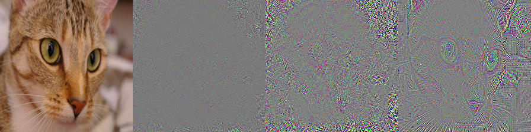

1. **負の勾配を 0 にしていない**: 以前のコードは, GELU の出力が正の位置だけ勾配を通していましたが, 勾配そのものの符号は見ていませんでした. これは通常の逆伝播で ReLU を通るときと同じ計算なので, 得られる画像は通常の勾配に近いもの (相関係数は 0.7 程度) になり, 正と負の値が細かく入り混じります. Guided Backpropagation では, 入力が正の位置であることに加えて, 上の層から届いた勾配が負ならその勾配を 0 にします. 修正したコードでは, `torch.clamp(grad_output[0], min=0)` で負の勾配を 0 にしています.
2. **最小値と最大値で正規化している**: 入力画像についての勾配は, ごく少数の画素だけが極端に大きな値を取ります. 最小値と最大値で 0〜1 の範囲に揃えると, その少数の画素に合わせて目盛りが決まるので, 残りの画素はすべて中間の灰色に近い値になります. 修正したコードでは, 平均と標準偏差で揃えています (`normalize_gradient`). `Guided Grad-CAM` も, 正規化した後の画像ではなく, 正規化する前の勾配に `Grad-CAM` を掛けてから正規化するように直しています.

ConvNeXt の活性化関数は ReLU ではなく GELU です. GELU は負の入力に対して 0 に近い小さな負の値を返すだけなので, ReLU の規則 (入力が正の位置にある正の勾配だけを通す) をそのまま当てはめています. GELU の本来の微分で逆伝播したうえで負の勾配を 0 にする方法でも, ほぼ同じ画像 (相関係数は 0.8 程度) になります. フックの登録には, 推奨されなくなった `register_backward_hook` ではなく `register_full_backward_hook` を使っています.
:::

