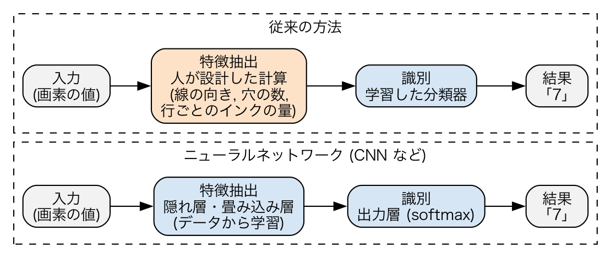
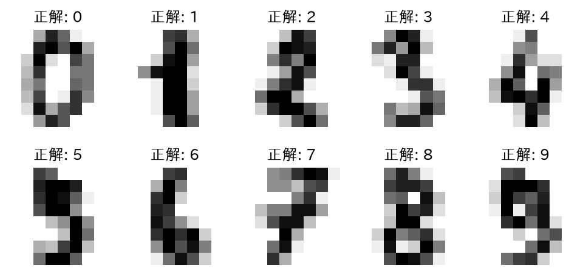
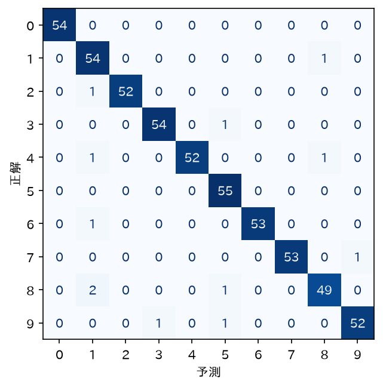
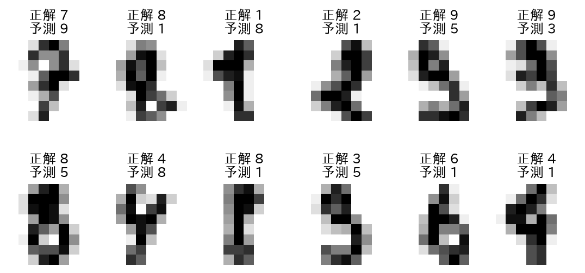

## 画像認識 {#画像認識}

画像や音声から, そこに写っているものや話された言葉を当てる技術を**認識**といいます. 仕組みを学んだ[ニューラルネットワーク](block:ml-network#ニューラルネットワーク概要)を, [BERT による自然言語処理](block:nlp-bert#ニューラル言語モデル)に続いて画像や音声の認識で動かします. [手書き数字の認識](block:img-recognition#digit-recognition)を scikit-learn で試した後, 画像認識で広く使われる[畳み込みニューラルネットワーク](block:img-cnn#cnn)の仕組みを確かめ, 顔の画像から年代を当てるモデルを PyTorch で[学習](block:img-age#age-classification)させます. [音声認識](block:img-speech#speech-recognition)にも画像認識と同じ考え方を使えます.

# 認識技術の活用事例 {#recognition-applications}

認識の技術は, 身近なところで多く使われています.

| 分野 | 認識するもの | 入力 |
|---|---|---|
| 郵便 | はがきや封筒に手書きされた郵便番号 | 郵便物を撮影した画像 |
| 事務 | 書類, レシート, 名刺の文字 (**OCR**, 光学文字認識) | 紙をスキャンした画像 |
| 本人確認 | 登録された本人の顔かどうか (**顔認証**) | カメラで撮影した顔の画像 |
| 音声アシスタント | 話しかけた言葉 (**音声認識**) | マイクで録音した音 |
| 医療 | X 線や CT の画像に写った病変の候補 | 医療用の画像 |
| 自動車 | 歩行者, 他の車, 道路標識 | 車載カメラの画像 |

どの事例も, 画像や音という数値の集まりを入力にして, 「どの数字か」「本人か他人か」「どの言葉か」のように, あらかじめ決まった選択肢 (クラス) のどれにあたるかを答えています. 形のうえでは[教師あり分類](block:ml-classification#predictive-modeling)と同じ問題です. ただし入力は, 列ごとに意味の決まった表のデータではなく, 大量の画素の値や音の振幅の並びです.

# パターン認識: 特徴抽出と識別 {#pattern-recognition}

画像や音声のようなデータを, 決まったクラスのどれかに振り分けることを**パターン認識**といいます. パターン認識は, 次の 2 つの段階に分けて考えます.

- **特徴抽出**: 入力から, クラスを見分けるのに役立つ値 (**特徴**) を取り出す.
- **識別**: 取り出した特徴から, どのクラスにあたるかを決める. [決定木](block:ml-classification#決定木分析)のような分類器が担う.

特徴抽出が要るのは, 画素の値そのものがクラスとの対応を直接表していないからです. 同じ「7」でも, 書く位置が 1 画素ずれるだけで, すべての画素の値が変わります. 一方で「線で囲まれた穴がいくつあるか」は, 位置がずれても変わりません. 穴は「0」「6」「9」に 1 つ, 「8」に 2 つあり, 「1」「7」にはありません. このように, 書き方の違いでは変わりにくく, クラスによって違う値が, 識別に役立つ特徴です.

従来のパターン認識では, 図の上段のように, 何を特徴にするかを人が考えて設計しました. 穴の数, 線の向き, 行ごとのインクの量などです. 識別の部分は学習で決めますが, 認識の性能は, 人が設計した特徴の良し悪しで大きく左右されました.

ニューラルネットワークでは, 図の下段のように, 特徴抽出の部分も学習で決めます. 隠れ層の重みは, 識別に役立つ特徴を取り出すように, 訓練データから決まります. 画像向けの**畳み込みニューラルネットワーク (CNN)** では, 畳み込み層のフィルタがこの役割を担います. [畳み込みニューラルネットワーク](block:img-cnn#cnn)で説明する縦のエッジを取り出すフィルタは, 人が設計した特徴抽出の一例です. CNN はこのフィルタの値を人が決めずに, 学習で決めます.

# 手書き数字の認識 {#digit-recognition}

パターン認識の流れを, 手書き数字の画像で試します. [ニューラルネットワーク](block:ml-network)の例で使った手書き数字の認識を, scikit-learn のニューラルネットワークで実際に行います.

::: warn
この節では次のライブラリを使います. `uv add` しておいてください.

~~~ sh
uv add numpy matplotlib matplotlib-fontja scikit-learn
~~~

:::

## 数字の画像データ {#digits-data}

scikit-learn には, 手書きの数字 0 から 9 の画像 1797 枚が付属しています. 各画像は縦 8 画素, 横 8 画素で, 各画素の値はインクの濃さを 0 (白) から 16 (黒) で表します. `load_digits` で読み込めるので, ダウンロードは要りません.

~~~ py
import numpy as np
import matplotlib.pyplot as plt
import matplotlib_fontja
from sklearn.datasets import load_digits

digits = load_digits()
print(digits.images.shape)  # (枚数, 縦, 横)
print(digits.images[0])     # 1 枚目の画像の画素の値
print(digits.target[:10])   # 最初の 10 枚の正解
"""
(1797, 8, 8)
[[ 0.  0.  5. 13.  9.  1.  0.  0.]
 [ 0.  0. 13. 15. 10. 15.  5.  0.]
 [ 0.  3. 15.  2.  0. 11.  8.  0.]
 [ 0.  4. 12.  0.  0.  8.  8.  0.]
 [ 0.  5.  8.  0.  0.  9.  8.  0.]
 [ 0.  4. 11.  0.  1. 12.  7.  0.]
 [ 0.  2. 14.  5. 10. 12.  0.  0.]
 [ 0.  0.  6. 13. 10.  0.  0.  0.]]
[0 1 2 3 4 5 6 7 8 9]
"""
~~~

1 枚目の画像は, 8 行 8 列の数値の表です. 値の大きい画素が輪のように並んでいて, 「0」の形が読み取れます. 画像として描くと, 次のようになります.

~~~ py
fig, axes = plt.subplots(2, 5, figsize=(8, 3.6))
for i, ax in enumerate(axes.flat):
    ax.imshow(digits.images[i], cmap='gray_r')  # 値が大きいほど黒く描く
    ax.set_title(f'正解: {digits.target[i]}')
    ax.axis('off')
plt.show()
plt.close()
~~~

8 × 8 画素と粗い画像ですが, どの数字かは人の目で見分けられます. この 64 個の画素の値から数字を当てるのが, 手書き数字の認識です.

## ニューラルネットワークによる識別 {#digits-mlp}

scikit-learn の `MLPClassifier` は, 全結合層を重ねた[ニューラルネットワーク](block:ml-network#ニューラルネットワークの構成) (**多層パーセプトロン**, MLP) の分類器です. 入力層に 64 個の画素の値を並べ, 隠れ層で特徴を取り出し, 出力層の softmax 関数で 0 から 9 のそれぞれである確率を出します. 隠れ層の活性化関数は ReLU で, 重みは交差エントロピー損失を小さくするように誤差逆伝播法で学習します ([ニューラルネットワークの学習](block:ml-network#ニューラルネットワークの学習)).

全結合層には数値を 1 列に並べて入力するので, 8 × 8 の画像を 64 個の値の並びとして扱います. `digits.data` は, 各画像をこの形に並べ直したものです. 画素の値は 16 で割って 0 から 1 の範囲にそろえます. 入力の値の範囲が大きいと, 学習が不安定になりやすいからです.

画像を[訓練データとテストデータ](block:ml-classification#訓練データとテストデータ)に分け, 訓練データだけで学習します.

~~~ py
from sklearn.model_selection import train_test_split
from sklearn.neural_network import MLPClassifier

X = digits.data / 16  # 64 個の画素の値を 0 から 1 の範囲にする
y = digits.target

# 7割を訓練データ, 3割をテストデータにする (数字ごとの割合を両方で揃える)
X_train, X_test, y_train, y_test = train_test_split(
    X, y, test_size=0.3, random_state=0, stratify=y)
print(X_train.shape, X_test.shape)

# 隠れ層にニューロンを 64 個置いたニューラルネットワーク
mlp = MLPClassifier(hidden_layer_sizes=(64,), max_iter=1000, random_state=0)
mlp.fit(X_train, y_train)

pred = mlp.predict(X_test)
print((pred == y_test).mean())  # 正解率
"""
(1257, 64) (540, 64)
0.9777777777777777
"""
~~~

`hidden_layer_sizes=(64,)` は, 隠れ層を 1 層にしてニューロンを 64 個置くという指定です. `max_iter` は学習の繰り返しの上限, `random_state` は重みの初期値を決める乱数の固定です. 訓練データ 1257 枚で学習したモデルは, テストデータ 540 枚のうち 97.8% の数字を正しく認識しました.

この節に対応する演習は, [Exercise DSP11-1](#exercise-dsp11-1)と[Exercise DSP11-2](#exercise-dsp11-2)です.

## 混同行列と誤認識した画像 {#digits-errors}

[混同行列](block:ml-classification#混同行列)で, どの数字をどの数字と間違えたかを確かめます. 行が正解, 列が予測で, 10 クラスなので 10 × 10 の表になります.

~~~ py
from sklearn.metrics import confusion_matrix, ConfusionMatrixDisplay

cm = confusion_matrix(y_test, pred)
print(cm)
"""
[[54  0  0  0  0  0  0  0  0  0]
 [ 0 54  0  0  0  0  0  0  1  0]
 [ 0  1 52  0  0  0  0  0  0  0]
 [ 0  0  0 54  0  1  0  0  0  0]
 [ 0  1  0  0 52  0  0  0  1  0]
 [ 0  0  0  0  0 55  0  0  0  0]
 [ 0  1  0  0  0  0 53  0  0  0]
 [ 0  0  0  0  0  0  0 53  0  1]
 [ 0  2  0  0  0  1  0  0 49  0]
 [ 0  0  0  1  0  1  0  0  0 52]]
"""

ConfusionMatrixDisplay(cm).plot(cmap='Blues', colorbar=False)
plt.xlabel('予測')
plt.ylabel('正解')
plt.show()
plt.close()
~~~

誤りは全部で 12 枚です. 列の方向に見ると, 「1」の列に誤りが 5 枚 (正解が 2, 4, 6 の各 1 枚と, 8 の 2 枚) 集まっていて, 「1」と答える誤りが最も多いと分かります. 「8」と「1」は, 正解 8 を 1 と答えた 2 枚と, 正解 1 を 8 と答えた 1 枚があり, 両方向に間違えています. 実際に誤認識した画像を表示して, 間違えた理由を探ります.

~~~ py
wrong = np.where(pred != y_test)[0]  # 誤認識したテストデータの番号
print(len(wrong))
"""
12
"""

fig, axes = plt.subplots(2, 6, figsize=(9, 4.2))
for ax in axes.flat:
    ax.axis('off')
for ax, i in zip(axes.flat, wrong):
    ax.imshow(X_test[i].reshape(8, 8), cmap='gray_r')
    ax.set_title(f'正解 {y_test[i]}\n予測 {pred[i]}')
plt.show()
plt.close()
~~~

`X_test[i].reshape(8, 8)` は, 64 個の値の並びを 8 × 8 の表に戻しています. 誤認識した画像には, 人が見ても迷う形が多く含まれます. 「1」と答えた「8」のうち 1 枚 (下段の左から 3 枚目) は, 輪がつぶれて縦の太い線に近くなっています. 「9」を「5」や「3」と答えた画像は, 上の輪がはっきり閉じておらず, 「5」や「3」に近い形です. 形の似た数字の組 (8 と 1, 3 と 5 と 9) で誤りが起きやすいという傾向は, [モデルの評価](block:dl-lifecycle#モデルの評価)の混同行列の例で示した「4」と「9」の取り違えと同じ種類の弱点です. 8 × 8 画素では細かい形が失われるので, 解像度の高い画像を使えば減らせる誤りもあります.

この節に対応する演習は, [Exercise DSP11-2](#exercise-dsp11-2)です.

## 人が設計した特徴との比較 {#hand-crafted-features}

MLP には画素の値をそのまま入力し, 特徴は隠れ層が学習で取り出しました. [パターン認識: 特徴抽出と識別](#pattern-recognition)の図の上段のように, 人が設計した特徴を使うとどうなるかを比べます. 特徴として, 各行のインクの量 (その行の画素の値の合計) 8 個と, 各列のインクの量 8 個の, 合わせて 16 個の値を使います. 「1」なら中央の列にインクが集まり, 「0」なら左右の列に分かれる, という違いを捉える特徴です.

~~~ py
images = digits.images / 16
# 各行のインクの量 (8 個) と各列のインクの量 (8 個) を特徴にする
features = np.hstack([images.sum(axis=2), images.sum(axis=1)])
print(features.shape)

F_train, F_test, y_train, y_test = train_test_split(
    features, y, test_size=0.3, random_state=0, stratify=y)
mlp_f = MLPClassifier(hidden_layer_sizes=(64,), max_iter=2000, random_state=0)
mlp_f.fit(F_train, y_train)
print((mlp_f.predict(F_test) == y_test).mean())
"""
(1797, 16)
0.9351851851851852
"""
~~~

分け方と分類器は同じにして, 入力だけを 16 個の特徴に替えました. 正解率は 0.935 で, 画素の値をそのまま入力した 0.978 より下がります. 行と列の合計に畳むと, どの行のどの位置にインクがあるかという組み合わせの情報が失われるからです. 人が設計した特徴は, 設計者が気付いた違いしか捉えられません. 画素の値をそのまま入力して特徴を学習させる方が, この例では良い結果になりました.

## 文字認識 {#character-recognition}

文字の認識も, 数字の認識と同じ流れで行えます. 違いは, クラスの数と, 入力の画像の作り方です.

クラスの数は, 数字なら 10, アルファベットなら大文字と小文字で 52 です. 日本語では, ひらがな, カタカナに加えて漢字が数千種類あるので, 数千クラスの分類になります. クラスが増えるほど, 形の似た文字の組 (「力」と「カ」, 「口」と「ロ」, 「未」と「末」) も増えます. 手書き数字の「8」と「1」の取り違えと同じ種類の誤りが, 数千のクラスの間で起こりえます.

実際の文書の OCR では, 1 文字ずつの画像が最初から用意されているわけではありません. 文書の画像から文字の並んだ行の位置を見つけ, 行を 1 文字ずつに切り出すか, 行の画像全体を文字の並びとして読み取ります. 読み取った文字の並びを, 単語や文として自然かどうかで補正することもあります. 「未来」と「末来」のように形の似た候補があるとき, 単語として存在する「未来」を選ぶ, という補正です.

# []{#演習}演習 {#exercises}

## Exercise DSP11-1 {#exercise-dsp11-1}

**分類器を変えた手書き数字の認識**

対応する節: [ニューラルネットワークによる識別](#digits-mlp)

[ニューラルネットワークによる識別](#digits-mlp)と同じデータと分け方 (`test_size=0.3, random_state=0, stratify=y`) で, 次の 5 つの分類器を学習させ, テストデータでの正解率を比べてください. 最も正解率の高い分類器と低い分類器を挙げ, 低い分類器の正解率が低い理由を考えてください.

- ロジスティック回帰 (`LogisticRegression(max_iter=1000)`, [ロジスティック回帰の解説](block:reg-glm#logistic-regression))
- 決定木 (`DecisionTreeClassifier(random_state=0)`, [決定木の解説](block:ml-classification#決定木分析))
- ランダムフォレスト (`RandomForestClassifier(random_state=0)`)
- サポートベクターマシン (`SVC()`)
- [手書き数字の識別に使った MLP](block:img-recognition#digits-mlp) (`MLPClassifier(hidden_layer_sizes=(64,), max_iter=1000, random_state=0)`)

提出ファイル名: `dsp11-1.py`

    
 回答例 

~~~ py
from sklearn.datasets import load_digits
from sklearn.model_selection import train_test_split
from sklearn.linear_model import LogisticRegression
from sklearn.tree import DecisionTreeClassifier
from sklearn.ensemble import RandomForestClassifier
from sklearn.svm import SVC
from sklearn.neural_network import MLPClassifier

digits = load_digits()
X = digits.data / 16
y = digits.target
X_train, X_test, y_train, y_test = train_test_split(
    X, y, test_size=0.3, random_state=0, stratify=y)

models = {
    'ロジスティック回帰': LogisticRegression(max_iter=1000),
    '決定木': DecisionTreeClassifier(random_state=0),
    'ランダムフォレスト': RandomForestClassifier(random_state=0),
    'SVM': SVC(),
    'MLP': MLPClassifier(hidden_layer_sizes=(64,), max_iter=1000, random_state=0),
}
for name, model in models.items():
    model.fit(X_train, y_train)
    print(name, round(model.score(X_test, y_test), 3))
"""
ロジスティック回帰 0.97
決定木 0.837
ランダムフォレスト 0.97
SVM 0.987
MLP 0.978
"""
~~~

最も正解率が高いのは SVM (0.987), 最も低いのは決定木 (0.837) です. 決定木は, 1 回の分岐で 1 つの画素の値だけを見て「ある値以下か」を判定します. 数字の形は多くの画素の組み合わせで決まり, 同じ数字でも書く位置がずれると, 見るべき画素が変わります. 1 画素ずつの分岐を重ねる決定木は, 訓練データの書き方に合わせた分岐を覚え込みやすく, 新しい書き方の数字に通用しにくくなります. 決定木を多数組み合わせるランダムフォレストでは, この弱点が補われ, 正解率が 0.97 まで上がります.

## Exercise DSP11-2 {#exercise-dsp11-2}

**隠れ層の大きさと誤認識の傾向**

対応する節: [ニューラルネットワークによる識別](#digits-mlp), [混同行列と誤認識した画像](#digits-errors)

[手書き数字の識別に使った MLP](block:img-recognition#digits-mlp) の隠れ層のニューロンの数を 4, 8, 16, 64 と変えて学習させ (`max_iter=3000, random_state=0` とします), それぞれについて次の 2 つを求めてください.

1. テストデータでの正解率と, 誤認識した枚数
2. 混同行列で, 誤りの多い (正解, 予測) の組の上位 3 つ

ニューロンの数によって正解率と誤りの傾向がどう変わるかを説明してください.

提出ファイル名: `dsp11-2.py`

    
 回答例 

~~~ py
import numpy as np
from sklearn.datasets import load_digits
from sklearn.model_selection import train_test_split
from sklearn.neural_network import MLPClassifier
from sklearn.metrics import confusion_matrix

digits = load_digits()
X = digits.data / 16
y = digits.target
X_train, X_test, y_train, y_test = train_test_split(
    X, y, test_size=0.3, random_state=0, stratify=y)

for n in [4, 8, 16, 64]:
    mlp = MLPClassifier(hidden_layer_sizes=(n,), max_iter=3000, random_state=0)
    mlp.fit(X_train, y_train)
    pred = mlp.predict(X_test)
    cm = confusion_matrix(y_test, pred)
    np.fill_diagonal(cm, 0)  # 正しく分類した数を 0 にして誤りだけ残す
    # 誤りの多い (正解, 予測) の組を 3 つ
    top = np.dstack(np.unravel_index(np.argsort(cm, axis=None)[::-1][:3], cm.shape))[0]
    pairs = [f'{a}→{b}: {cm[a, b]}' for a, b in top]
    print(n, round((pred == y_test).mean(), 3), cm.sum(), pairs)
"""
4 0.935 35 ['8→9: 6', '9→3: 4', '8→1: 4']
8 0.957 23 ['2→3: 3', '8→1: 3', '4→8: 2']
16 0.972 15 ['8→1: 3', '4→1: 2', '5→8: 1']
64 0.978 12 ['8→1: 2', '6→1: 1', '3→5: 1']
"""
~~~

各行は, ニューロンの数, 正解率, 誤認識した枚数, 誤りの多い組の上位 3 つです. 誤りが 1 枚ずつの組が複数あるときは, そのうちのどれが表示されるかは並べ替えの順序で決まります.

ニューロンの数を増やすほど正解率は上がり, 誤認識は 35 枚から 12 枚に減ります. 隠れ層のニューロンの数は, 取り出せる特徴の数にあたります. 4 個では 64 画素の情報を 4 つの値に押し込むことになり, 数字を見分けるのに必要な形の違いを表しきれません. 誤りの組を見ると, どの大きさでも「8」を「1」と答える誤りが上位にあり, ニューロンが 4 個のときは「8」と「9」, 「9」と「3」のように, 輪や曲線の一部を共有する数字の取り違えが目立ちます. ニューロンを増やすと, こうした形の似た数字の間の細かな違いも捉えられるようになり, 誤りが減ります.

