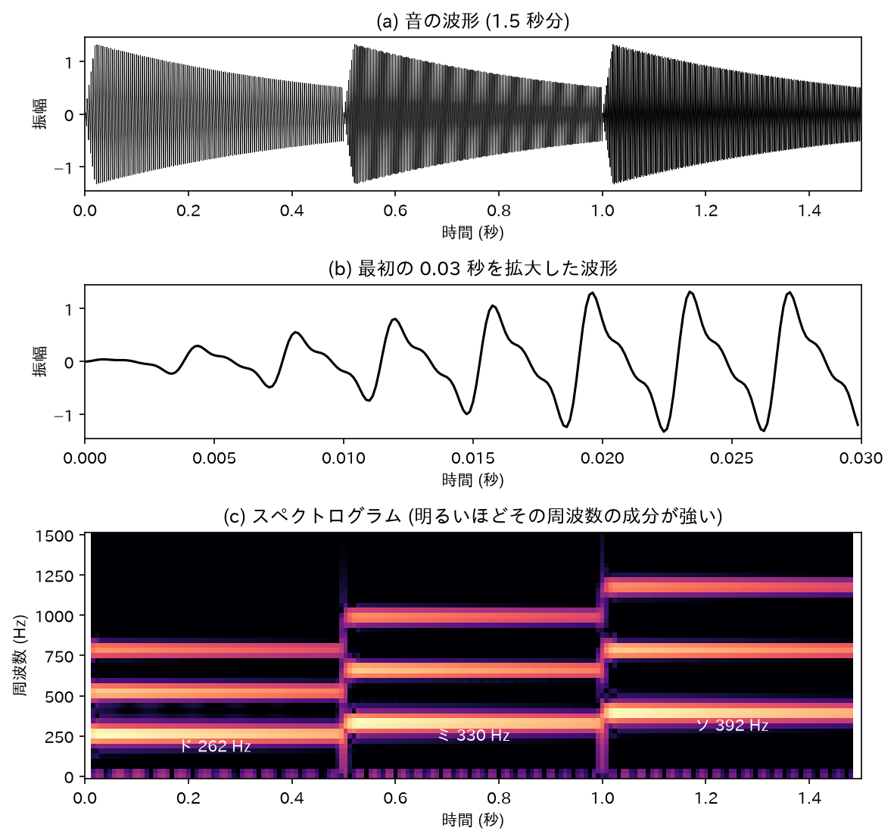

## 音声認識 {#speech-recognition}

音声の認識も, 画像の認識と同じ考え方で行えます. 音は空気の圧力の振動で, マイクはその圧力を 1 秒間に数千回から数万回測り, 数値の列として記録します. この数値の列を時間に沿って描いたものが**波形**です.

波形をそのまま入力にすると, 認識は難しくなります. 同じ言葉でも, 話す速さ, 声の高さ, 声の大きさで波形は大きく変わるからです. 手書き数字の画素の値が, 書く位置のずれで大きく変わるのと同じ事情です. そこで, [パターン認識: 特徴抽出と識別](block:img-recognition#pattern-recognition)の特徴抽出にあたる変換を最初に行います.

1. 波形を 0.02 秒から 0.03 秒程度の短い区間に区切ります.
2. 区間ごとに, どの高さ (周波数) の音がどれだけ強く含まれているかを計算します. この計算を**フーリエ変換**といいます.
3. 区間ごとの結果を時間の順に横に並べ, 横軸が時間, 縦軸が周波数, 色がその成分の強さを表す表にします. この表を**スペクトログラム**といいます.

次の図は, ド (262 Hz), ミ (330 Hz), ソ (392 Hz) の音を 0.5 秒ずつ順に鳴らす音を numpy で合成し, 波形とスペクトログラムを描いたものです. Hz (ヘルツ) は 1 秒あたりの振動の回数で, 値が大きいほど高い音です.

(a) の波形からは, 音が 0.5 秒ごとに鳴り直していることは分かりますが, 音の高さは読み取れません. (b) のように拡大すると同じ形の繰り返しが見え, その間隔が音の高さに対応しますが, 波形の形は単純な正弦波ではありません. (c) のスペクトログラムでは, 音の高さが横の帯の位置として現れ, 0.5 秒ごとに帯が上へ移っていく様子が一目で分かります. ドの区間では 262 Hz のほかに, その 2 倍 (524 Hz) と 3 倍 (786 Hz) にも帯があります. 合成するときに, 楽器の音のように 2 倍と 3 倍の周波数の成分 (倍音) を混ぜたからです. (b) の波形が複雑な形をしているのは, これらの成分が重なっているためです.

スペクトログラムは, 縦と横に数値が並んだ表なので, 1 チャンネルの画像と同じ形をしています. そのため, 画像と同じく CNN に入力して, 音声を認識できます. 話し言葉の認識では, 母音や子音の種類によって, どの周波数の帯が強くなるかが異なります. モデルは, スペクトログラムの帯の配置のパターンから, 話された音や単語を識別するように学習します. 人の聴覚に合わせて周波数の目盛りを付け直したスペクトログラム (メルスペクトログラム) がよく使われます. 最近の音声認識のモデルでは, スペクトログラムを Transformer ([第8章](block:dl-transformer#自己注意と-transformer-の構成)) に入力して, 文字の並びを出力するものが主流になっています.

