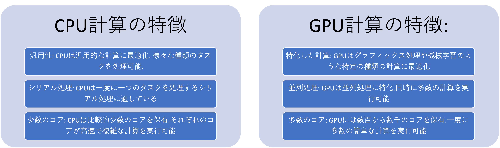

## ニューラル言語モデル {#ニューラル言語モデル}

[ワードクラウド](block:nlp-processing#ワードクラウド)は単語の出現回数を数えるだけで, [かな漢字変換](block:nlp-syntax#kana-kanji-conversion)の n-gram モデルも, 直前の数語との並びの出やすさを数えるだけです. どちらも単語の意味は扱っていません. 単語や文章の意味を数値のベクトルで表し, 分析に使うのが**ニューラル言語モデル**です.

ここでは, 2018 年に Google が発表したニューラル言語モデルである **BERT (Bidirectional Encoder Representations from Transformers)** を利用します (BERT の後継には ELECTRA などのモデルもありますが, この例では BERT を使います).

BERT は, [Transformer](block:dl-transformer#transformer-と注意機構) のエンコーダ部分を積み重ねたモデルです.

BERT などのニューラル言語モデルは**事前学習**と**ファインチューニング**という二段階の学習を行うのが一般的です.

::: note
- 事前学習

(日本語などの) 言語全般について, 大規模なテキストコーパス (Wikipedia など) で学習します.
事前学習済みのモデルは Google などが公開していて, ライブラリとして利用できます.

- ファインチューニング

事前学習済みの BERT モデルを, 用途 (穴埋め, ラベリング, 校正など) に応じて追加学習させます.
用途に関連した新たなデータセットが必要で, ラベリングをするのであれば, ラベル付けされた教師データが必要です.

:::

BERT はコーパスを用いてどのような学習を行っているのでしょうか. 基本的に BERT が行っているのは文章の穴埋め精度を高めるための学習です.

- 私はりんごを【MASK】

という一部が隠れた文章があったとき, 【MASK】の部分に入る文字列の確率計算をしています.
通常, 文章の【MASK】部分に入る文章は, それぞれ確率が異なります.

例えば, 上の文章では【MASK】部分に「行う」「走る」などの動詞が続く確率よりも「食べる」「買う」「調理する」などの動詞が続く確率が高いと考えられます.

- 私はりんごを行った ← 確率低い
- 私はりんごを食べた ← 確率高い

人間は過去の学習から, このような確率をなんとなく判断できますが, BERT はコーパスの一部を隠して当てさせるという方法で, あらゆる語彙の連なりやすさの確率を計算しています. 正解ラベルを人手で付けるのではなく, 元の文章そのものを正解として使うので, これは[自己教師あり学習](block:dl-transformer#自己教師あり学習)にあたります.

ここで計算している確率は, 前の語句が与えられたときに次の語が来る条件付き確率です. コーパスの頻度で書くと次のようになります.

$$P(\text{食べた} \mid \text{私はりんごを}) = \frac{\text{コーパス中の「私はりんごを食べた」の頻度}}{\text{コーパス中の「私はりんごを」の頻度}}$$

$$P(\text{行った} \mid \text{私はりんごを}) = \frac{\text{コーパス中の「私はりんごを行った」の頻度}}{\text{コーパス中の「私はりんごを」の頻度}}$$

[かな漢字変換](block:nlp-syntax#kana-kanji-conversion)の 2-gram モデルは, この頻度の比を, 直前の 1 単語に限って実際に数えるものです. BERT は頻度を直接数えるのではなく, ニューラルネットワークでこの確率を推定します. 頻度を数える方法では, コーパスに一度も現れない語句の並びの確率は 0 になりますが, BERT は単語の意味を表すベクトルを通して, 現れたことのない並びにも確率を割り当てられます.

大抵はすでにこのような事前学習が行われたモデルを利用し, 必要があればファインチューニングをそれぞれの利用者が行います. 日本語で有名な学習済みモデルには, 東北大学が日本語版 Wikipedia の記事で学習したモデル (`tohoku-nlp/bert-base-japanese-whole-word-masking`) などがあります.

BERT のファインチューニングのためには, 目的に応じたデータセットが必要となります. このデータは, [ワードクラウド](block:nlp-processing#ワードクラウド)の作成に使うような分析の対象となるデータではなく, モデルに課題の解き方を学習させるための正解付きのデータです.

::: note
- データセット

日本語データセットとして良く利用されるものは以下のとおりです.

- ### [Twitter 日本語評判分析データセット](http://www.cl.ecei.tohoku.ac.jp/resources/twitter_target_review/) {#twitter-日本語評判分析データセット}

Twitter の商品に関するポジティブ, ネガティブ, ニュートラルのラベリングデータ

- ### [SNOW D18 日本語感情表現辞書](https://www.jnlp.org/GengoHouse/snow/d18) {#snow-d18-日本語感情表現辞書}

日本語を 48 の感情に分類

> 安らぎ、楽しさ親しみ、尊敬・尊さ、感謝、気持ちが良い、誇らしい、感動、喜び、悲しさ、寂しさ不満、切なさ、苦しさ、不安、憂鬱、辛さ、好き、嫌悪、恥ずかしい、焦り、驚き、怒り、幸福感、恨み、恐れ（恐縮等の意味で）、恐怖、悔しさ、祝う気持ち、困惑、きまずさ、興奮、悩み、願望、失望、あわれみ、見下し、謝罪、ためらい、不快、怠さ、あきれ、心配、緊張、妬み、憎い、残念、情けない、穏やか

- ### [livedoor ニュースコーパス](https://www.rondhuit.com/download.html#news%20corpus) {#livedoor-ニュースコーパス}

ニュース記事をサイト別/ジャンル別に分類

  - [トピックニュース](http://news.livedoor.com/category/vender/news/) - [Sports Watch](http://news.livedoor.com/category/vender/208/) - [IT ライフハック](http://news.livedoor.com/category/vender/223/) - [家電チャンネル](http://news.livedoor.com/category/vender/kadench/) - [MOVIE ENTER](http://news.livedoor.com/category/vender/movie_enter/) - [独女通信](http://news.livedoor.com/category/vender/90/) - [エスマックス](http://news.livedoor.com/category/vender/smax/) - [livedoor HOMME](http://news.livedoor.com/category/vender/homme/) - [Peachy](http://news.livedoor.com/category/vender/ldgirls/)

- ### [有価証券報告書ネガポジデータセット](https://github.com/chakki-works/chABSA-dataset) {#有価証券報告書ネガポジデータセット}

TIS 株式会社が公開している上場企業の有価証券報告書を用いて作成されたマルチラベルのネガポジデータセット

ネガティブ, ポジティブ, ニュートラルの 3 ラベル
:::

BERT をどのように利用するかは, 様々な応用がありえますが, 良く利用される事例は以下のようなものです.

::: note

- ### BERT の利用例 {#bert-の利用例}

1. **文章の穴埋め (Masked Language Model, MLM)**

    トークンを利用して文中の一部を隠し, その隠れた部分を予測します. たとえば「今日は【MASK】に行く」という文が与えられた場合, BERT は文脈に基づいて【MASK】部分が「学校」「会社」などになると予測します. この機能により, 文章の補完やオートコンプリート機能に利用できます.

2. **文章分類**

    BERT は感情分析や話題の分類などの文章分類タスクで広く使われています. 例えば, 商品レビューや SNS の投稿をポジティブ・ネガティブといった感情ラベルに分類することで, マーケティング分析やレコメンドシステムの精度を向上させます. また, ニュース記事をカテゴリに分けるなど, 文書分類にも応用されています.

3. **マルチラベル文章分類**

    一部の文章は, 複数の感情やカテゴリに属することがあり, BERT は「ポジティブかつネガティブ」のように複数のラベルを付与するマルチラベル分類も可能です. これにより, 特定のジャンルに限らない複数の特徴や感情を同時に判別し, より高度な文章分析を可能にします. たとえば, レビューが「高評価だが高価」といった異なる側面を含む場合も, それぞれの特徴を捉えることができます.

4. **固有表現抽出 (Named Entity Recognition, NER)**

    BERT を用いて文章から特定の固有名詞を抽出できます. 例えば, 文中の「人名」「組織名」「地名」などの固有表現を検出し, ビジネスや医療, 自然言語処理の分野で多用されます. ニュース記事から企業名や国名を抽出して情報整理を行ったり, 顧客対応で企業名や製品名を抽出して対応を迅速化するなどの応用が可能です.

5. **文章校正**

    BERT を使った校正機能は, 文法チェックやスペルチェックに利用され, Grammarly のようなサービスに応用できます. 文脈を考慮した校正が可能なため, 単なる誤字脱字の修正だけでなく, 不自然な表現を検知し, より適切な言い回しに修正することも可能です.

6. **データの可視化と類似文章検索**

    BERT のエンコーディング機能を使うと, 文章をベクトル化し, 意味の似た文章を数値的に比較できるようになります. これにより, 多次元空間における文章の類似性が計算でき, 例えば PCA や t-SNE で次元を減らし, クラスタリングを行ってデータを可視化できます. 類似した内容の文書を自動でグループ分けしたり, ユーザーが検索したい文に近い内容の文書を瞬時に探すといった検索機能にも利用されます.

:::

# []{#マルチラベル分類}マルチラベル分類 {#multilabel-classification}
マルチラベル分類とは, 選択肢の中から複数のカテゴリを選べる分類手法です.
今回は有価証券報告書データを利用して `[ネガティブ,ニュートラル,ポジティブ]` に分類します.
ネガティブと判定されると `[1,0,0]`, ニュートラルと判定されると `[0,1,0]` のようなベクトルが返ってきます.
また, 一つの文章にネガティブな内容とポジティブな内容両方が含まれている場合には `[1,0,1]` のような結果となります.

::: note

- ### GPU 計算と CPU 計算 {#gpu-計算と-cpu-計算}
PC における計算は通常 CPU によって行われます.
これまでに実行してきた Python の例では, すべて CPU を用いて計算していました.
一方で GPU (Graphics Processing Unit, 画像処理装置, いわゆるグラボ) を利用してプログラムを計算することも可能です.
ニューラルネットワークモデルは, その特性から単純な計算を大量に行うため GPU を用いた並列計算が行われることが多いです.

- ### **CUDA (Compute Unified Device Architecture)** {#cuda-compute-unified-device-architecture}
機械学習では, GPU を使って計算するのが一般的です. 特に PyTorch などは, NVIDIA が開発した GPU 向けの並列計算の基盤である **CUDA (Compute Unified Device Architecture)** を前提に開発されています. したがって, CUDA に対応した GPU を搭載した PC では, CUDA を使うのが望ましいです.

しかし, 現在の macOS は CUDA に対応しておらず, Windows の PC でも, コストなどの理由で CUDA に対応しない GPU を搭載している場合があります.

M1 以降の Apple Silicon を搭載した Mac では, PyTorch の実行に CUDA の代わりに **MPS (Metal Performance Shaders)** を使えます.

PyTorch では `torch.device()` で使うデバイスを設定できます. 後のコードでは, CUDA か MPS が使える場合はそれを使い, 使えない場合は CPU を使います.

該当部分 (全体のインデントは省略)

~~~ py
if torch.backends.mps.is_available():
    device = torch.device("mps") #Mac GPU
elif torch.cuda.is_available():
    device = torch.device("cuda:0") #Win GPU
else:
    device = torch.device("cpu") #CPU
~~~

:::

これから BERT を利用してマルチラベル分類を実施してみます. 大きなニューラルネットワークの学習は GPU を使うと速く終わるので, プログラムは, 上の囲みで説明したとおり, CUDA か MPS が使えればそれを使い, 使えなければ CPU で計算します.

ただし, GPU のない PC でも数分で終わるように, 学習の規模を小さくしてあります. 規模は, プログラムの冒頭にある 3 つの値で決まります.

- `EPOCHS`: 訓練データを繰り返して学習する回数
- `MAX_LENGTH`: 1 文から読み込む最大のトークン数 (これより長い文は切り捨てます)
- `N_TRAIN`: 学習に使う文の数

次の表は, Apple M5 Max の Mac で実行したときの学習の時間と, テストデータでの正解率です. 「元の設定」は, 学習用の文をすべて使い, 5 エポック, 最大長 128 で学習した場合です.

| 設定 | `EPOCHS` | `MAX_LENGTH` | `N_TRAIN` | MPS | CPU のみ | 正解率 |
|:---|---:|---:|---:|---:|---:|---:|
| 本文の設定 | 2 | 64 | 640 | 7 秒 | 68 秒 | 0.73 から 0.75 |
| 元の設定 | 5 | 128 | 1929 (全件) | 91 秒 | 約 30 分 | 0.87 |

元の設定で CPU のみの時間は, 実測した 1 ステップあたりの時間から換算した値です. Apple M5 Max はノート PC の中でも高性能なので, 一般的な PC の CPU ではこれより長くかかります. 元の設定で試したい場合や, GPU のない PC で時間を気にせず試したい場合は, 共通資料の[Google Colaboratory による GPU 計算](/lectures/colab.html)の手順で Colab の GPU を使い, 3 つの値を元の設定に変えて, 同じプログラムを実行してください.

次のライブラリを使います. `uv add` しておいてください. なお, 以下のマルチラベル文章分類に関するコードは, **[BERT による自然言語処理入門 オーム社](https://www.ohmsha.co.jp/book/9784274227264/)**を参考にしています.

~~~ sh
uv add torch transformers fugashi unidic-lite pandas
~~~

まずは, 学習の設定と, 学習済みのモデルを読み込みます. ニューラルモデルに関するこれらのコードをすべて理解するには, 膨大な時間が必要になります.
ここでは, それぞれの部分で何をしているのかを大まかに把握しましょう.

~~~ py
import random
import time

import numpy as np
import pandas as pd
import torch
from transformers import AutoTokenizer, BertModel

# 日本語の学習済みモデル
MODEL_NAME = 'tohoku-nlp/bert-base-japanese-whole-word-masking'

# 学習の設定. GPU がない PC でも数分で終わる大きさにしている
EPOCHS = 2  # 訓練データを繰り返して学習する回数
MAX_LENGTH = 64  # 1 文から読み込む最大のトークン数
N_TRAIN = 640  # 学習に使う文の数
LEARNING_RATE = 3e-5
BATCH_SIZE = 32

# 使うデバイスの選択
if torch.backends.mps.is_available():
    device = torch.device('mps')  # Mac GPU
elif torch.cuda.is_available():
    device = torch.device('cuda:0')  # Win GPU
else:
    device = torch.device('cpu')  # CPU
print(f'Using device: {device}')

# マルチラベル文章分類用のモデル
class BertForMultiLabel(torch.nn.Module):
    def __init__(self, model_name, num_labels):
        super().__init__()
        # 学習済みの BERT を読み込む
        self.bert = BertModel.from_pretrained(model_name)
        # BERT の出力を各ラベルのスコアに変える線形変換
        self.linear = torch.nn.Linear(self.bert.config.hidden_size, num_labels)

    def forward(self, input_ids, attention_mask, token_type_ids=None):
        output = self.bert(
            input_ids=input_ids,
            attention_mask=attention_mask,
            token_type_ids=token_type_ids,
        )
        # [PAD] 以外のトークンの出力を平均して, 文のベクトルにする
        mask = attention_mask.unsqueeze(-1)
        sentence_vector = (output.last_hidden_state * mask).sum(1) / mask.sum(1)
        return self.linear(sentence_vector)

torch.manual_seed(0)  # 線形変換の初期値を固定する
tokenizer = AutoTokenizer.from_pretrained(MODEL_NAME)
model = BertForMultiLabel(MODEL_NAME, num_labels=3).to(device)
~~~

続いて, ファインチューニングを実施します. 今回は, TIS 株式会社が上場企業の有価証券報告書から作成したマルチラベルのネガポジデータセット [`chABSA-dataset`](https://www.tis.co.jp/news/2018/tis_news/20180410_1.html)を利用します. 文ごとに, ネガティブ, ニュートラル, ポジティブの評価が付いています. 文の数は 3215 で, 1 つの文にポジティブとネガティブの両方が付く場合を含め, 複数の評価が付く文が 916 あります.

このデータは CC BY 4.0 で公開されています. 元の配布先は現在閉鎖されているため, Hugging Face で公開されている同じデータ ([zenless-lab/chABSA](https://huggingface.co/datasets/zenless-lab/chABSA)) から, 文と 3 つのラベルを列にした CSV を作りました. [chABSA.csv](https://github.com/yakagika/yakagika.github.io/blob/main/slds_data/ch15/chABSA.csv)をダウンロードして, プログラムを置くディレクトリの `data` ディレクトリに保存してください.

データを学習用 (60%), 検証用 (20%), テスト用 (20%) に分けます. 学習に使うのは, 学習用のうち `N_TRAIN` 文です. 検証用は, エポックごとの損失を見て, [過学習](block:ml-classification#訓練データとテストデータ)が起きていないか (学習を進めると検証用の損失が増えていないか) を確認するために使います. 文のトークン化には, BERT のトークナイザを使います.

~~~ py
# データの読み込み. ラベルは (ネガティブ, ニュートラル, ポジティブ)
df = pd.read_csv('data/chABSA.csv')
texts = df['text'].tolist()
labels = df[['negative', 'neutral', 'positive']].values.astype(np.float32)

# 学習用 (60%), 検証用 (20%), テスト用 (20%) に分ける
random.seed(0)
index = list(range(len(df)))
random.shuffle(index)
n_train_all = int(0.6 * len(index))
n_val = int(0.2 * len(index))
train_index = index[:n_train_all][:N_TRAIN]
val_index = index[n_train_all : n_train_all + n_val]
test_index = index[n_train_all + n_val :]
print(f'学習: {len(train_index)} 文, 検証: {len(val_index)} 文, テスト: {len(test_index)} 文')

def make_batch(batch_index):
    """文を BERT への入力に変え, device へ送る."""
    encoding = tokenizer(
        [texts[i] for i in batch_index],
        max_length=MAX_LENGTH,
        padding='longest',
        truncation=True,
        return_tensors='pt',
    )
    encoding = {key: value.to(device) for key, value in encoding.items()}
    y = torch.tensor(labels[batch_index]).to(device)
    return encoding, y

def evaluate(data_index):
    """損失と, 3 つのラベルがすべて一致した割合を返す."""
    model.eval()
    total_loss, n_correct = 0.0, 0
    with torch.no_grad():
        for i in range(0, len(data_index), 128):
            encoding, y = make_batch(data_index[i : i + 128])
            scores = model(**encoding)
            total_loss += torch.nn.BCEWithLogitsLoss()(scores, y).item() * len(y)
            n_correct += ((scores > 0).float() == y).all(dim=1).sum().item()
    return total_loss / len(data_index), n_correct / len(data_index)
~~~

データの準備が整ったので, ファインチューニングを行います. 今回はエポック数を 2 として, 決め打ちで行っています. 実際に研究等で使用する場合には, 検証用データの損失を見て, エポック数や学習率 (`LEARNING_RATE`) を調整しましょう. 学習の時間は, 本文の設定で数秒から数分です.

~~~ py
optimizer = torch.optim.Adam(model.parameters(), lr=LEARNING_RATE)
loss_function = torch.nn.BCEWithLogitsLoss()
start = time.time()
for epoch in range(EPOCHS):
    model.train()
    random.shuffle(train_index)
    for i in range(0, len(train_index), BATCH_SIZE):
        encoding, y = make_batch(train_index[i : i + BATCH_SIZE])
        loss = loss_function(model(**encoding), y)
        loss.backward()
        optimizer.step()
        optimizer.zero_grad()
    val_loss, val_accuracy = evaluate(val_index)
    print(f'Epoch {epoch + 1}/{EPOCHS}', end=' ')
    print(f'val_loss: {val_loss:.3f} val_accuracy: {val_accuracy:.3f}')
print(f'学習時間: {time.time() - start:.0f} 秒')

test_loss, test_accuracy = evaluate(test_index)
print(f'Accuracy: {test_accuracy:.2f}')

"""
Using device: mps
学習: 640 文, 検証: 643 文, テスト: 643 文
Epoch 1/2 val_loss: 0.309 val_accuracy: 0.706
Epoch 2/2 val_loss: 0.253 val_accuracy: 0.756
学習時間: 8 秒
Accuracy: 0.73
"""
~~~

テストデータに対する正解率は 7 割ほどでした. この正解率は, 3 つのラベルがすべて一致した割合です. 値は PC や環境によって少し変わります. 元の設定で学習すると, 5 エポックのうち検証用データの損失は 2 エポック目で最小になり (0.180), 5 エポック目には 0.227 まで大きくなりました. 訓練データへの当てはまりだけが進む過学習です. 正解率は 0.87 になりました.

それではファインチューニングしたモデルを利用して, マルチラベル分類を行ってみます.

最初の `text_list` 部分に適当に作成した文章をリスト形式で与えます. 研究などではここに CSV などで取得した外部のデータを指定します. それぞれのネガティブ, ニュートラル, ポジティブの判定結果を見てみましょう.

~~~ py
# 入力する文章. 結果はネガティブ, ニュートラル, ポジティブの順
text_list = [
    '当連結会計年度の売上高は前期比5.8%増加し、業績は堅調に推移しました。',
    '海外市場での需要拡大が寄与し、売上および営業利益が過去最高を記録しました。',
    '一部事業における原材料価格の高騰の影響を受け、収益性が低下しました。',
    '国内景気は緩やかな回復基調を維持したものの、インフレ率の上昇が購買力に影響を及ぼしました。',
    '新興市場における競争激化により、当社製品のシェアは微減しましたが、全体的な市場拡大により売上は増加しました。',
    '為替変動が利益にプラスの影響を与えた一方で、サプライチェーンの遅延が一部事業の成長を抑制しました。',
    '2025年度に向けて、成長市場への積極的な投資と新規事業の開発に注力する予定です。',
    '業界全体の需要鈍化が予想される中で、コスト構造の見直しにより安定的な収益を確保していきます。',
    'カーボンニュートラル達成を目指し、再生可能エネルギーへのシフトを加速させます。',
    '当社は、デジタル化の遅れが競争力に与える影響を認識しており、ITシステムへの投資を増強する方針です。',
    '地政学的リスクの高まりにより、一部の輸出取引に不確実性が生じています。',
    '半導体不足の影響を受け、特定製品の納期が遅延する可能性があります。',
]
encoding = tokenizer(
    text_list,
    max_length=MAX_LENGTH,
    padding='longest',
    truncation=True,
    return_tensors='pt',
)
encoding = {key: value.to(device) for key, value in encoding.items()}
model.eval()
with torch.no_grad():
    scores = model(**encoding)
labels_predicted = (scores > 0).int().cpu().numpy().tolist()
for text, label in zip(text_list, labels_predicted):
    print('--')
    print(f'入力: {text}')
    print(f'出力: {label}')
"""
--
入力: 当連結会計年度の売上高は前期比5.8%増加し、業績は堅調に推移しました。
出力: [0, 0, 1]
--
入力: 海外市場での需要拡大が寄与し、売上および営業利益が過去最高を記録しました。
出力: [0, 0, 1]
--
入力: 一部事業における原材料価格の高騰の影響を受け、収益性が低下しました。
出力: [1, 0, 0]
--
入力: 国内景気は緩やかな回復基調を維持したものの、インフレ率の上昇が購買力に影響を及ぼしました。
出力: [0, 0, 1]
--
入力: 新興市場における競争激化により、当社製品のシェアは微減しましたが、全体的な市場拡大により売上は増加しました。
出力: [1, 0, 1]
--
入力: 為替変動が利益にプラスの影響を与えた一方で、サプライチェーンの遅延が一部事業の成長を抑制しました。
出力: [1, 0, 0]
--
入力: 2025年度に向けて、成長市場への積極的な投資と新規事業の開発に注力する予定です。
出力: [0, 0, 1]
--
入力: 業界全体の需要鈍化が予想される中で、コスト構造の見直しにより安定的な収益を確保していきます。
出力: [0, 0, 1]
--
入力: カーボンニュートラル達成を目指し、再生可能エネルギーへのシフトを加速させます。
出力: [0, 0, 1]
--
入力: 当社は、デジタル化の遅れが競争力に与える影響を認識しており、ITシステムへの投資を増強する方針です。
出力: [0, 0, 1]
--
入力: 地政学的リスクの高まりにより、一部の輸出取引に不確実性が生じています。
出力: [1, 0, 0]
--
入力: 半導体不足の影響を受け、特定製品の納期が遅延する可能性があります。
出力: [1, 0, 0]
"""
~~~

結果を見てみると, 業績が良いことだけを述べた 1 文目と 2 文目はポジティブ, 悪化したことを述べた 3 文目と 12 文目はネガティブと判定されています. 好材料と悪材料が混じる 4 文目から 6 文目は, 5 文目では両方が判定された一方, 4 文目はポジティブだけ, 6 文目はネガティブだけが判定されています. 学習の規模を小さくしたことが影響している可能性があります. 3 つの設定の値を変えて, 判定がどう変わるかを比べてみましょう.
文章を変える, 外部からデータを取り込むなどして, これ以外の事例でも試してみましょう.

