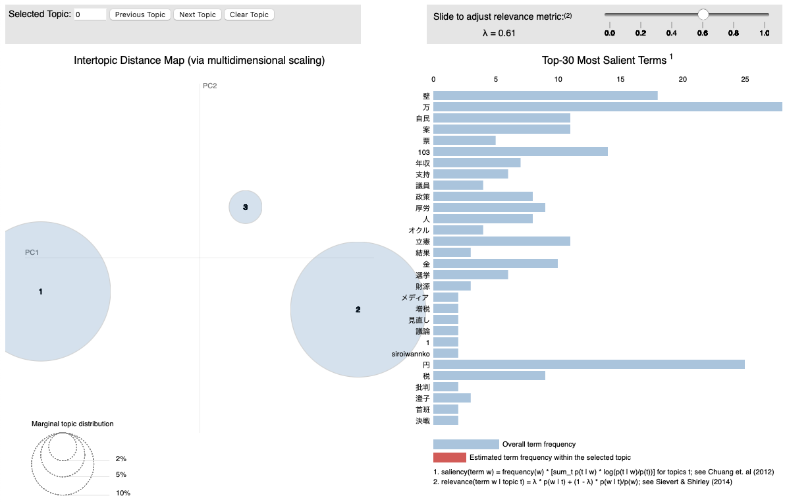
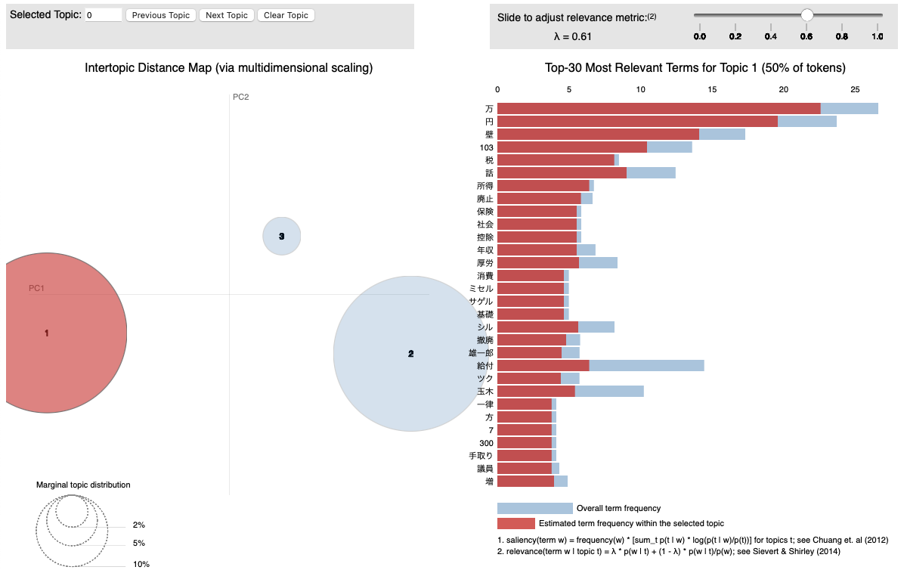
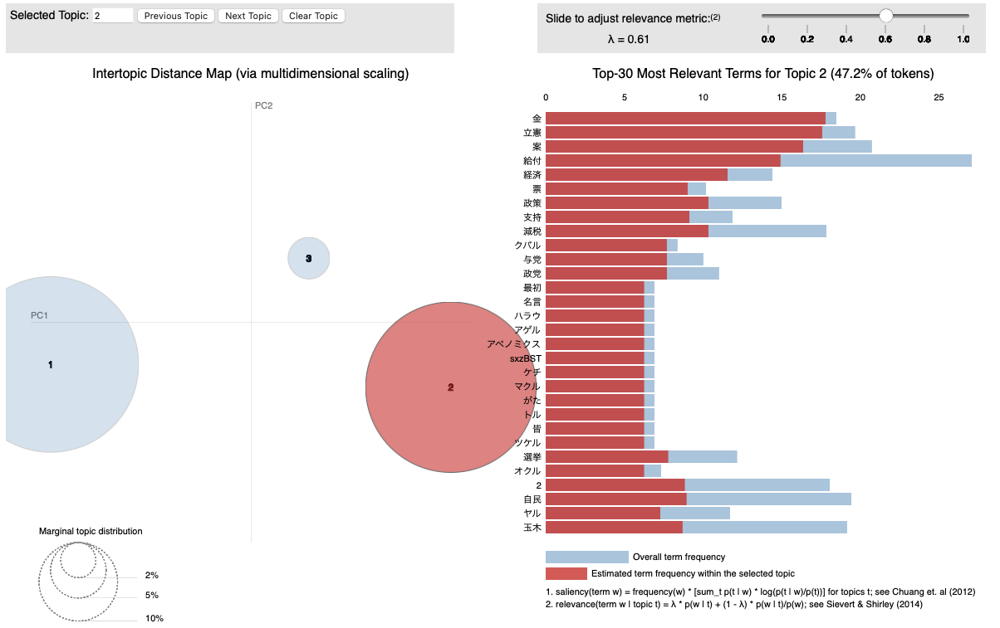
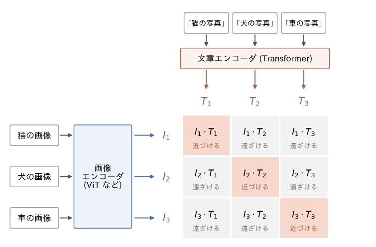

## トピックモデル {#トピックモデル}
テキスト文書の集合から潜在的なトピック (話題) を抽出するために広く利用される古典的手法である, トピックモデルを利用してみましょう.

トピックモデルでは単語の分布を使って, 文章が何について話しているかを抽出します. ただし, 出力は単語の集合で表されるため, そのトピックが何に関する話題かは利用者が判断する必要があります.

- 例: トピックA: 「経済」「市場」「投資」 ← 経済に関するトピックと解釈できる
- 例: トピックB: 「ねこ」「いぬ」「ペット」 ← ペットに関するトピックと解釈できる

トピックモデルにもいくつかの手法がありますが, 最も一般的な実装手法の一つに LDA (Latent Dirichlet Allocation: 潜在的ディリクレ配分法) があります. LDA 以外にも PLSA (Probabilistic Latent Semantic Analysis) などがあります.

LDA では各文章をトピックの混合分布として表現します.

- 例: 文章1: トピックA 0.5, トピックB 0.4, トピックD 0.1
- 例: 文章2: トピックA 0.6, トピックE 0.3

LDA では, 各文書のトピック分布と各トピックの単語分布にディリクレ分布を使用します. ディリクレ分布は, 確率の分布に対する分布 (事前分布) として使われ, 特にトピックの混合率が異なる多様な文書集合に対応できます. この過程では「ギブスサンプリング」や「変分ベイズ法」といった推論手法を使い, 文書全体のトピックと単語の分布が収束するまで反復的に計算されます. 事前分布と事後分布の考え方や, マルコフ連鎖モンテカルロ法 (MCMC) の概要は, [ベイズ統計学の基礎](block:bayes-intro#基礎知識-ベイズ統計学概要)で扱います.

## X (Twitter) API を用いたデータの取得 {#x-twitter-api-を用いたデータの取得}
自然言語解析では, [ワードクラウド](block:nlp-processing#ワードクラウド)の事例のように, まとまった文章を分析する場合もありますが, X (旧:Twitter) のつぶやきのように, 短い文章の集合を扱う場合もあります. ここでは, Twitter の API を利用して取得したつぶやきを分析してみましょう.

API という仕組みの説明と, X API による取得手順 (認証トークンの発行, 環境変数での受け渡し, 取得コード) は, [X API による投稿の取得](block:api-x)にまとめてあります (API 一般の説明は[API とは](block:api-intro#api-basics)). X API は 2026 年 2 月の改定で無料の取得枠が廃止され, 投稿 1 件 0.005 ドルの従量課金だけになりました. 研究で利用する人以外は, [取得済みの 50 件の投稿をまとめたデータ](https://github.com/yakagika/yakagika.github.io/blob/main/slds_data/ch15/tweets.csv)をダウンロードして利用しましょう. このデータはX API で取得する `posts.csv` と同じ列構造 (`query` = 検索ワード, `text` = 投稿本文) なので, 以下のコードは自分で取得した `posts.csv` でもファイル名の変更だけで動きます.

## トピックモデル実践 {#トピックモデル実践}

LDA によるトピックモデルを利用するためにライブラリ `gensim` と, LDA の可視化用のライブラリ `pyLDAvis` をインストールしましょう.

~~~ sh
uv add gensim pyLDAvis
~~~

`import` と形態素解析のための関数を定義しておきます.
URL は上手く形態素解析できないので, URL を削除する関数も新たに定義しています.

~~~ py
import pandas as pd
import MeCab as mc
import re
from gensim.corpora.dictionary import Dictionary
from gensim.models import LdaModel
import pyLDAvis
import pyLDAvis.gensim_models as gensimvis
import pyLDAvis.gensim

def strip_CRLF_from_Text(text):
    """テキストファイルの改行,タブを削除し,形態素解析を実行
    改行前後が日本語文字の場合は改行を削除する．
    それ以外はスペースに置換する．
    """
    # 改行前後の文字が日本語文字の場合は改行を削除する
    plaintext = re.sub('([ぁ-んー]+|[ァ-ンー]+|[\\u4e00-\\u9FFF]+|[ぁ-んァ-ンー\\u4e00-\\u9FFF]+)(\n)([ぁ-んー]+|[ァ-ンー]+|[\\u4e00-\\u9FFF]+|[ぁ-んァ-ンー\\u4e00-\\u9FFF]+)',
                       r'\1\3',
                       text)
    # 残った改行とタブ記号はスペースに置換する
    plaintext = plaintext.replace('\n', ' ').replace('\t', ' ')
    return plaintext

def mecab_wakati(text,word_types = ["名詞","動詞","形容詞","副詞"]):
    #分かち書き
    t = mc.Tagger()
    #word_types = [String]で指定 ("名詞","動詞","形容詞","副詞")
    node = t.parseToNode(text)
    sent = ""
    noun = [x for x in word_types if x == "名詞"]
    others = [x for x in word_types if x in [ "動詞", "形容詞","副詞"]]
    while(node):
        if node.surface != "":  # ヘッダとフッタを除外
            word_type = node.feature.split(",")[0]
            if word_type in noun:
                 sent += node.surface + " " # node.surface は「表層形」
            if word_type in others:
                sent += node.feature.split(",")[10] + " " # node.feature.split(",")[10] は unidic の「書字形基本形」(活用する前の形, 例: 当たり → 当たる)
        node = node.next
        if node is None:
            break
    return sent

def remove_urls(text):
    # URLを検出する正規表現パターン
    url_pattern = r'http[s]?://(?:[a-zA-Z]|[0-9]|[$-_@.&+]|[!*\\(\\),]|(?:%[0-9a-fA-F][0-9a-fA-F]))+'
    # URLを空文字に置換して除外
    return re.sub(url_pattern, '', text)
~~~

データを読み込みます (このデータを取得した次の日に国民民主党の党首の不倫騒動があったので, そのつぶやきが取れていれば面白かったのですが, 残念です).

トークナイズ (形態素解析), 削除する語の指定, 削除までをまとめて行います. ここで指定している削除する語は, 一度結果を見たあとで追加したものです. 実際の分析では, 結果とコードを何往復かして, 調整する作業が必要になります.

形態素解析の前に `remove_urls()` を適用していることに注意してください.

~~~ py
#データの読み込み (X API で取得した posts.csv と同じ列構造: query, text)
df = pd.read_csv('data/tweets.csv')

#投稿本文の列を取り出す
akagi = df['text']

#トークナイズ
txt = [mecab_wakati(strip_CRLF_from_Text(remove_urls(x)),["名詞","動詞"]).split(' ') for x in akagi]

#削除文字の指定
stopwords = ['思う','言う','いう','いる','ある','こと']
txt = [[x for x in t if x not in stopwords] for t in txt]
~~~

[ワードクラウド](block:nlp-processing#ワードクラウド)で扱った「千葉商科大学の理念」は単一のテキストデータでしたが, 今回の分析の対象は 50 件のつぶやきです. このような複数のテキストを扱う際には, 前処理として**出現頻度による単語の削除**がよく用いられます. ほとんどすべてのテキストに出てくるような単語 (数字や副詞などが多い) は特徴を抽出する際には役に立たないので削除したほうが良い場合があります. 反対に, 出現回数がごく少ない単語, 造語や個人名なども削除したほうがよい場合があります.

実際の分析では, どの程度の頻度を基準とするかを結果を見ながら調整する必要がありますが, 今回は練習なので `2文書未満にしか出現しない単語` と, `全体の50%以上に出現する単語` を削除しています.

実装は `dictionary` クラスの `filter_extremes()` メソッドを利用しています.

~~~py
#辞書の作成
dictionary = Dictionary(txt)
#出現がx文書に満たない単語と、y%以上の文書に出現する単語を極端と見做し削除する
x =2
y =0.5
dictionary.filter_extremes(no_below=x,no_above=y)
## LdaModelが読み込めるBoW形式に変換
corpus = [dictionary.doc2bow(x) for x in txt]

print(f"Number of unique tokens: {len(dictionary)}")
print(f"Number of documents: {len(corpus)}")
"""
Number of unique tokens: 220
Number of documents: 50
"""
~~~

LDA では, 事前に抽出するトピック数を決めることができます. トピック数も実際には調整が必要ですが, 今回は決め打ちで `3` としています.

`LDA` の結果は `pyLDAvis` によって `html` 形式で出力されます.

~~~ py
#3トピックを抽出
num_topics =3
lda = LdaModel(corpus, id2word =dictionary, num_topics=num_topics, alpha=0.01)

#トピックごとに上位5単語を表示
df =pd.DataFrame()
for t in range(num_topics):
    word=[]
    for i, prob in lda.get_topic_terms(t, topn=5):
        word.append(dictionary.id2token[int(i)])
    _ = pd.DataFrame([word],index=[f'topic{t+1}'])
    df = df._append(_)

print(df.T)
"""
  topic1 topic2 topic3
0      金      万     増税
1     立憲      円      壁
2      案      壁   メディア
3     給付    103     自民
4     経済      話     結果
"""

#可視化
#PyLDAvisの実装
visualisation = pyLDAvis.gensim.prepare(lda, corpus, dictionary)
pyLDAvis.save_html(visualisation, 'result/LDA_Visualization.html')
~~~

3 つのトピックはいずれも 103 万円の壁の話をしていますが, `topic1` では立憲民主党の対案としての低所得者への給付の話題, `topic3` ではメディアや自民党に対する批判などの話題が抽出されました. あまりはっきりしていませんが, もう少しつぶやきの数を増やすと分かりやすくなるかもしれません.

出力された `LDA_Visualization.html` をクリックするとブラウザ上で確認することができます.

左側には主成分分析による第 1 主成分, 第 2 主成分上にマッピングされたトピックの集合が可視化されており, 右側には全体のトピックにおける単語の分布が表示されています.

それぞれのトピックをクリックすることでトピックごとの単語の分布が表示されます.

右上のバーで調整できるラムダは, トピックモデルの結果を調整するためのパラメータです. ラムダの値が大きいほど, 他のトピックにも出現する一般的な単語を除外し, トピック内の単語の特徴を強調します. 値を変化させてどのようにトピックの分布が変わるかを確認してみましょう.

コード全体は以下のようになっています.

~~~ py
import pandas as pd
import MeCab as mc
import re
from gensim.corpora.dictionary import Dictionary
from gensim.models import LdaModel
import pyLDAvis
import pyLDAvis.gensim_models as gensimvis
import pyLDAvis.gensim

def strip_CRLF_from_Text(text):
    """テキストファイルの改行,タブを削除し,形態素解析を実行
    改行前後が日本語文字の場合は改行を削除する．
    それ以外はスペースに置換する．
    """
    # 改行前後の文字が日本語文字の場合は改行を削除する
    plaintext = re.sub('([ぁ-んー]+|[ァ-ンー]+|[\\u4e00-\\u9FFF]+|[ぁ-んァ-ンー\\u4e00-\\u9FFF]+)(\n)([ぁ-んー]+|[ァ-ンー]+|[\\u4e00-\\u9FFF]+|[ぁ-んァ-ンー\\u4e00-\\u9FFF]+)',
                       r'\1\3',
                       text)
    # 残った改行とタブ記号はスペースに置換する
    plaintext = plaintext.replace('\n', ' ').replace('\t', ' ')
    return plaintext

def mecab_wakati(text,word_types = ["名詞","動詞","形容詞","副詞"]):
    #分かち書き
    t = mc.Tagger()
    #word_types = [String]で指定 ("名詞","動詞","形容詞","副詞")
    node = t.parseToNode(text)
    sent = ""
    noun = [x for x in word_types if x == "名詞"]
    others = [x for x in word_types if x in [ "動詞", "形容詞","副詞"]]
    while(node):
        if node.surface != "":  # ヘッダとフッタを除外
            word_type = node.feature.split(",")[0]
            if word_type in noun:
                 sent += node.surface + " " # node.surface は「表層形」
            if word_type in others:
                sent += node.feature.split(",")[10] + " " # node.feature.split(",")[10] は unidic の「書字形基本形」(活用する前の形, 例: 当たり → 当たる)
        node = node.next
        if node is None:
            break
    return sent

def remove_urls(text):
    # URLを検出する正規表現パターン
    url_pattern = r'http[s]?://(?:[a-zA-Z]|[0-9]|[$-_@.&+]|[!*\\(\\),]|(?:%[0-9a-fA-F][0-9a-fA-F]))+'
    # URLを空文字に置換して除外
    return re.sub(url_pattern, '', text)

#------------------------------------------------------------------
## ↑ ここまで,関数定義
## ↓ ここから,データ処理
#------------------------------------------------------------------

#データの読み込み (X API で取得した posts.csv と同じ列構造: query, text)
df = pd.read_csv('data/tweets.csv')

#検索ワードが「国民民主党」の投稿本文を取り出す (複数ワードを取得したデータでも動く形)
akagi = df[df['query'] == '国民民主党']['text']

#トークナイズ
txt = [mecab_wakati(strip_CRLF_from_Text(remove_urls(x)),["名詞","動詞"]).split(' ') for x in akagi]

#削除文字の指定
stopwords = ['思う','言う','いう','いる','ある','こと']
txt = [[x for x in t if x not in stopwords] for t in txt]

#辞書の作成
dictionary = Dictionary(txt)
#出現がx文書に満たない単語と、y%以上の文書に出現する単語を極端と見做し削除する
x =2
y =0.5
dictionary.filter_extremes(no_below=x,no_above=y)
## LdaModelが読み込めるBoW形式に変換
corpus = [dictionary.doc2bow(x) for x in txt]

print(f"Number of unique tokens: {len(dictionary)}")
print(f"Number of documents: {len(corpus)}")

#3トピックを抽出
num_topics =3
lda = LdaModel(corpus, id2word =dictionary, num_topics=num_topics, alpha=0.01)

#トピックごとに上位5単語を表示
df =pd.DataFrame()
for t in range(num_topics):
    word=[]
    for i, prob in lda.get_topic_terms(t, topn=5):
        word.append(dictionary.id2token[int(i)])
    _ = pd.DataFrame([word],index=[f'topic{t+1}'])
    df = df._append(_)

print(df.T)

#可視化
#PyLDAvisの実装
visualisation = pyLDAvis.gensim.prepare(lda, corpus, dictionary)
pyLDAvis.save_html(visualisation, 'result/LDA_Visualization.html')
~~~

# n-gram と文章間類似度 {#ngram-similarity}

**n-gram** は, 文章の中で隣り合う n 個の単語 (または文字) の並びです. 「学生 が 先生 に 本 を 借り た」の単語の 2-gram は「学生 が」「が 先生」「先生 に」「に 本」「本 を」「を 借り」「借り た」の 7 つです. 1-gram は単語 1 つずつ, つまり単語そのものです.

文章を「どの n-gram が何回現れたか」を並べたベクトルで表すと, [コサイン類似度](block:num-distance#コサイン類似度)で, 文章同士の似ている度合い (**文章間類似度**) を計算できます. 単語の出現回数 (1-gram) のベクトルは単語の順番を無視するので, **Bag of Words** (単語の袋) とも呼ばれます.

次の 4 つの文で比べます. B は A の「学生」と「先生」を入れ替えた文で, 借りた人と貸した人が逆になります. C は A の「本」を「ノート」に変えた文, D は内容の違う文です.

| | 文 |
|---|---|
| A | 学生が先生に本を借りた。 |
| B | 先生が学生に本を借りた。 |
| C | 学生が先生にノートを借りた。 |
| D | 売店で昼休みに弁当が売れた。 |

~~~ py
import MeCab as mc
import pandas as pd
from sklearn.feature_extraction.text import CountVectorizer
from sklearn.metrics.pairwise import cosine_similarity

docs = ['学生が先生に本を借りた。',
        '先生が学生に本を借りた。',
        '学生が先生にノートを借りた。',
        '売店で昼休みに弁当が売れた。']
names = ['A', 'B', 'C', 'D']

# 単語に分割する (句点は除く)
t = mc.Tagger('-Owakati')
words = [t.parse(d).replace('。', '').split() for d in docs]
print(words[0])

# 1. 単語の出現回数のベクトル
vec1 = CountVectorizer(analyzer=lambda w: w)
X1 = vec1.fit_transform(words)
print(pd.DataFrame(X1.toarray(), index=names, columns=vec1.get_feature_names_out()))

# 2. 単語の 2-gram (隣り合う 2 単語の組) の出現回数のベクトル
vec2 = CountVectorizer(analyzer=lambda w: [f'{a}_{b}' for a, b in zip(w, w[1:])])
X2 = vec2.fit_transform(words)
print(vec2.get_feature_names_out()[:5])

for X, label in [(X1, '単語の出現回数'), (X2, '単語の2-gram')]:
    print(label)
    print(pd.DataFrame(cosine_similarity(X), index=names, columns=names).round(3))
"""
['学生', 'が', '先生', 'に', '本', 'を', '借り', 'た']
   が  た  で  に  を  ノート  借り  先生  売れ  売店  学生  弁当  昼休み  本
A  1  1  0  1  1    0   1   1   0   0   1   0    0  1
B  1  1  0  1  1    0   1   1   0   0   1   0    0  1
C  1  1  0  1  1    1   1   1   0   0   1   0    0  0
D  1  1  1  1  0    0   0   0   1   1   0   1    1  0
['が_先生' 'が_売れ' 'が_学生' 'で_昼休み' 'に_ノート']
単語の出現回数
       A      B      C      D
A  1.000  1.000  0.875  0.375
B  1.000  1.000  0.875  0.375
C  0.875  0.875  1.000  0.375
D  0.375  0.375  0.375  1.000
単語の2-gram
       A      B      C    D
A  1.000  0.571  0.714  0.0
B  0.571  1.000  0.286  0.0
C  0.714  0.286  1.000  0.0
D  0.000  0.000  0.000  1.0
"""
~~~

`CountVectorizer` は, 文章の一覧から現れる語の一覧 (列) を作り, 各文章を語ごとの出現回数のベクトルに変換します. `analyzer` には, 1 つの文章を数える単位のリストにする関数を渡します. 単語の出現回数では単語のリストをそのまま使い, 2-gram では隣り合う 2 単語を `_` でつないだ文字列を 1 つの単位として数えています. `cosine_similarity` は, すべての文章の組についてコサイン類似度を計算します.

A と C の単語の出現回数のベクトルでは, 8 つの単語のうち「本」と「ノート」以外の 7 つが共通で, どの単語も 1 回ずつ現れます. 内積は 7, 各ベクトルの長さは $\sqrt{8}$ なので, コサイン類似度は $7 / (\sqrt{8} \times \sqrt{8}) = 0.875$ です.

- 単語の出現回数では, A と B の類似度が 1.000 になります. 同じ単語が同じ回数だけ現れるので, 借りた人が逆になってもベクトルは同じです.
- 2-gram では, A と B の類似度は 0.571, A と C は 0.714 です. 単語の出現回数とは逆に, 1 語だけ違う C のほうが, 語順の違う B より A に近くなります. 「学生 が」「が 先生」のような 2-gram は, どの語が「が」の前にあるか, つまり誰が主語かの情報を一部含むからです.
- D は A, B, C と共通の単語 (が, に, た) があるので単語の出現回数では 0.375 ですが, 共通の 2-gram はないので 2-gram では 0 です.

n を大きくするほど語順の情報を多く含みますが, 同じ n-gram が別の文章に現れにくくなり, 多くの組の類似度が 0 に近づきます. また, n-gram はどれも単語の表記で数えるので, 「本」と「書籍」のように意味の近い別の語は別の列になります. 意味の近さを反映した類似度が要るときは, [自然言語ベクトル抽出によるデータ可視化と類似度評価](block:nlp-embedding#自然言語ベクトル抽出によるデータ可視化と類似度評価)のように, BERT が作るベクトルでコサイン類似度を計算します.

# CLIP {#clip}

**CLIP (Contrastive Language-Image Pre-training)** は, 画像と文章を同じベクトルの空間に置くように学習するモデルです (2021 年, OpenAI). 画像を読み取る**画像エンコーダ** ([Vision Transformer](block:img-more#vision-transformer) など) と, 文章を読み取る**文章エンコーダ** (Transformer) を組にして, 画像と文章をそれぞれ同じ次元のベクトルに変換します.

学習には, Web 上から集めた画像とその説明文の組を約 4 億組使いました. 次の図は, 3 組の画像と説明文で学習する様子です.

1. 3 枚の画像を画像エンコーダでベクトル $I_1, I_2, I_3$ に, 3 つの説明文を文章エンコーダでベクトル $T_1, T_2, T_3$ に変換します. どのベクトルも長さを 1 にそろえるので, 内積 $I_i \cdot T_j$ は[コサイン類似度](block:num-distance#コサイン類似度)に一致します.
2. すべての画像と説明文の組について内積を計算し, 3 × 3 の表にします.
3. 表の対角線上の組 (猫の画像と「猫の写真」のように, もともと対応する組) の類似度が大きく, それ以外の 6 つの組の類似度が小さくなるように, 2 つのエンコーダの重みを学習します.

対応する組を近づけるだけでなく, 対応しない組を遠ざけることで, 「猫の画像は『犬の写真』より『猫の写真』に近い」という比較を学習します. このように, 正しい組と誤った組を対比させて学習する方法を**対照学習 (contrastive learning)** といいます. 実際の学習では, 1 回に 3 組ではなく数万組をまとめて表を作ります. 画像ごとに人がクラスのラベルを付ける必要がなく, Web 上にもともとある説明文を使える点は, [自己教師あり学習](block:dl-transformer#自己教師あり学習)と同じです.

学習した CLIP は, 追加の学習なしで画像を分類できます. 「猫の写真」「犬の写真」「車の写真」のように, 分類したいクラスの名前を文章にして文章エンコーダでベクトルに変換し, 分類したい画像のベクトルと最もコサイン類似度の大きい文章のクラスを答えとします (**ゼロショット分類**). [顔による年齢識別](block:img-age#age-classification)の例ではクラスごとに正解付きの画像を集めて学習しますが, CLIP ではクラスの名前を文章で書くだけで分類の対象を変えられます. 同じ仕組みで, 文章から内容の近い画像を探す検索もできます. 文章から画像を作る生成 AI でも, 文章の意味を画像に結び付けるために CLIP の文章エンコーダが使われてきました.

