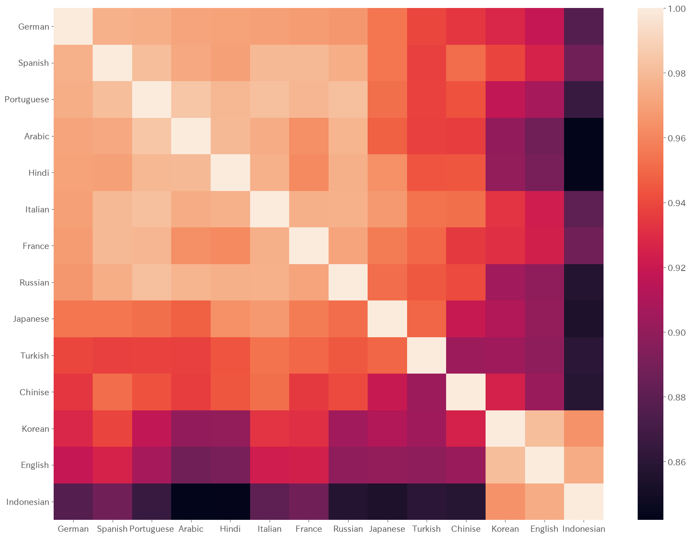
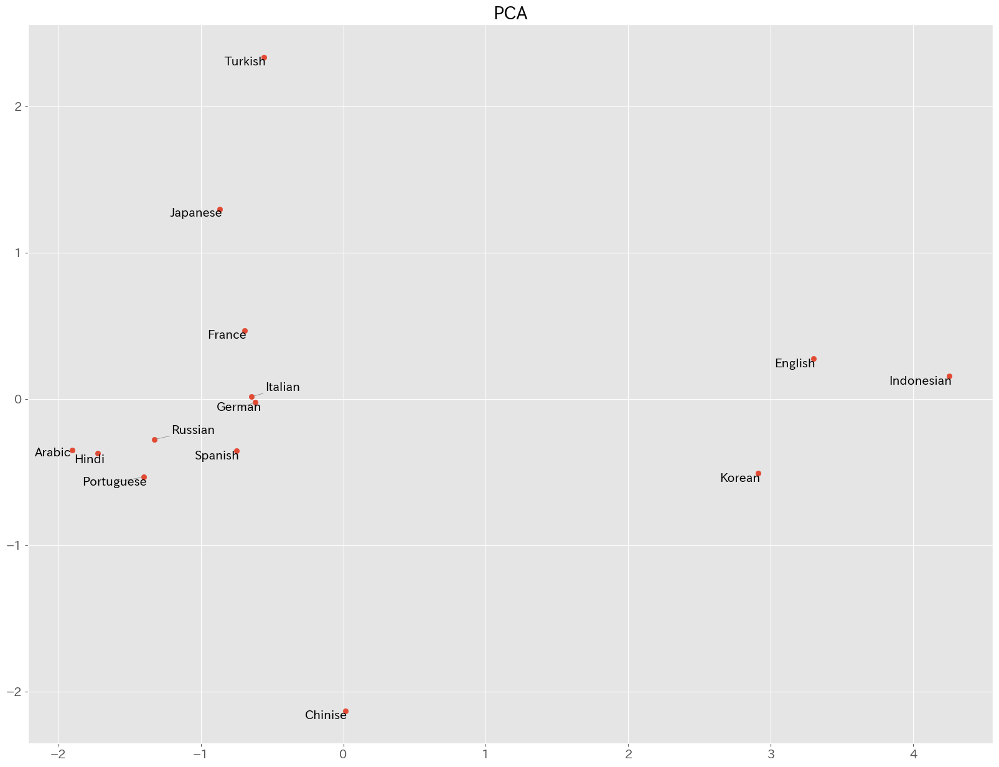
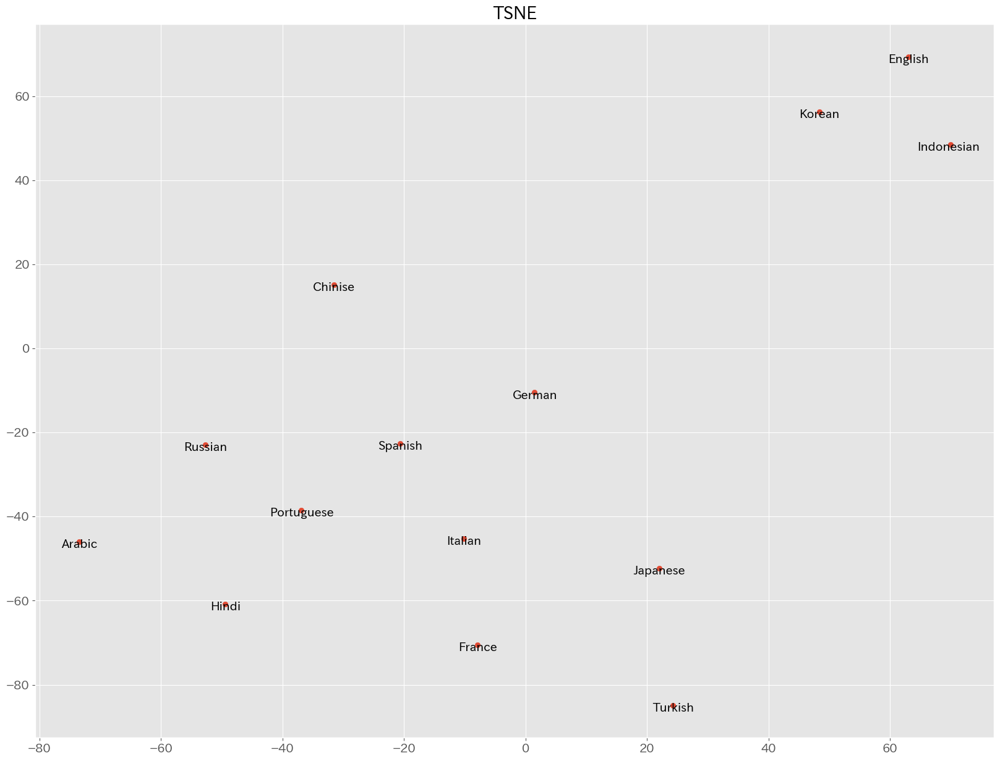
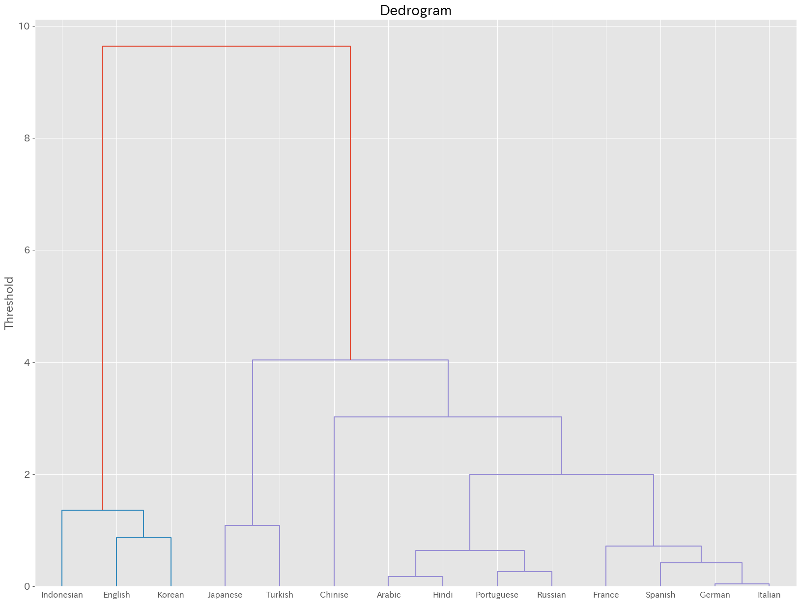
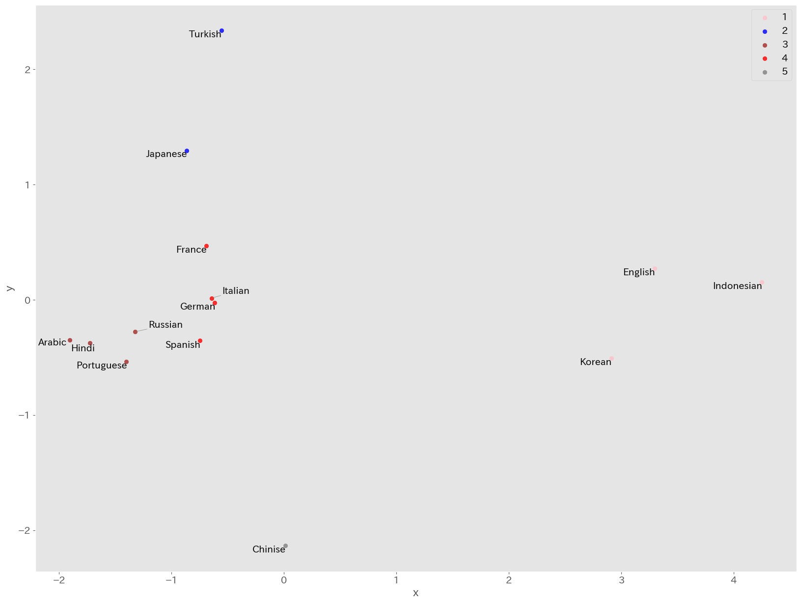
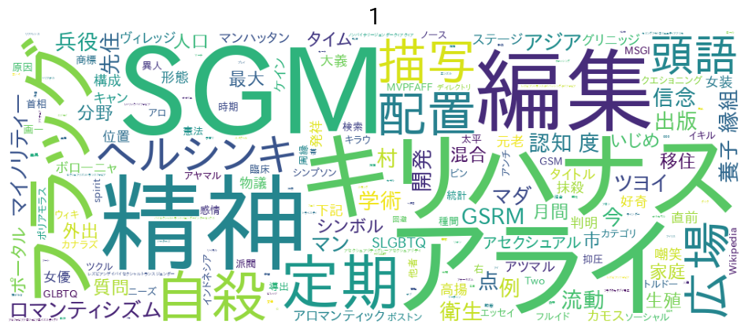
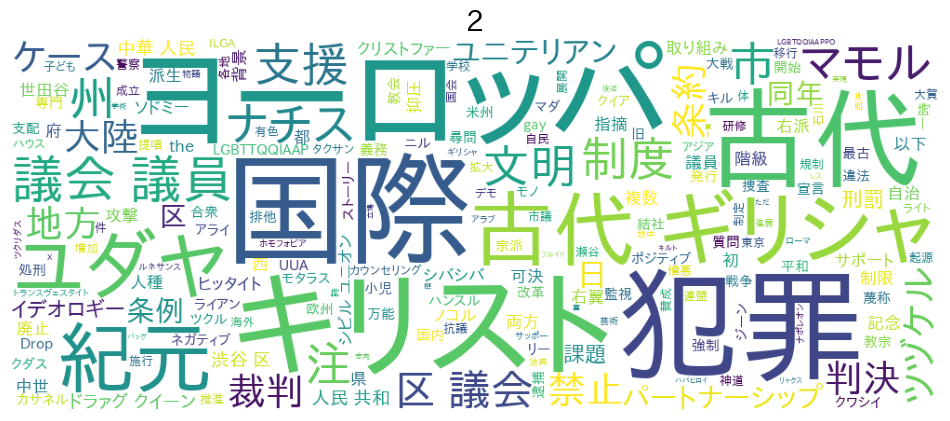
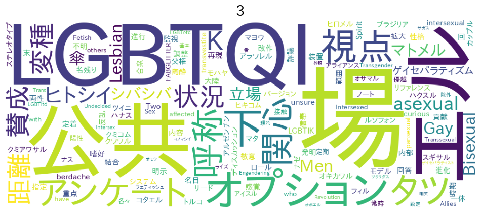
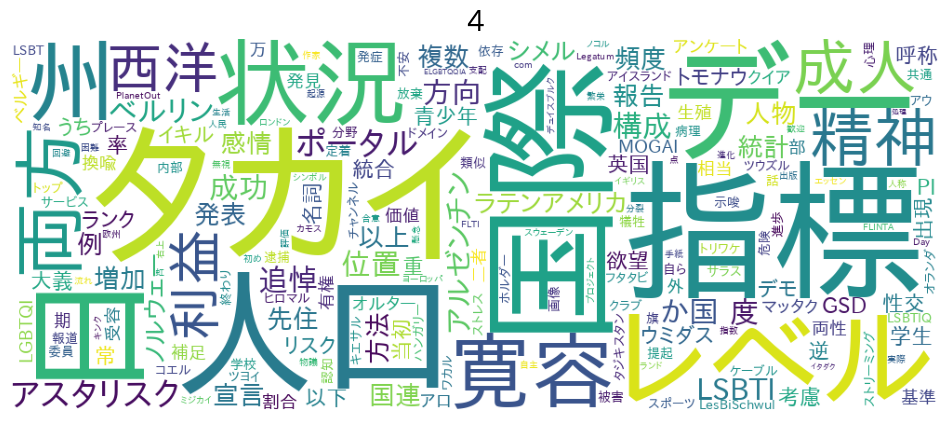
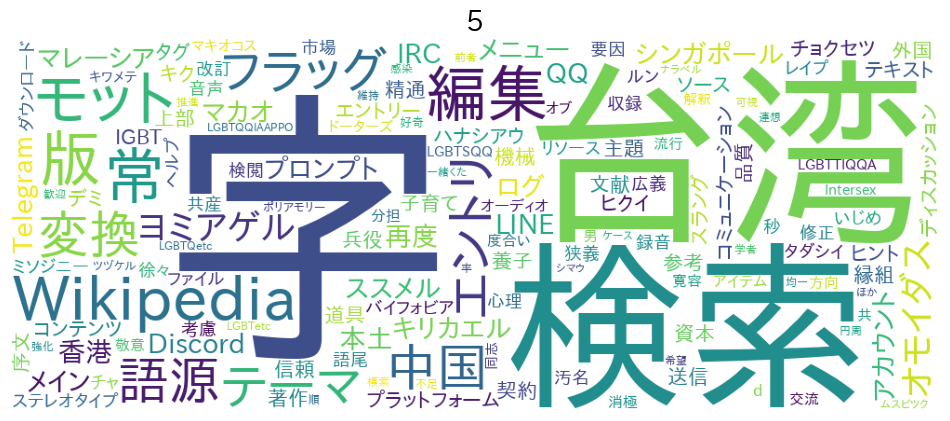

## 自然言語ベクトル抽出によるデータ可視化と類似度評価 {#自然言語ベクトル抽出によるデータ可視化と類似度評価}

[BERT](block:nlp-bert#ニューラル言語モデル) を利用して文章をベクトルに変換しクラスタリングや類似度の評価を行ってみます.
事例として, 異なる言語 (アラビア語, 中国語, 英語, フランス語, ドイツ語, ヒンディー語, インドネシア語, イタリア語, 日本語, 韓国語, ポルトガル語, ロシア語, スペイン語, トルコ語) での Wikipedia における LGBTQ に関する記事の類似度を評価してみます.

[各言語の記事を日本語に翻訳したデータ](https://github.com/yakagika/yakagika.github.io/blob/main/slds_data/ch15/LGBTWiki.csv)をダウンロードして, プログラムを置くディレクトリの `data` ディレクトリに保存しましょう. 本来は, 英語に翻訳したほうが翻訳精度の関係から望ましいですが, ここでは分かりやすいように日本語に翻訳してあります.

また, 日本語のワードクラウドを作成するために, 日本語のフォントも `data` ディレクトリに保存しておきます. [日本語フォント](https://github.com/yakagika/yakagika.github.io/blob/main/slds_data/ch15/fonts-japanese-gothic.ttf)をダウンロードして, `data` ディレクトリに保存しておきましょう.

この節の BERT は, 学習をせずに文章をベクトルに変えるだけなので, GPU がなくても短い時間で終わります (14 記事で, Apple M5 Max の CPU のみで約 2 秒です). 次のライブラリを使います. `uv add` しておいてください.

~~~ sh
uv add torch transformers fugashi unidic-lite pandas scikit-learn scipy matplotlib matplotlib-fontja seaborn adjustText tqdm
~~~

続いて各種インポートと, 設定を行います.

~~~ py
from tqdm import tqdm
import numpy as np
from sklearn.manifold import TSNE
from sklearn.decomposition import PCA
import matplotlib.pyplot as plt
import matplotlib_fontja
import pandas as pd
import torch
from transformers import BertJapaneseTokenizer, BertModel
import seaborn as sns
from adjustText import adjust_text

#グラフの設定
plt.style.use('ggplot') #グラフスタイル
plt.rcParams['figure.figsize'] = [20, 15] #グラフサイズ
plt.rcParams['font.size'] = 14 #フォントサイズ

# 使うデバイスの選択 (マルチラベル分類と同じ)
if torch.backends.mps.is_available():
    device = torch.device('mps') #Mac GPU
elif torch.cuda.is_available():
    device = torch.device('cuda:0') #Win GPU
else:
    device = torch.device('cpu') #CPU

# BERTの日本語モデル
MODEL_NAME = 'tohoku-nlp/bert-base-japanese-whole-word-masking'
~~~

データを読み込み, ベクトル化します. 今回はファインチューニングは行わず日本語 Wikipedia で学習した BERT のモデルをそのまま利用します.

~~~ py
# ベクトルを作成するデータの読み込み
df_wiki = pd.read_csv('./data/LGBTWiki.csv')
category_list = ['Arabic'
                ,'Chinese'
                ,'English'
                ,'France'
                ,'German'
                ,'Hindi'
                ,'Indonesian'
                ,'Italian'
                ,'Japanese'
                ,'Korean'
                ,'Portuguese'
                ,'Russian'
                ,'Spanish'
                ,'Turkish']
print(df_wiki)
print(df_wiki['Text'][0])
df_wiki['Text'] = df_wiki['Text'].astype(str)

# トークナイザとモデルのロード
tokenizer = BertJapaneseTokenizer.from_pretrained(MODEL_NAME)
model = BertModel.from_pretrained(MODEL_NAME)
model = model.to(device)

# 各データの形式を整える
max_length = 256
sentence_vectors = [] # 文章ベクトルを追加していく。
labels = [] # ラベルを追加していく。

for i in tqdm(df_wiki.index):
    encoding = tokenizer(
        df_wiki.at[i,'Text'],
        max_length=max_length,
        padding='max_length',
        truncation=True,
        return_tensors='pt'
    )
    encoding = { k: v.to(device) for k, v in encoding.items() }
    attention_mask = encoding['attention_mask']

    # 文章ベクトルを計算
    # BERTの最終層の出力を平均を計算する。（ただし、[PAD]は除く。）
    with torch.no_grad():
        output = model(**encoding)
        last_hidden_state = output.last_hidden_state
        averaged_hidden_state = \
            (last_hidden_state*attention_mask.unsqueeze(-1)).sum(1) \
            / attention_mask.sum(1, keepdim=True)

    # 文章ベクトルとラベルを追加
    sentence_vectors.append(averaged_hidden_state[0].cpu().numpy())
    labels.append(df_wiki.at[i,'Country'])

# それぞれをnumpy.ndarrayにする。
sentence_vectors = np.vstack(sentence_vectors)
print(sentence_vectors)
labels = np.array(labels)
print(labels)
~~~

各 Wikipedia の記事がベクトル化されたので, それぞれの組のコサイン類似度を計算します (コード中の「コサイン距離」という表示も, 計算しているのはコサイン類似度です).

~~~ py
df_vector = pd.DataFrame(data=sentence_vectors.T,columns=labels)
print(df_vector)
df_vector.to_csv('data/vector.csv',encoding='utf-8-sig')
#コサイン類似度の計算
def cos(x,y):
  return np.dot(x,y) / (np.linalg.norm(x)*np.linalg.norm(y))

#全組み合わせのコサイン距離
df_cos = pd.DataFrame(columns=[str(x) for x in labels]
                      ,index=[str(x) for x in labels])
for i in df_cos.index:
  for c in df_cos.columns:
    df_cos.at[i,c] = cos(df_vector[i],df_vector[c])
df_cos = df_cos[labels].astype(float)
print(df_cos.dtypes)
df_cos.sort_values(inplace=True, by=['German'],ascending=False)
df_cos = df_cos.reindex(columns=df_cos.index)

print('コサイン距離------')
print(df_cos)
sns.heatmap(df_cos)

df_cos.to_csv('data/cos.csv',encoding='utf-8-sig')
#ドイツとの距離を測る

"""
コサイン距離------
              German   Spanish  Portuguese    Arabic     Hindi   Italian  \
German      1.000000  0.976203    0.975127  0.971573  0.970698  0.969747
Spanish     0.976203  1.000000    0.981414  0.972422  0.969167  0.979055
Portuguese  0.975127  0.981414    1.000000  0.984561  0.978703  0.981902
Arabic      0.971573  0.972422    0.984561  1.000000  0.979478  0.974308
Hindi       0.970698  0.969167    0.978703  0.979478  1.000000  0.976511
Italian     0.969747  0.979055    0.981902  0.974308  0.976511  1.000000
France      0.967945  0.979471    0.977836  0.963222  0.961492  0.975864
Russian     0.966447  0.974909    0.982041  0.977697  0.975407  0.976528
Japanese    0.954630  0.954573    0.952049  0.947444  0.963872  0.967003
Turkish     0.939331  0.937166    0.937905  0.937141  0.943376  0.953529
Chinise     0.933493  0.951283    0.943161  0.935953  0.944198  0.952429
Korean      0.927303  0.938399    0.917036  0.899642  0.900244  0.932856
English     0.918245  0.925514    0.907207  0.887589  0.890674  0.922525
Indonesian  0.876889  0.887521    0.866018  0.841958  0.843015  0.880764

              France   Russian  Japanese   Turkish   Chinise    Korean  \
German      0.967945  0.966447  0.954630  0.939331  0.933493  0.927303
Spanish     0.979471  0.974909  0.954573  0.937166  0.951283  0.938399
Portuguese  0.977836  0.982041  0.952049  0.937905  0.943161  0.917036
Arabic      0.963222  0.977697  0.947444  0.937141  0.935953  0.899642
Hindi       0.961492  0.975407  0.963872  0.943376  0.944198  0.900244
Italian     0.975864  0.976528  0.967003  0.953529  0.952429  0.932856
France      1.000000  0.971557  0.956259  0.949862  0.934714  0.931158
Russian     0.971557  1.000000  0.951799  0.944928  0.940381  0.905520
Japanese    0.956259  0.951799  1.000000  0.949200  0.919489  0.911559
Turkish     0.949862  0.944928  0.949200  1.000000  0.903424  0.903760
Chinise     0.934714  0.940381  0.919489  0.903424  1.000000  0.924830
Korean      0.931158  0.905520  0.911559  0.903760  0.924830  1.000000
English     0.923854  0.898786  0.900241  0.898590  0.903045  0.981151
Indonesian  0.887053  0.857061  0.853968  0.860300  0.858218  0.964330

             English  Indonesian
German      0.918245    0.876889
Spanish     0.925514    0.887521
Portuguese  0.907207    0.866018
Arabic      0.887589    0.841958
Hindi       0.890674    0.843015
Italian     0.922525    0.880764
France      0.923854    0.887053
Russian     0.898786    0.857061
Japanese    0.900241    0.853968
Turkish     0.898590    0.860300
Chinise     0.903045    0.858218
Korean      0.981151    0.964330
English     1.000000    0.974397
Indonesian  0.974397    1.000000
"""
~~~

各言語間の記事の内容のコサイン類似度をヒートマップで表現すると以下のようになりました. 数値は, 使っているライブラリのバージョンによって少し変わります. 以降の図も細部は変わりますが, 階層クラスタリングで分かれるクラスタの組み合わせは同じになることを確かめてあります.

今回はドイツ語からの距離を基準にソートされていますが, ドイツ語と類似度が高いヨーロッパ言語圏のクラスタ, 韓国語, インドネシア語, 英語のクラスタがあることが見受けられます.

各言語のベクトルを PCA と t-SNE によって次元削減して, 2 次元上に配置してみます. 2 つの手法の仕組みは[次元削減: 主成分分析](block:ml-clustering#pca)と[非線形の次元削減: t-SNE](block:ml-clustering-more#t-sne)で説明しています.

~~~ py
#PCAとtsneの比較
#PCAによる次元削減
pca = sentence_vectors_pca = PCA(n_components=2).fit_transform(sentence_vectors)
plt.scatter(pca[:,0],pca[:,1])
text = [plt.text(pca[i,0],pca[i,1],l) for i,l in enumerate(labels)]
plt.title('PCA')
adjust_text(text, arrowprops=dict(arrowstyle='-', color='gray', lw=0.5))
plt.show()

# t-sneによる次元削減 pの適正値を探す
"""
for p in range(5,14):
  tsne = sentence_vectors_tsne = TSNE(n_components=2,perplexity=p).fit_transform(sentence_vectors)
  plt.scatter(tsne[:,0],tsne[:,1])
  for i,l in enumerate(labels):
    plt.text(tsne[i,0],tsne[i,1],l)
  plt.title('TSNE p = '+ str(p))
  plt.show()
"""

#距離と整合的なのでp=5で決め打ち
tsne = sentence_vectors_tsne = TSNE(n_components=2,perplexity=5).fit_transform(sentence_vectors)
plt.scatter(tsne[:,0],tsne[:,1])
text = [plt.text(tsne[i,0],tsne[i,1],l) for i,l in enumerate(labels)]
plt.title('TSNE')
adjust_text(text, arrowprops=dict(arrowstyle='-', color='gray', lw=0.5))
plt.show()
~~~

結果は以下のようになりました. いずれの次元削減手法でも, 韓国語, インドネシア語, 英語のクラスタが見て取れますが, PCA ではトルコ語, 日本語, 中国語などが離れた位置に配置され, それ以外の言語が固まっています.

ここではよりクラスタに特徴が見られる, PCA を利用してクラスタリングを行ってみましょう.
教師なし学習なので, 階層クラスタリングを行ってみます.
研究では, 中心や距離を適切に設定する必要がありますが, ここでは Ward 法を用いてみます.

~~~ py
# 階層クラスタリングで決め打ちする.
from scipy.cluster.hierarchy import dendrogram, linkage, fcluster

#ward法で分類
df = pd.DataFrame({'x':pca[:,0]
                  ,'y':pca[:,1]}
                  ,index=labels)
res = linkage(df[['x','y']]
             , method = 'ward')

# デンドログラムの図示
dendrogram(res,labels=labels)
plt.title("Dedrogram")
plt.ylabel("Threshold")
plt.show()
~~~

階層クラスタリングで得られた結果を散布図上に色で表現してみます.

~~~ py
clusters = fcluster(res, t=5, criterion='maxclust')
colors =   ["orange", "pink", "blue", "brown", "red", "grey", "yellow", "green"]
print(clusters)
df['c'] = clusters
print(df)
for i in list(set(clusters)):
  x = df[df['c']==i]['x']
  y = df[df['c']==i]['y']
  plt.scatter( x
             , y
             , alpha=0.8
             , label = i
             , c=colors[i])
text = [plt.text(pca[i,0],pca[i,1],l) for i,l in enumerate(labels)]
adjust_text(text, arrowprops=dict(arrowstyle='-', color='gray', lw=0.5))
plt.legend()
plt.grid()
plt.xlabel('x')
plt.ylabel('y')
plt.show()
~~~

英語, 韓国語, インドネシア語の `クラスタ1`, 日本語, トルコ語の `クラスタ2`, アラビア語, ヒンディー語, ポルトガル語, ロシア語の `クラスタ3`, フランス語, ドイツ語, スペイン語, イタリア語の `クラスタ4`, 中国語単体の `クラスタ5` になりました.
研究で行う場合には, それぞれのクラスタの背景などを考察する必要があります. 例えば, ここでは LGBTQ に関する各言語圏での考え方が Wikipedia の記事に反映されていると想定して, 各国の法制度や世界価値観調査などと比較すると面白いかもしれません.

続いて, それぞれのクラスタごとの特徴をワードクラウドで確認してみましょう.

ワードクラウドの作成に必要なライブラリをインストールします.

~~~ sh
uv add mecab-python3 unidic-lite wordcloud gensim
~~~

各クラスタごとにワードクラウドを作成してみます.

~~~ py
#クラスタごとの中身を見てみる
from wordcloud import WordCloud
import os
import re
import MeCab as mc
from gensim.corpora.dictionary import Dictionary
from gensim.models import LdaModel

df_wiki['c'] = clusters
print(df_wiki['c'])
def strip_CRLF_from_Text(text):
    """テキストファイルの改行，タブを削除し，形態素解析を実行する．
    改行前後が日本語文字の場合は改行を削除する．
    それ以外はスペースに置換する．
    """
    # 改行前後の文字が日本語文字の場合は改行を削除する
    plaintext = re.sub('([ぁ-んー]+|[ァ-ンー]+|[\\u4e00-\\u9FFF]+|[ぁ-んァ-ンー\\u4e00-\\u9FFF]+)(\n)([ぁ-んー]+|[ァ-ンー]+|[\\u4e00-\\u9FFF]+|[ぁ-んァ-ンー\\u4e00-\\u9FFF]+)',
                       r'\1\3',
                       text)
    # 残った改行とタブ記号はスペースに置換する
    plaintext = plaintext.replace('\n', ' ').replace('\t', ' ')
    return plaintext

def mecab_wakati(text):
    """
    MeCabで分かち書き．
    ただし品詞は名詞だけに限定．
    """
    t = mc.Tagger()
    # t = mc.Tagger('-d /usr/local/lib/mecab/dic/mecab-ipadic-neologd/')

    node = t.parseToNode(text)
    sent = ""
    while(node):
        if node.surface != "":  # ヘッダとフッタを除外
            word_type = node.feature.split(",")[0]
            # 名詞だけをリストに追加する
            if word_type in ["名詞"]:
                sent += node.surface + " "  # node.surface は「表層形」
            # 動詞（の基本形），形容詞，副詞もリストに加えたい場合は次の２行を有効にする
            #if word_type in [ "動詞", "形容詞","副詞"]:
            if word_type in [ "動詞","副詞","形容詞"]:
                sent += node.feature.split(",")[10] + " " # node.feature.split(",")[10] は unidic の「書字形基本形」(活用する前の形, 例: 当たり → 当たる)
        node = node.next
        if node is None:
            break
    return sent

def ids_to_words(dictionary: Dictionary, ids):
    return [dictionary[idx] for idx in ids]
def most_frequent_words_rate(dictionary: Dictionary, threshold: float):
    threshold_abs = int(threshold * dictionary.num_docs)
    ids = [ v for v in dictionary.token2id.values() if threshold <= dictionary.dfs.get(v, 0) > threshold_abs]
    return ids_to_words(dictionary, ids)

#クラスタごとにテキストをまとめてワードクラウドを作ってみる
font_path_gothic = './data/fonts-japanese-gothic.ttf'
stop_words = ['こと','繁体','簡体','日本','ブラジル','ポルトガル']
txts = []
for c in list(df_wiki['c'].unique()):
  txt = ""
  df_t = df_wiki[df_wiki['c'] == c]
  for j in df_t['Text']:
    txt += j + "\n"
  txt = strip_CRLF_from_Text(txt)
  txt = mecab_wakati(txt)
  txts.append(txt)

print(txts)
dictionary = Dictionary([x.split(' ') for x in txts])
print(most_frequent_words_rate(dictionary, 0.5))
stop_words += most_frequent_words_rate(dictionary, 0.5)
print(stop_words)
for c,txt in zip(list(df_wiki['c'].unique()),txts):
  result = WordCloud( width=1000,height=400,background_color='white'
                    , font_path=font_path_gothic
                    , regexp=r"[\w']+" #一文字を表示
                    , stopwords=stop_words).generate(txt)
  plt.figure(figsize=(12,10))
  plt.imshow(result)
  plt.title(str(c))
  plt.axis('off')
  plt.show()
~~~

クラスタごとに異なる単語が現れています. 研究では, それぞれの特徴とその理由を考察します.

