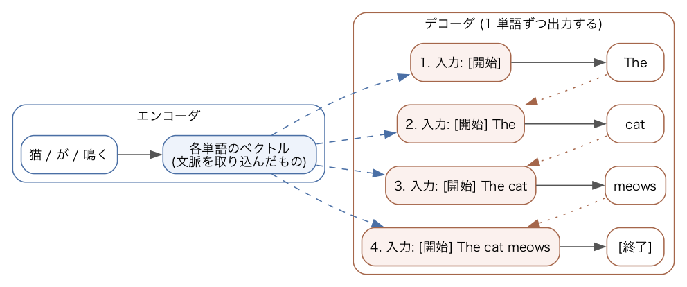
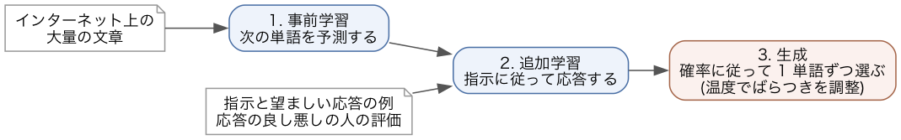
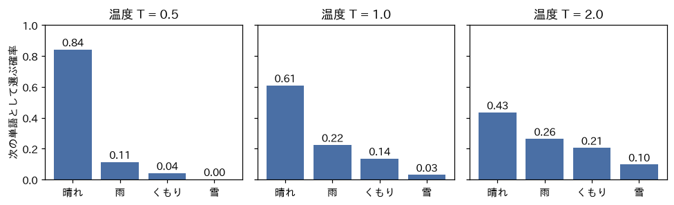

## 機械翻訳と文章生成 {#translation-generation}

**機械翻訳**は, ある言語の文を, 別の言語の同じ意味の文に変換する処理です. かつては, 単語や句の対訳の表と n-gram の言語モデルを組み合わせた統計的機械翻訳が主流でしたが, 2016 年ごろからニューラルネットワークによる翻訳 (ニューラル機械翻訳) に置き換わりました.

[Transformer](block:dl-transformer#自己注意と-transformer-の構成) は, もともと機械翻訳のために作られたモデルで, 翻訳前の文を読み取る**エンコーダ**と, 翻訳後の文を作る**デコーダ**からなります. 次の図は, 「猫が鳴く」を英語に翻訳する流れです.

1. エンコーダは「猫」「が」「鳴く」を読み取り, 各単語を, 文全体の文脈を取り込んだベクトルに変換します.
2. デコーダは, 文の始まりを表す特別なトークン `[開始]` を入力として, 翻訳後の最初の単語の確率を出力します. 確率が最も大きい単語「The」を選びます.
3. 選んだ単語を入力の末尾に加え (点線の矢印), `[開始] The` から次の単語「cat」を予測します. デコーダは各段階で, エンコーダが作ったベクトルにも注意を向け (破線の矢印), 翻訳前の文のどの単語に対応するかを参照します.
4. 文の終わりを表す `[終了]` が選ばれたら, 翻訳を終えます.

このように, それまでに作った単語を入力に加えながら, 次の単語を 1 つずつ予測して文を作る方法を**自己回帰生成**といいます. `[終了]` を出す時点もモデルが予測するので, 翻訳前と翻訳後で単語の数が違う文も作れます.

**文章生成**も, 同じ自己回帰生成で行います. 翻訳では翻訳前の文を手がかりに次の単語を予測しましたが, エンコーダを使わずに, それまでの文章だけから次の単語を予測すれば, 文章の続きを作れます. 対話型の生成 AI で使われる大規模言語モデル (GPT など) は, このようにデコーダだけを積み重ねたモデルです ([自己注意と Transformer の構成](block:dl-transformer#自己注意と-transformer-の構成)). 「今日の天気は」に続けて「晴れ」「です」「。」のように, 1 トークンずつ予測して文章を作ります.

# 生成 AI の仕組み: 事前学習と生成 {#pretraining-and-generation}

対話型の生成 AI の中で動いている大規模言語モデルは, 次の 3 段階を経て使われます.

1. **事前学習**: インターネット上の文章や書籍など, 大量の文章で, 次のトークンを予測する問題 ([自己教師あり学習の次トークン予測](block:dl-transformer#自己教師あり学習)) を解かせます. 正解は文章そのものなので, 人が正解を付ける必要はありません. 現在の大規模なモデルは, 数兆トークン規模の文章で学習しています. 事前学習を終えたモデルは, 文章の自然な続きを作れますが, 質問に答えるとは限りません. 「日本の首都はどこですか」の続きとして, 答えではなく, よく似た質問を並べ続けることもあります.
2. **指示に従うための追加学習**: 指示と, それに対する望ましい応答の組を人が作り, その組で追加の学習 (ファインチューニング) をします. さらに, 同じ指示に対する複数の応答を人が比べて評価し, 評価の高い応答を出しやすくなるように学習します (人のフィードバックによる強化学習, RLHF). この段階で, 質問に答える, 指示に従う, 有害な依頼を断る, といったふるまいを身に付けます.
3. **生成**: 利用者の入力 (**プロンプト**) の続きとして, 次のトークンを 1 つずつ選んで回答を作ります. [機械翻訳と文章生成](#translation-generation)の自己回帰生成です.

生成の各段階で, モデルは語彙のそれぞれについて, 次のトークンになる確率を出力します. 確率が最大のトークンを毎回選ぶと, 同じ入力には常に同じ回答になり, 決まった言い回しを繰り返しやすくなります. そこで実際には, 出力された確率に従ってトークンを無作為に選びます (**サンプリング**). 確率 0.6 のトークンは, 10 回のうち 6 回ほど選ばれます. 同じ質問をしても毎回違う回答が返ってくるのは, このためです.

選ばれ方のばらつきを調整するのが**温度 (temperature)** です. softmax 関数に入れる前の各トークンのスコアを $z_i$ とすると, 温度 $T$ での確率は次の式で求めます.

$$
p_i = \frac{\exp(z_i / T)}{\sum_j \exp(z_j / T)}
$$

$T = 1$ のときは, [softmax 関数](block:ml-network#ニューラルネットワークの構成)そのものです. 「今日の天気は」の次のトークンの候補が 4 つで, スコアが「晴れ」2.0, 「雨」1.0, 「くもり」0.5, 「雪」-1.0 だったとします. 温度を変えて確率を計算すると, 次の図のようになります.

- $T = 0.5$ では, 「晴れ」の確率が 0.84 まで上がり, 「雪」は 0.002 になります. 温度を下げるとスコアの差が拡大され, 確率の大きいトークンがさらに選ばれやすくなります.
- $T = 2$ では, 「晴れ」が 0.43, 「雪」が 0.10 になり, 確率の差が縮まります. 温度を上げると, ふだんは選ばれにくいトークンも選ばれるようになり, 回答が多様になる代わりに, 不自然な文も出やすくなります.

事実を正確に答えてほしい用途では温度を低く, アイデアを多く出してほしい用途では温度を高く設定します. ただし, 温度を下げても回答が正しいとは限りません. 大規模言語モデルは, 学習した文章での単語の並びの出やすさに基づいて回答を作るので, もっともらしいが事実と異なる文 (**ハルシネーション**) を含むことがあります. 生成 AI の回答は, 出典や別の資料で確かめてから使います.

