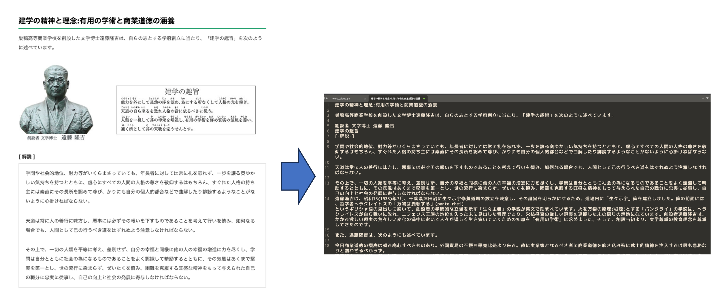

## 自然言語処理 {#自然言語処理}

非構造化データの分析手法として, 人が書いたり話したりする言葉 (**自然言語**) を, コンピュータで扱えるように処理し, 分析する技術を**自然言語処理 (NLP; Natural Language Processing)** といいます. 文章を単語に分ける[形態素解析](block:nlp-processing#トークン化と形態素解析)から始めて, 単語の出現回数による[可視化](block:nlp-processing#ワードクラウド), 辞書に無い語を登録する[ユーザ定義辞書](block:nlp-processing#user-dictionary), 文の構造を調べる[係り受け解析](block:nlp-syntax#dependency-parsing), 読みから文を選ぶ[かな漢字変換と言語モデル](block:nlp-syntax#kana-kanji-conversion), 事前学習済みのニューラル言語モデル (BERT) による[文章の分類](block:nlp-bert#マルチラベル分類)と[ベクトル化](block:nlp-embedding#自然言語ベクトル抽出によるデータ可視化と類似度評価)の順に扱います.

## 自然言語処理の活用事例 {#nlp-applications}

自然言語処理の技術は, 毎日使う道具の中で動いています.

| 活用事例 | 入力 | 出力 |
|---|---|---|
| 検索エンジン | 検索したい語句や質問 | 内容の近い Web ページや文書の一覧 |
| かな漢字変換 | キーボードで入力した読み (ひらがな) | 漢字かな交じりの文 |
| 機械翻訳 | ある言語の文 | 別の言語の同じ意味の文 |
| 対話 AI | 利用者の質問や指示 | 回答の文章 |
| 感情分析 | 商品レビューや SNS の投稿 | 肯定的か否定的か |
| 情報抽出 | ニュース記事や報告書 | 人名, 組織名, 日付や「誰が何をしたか」の組 |
| 音声アシスタント | 話しかけた言葉 ([音声認識](block:img-speech#speech-recognition)で文字にしたもの) | 質問の答えや機器の操作 |

どの事例でも, 文章をそのまま扱うのではなく, まず単語に分け, 単語同士の関係や単語の並びの出やすさを数値で表してから処理します. 「単語に分ける」を担うのが[トークン化と形態素解析](block:nlp-processing#トークン化と形態素解析), 「単語同士の関係」を調べるのが[係り受け解析](block:nlp-syntax#dependency-parsing), 「並びの出やすさ」を表すのが[かな漢字変換](block:nlp-syntax#kana-kanji-conversion)で説明する言語モデルです.

# []{#トークン化と形態素解析}トークン化と形態素解析 {#tokenization-morphology}
自然言語処理にも様々な手法がありますが, 基本的には元の文章データをそのまま使うことはなく, 文章を適切な単位に分割するなどの前処理を施します. これを**トークン化**といい, 代表的な手法としては**単語分割**, **文字分割**, **サブワード分割**などがあります.

単語分割に関して元の文章が英語などの単語ごとに区切られている文章であれば

`"This is a pen"` → `"This","is","a","pen"`

という風に簡単に分割できますが, 日本語のように単語間に空白などがない言語では特別な処理が必要になります.

また, 英語であっても, 代名詞 `'This'`, 動詞 `is`, 冠詞 `"a"`, 名詞 `"pen"` のように各単語の品詞を識別する (**品詞タグ付け**) には特別な処理が必要になります.

このような処理のために, 文章を意味を持つ最小の言語単位 (**形態素**) に分割し, それぞれの品詞を識別する処理を**形態素解析 (Morphological Analysis)** といいます.

::: note
形態素解析の基本的な手順は以下のようになります.

- ### データの作成 {#データの作成}

PDF やホームページなどから直接処理することも可能ですが, `.txt` や `.csv`, `.xml` などの構造化データに変換しておくと処理が楽になります.

入力例文: `"太陽が昇る東の空が美しい"`

- ### テキストの前処理 {#テキストの前処理}

不要なスペースや記号を除去しテキストを処理しやすい形に整理します.

- ### 形態素への分割 {#形態素への分割}

文章を形態素と呼ばれる最小単位に分割します.

`"太陽","が","昇る","東","の","空","が","美しい"`

- ### 品詞のタグ付け {#品詞のタグ付け}

分割された形態素に品詞情報を付与します.

`"太陽"`: 名詞

`"が"`: 助詞

`"昇る"`: 動詞

`"東"`: 名詞

`"の"`: 助詞

`"空"`: 名詞

`"が"`: 助詞

`"美しい"`: 形容詞

:::

日本語の形態素解析用の Python パッケージとして有名なものには, MeCab や Janome があります.

::: note

- `MeCab`
    - 日本語のオープンソース形態素解析システム
    - Python のライブラリとしては mecab-python3

- `janome`
    - Python で書かれた日本語形態素解析器
    - MeCab より Python からのインストールが簡単
    - ただし, 遅いので大規模な処理ではあまり使われない

形態素解析の例では, ライブラリとして MeCab を利用します. 次のコマンドでインストールしておきましょう (`unidic-lite` は形態素解析用の日本語の辞書です).

~~~ sh
uv add mecab-python3 unidic-lite
~~~

:::

形態素解析の練習用のデータとして[千葉商科大学の HP に掲載されている理念](https://www.cuc.ac.jp/about_cuc/outline/spirits/index.html)を利用してみます. テキスト部分をコピーして, `UTF-8` の `cuc.txt` ファイルを作成し, `data` フォルダに保存しましょう.

まずは, テキストデータを読み込んでみます. `pandas` などを利用して読み込むこともできますが, ここでは Python の組み込み関数 `open()` でファイルを開き, `read()` で読み込み, `close()` でファイルを閉じます.

~~~ py
# ファイルを開く
f = open('data/cuc.txt', encoding='utf-8')
# ファイルを読み込む
raw = f.read()
# ファイルを閉じる
f.close()
print(raw)

"""
建学の精神と理念:有用の学術と商業道徳の涵養

巣鴨高等商業学校を創設した文学博士遠藤隆吉は、自らの志とする学府創立に当たり、「建学の趣旨」を次のように述べています。

創設者 文学博士 遠藤 隆吉
...
"""
~~~

`pandas` などではこれらの手順を一度にまとめて行ってくれていましたが, この方法で行う場合は `close()` を利用してファイルを閉じることを忘れないようにしましょう. 忘れた場合, システムのリソースが無駄に占有され, 他のプログラムやソフトがファイルにアクセスできなくなるなどの問題が生じる可能性があります. 今回はファイルを読み込むだけですが, 間に適用される処理が多くなるほど, `open()` と `close()` の間の対応関係が分かりづらくなります.

そこでこのように手動で `close()` を呼ぶ代わりに, Python では `with` 文を使うことで, インデントブロックを抜けたときに自動的にファイルを閉じられます. `with` 文を使うとコードが簡潔になり, 閉じ忘れも防げるので, 一般には `with` 文の使用が推奨されます.

~~~ py
with open('data/cuc.txt', encoding='utf-8') as f:
    raw = f.read()

print(raw)
~~~

続いて形態素解析の前の前処理を行います.
(以下の形態素解析のコードなどは[神戸学院大学 林坂ゼミの資料](https://rinsaka.com/python/nltk/05-wordcloud.html)を参考にしました.)

前処理として, テキストファイルの改行やタブなどを削除する関数を用意します.
文字列を正規表現で操作するための標準ライブラリ `re` を `import` する必要があるので注意してください.

~~~ py
import re #正規表現操作のための標準ライブラリ

def strip_CRLF_from_Text(text):
    """テキストファイルの改行,タブを削除し,形態素解析を実行
    改行前後が日本語文字の場合は改行を削除する．
    それ以外はスペースに置換する．
    """
    # 改行前後の文字が日本語文字の場合は改行を削除する
    plaintext = re.sub('([ぁ-んー]+|[ァ-ンー]+|[\\u4e00-\\u9FFF]+|[ぁ-んァ-ンー\\u4e00-\\u9FFF]+)(\n)([ぁ-んー]+|[ァ-ンー]+|[\\u4e00-\\u9FFF]+|[ぁ-んァ-ンー\\u4e00-\\u9FFF]+)',
                       r'\1\3',
                       text)
    # 残った改行とタブ記号はスペースに置換する
    plaintext = plaintext.replace('\n', ' ').replace('\t', ' ')
    return plaintext

text = strip_CRLF_from_Text(raw)
print(text)

"""
建学の精神と理念:有用の学術と商業道徳の涵養  巣鴨高等商業学校を創設した文学博士遠藤隆吉は...
"""
~~~

改行やタブが消えて, 文毎にスペースで区切られた文章が作成されました. 日本語の文章の途中で改行がある場合には, 改行前後を結合して 1 文としてまとめられていることを確認しましょう.

続いて, 前処理を施した文章を, MeCab で形態素解析してみます.

抽出する品詞は `word_types` に `[String]` で指定します.

~~~ py
import MeCab as mc

def mecab_wakati(text,word_types = ["名詞","動詞","形容詞","副詞"]):
    #分かち書き
    t = mc.Tagger()
    #word_types = [String]で指定 ("名詞","動詞","形容詞","副詞")
    node = t.parseToNode(text)
    sent = ""
    noun = [x for x in word_types if x == "名詞"]
    others = [x for x in word_types if x in [ "動詞", "形容詞","副詞"]]
    while(node):
        if node.surface != "":  # ヘッダとフッタを除外
            word_type = node.feature.split(",")[0]
            if word_type in noun:
                 sent += node.surface + " " # node.surface は「表層形」
            if word_type in others:
                sent += node.feature.split(",")[10] + " " # node.feature.split(",")[10] は unidic の「書字形基本形」(活用する前の形, 例: 当たり → 当たる)
        node = node.next
        if node is None:
            break
    return sent

sent = mecab_wakati(text)
print(sent)
"""
建学 精神 理念 有用 学術 商業 道徳 涵養 巣鴨 商業 学校 創設 する 文学 博士 遠藤 隆吉 自ら 志 する 学府 創立 当たる...
"""

#動詞だけ抽出
sent = mecab_wakati(text,['動詞'])
print('-'*10 + '\n', sent)
"""
 する する 当たる 述べる いる まさる いる 対する 忘れる 譲る 持つ...
"""
~~~

以上で文章の形態素解析は完了です.

# []{#ワードクラウド}ワードクラウド {#word-cloud}

広く使われる文章の可視化手法として, 文章中に利用されている単語の頻度などを基準に文字の色や大きさを変える**ワードクラウド (WordCloud)** があります. [形態素解析の例](block:nlp-processing#トークン化と形態素解析)で使った文章を利用して, ワードクラウドを作成してみましょう.

まず日本語を表示するためにフォントの設定を行います.

フォントの場所は Windows と Mac で異なるので, 自分の環境に合わせてコメントアウトを外してください.

~~~ py
# フォントの保存先を指定する（環境によって書き換えてください）
font_path = "C:\\WINDOWS\\FONTS\\MEIRYO.TTC"    ## Windows 版はこちら
# font_path = "/System/Library/Fonts/ヒラギノ角ゴシック W3.ttc"  ## Mac 版はこちら
~~~

`wordcloud` をインストールしてから,

~~~ sh
uv add wordcloud
~~~

`wordcloud` を `import` して画像を生成します.

~~~ py
from wordcloud import WordCloud
# 直前で動詞だけに上書きした sent を, 既定の品詞で作り直します
sent = mecab_wakati(text)
wc = WordCloud(width=1000
              ,height=400
              ,background_color='white'
              , regexp=r"[\w']+" #一文字を表示
              ,font_path=font_path).generate(sent)
wc.to_file("result/fig/cuc.png")
~~~

指定した保存先 (`"result/fig/cuc.png"`) に以下の画像が保存されているはずです.

ワードクラウドでは, 登場する用語の頻度に応じて大きさや色などが強調されています. 千葉商科大学の理念では, 「実業」「道徳」などが強調されていることが分かります.

ワードクラウドを作成するときは, 「こと」「もの」のようにどんな文章にも頻出する語を除いたほうが, 文章の特徴が見やすくなります. 除きたい語を `stopwords` に指定すると, その語はワードクラウドに表示されません.

~~~ py
stopwords = ['こと','もの','ため']
wc = WordCloud(width=1000
              ,height=400
              ,background_color='white'
              , regexp=r"[\w']+" #一文字を表示
              ,font_path=font_path
              ,stopwords=stopwords).generate(sent)
wc.to_file("result/fig/cuc2.png")
~~~

ここまでのコードを整理すると, 次のようになります.

~~~ py
from wordcloud import WordCloud
import re #正規表現操作のための標準ライブラリ
import MeCab as mc

def strip_CRLF_from_Text(text):
    """テキストファイルの改行,タブを削除し,形態素解析を実行
    改行前後が日本語文字の場合は改行を削除する．
    それ以外はスペースに置換する．
    """
    # 改行前後の文字が日本語文字の場合は改行を削除する
    plaintext = re.sub('([ぁ-んー]+|[ァ-ンー]+|[\\u4e00-\\u9FFF]+|[ぁ-んァ-ンー\\u4e00-\\u9FFF]+)(\n)([ぁ-んー]+|[ァ-ンー]+|[\\u4e00-\\u9FFF]+|[ぁ-んァ-ンー\\u4e00-\\u9FFF]+)',
                       r'\1\3',
                       text)
    # 残った改行とタブ記号はスペースに置換する
    plaintext = plaintext.replace('\n', ' ').replace('\t', ' ')
    return plaintext

def mecab_wakati(text,word_types = ["名詞","動詞","形容詞","副詞"]):
    #分かち書き
    t = mc.Tagger()
    #word_types = [String]で指定 ("名詞","動詞","形容詞","副詞")
    node = t.parseToNode(text)
    sent = ""
    noun = [x for x in word_types if x == "名詞"]
    others = [x for x in word_types if x in [ "動詞", "形容詞","副詞"]]
    while(node):
        if node.surface != "":  # ヘッダとフッタを除外
            word_type = node.feature.split(",")[0]
            if word_type in noun:
                 sent += node.surface + " " # node.surface は「表層形」
            if word_type in others:
                sent += node.feature.split(",")[10] + " " # node.feature.split(",")[10] は unidic の「書字形基本形」(活用する前の形, 例: 当たり → 当たる)
        node = node.next
        if node is None:
            break
    return sent

with open('data/cuc.txt', encoding='utf-8') as f:
    raw = f.read()

text = strip_CRLF_from_Text(raw)

#名詞だけ抽出
sent = mecab_wakati(text,['名詞'])

# WordCloud
# フォントの保存先を指定する（環境によって書き換えてください）
font_path = "C:\\WINDOWS\\FONTS\\MEIRYO.TTC"    ## Windows 版はこちら
#font_path = "/System/Library/Fonts/ヒラギノ角ゴシック W3.ttc"  ## Mac 版はこちら

stopwords = ['こと','もの','ため']
wc = WordCloud(width=1000
              ,height=400
              ,background_color='white'
              , regexp=r"[\w']+" #一文字を表示
              ,font_path=font_path
              ,stopwords=stopwords).generate(sent)
wc.to_file("result/fig/cuc2.png")
~~~

# ユーザ定義辞書 {#user-dictionary}

MeCab のような形態素解析器は, 辞書に載っている単語を組み合わせて文を区切ります. 1 つの文にも区切り方の候補は何通りもあるので, 辞書の各単語には出やすさを表す**コスト** (小さいほど出やすい) が付いていて, 形態素解析器はコストの合計が最も小さくなる区切り方を選びます. そのため, 辞書に載っていない語は, 辞書に載っている短い単語の組み合わせに分けられます.

大学名と科目名を含む文を, [トークン化と形態素解析](#トークン化と形態素解析)と同じ MeCab (辞書は unidic-lite) で分かち書きしてみます.

~~~ py
import MeCab as mc

t = mc.Tagger('-Owakati')
print(t.parse('千葉商科大学でデータサイエンス実践を履修した。'))
"""
千葉 商科 大学 で データ サイエンス 実践 を 履修 し た 。
"""
~~~

「千葉商科大学」は「千葉」「商科」「大学」に, 「データサイエンス実践」は「データ」「サイエンス」「実践」に分かれました. 学内アンケートの自由記述から, どの科目がよく話題になっているかを数える分析では, 科目名が 1 語として数えられないと集計できません. ワードクラウドでも, 「千葉」と「大学」が別々の語として表示されます.

形態素解析器の辞書に, 利用者が単語を追加したものを**ユーザ定義辞書** (ユーザ辞書) といいます. MeCab のユーザ辞書は, 次の手順で作ります.

1. 登録する単語を, 1 行に 1 語ずつ CSV ファイルに書く.
2. CSV ファイルを, MeCab が読み込める辞書ファイル (`.dic`) にコンパイルする.
3. 形態素解析のときに, `-u` オプションでユーザ辞書を指定する.

CSV の各行には, 表層形 (文中に現れる形), 左文脈 ID, 右文脈 ID, コスト, 品詞や読みなどの素性を, この順に並べます. 文脈 ID は前後の単語とのつながりやすさを決める番号で, 品詞ごとに辞書で決まっています. unidic-lite では, 固有名詞 (名詞-固有名詞-一般) の文脈 ID は 4786 です (辞書のフォルダにある `left-id.def` に書かれています). unidic-lite の素性は 26 項目あるので, 手で書く代わりに関数で作ります.

辞書のコンパイルには, MeCab の本体に付属するコマンド `mecab-dict-index` を使うのが一般的ですが, mecab-python3 にはこのコマンドが含まれていません. ここでは, 同じ機能を Python から呼び出せるライブラリ fugashi を使います. fugashi は MeCab を同梱しているので, Windows でも Mac でも, MeCab の本体を別にインストールせずに使えます.

::: warn
この節では fugashi を使います. `uv add` しておいてください.

~~~ sh
uv add fugashi
~~~

:::

作業フォルダに `data` フォルダがある状態で, 次のコードを実行します.

~~~ py
import csv
from pathlib import Path
import unidic_lite
from fugashi import build_dictionary

def user_entry(surface, reading, cost=3000):
    """ユーザ辞書の 1 行 (unidic-lite の 名詞-固有名詞-一般 と同じ形) を作る"""
    feature = ['名詞', '固有名詞', '一般', '*', '*', '*',
               reading, surface, surface, reading, surface, reading, '固',
               '*', '*', '*', '*', reading, reading, reading, reading,
               '*', '*', '*', '*', '*']
    # 表層形, 左文脈ID, 右文脈ID, コスト, 素性 (品詞, 読みなど)
    return [surface, 4786, 4786, cost] + feature

words = [('千葉商科大学', 'チバショウカダイガク'),
         ('データサイエンス実践', 'データサイエンスジッセン')]

# 1. 単語の一覧を CSV に書き出す
with open('data/user.csv', 'w', encoding='utf-8', newline='') as f:
    csv.writer(f).writerows(user_entry(s, r) for s, r in words)

# 2. CSV をコンパイルして data/user.dic を作る
dicdir = Path(unidic_lite.DICDIR).as_posix()  # unidic-lite の辞書の場所
build_dictionary(f'mecab-dict-index -d "{dicdir}" -u data/user.dic '
                 f'-f utf-8 -t utf-8 data/user.csv')
"""
.../unidic_lite/dicdir/pos-id.def is not found. minimum setting is used
reading data/user.csv ... 2
emitting double-array: 100% |###########################################|

done!
"""
~~~

`build_dictionary` には, `mecab-dict-index` と同じオプションを 1 つの文字列で渡します. `-d` は品詞の情報を読み出すシステム辞書 (unidic-lite) の場所, `-u` は作るユーザ辞書のファイル名, `-f` と `-t` は CSV と辞書の文字コードです. 辞書の場所は `Path(...).as_posix()` で `/` 区切りに直しておくと, Windows でもそのまま渡せます. 出力の `pos-id.def is not found` は品詞の番号表が unidic-lite に含まれていないという表示で, ユーザ辞書の作成には影響しません. `reading data/user.csv ... 2` は 2 語を読み込んだことを表します. CSV のファイル名を間違えるなどしてファイルが見つからないときは, エラーを表示してスクリプト全体が終了します.

作ったユーザ辞書を `-u` で指定して, 同じ文を解析し直します.

~~~ py
import MeCab as mc

text = '千葉商科大学でデータサイエンス実践を履修した。'
t = mc.Tagger('-Owakati -u data/user.dic')
print(t.parse(text))

t = mc.Tagger('-u data/user.dic')
print(t.parse(text))
"""
千葉商科大学 で データサイエンス実践 を 履修 し た 。

千葉商科大学	チバショウカダイガク	チバショウカダイガク	千葉商科大学	名詞-固有名詞-一般
で	デ	デ	で	助詞-格助詞
データサイエンス実践	データサイエンスジッセン	データサイエンスジッセン	データサイエンス実践	名詞-固有名詞-一般
を	オ	ヲ	を	助詞-格助詞
履修	リシュー	リシュウ	履修	名詞-普通名詞-サ変可能			0
し	シ	スル	為る	動詞-非自立可能	サ行変格	連用形-一般	0
た	タ	タ	た	助動詞	助動詞-タ	終止形-一般
。			。	補助記号-句点
EOS
"""
~~~

登録した 2 語が, それぞれ 1 語の固有名詞として解析されました. [トークン化と形態素解析](#トークン化と形態素解析)の `mecab_wakati` 関数は関数の中で `mc.Tagger()` を作っているので, ユーザ辞書を使うときはこの部分を `mc.Tagger('-u data/user.dic')` に書き換えます.

登録した語が選ばれるのは, その語のコストが, 分割したときの単語のコストの合計 (に単語同士のつながりのコストを加えたもの) より小さいときです. 同じ 2 語をコスト 15000 で登録すると「データサイエンス実践」は再び 3 語に分かれ, 20000 で登録すると「千葉商科大学」も 3 語に分かれます. 登録したのに分割される語があれば, コストを小さくします.

この節に対応する演習は, [Exercise DSP9-1](#exercise-dsp9-1)です.

# []{#演習}演習 {#exercises}

## Exercise DSP9-1 {#exercise-dsp9-1}

**学部名のユーザ辞書と登録のコスト**

対応する節: [ユーザ定義辞書](#user-dictionary)

「サービス創造学部の学生が商経学部の授業に出た。」を MeCab (unidic-lite) で分かち書きします.

1. ユーザ辞書を使わないときの分かち書きの結果を示してください.
2. 「サービス創造学部」と「商経学部」を, [ユーザ定義辞書](#user-dictionary)の `user_entry` 関数でコスト 3000 として登録し, 1 語として解析されることを確かめてください.
3. コストを 10000, 15000, 20000 に変えて辞書を作り直し, それぞれの結果を比べてください. コスト 20000 で分割される語と分割されない語があれば, その違いが生じる理由を, 登録しないときに分割された単語のコストの合計 (`node.wcost` の合計) を使って説明してください.

提出ファイル名: `dsp9-1.py`

    
 回答例 

~~~ py
import csv
from pathlib import Path
import unidic_lite
from fugashi import build_dictionary
import MeCab as mc

def user_entry(surface, reading, cost=3000):
    feature = ['名詞', '固有名詞', '一般', '*', '*', '*',
               reading, surface, surface, reading, surface, reading, '固',
               '*', '*', '*', '*', reading, reading, reading, reading,
               '*', '*', '*', '*', '*']
    return [surface, 4786, 4786, cost] + feature

words = [('サービス創造学部', 'サービスソウゾウガクブ'),
         ('商経学部', 'ショウケイガクブ')]
text = 'サービス創造学部の学生が商経学部の授業に出た。'
dicdir = Path(unidic_lite.DICDIR).as_posix()

# 問1
print('登録前:', mc.Tagger('-Owakati').parse(text).strip())

# 問2, 問3
for cost in [3000, 10000, 15000, 20000]:
    with open(f'data/ex2_{cost}.csv', 'w', encoding='utf-8', newline='') as f:
        csv.writer(f).writerows(user_entry(s, r, cost) for s, r in words)
    build_dictionary(f'mecab-dict-index -d "{dicdir}" -u data/ex2_{cost}.dic '
                     f'-f utf-8 -t utf-8 data/ex2_{cost}.csv')
    t = mc.Tagger(f'-Owakati -u data/ex2_{cost}.dic')
    print(cost, t.parse(text).strip())

# 問3: 登録しないときに分割された単語のコスト
t = mc.Tagger()
for s, r in words:
    node = t.parseToNode(s)
    costs = []
    while node:
        if node.surface != '':
            costs.append((node.surface, node.wcost))
        node = node.next
    print(s, costs, sum(c for _, c in costs))
"""
(辞書の作成時の表示は省略)
登録前: サービス 創造 学 部 の 学生 が 商 経学 部 の 授業 に 出 た 。
3000 サービス創造学部 の 学生 が 商経学部 の 授業 に 出 た 。
10000 サービス創造学部 の 学生 が 商経学部 の 授業 に 出 た 。
15000 サービス創造学部 の 学生 が 商経学部 の 授業 に 出 た 。
20000 サービス 創造 学 部 の 学生 が 商経学部 の 授業 に 出 た 。
サービス創造学部 [('サービス', 993), ('創造', 6183), ('学', 6964), ('部', 6416)] 20556
商経学部 [('商', 6389), ('経学', 8049), ('部', 6416)] 20854
"""
~~~

1. 「サービス 創造 学 部」「商 経学 部」のように, どちらの学部名も辞書にある短い語に分割されます. 「商経学部」は「商経」ではなく「商」「経学」「部」に分かれています.
2. コスト 3000 では, 2 つの学部名がそれぞれ 1 語になります.
3. コスト 15000 までは 2 語とも 1 語のままですが, 20000 では「サービス創造学部」だけが分割されます. 形態素解析器は, 登録した語 1 つで表す区切り方と, 短い語に分ける区切り方のうち, コストの合計が小さいほうを選びます. 分割したときの単語のコストの合計は「サービス創造学部」が 20556, 「商経学部」が 20854 です. 「商経学部」のほうが分割したときのコストが大きい (「経学」のような出にくい語を含む) ので, 登録した語のコストが大きくても, 分割せずに 1 語とする区切り方が選ばれやすくなります. ただし, どちらの合計も 20000 をわずかに上回るだけなので, 単語同士のつながりのコスト (文脈 ID の組で決まる値) も結果を左右します. 登録した語を確実に 1 語にするには, 分割したときのコストの合計より十分小さいコストを付けます.

