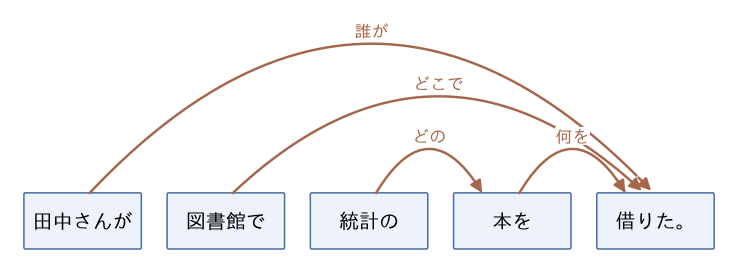
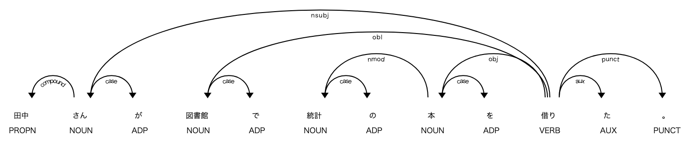
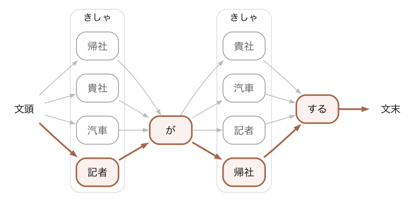

## 係り受け解析 {#dependency-parsing}

形態素解析で文を単語に分けても, どの語がどの語を説明しているかは分かりません. 文の中で, ある語句が別の語句に意味の上でつながる関係を**係り受け**といい, 係る側を**係り元**, 係られる側を**係り先**といいます. 文の係り受けを求める処理を**係り受け解析 (dependency parsing)** といいます.

日本語の係り受けは, 伝統的に**文節** (「田中さんが」「図書館で」のように, 自立語 1 つとそれに付く助詞などをまとめた単位) を単位として考えます. 「田中さんが図書館で統計の本を借りた。」の係り受けは, 次の図のようになります.

矢印は係り元の文節から係り先の文節へ向かいます. 「統計の」は「本を」に係り, 「田中さんが」「図書館で」「本を」はどれも文末の「借りた。」に係ります. 述語の「借りた」に係る文節を助詞で見分けると, 誰が (〜が), どこで (〜で), 何を (〜を) 借りたかが分かります. 語順を「図書館で田中さんが統計の本を借りた。」と入れ替えても係り受けの関係は変わらないので, 係り受けを使えば, 語順によらずに「誰が何をしたか」を取り出せます.

## GiNZA による係り受け解析 {#ginza}

係り受け解析には **GiNZA** を使います. GiNZA は, 自然言語処理のライブラリ spaCy の上で動く日本語の解析器で, 形態素解析, 係り受け解析, 固有表現抽出をまとめて行います. `pip` や `uv` だけでインストールでき, Windows でも Mac でも同じ手順で使えます.

::: warn
この節では GiNZA を使います. `uv add` しておいてください. `ja_ginza` は GiNZA が解析に使う学習済みのモデルです.

~~~ sh
uv add ginza ja_ginza
~~~

:::

`spacy.load('ja_ginza')` でモデルを読み込み, 文を渡すと解析結果が返ります. 各単語 (spaCy ではトークンと呼びます) について, 番号, 表層形, 原形, 品詞, 係り受けのラベル, 係り先の番号, 係り先の語を表示します.

~~~ py
import spacy

nlp = spacy.load('ja_ginza')
doc = nlp('田中さんが図書館で統計の本を借りた。')
for t in doc:
    print(t.i, t.text, t.lemma_, t.pos_, t.dep_, t.head.i, t.head.text, sep='\t')
"""
0	田中	田中	PROPN	compound	1	さん
1	さん	さん	NOUN	nsubj	9	借り
2	が	が	ADP	case	1	さん
3	図書館	図書館	NOUN	obl	9	借り
4	で	で	ADP	case	3	図書館
5	統計	統計	NOUN	nmod	7	本
6	の	の	ADP	case	5	統計
7	本	本	NOUN	obj	9	借り
8	を	を	ADP	case	7	本
9	借り	借りる	VERB	ROOT	9	借り
10	た	た	AUX	aux	9	借り
11	。	。	PUNCT	punct	9	借り
"""
~~~

GiNZA の係り受けは, 文節ではなく単語を単位とし, 多くの言語で共通に使われるラベルの体系 (Universal Dependencies) で関係の種類を表します. 助詞は前の名詞に `case` で係り, 名詞が述語に係ります. この文に現れたラベルの意味は次のとおりです.

| ラベル | 意味 | この文の例 (係り元 → 係り先) |
|---|---|---|
| `nsubj` | 主語 | さん → 借り |
| `obj` | 目的語 | 本 → 借り |
| `obl` | 述語を補う語 (場所, 時, 相手など) | 図書館 → 借り |
| `nmod` | 名詞を修飾する名詞 | 統計 → 本 |
| `compound` | 複合語の一部 | 田中 → さん |
| `case` | 格助詞 (が, で, の, を など) | が → さん |
| `aux` | 助動詞 | た → 借り |
| `punct` | 句読点 | 。 → 借り |
| `ROOT` | 文の中心となる語 (係り先は自分自身) | 借り |

spaCy の `displacy` を使うと, 係り受けを図にできます. 次のコードは図を SVG ファイルに保存します. 保存した `dep.svg` をブラウザで開くと, 図が表示されます.

~~~ py
import spacy
from spacy import displacy

nlp = spacy.load('ja_ginza')
doc = nlp('田中さんが図書館で統計の本を借りた。')
svg = displacy.render(doc, style='dep', jupyter=False,
                      options={'compact': True, 'distance': 100})
with open('dep.svg', 'w', encoding='utf-8') as f:
    f.write(svg)
~~~

次の図は, 同じ文を `compact` を指定せずに描いたものです.

各単語の下に品詞, 弧の上にラベルが付いています. `displacy` の矢印は係り先から係り元へ向かうので, 文節の図とは矢印の向きが逆です. 「借り」から出る 3 本の長い弧 (`nsubj`, `obl`, `obj`) が「さん」「図書館」「本」に向かっていて, 文節の図の「田中さんが」「図書館で」「本を」から「借りた。」への矢印と同じ関係を表しています.

GiNZA は, 単語の係り受けを文節の係り受けにまとめる関数も持っています. `ginza.bunsetu_spans` は文を文節に区切り, `ginza.bunsetu_span` は単語を含む文節を返します.

~~~ py
import spacy
import ginza

nlp = spacy.load('ja_ginza')
doc = nlp('田中さんが図書館で統計の本を借りた。')
for b in ginza.bunsetu_spans(doc):
    head = ginza.bunsetu_span(b.root.head)  # 係り先の文節
    print(b.text, '→', head.text if head != b else '(文末)')
"""
田中さんが → 借りた。
図書館で → 借りた。
統計の → 本を
本を → 借りた。
借りた。 → (文末)
"""
~~~

`b.root` は文節の中心となる語 (「田中さんが」なら「さん」) です. その係り先の語を含む文節が, 文節の係り先になります. 結果は文節の図と一致します.

## 係り受けから「誰が何をしたか」を取り出す {#who-did-what}

係り受けを使って, 複数の文から「誰が」「何を」「どうした」を取り出してみます. 各文の中心 (`ROOT`) の語を述語とし, 述語に `nsubj` で係る語を「誰が」, `obj` で係る語を「何を」とします.

~~~ py
import spacy
import ginza

nlp = spacy.load('ja_ginza')

def phrase(token):
    # token に係る語をまとめた句 (token 自身の格助詞は除く)
    return ''.join(t.text for t in token.subtree
                   if not (t.dep_ == 'case' and t.head == token))

def predicate(token):
    # 述語の文節から句読点を除いたもの
    return ''.join(t.text for t in ginza.bunsetu_span(token) if t.pos_ != 'PUNCT')

text = ('田中さんが図書館で統計の本を借りた。'
        '先生は学生にレポートの締め切りを伝えた。'
        '売店では昼休みに弁当がよく売れる。'
        '佐藤さんがデータサイエンス実践を履修した。')
for sent in nlp(text).sents:
    root = sent.root  # 文の中心 (ROOT) の語
    who = [phrase(c) for c in root.children if c.dep_ == 'nsubj']
    what = [phrase(c) for c in root.children if c.dep_ == 'obj']
    print(f'誰が: {who}, 何を: {what}, どうした: {predicate(root)}')
"""
誰が: ['田中さん'], 何を: ['統計の本'], どうした: 借りた
誰が: ['先生'], 何を: ['レポートの締め切り'], どうした: 伝えた
誰が: ['弁当'], 何を: [], どうした: 売れる
誰が: ['佐藤さん'], 何を: ['データサイエンス実践'], どうした: 履修した
"""
~~~

`nlp(text).sents` は解析結果を文ごとに区切ったもので, `root.children` は述語に直接係る語の一覧です. `phrase` は, 語に係る語 (`token.subtree`) をつないで「統計の本」「田中さん」のような句にする関数で, 句の末尾の格助詞 (「が」「を」) は除いています. 述語は, 助動詞も含めるために「借りた」のような文節の形で表示しています.

3 文目の「誰が」は「弁当」です. `nsubj` は文法上の主語 (述語「売れる」に対して「〜が」で示される語) を表し, 動作をした人とは限りません. 弁当を売ったのは売店, 買ったのは客です. 2 文目では「先生は」が `nsubj` になっています. 「は」は話題を示す助詞で, 格助詞の「が」とは働きが違いますが, GiNZA は述語との関係から「先生」を主語と判定しています.

4 文目の「データサイエンス実践」は 1 つの句として取り出せていますが, GiNZA は内部では「データ」「サイエンス」「実践」の 3 語に分け, `compound` でつないでいます. 一方で「千葉商科大学」は, MeCab (unidic-lite) と違って最初から 1 語になります.

~~~ py
import spacy

nlp = spacy.load('ja_ginza')
doc = nlp('千葉商科大学でデータサイエンス実践を履修した。')
print([t.text for t in doc])
"""
['千葉商科大学', 'で', 'データ', 'サイエンス', '実践', 'を', '履修', 'し', 'た', '。']
"""
~~~

形態素解析器ごとに辞書の中身が違うので, 分析に使う固有名詞がどう区切られるかは, 実際に解析して確かめます. GiNZA (内部で使っている形態素解析器 Sudachi) にも, MeCab とは別の形式のユーザ辞書の仕組みがあります.

この節に対応する演習は, 章末の[Exercise DSP9-2](#exercise-dsp9-2)です.

# かな漢字変換 {#kana-kanji-conversion}

キーボードで「きしゃがきしゃする」と入力して変換すると, 「記者が帰社する」が候補の先頭に出ます. **かな漢字変換**は, 読み (ひらがなの並び) から漢字かな交じりの文を作る処理で, 次の 2 段階からなります.

1. **候補の列挙**: 読みを辞書に載っている単語の読みで区切り, 区切りごとに当てはまる単語の候補を並べる. 「きしゃ」には「記者」「汽車」「貴社」「帰社」などの候補がある.
2. **候補の選択**: 候補を組み合わせてできる文の中から, 日本語の文として最も出やすいものを選ぶ.

次の図は, 「きしゃがきしゃする」の候補を並べたものです (**ラティス**といいます). 文頭から文末まで矢印をたどる道の 1 本が, 変換結果の文 1 つにあたります. この図だけでも 4 × 4 = 16 通りの文があり, 読みが長くなると組み合わせの数は急速に増えます.

候補の選択には**言語モデル**を使います. 言語モデルは, 単語の並び $w_1, w_2, \dots, w_n$ が文として現れる確率 $P(w_1, w_2, \dots, w_n)$ を与えるモデルです. 最も単純な言語モデルの 1 つが, 直前の 1 単語だけから次の単語の確率を決める **2-gram (バイグラム) モデル**です. 2-gram モデルでは, 「記者が帰社する」の確率を次の積で近似します.

$$
P(\text{記者}, \text{が}, \text{帰社}, \text{する}) \approx P(\text{記者} \mid \text{文頭})\, P(\text{が} \mid \text{記者})\, P(\text{帰社} \mid \text{が})\, P(\text{する} \mid \text{帰社})\, P(\text{文末} \mid \text{する})
$$

各確率は, 大量の文章 (コーパス) で隣り合う 2 単語の組を数えて求めます. 例えば $P(\text{する} \mid \text{帰社})$ は, コーパスで「帰社」の直後に「する」が来た回数を, 「帰社」が現れた回数で割った値です. 「帰社する」はコーパスによく現れ, 「記者する」はほとんど現れないので, 2 つ目の「きしゃ」は「帰社」になります. 図の太線が, 確率の積が最大になる道です. 左から順に, 各候補について「そこまでの道の確率の最大値」を記録していけば, すべての道を調べなくても最大の道が求まります (ビタビアルゴリズム).

2-gram モデルは隣り合う 2 単語しか見ません. 1 つ目の「きしゃ」を「記者」にするか「汽車」にするかは, $P(\text{記者} \mid \text{文頭})\, P(\text{が} \mid \text{記者})$ と $P(\text{汽車} \mid \text{文頭})\, P(\text{が} \mid \text{汽車})$ の比較だけで決まり, 離れた位置にある「帰社」との意味のつながりは使われません. そのため, 実際のかな漢字変換では, 直前の 2 単語を見る 3-gram モデルや, より長い文脈を扱えるニューラルネットワークの言語モデルも使われます. また, かな漢字変換のソフトにも単語登録の機能があり, 辞書にない固有名詞は, [ユーザ定義辞書](block:nlp-processing#user-dictionary)と同じく利用者が登録して候補に出します.

隣り合う単語の並び (n-gram) の数え方は, 文章同士の似ている度合いを測るのにも使えます. 後述の[n-gram と文章間類似度](block:nlp-embedding-more#ngram-similarity)で扱います.

# []{#演習}演習 {#exercises}

## Exercise DSP9-2 {#exercise-dsp9-2}

**係り受けによる「誰が, どこで, 誰に, 何をしたか」の取り出し**

対応する節: [係り受けから「誰が何をしたか」を取り出す](#who-did-what)

[係り受けから「誰が何をしたか」を取り出す](#who-did-what)のコードを拡張し, 述語 (`ROOT` の語) に `obl` で係る語のうち, 格助詞「で」が付くものを「どこで」, 格助詞「に」が付くものを「誰に」として取り出してください. 次の 4 文に適用し, 取り出した結果のうち正しくないものを挙げて, そうなった理由を説明してください.

- 田中さんが図書館で統計の本を借りた。
- 先生は教室で学生にレポートの締め切りを伝えた。
- 佐藤さんが駅で友人に会った。
- 昼休みに売店で弁当を買った。

提出ファイル名: `dsp9-2.py`

    
 回答例 

~~~ py
import spacy
import ginza

nlp = spacy.load('ja_ginza')

def phrase(token):
    return ''.join(t.text for t in token.subtree
                   if not (t.dep_ == 'case' and t.head == token))

def predicate(token):
    return ''.join(t.text for t in ginza.bunsetu_span(token) if t.pos_ != 'PUNCT')

def case_of(token):
    # token に付いている格助詞 (で, に など)
    return ''.join(c.text for c in token.children if c.dep_ == 'case')

text = ('田中さんが図書館で統計の本を借りた。'
        '先生は教室で学生にレポートの締め切りを伝えた。'
        '佐藤さんが駅で友人に会った。'
        '昼休みに売店で弁当を買った。')
for sent in nlp(text).sents:
    root = sent.root
    row = {'誰が': [], '何を': [], 'どこで': [], '誰に': []}
    for c in root.children:
        if c.dep_ == 'nsubj':
            row['誰が'].append(phrase(c))
        elif c.dep_ == 'obj':
            row['何を'].append(phrase(c))
        elif c.dep_ == 'obl' and case_of(c) == 'で':
            row['どこで'].append(phrase(c))
        elif c.dep_ == 'obl' and case_of(c) == 'に':
            row['誰に'].append(phrase(c))
    print(row, predicate(root))
"""
{'誰が': ['田中さん'], '何を': ['統計の本'], 'どこで': ['図書館'], '誰に': []} 借りた
{'誰が': ['先生'], '何を': ['レポートの締め切り'], 'どこで': ['教室'], '誰に': ['学生']} 伝えた
{'誰が': ['佐藤さん'], '何を': [], 'どこで': ['駅'], '誰に': ['友人']} 会った
{'誰が': [], '何を': ['弁当'], 'どこで': ['売店'], '誰に': ['昼休み']} 買った
"""
~~~

1 文目から 3 文目は正しく取り出せています. 4 文目には誤りが 2 つあります.

- 「誰が」が空です. 日本語では, 文脈から分かる主語を省略することが多く, この文にはもともと主語の語がありません. 係り受け解析は文の中にある語同士の関係を求めるだけなので, 省略された主語は補えません. 補うには, 前の文の主語を引き継ぐなど, 文をまたいだ処理が必要です.
- 「昼休み」が「誰に」に入っています. 格助詞「に」は, 相手 (友人に) だけでなく時 (昼休みに) も表します. 係り受けのラベルはどちらも `obl` で, 格助詞も同じなので, ラベルと助詞だけでは区別できません. 区別するには, 係る語が人を表すか時を表すか, という語の意味の情報を使う必要があります.

