## 相関 {#correlation}

[基本統計量](block:num-summary#basic-stats)で 1 つの観測項目の特徴を要約できるように, [散布図](block:vis-relation#scatter)で表した 2 つの観測項目間の関係も数値で表せます.

[散布図](block:vis-relation#scatter)で扱った[事例](https://github.com/yakagika/yakagika.github.io/blob/main/slds_data/ch8/scatter.csv)についてもう一度考えてみましょう.

~~~ sh
     AI  Python
0    34      27
1    40      26
2    59      28
3    46      29
4    36      29
..   ..     ...
255  58      83
256  69      87
257  59      82
258  62      84
259  59      87
~~~

~~~ py
df = pd.read_csv('data/scatter.csv')
#散布図のx軸を指定
x_column = 'AI'
#散布図のy軸を指定
y_column = 'Python'

x_value = df[x_column]
y_value = df[y_column]
plt.scatter(x_value, y_value)
plt.ylabel(y_column)
plt.xlabel(x_column)
plt.show()
~~~

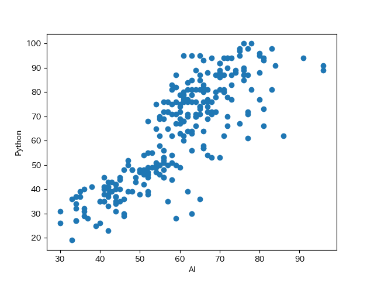

Google トレンドの `AI` と `Python` の検索数から散布図を作成すると, `AI` の検索数が増えるにつれて `Python` の検索数が増えていることが分かります.

::: note
- ### 相関関係 {#相関関係}

このような関係を**相関関係 (correlation)**といい, 2 つの変数の間に直線関係に近い傾向が見られるときに「**相関関係がある**」といいます.

点の並びが直線的であるほど**強い相関**, 直線から散らばっているほど**弱い相関**といいます.

また,

- 一方が増加したとき, 他方が増加する関係を **正の相関関係**
- 一方が増加したとき, 他方が減少する関係を **負の相関関係**

といいます.

このような相関関係があるかないかは, 散布図を見ただけである程度判断が可能ですが, 相関が**ある/ない**, **強い/弱い**というのは抽象的な表現なので, 厳密に判断する場合にはそれらを数値として表す必要があります.

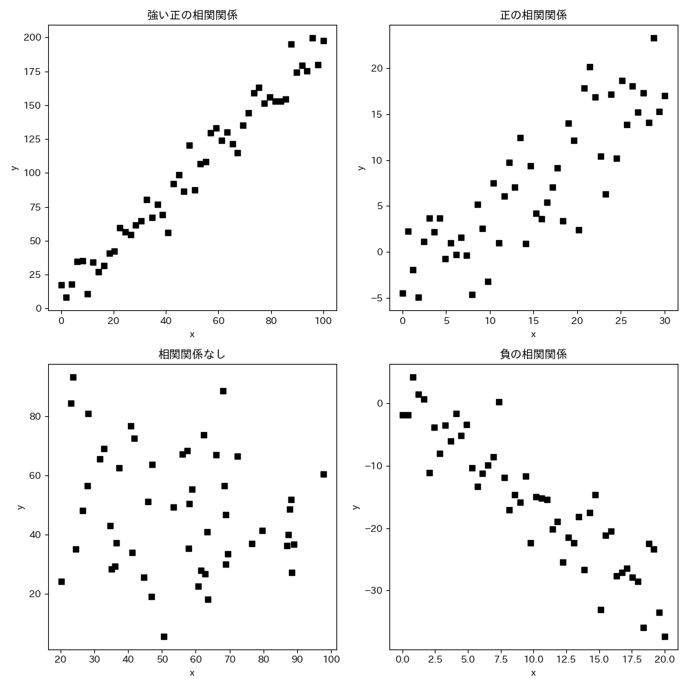

相関関係を数値化したものを**相関係数 (correlation coefficient)**といいます. 相関係数には, データの尺度に応じていくつかの種類があります. どれを使うかは, [統計量の選び方の樹形図](block:num-summary#choose-stat)の「変数が 2 つ」の枝のとおりです.

:::

## ピアソンの積率相関係数 {#ピアソンの積率相関係数}

2 つの量的変数に利用される相関係数を**ピアソンの積率相関係数 (product moment correlation coefficient)**といいます.

データが $(x_1, y_1), (x_2, y_2), ..., (x_n, y_n)$ のとき,

$$
\begin{align*}
r_{xy} &= \frac{\sum (x_i - \bar{x})(y_i - \bar{y}) / n}{\sqrt{\sum (x_i - \bar{x})^2 / n} \sqrt{\sum (y_i - \bar{y})^2 / n}} \\
& = \frac{\sum (x_i - \bar{x})(y_i - \bar{y})}{\sqrt{\sum (x_i - \bar{x})^2} \sqrt{\sum (y_i - \bar{y})^2}} \\
&= \frac{s_{xy}}{S_x S_y}
\end{align*}
$$

なお,
$$
\quad s_{xy} = \frac{1}{n} \sum (x_i - \bar{x})(y_i - \bar{y})
$$
を $x$ と $y$ の共分散といい, 相関係数は $\frac{x \text{と} y \text{の共分散}}{x \text{の標準偏差} \times y \text{の標準偏差}}$ の形で表されます.

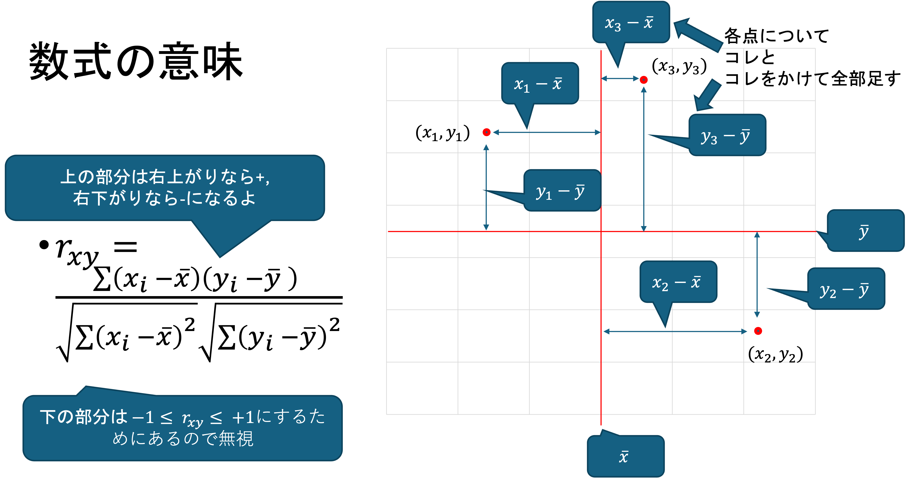
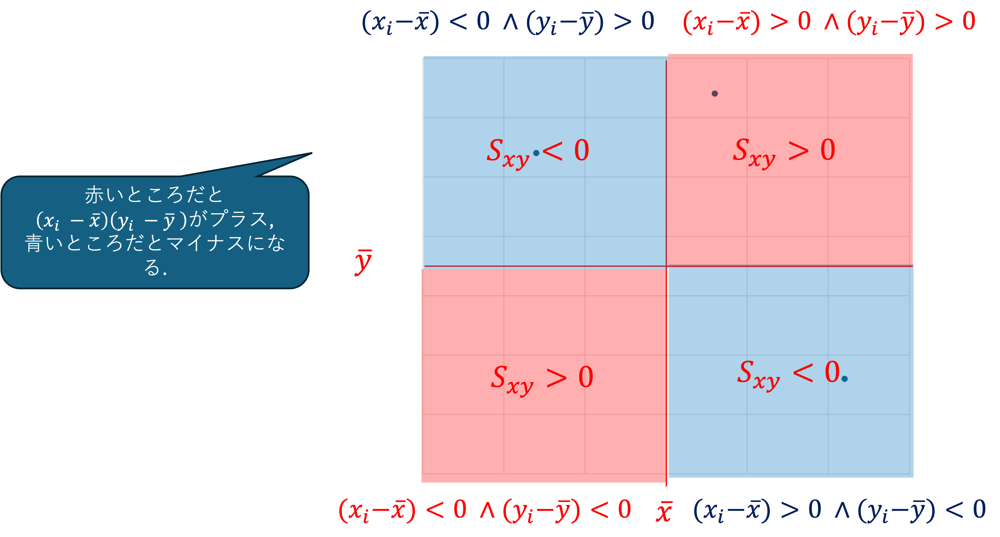
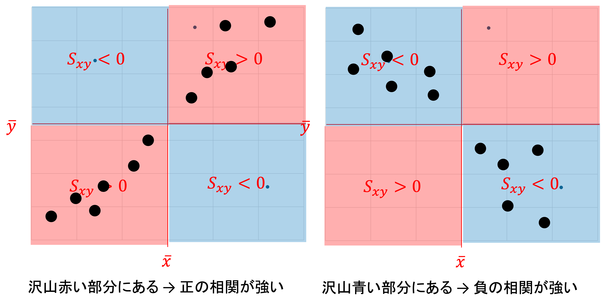

$x_i, y_i$ を標準化し $z_i = \frac{x_i - \bar{x}}{S_x}, w_i = \frac{y_i - \bar{y}}{S_y}$ とすると,

$$
\begin{align*}
r_{zw} &= \frac{1}{n} \sum z_i w_i \\
&= \frac{1}{n} \sum \left( \frac{x_i - \bar{x}}{S_x} \right) \left( \frac{y_i - \bar{y}}{S_y} \right) \\
&= \frac{\sum (x_i - \bar{x})(y_i - \bar{y})}{n S_x S_y} \\
&= r_{xy}
\end{align*}
$$

相関係数が $-1$ から $1$ の範囲に収まることを示すために, $\frac{1}{n} \sum (z_i \pm w_i)^2$ を考えます.

$$
\begin{align*}
\frac{1}{n} \sum (z_i \pm w_i)^2 &\geq 0 \\
\frac{1}{n} \sum (z_i^2 \pm 2z_i w_i + w_i^2) &\geq 0 \\
\frac{1}{n} \sum z_i^2 \pm \frac{2}{n} \sum z_i w_i + \frac{1}{n} \sum w_i^2 &\geq 0 \\
\frac{1}{n S_x^2} \sum (x_i - \bar{x})^2 \pm \frac{2}{n} \sum z_i w_i + \frac{1}{n S_y^2} \sum (y_i - \bar{y})^2 &\geq 0  \\
\frac{S_x^2}{S_x^2} \pm \frac{2}{n} \sum z_i w_i + \frac{S_y^2}{S_y^2}  &\geq 0 \\
1 \pm \frac{2}{n} \sum z_i w_i + 1 &\geq 0 \\
2 (1 \pm r_{xy}) &\geq 0 \\
\therefore -1 \leq r_{xy} &\leq 1
\end{align*}
$$

このように相関係数は常に $-1 \leq r_{xy} \leq 1$ を取ります.

また, $c$ を $c > 0$ の定数として, すべての点で $y_i = c x_i$ が成り立つとき, $\bar{y} = c \bar{x}$ が成り立ち,

$$
\begin{align*}
S_y &= \sqrt{\frac{1}{n} \sum (y_i - \bar{y})^2} \\
    &= \sqrt{\frac{1}{n} \sum (c x_i  - c \bar{x})^2} \\
    &= \sqrt{\frac{c^2}{n} \sum (x_i - \bar{x})^2} = c S_x
\end{align*}
$$

となります.
したがって,

$$
\begin{align*}
r &= \frac{\frac{1}{n} \sum (x_i - \bar{x})(y_i - \bar{y})}{S_x \times S_y} \\
  &= \frac{\frac{c}{n} \sum (x_i - \bar{x})^2}{S_x \times c S_x} \\
  &= \frac{c S_x^2}{c S_x^2} = 1
\end{align*}
$$

となり, 相関係数は `1` になります. また, $c < 0$ の場合は, $S_y = |c| S_x = -c S_x$ より $S_x \times S_y = -c S_x^2$ となるので, `-1` になります.

このように $x_i$ と $y_i$ が同じ比率で増減するとき,

- $r_{xy} = 1$ となり, 正の完全相関
- $r_{xy} = -1$ となり, 負の完全相関

といいます.

なお, 相関が「ある/ない」の目安は以下のようになっています.

| 相関係数 | 関連性の程度 |
|---------------------|----------------------------|
| 0.0〜0.4, -0.4〜0.0 | ほとんど相関がない |
| 0.4〜0.7, -0.7〜-0.4 | 弱い相関がある |
| 0.7〜0.9, -0.9〜-0.7 | 強い相関がある |
| 0.9〜1.0, -1.0〜-0.9 | きわめて強い相関がある |

Python で積率相関係数を求めるには `numpy` の `np.corrcoef(xのデータ,yのデータ)` あるいは `scipy.stats.pearsonr(xのデータ,yのデータ)` を利用します. `scipy` がインストールされていない人は `uv add scipy` をしておきましょう.

~~~ py
import pandas               as pd
import matplotlib.pyplot    as plt
import matplotlib_fontja
import numpy as np
import scipy.stats as st

#データの読み込み
#データの位置を指定しよう
df = pd.read_csv('data/scatter.csv')
print(df)

#散布図のx軸を指定
x_column = 'AI'
#散布図のy軸を指定
y_column = 'Python'

x_value = df[x_column]
y_value = df[y_column]
plt.scatter(x_value, y_value)
plt.ylabel(y_column)
plt.xlabel(x_column)
plt.show()

# numpyで相関係数を求める
# 返り値が [[xとxの相関係数=1, xとyの相関係数]
# ,[yとxの相関係数, yとyの相関係数=1]]
# となっている
print(np.corrcoef(df[x_column],df[y_column]))
"""
[[1.         0.83281294]
 [0.83281294 1.        ]]
"""
print(np.corrcoef(df[x_column],df[y_column])[0][1])
# 0.8328129378961621

#scipy.stats.pearsonr でも計算可能
# 返り値が (相関係数, p値)の形に成っている
# p値の意味は「データ活用の統計学実践」で扱います.
r, p = st.pearsonr(df[x_column],df[y_column])
print(r) #0.832812937896162
~~~

## スピアマンの順位相関係数 {#スピアマンの順位相関係数}

積率相関係数は量的変数にしか利用できませんが, 質的変数のうち順序尺度データに関しては, **スピアマンの順位相関係数 (rank correlation coefficient)**が利用できます.

スピアマンの順位相関係数は, 順序尺度データを順位に変換して, 順位の間の相関係数を求めたものになります.

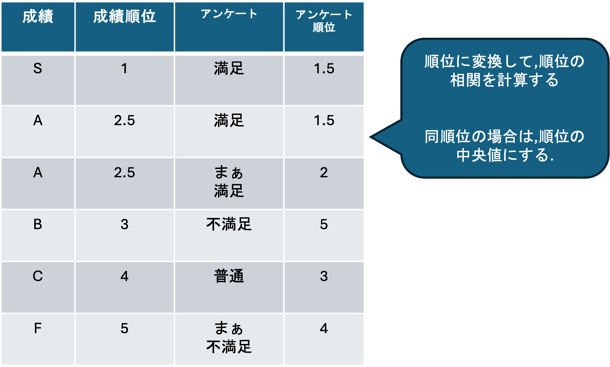

2 つの変数それぞれでデータを小さい順に並べ替えた順位を $x_1, \dots, x_n$ と $y_1, \dots, y_n$ とします (同じ順位は無いものとします). このとき,

$$
r_{xy} = \frac{\frac{1}{n} \sum (x_i - \bar{x})(y_i - \bar{y})}{\sqrt{\frac{1}{n} \sum (x_i - \bar{x})^2} \sqrt{\frac{1}{n} \sum (y_i - \bar{y})^2}}
$$
がどのようになるかを考えます.

順位は 1 から $n$ までの整数を並べ替えたものなので,

$$
\sum x_i = \sum y_i = \frac{n(n+1)}{2}
$$

$$
\sum x_i^2 = \sum y_i^2 = \frac{1}{6} n(n+1)(2n+1)
$$

$$
\bar{x} = \bar{y} = \frac{\sum x_i}{n} = \frac{n(n+1)}{2n} = \frac{n+1}{2}
$$

なので, 分子に関して,

$$
\begin{align*}
& \frac{1}{n}\sum(x_i - \bar{x})(y_i - \bar{y}) \\
&= \frac{1}{n}\sum \{x_iy_i - x_i \bar{y} - \bar{x}y_i + \bar{x}\bar{y}\} \\
&= \frac{1}{n}\sum x_i y_i - \frac{1}{n}\sum x_i\bar{y} - \frac{1}{n}\sum \bar{x}y_i + \frac{1}{n}\sum  \bar{x}\bar{y} \\
&= \frac{1}{n}\sum x_i y_i - \frac{\bar{y}}{n}\sum x_i - \frac{\bar{x}}{n}\sum y_i + \bar{x}\bar{y} \\
&= \frac{1}{n}\sum x_i y_i - \bar{x}\bar{y} \\
&= \frac{1}{2n}\sum \{x_i^2 + y_i^2 - (x_i - y_i)^2\} - \bar{x}\bar{y} \\
\end{align*}
$$

$$
\begin{align*}
\because (x_i - y_i)^2 = x_i^2 -2x_i y_i + y_i^2  \\
x_i y_i = \frac{1}{2} \{ x_i^2 + y_i^2 - (x_i - y_i)^2 \}
\end{align*}
$$

$$
\begin{align*}
& \frac{1}{2n}\sum \{x_i^2 + y_i^2 - (x_i - y_i)^2\} - \bar{x}\bar{y} \\
&= \frac{1}{2n}\sum x_i^2 + \frac{1}{2n}\sum y_i^2 - \frac{1}{2n}\sum (x_i - y_i)^2 - \bar{x}\bar{y} \\
& = \frac{1}{6} (n+1)(2n+1) - \frac{(n+1)^2}{4} - \frac{1}{2n}\sum (x_i - y_i)^2 \\
& = \frac{1}{12}(n+1)(n-1) - \frac{1}{2n}\sum (x_i - y_i)^2
\end{align*}
$$

また, 分母に関して,
$$
\begin{align*}
& \frac{1}{n}\sum (x_i - \bar{x})^2 \\
&= \frac{1}{n}\sum (x_i^2 - 2 x_i \bar{x} + \bar{x}^2) \\
&= \frac{1}{n} \{ \sum x_i^2 -2n \bar{x}^2 + n\bar{x}^2 \} \\
&= \frac{1}{n} \{\sum x_i^2 - n\bar{x}^2\} \\
&= \frac{1}{6}(n+1)(2n+1) - \frac{1}{4}(n+1)^2 \\
&= \frac{1}{12}(n+1)(n-1)
\end{align*}
$$

となります. $y$ についての $\frac{1}{n} \sum (y_i - \bar{y})^2$ も同じ値になるので, これらを

$$
r_{xy} = \frac{\frac{1}{n} \sum (x_i - \bar{x})(y_i - \bar{y})}{\sqrt{\frac{1}{n} \sum (x_i - \bar{x})^2} \sqrt{\frac{1}{n} \sum (y_i - \bar{y})^2}}
$$

に代入して,
$$
\begin{align*}
r_{xy} = \frac{\frac{1}{n} \sum (x_i - \bar{x})(y_i - \bar{y})}{\sqrt{\frac{1}{n} \sum (x_i - \bar{x})^2} \sqrt{\frac{1}{n} \sum (y_i - \bar{y})^2}} &= \frac{\frac{1}{12}(n+1)(n-1) - \frac{1}{2n} \sum (x_i - y_i)^2}{\frac{1}{12}(n+1)(n-1)}\\
&=  1 - \frac{6}{n^3 - n} \sum (x_i - y_i)^2
\end{align*}
$$

となります.

スピアマンの順位相関係数は, Python では, `scipy.stats.spearmanr(xのデータ,yのデータ)` で求めることができます.

次の[データ](https://github.com/yakagika/yakagika.github.io/blob/main/slds_data/ch9/spearman.csv)は, 国別 (A〜J) のサッカー (FIFA) と野球 (WBSC) のランキングのダミーデータです.

~~~ sh
    rank FIFA WBSC
0     1    A    A
1     2    B    E
2     3    C    G
3     4    D    I
4     5    E    D
5     6    F    C
6     7    G    B
7     8    H    F
8     9    I    H
9    10    J    J
~~~

この 2 つのランキングの順位相関係数を求めてみましょう. データは順位ごとに国名が並んでいるので, 国 (A〜J) をキーにして FIFA の順位と WBSC の順位を対応させてから計算します.

~~~ py
df = pd.read_csv('data/spearman.csv')

#国(A~J)をキーにして,FIFA順位とWBSC順位を対応させる
fifa = df.set_index('FIFA')['rank']
wbsc = df.set_index('WBSC')['rank']
wbsc = wbsc.loc[fifa.index] #国の並び順を揃える

# scipyで順位相関係数を求める
correlation, pvalue = st.spearmanr(fifa, wbsc)
print("相関係数:",correlation) #0.4545454545454545
~~~

`0.45` なので弱い正の相関があることが分かります.

## 相関係数のヒートマップ {#相関係数のヒートマップ}

相関係数はデータの関係を探るために便利な数値であり, 複数の観測項目からなるデータを扱う場合には, 最初に相関係数をとってそれぞれにどのような関係があるのかを確認するようにしましょう.

次の[データ](https://github.com/yakagika/yakagika.github.io/blob/main/slds_data/ch9/coeff_multi.csv)は, e-Stat (政府統計の総合窓口) から取得した, 都道府県別の身長, 体重, 食費, 睡眠の平均時間, スポーツの平均時間に関するデータです. [散布図行列](block:vis-relation#scatter-matrix)で使ったデータと同じものです.

~~~ sh
python coeff.py
    pref  height  weight   food  sleep  sports
0    北海道   170.4    63.7  65739    477      15
1    青森県   169.8    62.8  64889    490      13
2    岩手県   170.6    63.7  70156    489      13
3    宮城県   169.8    63.4  73337    482      15
4    秋田県   170.6    66.1  74560    493      14
5    山形県   170.9    63.9  76000    497      12
6    福島県   170.2    63.9  71074    480      13
7    茨城県   169.7    62.4  74341    467      17
8    栃木県   169.8    63.3  74387    472      16
9    群馬県   170.5    62.7  71701    475      15
10   埼玉県   170.4    61.1  76663    463      15
11   千葉県   170.3    62.4  77639    458      15
12   東京都   170.5    61.3  83506    461      16
13  神奈川県   170.9    62.5  77510    456      17
14   新潟県   170.9    62.0  75937    479      13
15   富山県   170.8    63.5  73589    471      15
16   石川県   170.8    62.9  76256    470      16
17   福井県   170.4    62.5  79478    476      14
18   山梨県   170.1    61.7  71294    481      16
19   長野県   169.5    61.0  72228    474      17
20   岐阜県   169.9    60.6  69527    469      13
21   静岡県   170.1    61.9  75833    474      19
22   愛知県   169.6    60.9  74694    463      14
23   三重県   170.4    62.1  75721    473      16
24   滋賀県   170.6    62.9  77978    470      18
25   京都府   170.5    62.0  76904    464      16
26   大阪府   170.2    62.2  74015    469      18
27   兵庫県   169.6    60.6  72847    466      15
28   奈良県   169.9    61.8  74888    461      18
29  和歌山県   170.0    62.6  69858    479      15
30   鳥取県   170.4    62.7  73321    475      14
31   島根県   169.7    60.7  72160    483      16
32   岡山県   169.6    61.7  69060    475      17
33   広島県   168.8    60.8  69061    473      15
34   山口県   169.2    60.2  69882    472      17
35   徳島県   169.9    64.4  67102    472      18
36   香川県   169.9    62.7  68400    469      18
37   愛媛県   168.8    61.8  67274    474      16
38   高知県   169.1    61.8  70188    484      16
39   福岡県   169.7    60.9  70135    471      14
40   佐賀県   169.2    62.2  68749    473      16
41   長崎県   170.1    63.3  66641    473      18
42   熊本県   169.5    61.8  66184    482      20
43   大分県   169.3    62.5  69255    479      18
44   宮崎県   168.7    61.8  65165    477      19
45  鹿児島県   169.7    61.4  65377    479      18
46   沖縄県   168.7    60.6  56298    482      20
~~~

データの取得過程に興味がある人は, 以下の手順を自分で行い, データを作ってみましょう.

 e-Stat のデータ表示機能を使ってデータを自分で作る (開く/閉じる) 

::: note

e-Stat で都道府県別の身長, 体重, 睡眠時間等のデータを集めます.
地域別のデータは「地域」から選択できます.

「都道府県データ」を選択し, 「データ表示」をクリックします.

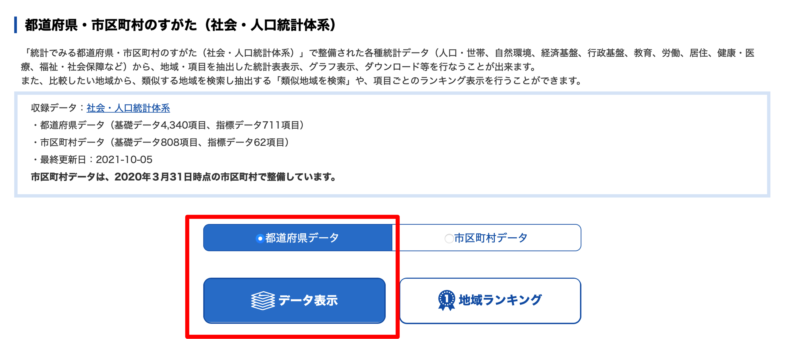

データを集める, 地域, 表示項目, 表示方法の順に選択します.
今回はすべての都道府県を利用するので, 「全て選択」をクリックしたあと「確定」をクリックします.

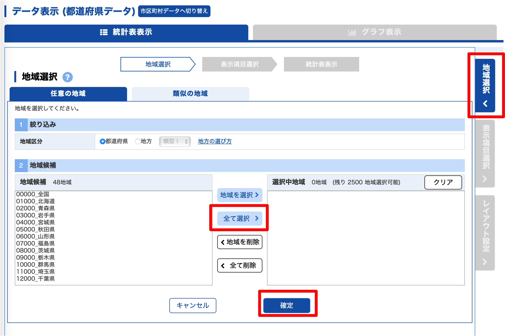

次に項目を決めます.
分野をクリックして「I 健康・医療」を選ぶと, 項目候補に健康・医療に関わる項目が表示されます.
そこから,

- I411301_身長（高校2年）（男）【ｃｍ】
- I412301_体重（高校2年）（男）【ｋｇ】

を順番に選んで, 「項目を選択」をクリックします.

同様に, 「L 家計」から

- L421101_食料費（二人以上の世帯のうち勤労者世帯）（全国消費実態調査結果）【円】

「M 生活時間」から

- M1101_睡眠の平均時間（10歳以上）（男）【分】
- M360100_スポーツの平均時間（15歳以上）（男）【分】

を順番に選んで, 「項目を選択」をクリックします.

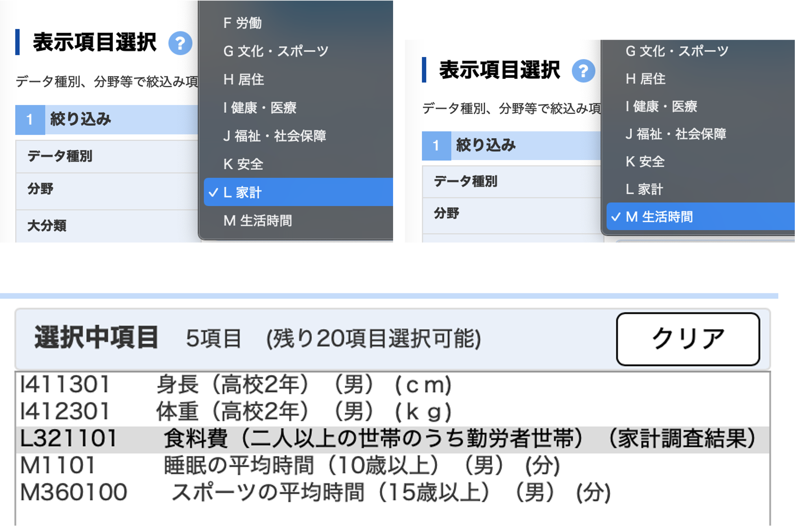

最後にどのデータを表示するかレイアウトを決めます.

- 調査年を列に配置
- 表示年度を 2000 から 2010 まで
- 設定して表示を更新

データをダウンロードします.

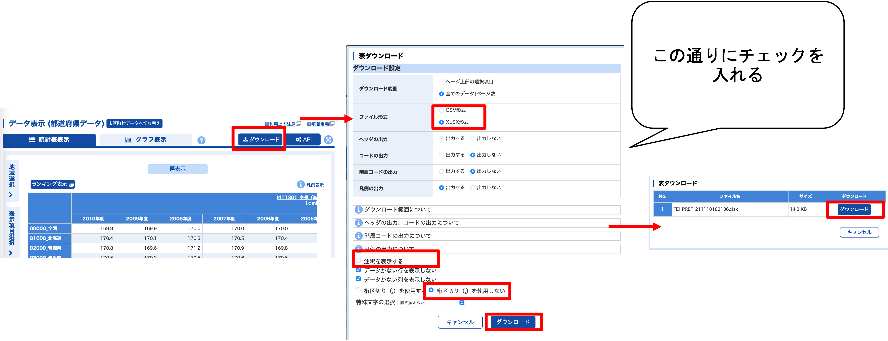

ダウンロードしたデータを読み込める csv に編集します.

- 2006 年以外の列を削除
- 数値として新しいシートにコピー
- ヘッダー名をつける
    - 県名 pref (prefecture の略)
    - 身長 height
    - 体重 weight
    - 食費 food
    - 睡眠 sleep
    - スポーツ sports
- utf-8 の csv で保存
- ファイル名: coeff_multi.csv
- 作業ディレクトリの data フォルダに保存

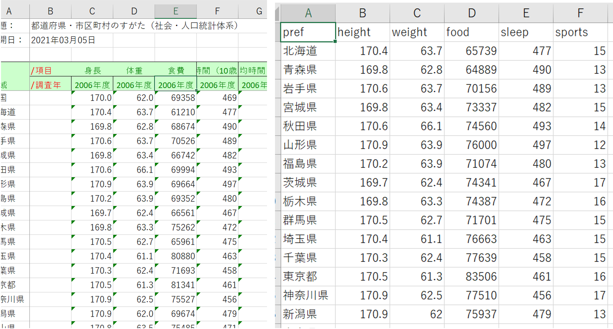

:::

データのどの観測項目間に関連があるのかを確かめるために, 作成したデータのすべての組み合わせの相関係数を見てみましょう. 今までのように一つ一つ散布図を作成して, 相関係数を求めていると, $\text{観測項目数} \times \text{観測項目数}$ のグラフを作成することになります.
そこで, 与えられた観測項目すべての組み合わせで図示する**ペアプロット**と**ヒートマップ**を活用してみます.

`DataFrame` に含まれるデータのペアプロットには, `pandas` の `plotting` モジュールを利用します. `pd.plotting.scatter_matrix(ペアプロットを求めるDataFrame)` で, 散布図のペアプロットが作成できます.

また, 各項目の相関係数も `pandas` の `.corr()` メソッドで取得することができます.

~~~ py
# CSVファイルを読み込んでデータフレームに格納
# dataフォルダを作成し,そこにデータを入れておきましょう
df = pd.read_csv('data/coeff_multi.csv')

# データの表示
print(df)

#分析するデータの選択
labels = ['height', 'weight', 'food', 'sports', 'sleep']
X = df[labels]

#散布図行列を作成してみる
pd.plotting.scatter_matrix(X, range_padding=0.2)
plt.show()

#相関係数の組み合わせを確認
print(X.corr())

#ヒートマップで確認
sns.heatmap(X.corr()
           ,vmax=1     #ヒートマップの最大値
           ,vmin=-1    #最小値
           ,center =0  #中心
           ,annot=True)
plt.show()
~~~

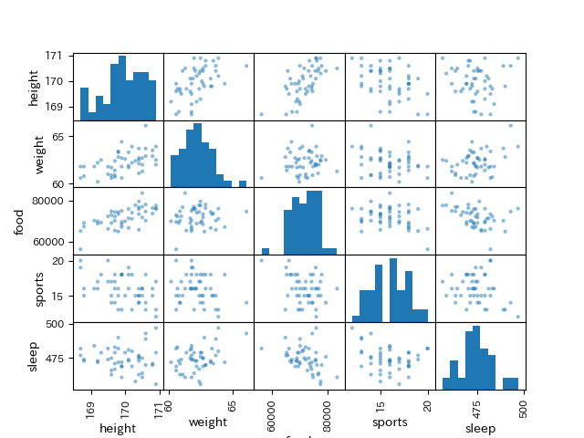

各項目の組み合わせごとに, 散布図が作成されています. 対角線上にはヒストグラムが作成されます.

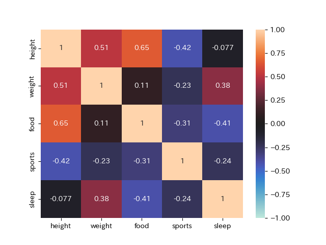

身長と食費 (0.65), 身長と体重 (0.51) に弱い正の相関があり, 食費と睡眠時間 (-0.41), 身長とスポーツの時間 (-0.42) に弱い負の相関があることが分かります. 一方, 食費と体重の相関係数は 0.11 で, ほとんど相関がありません.
このように複数の観測項目から関係があるデータを探したい場合には, ペアプロットや, 相関係数のヒートマップを作成することで, 関係性がわかりやすくなります.

## $\chi^2$ 統計量 {#chi2-統計量}

量的データには積率相関係数, 順位尺度データに対しては, 順位相関係数を求めることで 2 つのデータの関連性を確かめることができました. では, 名義尺度データの場合はどのようにすればよいのでしょうか.

名義尺度を含めた質的変数の関係性の可視化には, [ヒートマップ](block:vis-relation#heatmap)の例のように同時度数分布表が使えます. 数値化においても, 同時度数分布表を用いることができます.

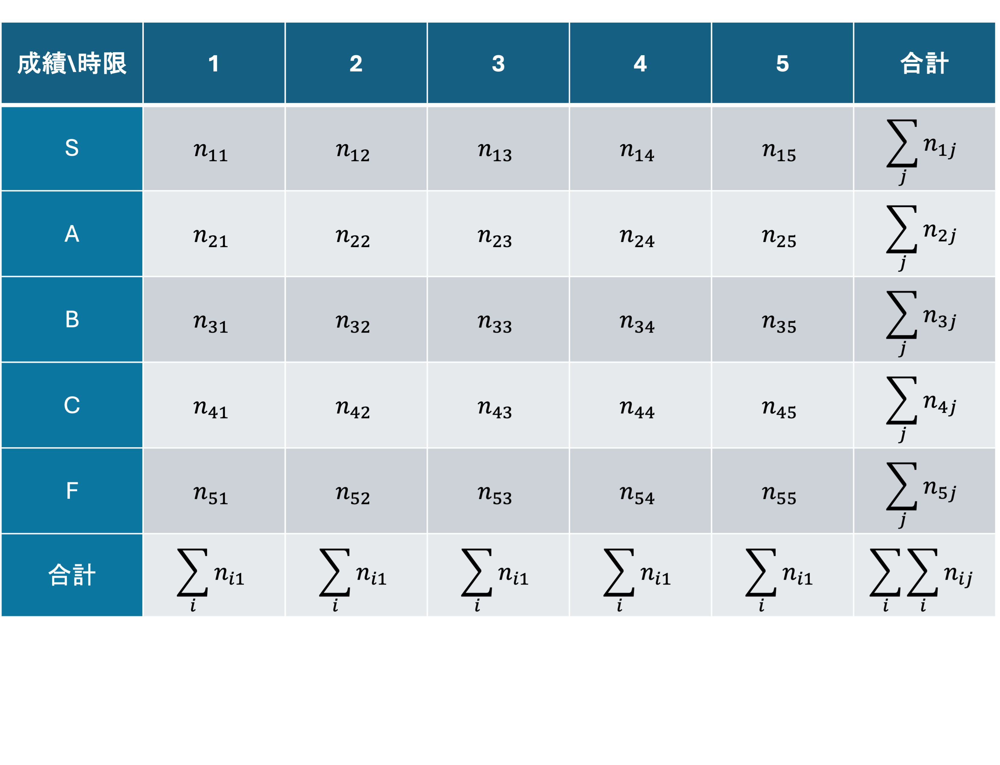

質的変数間の関連度合いは, 同時度数分布表の数値を利用した **ピアソンの $\chi^2$ 統計量 (カイにじょうとうけいりょう)**で表すことができます. [ヒートマップ](block:vis-relation#heatmap)の例では同時度数分布表から列相対度数を求めましたが, ここで使うのは相対度数ではなく度数です.

$$
\chi_o^2 = \sum_{i=1}^{r} \sum_{j=1}^{c} \frac{(n_{ij} - E_{ij})^2}{E_{ij}} \quad (r: \text{行数},\ c: \text{列数})
$$

ここで $n_{ij}$ は $i$ 行 $j$ 列のセルの度数です. $E_{ij}$ を**期待度数**といい, $\frac{\text{行の合計} \times \text{列の合計}}{\text{総数}}$, すなわち

$$
E_{ij} = \frac{\sum_{l=1}^{c} n_{il} \times \sum_{k=1}^{r} n_{kj}}{\sum_{k=1}^{r}\sum_{l=1}^{c} n_{kl}}
$$

で求められます.

この $\chi_o^2$ が大きいほど, 2 つの変数の間の関連が強いといえます. この値を利用して, 行と列のデータが独立であるかを検定する **$\chi^2$ 検定 (独立性の検定)** を行うこともできます. $\chi^2$ 検定は[質問紙調査の独立性の検定](block:survey-analysis#独立性の検定)で使います. ここでは, この値から 2 つのデータの関連の度合いを判断する方法を見ていきましょう.

$\chi_o^2$ の値は, 同時度数分布表の行数や列数に依存して値が変わるため, 相関係数のように, 「特定の値から関連があるといえる」といった利用法には適しません.

そこで, 異なるデータを比較するためには, $0 \leq V \leq 1$ の値を取る, **クラメールの連関係数 $V$**に変換します. $n$ は総度数です.

$$
V = \sqrt{\frac{\chi_o^2}{n \times \min(r - 1,c - 1)}}
$$

クラメールの連関係数は, 相関係数よりも高い値が出にくいので, 以下のような基準で判断します.

|V |判断 |
|:--- |:--- |
|0〜0.1 | 関連なし |
|0.1〜0.25 | 弱い関連がある |
|0.25〜0.5 | 関連がある |
|0.5〜1.0 | 強い関連がある |

$\chi_o^2$ は `scipy.stats` の `chi2_contingency(度数分布表,correction=False)` で求めることができます.
返り値は $\chi_o^2$, p 値, 自由度, 期待度数の 4 つです.

[ヒートマップ](block:vis-relation#heatmap)で使った, 時限と成績の関係を記録した[データ](https://github.com/yakagika/yakagika.github.io/blob/main/slds_data/ch8/cross_table_data.csv)を利用して, クラメールの連関係数 $V$ を求めてみましょう.

~~~ sh
     Period Grade
0         2     B
1         5     A
2         4     A
3         3     C
4         1     C
..      ...   ...
195       2     C
196       4     C
197       5     C
198       5     F
199       4     C
~~~

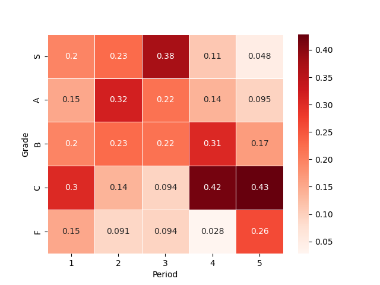

~~~ py
import pandas as pd
import matplotlib.pyplot as plt
import seaborn as sns
import scipy.stats as st
import numpy as np

df = pd.read_csv('data/cross_table_data.csv')

#クロス表(同時度数分布表)の作成
cross = pd.crosstab(df['Grade'],df['Period'])

#表示順の設定
cross = cross.reindex([1,2,3,4,5],axis='columns')
cross = cross.reindex(['S','A','B','C','F'],axis='index')
print(cross)

# 列相対度数をヒートマップで可視化
cross_rel = cross.copy()
for c in cross_rel.columns:
    cross_rel[c] = cross_rel[c] / cross_rel[c].sum()

print(cross_rel)

sns.heatmap( cross_rel  #ヒートマップを作成したいテーブル
           , cmap=plt.get_cmap('Reds') #カラーマップ(省略可)
           , linewidths=.5 #線の太さを指定することでセルを囲う線を表示
           , annot=True  #セルに数値を表示
           )
plt.show()

#χ二乗統計量は相対度数ではなく度数の分布表から求める
x2, p, dof, e = st.chi2_contingency(cross,correction=False)
print(x2) #43.39273272653072

#クラメールの連関係数Vを求める
n = cross.sum().sum() #総度数 200
v = np.sqrt(x2/(n * min(cross.shape[0]-1,cross.shape[1] -1)))
print(v) #0.232896792395609
~~~

クラメールの連関係数 $V$ の値は約 0.23 となり, 弱い関連があることが分かりました.

## 因果関係と相関 {#因果関係と相関}

相関関係は, 2 つの観測項目間の関係を表していますが, 観測項目 A の変化によって, 観測項目 B の変化が起きているという**因果関係 (causality)**を示しているものではありません.

「A が起きれば必ず B が起きる」という関係を, **決定論的な関係**といいます.

- 例: 水を 1 気圧のもとで 100 ℃ まで熱すると, 沸騰する

論理学の「A ならば B $(A \Rightarrow B)$」(含意) を使うと, このような関係を「A が真なら B も真」と書けます. このとき, A を B の**十分条件**, B を A の**必要条件**といいます. ただし, 論理学の「ならば」は真と偽の組み合わせだけで決まり, A が B の原因かどうかは問いません. 例えば「人間ならば死ぬ」は正しい含意ですが, 人間であることが死の原因だと述べているわけではありません.

統計学で扱う因果関係は, 決定論的な関係では表せません.
例えば, **喫煙をすると肺がんになる**という関係は, 喫煙をしても肺がんにならない人がいるので, 決定論的な関係ではありません. 統計学で扱う因果関係は, **A が B の起きる確率を高める要因になっている**, あるいは **A によって B の一部が説明できる**ことを表します. これを**統計的因果関係**といいます.

::: note
統計的因果関係が認められる条件は, 簡単には以下のように示されます.

1. A と B の間に明瞭な関係が認められる

2. A が時間的に, あるいは意味的に B より先行している

3. A と B の共通要因となりうる要因を統制して (影響を取り除いて) も, 両者に関係が見出される.
:::

因果関係を示すには, 特に 3. の条件を確かめるために, A 以外の条件を揃えて B の発生確率を比べる**対照実験**などの手法を使います. A によって B を説明するという関係は, [回帰分析](block:reg-intro)で扱います.

このように, 相関関係と因果関係は異なる概念として理解する必要があります.

例えば, 相関関係があっても因果関係がない有名な例として, **チーズの消費量と, ベッドシーツに絡まって死ぬ人の数**や, **プールで溺れた人の数と, ニコラス・ケイジの映画出演数**などがあります. Tyler Vigen のサイト [Spurious Correlations](https://www.tylervigen.com/spurious-correlations) に, こうした例がたくさんまとめられています.

](/images/slds/ch9/cheese-consumption.png)

](/images/slds/ch9/nicolas-cage.png)

このように, まったく因果関係のないものでも現れる相関関係を**偽相関 (Spurious Correlation)**といいます.

反対に, $x$ を 1 から 15 までの整数として $y = (x-8)^2$ とすると, $y$ の値は完全に $x$ によって決まるため, $x$ と $y$ の間に因果関係は認められますが, 相関係数は 0 になります. 相関係数が測るのは直線的な関係の強さだけであり, $x = 8$ を境に増減が入れ替わる関係は捉えられません.

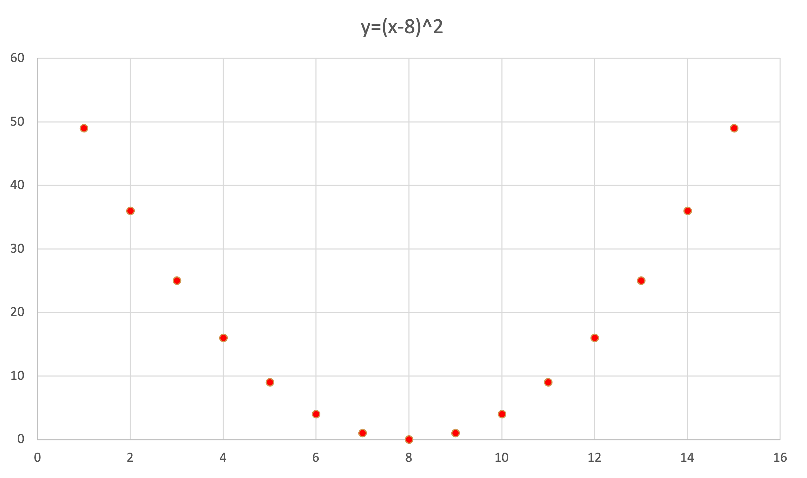

相関に似た概念として, 3 つ目の変数の影響を除いた相関を表す**偏相関係数**があります. [偏相関係数](block:num-partial#partial-correlation)で扱います.

この節に対応する演習は, [Exercise DSP4-2](#exercise-dsp4-2)です.

# []{#演習}演習 {#exercises}

## Exercise DSP4-2 {#exercise-dsp4-2}

**都道府県別データの相関係数と散布図の解釈**

対応する節: [ピアソンの積率相関係数](#ピアソンの積率相関係数), [相関係数のヒートマップ](#相関係数のヒートマップ), [因果関係と相関](#因果関係と相関)

[相関係数のヒートマップ](#相関係数のヒートマップ)で使った都道府県別のデータについて, 次の問いに答えてください.

1. 食費 (`food`) と睡眠時間 (`sleep`) のピアソンの積率相関係数を, `np.corrcoef` と `scipy.stats.pearsonr` の両方で求めてください.
2. 横軸を食費, 縦軸を睡眠時間とする散布図を, 各点に都道府県名を添えて描いてください. 散布図から読み取れることと相関係数の値を合わせて, 2 つの変数の関係を解釈してください.
3. 食費が他の都道府県から大きく離れている沖縄県を除いて相関係数を求め直し, 問 1 の値と比べてください.
4. 「食費が多いと睡眠時間が短くなる」といえるかを, [因果関係と相関](#因果関係と相関)の内容をもとに説明してください.

提出ファイル名: `dsp4-2.py`

    
 回答例 

~~~ py
import pandas as pd
import numpy as np
import scipy.stats as st
import matplotlib.pyplot as plt
import matplotlib_fontja

df = pd.read_csv('data/coeff_multi.csv', encoding='utf-8-sig')

# 問1: 食費と睡眠時間の相関係数
print(np.corrcoef(df['food'], df['sleep'])[0][1])
r, p = st.pearsonr(df['food'], df['sleep'])
print(r)
"""
-0.40822961572269567
-0.4082296157226958
"""

# 問2: 散布図に都道府県名を添える
plt.scatter(df['food'], df['sleep'])
for i in df.index:
    plt.annotate(df.loc[i, 'pref'], (df.loc[i, 'food'], df.loc[i, 'sleep']), fontsize=7)
plt.xlabel('食費 (円)')
plt.ylabel('睡眠時間 (分)')
plt.show()

# 問3: 沖縄県を除いた相関係数
df2 = df[df['pref'] != '沖縄県']
print(np.corrcoef(df2['food'], df2['sleep'])[0][1])
"""
-0.3966182673912843
"""
~~~

1. 相関係数は約 -0.41 で, 目安の表では弱い負の相関にあたります. 2 つの関数の結果は, 計算誤差の範囲で一致します.
2. 散布図では, 東京都, 神奈川県, 千葉県, 埼玉県など大都市圏の都道府県が右下 (食費が多く睡眠時間が短い) に, 山形県, 秋田県, 青森県, 岩手県など東北の県が上側 (睡眠時間が長い) に集まっています. 右下がりの傾向はあるものの, 点は直線から大きく散らばっており, 相関係数が -0.41 にとどまることと合っています.
3. 沖縄県を除くと約 -0.40 になり, ほとんど変わりません. 沖縄県は食費が極端に少ない一方, 睡眠時間は全体の中ほどにあるため, 相関係数への影響は小さくなっています.
4. いえません. 相関係数は, 食費の多い都道府県ほど睡眠時間が短い傾向を表すだけです. 大都市圏であること (所得や物価の高さ, 通勤時間の長さなど) が食費と睡眠時間の両方に影響する共通要因になっている可能性があり, その影響を取り除かない限り, 食費が睡眠時間を短くするという因果関係は主張できません.

