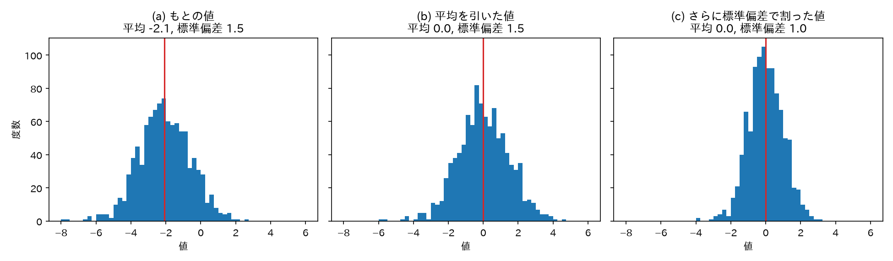

## 距離と類似度 {#距離と類似度}

相関係数は, 2 つの観測項目 (データフレームの列) がどれだけ連動するかを表しました. これに対して, 2 つの観測対象 (行) がどれだけ似ているかを表すのが**距離**と**類似度**です. 都道府県同士, 顧客同士, 文章同士のように, 観測対象を複数の項目の値の組として比べるときに使います. [第7章](/lectures/dsp7.html)のクラスタリングは, この距離を使って似た観測対象を同じグループにまとめます.

ここでは, [第3章](block:vis-relation#scatter-matrix)で散布図行列を描いた都道府県別のデータ ([こちら](https://github.com/yakagika/yakagika.github.io/blob/main/slds_data/ch8/pref_stats.csv)) を使います. 各都道府県は, 平均身長 (`height`), 体重 (`weight`), 食費 (`food`), 睡眠時間 (`sleep`), 運動時間 (`sports`) の 5 つの値の組で表されます.

~~~ py
import numpy as np
import pandas as pd
from scipy.spatial import distance

df = pd.read_csv('data/pref_stats.csv', encoding='utf-8-sig', index_col='pref')
print(df.loc[['北海道', '東京都', '沖縄県']])
"""
      height  weight   food  sleep  sports
pref
北海道   170.4    63.7  65739    477      15
東京都   170.5    61.3  83506    461      16
沖縄県   168.7    60.6  56298    482      20
"""
~~~

## ユークリッド距離 {#ユークリッド距離}

2 つの観測対象を $m$ 個の項目の値の組 $\boldsymbol{a} = (a_1, \dots, a_m)$, $\boldsymbol{b} = (b_1, \dots, b_m)$ で表します. 項目ごとの差を 2 乗して足し, 平方根をとったものを**ユークリッド距離**といいます.

::: note
- **ユークリッド距離 (Euclidean distance)**

$$ d(\boldsymbol{a}, \boldsymbol{b}) = \sqrt{\sum_{j=1}^{m} (a_j - b_j)^2} $$

:::

項目が 2 つなら, ユークリッド距離は散布図上の 2 点を結ぶ線分の長さ (三平方の定理) に一致します. 項目が 3 つ以上あっても同じ式で計算できます.

北海道と沖縄県の距離を, 式のとおりに計算した場合と `scipy` の関数を使った場合で比べてみましょう.

~~~ py
a = df.loc['北海道']
b = df.loc['沖縄県']
# 式のとおりに計算する
print(np.sqrt(((a - b) ** 2).sum()))
# scipy の関数で計算する
print(distance.euclidean(a, b))
"""
9441.003310030137
9441.003310030137
"""
# 項目ごとの差の2乗
print((a - b) ** 2)
"""
height           2.89
weight           9.61
food      89132481.00
sleep           25.00
sports          25.00
"""
~~~

項目ごとの差の 2 乗を見ると, 距離のほとんどが食費の差で決まっています. 食費は円単位で数万の値をとり, 身長 (cm) や睡眠時間 (分) とは桁が違うためです. このまま計算した距離で似た都道府県を探すと, 食費が近い都道府県を探すのとほとんど変わりません.

## 標準化 {#標準化}

項目ごとに単位と散らばりが違うときは, 各項目を**標準化**してから距離を計算します. 標準化は, 各値から項目の平均を引き, 項目の標準偏差で割る操作です ([データの広がりを表す統計量](block:num-summary#dispersion)で定義した標準偏差 $S$ を使います. ピアソンの積率相関係数の説明で使った変換と同じものです).

::: note
- **標準化 (standardization)**

$$ z_i = \frac{x_i - \bar{x}}{S} $$

:::

標準化した値は, 項目ごとに平均 0, 標準偏差 1 になり, 「その値が項目の平均から標準偏差いくつ分離れているか」を表します. 単位が消えるので, 身長の差と食費の差を同じ尺度で比べられます.

平均 0, 標準偏差 1 になる理由を, 標準化の 2 つの操作に分けて確かめます. 次の図は, 平均がおよそ -2, 標準偏差がおよそ 1.5 のデータ 1000 個のヒストグラムで, 赤い線が平均です. (b) のように各値から平均を引くと, 分布の形を保ったまま全体が平行移動し, 平均が 0 になります. 平均からの差は変わらないので, 標準偏差は 1.5 のままです. (c) のようにさらに標準偏差 $S$ で割ると, 平均からの差がすべて $1/S$ 倍になるので, 標準偏差も $1/S$ 倍になって $S \times 1/S = 1$ になります. この例では $S$ が 1 より大きいので分布の幅が縮み, 同じ個数のデータが狭い範囲に入るため, ヒストグラムの山が高くなります.

{.wide}

~~~ py
z = (df - df.mean()) / df.std(ddof=0)
print(z.loc[['北海道', '東京都', '沖縄県']].round(2))
"""
      height  weight  food  sleep  sports
pref
北海道    0.74    1.25 -1.28   0.31   -0.48
東京都    0.91   -0.82  2.45  -1.55    0.03
沖縄県   -2.10   -1.42 -3.27   0.90    2.10
"""
~~~

::: warn
`pandas` の `.std()` は, 既定では $n$ でなく $n-1$ で割った標準偏差を返します. 本章の定義 ($n$ で割る) に合わせるには `ddof=0` を指定します. どちらで割っても全項目が同じ比率で拡大・縮小されるだけなので, どの都道府県同士が近いかの順位は変わりません.
:::

標準化したデータで北海道と沖縄県の距離を計算し直すと, 身長, 体重, 運動時間の差も距離に効くようになります.

~~~ py
print(distance.euclidean(z.loc['北海道'], z.loc['沖縄県']))
"""
5.114060111150499
"""
print(((z.loc['北海道'] - z.loc['沖縄県']) ** 2).round(2))
"""
height    8.09
weight    7.14
food      3.94
sleep     0.34
sports    6.65
"""
~~~

北海道から他の都道府県までの距離を計算し, 近い順に並べてみます.

~~~ py
dist = z.apply(lambda row: distance.euclidean(z.loc['北海道'], row), axis=1)
print(dist.sort_values().round(2))
"""
pref
北海道     0.00
和歌山県    1.47
群馬県     1.55
福島県     1.61
...
山口県     3.91
東京都     4.69
沖縄県     5.11
"""
~~~

北海道に最も近いのは和歌山県で, 地理的に隣り合う都道府県が近いとは限りません. ここでの距離は選んだ 5 項目だけで測っているので, 「この 5 項目の値の組が似ている」という意味の近さです. どの項目を使うかによって, 何と何が近いかは変わります.

## コサイン類似度 {#コサイン類似度}

ユークリッド距離は値そのものの差を測ります. これに対して**コサイン類似度**は, 値の組を原点から伸びる矢印 (ベクトル) と見て, 2 本の矢印の向きがどれだけ揃っているかを測ります.

::: note
- **コサイン類似度 (cosine similarity)**

$$ \cos(\boldsymbol{a}, \boldsymbol{b}) = \frac{\sum_{j=1}^{m} a_j b_j}{\sqrt{\sum_{j=1}^{m} a_j^2} \sqrt{\sum_{j=1}^{m} b_j^2}} $$

:::

コサイン類似度は $-1$ から $1$ の値をとり, $1$ なら同じ向き, $0$ なら直交, $-1$ なら逆向きです. $1$ からコサイン類似度を引いた値を**コサイン距離**と呼びます.

標準化したデータでは, 矢印の向きは「どの項目が平均より大きく, どの項目が平均より小さいか」の組み合わせを表します.

~~~ py
def cos_sim(a, b):
    return np.dot(a, b) / (np.linalg.norm(a) * np.linalg.norm(b))

for p in ['青森県', '沖縄県', '東京都']:
    print(p, round(cos_sim(z.loc['北海道'], z.loc[p]), 2))
"""
青森県 0.62
沖縄県 0.01
東京都 -0.63
"""
~~~

北海道は体重が平均より大きく, 食費が平均より小さく, 睡眠時間が平均より長い都道府県です. 東京都はこの 3 項目がすべて逆なので, コサイン類似度が負になります.

コサイン類似度は矢印の長さ (値の大きさ) を無視します. そのため, 単語の出現回数のように, 長い文章ほど全体の値が大きくなるデータを比べるのに向いています. [第9章](/lectures/dsp9.html)では, 文章をベクトルに変換してコサイン類似度で比べます.

