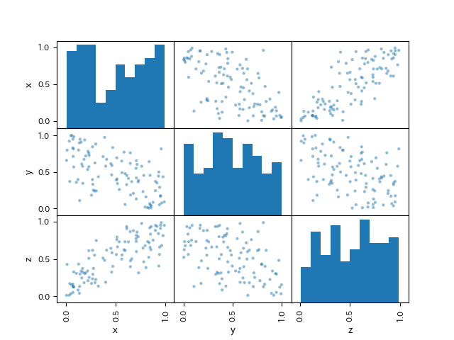
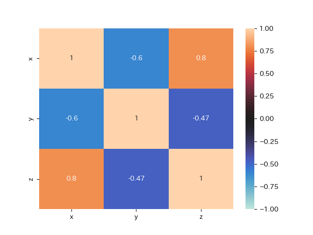
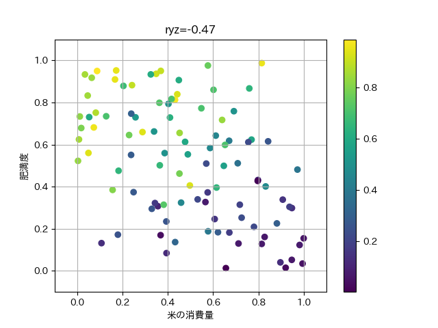
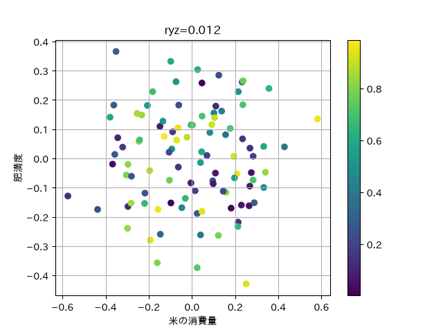

## 偏相関係数 {#partial-correlation}

[因果関係と相関](block:num-correlation#因果関係と相関)の条件 3. のように, 2 つの変数の関係を見るときには共通要因の影響を取り除く必要があります. 相関係数からその影響を取り除いたものが**偏相関係数**です.

**偏相関係数 (partial correlation coefficient)** は, 3 つの変数があるときに, **1 つの変数の影響を除いた**残り 2 つの変数間の相関係数です.

変数 $x, y, z$ があるとき, $z$ の影響を除いた $x, y$ の間の偏相関係数は以下のように求められます.

$$
r_{xy \cdot z} = \frac{r_{xy} - r_{xz}r_{yz}}{\sqrt{1 - r_{xz}^2}\sqrt{1 - r_{yz}^2}}
$$

分子では, $x$ と $y$ の相関係数から, $z$ を介した相関 $r_{xz}r_{yz}$ を引いています.

偏相関係数の具体例を見てみましょう. 次の[データ](https://github.com/yakagika/yakagika.github.io/blob/main/slds_data/ch9/partial_coeff.csv)は, 米国における `x:小麦の1日あたりの消費量`, `y:米の一日あたりの消費量`, `z:肥満度` を表しています. なお, いずれの列も最大を 1, 最小を 0 に変換してあります.

この 3 変数の相関係数を取ってみます.

~~~ py
df = pd.read_csv('data/partial_coeff.csv', index_col=0)
x = df['x']
y = df['y']
z = df['z']

#散布図行列を作成してみる
pd.plotting.scatter_matrix(df, range_padding=0.2)
plt.savefig('partial_coeff_scatter_matrix.png')
plt.close()

#ヒートマップで確認
sns.heatmap(df.corr()
           ,vmax=1     #ヒートマップの最大値
           ,vmin=-1    #最小値
           ,center =0  #中心
           ,annot=True)
plt.savefig('partial_coeff_heatmap.png')
plt.close()

rxy = np.corrcoef(x, y)[0, 1]
rxz = np.corrcoef(x,z)[0, 1]
ryz = np.corrcoef(y,z)[0, 1]
print('x-y:',rxy) #x-y: -0.600168172831563
print('x-z:',rxz) #x-z: 0.800077754980739
print('y-z:',ryz) #y-z: -0.4740072261555344
~~~

相関係数を見ると,

- $r_{xy} \approx -0.60$: 小麦を食べる量が多いと米を食べる量が少ない

- $r_{xz} \approx 0.80$: 小麦を食べる量が多いほど太っている

- $r_{yz} \approx -0.47$: 米を食べる量が多いほど痩せている

となっています.

小麦を食べるほど米を食べる量が少ないという関係は, 米国では米を主食とする人が少なく, 普段小麦粉を利用した食事をしているほど米を食べる機会が少ない, ということで理解できます. また, 小麦を食べる量が多いほど太っているというのも, 炭水化物をたくさん食べるほど太っているということで理解できます. 一方で, 米を食べる量が多いほど痩せているという関係は, あまり自然ではありません.

これは, 一般的に小麦を食べる文化圏の人のほうが, アジア系よりも太っていることに影響されていそうです. $y$ と $z$ の散布図に $x$ の値で色をつけて, $x$ の影響を確認してみましょう.

~~~ py
plt.scatter(y,z,c=x)
plt.xlabel('米の消費量')
plt.ylabel('肥満度')
plt.xlim(-0.1,1.1)
plt.ylim(-0.1,1.1)
plt.grid()
plt.colorbar()
plt.title('ryz='+str(ryz)[:5])
plt.savefig('partial_coeff1.png')
plt.close()
~~~

左上に行くほど $x$ の値を表す色が明るくなっており, $x$ の影響で $r_{yz}$ が負の相関になっていることが分かります.

それでは, 小麦の影響を除いた米の肥満への影響 $r_{yz \cdot x}$ を計算してみましょう.

$$
\begin{align*}
r_{yz \cdot x} &= \frac{r_{yz} - r_{xy}r_{xz}}{\sqrt{1 - r_{xy}^2}\sqrt{1 - r_{xz}^2}} \\
&\approx \frac{-0.47 + 0.6 \times 0.8}{\sqrt{1 - 0.6^2}\sqrt{1 - 0.8^2}} \\
&\approx 0.02
\end{align*}
$$

Python でも計算してみます.

~~~ py
ryzx = (ryz - (rxy * rxz)) / (np.sqrt(1-rxy**2)*np.sqrt(1-rxz**2))
print('ryzx:',ryzx) #0.01286670673838738
~~~

小麦の消費量の影響を除くと, 米の消費量と肥満度にはほとんど相関がないことが分かります.

最後に, $x$ の影響を打ち消した $y$ と $z$ の関係をプロットしてみましょう. このコードは[回帰分析](/lectures/dsp5.html)で扱う回帰を利用しているので, この例では回帰の詳細を理解できなくても問題ありません.

~~~ py
#xの影響を除いたyとzの散布図
from sklearn.linear_model import LinearRegression
#yとzのxによる回帰式をたてて,その残差をプロットすることで,
#xの効果を打ち消したyとzの関係を表現
model_y = LinearRegression().fit(df[['x']], y)
residual_y = y - model_y.predict(df[['x']])
model_z = LinearRegression().fit(df[['x']], z)
residual_z = z - model_z.predict(df[['x']])

plt.scatter(residual_y,residual_z,c=x)
plt.xlabel('米の消費量')
plt.ylabel('肥満度')
plt.grid()
plt.colorbar()
plt.title('ryz='+str(ryzx)[:5])
plt.savefig('partial_coeff2.png')
plt.close()
~~~

もとの $y$ と $z$ の散布図にあった $x$ の影響が打ち消され, ほとんど相関がなくなっていることが分かります.

