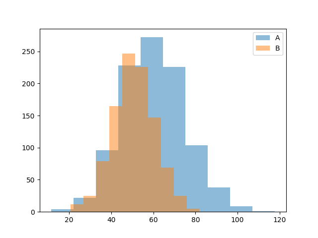
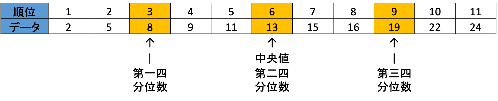
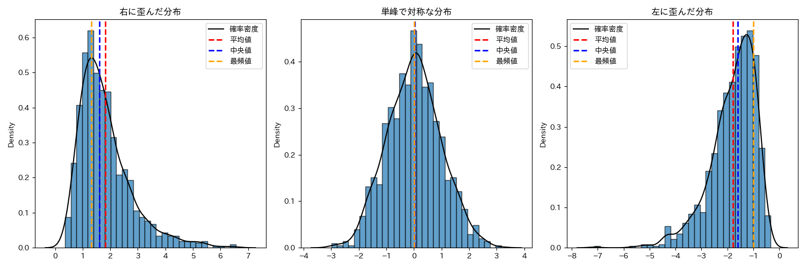
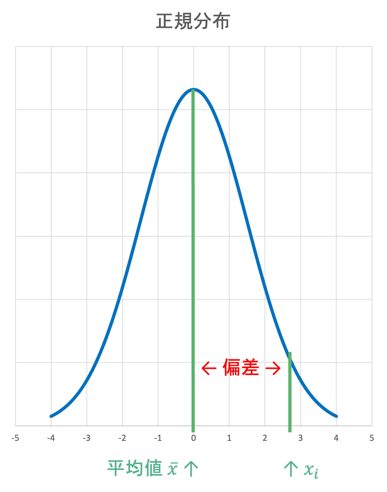

## データの数値化 {#データの数値化}

データを可視化することで, データの大まかな傾向はつかめます. しかし, グラフではデータの特徴を大まかにしか捉えることができません.
データの特徴を具体的に述べるには, それを数値にする必要があります.

例えば, 以下のヒストグラム ([データ](https://github.com/yakagika/yakagika.github.io/blob/main/slds_data/ch9/histogram_A_B_data.csv)) を見てみましょう.

ヒストグラム B と比較して, A はデータの**中心が右**にあり, データの**散らばりが大きい**ように見えます. しかし, A の中心が B よりどの程度右にあり, A の散らばりがどの程度大きいのかは, グラフからは読み取れません.
このように, グラフによる比較では, 抽象的な印象しか語ることができないため, データの中心や, 散らばりを数値で表すことが必要です.

数値化の対象となる量は, 同時に扱う変数の数と, 各変数が量的か質的かで, おおよそ決まります. 下の樹形図を上から順にたどって, 求める数値を選んでください. 数値の名前をクリックすると, 本章の対応する解説に移動します.

::: {.choice-tree #choose-stat}

- [データの数値化]{.ct-root}
    - [変数が 1 つ]{.ct-dim}
        - [量的]{.ct-type} → 分布が単峰で左右対称か
            - [はい]{.ct-type} → [平均](#算術平均-mean) と [標準偏差](#dispersion)
            - [いいえ (歪んでいる, 外れ値がある)]{.ct-type} → [中央値](#中央値-median) と [四分位範囲](#四分位数-quartiles)
        - [質的]{.ct-type} → [最頻値](#最頻値-mode) と各カテゴリーの割合
    - [変数が 2 つ]{.ct-dim}
        - [量的 × 量的]{.ct-type} → [ピアソンの積率相関係数](block:num-correlation#ピアソンの積率相関係数)
        - [順序 × 順序]{.ct-type} → [スピアマンの順位相関係数](block:num-correlation#スピアマンの順位相関係数)
        - [名義 × 質的]{.ct-type} → [$\chi^2$ 統計量とクラメールの連関係数 $V$](block:num-correlation#chi2-統計量)
    - [変数が 3 つ以上]{.ct-dim}
        - 2 つずつの相関を一覧にする → [相関係数のヒートマップ](block:num-correlation#相関係数のヒートマップ)
        - 3 つ目の変数の影響を除いて 2 つの関係を見る → [偏相関係数](block:num-partial#partial-correlation) [発展]{.ct-tag}
        - 多数の変数をまとめて扱う → [回帰分析などの多変量解析 (第5章以降)](/lectures/dsp5.html)

:::

平均と中央値のどちらを使うかは, [中心を表す代表値の使い分け](#中心を表す代表値の使い分け)で説明します.

# 基本統計量 {#basic-stats}

量的データを客観的に評価するために, 分布の特徴を数値で表したものを**基本統計量 (代表値)**といいます.

::: note

- 基本統計量

|名称 | 概要 |
|:---:|:---|
| 平均 (Mean) | データの平均値. 量的データの分布の中心傾向を示す |
| 中央値 (Median) | データの順位における中央. 量的データの分布の中心傾向を示す|
| 最頻値 (Mode) | 最も度数の多い値. 量的データの分布の中心傾向を示す |
| 標準偏差 (Standard Deviation) | データのばらつき具合を示す. |
| 分散 (Variance) | データのばらつき具合を示す. |
| 尖度 (Kurtosis) | 外れ値の度合い |
| 歪度 (Skewness) | 分布の歪み

:::

Python では, pandas の DataFrame に対して, `.describe()` メソッドを適用すると, データ数 (`count`), 平均値 (`mean`), 中央値 (`50%`), 四分位数 (`25%,75%`), 標準偏差 (`std`), 最大値 (`max`), 最小値 (`min`) などが求まります.

~~~ py
df = pd.read_csv('data/histogram_A_B_data.csv')
print(df.describe())
"""
python quantify.py
       Histogram_A  Histogram_B
count  1000.000000  1000.000000
mean     60.289981    50.708362
std      14.688239     9.974544
min      11.380990    20.596114
25%      50.286145    43.937583
50%      60.379509    50.630771
75%      69.719158    57.288822
max     117.790972    81.931076
"""
~~~

それぞれの統計量の意味を順番に見ていきましょう.

# 中心を表す基本統計量 {#central-tendency}

ヒストグラムにおける峰のある位置, 分布の中心がどこにあるかを表す統計量には, **平均値**, **中央値**, **最頻値**などがあります. この 3 つは, いずれも分布の中心を表す統計量ですが, 分布の歪みによって意味が異なり, 使い分けが必要となります.

- ### **算術平均 (mean)** {#算術平均-mean}
分布の中心を表す統計量としてもっとも一般的なものに, 平均値があります. しかし, 一口に平均といっても, いくつかの種類があるので注意しましょう. 分布の中心を表す場合に用いられる平均は基本的に算術平均ですが, ここでは異なる定義の平均として, **幾何平均**と**調和平均**も紹介します.

一般に「平均」といったときにイメージされる, すべてのデータの和をデータの個数で割った値を**算術平均**といいます.

算術平均は対象とするデータを足し合わせることによって基準となる値が算出される場合に使用します.

::: note
$n$ 個の観測値 $x_1, x_2, ..., x_n$ のとき, 平均値 $\bar{x}$ は

$$ \bar{x} = \frac{1}{n} (x_1 + ... + x_n) = \frac{1}{n} \sum_{i=1}^{n} x_i $$
:::

例: 165, 171, 189 の算術平均は

$$ \bar{x} = \frac{1}{3} (165 + 171 + 189) = 175 $$

となります.

`pandas` で平均を求めるには, `.mean()` を利用します.

~~~ py
df = pd.DataFrame({'x':[165,171,189]})
print(df['x'].mean()) #>>>175
~~~

- ### **幾何平均 (geometric mean)** {#幾何平均-geometric-mean}

すべてのデータを乗じて, データの数で根を取った値を**幾何平均**といいます. 増加率, 減少率など対象とするデータを相互に乗じることによって基準となる値が算出される場合に使用します.

::: note
$n$ 個の観測値 $x_1, x_2, ..., x_n$ のとき, 幾何平均 $x_G$ は
$$ x_G = \sqrt[n]{x_1 \cdot x_2 \cdot ... \cdot x_n} = \left(\prod_{i=1}^{n} x_i\right)^{\frac{1}{n}} $$
:::

例: 各年の売上と, その前年比 (前年の売上に対する倍率) が以下のように表されるとき, 売上が平均で何 % ずつ伸びているかを考えます.

|年度 | 売上 | 前年比 |
|:---:|:---: |:---: |
|1 | 300 | |
|2 | 350 | 117% |
|3 | 600 | 171% |
|4 | 1000 | 167% |

このとき算術平均を用いると,
$$ \text{算術平均} = \frac{1.17 + 1.71 + 1.67}{3} \approx 1.52 $$ となり,

$$ 300 \cdot 1.52^3 \approx 1054 $$

平均的な伸び率を 3 回乗じても 4 年目の売上の値になりません. これは, 毎年度の値に前年比を**掛ける**ことで次の年度の値が求まるのに対して, 算術平均は毎年度足す操作をした場合の平均値を求めているからです.

そこで, 幾何平均を求めてみると,

$$ \text{幾何平均} = \sqrt[3]{\frac{350}{300} \cdot \frac{600}{350} \cdot \frac{1000}{600}} = \sqrt[3]{\frac{1000}{300}} \approx 1.494, \\
300 \cdot 1.494^3 \approx 1000 $$
となり, 4 年目の値と一致します.

- ### **調和平均 (harmonic mean)** {#調和平均-harmonic-mean}
先ほどの幾何平均が掛け算の平均値だったのに対して, 割り算の平均値を**調和平均**といい, 速度などの定義に割り算が含まれている計算で用います.

調和平均は, 別の値を対象とするデータで除して足し合わせることによって基準となる値が算出される場合に使用します.

::: note

$n$ 個の観測値 $x_1, x_2, ..., x_n$ のとき, 調和平均 $x_H$ は
$$ \frac{1}{x_H} = \frac{1}{n} \left( \frac{1}{x_1} + ... + \frac{1}{x_n} \right) \\
 \iff \\
 x_H = \frac{n}{\frac{1}{x_1} + ... + \frac{1}{x_n}} = \frac{n}{\sum_{i=1}^{n} \frac{1}{x_i}}$$
:::

例: 平均速度

100 km の道のりを行きは車 (60 km/h), 帰りは自転車 (30 km/h) で移動した場合, 算術平均は 45 km/h となります. しかし,
かかった時間は $\frac{\text{距離}}{\text{速度}}$ で求まるので,
車は $\frac{100}{60}$, 自転車は $\frac{100}{30}$ となり, 速度は $\frac{\text{距離}}{\text{時間}}$ で求まるので,
平均速度は

$$ \frac{200}{\frac{100}{60} + \frac{100}{30}} = \frac{2}{\frac{1}{60} + \frac{1}{30}} = 40 $$

となり, 算術平均の 45 km/h とは一致しません.
右辺の $\frac{2}{\frac{1}{60} + \frac{1}{30}}$ が, 60 と 30 の調和平均です.

- ### **中央値 (median)** {#中央値-median}

中心を表す統計量として, データを昇順に並び替えて, そのちょうど真ん中の数を表す**中央値**もよく利用されます.

::: note
$n$ 個の観測値を大きさの順に並べ替えて $x_1, x_2, ..., x_n$ としたとき,
中央値 $\tilde{x}$ は

$$ \tilde{x} =
\begin{cases}
x_{\frac{n+1}{2}}, ~~& n \text{ が奇数のとき} \\
\frac{x_{ \frac{n}{2}} + x_{\frac{n}{2} + 1 }}{2}, ~~ & n \text{ が偶数のとき}
\end{cases}
$$

:::

例: 観測値が $3, 4, 7, 9, 11, 12, 15$ ($n = 7$) のとき, 中央値は
$$ \tilde{x} = x_{\frac{n+1}{2}} = x_{\frac{8}{2}} = x_4 = 9 $$

となります.

また, 観測値が $4, 5, 6, 10, 14, 17$ のように偶数個の場合は
$$ \tilde{x} = \frac{x_{ \frac{n}{2}} + x_{\frac{n}{2} + 1 }}{2} = \frac{6 + 10}{2} = 8 $$

となります.

`pandas` では, 中央値は `.median()` で求めることができます.

~~~ py
df = pd.DataFrame({'x':[3,4,7,9,11,12,15]})
print(df['x'].median()) #9.0

df = pd.DataFrame({'x':[4,5,6,10,14,17]})
print(df['x'].median()) #8.0
~~~

`pandas` を使わずに実装するときは, 添字を 1 つずらして読み替えます. 式の添字は 1 から始まりますが, Python のリストの添字は 0 から始まるためです. 読み替えると, 奇数のときの $x_{\frac{n+1}{2}}$ は `s[(n - 1) // 2]`, 偶数のときの $x_{\frac{n}{2}}$ と $x_{\frac{n}{2} + 1}$ は `s[n // 2 - 1]` と `s[n // 2]` になります. 奇数のとき `(n - 1) // 2` と `n // 2` は同じ位置を指すので, 場合分けをせずに次の 1 つの式で書けます.

~~~ py
def median(xs):
    s = sorted(xs)
    n = len(s)
    return (s[(n - 1) // 2] + s[n // 2]) / 2

print(median([3, 4, 7, 9, 11, 12, 15]))  # 9.0
print(median([4, 5, 6, 10, 14, 17]))  # 8.0
~~~

次の四分位数の説明でも, 位置は 0 から数えます.

- ### 四分位数 (quartiles) {#四分位数-quartiles}

**中央値**: データを小さい順に並べたときに観測数が 50% となる点

**四分位数**:
データを小さい順に並べたときに, 観測数が 25%, 50%, 75% となる点.
第一四分位数 (25%), 第二四分位数 (50%), 第三四分位数 (75%)

**四分位範囲**:
第三四分位数から第一四分位数を引いた値 (第一四分位数から第三四分位数までの幅)

`pandas` で四分位数を求めるには, `.quantile(q=%点の数値,interpolation='nearest')` を使います.
`interpolation` (補間) は, 値がインデックス `i` と `j` の間にある場合に補間する方法を指定する引数で, 以下のような設定が可能です.

`.quantile()` では, データの最大インデックス (データ数 - 1) に `q` を掛けた位置の値を求めます. 例えば `xs=[2,5,8,9,11,13,15,16,19,22,24]` の 25% 点は, `10*0.25=2.5` となり `xs[2.5]` となるような点を求めます.

|引数 |効果 |25% 点の場合の計算 |
|:--- |:--- | :--- |
|`'linear'` | 線形補間 | `xs[2] + (xs[3] - xs[2]) * 0.5 = 8.5` |
|`'lower'` | 小さい方 | `xs[2] = 8` |
|`'higher'` | 大きい方 | `xs[3] = 9` |
|`'midpoint'`| 中間 | `(xs[2] + xs[3])/2 = 8.5` |
|`'nearest'` | 近い方 | `xs[2] = 8` |

~~~ py
xs = [2,5,8,9,11,13,15,16,19,22,24]
df = pd.DataFrame({'x':xs})
print('25%点:',df['x'].quantile(q=0.25, interpolation='linear'))
print('25%点:',df['x'].quantile(q=0.25, interpolation='nearest'))
print('50%点:',df['x'].quantile(q=0.5, interpolation='nearest'))
print('75%点:',df['x'].quantile(q=0.75, interpolation='nearest'))

"""
25%点: 8.5
25%点: 8
50%点: 13
75%点: 19
"""
~~~

- ### 最頻値 (mode) {#最頻値-mode}

中心を表す統計量の最後は, 最も頻繁にあらわれる値を表す**最頻値**です. 量的データを度数分布表にまとめた場合は, 最も度数の高い階級を指します.

::: note
最頻値の意味は, データの種類によって異なります.
(※ 質的データの平均値などは定義できません)

- 質的データの場合

    - 最大度数のカテゴリー

- 量的データの場合

    - 最大度数の階級 = 最頻階級 (modal class)

    - 長さや気温など同じ間隔で値が存在するもの

:::

`pandas` で最頻値を求める方法はいろいろありますが, 単純に同じデータが最も多い値を探す場合には `.mode()` が利用できます. `.mode()` は最頻値が複数ある場合に対応するために `Series` を返すので, `[0]` で最初の値を取っています.

~~~ py
df = pd.DataFrame({'x':['A','A','B','C']})
print(df['x'].mode()[0]) # A
df = pd.DataFrame({'x':[1,3,2,4,5,3]})
print(df['x'].mode()[0]) # 3
~~~

しかし, 連続値のデータでは同じ値がほとんど現れないため, この方法では最頻階級を求められません. 区間ごとの度数から最頻階級を求めるには, `value_counts()` の引数 `bins` で区間を指定します.

~~~ py
# ランダムな0から100までのデータの生成
np.random.seed(0)  # 再現性のためにシードを設定
df = pd.DataFrame({'x':np.random.randint(0, 101, size=1000)})
print(df)

#10区切りで度数を求める
bins = [0,10,20,30,40,50,60,70,80,90,100]
freq = df['x'].value_counts(bins =bins, sort=False)
print(freq)
#最大の度数のindexを取得
print(freq.idxmax())

"""
      x
0    44
1    47
2    64
3    67
4    67
..   ..
995  79
996  41
997  17
998  80
999  43

[1000 rows x 1 columns]
(-0.001, 10.0]    121
(10.0, 20.0]       87
(20.0, 30.0]       96
(30.0, 40.0]      107
(40.0, 50.0]       94
(50.0, 60.0]       92
(60.0, 70.0]       97
(70.0, 80.0]      103
(80.0, 90.0]      103
(90.0, 100.0]     100
Name: count, dtype: int64
(-0.001, 10.0]
"""
~~~

::: note
- ### 中心を表す代表値の使い分け {#中心を表す代表値の使い分け}

中心を表す基本統計量である, **算術平均**, **中央値**, **最頻値**は, ヒストグラムが**単峰で左右対称**である場合一致します. したがってヒストグラムを作成して単峰で左右対称である場合には, どの値を利用しても大きな違いは生まれません.

一方で, 分布が歪んでいる場合には, それぞれの統計量の値が変わります. 分布が歪んでいる場合には, 算術平均よりも最頻値や中央値のほうが, 目的に合った中心を表すことがあります.

例えば, 以下の図は, 平成 21 年の国民生活基礎調査による, 世帯ごとの所得の分布を表したヒストグラムです.

](/images/slds/ch9/mean-median-mode2.png)

この図では, 分布が大きく右に歪んでいるため平均値, 中央値, 最頻値の値が異なっています. それぞれの値が何を意味するのかを考えてみましょう.

- 平均値: 547 万円
    - 全世帯の所得を足して世帯数で割った値 (仮に全世帯が平等に受け取るならこの金額)

- 中央値: 427 万円
    - 所得の低い順に並べたときに真ん中の世帯の所得 (これ以上なら真ん中より上の所得)

- 最頻値: 250 万円
    - 最も度数の多い階級 (街で適当に声をかけるとこれくらいである可能性が高い)

このようなときに, 世間一般の人の感覚を表す値として平均値を利用することは適当ではないでしょう. 平均値は, 分布が歪んでいる場合には少数のデータに大きく引っ張られるため全体の傾向を表せない場合があります.

例えば, 年収 300 万円の人が 100 人いる村に年収 50 億円の野球選手が引っ越してくると, 平均年収は約 5250 万円, 中央値と最頻値は 300 万円になります.

統計量はそれぞれの意味を把握したうえで, 目的に応じて使い分けるようにしましょう.

:::

この節に対応する演習は, 章末の[Exercise DSP4-1](#exercise-dsp4-1)です.

# データの広がりを表す統計量 {#dispersion}

分布の中心がどこかという点のほかに, データがどのように広がっているかもデータの特徴を記述するうえでは重要です.

データの広がり具合を**散布度**といいますが, 散布度を表す統計量として代表的なものに**分散**と**標準偏差**があります.

データの散らばり具合を数値化するために, どのように考えるかを順を追って見ましょう.
データがどの程度散らばっているかを考える際の基準の一つが算術平均 $\bar{x}$ です.
各データ $x_i$ が, データの算術平均からどの程度離れているのかを考えてみましょう.

::: note
- **偏差 (deviation)**

$$ \text{観測値} x_i \text{と平均} \bar{x} \text{の差} = x_i - \bar{x} $$

:::

この偏差がデータ全体でどのくらい大きいのかを考えるために**偏差の平均**を取ります.
ただし, 平均からの差は, すべて足し合わせると 0 になるため, 絶対値を取ります. これを**平均偏差**と呼びます.

::: note
- **平均偏差 (mean deviation)**

各観測値が平均からどれだけ離れているかの絶対値平均

$$ d = \frac{1}{n} \sum_{i=1}^{n} |x_i - \bar{x}| $$

:::

絶対値は式の変形で扱いにくいので, 絶対値の代わりに偏差を 2 乗して平均します (値は大きくなります). これが**分散**です.

::: note
- **分散 (variance)**

各観測値の偏差の 2 乗の平均

$$ S^2 = \frac{1}{n} \sum_{i=1}^{n} (x_i - \bar{x})^2 $$

:::

2 乗すると値が大きくなるので, 単位をもとのデータに合わせるために分散の平方根をとります (例えば, $x_i$ の単位が kg のとき, $S^2$ の単位は $\text{kg}^2$ になります). これを標準偏差といいます.

::: note
- **標準偏差 (standard deviation)**

$$ S = \sqrt{S^2} $$

:::

例えば, データが `[9,6,12,18,10]` の場合を考えてみましょう. 何を計算しているのか, イメージしながら順番に計算していきましょう.

~~~ py
data = [9,6,12,18,10]
df = pd.DataFrame({'data':data})
print(df)
"""
  data
0     9
1     6
2    12
3    18
4    10
"""
~~~

まずは平均からの差 (偏差) を求めてみます.

~~~py
#平均
barx = df['data'].mean()
print(barx) #11.0

# 偏差
df['dev'] = df['data'] - barx
print(df)
"""
   data  dev
0     9 -2.0
1     6 -5.0
2    12  1.0
3    18  7.0
4    10 -1.0
"""
~~~

次に偏差の 2 乗とその平均 (分散) を求めます.

~~~py
#偏差の2乗
df['dev2'] = df['dev'] * df['dev']
print(df)
"""
   data  dev  dev2
0     9 -2.0   4.0
1     6 -5.0  25.0
2    12  1.0   1.0
3    18  7.0  49.0
4    10 -1.0   1.0
"""

#偏差の2乗の平均(分散)
print(df['dev2'].mean()) #16.0
~~~

最後に分散の平方根をとって, 標準偏差を求めます.

~~~ py
#偏差の2乗の平均の平方根(標準偏差)
print(np.sqrt(df['dev2'].mean())) #4.0
~~~

計算から, このデータの分散は `16`, 標準偏差は `4` であることが分かりました.

`pandas` では, 分散は `.var(ddof=0)`, 標準偏差は `.std(ddof=0)` で求めることができます.

~~~ py
print('分散:',df['data'].var(ddof=0)) #16.0
print('標準偏差:',df['data'].std(ddof=0)) #4.0
~~~

::: warn

- 不偏分散, 不偏標準偏差

`.var()` と `.std()` における引数 `ddof=0` とはなんでしょうか. これは, 分散を求める際の分母の値から引く数を表しています (引いた後の値を自由度といいます).

デフォルトの値は `ddof=1` で,

$$\frac{1}{n-1} \sum_{i=1}^{n} (x_i - \bar{x})^2$$ を求めています.

このような分母が $n-1$ となっている分散を**不偏分散**といいます. 一方で, これまで計算してきた値を**標本分散**といいます.

不偏分散の意味は統計学の講義で扱います. ここでは, 一口に分散や標準偏差といっても,
細かくは**標本分散**, **不偏分散**, **母分散**などの異なる概念があることに注意しましょう.
特にプログラムで分散や標準偏差を求めるときは, どの値を計算しているのかを確かめましょう.
ネット上の記事などにおいても混同していることが多いので, 実際に自分で計算して確かめることをおすすめします.

例えば, `pandas` における `describe()` で表示される `std` は不偏標準偏差であり, `std(ddof=0)` の値とは異なります.

~~~ py
print(df['data'].describe())
"""
count     5.000000
mean     11.000000
std       4.472136
min       6.000000
25%       9.000000
50%      10.000000
75%      12.000000
max      18.000000
Name: data, dtype: float64
"""
~~~

:::

この節に対応する演習は, 章末の[Exercise DSP4-1](#exercise-dsp4-1)です.

# []{#演習}演習 {#exercises}

## Exercise DSP4-1 {#exercise-dsp4-1}

**基本統計量を求める関数とヒストグラムのデータの基本統計量**

対応する節: [中心を表す基本統計量](#central-tendency), [データの広がりを表す統計量](#dispersion)

1. 数値のリストを受け取り, 算術平均, 幾何平均, 調和平均, 中央値, 標本標準偏差 ($n$ で割る標準偏差) をそれぞれ返す関数を, `pandas` や `numpy` の統計量の関数を使わずに作成してください. 本文の例 (165, 171, 189 の算術平均, 売上の前年比の幾何平均, 60 km/h と 30 km/h の調和平均, `[3,4,7,9,11,12,15]` と `[4,5,6,10,14,17]` の中央値, `[9,6,12,18,10]` の標準偏差) で結果を確かめてください.
2. 章の冒頭のヒストグラムの[データ](https://github.com/yakagika/yakagika.github.io/blob/main/slds_data/ch9/histogram_A_B_data.csv)について, 列ごとの算術平均, 中央値, 最頻階級 (値の範囲を 10 の区間に分けたとき), 標本分散, 標本標準偏差を求めてください.

提出ファイル名: `dsp4-1.py`

    
 回答例 

~~~ py
import pandas as pd

# 問1
def arith_mean(xs):
    return sum(xs) / len(xs)

def geo_mean(xs):
    prod = 1
    for x in xs:
        prod = prod * x
    return prod ** (1 / len(xs))

def harm_mean(xs):
    return len(xs) / sum(1 / x for x in xs)

def median(xs):
    s = sorted(xs)
    n = len(s)
    return (s[(n - 1) // 2] + s[n // 2]) / 2

def sample_std(xs):
    m = arith_mean(xs)
    return (sum((x - m) ** 2 for x in xs) / len(xs)) ** 0.5

print(arith_mean([165, 171, 189]))
print(geo_mean([350/300, 600/350, 1000/600]))
print(harm_mean([60, 30]))
print(median([3, 4, 7, 9, 11, 12, 15]))
print(median([4, 5, 6, 10, 14, 17]))
print(sample_std([9, 6, 12, 18, 10]))
"""
175.0
1.4938015821857216
40.0
9.0
8.0
4.0
"""

# 問2
df = pd.read_csv('data/histogram_A_B_data.csv')
for c in df.columns:
    print(c)
    print('算術平均:', df[c].mean())
    print('中央値:', df[c].median())
    freq = df[c].value_counts(bins=10, sort=False)
    print('最頻階級:', freq.idxmax())
    print('標本分散:', df[c].var(ddof=0))
    print('標本標準偏差:', df[c].std(ddof=0))
"""
Histogram_A
算術平均: 60.28998083741
中央値: 60.37950918
最頻階級: (53.945, 64.586]
標本分散: 215.52862269245915
標本標準偏差: 14.680893116307985
Histogram_B
算術平均: 50.708362372379995
中央値: 50.630771325
最頻階級: (45.13, 51.264]
標本分散: 99.39203194350507
標本標準偏差: 9.969555253044394
"""
~~~

A は B より平均が約 9.6 大きく, 標準偏差は B の約 1.5 倍です. 章の冒頭のヒストグラムで A の中心が右にあり散らばりが大きく見えたことを, 数値で言い表せます.

