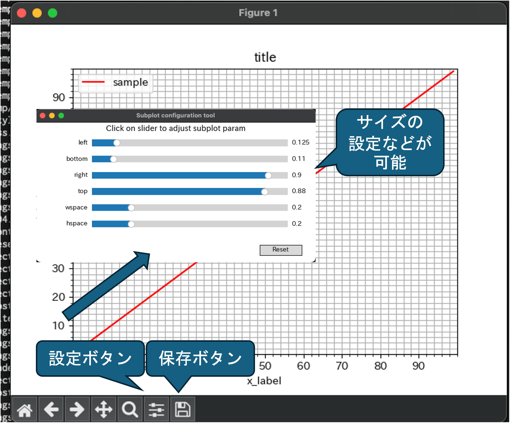
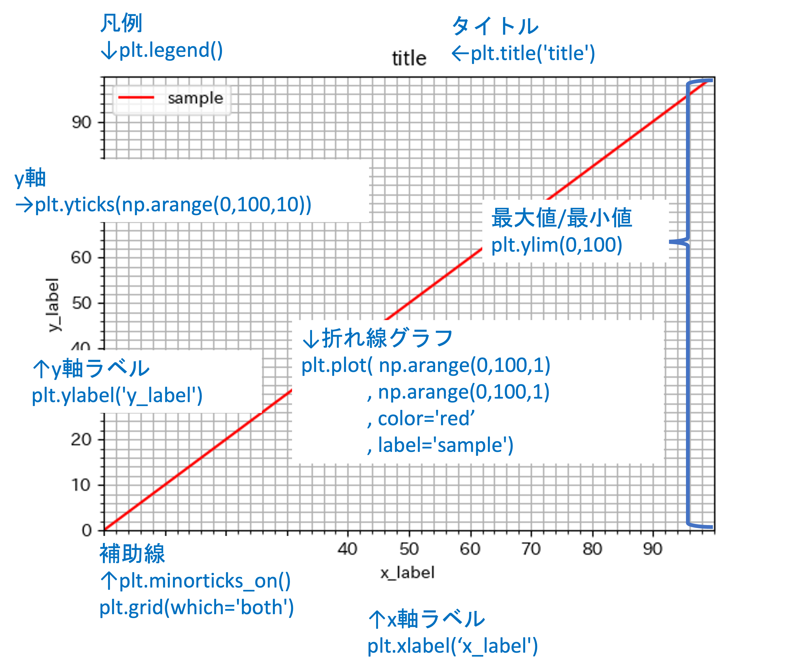
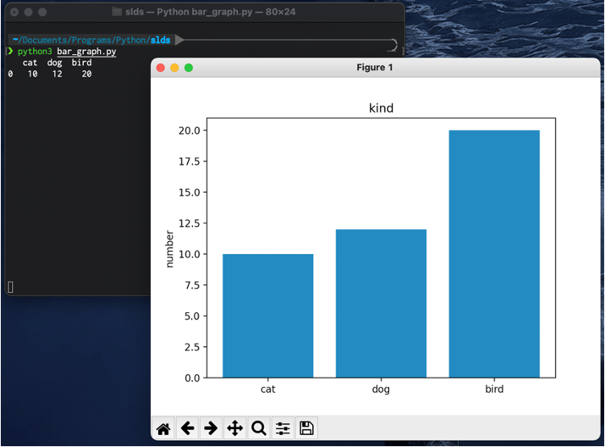
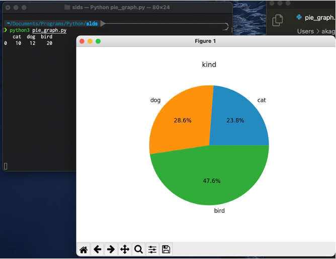
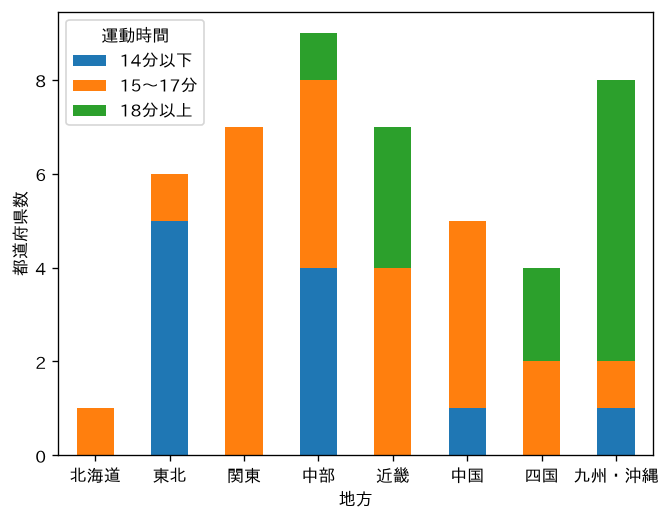
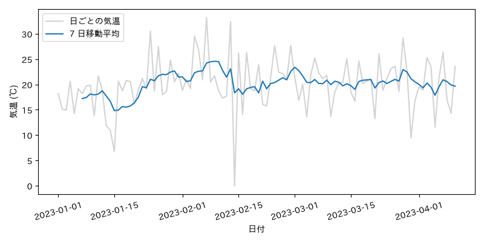

## データの可視化 {#データの可視化}

ここまでで, プログラミングを利用してデータを読み込み, 編集ができるようになりました. これから, データを分析する手法を学習しましょう. データ分析の第一歩は, データの**可視化**です.

統計データはテーブル形式のまま, 眺めても理解できません. データを可視化することで, データの特徴や意味を理解する助けになります. ここでは, データを可視化するいくつかの方法を学びましょう.

::: note

- ### ライブラリのインストール {#ライブラリのインストール}

Python におけるグラフ作成の, 代表的なライブラリには, [`matplotlib`](https://matplotlib.org)や[`seaborn`](https://seaborn.pydata.org)があります.
それぞれ, `uv add` しておきましょう.

`matplotlib`, `seaborn` はそれぞれ以下のようにインポートするのが一般的です.

- `import matplotlib.pyplot as plt`

- `import seaborn as sns`

:::

::: warn

- ### `matplotlib` における日本語表示 {#matplotlib-における日本語表示}
`matplotlib` は日本語などのマルチバイト文字に対応しておらず, 日本語を使用すると日本語部分が □ (通称豆腐) に変わります.

 例: 「Hello こんにちは」 → 「Hello □ □ □ □ □」

`matplotlib` で日本語を利用する方法として一番簡単なものに, `matplotlib-fontja` の利用があります.
`uv add matplotlib-fontja` したあとに, `import matplotlib_fontja` をしましょう (`uv add` では `'-'` (ハイフン) ですが, `import` 文では `'_'` (アンダーバー) なので注意してください).

:::

::: warn

- `japanize-matplotlib` はサポート終了済み

かつて同様の用途で広く使われていた `japanize-matplotlib` は **すでにサポートが終了しています**. 既存のコードや解説記事で `import japanize_matplotlib` という記述を見かけることがありますが, これからは後継である `matplotlib-fontja` を利用してください.

`matplotlib-fontja` は `japanize-matplotlib` のフォークとして開発されており, インポートするだけで日本語フォントが適用される点はそのままで, Python 3.12 以降で発生していた `ModuleNotFoundError: No module named 'distutils'` の問題も解消されています.

:::

本章のコードは, 先頭に以下の記述があることを前提とします.

~~~ py
import pandas as pd
import numpy as np
import matplotlib.pyplot as plt
import matplotlib_fontja
import seaborn as sns
~~~

# グラフの選び方:データの次元と種別 {#choose-graph}

グラフを作る前に, まず **どのグラフを使うか** を決めましょう. 使うべきグラフは, 同時に見る観測項目の数 (データの **次元**) と, 各項目が **質的データ** か **量的データ** かで, おおよそ決まります.

下の樹形図は, 観測項目の数 (データの次元) と各項目の種別を上から順にたどって, 代表的なグラフを選ぶためのものです. 各グラフ名をクリックすると, 本章の対応する解説に移動します.

<ul>
<li>
データ
<ul>
<li>
1次元データ
<ul><li>
量的→<a class="ct-g" href="/fields/descriptive/vis-distribution/index.html#histogram"><svg class="ct-ico" viewBox="0 0 32 32" aria-hidden="true"><path d="M4 28h24"/><rect class="f" x="6" y="20" width="5" height="8"/><rect class="f" x="11" y="10" width="5" height="18"/><rect class="f" x="16" y="6" width="5" height="22"/><rect class="f" x="21" y="16" width="5" height="12"/></svg>ヒストグラム</a>
</li><li>
質的→<a class="ct-g" href="/fields/descriptive/vis-basic/basic-graphs.html#bar"><svg class="ct-ico" viewBox="0 0 32 32" aria-hidden="true"><path d="M4 28h24"/><rect class="f" x="5" y="18" width="5" height="10"/><rect class="f" x="13" y="8" width="5" height="20"/><rect class="f" x="21" y="21" width="5" height="7"/></svg>棒グラフ</a><a class="ct-g" href="/fields/descriptive/vis-basic/pie.html#pie"><svg class="ct-ico" viewBox="0 0 32 32" aria-hidden="true"><circle cx="16" cy="16" r="11"/><path class="f" d="M16 16V5A11 11 0 0 1 25.5 21.5Z"/></svg>円グラフ</a>
</li></ul></li>
<li>
2次元データ
<ul><li>
質的 × 質的→<a class="ct-g" href="/fields/descriptive/vis-relation/heatmap.html#heatmap"><svg class="ct-ico" viewBox="0 0 32 32" aria-hidden="true"><rect class="f" style="fill-opacity:0.9" x="4" y="4" width="7" height="7"/><rect class="f" style="fill-opacity:0.5" x="12" y="4" width="7" height="7"/><rect class="f" style="fill-opacity:0.15" x="20" y="4" width="7" height="7"/><rect class="f" style="fill-opacity:0.4" x="4" y="12" width="7" height="7"/><rect class="f" style="fill-opacity:0.8" x="12" y="12" width="7" height="7"/><rect class="f" style="fill-opacity:0.3" x="20" y="12" width="7" height="7"/><rect class="f" style="fill-opacity:0.15" x="4" y="20" width="7" height="7"/><rect class="f" style="fill-opacity:0.35" x="12" y="20" width="7" height="7"/><rect class="f" style="fill-opacity:0.9" x="20" y="20" width="7" height="7"/></svg>ヒートマップ</a>
</li><li>
質的 × 量的→<a class="ct-g" href="/fields/descriptive/vis-basic/basic-graphs.html#bar"><svg class="ct-ico" viewBox="0 0 32 32" aria-hidden="true"><path d="M4 28h24"/><rect class="f" x="5" y="18" width="5" height="10"/><rect class="f" x="13" y="8" width="5" height="20"/><rect class="f" x="21" y="21" width="5" height="7"/></svg>棒グラフ</a><a class="ct-g" href="/fields/descriptive/vis-distribution/boxplot.html#boxplot"><svg class="ct-ico" viewBox="0 0 32 32" aria-hidden="true"><path d="M16 4v6M16 22v6M12 4h8M12 28h8"/><rect class="f" x="9" y="10" width="14" height="12"/><path d="M9 16h14"/></svg>箱ひげ図</a>
</li><li>
量的 × 量的→<a class="ct-g" href="/fields/descriptive/vis-relation/index.html#scatter"><svg class="ct-ico" viewBox="0 0 32 32" aria-hidden="true"><path d="M5 4v24h23"/><circle class="d" cx="10" cy="22" r="1.7"/><circle class="d" cx="14" cy="18" r="1.7"/><circle class="d" cx="18" cy="20" r="1.7"/><circle class="d" cx="20" cy="13" r="1.7"/><circle class="d" cx="25" cy="9" r="1.7"/><circle class="d" cx="13" cy="24" r="1.7"/></svg>散布図</a>
</li><li>
時間 × 量的→<a class="ct-g" href="/fields/descriptive/vis-basic/line.html#line"><svg class="ct-ico" viewBox="0 0 32 32" aria-hidden="true"><path d="M5 4v24h23"/><path d="M8 22l6-7 5 4 8-11"/></svg>折れ線グラフ</a>
</li></ul></li>
<li>
3次元以上のデータ
<ul><li>
量的 3 つ→<a class="ct-g" href="/fields/descriptive/vis-more/scatter-3d.html#scatter-3d"><svg class="ct-ico" viewBox="0 0 32 32" aria-hidden="true"><path d="M14 20V4M14 20L4 28M14 20l14 6"/><circle class="d" cx="18" cy="10" r="1.7"/><circle class="d" cx="21" cy="17" r="1.7"/><circle class="d" cx="9" cy="22" r="1.7"/><circle class="d" cx="16" cy="15" r="1.7"/><circle class="d" cx="23" cy="23" r="1.7"/></svg>3次元プロット<small class="ct-tag">発展</small></a><a class="ct-g" href="/fields/descriptive/vis-more/scatter-3d.html#scatter-3d"><svg class="ct-ico" viewBox="0 0 32 32" aria-hidden="true"><path d="M5 4v24h23"/><circle class="f" cx="11" cy="21" r="2.3"/><circle class="f" style="fill-opacity:.5" cx="17" cy="15" r="4"/><circle class="f" cx="24" cy="9" r="3"/><circle class="f" style="fill-opacity:.1" cx="23" cy="22" r="3"/></svg>色・大きさ付き散布図<small class="ct-tag">発展</small></a>
</li><li>
量的が多数→<a class="ct-g" href="/fields/descriptive/vis-relation/scatter-matrix.html#scatter-matrix"><svg class="ct-ico" viewBox="0 0 32 32" aria-hidden="true"><rect x="4" y="4" width="24" height="24"/><path d="M12 4v24M20 4v24M4 12h24M4 20h24"/><rect class="f" x="4" y="4" width="8" height="8"/><rect class="f" x="12" y="12" width="8" height="8"/><rect class="f" x="20" y="20" width="8" height="8"/><circle class="d" cx="14.5" cy="9.5" r="0.9"/><circle class="d" cx="17.5" cy="6.5" r="0.9"/><circle class="d" cx="22.5" cy="9.5" r="0.9"/><circle class="d" cx="25.5" cy="6.5" r="0.9"/><circle class="d" cx="6.5" cy="17.5" r="0.9"/><circle class="d" cx="9.5" cy="14.5" r="0.9"/><circle class="d" cx="22.5" cy="17.5" r="0.9"/><circle class="d" cx="25.5" cy="14.5" r="0.9"/><circle class="d" cx="6.5" cy="25.5" r="0.9"/><circle class="d" cx="9.5" cy="22.5" r="0.9"/><circle class="d" cx="14.5" cy="25.5" r="0.9"/><circle class="d" cx="17.5" cy="22.5" r="0.9"/></svg>散布図行列</a>
</li></ul></li>
</ul></li>
</ul>

::: note

- ### ヒストグラムと棒グラフの違い {#ヒストグラムと棒グラフの違い}

1 次元データをどちらのグラフで表すかは, 「質的か量的か」だけでは決まりません. 効いてくるのは次の 2 点です.

- **順序があるか**: 累積度数・中央値・分布の歪みといった「並び方から読み取る情報」は, カテゴリに順序が無いと意味を持ちません.
- **連続量を階級 (階級幅) に区切ったものか**: 面積が度数に比例する, というヒストグラム本来の読み方は, 連続量を区間に分けて初めて成り立ちます.

この 2 点で整理すると, 次のようになります.

- **名義尺度** (血液型・職業など順序の無いカテゴリ) は **棒グラフ** で表し, 棒を離して並べます. 並び順は任意で, 棒を入れ替えても中身は変わらないので, 「形」を読んではいけません.
- **順序尺度** (満足度・成績・難易度など順序のあるカテゴリ) は順序があるので累積度数や歪みが読め, 棒を隙間なく詰めて **ヒストグラムのように** 描いても構いません. ただしカテゴリは離散的で階級幅の概念が無いため, **厳密な意味でのヒストグラムではありません**.
- **量的データ** (身長・気温など連続した数値) は階級に区切って **ヒストグラム** で表します. 棒を隙間なく並べ, 階級幅・面積=度数 といった本来の読み方ができます.

構成比を一般向けに伝えたいときは **円グラフ** も使えます. 棒を離すか詰めるかは「連続量を階級に区切ったか」で決まり, 質的データでも順序尺度なら詰めて (ヒストグラム風に) 描いてかまいません.

:::

樹形図はデータの形からグラフを選ぶ方法です. グラフを選ぶもう 1 つの手がかりは, 図で何を見せたいか (比較, 構成, 分布, 変化, 関係) です. 見せたいことと本章の節の対応は次のとおりです.

- **比較**: [棒グラフ](#bar)
- **構成**: [円グラフ](#pie), [積み上げ棒グラフ](#stacked-bar)
- **分布**: [ヒストグラム](block:vis-distribution#histogram), [箱ひげ図](block:vis-distribution#boxplot)
- **変化**: [折れ線グラフ](#line) (複数の系列を重ねる方法は [for 文を利用したグラフ](block:vis-design#for-graph))
- **関係**: [散布図](block:vis-relation#scatter), [散布図行列](block:vis-relation#scatter-matrix), [ヒートマップ](block:vis-relation#heatmap), [変数の関係を図で表す](block:vis-more#relation-diagram)

同じデータでも, 軸に何を取るかで読み取れることが変わり ([縦軸と横軸の選び方](block:vis-reading#axis-choice)), 軸の範囲や色の付け方によっては, グループの間に実際より大きな差があるように見えます ([誇張と強調が読み取りに与える影響](block:vis-reading#exaggeration)).

この節に対応する演習は, 章末の[Exercise DSP3-2](block:vis-reading#exercise-dsp3-2)です.

# 基礎的なグラフ (棒グラフ, 円グラフ, 折れ線グラフ) {#basic-graphs}

`matplotlib` を利用して, グラフを作成する大まかな手順は以下のようになります.

::: note
1. データを準備します.
    CSV を作りましょう.

2. `pandas` で CSV を読み込みます.

3. グラフにしたい部分を抽出します.

    グラフを作るために何が必要かはグラフの種類によります.

4. `matplotlib` のメソッドを利用してグラフを生成します.

    基本的なメソッドは以下のとおりです.

    | グラフの種類 | メソッド |
    | :---:        | :---:    |
    |              |          |
    | 棒グラフ     | `plt.bar(x軸のリスト,y軸のリスト)`                      |
    | 円グラフ     | `plt.pie(カテゴリー別のデータのリスト,labels=ラベルのリスト)`    |
    | 折れ線グラフ | `plt.plot(x軸のリスト,y軸のリスト)`                     |
    | 散布図       | `plt.scatter(x軸のリスト,y軸のリスト)`                  |

    これら以外のグラフは, 個別に扱います.

5. グラフの見た目を整えます.

   ある程度自動で設定されますが, 色, 目盛り, 形, 軸などを個別に設定できます.

   | グラフの要素 | メソッド                        |
   | :---:        | :---:                           |
   |              |                                 |
   | タイトル     | `plt.title('タイトル')`         |
   | 凡例         | `plt.legend()`                  |
   | y 軸          | `plt.yticks(軸の目盛のリスト)`  |
   | x 軸          | `plt.xticks(軸の目盛のリスト)`  |
   | y 軸ラベル    | `plt.ylabel('ラベル')`          |
   | x 軸ラベル    | `plt.xlabel('ラベル')`          |
   | 補助線の追加 | `plt.minorticks_on()`           |
   |              | `plt.grid(which='both')`        |
   | 表示領域     | `plt.ylim(min,max)`             |
   |              | `plt.xlim(min,max)`             |

6. `plt.show()` でグラフを出力します.

ポップアップウィンドウでグラフが表示されます.

7. グラフを保存します.

ポップアップウィンドウの保存ボタンを押すと, 画像に名前をつけて保存できます.

:::

例えば, 以下のコードで次のグラフが表示されます.
`np.arange(0,100,1)` は, `0` から `99` まで `1` ずつ増える数値の `numpy` の配列を生成します.
`[x for x in range(0,100,1)]` でも同様の結果となります.

~~~ py
plt.plot(np.arange(0,100,1)
        ,np.arange(0,100,1)
        ,color='red'
        ,label='sample')
plt.title('title')
plt.ylim(0,100)
plt.xlim(0,100)
plt.xticks(np.arange(0,100,10))
plt.yticks(np.arange(0,100,10))
plt.minorticks_on()
plt.grid(which='both')
plt.xlabel('x_label')
plt.ylabel('y_label')
plt.legend()
plt.show()
~~~

::: warn

画像は `plt.show()` で表示されるポップアップウィンドウを立ち上げなくても, `plt.savefig('figure.png')` と記述することで保存できます.

ただし, `plt.show()` をして自分でポップアップウィンドウを閉じないと, `plt.` による設定がメモリに残ったままになります.

`plt.show()` を実行しない場合は, 必ず最後に `plt.close()` を追加してメモリを解放しましょう.

~~~ py
plt.plot(np.arange(0,100,1)
        ,np.arange(0,100,1)
        ,color='red'
        ,label='sample')
plt.savefig('figure.png')
plt.close()
~~~

:::

## 棒グラフの作成 {#bar}

[こちら](https://github.com/yakagika/yakagika.github.io/blob/main/slds_data/ch8/bar_pie.csv)からデータをダウンロードし, 棒グラフを作成してみましょう.

まずはデータを確認します.

~~~ py
# import 部分は省略されています
# dataフォルダにあるbar_pie.csvというファイルを読み込みます.
df = pd.read_csv("data/bar_pie.csv")

# 読み込んだファイルの中身を見てみます.
print(df)
"""
    cat dog bird
0    10  12   20
"""
~~~

プログラムは読み込むデータと, 作りたいグラフの形によって変化します.
どのようなデータが必要かを意識して, データを抽出しましょう.

::: note

棒グラフの作成に必要なデータは,

- `棒毎のラベル`

それぞれの棒の名前です. 文字列で指定します.
今回は `'cat'`, `'dog'`, `'bird'` とします.

- `棒毎のx軸の位置`

棒グラフの位置は, `0` から始まる整数の列として指定します.
今回は, `0`, `1`, `2` を指定します.

- `棒毎の高さ` になります.

高さに `10`, `12`, `20` を指定します.

:::

~~~ py
# 棒グラフのラベルを抽出します
# df.columns でDataFrameからHeaderを抽出し,
# list()関数でDataFrameからlist型に変換しています
labels = list(df.columns)

# 棒グラフのx軸のどこに置くのかを指定しています.
# np.arange(x) は [0,1,..,x]というarrayを作ります.
x_position = np.arange(len(labels))

#棒グラフの高さを抽出します
# メソッド iloc[x]はDataFrameのx行目を抽出します.
values = list(df.iloc[0])
~~~

抽出した情報を元に, 棒グラフを作成します.
`plt.bar(X軸のリスト,Y軸のリスト)` の形で, データを指定します.

~~~ py
# 棒グラフを作成します.
# x 軸 にx_position
# それぞれの棒グラフの高さにvaluesを与えています.
# その他にも沢山の引数があります.
plt.bar(x=x_position, height=values)
~~~

このままだと, X 軸のラベルに何も記述されないので,
`plt.xticks(ラベルの位置のリスト,ラベルのリスト)` で, ラベルを指定します.

~~~ py
#ラベルの位置を指定します.
plt.xticks(ticks=x_position,labels=labels)
# Y軸ラベルを指定します
plt.ylabel("number")
# タイトルを指名します
plt.title("kind")
# グラフの表示
plt.show()
~~~

表示されたグラフは, 保存ボタンで画像として保存できます.

グラフ作成の基本は, これで終わりです. あとは, それぞれのグラフごとに `plt.bar()` の部分を使い分け, グラフのデザインを変更することで, 様々なグラフが作成できます. 色, スタイル, 凡例などの変更は, [グラフのデザインの変更](block:vis-design#design)にまとめてあります.

この節に対応する演習は, 章末の[Exercise DSP3-4](#exercise-dsp3-4)です.

# 円グラフ {#pie}

先ほどと同じデータ `bar_pie.csv` を利用して円グラフを作成してみます.

~~~ py
"""
header1 header2 header3 ...
value1  value2  value3  ...
の形のcsvから棒グラフを作成する
"""

# dataフォルダにあるbar_pie.csvというファイルを読み込みます.
df = pd.read_csv("data/bar_pie.csv")

# 読み込んだファイルの中身を見てみます.
print(df)

# 棒グラフのラベルを抽出します
# df.columns でDataFrameからHeaderを抽出し,
# list()関数でDataFrameからlist型に変換しています
labels = list(df.columns)

# メソッド iloc[x]はDataFrameのx行目を抽出します.
values = list(df.iloc[0])

# 円グラフの作成
plt.pie(values, labels=labels, autopct='%1.1f%%')
# タイトルを指名します
plt.title("kind")
# グラフの表示
plt.show()
~~~

円グラフは, `plt.pie()` にそれぞれの領域の割合と, ラベルを与えることで, 作成できます.
グラフに数字を表示するには, `autopct=` に `フォーマット文字列` で表示内容を指定します.
上記の例では `'%1.1f%%'` と書くことで, 小数点 1 桁まで数値を表示しています.

この節に対応する演習は, 章末の[Exercise DSP3-4](#exercise-dsp3-4)です.

# 積み上げ棒グラフ {#stacked-bar}

円グラフは 1 つの全体の内訳を表します. 複数のグループの内訳を並べて比べるときは, 棒を内訳ごとに色分けして積み上げた**積み上げ棒グラフ**を使います. 棒全体の高さがグループの合計を, 色ごとの長さが内訳を表します.

積み上げ棒グラフの例には, 都道府県別のデータ ([こちら](https://github.com/yakagika/yakagika.github.io/blob/main/slds_data/ch8/pref_stats.csv)) を使います. e-Stat の都道府県データから 2006 年の値を集めたもので, 列は次のとおりです. このデータは本章の後半の[散布図行列](block:vis-relation#scatter-matrix), [縦軸と横軸の選び方](block:vis-reading#axis-choice), [誇張と強調が読み取りに与える影響](block:vis-reading#exaggeration)でも使います.

| 列 | 内容 |
|---|---|
| `pref` | 都道府県名 |
| `height` | 高校 2 年生男子の平均身長 (cm) |
| `weight` | 高校 2 年生男子の平均体重 (kg) |
| `food` | 二人以上の世帯のうち勤労者世帯の食料費 (円) |
| `sleep` | 10 歳以上男性の睡眠の平均時間 (分) |
| `sports` | 15 歳以上男性のスポーツの平均時間 (運動時間, 分) |

あわせて, 都道府県を 8 つの地方 (北海道, 東北, 関東, 中部, 近畿, 中国, 四国, 九州・沖縄) に分けた表 ([こちら](https://github.com/yakagika/yakagika.github.io/blob/main/slds_data/dsp3/pref_region.csv)) も使います. 三重県は近畿に含めています.

地方ごとに, 運動時間が短い県, 中くらいの県, 長い県がいくつずつあるかを積み上げ棒グラフで表します.

~~~ py
df = pd.read_csv('data/pref_stats.csv', encoding='utf-8-sig')
region = pd.read_csv('data/pref_region.csv', encoding='utf-8-sig')
# pref 列が一致する行同士をつないで, 地方の列を加えます.
df = df.merge(region, on='pref')

# 運動時間を 3 つの階級に分けます. (0, 14], (14, 17], (17, 60] の区間になります.
df['sports_class'] = pd.cut(df['sports']
                           ,bins=[0, 14, 17, 60]
                           ,labels=['14分以下', '15〜17分', '18分以上'])

# 地方ごと, 階級ごとに都道府県の数を数えます.
order = ['北海道', '東北', '関東', '中部', '近畿', '中国', '四国', '九州・沖縄']
table = pd.crosstab(df['region'], df['sports_class']).reindex(order)
print(table)

# stacked=True で, 列ごとの棒を積み上げます.
table.plot.bar(stacked=True, rot=0)
plt.xlabel('地方')
plt.ylabel('都道府県数')
plt.legend(title='運動時間')
plt.show()
~~~

~~~ sh
sports_class  14分以下  15〜17分  18分以上
region
北海道               0       1      0
東北                5       1      0
関東                0       7      0
中部                4       4      1
近畿                0       4      3
中国                1       4      0
四国                0       2      2
九州・沖縄             1       1      6
~~~

`pd.cut()` は量的データを `bins=` で指定した区間に分け, 各値がどの階級に入るかを表す列を作ります. `pd.crosstab(行, 列)` は, 2 つの列の値の組み合わせごとに行数を数えた表を作ります ([同時度数分布表](block:vis-more#同時度数分布表)で詳しく扱います). できた表の `.plot.bar(stacked=True)` を呼ぶと, 列 (階級) ごとの棒が行 (地方) ごとに積み上がります. `plt.bar()` で描く場合は, 2 つ目以降の棒の引数 `bottom=` に, それまでに積んだ高さを渡します.

東北は 6 県のうち 5 県が 14 分以下, 九州・沖縄は 8 県のうち 6 県が 18 分以上で, 関東は 7 都県すべてが 15〜17 分に入ります. 運動時間の短い県は北に, 長い県は南に多いことが読み取れます. 一方で, 棒全体の高さは地方の都道府県数 (北海道の 1 から中部の 9 まで) で決まるので, 地方同士で内訳の割合を比べるには向きません. 割合で比べる描き方は[実数か割合か](block:vis-reading#axis-count-ratio)で扱います.

# 折れ線グラフ {#line}

折れ線グラフは, 時間の順に並んだ値の**変化**を見せる図です. 横軸に時間をとり, 隣り合う時点の値を線でつなぎます. 線の傾きから, 値が増えているか減っているか, どのくらいの速さで変わっているかを読み取ります.

ある地点の 2023 年 1 月 1 日から 4 月 10 日までの日ごとの気温のデータ (`temperature_10location.csv`) を使います. `Date` 列が日付, `Location_1` から `Location_10` の列が 10 か所の地点の気温です. ここでは `Location_1` の 1 か所だけを描きます.

~~~ py
df = pd.read_csv('data/temperature_10location.csv')
# 'Date' 列を日付型に変換します. 横軸が日付の間隔どおりに並びます.
df['Date'] = pd.to_datetime(df['Date'])

# 月ごとの平均気温
print(df.groupby(df['Date'].dt.month)['Location_1'].mean().round(2))

plt.figure(figsize=(8, 4))
plt.plot(df['Date'], df['Location_1'], color='lightgray', label='日ごとの気温')
# rolling(7).mean() で, その日までの 7 日間の平均 (移動平均) を求めます.
plt.plot(df['Date'], df['Location_1'].rolling(7).mean(), color='tab:blue', label='7 日移動平均')
plt.xlabel('日付')
plt.ylabel('気温 (℃)')
plt.legend()
plt.xticks(rotation=15)  # 日付の目盛りを 15 度傾けます
plt.show()
~~~

~~~ sh
Date
1    18.74
2    21.44
3    20.23
4    20.13
Name: Location_1, dtype: float64
~~~

灰色の線が日ごとの気温です. 日ごとの気温は 0 ℃ から 33 ℃ の間で大きく上下していて, この線だけでは全体の傾向が読み取れません. 青い線は, その日までの 7 日間の気温の平均 (**移動平均**) です. 移動平均では日ごとの上下がならされ, 1 月中旬に最も低く (約 15 ℃), 2 月上旬に最も高く (約 25 ℃) なり, その後は 20 ℃ 前後で推移していることが読み取れます. 月ごとの平均気温 (1 月 18.74 ℃, 2 月 21.44 ℃) の違いとも合っています.

折れ線グラフは, 横軸が時間のように順序と間隔を持つときに使います. 都道府県や商品の種類のように順序の無いカテゴリーを線でつなぐと, 存在しない「変化」を描くことになるので, 棒グラフを使います. 複数の地点の気温を 1 つの図に重ねる方法は, [for 文を利用したグラフ](block:vis-design#for-graph)で扱います.

この節に対応する演習は, 章末の[Exercise DSP3-3](block:vis-relation#exercise-dsp3-3)と[Exercise DSP3-4](#exercise-dsp3-4)です.

# []{#演習}演習 {#exercises}

## Exercise DSP3-4 {#exercise-dsp3-4}

**棒グラフ・円グラフ・折れ線グラフを作る**

対応する節: [棒グラフの作成](#bar), [円グラフ](#pie), [折れ線グラフ](#line)

[円グラフ用のデータ](https://github.com/yakagika/yakagika.github.io/blob/main/slds_data/ch8/pie_chart_practice.csv), [折れ線グラフ用のデータ](https://github.com/yakagika/yakagika.github.io/blob/main/slds_data/ch8/line_chart_practice.csv), [棒グラフ用のデータ](https://github.com/yakagika/yakagika.github.io/blob/main/slds_data/ch8/bar_chart_practice.csv)を使い, それぞれのグラフを作成してください. 図を読むために必要だと思う表示 (タイトル, 軸のラベル, 数値の表示など) を設定してください.

提出ファイル名: `dsp3-4.py`

    
 回答例 

~~~ py
import pandas as pd
import matplotlib.pyplot as plt
import matplotlib_fontja

# 円グラフ: 内訳の割合を読むので, 割合を表示します.
pie = pd.read_csv('data/pie_chart_practice.csv')
plt.pie(pie['Values'], labels=pie['Category'], autopct='%1.1f%%')
plt.title('カテゴリ別の割合')
plt.show()

# 折れ線グラフ: 月の順に並んだ値の変化を読みます.
line = pd.read_csv('data/line_chart_practice.csv')
plt.plot(line['Month'], line['Value'], marker='o')
plt.xlabel('月')
plt.ylabel('値')
plt.title('月ごとの値の推移')
plt.xticks(rotation=15)
plt.show()

# 棒グラフ: 項目の大小を比べるので, 棒の上に値を表示します.
bar = pd.read_csv('data/bar_chart_practice.csv')
bars = plt.bar(bar['Item'], bar['Value'])
plt.bar_label(bars)
plt.xlabel('項目')
plt.ylabel('値')
plt.title('項目別の値')
plt.show()
~~~

円グラフは A から D の割合が 30%, 40%, 20%, 10% で, B が最も大きく D が最も小さいことが読み取れます. 折れ線グラフは 1 月の 100 から 6 月の 350 まで, 毎月 50 ずつ一定の割合で増えています. 棒グラフは Item2 と Item4 が 35 で最も大きく, Item1 が 20 で最も小さいことが分かります. 円グラフには割合, 棒グラフには値を直接表示すると, 目盛りを読み取らなくても大小を比べられます.

