## グラフのデザインの変更 {#design}

[棒グラフの作成](block:vis-basic#bar)で作った棒グラフ (`labels`, `x_position`, `values`) を使います.

グラフのデザインに関する要素は, 無数にあるためこの解説ですべてを扱うことはできませんが, いくつかの要素を実際に変更してみましょう.

## 色の変更 {#色の変更}

matplotlibではグラフの各部に以下の色を指定できます.
これ以外の指定の仕方もあります.色の変え方は,それぞれのグラフで異なります.

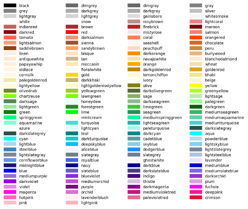

棒グラフは`plt.bar(color=棒毎の色のリスト)`の形で棒ごとに色を指定することができます.

~~~ py
# 棒グラフの色を指定します.
# 1つ目 red
# 2つ目 blue
# 3つ目 yellow
color_list = ["red", "blue", "yellow"]
# 引数に色の指定をします
plt.bar(color=color_list, x=x_position, height=values)
#ラベルの位置を指定します.
plt.xticks(ticks=x_position,labels=labels)
# yラベルを指定します
plt.ylabel("number")
# タイトルを指名します
plt.title("kind")
# グラフの表示
plt.show()
~~~

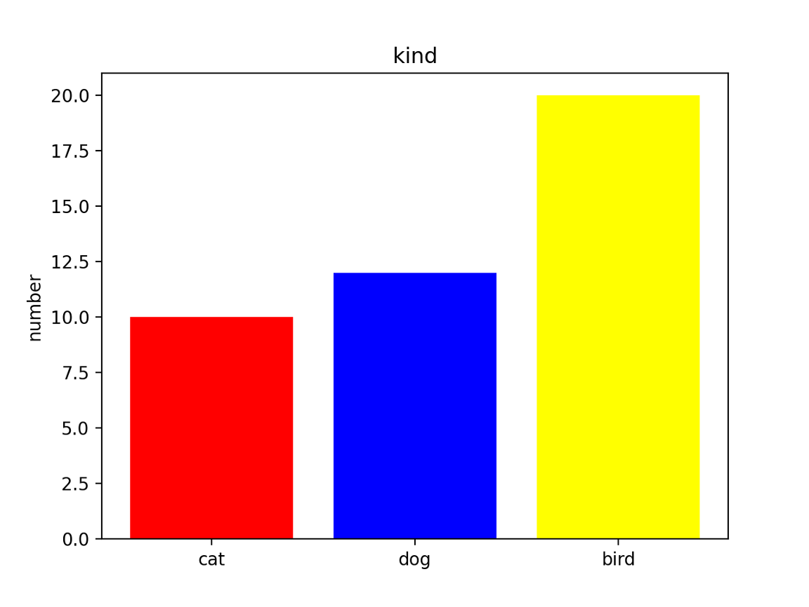

## スタイルの変更 {#スタイルの変更}

毎回細かなデザインを自分で調整すると手間なので,デフォルトで準備されているスタイルを利用すると楽です.

matplotlibではいくつかのデフォルトのスタイルが準備されています. 使用可能なスタイルは,plt.style.available で確認できます.

~~~ sh
❯ python
Python 3.12.3 (main, Jun  3 2024, 08:31:31) [Clang 15.0.0 (clang-1500.3.9.4)] on darwin
Type "help", "copyright", "credits" or "license" for more information.
>>> import matplotlib.pyplot as plt
>>> plt.style.available
['Solarize_Light2', 'bmh', 'classic', 'dark_background', 'fast', 'fivethirtyeight', 'ggplot', 'grayscale', 'petroff10', 'petroff6', 'petroff8', 'seaborn-v0_8', 'seaborn-v0_8-bright', 'seaborn-v0_8-colorblind', 'seaborn-v0_8-dark', 'seaborn-v0_8-dark-palette', 'seaborn-v0_8-darkgrid', 'seaborn-v0_8-deep', 'seaborn-v0_8-muted', 'seaborn-v0_8-notebook', 'seaborn-v0_8-paper', 'seaborn-v0_8-pastel', 'seaborn-v0_8-poster', 'seaborn-v0_8-talk', 'seaborn-v0_8-ticks', 'seaborn-v0_8-white', 'seaborn-v0_8-whitegrid', 'tableau-colorblind10']
~~~

それぞれのスタイルのイメージは[こちら](https://matplotlib.org/stable/gallery/style_sheets/style_sheets_reference.html)で確認できます.

::: note
**`seaborn` という名前のスタイルは削除されています**

`matplotlib`にはかつて`seaborn`や`seaborn-darkgrid`という名前のスタイルが同梱されていましたが, これらは`seaborn`ライブラリ本体のデザイン更新に追随できなくなったため, matplotlib 3.6 で非推奨となり, 3.8 で削除されました. 現在は`seaborn-v0_8`,`seaborn-v0_8-darkgrid`のように **`seaborn-v0_8`で始まる名前** に置き換わっています (末尾の`v0_8`は seaborn 0.8 時代のデザインで固定されていることを表します).

古い解説記事などで`plt.style.use('seaborn')`という記述を見かけても, そのままでは`OSError`になります. `plt.style.use('seaborn-v0_8')`のように読み替えてください. 最新の`seaborn`のデザインを使いたい場合は, スタイルシートではなく`seaborn`を直接読み込み,`sns.set_theme()`を利用します.
:::

スタイルは`plt.style.use('スタイル名')`で指定し,以降のコード全てに適用されます.

~~~ py
# スタイル 'ggplot' を使ってみます
plt.style.use('ggplot')
# 引数に色の指定をします
plt.bar(x=x_position, height=values)
#ラベルの位置を指定します.
plt.xticks(ticks=x_position,labels=labels)
# yラベルを指定します
plt.ylabel("number")
# タイトルを指名します
plt.title("kind")
# グラフの表示
plt.show()
~~~

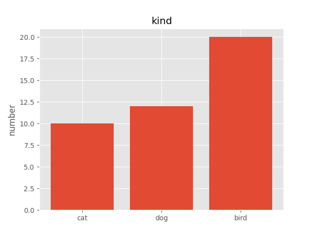

## 要素の追加 {#要素の追加}

グラフに新しい要素を付け加えるのも簡単です.

`plt.show()`までの間に,グラフを宣言することで,複数のグラフを重ねることが可能です.
ここでは, 異なる色の棒グラフを追加しています.

また, `plt.legend()`によって凡例を追加しています.

~~~ py
# スタイル seaborn-v0_8 を使ってみます
plt.style.use('seaborn-v0_8')
# 棒グラフを2つ並べます
plt.bar(color='red', x=x_position, width=0.3,height=values)
plt.bar(color='blue',x=x_position+0.3, width=0.3,height=[11,15,14])
#凡例を追加します
# loc で位置を指定します
# 上下 upper center lower
# 左右 left center right
plt.legend(['2020','2000'], loc='upper left')
#ラベルの位置を指定します.
plt.xticks(ticks=x_position+0.15,labels=labels)
# yラベルを指定します
plt.ylabel("number")
# タイトルを指名します
plt.title("kind")
# グラフの表示
plt.show()
~~~

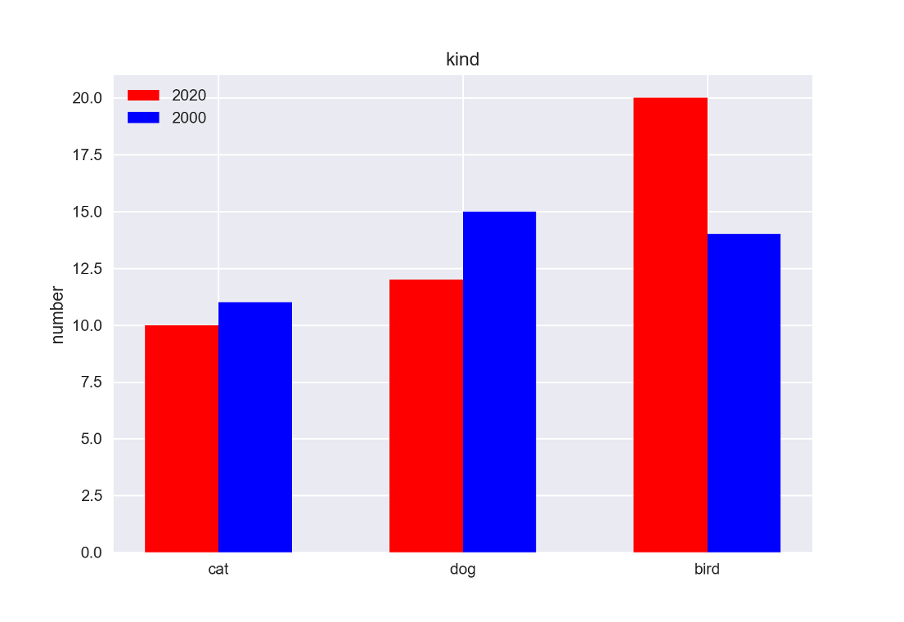

デザインのすべてのパターンをここで扱うことは出来ないので,
やりたいことに応じて,
[matplotlubの公式ドキュメント](https://matplotlib.org/stable/users/index)を確認しましょう.

# for 文を利用したグラフ {#for-graph}

単純な一つのグラフを作成するだけであれば, 恐らく Excelなどのほうが手軽ですが, 多数のグラフを作成したり, 複数のデータを組み合わせた複雑なグラフを作成する場合にはプログラミングの方が便利になります.

例えば[こちら](https://github.com/yakagika/yakagika.github.io/blob/main/slds_data/ch8/temperature_10location.csv)のデータを利用して棒グラフを作成することを考えてみましょう.このデータは10箇所の気温が記録された時系列データです.

~~~ sh
          Date  Location_1  Location_2  ...  Location_8  Location_9  Location_10
0   2023-01-01   18.211700   21.553371  ...   18.665620   29.108637    21.634069
1   2023-01-02   15.108630   16.172744  ...   20.135756    9.212193    24.209877
2   2023-01-03   14.938279   24.593193  ...   16.778431   22.291269    19.815977
3   2023-01-04   20.640249   18.862405  ...   13.282269   16.040627    15.993132
4   2023-01-05   14.218562   16.281882  ...   15.729466   24.951213    18.053277
..         ...         ...         ...  ...         ...         ...          ...
95  2023-04-06   21.312739   19.613363  ...   16.497553   20.446656    13.644605
96  2023-04-07   26.388210   31.533854  ...   18.999736   15.603714    19.215097
97  2023-04-08   16.914329   20.479892  ...   21.698464   17.705697    16.867517
98  2023-04-09   14.316258   17.841650  ...   31.885071   20.816917    16.895196
99  2023-04-10   23.595042   19.896247  ...   17.534881   15.180066    15.104460
~~~

このデータの`Location_1`から`Location_10`までの折れ線グラフを一つのグラフに表示することを考えてみます.

`matplotlib`では, `plt.show()`までに要素を重ねることで複数のグラフを重ねることができます.

例えば,10本の折れ線グラフを表示する場合,一つ一つ手書きすると以下のようになります.

~~~ py
df = pd.read_csv('data/temperature_10location.csv')
print(df)

#'Date'列を日付型に変更しています.
df['Date'] = pd.to_datetime(df['Date'])

#一つ一つ手書きする方法
plt.plot(df['Date'],df['Location_1'],label='Location_1')
plt.plot(df['Date'],df['Location_2'],label='Location_2')
plt.plot(df['Date'],df['Location_3'],label='Location_3')
plt.plot(df['Date'],df['Location_4'],label='Location_4')
plt.plot(df['Date'],df['Location_5'],label='Location_5')
plt.plot(df['Date'],df['Location_6'],label='Location_6')
plt.plot(df['Date'],df['Location_7'],label='Location_7')
plt.plot(df['Date'],df['Location_8'],label='Location_8')
plt.plot(df['Date'],df['Location_9'],label='Location_9')
plt.plot(df['Date'],df['Location_10'],label='Location_10')

plt.legend()
plt.xticks(rotation=15) #x軸を15度傾かせています
plt.show()

~~~

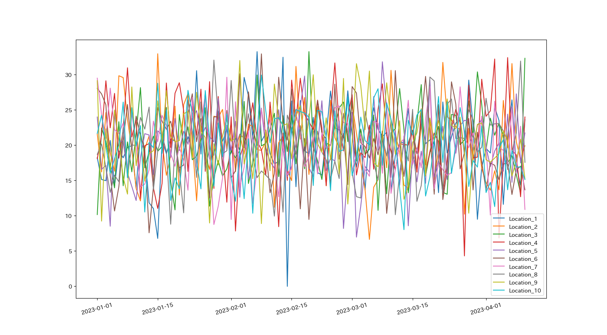

10本程度であれば,まだ書けなくもありませんが,それでも手間がかかります.こういった繰り返しの作業は`for文`を利用しましょう.

`for文`を利用した場合には以下のようになります.

~~~ py
for x in df.columns[1:]:
    plt.plot(df['Date'],df[x],label=x)
plt.legend()
plt.xticks(rotation=15)
plt.show()
~~~

グラフの内容は同じですが,こちらのほうが労力が少なく,コードもスッキリしており,何か修正を加える場合でも修正箇所が少なくて済みます.
繰り返し作業は積極的に`for文`や`while文`を利用するようにしましょう.

# []{#グラフの分割}グラフの分割 {#subplots}

[for 文を利用したグラフ](block:vis-design#for-graph)では一つのグラフ内に複数の折れ線グラフを表示しました. 個別に表示する場合にはどのようになるでしょうか.
一つの方法として,以下の用に複数のグラフを個別に作成することも可能です.
(先に保存先のディレクトリ `result/multi_plot` を作成しておきましょう.)

~~~ py
for x in df.columns[1:]:
    plt.plot(df['Date'],df[x])
    plt.title(x)
    plt.xticks(rotation=15)
    plt.savefig('result/multi_plot/' + x + '.png')
    plt.close()
~~~

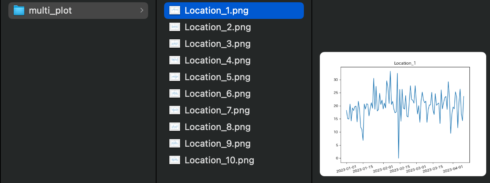

しかし,レポートなどに10枚の画像を貼り付けるのは手間がかかりますし,余白など無駄も多いです.

- subplots()

`matplotlib`には1枚の画像を分割して複数のグラフを載せるためのメソッド`.subplots()`があるので,関連するグラフや比較のためのグラフなどはできるだけ1枚の画像に集約しましょう.

`.subplots()`は1枚の画像を`n行`,`n列`に分割し,それぞれの領域にグラフを描画します.

各領域は `axes`などと呼ばれ,画像全体を`figure`などと呼びます.
利用するためには,まず `fig, axes = plt.subplots()`の形で宣言します. 引数として,行数は`nrows=`,列数は`ncols=`にそれぞれ`int`で指定します.

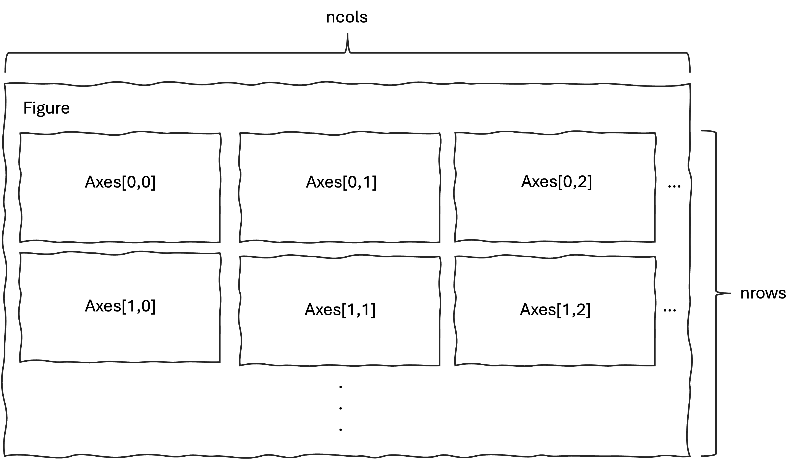

~~~ py

fig, axes = plt.subplots(nrows= 5 #行数の指定
                       ,ncols= 2 #列数の指定
                        )
~~~

宣言のあと,各領域のグラフを `axes[行,列]`の形で指定していきます.行や列は`0`から始まるので注意してください.

~~~ py
axes[0,0].plot(df['Date'],df['Location_1'],label='Location_1')
axes[0,1].plot(df['Date'],df['Location_2'],label='Location_2')
axes[1,0].plot(df['Date'],df['Location_3'],label='Location_3')
axes[1,1].plot(df['Date'],df['Location_4'],label='Location_4')
axes[2,0].plot(df['Date'],df['Location_5'],label='Location_5')
axes[2,1].plot(df['Date'],df['Location_6'],label='Location_6')
axes[3,0].plot(df['Date'],df['Location_7'],label='Location_7')
axes[3,1].plot(df['Date'],df['Location_8'],label='Location_8')
axes[4,0].plot(df['Date'],df['Location_9'],label='Location_9')
axes[4,1].plot(df['Date'],df['Location_10'],label='Location_10')
plt.show()
~~~

以下のようなグラフが作成されます. しかし, 少し見にくいですね.

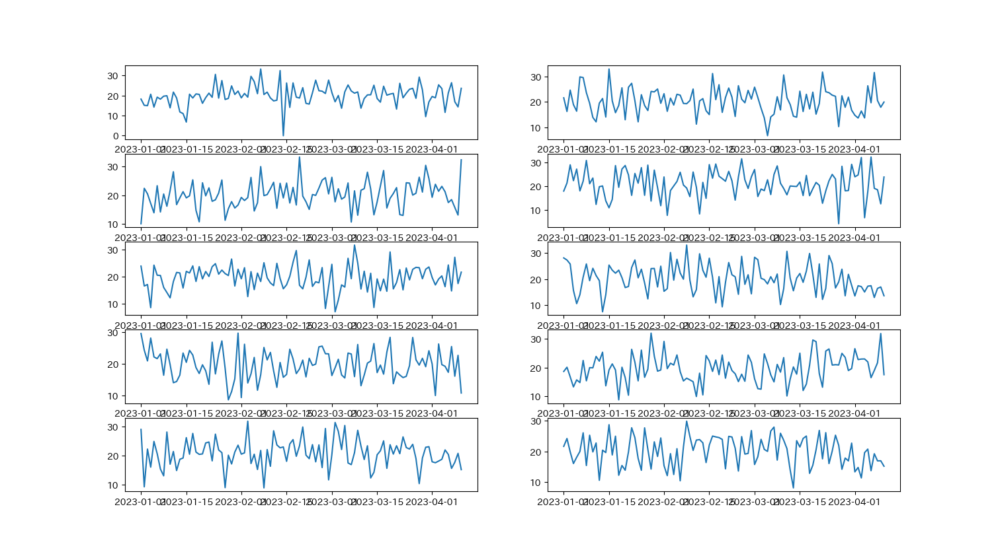

`.subplots(sharex=True)`とすると,x軸を共有することができます.今回のグラフはx軸がすべて同じなので,共有してみましょう.
また,それぞれのグラフにタイトルを付けてみます.
更に,一つ一つ手で入力するのは手間なので`for文`を利用してみましょう.

タイトルを付けるには今までの`plt.title()`ではなく`axes[r,c].set_title()`になります. `axes`毎の要素に関しては[公式サイト](https://matplotlib.org/stable/users/explain/axes/axes_intro.html)を参考にしてください.

~~~ py
fig, axes = plt.subplots(nrows= 5 #行数の指定
                        ,ncols= 2 #列数の指定
                        ,sharex=True)

count = 0
for i in range(5):
    for j in range(2):
        col = df.columns[1:]
        axes[i,j].plot(df['Date'],df[col[count]])
        axes[i,j].set_title(col[count])
        axes[i,j].tick_params(axis='x', rotation=15)
        count +=1
plt.show()
~~~

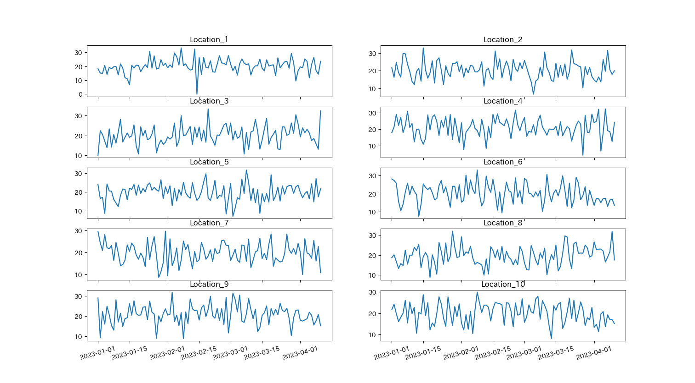

グラフ全体の要素は`fig.`の形で指定します.
タイトルを付ける場合は`fig.suptitle('title')`となります.

~~~ py
fig, axes = plt.subplots(nrows= 5 #行数の指定
                        ,ncols= 2 #列数の指定
                        ,sharex=True)

count = 0
for i in range(5):
    for j in range(2):
        col = df.columns[1:]
        axes[i,j].plot(df['Date'],df[col[count]])
        axes[i,j].set_title(col[count])
        axes[i,j].tick_params(axis='x', rotation=15)
        count +=1
fig.suptitle('subplots title')
plt.show()
~~~

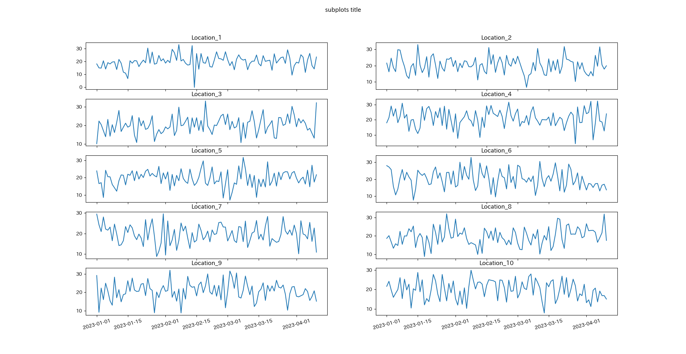

::: note

- flatten()

`for文`を二重ループで記述するのは大変なので,しばしば`axes.flatten()`を利用して,連番に変換すると便利です.

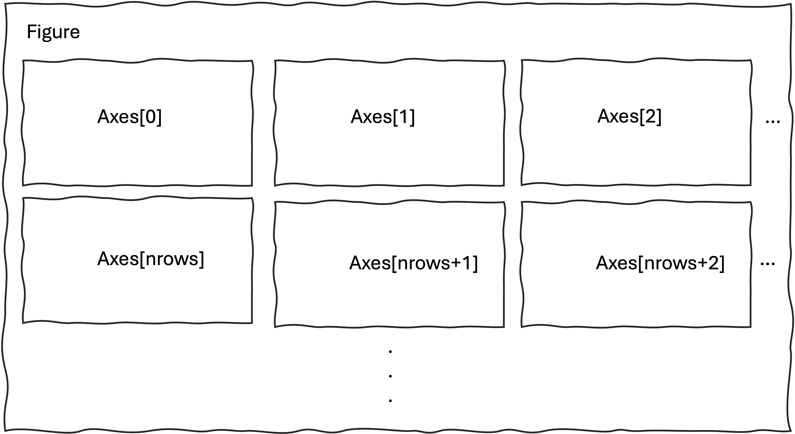

~~~ py
fig, axes = plt.subplots(nrows= 5 #行数の指定
                        ,ncols= 2 #列数の指定
                        ,sharex=True)

#連番に変換
axes = axes.flatten()
for i in range(10):
    col = df.columns[1:][i] #countをiで共通化
    axes[i].plot(df['Date'],df[col])
    axes[i].set_title(col)
    axes[i].tick_params(axis='x', rotation=15)
fig.suptitle('subplots title')
plt.show()
~~~

:::

