## 度数分布表とヒストグラム {#度数分布表とヒストグラム}

データを手に入れたら最初にデータを可視化してデータの特徴を掴む必要があります. データの特徴として重要なものに, データの**分布**があります.

::: warn

- ### 分布の意味 {#分布の意味}

**分布**という語の詳細な意味に関しては, 後ほど検定や回帰の章でも簡単に扱いますが, 統計学入門において数理的に詳しく扱っています.

統計学入門を履修していない人はここでは, 単に**データの散らばり具合**という意味として捉えておきましょう.

:::

分布を可視化する手法として代表的なものに, **度数分布表**と, **ヒストグラム**があります. 1 次元のデータの可視化において, 度数分布表とヒストグラムは, **データ分析のファーストステップ**とも称される, 重要な手法です. データを手に入れたらまずは度数分布表と, ヒストグラムを作成してみましょう.

## 度数分布表 {#度数分布表}

::: note

**度数分布表**とは, データの数を区切られた範囲ごとに数えた表のことです. 質的データの場合はデータのカテゴリーごとに, 量的データの場合は分析者が定めた区間ごとに, データがいくつあるのかを数えます.

普通ヒストグラムというと, 量的データを対象としたものをいいますが, ここではわかりやすさのために, 質的データから見ていきましょう.

以下の表は, 何かしらの商品の美味しさに関するアンケート結果です. 商品を食べて, 「とても美味しい」と回答した人の人数が 9 人, 「不味い」と回答した人の人数が 5 人であることなどがわかります.

このように**データのカテゴリー別にその値が生じたケースの数**を**度数**といい, **度数を表に整理したもの**を**度数分布表**といいます.

|アンケート区分            |度数   |
|  :---:                   | :---: |
|とても美味しい            |  9    |
|どちらかといえば美味しい  |  11   |
|普通                      |  34   |
|どちらかといえば不味い    |  5    |
|不味い                    |  5    |

度数の亜種には, 以下のようなものがあり, それぞれによってデータの分布が把握できます.

- 累積度数:

    順序尺度データの度数を少ない方から足し上げた値

- 相対度数 (構成比率):

    度数の総和を100%としたときの構成比率

- 累積相対度数 (累積比率):

    相対度数を上から足し上げた値

|アンケート区分            |度数   | 累積度数 | 相対度数 | 累積相対度数|
|  :---:                   | :---: | :---:    | :---:    | :---:       |
|とても美味しい            |  9    | 9        | 14%      | 14%         |
|どちらかといえば美味しい  |  11   | 20       | 17%      | 31%         |
|普通                      |  34   | 54       | 53%      | 84%         |
|どちらかといえば不味い    |  5    | 59       | 8%       | 92%         |
|不味い                    |  5    | 64       | 8%       | 100%        |
|計                        |  64   |          | 100%     |             |

度数分布表を作成することで, データがどの分類に偏っているのかなど, データの分布の傾向がつかめます. 度数分布表を見る場合には, 相対度数や累積度数から**データが一番多いカテゴリー**, **度数データの過半数が属するカテゴリー**, **データのほとんど (90% 程度) が属するカテゴリー**などに注目してみましょう.
上のデータでは, 最も回答が多いのは「普通」であること, 「とても美味しい」「どちらかといえば美味しい」の回答が, 31% であるのに対して, 「どちらかといえば不味い」「不味い」の回答が 18% であり, 全体的にこの商品の味は高評価側に集中していることなどがわかります.

:::

Python で度数分布表を作成するにはどのようにしたら良いのでしょうか. 質的データの場合は, ただそれぞれの値を数えればいいので `for` 文などを利用することも可能ですが, `pandas` の `value_counts()` メソッドを利用することで簡単に作成できます.

[こちら](https://github.com/yakagika/yakagika.github.io/blob/main/slds_data/ch8/diff_class.csv)のとある授業の難易度に関する質的データをダウンロードして度数分布表を作成してみましょう.

データは以下のように, 「難しすぎてついていけない」, 「難しいが許容できる」, 「ちょうどよい」, 「簡単だが許容できる」「簡単すぎて退屈」の 5 段階のカテゴリーが記述されています.

~~~ sh
         Diff
0   難しいが許容できる
1   簡単すぎて退屈
2   難しいが許容できる
3   簡単だが許容できる
4      ちょうどよい
..        ...
~~~

~~~ py
import pandas as pd
import numpy as np
from matplotlib import pyplot as plt
import matplotlib_fontja
import math

#データの読み込み
df = pd.read_csv('data/diff_class.csv')
print(df)

#ヒストグラムを作りたいデータの列名を指定
target_column = 'Diff'

#度数
freq = df[target_column].value_counts(sort=False)
#順番の入れ替え
freq = freq.reindex(['難しすぎてついていけない'
                    ,'難しいが許容できる'
                    ,'ちょうどよい'
                    ,'簡単だが許容できる'
                    ,'簡単すぎて退屈'],axis='index')
print('度数',freq)

rel_freq = freq / df[target_column].count()  # 相対度数
cum_freq = freq.cumsum()  # 累積度数
rel_cum_freq = rel_freq.cumsum()  # 相対累積度数

dist = pd.DataFrame(
    {   "Value": freq.index,        #階級値
        "Freq": freq,               #度数
        "Rel": rel_freq,            #相対度数
        "Cum": cum_freq,            #累積度数
        "RelCum": rel_cum_freq,     #相対累積度数
    },
    index=freq.index
)

print(dist)
dist.to_csv('frequency_table.csv',)

~~~

保存された csv(`frequency_table.csv`) を確認してみると, 度数分布表が作成されていることが確認できます.

|Value                       |Freq    |Rel         |Cum   |RelCum      |
| :---:                      |:---:   |:---:       |:---: |:---:       |
|難しすぎてついていけない    |2       |0.02247191  |2     |0.02247191  |
|難しいが許容できる          |44      |0.494382022 |46    |0.516853933 |
|ちょうどよい                |38      |0.426966292 |84    |0.943820225 |
|簡単だが許容できる          |4       |0.04494382  |88    |0.988764045 |
|簡単すぎて退屈              |1       |0.011235955 |89    |1           |

質的データはあらかじめデータのカテゴリーが定められているのでその数を数えるだけで, 度数分布表が作成できました.
それでは, カテゴリーが存在しない量的データではどのようにして度数分布表を作成するのでしょうか.

::: note

- **量的データと度数分布表**

量的データには当てはまるデータを数えるためのカテゴリーが存在しません. 年収のデータを考えた場合, 年収 1 万円ごとに表を作ると 1 から数億まで, 非常に細かくなります.
そこで, 量的データで度数分布表を作成するには, 100 万円ごと, 300 万円ごとなどデータをいくつかの区間に分けて, 区間別の度数を数える必要があります. ここで, 作られた区間を**階級**, 階級の幅を**階級幅**, 階級を代表する値を**階級値**といいます. 階級値は大抵の場合, 区間の中間の値が用いられます (100 万円~200 万円の区間だとすると, 150 万円など).

以下の度数分布表は, ある情報クラスの成績 (0-100 点) を 10 点毎に区分したものです. それぞれの点数に当てはまる人数を数えて度数とします.

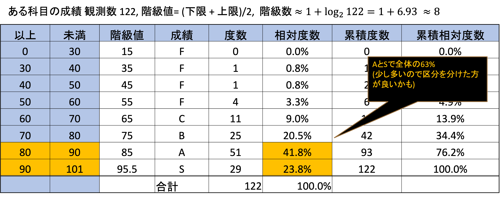

量的データの階級数や階級幅は, 100 万円ごとなどある程度人間の判断によって作成しても構いませんが, 数理的に決定する方法もあります.

階級幅は階級数が決まることで自動的に決まるため, 階級数を決める一般的な目安として, **スタージェスの公式**が利用されます.

観測数を $n$, 階級数を $k$ とすると.

$$ k = 1 + log_2 n = \frac{log_{10} n}{log_{10} 2}$$

程度の $k$ が望ましいとされています.

計算結果はおおよそ以下のようになります.

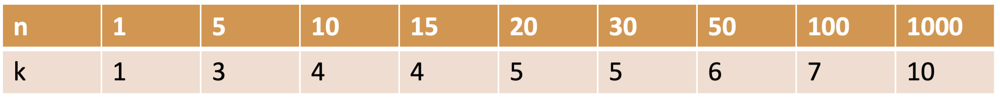
:::

Python ではスタージェス数は対数計算をするためのモジュール `math` を利用して以下のように求めることができます.

~~~ py
# 2進対数を返す math.log2() 関数などを利用するために必要なモジュール
import math

# 関数名を sturgesNumber として引数をnとします
def sturgesNumber(n):
    # 公式の通り k = 1 + log2 n
    # 階級数は整数が良いので,math.floor()で小数点以下を切り捨てます
    return (math.floor (1 + math.log2(n)))

print(sturgesNumber(2048)) #>>> 12
~~~

階級数が決まることで階級幅が
$$\frac{(データの最大値 - データの最小値)}{階級数}$$

として決まります.

それでは, [こちら](https://github.com/yakagika/yakagika.github.io/blob/main/slds_data/ch8/histogram_quantitative.csv)のデータを利用して, 度数分布表を作成してみます. 量的データの度数分布表を作成するには, `value_counts()` の引数 `bins=` に各階級の終点を表すリストを指定します.

~~~ py
#ヒストグラムを作りたいデータの列名を指定
target_column = 'Values'

# 関数名を sturgesNumber として引数をnとします
def sturgesNumber(n):
    # 公式の通り k = 1 + log2 n
    # 階級数は整数が良いので,math.floor()で小数点以下を切り捨てます
    return (math.floor (1 + math.log2(n)))

# dataフォルダにあるhistogram_quantitative.csvというファイルを読み込みます.
df = pd.read_csv("data/histogram_quantitative.csv")
# 読み込んだファイルの中身を見てみます.
print(df)

#階級数を決定
stnum = sturgesNumber(len(df[target_column]))
print('sturges number:',stnum)

#階級幅を決定
space = int((df[target_column].max() - df[target_column].min()) / stnum)
print('space:',space)

#階級幅の終端を指定
bins = np.arange(start = int(df[target_column].min()) - 1 #最小値
                ,stop  = int(df[target_column].max()) + 1 #最大値
                ,step  = space #階級幅
                )

print('bins:',bins)

#度数
freq = df[target_column].value_counts(bins =bins, sort=False)
print('度数',freq)

rel_freq = freq / df[target_column].count()  # 相対度数
cum_freq = freq.cumsum()  # 累積度数
rel_cum_freq = rel_freq.cumsum()  # 相対累積度数

dist = pd.DataFrame(
    {   "Value": freq.index,        #階級値
        "Freq": freq,               #度数
        "Rel": rel_freq,            #相対度数
        "Cum": cum_freq,            #累積度数
        "RelCum": rel_cum_freq,     #相対累積度数
    },
    index=freq.index
)

print(dist)

dist.to_csv('frequency_table_qualitative.csv'
           ,encoding='utf-8-sig'
           ,index=False)
~~~

結果作成された, `frequency_table_qualitative.csv` を開いてみると, 以下のような度数分布表が作成されたことが確認できます.

|Value           |Freq    |Rel     |Cum   |RelCum|
|:---:           |:---:   |:---:   |:---: |:---: |
|(8.999, 18.0]   |1       |0.01    |1     |0.01  |
|(18.0, 27.0]    |5       |0.05    |6     |0.06  |
|(27.0, 36.0]    |11      |0.11    |17    |0.17  |
|(36.0, 45.0]    |21      |0.21    |38    |0.38  |
|(45.0, 54.0]    |27      |0.27    |65    |0.65  |
|(54.0, 63.0]    |20      |0.2     |85    |0.85  |
|(63.0, 72.0]    |9       |0.09    |94    |0.94  |

## 度数分布表の可視化:**ヒストグラム** {#histogram}

ここまでで, データの分布, 偏りを把握する手段としての度数分布表を学びました. 度数分布表を眺めることである程度データの形は分かりますが, よりわかりやすく可視化する方法として**ヒストグラム**があります.

**ヒストグラム (Histogram)/柱状図**とは, 量的データの度数分布を棒グラフで表現したものです. ただし, 通常の棒グラフと異なり値が連続しているので, 棒と棒の間にスペースを置きません. 統計における最も基本的なグラフです.

ヒストグラムはいくつかの代表的なパターンがあり, それぞれ注意するべきポイントがありますので, 順に見ていきましょう.

::: note

- ### 単峰型 (unimodal) で左右対称 {#単峰型-unimodal-で左右対称}

ヒストグラムの盛り上がっている部分を**峰**といいます. 峰の数が一つのヒストグラムを**単峰 (unimodal)**なヒストグラムといいます.

ヒストグラムの基本となる形は, 単峰で左右対称な分布です. この分布は, **データが同質な集団から発生していること**を表しています.

    - 例:同じ人種の, 同じ年代の, 男性の集団の身長

    - 例:同じ種類, 同じ時期, 同じ地域のうさぎの集団のサイズ

峰からの左右のデータのばらつきは集団の個体差を表しています. 異なる, 質を持つ集団が混じっている場合は峰が複数になることが多いです.

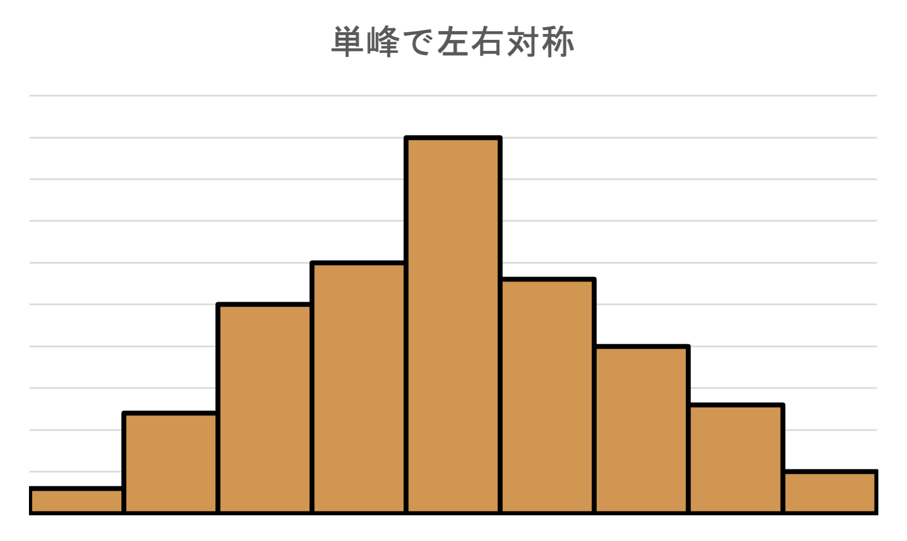

- ### 多峰型 (multimodal) のヒストグラム {#多峰型-multimodal-のヒストグラム}

峰が 2 つ以上あるヒストグラムを**多峰 (multimodal)** なヒストグラムといいます (峰が 2 つのものは特に**二峰 (bimodal)** といいます).
異質な集団が混ざっているデータでは, ヒストグラムが多峰になることがあります.

    - 例:男女の混ざった集団の身長や体重
    男性の峰と女性の峰が現れます.

    - 例:小学生と中学生が同じテストを受けたときの点数
    小学生の点数の峰と,中学生の点数の峰が現れます.

ヒストグラムを作成し, 多峰性が現れたらデータを集団別・要因別に分割して分析するのが良いとされています. データを特定の属性で分割することを**層別**といいます.

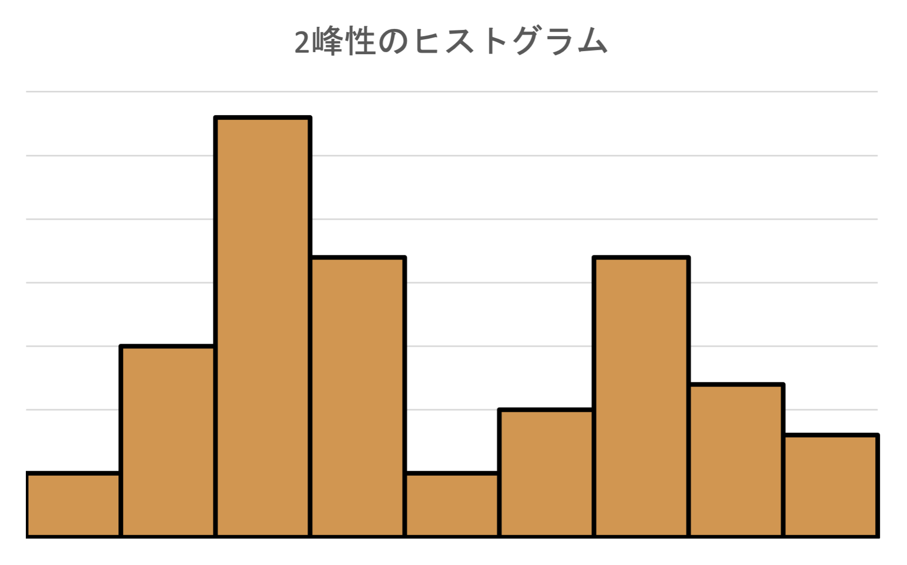

- ### 左右非対称なヒストグラム {#左右非対称なヒストグラム}

ヒストグラムは峰を中心として左右対称な場合もありますが, どちらかの方向に歪んでいるものも良く見られます.

    - 例:社会人の年収, 企業の売上など

ヒストグラムの細くなっている部分をヒストグラムの**尾**といいます.

    - **尾が**左に伸びている場合に **左に歪んだ分布**

    - **尾が**右に伸びている場合に **右に歪んだ分布**

といいます.

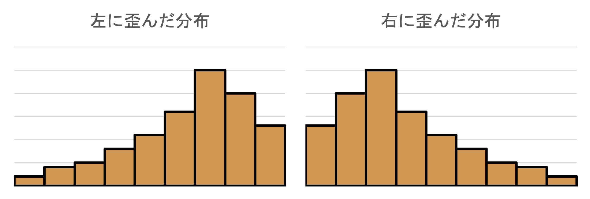

左右に歪んだ分布では, 後に扱う**中心を表す代表値**(平均値や中央値) が適切に集団を代表しない場合があるので, 代表値の使い分けが必要になります.

また, 後に扱う**検定**手法のうち, **正規分布**を仮定する検定が利用できないなど, 手法の選択において, 分布の歪みは重要なポイントです.

- ### **外れ値 (Outlier)**のあるヒストグラム {#外れ値-outlierのあるヒストグラム}

大多数のデータとは離れた位置にある少数のデータを**外れ値 (Outlier)**といいます.

外れ値は, データ分析において非常に重要な意味を持ち, 外れ値が現れた場合にはその原因を探ることが必要となります.
外れ値が発生する原因としては以下のようなものがあり, いずれも注目する必要があります.

    - データの取得におけるミス
        単純な入力ミスや計算ミスなど
        発見した場合は修正,除外する必要がある.

    - 異質な存在の発見
        新種や新しい現象の発見などにつながる可能性があります.

また, 代表値の計算においては歪みが生じる可能性があるので, 外れ値を除外する必要があります.

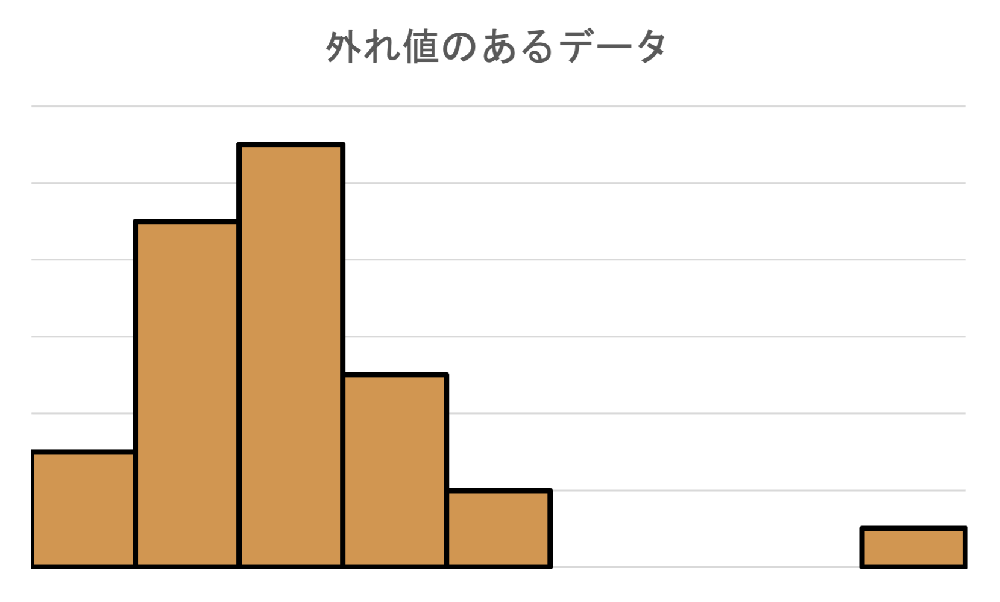

:::

それでは, Python で度数分布表をグラフにしてみましょう. 度数分布表がある場合は, 棒グラフを作り棒の間隔を `0` にすることで, 棒を詰めたグラフ (量的データならヒストグラム) が作成できます.

`plt.bar()` では, 引数 `width=1` を与えることで, 棒の太さを `1` (棒の間を 0) にすることができます.

まずは, 以前扱った[順序尺度の質的データ](https://github.com/yakagika/yakagika.github.io/blob/main/slds_data/ch8/diff_class.csv)の例を描いてみましょう. 前述のとおり順序尺度には階級幅の概念が無いため, これは厳密にはヒストグラムではありませんが, 順序があるので棒を詰めて描くと分布の歪みなどを読み取れます.

~~~ py
#データの読み込み
df = pd.read_csv('data/diff_class.csv')
print(df)

#ヒストグラムを作りたいデータの列名を指定
target_column = 'Diff'

#度数
freq = df[target_column].value_counts(sort=False)
#順番の入れ替え
freq = freq.reindex(['難しすぎてついていけない'
                    ,'難しいが許容できる'
                    ,'ちょうどよい'
                    ,'簡単だが許容できる'
                    ,'簡単すぎて退屈'],axis='index')
print('度数',freq)

rel_freq = freq / df[target_column].count()  # 相対度数
cum_freq = freq.cumsum()  # 累積度数
rel_cum_freq = rel_freq.cumsum()  # 相対累積度数

dist = pd.DataFrame(
    {   "Value": freq.index,        #階級値
        "Freq": freq,               #度数
        "Rel": rel_freq,            #相対度数
        "Cum": cum_freq,            #累積度数
        "RelCum": rel_cum_freq,     #相対累積度数
    },
    index=freq.index
)

print(dist)
dist.to_csv('frequency_table.csv',encoding='utf-8-sig',index=False)

# ヒストグラム
plt.bar(x=dist['Value'], height=dist["Freq"],width=1)
plt.xticks(np.arange(len(dist)),list(dist.index),rotation=15)
plt.show()
~~~

以下のように, 単峰で右に歪んだグラフが作成されるはずです.

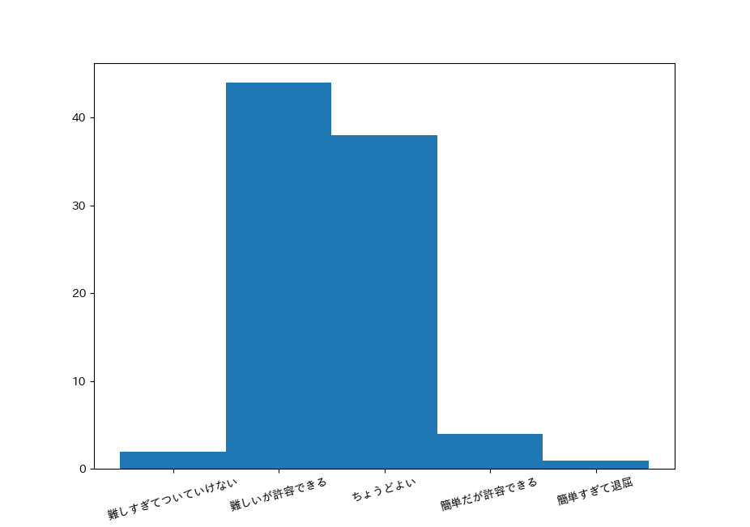

同様に[量的データ](https://github.com/yakagika/yakagika.github.io/blob/main/slds_data/ch8/histogram_quantitative.csv)についても作成してみます.

~~~py
#ヒストグラムを作りたいデータの列名を指定
target_column = 'Values'

# 関数名を sturgesNumber として引数をnとします
def sturgesNumber(n):
    # 公式の通り k = 1 + log2 n
    # 階級数は整数が良いので,math.floor()で小数点以下を切り捨てます
    return (math.floor (1 + math.log2(n)))

# dataフォルダにあるhistogram_quantitative.csvというファイルを読み込みます.
df = pd.read_csv("data/histogram_quantitative.csv")
# 読み込んだファイルの中身を見てみます.
print(df)

#階級数を決定
stnum = sturgesNumber(len(df[target_column]))
print('sturges number:',stnum)

#階級幅を決定
space = int((df[target_column].max() - df[target_column].min()) / stnum)
print('space:',space)

#階級幅の終端を指定
bins = np.arange(start = int(df[target_column].min()) - 1 #最小値
                ,stop  = int(df[target_column].max()) + 1 #最大値
                ,step  = space #階級幅
                )

print('bins:',bins)

"""
階級が整数では大きすぎる場合は,
np.arrange()では上手く出来ません.
while文などで,以下のように自作しましょう.

space = (data.max() - data.min()) / step
current = data.min() -1
bins = [current]
while current <= data.max() +1:
    current += space
    bins.append(current)
"""

#度数
freq = df[target_column].value_counts(bins =bins, sort=False)
print('度数',freq)

rel_freq = freq / df[target_column].count()  # 相対度数
cum_freq = freq.cumsum()  # 累積度数
rel_cum_freq = rel_freq.cumsum()  # 相対累積度数

dist = pd.DataFrame(
    {   "Value": freq.index,        #階級値
        "Freq": freq,               #度数
        "Rel": rel_freq,            #相対度数
        "Cum": cum_freq,            #累積度数
        "RelCum": rel_cum_freq,     #相対累積度数
    },
    index=freq.index
)

print(dist)
dist.to_csv('frequency_table_qualitative.csv'
           ,encoding='utf-8-sig',index=False)

# ヒストグラム
## dist['Value']は文字列でないので,
## .astype(str) で文字列に変換しています.
plt.bar(x=dist['Value'].astype(str)
       ,height=dist["Freq"],width=1)
plt.xticks(np.arange(len(dist)),list(dist.index),rotation=15)
plt.show()
~~~

以下のように単峰で左に歪んだヒストグラムが作成されます.

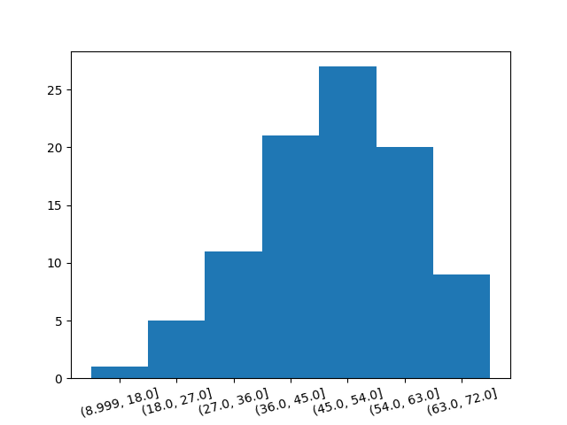

一方で, 量的データに関しては, 度数分布表を作成せずとも `matplotlib` の `plt.hist()` を利用して直接作成することも可能です.

`plt.hist()` では `bins=` に階級数を指定することで, その階級数で自然に分割したヒストグラムを作成してくれます.

~~~ py
# ヒストグラムの作成
label  = df.columns[0]
values = df[label]
plt.hist(values, bins=stnum)
plt.show()
~~~

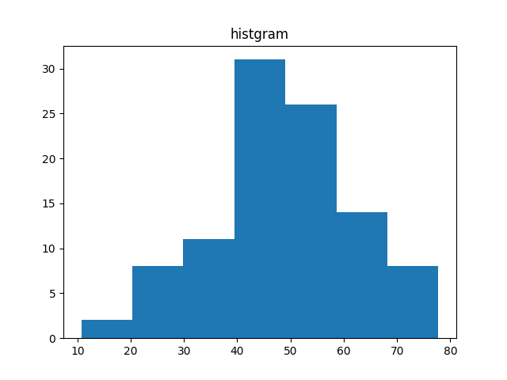

階級幅の設定によって, 見た目が変わることが分かります. 作成手法や階級の設定は目的に応じて, 使い分けるようにしましょう.

この節に対応する演習は, 章末の[Exercise DSP3-5](#exercise-dsp3-5)です.

# 箱ひげ図 {#boxplot}

データの観測対象が複数のグループに層別可能な場合には, それぞれのヒストグラムを作成して比較することなどが必要です. グループの数が多い場合には, 何個もヒストグラムを作成することになりますし, 比較には向いていない場合があります.
そのような複数のグループの分布を比較する際に良く用いられるグラフが, 箱ひげ図です.

[こちら](https://github.com/yakagika/yakagika.github.io/blob/main/slds_data/ch8/boxplot_data_300.csv)のデータは, 複数の種類の馬鈴薯のサイズがまとまっています.

試しに, 馬鈴薯の種類ごとのヒストグラムを作成してみます.

~~~ py
df = pd.read_csv('data/boxplot_data_300.csv')

#馬鈴薯の種類を抜き出す
types = list(set(df['Type']))
print(types)

#馬鈴薯の種類別にヒストグラムを作成してみる
fig, ax = plt.subplots(ncols=2
                      ,nrows=int(len(types) / 2) + 1
                      ,sharex = True)
axes = ax.flatten()
fig.suptitle('Potato Weight')

for i in range(len(types)):
    t = types[i]
    df_temp = df[df['Type'] == t]
    axes[i].hist(df_temp['Weight'])
    axes[i].set_title(t)

plt.show()
~~~

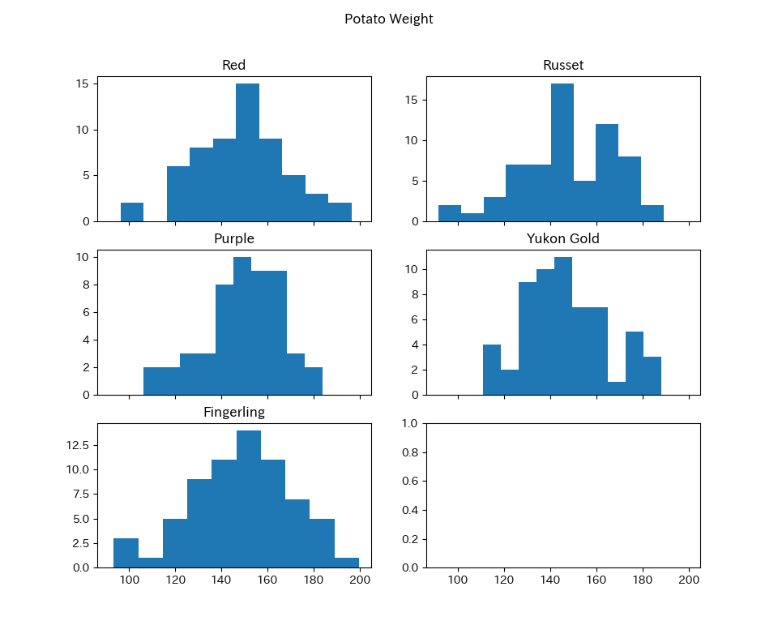

これでも比較はできますが 1 枚の画像にまとめる手段として, 箱ひげ図が利用できます.
箱ひげ図は `plt.boxplot(データのリスト, tick_labels=ラベルのリスト)` で生成できます (`matplotlib` 3.9 より前の版では `tick_labels=` の代わりに `labels=` を使います).

~~~ py
data = [df[df['Type']==x]['Weight'] for x in types]
"""
#内包表記を利用しない場合は
data = []
for x in types:
    data.append(df[df['Type']==x]['Weight'])
"""
print(data)
plt.boxplot(data, tick_labels=types)
plt.show()
~~~

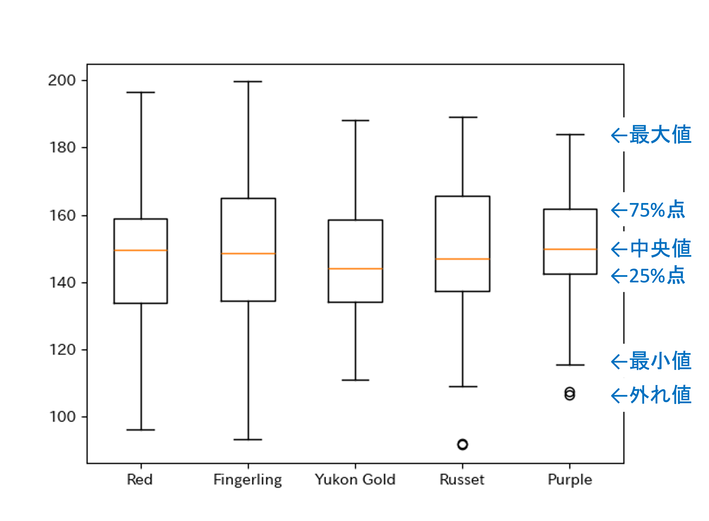

箱ひげ図の箱は, 上から **75% 点**, **中央値** (箱の中の線), **25% 点** を表します. ひげは箱から上下に伸び, 箱の長さ (四分位範囲) の 1.5 倍以内にあるデータの**最大値**と**最小値**まで引かれます. その範囲の外にあるデータは外れ値として丸で表されます.

ヒストグラムと比較して情報量は減りますが, 一覧性と比較においては優れています. それぞれ一長一短なので, 用途に応じて使い分けるようにしましょう.

# []{#演習}演習 {#exercises}

## Exercise DSP3-5 {#exercise-dsp3-5}

**度数分布表とヒストグラムを作る**

対応する節: [度数分布表](#度数分布表), [ヒストグラム](#histogram)

[質的データ](https://github.com/yakagika/yakagika.github.io/blob/main/slds_data/ch8/qualitative_histogram_practice.csv)と[量的データ](https://github.com/yakagika/yakagika.github.io/blob/main/slds_data/ch8/quantitative_histogram_practice.csv)のそれぞれについて, 度数分布表とヒストグラムを作成し, ppt などでグラフとその解釈をまとめてください.

提出ファイル名: `dsp3-5.py` (ppt などの資料も添えてください)

    
 回答例 

~~~ py
import math
import numpy as np
import pandas as pd
import matplotlib.pyplot as plt
import matplotlib_fontja

# 質的データ: 値ごとに数え, 相対度数と累積度数を加えます.
qual = pd.read_csv('data/qualitative_histogram_practice.csv')
freq = qual['Category'].value_counts().sort_index()
rel_freq = freq / freq.sum()
dist = pd.DataFrame({'Freq': freq, 'Rel': rel_freq,
                     'Cum': freq.cumsum(), 'RelCum': rel_freq.cumsum()})
print(dist)

plt.bar(dist.index, dist['Freq'], width=1)
plt.ylabel('度数')
plt.show()

# 量的データ: スタージェスの公式で階級数を決め, 度数分布表を作ります.
quant = pd.read_csv('data/quantitative_histogram_practice.csv')
values = quant['Values']

def make_dist(values):
    stnum = math.floor(1 + math.log2(len(values)))
    space = int((values.max() - values.min()) / stnum)
    bins = np.arange(int(values.min()) - 1, int(values.max()) + 1 + space, space)
    freq = values.value_counts(bins=bins, sort=False)
    rel_freq = freq / freq.sum()
    dist = pd.DataFrame({'Freq': freq, 'Rel': rel_freq,
                         'Cum': freq.cumsum(), 'RelCum': rel_freq.cumsum()})
    return dist, bins

dist, bins = make_dist(values)
print(dist.round(2))
plt.hist(values, bins=bins)
plt.show()

# 最大値だけが桁外れに大きい (外れ値) ので, 除いて作り直します.
print(values.max(), values.drop(values.idxmax()).max())
values = values.drop(values.idxmax())
dist, bins = make_dist(values)
print(dist.round(2))
plt.hist(values, bins=bins)
plt.xlabel('値')
plt.ylabel('度数')
plt.show()
~~~

~~~ sh
            Freq   Rel  Cum  RelCum
Category
Category A    21  0.21   21    0.21
Category B    26  0.26   47    0.47
Category C    25  0.25   72    0.72
Category D    28  0.28  100    1.00
                        Freq   Rel  Cum  RelCum
(8.999, 821206.0]         99  0.99   99    0.99
(821206.0, 1642403.0]      0  0.00   99    0.99
(1642403.0, 2463600.0]     0  0.00   99    0.99
(2463600.0, 3284797.0]     0  0.00   99    0.99
(3284797.0, 4105994.0]     0  0.00   99    0.99
(4105994.0, 4927191.0]     0  0.00   99    0.99
(4927191.0, 5748388.0]     0  0.00   99    0.99
(5748388.0, 6569585.0]     1  0.01  100    1.00
5748392.168 77.78417277
               Freq   Rel  Cum  RelCum
(8.999, 18.0]      1  0.01    1    0.01
(18.0, 27.0]       5  0.05    6    0.06
(27.0, 36.0]      11  0.11   17    0.17
(36.0, 45.0]      21  0.21   38    0.38
(45.0, 54.0]      27  0.27   65    0.66
(54.0, 63.0]      20  0.20   85    0.86
(63.0, 72.0]       9  0.09   94    0.95
(72.0, 81.0]       5  0.05   99    1.00
~~~

質的データは, 4 つのカテゴリの度数が 21 から 28 でほぼ均等です. 最も多いのは D (28), 最も少ないのは A (21) ですが, 差は小さく, 偏りがあるとは言えません.

量的データは, 最大値の約 575 万が, 他の値の最大値 (約 78) から桁違いに離れた**外れ値**です. この 1 件が階級の幅を押し広げるため, 最初の度数分布表では 99 件が最初の階級に入り, ヒストグラムは 1 本の棒しか読み取れません. 実際の分析では, 外れ値を除く前に入力ミスなどの原因を確認します. 外れ値を除いて作り直すと, 45 を超え 54 以下の階級が最も多い (27 件), 左右ほぼ対称な山の形になっていることが読み取れます.

