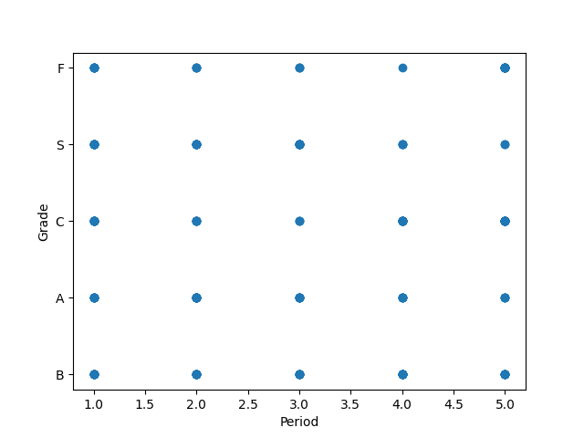
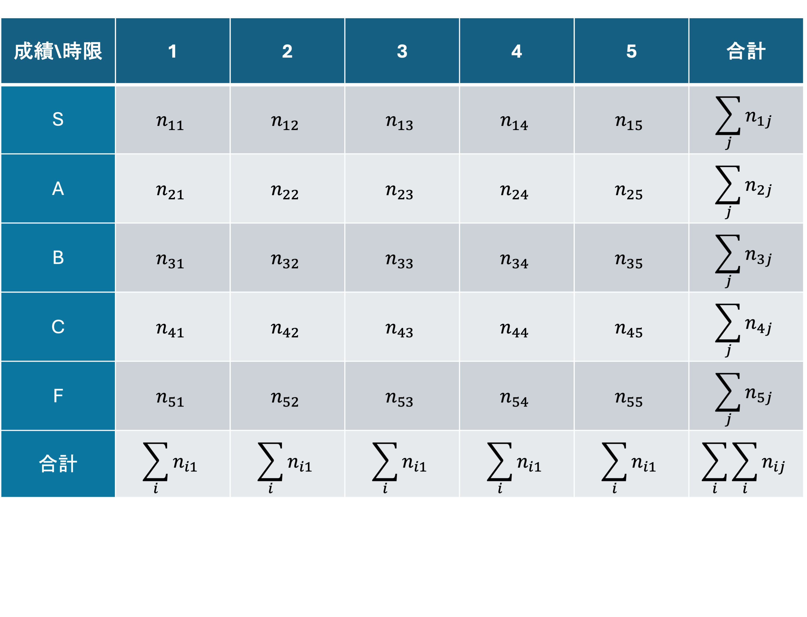
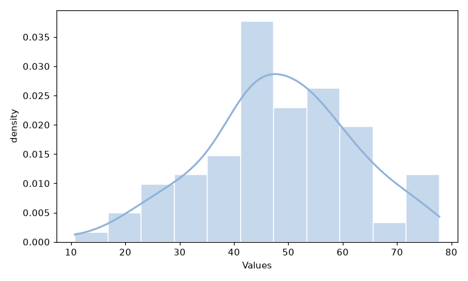
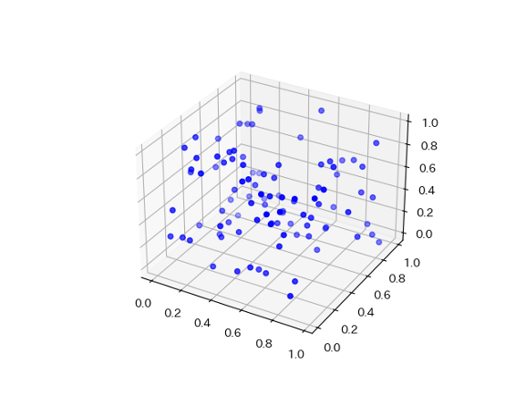
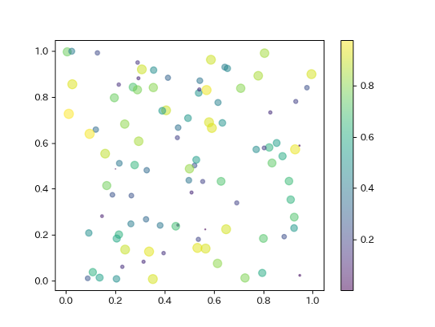
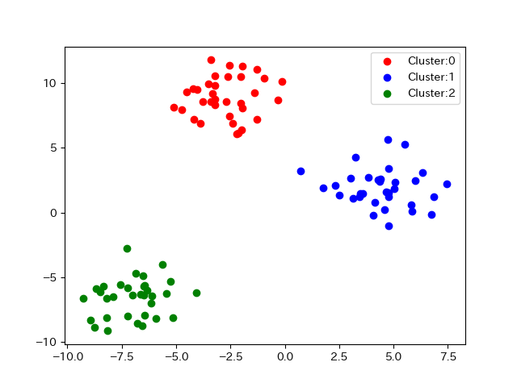
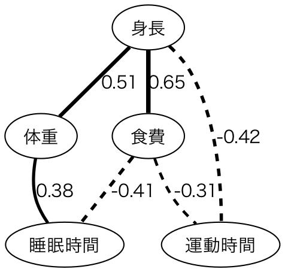

## 同時度数分布表 {#同時度数分布表}

2 つの観測項目の関係を調べる[散布図](block:vis-relation#scatter)は,量的データにしか使えません. 質的変数同士の関係性を調べるにはどのようにしたらいいのでしょうか.

質的変数同士の関係性を調べる手法として代表的なものに**同時度数分布表(クロス表)**があります.
例えば[こちら](https://github.com/yakagika/yakagika.github.io/blob/main/slds_data/ch8/cross_table_data.csv)のデータはある講義の成績情報ですが,観測項目として成績以外に1時限から5時限までの時限が記録されています. 時限が早い講義と遅い講義で成績が変わるのかという関係性を調べてみます.

~~~ sh
     Period Grade
0         2     B
1         5     A
2         4     A
3         3     C
4         1     C
..      ...   ...
195       2     C
196       4     C
197       5     C
198       5     F
199       4     C
~~~

試しに,散布図で`Period`と`Grade`の関係を表してみましょう.
成績をそのままでは,散布図の軸上に配置できないので数値に変換します.

~~~ py
df = pd.read_csv('data/cross_table_data.csv')
print(df)

#あえて散布図を作ってみる
grade_num_map = {'S':1
                ,'A':2
                ,'B':3
                ,'C':4
                ,'F':5}

df['Grade_num'] = df['Grade'].map(lambda x: grade_num_map[x])

plt.scatter(df['Period'],df['Grade'])
plt.xlabel('Period')
plt.ylabel('Grade')
plt.show()
~~~

質的データを数値に変換したとしても,離散値となるため,散布図はこのように基本的にはすべての交点に点があるだけのなんの情報も得られないグラフとなります.

散布図としてプロットすると, 点がありうる場所が少なすぎるため情報がとれません. 元々知りたいことは,講義の時限と成績にどのような関係があるのかということでした.
そこで, 講義の時間ごとの成績の偏りが分かるように可視化することを考えてみます.

講義の時限ごとの成績の分布がわかり,それぞれに違いがあれば時限によって成績に偏りが出ていると言えそうです.
そこで,以下のように講義の時限毎の成績の度数分布表を作ってみましょう.

この度数分布表では,時限毎にその成績を取った学生の度数が数えられています($n_{11}$は1時限にSを取った学生の度数,$n_{ij}$は`j時限`に上から`i番目`の成績をとった学生の度数.)

このような2観測項目の度数分布表を**同時度数分布表**あるいは,**クロス表(cross table)**といいます.

それでは,Pythonで同時度数分布表を作成してみましょう.
`pandas` では,`.crosstab(行,列)`メソッドを利用することで,クロス表が作成できます.

~~~ py
#クロス表の作成
cross = pd.crosstab(df['Grade'],df['Period'])

#表示順の設定
cross = cross.reindex([1,2,3,4,5],axis='columns')
cross = cross.reindex(['S','A','B','C','F'],axis='index')
print(cross)
~~~

~~~ sh
Period   1   2   3   4   5
Grade
S        9  10  12   4   2
A        7  14   7   5   4
B        9  10   7  11   7
C       14   6   3  15  18
F        7   4   3   1  11
~~~

このようにしてみることで,それぞれの時限毎にそれぞれの成績がどのような分布なのかが分かります.
しかし,各時限の人数が同じとは限らないため,各列の値をその列の和で割って,列相対度数に変更してみましょう.

~~~ py
#列相対度数に変更する
for c in cross.columns:
    cross[c] = cross[c] / cross[c].sum()

print(cross)
~~~

~~~ sh
Period         1         2        3         4         5
Grade
S       0.195652  0.227273  0.37500  0.111111  0.047619
A       0.152174  0.318182  0.21875  0.138889  0.095238
B       0.195652  0.227273  0.21875  0.305556  0.166667
C       0.304348  0.136364  0.09375  0.416667  0.428571
F       0.152174  0.090909  0.09375  0.027778  0.261905
~~~

このようにすると,時限毎にどの程度の割合がSやAなどの良い成績をとっているのかが分かります.
通常度数分布表を作成したあとには, **χ二乗検定**や, **標準化残差**を利用した**残差分析**によって, **偏り**が統計的に存在するかを判定します. 偏りを一目で判断しやすくする可視化の方法として, [ヒートマップ](block:vis-relation#heatmap)を使えます.

# []{#カーネル密度プロット}カーネル密度プロット {#kernel-density}

データの分布を表現する手法としてヒストグラムは非常に便利ですが,階級数や階級幅を自分で定める必要があり,その設定によって見た目が変わってしまいます. また, データ数が少ないときには正確なデータの分布をつかめないという問題点もあります.

そこで, データを階級で区分せずに,度数ではなく確率密度を直接推定する手法に**カーネル密度推定(Kernel Density Estimation, KDE)**があります.

カーネル密度推定では, 一つ一つのデータ点の上に**カーネル**と呼ばれる小さな山(多くはガウス関数)を置き, それらをすべて足し合わせて1本のなめらかな曲線をつくります. データ点 $x_1, x_2, \dots, x_n$ に対する密度の推定値 $\hat{f}(x)$ は次の式で表されます.

$$\hat{f}(x) = \frac{1}{nh}\sum_{i=1}^{n} K\!\left(\frac{x - x_i}{h}\right)$$

ここで $K$ はカーネル関数(山の形)を, $h$ は**バンド幅(bandwidth)**と呼ばれるなめらかさを決めるパラメータを表します. $h$ を小さくするとデータ点ごとの凹凸が強く出て, 大きくするとよりなめらかになります. ヒストグラムにおける階級幅と同じような役割を持つ量です.

`seaborn`では`.histplot()`の引数`kde=True`を指定することで, ヒストグラムに重ねてカーネル密度推定の曲線を描くことができます. ここでは, ヒストグラムの節で用いた[量的データ](https://github.com/yakagika/yakagika.github.io/blob/main/slds_data/ch8/histogram_quantitative.csv)を使ってみましょう.

~~~ py
df = pd.read_csv('data/histogram_quantitative.csv')
# stat='density' で縦軸を度数から密度(棒の面積の合計が1)に変換します.
# kde=True を渡すと, ヒストグラムに重ねてカーネル密度推定の曲線が描かれます.
sns.histplot(df['Values'], stat='density', kde=True)
plt.xlabel('Values')
plt.show()
plt.close()
~~~

ヒストグラムの階段状のグラフと異なり, 分布のなめらかな形をつかむことができます. 曲線だけを描きたい場合は`sns.kdeplot(df['Values'])`とします. ただし, カーネル密度推定はあくまで手元のデータからの**推定**であり, バンド幅の取り方によって形が変わる点には注意しましょう.

# 観測項目が複数ある場合の散布図 {#scatter-3d}

データが 3 つある場合には, 以下のように 3D で表現することも可能ですが, この解説では, 3 次元のグラフに関しては深く扱いません. 興味のある方は調べてみましょう.

~~~ py
x = np.random.rand(100)
y = np.random.rand(100)
z = np.random.rand(100)

fig = plt.figure()
ax = fig.add_subplot(projection='3d')
ax.scatter(x, y, z, color='blue')
plt.show()
plt.close()
~~~

観測項目が 4 つ以上ある場合に散布図のように関係を表す手法としては, 複数の観測項目の値を合成して 3 次元以下にする**次元削減**が良く利用されます. 次元削減の例は[主成分分析](block:ml-clustering#pca)を参照してください. 次の例ではいくつかの観測項目を**色**や**大きさ**などの要素に変換して関係を見る方法を紹介します.

`plt.scatter()` では `s=` に数値を与えることでサイズ, `c=` に数値を与えることで色を指定できます.
また, 色と数値の関係は `plt.colorbar()` で表示可能です.

複数の点が重なると見にくくなるために `alpha=` に `0-1` の間の数値を指定して透明度を指定することができます.

~~~ py
x = np.random.rand(100)
y = np.random.rand(100)
z = np.random.rand(100)

#色とサイズをzで指定する
#そのままだとサイズが小さすぎるので,100倍している
plt.scatter(x,y,alpha=0.5,s=z*100,c=z)
plt.colorbar() #カラーバーの表示
plt.show()
~~~

## クラスタリングにおける散布図 {#クラスタリングにおける散布図}

散布図は複数の観測項目間の関係性を可視化するための手法ですが, データから特定の観測対象の集まり (**クラスター**) を発見する**クラスタリング**とも深い関わりがあります.
[クラスタリング](block:ml-clustering#クラスタリング)の解説とあわせて,可視化手法としての散布図とクラスタ表現の関係に関して確認してみましょう.

[こちら](https://github.com/yakagika/yakagika.github.io/blob/main/slds_data/ch8/scatter_class.csv)のデータには, クラスタリングによって得られたクラスタごとのラベルが付いています.

~~~ sh
           x          y  Cluster
0  -8.149818  -9.152380        2
1   5.860155   0.126873        1
2  -3.213409   9.828126        0
3   6.744070  -0.129607        1
4  -6.342946  -6.038933        2
..       ...        ...      ...
95 -3.524581   9.931801        0
96 -0.962698  10.411206        0
97  4.397950   2.579246        1
98 -5.255050  -5.299407        2
99 -3.768024   8.550468        0
~~~

クラスタを表すには, `.scatter()` の引数 `c=` で色を指定するのが一般的です.

~~~ py
df = pd.read_csv('data/scatter_class.csv')
color_list = ["red", "blue", "yellow"]
#散布図をクラスタごとに色を変えて表示
for i in range(3):
    df_temp= df[df['Cluster'] == i]
    plt.scatter(df_temp['x']
               ,df_temp['y']
               ,c=color_list[i]
               ,label='Cluster:' + str(i))
plt.legend()
plt.show()

~~~

# 変数の関係を図で表す {#relation-diagram}

[散布図行列](block:vis-relation#scatter-matrix)や[ヒートマップ](block:vis-relation#heatmap)は, 変数の組ごとの関係を並べて見せます. 変数が多くなると, どの変数がどの変数とつながっているかという全体の構造は, これらの図からは読み取りにくくなります. そこで, 変数を楕円 (ノード) で, 変数の間の関係を線 (エッジ) で表す図を描きます.

ここでは, 都道府県別のデータの 5 つの変数について, 相関係数 ([相関係数](block:num-correlation#correlation)で扱う, 2 つの量的データの直線的な関係の強さを -1 から 1 で表す指標) の絶対値が 0.3 以上の組を線で結びます. 図の作成には, グラフ (ノードとエッジからなる図) を描くソフトウェア Graphviz を Python から使うライブラリ `graphviz` を使います. `uv add graphviz` に加えて, Graphviz 本体のインストール (macOS なら `brew install graphviz`, Windows なら公式サイトのインストーラ) が必要です.

~~~ py
import pandas as pd
import graphviz

df = pd.read_csv('data/pref_stats.csv', encoding='utf-8-sig', index_col='pref')
corr = df.corr()   # 5 つの項目の, すべての組み合わせの相関係数

names = {'height': '身長', 'weight': '体重', 'food': '食費'
        ,'sleep': '睡眠時間', 'sports': '運動時間'}

g = graphviz.Graph(format='png')   # 向きの無い線で結ぶ図
g.attr(dpi='150')                   # 画像の解像度
g.attr('node', fontname='Hiragino Sans', shape='ellipse')
g.attr('edge', fontname='Hiragino Sans')
for col, label in names.items():
    g.node(col, label)

cols = list(names)
for i in range(len(cols)):
    for j in range(i + 1, len(cols)):
        r = corr.loc[cols[i], cols[j]]
        if abs(r) >= 0.3:   # 相関係数の絶対値が 0.3 以上の組だけ線で結ぶ
            g.edge(cols[i], cols[j]
                  ,label=f'{r:.2f}'
                  ,style='solid' if r > 0 else 'dashed'   # 負の相関は破線
                  ,penwidth=str(1 + 4 * abs(r)))          # 強い相関ほど太く
g.render('pref_corr_graph', cleanup=True)   # pref_corr_graph.png が保存されます
~~~

`fontname='Hiragino Sans'` は macOS の日本語フォントです. Windows では `'Yu Gothic'` などに替えます.

身長は食費 (0.65), 体重 (0.51) と正の相関で, 運動時間 (-0.42) と負の相関で結ばれ, 5 つの変数の中で最も多くの線が集まります. 睡眠時間は体重と正の相関 (0.38), 食費と負の相関 (-0.41) を持ちます. 散布図行列では 10 組の散布図を 1 つずつ見比べる必要がありましたが, この図では関係の強い組と, 関係が集まる変数を一度に見渡せます.

この図の線は相関を表すだけで, どちらがどちらに影響するかという向きは表していません. 変数の間の影響の向きを仮説として矢印で描いた図は**パス図**と呼ばれ, パス図の仮説をデータで確かめる手法が, [共分散構造分析](block:survey-sem#共分散構造分析)です.

