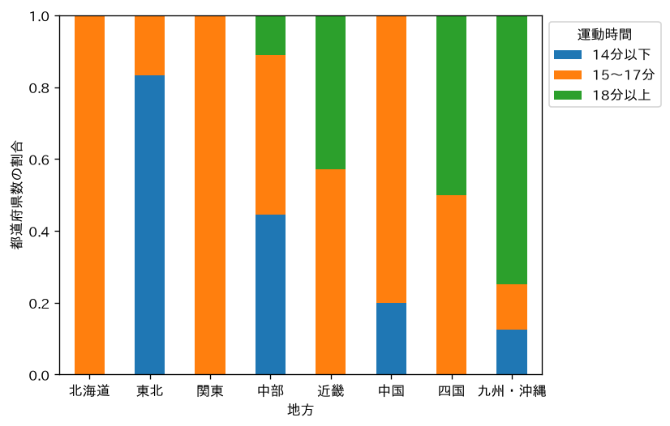
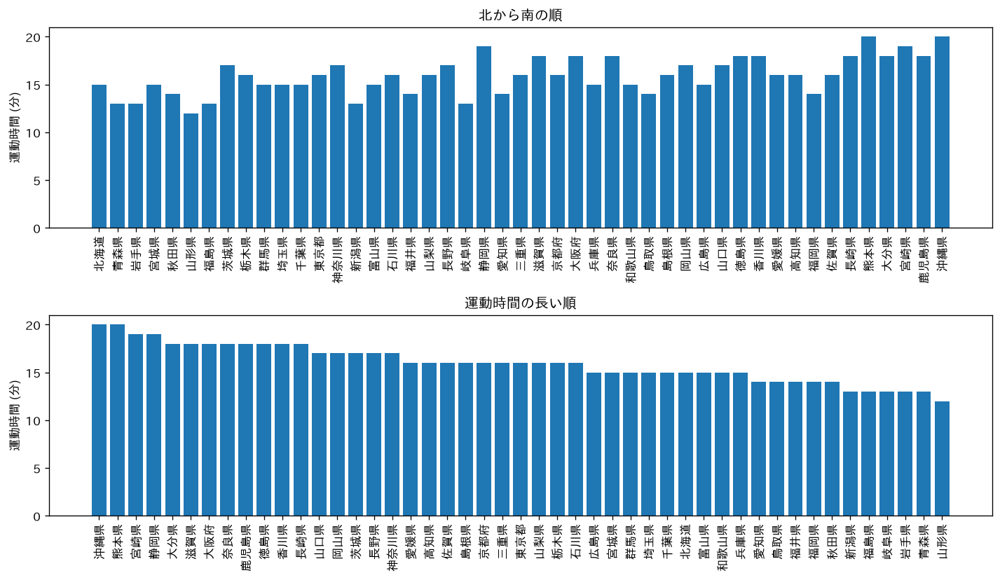
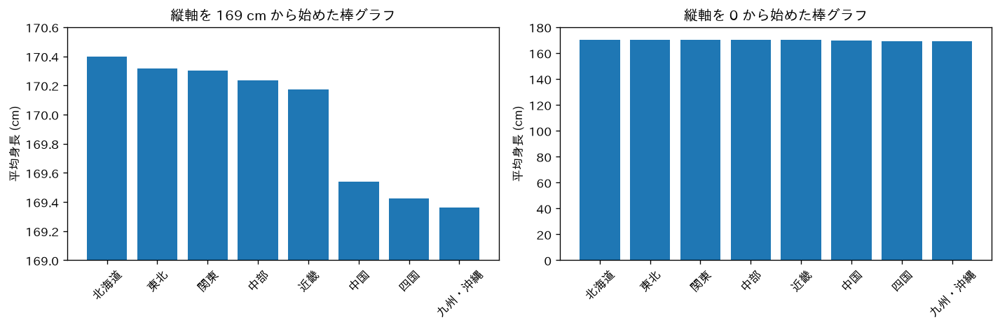
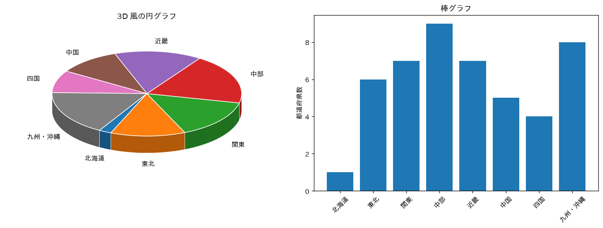
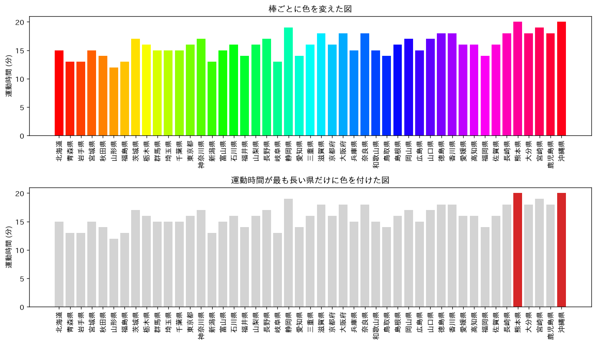

## 縦軸と横軸の選び方 {#axis-choice}

同じデータでも, 縦軸と横軸に何を取るかで読み取れることが変わります. そのため, 図を描く前に, 問いに対して軸の候補を書き出します. [積み上げ棒グラフ](block:vis-basic#stacked-bar)で使った都道府県別のデータで, 問い「運動時間は地域によって違うか」に対する候補を書き出すと, 次のようになります.

| 軸 | 候補 | 読み取りやすいこと |
|---|---|---|
| 横軸 | 都道府県 (北から南の順) | 地理的な並びに沿った変化 |
| 横軸 | 都道府県 (運動時間の長い順) | 順位, 上位と下位の都道府県 |
| 横軸 | 地方 | 地方単位の違い |
| 縦軸 | 運動時間 (分) | 各都道府県の水準 |
| 縦軸 | 階級ごとの都道府県数 | 地方の中の内訳 (合計は地方の都道府県数に左右される) |
| 縦軸 | 階級ごとの都道府県数の割合 | 都道府県数の違う地方同士の内訳の比較 |

候補を並べたら, 問いに答えられる組み合わせを選びます. 軸の比較と誇張の例のために, [積み上げ棒グラフ](block:vis-basic#stacked-bar)と同じ手順でデータを読み込み直します. [誇張と強調が読み取りに与える影響](#exaggeration)のコードも, この `df` と `order` を使います.

~~~ py
df = pd.read_csv('data/pref_stats.csv', encoding='utf-8-sig')
region = pd.read_csv('data/pref_region.csv', encoding='utf-8-sig')
# pref 列が一致する行同士をつないで, 地方の列を加えます.
df = df.merge(region, on='pref')

# 運動時間を 3 つの階級に分けます. (0, 14], (14, 17], (17, 60] の区間になります.
df['sports_class'] = pd.cut(df['sports']
                           ,bins=[0, 14, 17, 60]
                           ,labels=['14分以下', '15〜17分', '18分以上'])

# 地方の並び順
order = ['北海道', '東北', '関東', '中部', '近畿', '中国', '四国', '九州・沖縄']
~~~

## 実数か割合か {#axis-count-ratio}

[積み上げ棒グラフ](block:vis-basic#stacked-bar)の図は縦軸が都道府県数 (実数) なので, 棒全体の高さが地方ごとに違います. 縦軸を地方の中での割合にすると, どの地方の棒も高さが 1 になり, 内訳の割合を直接比べられます.

~~~ py
# normalize='index' で, 各行 (地方) の合計が 1 になるように割合に直します.
ratio = pd.crosstab(df['region'], df['sports_class'], normalize='index').reindex(order)
print(ratio.round(2))

ratio.plot.bar(stacked=True, rot=0)
plt.xlabel('地方')
plt.ylabel('都道府県数の割合')
plt.legend(title='運動時間', bbox_to_anchor=(1, 1))
plt.show()
~~~

~~~ sh
sports_class  14分以下  15〜17分  18分以上
region
北海道            0.00    1.00   0.00
東北             0.83    0.17   0.00
関東             0.00    1.00   0.00
中部             0.44    0.44   0.11
近畿             0.00    0.57   0.43
中国             0.20    0.80   0.00
四国             0.00    0.50   0.50
九州・沖縄          0.12    0.12   0.75
~~~

`bbox_to_anchor=(1, 1)` は, 凡例を図の右上の外に置く指定です.

18 分以上の県は, 実数では近畿が 3 県, 四国が 2 県で近畿のほうが多いのに対し, 割合では四国が 0.50, 近畿が 0.43 で四国のほうが大きくなります. 実数の図は「どの地方に 18 分以上の県が多いか」に, 割合の図は「どの地方で 18 分以上の県の比率が高いか」に答えます. ただし北海道は 1 道だけなので, 割合は 0 か 1 にしかなりません. 割合の図では, もとの件数が少ないグループの値が大きく振れる点に注意が要ります.

都道府県の人口や面積のように比べる単位の大きさが違うときも, 同じ判断が要ります. 例えば都道府県ごとの病院の数は人口の多い都道府県ほど多くなりやすく, 医療の手厚さを比べるなら人口あたりの数に直します.

## 対数軸 {#axis-log}

値が何桁にもわたって開いているとき (例えば 10 と 100000 が同じ図に並ぶとき) は, 縦軸を対数軸 (`plt.yscale('log')`) にする方法があります. 対数軸では目盛りの等間隔が等しい比 (何倍か) を表すので, 小さい値同士の違いも読めるようになります. 一方で, 棒の長さは値に比例しなくなるので, 対数軸には棒グラフより点や線で描く図が向きます.

都道府県別のデータでは, 開きの最も大きい食費でも最大 (83506 円) が最小 (56298 円) の約 1.5 倍にとどまり, 対数軸にしても図はほとんど変わりません. 対数軸を使うかどうかは, 値の最大と最小の比を確かめてから決めます.

## 横軸の並べ方 {#axis-order}

都道府県ごとの棒グラフでは, 横軸に都道府県をどの順に並べるかで読み取れることが変わります. データのファイルは北海道から沖縄県まで北から南の順に並んでいるので, そのまま描いた図と, 運動時間の長い順に並べ替えた図を比べます.

~~~ py
fig, axes = plt.subplots(nrows=2, figsize=(12, 7))

# 上: ファイルの並び (北海道から沖縄県まで, 北から南の順) のまま描きます.
axes[0].bar(df['pref'], df['sports'])
axes[0].set_title('北から南の順')

# 下: 運動時間の長い順に並べ替えてから描きます.
df_sorted = df.sort_values('sports', ascending=False)
axes[1].bar(df_sorted['pref'], df_sorted['sports'])
axes[1].set_title('運動時間の長い順')

for ax in axes:
    ax.set_ylabel('運動時間 (分)')
    ax.tick_params(axis='x', rotation=90)
fig.tight_layout()
plt.show()
~~~

`plt.subplots(nrows=2)` は 1 枚の図を上下 2 つの領域に分け, `axes[0]`, `axes[1]` でそれぞれの領域に描きます ([グラフの分割](block:vis-design#グラフの分割)で詳しく扱います).

北から南の順の図では, 東北の各県 (12〜15 分) が低く, 九州の長崎県から沖縄県 (18〜20 分) が高く, 南へ行くほど運動時間が長くなる傾向が見えます. 長い順の図では, 最も長いのが熊本県と沖縄県 (20 分), 最も短いのが山形県 (12 分) という順位が読めますが, 地理的な傾向は読めません. 地域による違いを見るには北から南の順が, 順位を見るには長い順が向きます.

この節に対応する演習は, [Exercise DSP3-2](#exercise-dsp3-2)です.

# 誇張と強調が読み取りに与える影響 {#exaggeration}

同じデータでも, 軸の範囲, 立体的な描き方, 色の付け方によって, 図から受ける印象は大きく変わります. 誇張された図は, グループの間の小さい差を大きく見せたり, 関係のないものを関係があるように見せたりします. 次の 3 つの例では, 誇張された図を同じデータの適切な図と並べます.

## 縦軸を 0 から始めない棒グラフ {#exaggeration-baseline}

地方ごとの平均身長 (都道府県の値の単純平均) を, 縦軸を 169 cm から始めた棒グラフと, 0 から始めた棒グラフで描きます.

~~~ py
# 地方ごとに, 都道府県の平均身長を平均します.
height = df.groupby('region')['height'].mean().reindex(order)
print(height.round(1))

fig, axes = plt.subplots(ncols=2, figsize=(12, 4))
axes[0].bar(height.index, height)
axes[0].set_ylim(169, 170.6)   # 縦軸を 169 cm から始める
axes[0].set_title('縦軸を 169 cm から始めた棒グラフ')
axes[1].bar(height.index, height)
axes[1].set_ylim(0, 180)       # 縦軸を 0 から始める
axes[1].set_title('縦軸を 0 から始めた棒グラフ')
for ax in axes:
    ax.set_ylabel('平均身長 (cm)')
    ax.tick_params(axis='x', rotation=45)
fig.tight_layout()
plt.show()
~~~

~~~ sh
region
北海道      170.4
東北       170.3
関東       170.3
中部       170.2
近畿       170.2
中国       169.5
四国       169.4
九州・沖縄    169.4
Name: height, dtype: float64
~~~

左の図では, 北海道の棒が九州・沖縄の棒の約 3.9 倍の長さに見えます. 北海道と九州・沖縄の平均身長の実際の差は約 1.0 cm で, 北海道の値は九州・沖縄の値の約 1.006 倍にすぎません. 棒グラフは棒の長さで値を表すので, 縦軸を 0 以外から始めると, 長さの比が値の比と食い違います. 右の図のように縦軸を 0 から始めると, 地方ごとの平均身長はほぼ同じだと読み取れます.

地方の間の 1 cm 程度の差そのものを見せたいときは, 縦軸を切り詰めるのではなく, 全国平均との差を棒にするなど, 0 を基準にした別の量を描きます. なお, 散布図, 折れ線グラフ, 箱ひげ図は長さでなく位置で値を表すので, 縦軸を 0 から始める必要はありません. 縦軸を 0 から始めない場合も, 軸の目盛りと単位を必ず表示します.

## 3D の円グラフ {#exaggeration-3dpie}

次の図は, 地方ごとの都道府県数を, 立体的に描いた円グラフ (左) と棒グラフ (右) で表したものです. `matplotlib` には立体的な円グラフを描く関数はなく, 比較のために作った図ですが, 表計算ソフトでは簡単に作れます.

関東 (7 都県) と近畿 (7 府県) は同じ数ですが, 左の図では手前にある関東のほうが大きく見えます. 手前の扇形にだけ側面が描き足され, その分だけ面積が大きく見えるからです. また, 円を傾けて楕円にすると, 左右に向いた扇形より手前や奥に向いた扇形のほうが細く見えます. 東北 (6 県) も, 手前にあるために奥の近畿 (7 府県) と同じかそれ以上の大きさに見えます. 立体にすると, 扇形の見かけの面積が値でなく位置で決まります. 構成を見せるなら平面の円グラフを, 値を正確に比べるなら右の棒グラフを使います.

## 過剰な色の強調 {#exaggeration-color}

色は, 図の中で区別したいものを示すために使います. 次のコードは, 都道府県ごとの運動時間を, 棒ごとに違う色で描いた図と, 伝えたい県だけに色を付けた図を描きます.

~~~ py
fig, axes = plt.subplots(nrows=2, figsize=(12, 7))

# 上: 棒ごとに違う色を付けた図
rainbow = plt.get_cmap('hsv')(np.linspace(0, 1, len(df)))
axes[0].bar(df['pref'], df['sports'], color=rainbow)
axes[0].set_title('棒ごとに色を変えた図')

# 下: 伝えたい都道府県 (運動時間が最も長い県) だけに色を付けた図
top = df['sports'] == df['sports'].max()
colors = np.where(top, 'tab:red', 'lightgray')
axes[1].bar(df['pref'], df['sports'], color=colors)
axes[1].set_title('運動時間が最も長い県だけに色を付けた図')

for ax in axes:
    ax.set_ylabel('運動時間 (分)')
    ax.tick_params(axis='x', rotation=90)
fig.tight_layout()
plt.show()
~~~

`plt.get_cmap('hsv')` は色相を一周する色の列 (カラーマップ) で, `np.linspace(0, 1, len(df))` で都道府県の数だけ色を取り出しています. `np.where(条件, A, B)` は, 条件が真の要素を A に, 偽の要素を B にした配列を返します.

上の図の色は何の情報も表していませんが, 読み手は色に意味を探します. 例えば北海道と沖縄県は同じ赤で描かれているので, 色だけを見ると同じグループに属すると読めます. 明るい黄色や緑の棒にも視線が向くので, どの棒に注目すべきかが図から読み取れません. 下の図は, 運動時間が最も長い熊本県と沖縄県 (20 分) だけを赤にし, 残りを灰色にしています. 伝えたい点が 1 つに定まり, 2 県と他の県との運動時間の差も棒の長さで読めます.

図を人に見せる前に, 次の 4 点を確かめます.

- 棒グラフの縦軸が 0 から始まっていること.
- 必要のない立体表現や装飾を使っていないこと.
- 色を, 区別したいものだけに付けていること.
- 軸のラベルと単位が書かれていること.

この節に対応する演習は, [Exercise DSP3-1](#exercise-dsp3-1)です.

# []{#演習}演習 {#exercises}

## Exercise DSP3-1 {#exercise-dsp3-1}

**誇張された棒グラフを直す**

対応する節: [誇張と強調が読み取りに与える影響](#exaggeration)

次のコードは, 地方ごとの平均体重 (都道府県の値の単純平均) を描きます.

~~~ py
df = pd.read_csv('data/pref_stats.csv', encoding='utf-8-sig')
region = pd.read_csv('data/pref_region.csv', encoding='utf-8-sig')
df = df.merge(region, on='pref')
order = ['北海道', '東北', '関東', '中部', '近畿', '中国', '四国', '九州・沖縄']
weight = df.groupby('region')['weight'].mean().reindex(order)

colors = plt.get_cmap('hsv')(np.linspace(0, 1, len(weight)))
plt.bar(weight.index, weight, color=colors)
plt.ylim(61, 64.5)
plt.ylabel('平均体重 (kg)')
plt.title('東北地方の体重は中国地方の何倍も重い!')
plt.show()
~~~

1. 描かれた図で, 東北の棒は中国の棒の何倍の長さに見えるかを求めてください. また, 実際の平均体重は何倍かを求めてください.
2. [誇張と強調が読み取りに与える影響](#exaggeration)の 4 つの点検項目に沿って図を直してください. 色は, 平均体重が最も重い地方だけに付けてください.

提出ファイル名: `dsp3-1.py`

    
 回答例 

~~~ py
import pandas as pd
import numpy as np
import matplotlib.pyplot as plt
import matplotlib_fontja

df = pd.read_csv('data/pref_stats.csv', encoding='utf-8-sig')
region = pd.read_csv('data/pref_region.csv', encoding='utf-8-sig')
df = df.merge(region, on='pref')
order = ['北海道', '東北', '関東', '中部', '近畿', '中国', '四国', '九州・沖縄']
weight = df.groupby('region')['weight'].mean().reindex(order)
print(weight.round(2))

# 問1: 縦軸 61 kg から上の部分の長さの比と, 実際の値の比
print('棒の長さの比:', round((weight['東北'] - 61) / (weight['中国'] - 61), 1))
print('実際の値の比:', round(weight['東北'] / weight['中国'], 3))

# 問2: 縦軸を 0 から始め, 色は伝えたい地方 (最も重い東北) だけに付ける
colors = np.where(weight.index == weight.idxmax(), 'tab:red', 'lightgray')
plt.bar(weight.index, weight, color=colors)
plt.ylim(0, 70)
plt.ylabel('平均体重 (kg)')
plt.title('地方別の平均体重 (都道府県の値の単純平均)')
plt.show()
~~~

~~~ sh
region
北海道      63.70
東北       63.97
関東       62.24
中部       61.89
近畿       62.03
中国       61.22
四国       62.68
九州・沖縄    61.81
Name: weight, dtype: float64
棒の長さの比: 13.5
実際の値の比: 1.045
~~~

問 1: 東北の棒は中国の棒の約 13.5 倍の長さに見えますが, 実際の平均体重は約 1.045 倍 (約 2.8 kg の差) です. 縦軸が 61 kg から始まっているため, 61 kg を超えた部分だけの長さを比べることになります.

問 2: 縦軸を 0 から始め, 棒ごとの色をやめて東北だけを赤にし, 誇張したタイトルを内容を表すタイトルに替えています. 軸のラベルと単位は元の図にもあるので残します.

## Exercise DSP3-2 {#exercise-dsp3-2}

**見せたいことに合う図を選んで描く**

対応する節: [グラフの選び方](block:vis-basic#choose-graph), [縦軸と横軸の選び方](#axis-choice)

都道府県別のデータと地方の表を使い, 次の 2 つの問いに答える図を描いてください. それぞれ, 図で見せたいこと (比較, 構成, 分布, 変化, 関係のどれか), 選んだ図の種類, 縦軸と横軸に取ったものを書き, 図から読み取れることを 1〜2 文で述べてください.

1. 睡眠時間の散らばり方は, 地方によってどう違うか.
2. 食費の多い都道府県ほど, 平均身長は高いか.

提出ファイル名: `dsp3-2.py`

    
 回答例 

~~~ py
import pandas as pd
import matplotlib.pyplot as plt
import matplotlib_fontja

df = pd.read_csv('data/pref_stats.csv', encoding='utf-8-sig')
region = pd.read_csv('data/pref_region.csv', encoding='utf-8-sig')
df = df.merge(region, on='pref')
order = ['北海道', '東北', '関東', '中部', '近畿', '中国', '四国', '九州・沖縄']

# 問1: 分布の比較なので箱ひげ図. 横軸に地方, 縦軸に睡眠時間
data = [df[df['region'] == r]['sleep'] for r in order]
plt.boxplot(data, tick_labels=order)
plt.xlabel('地方')
plt.ylabel('睡眠時間 (分)')
plt.show()

# 問2: 2 つの量的データの関係なので散布図. 横軸に食費, 縦軸に身長
plt.scatter(df['food'], df['height'])
plt.xlabel('食費 (円)')
plt.ylabel('平均身長 (cm)')
plt.show()
~~~

問 1: 見せたいことは分布なので, 横軸に地方, 縦軸に睡眠時間 (分) を取った箱ひげ図を描きます. 東北は中央値が約 490 分と最も長く, 関東は中央値が 463 分と最も短くなります. 北海道は 1 道だけなので箱にならず, 1 本の線になります.

問 2: 見せたいことは 2 つの量的データの関係なので, 横軸に食費 (円), 縦軸に平均身長 (cm) を取った散布図を描きます. 食費の多い都道府県ほど平均身長が高い傾向が見えます. ただし, この図から食費が身長を高くするという因果関係までは読み取れません.

`plt.boxplot()` の `tick_labels=` は `matplotlib` 3.9 以降の引数名で, それより前の版では `labels=` を使います.

