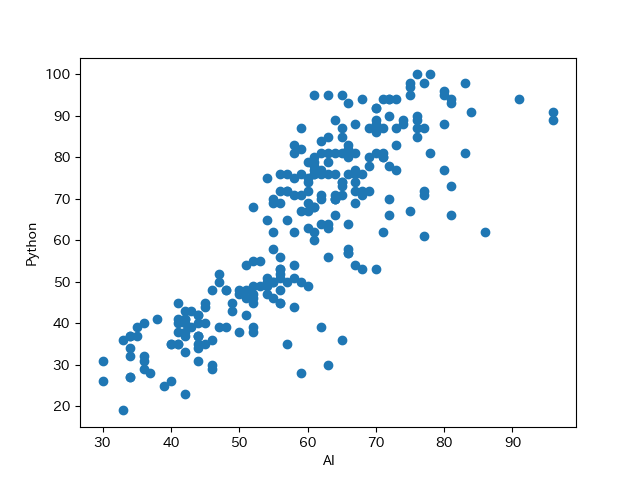
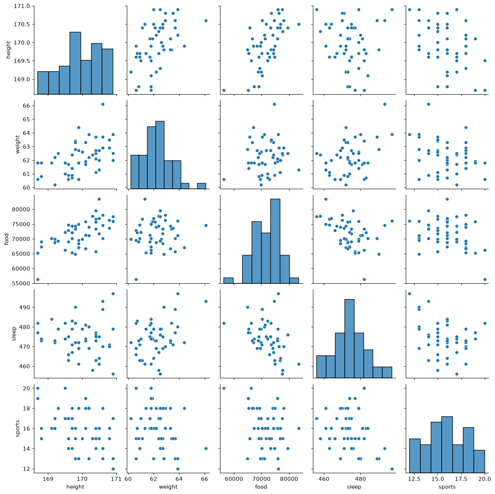
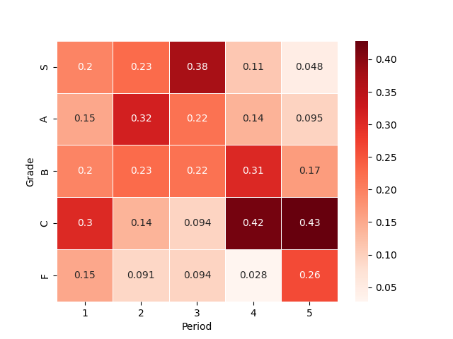

## 散布図 {#scatter}

これまではデータの各観測項目を独立に可視化してきました. 複数の観測項目の関係性を可視化する代表的な手法に散布図があります.

[こちら](https://github.com/yakagika/yakagika.github.io/blob/main/slds_data/ch8/scatter.csv)のデータは Google トレンドにおける同時期の `AI` というワードの検索量と, `Python` というワードの検索量を表しています.

~~~ sh
     AI  Python
0    34      27
1    40      26
2    59      28
3    46      29
4    36      29
..   ..     ...
255  58      83
256  69      87
257  59      82
258  62      84
259  59      87
~~~

この 2 つの検索量がどのような関係にあるのかを散布図を用いて確認してみましょう.
散布図は `plt.scatter(x軸の値のリスト,y軸の値のリスト)` の形で作成できます.

~~~ py
df = pd.read_csv('data/scatter.csv')
#散布図のx軸を指定
x_column = 'AI'
#散布図のy軸を指定
y_column = 'Python'

x_value = df[x_column]
y_value = df[y_column]
plt.scatter(x_value, y_value)
plt.ylabel(y_column)
plt.xlabel(x_column)
plt.show()
~~~

散布図を見ると, `AI` に関する検索量が増えるにつれて, `Python` の検索量が増えるという関係が見えてきます.

この関係の度合いを数値化する**相関係数**や, 関係の仕方を説明する**回帰分析**に関しては後ほど扱います.

この節に対応する演習は, 章末の[Exercise DSP3-3](#exercise-dsp3-3)です.

# 散布図行列(ペアプロット) {#scatter-matrix}

散布図は 2 つの量的データの関係を見る手法でしたが, 観測項目が 3 つ以上あると, どの項目とどの項目の間に関係があるのかを一枚の散布図では表せません. そこで, **すべての量的データの組み合わせについて散布図を一度に並べた**ものが**散布図行列 (ペアプロット)**です.

[積み上げ棒グラフ](block:vis-basic#stacked-bar)で使った都道府県別のデータ ([こちら](https://github.com/yakagika/yakagika.github.io/blob/main/slds_data/ch8/pref_stats.csv)) で, 平均身長 (`height`), 体重 (`weight`), 食費 (`food`), 睡眠時間 (`sleep`), 運動時間 (`sports`) の散布図行列を描きます (`pref` 列が都道府県名).

~~~ sh
      height  weight   food  sleep  sports
pref
北海道   170.4    63.7  65739    477      15
青森県   169.8    62.8  64889    490      13
岩手県   170.6    63.7  70156    489      13
..       ...     ...    ...    ...     ...
鹿児島県  169.7    61.4  65377    479      18
沖縄県   168.7    60.6  56298    482      20
~~~

散布図行列は `seaborn` の `.pairplot()` メソッドを使うと, データフレームを渡すだけで作成できます. 数値の列がすべて自動的に対象になります.

~~~ py
# pref 列を見出し(index)として読み込みます.
# このファイルはBOM付きUTF-8なので encoding='utf-8-sig' を指定します.
df = pd.read_csv('data/pref_stats.csv', encoding='utf-8-sig', index_col='pref')
# データフレームを渡すだけで,全組み合わせの散布図が作成されます.
sns.pairplot(df)
plt.show()
plt.close()
~~~

**対角線上**には各項目単体の**ヒストグラム**が, **対角線以外**にはその行と列の項目を軸にした**散布図**が並びます. これによって, 例えば「食費 (`food`) が多い都道府県ほど平均身長 (`height`) が高い傾向がある」といった項目間の関係を, 一度に見渡すことができます.

各組み合わせの関係の強さを数値で表す方法 (**相関係数**) は, [第4章](/lectures/dsp4.html)で詳しく扱います.

# ヒートマップ {#heatmap}

ヒートマップとは, 表形式の数値を各セルの色によって表現する可視化手法です. 2 つの質的データの組み合わせごとに数えた表 (同時度数分布表) のような, 数値の並んだ表を一目で読めるようにします.

[こちら](https://github.com/yakagika/yakagika.github.io/blob/main/slds_data/ch8/cross_table_data.csv)のデータは, ある講義の学生ごとに, 受講した時限 (`Period`, 1〜5 時限) と成績 (`Grade`, S, A, B, C, F) を記録したものです. 時限ごとに各成績の学生が占める割合の表を作り, ヒートマップにします. 表の作り方は[同時度数分布表](block:vis-more#同時度数分布表)で詳しく扱います.

~~~ py
df = pd.read_csv('data/cross_table_data.csv')
# 成績 (行) と時限 (列) の組み合わせごとに数え,
# normalize='columns' で各列 (時限) の合計が 1 になる割合に直します.
cross = pd.crosstab(df['Grade'], df['Period'], normalize='columns')
cross = cross.reindex(['S','A','B','C','F'], axis='index')
print(cross)
~~~

~~~ sh
Period         1         2        3         4         5
Grade
S       0.195652  0.227273  0.37500  0.111111  0.047619
A       0.152174  0.318182  0.21875  0.138889  0.095238
B       0.195652  0.227273  0.21875  0.305556  0.166667
C       0.304348  0.136364  0.09375  0.416667  0.428571
F       0.152174  0.090909  0.09375  0.027778  0.261905
~~~

ヒートマップは `seaborn` の `.heatmap()` を利用することで簡単に作成できます.

~~~ py
sns.heatmap( cross  #ヒートマップを作成したいテーブル
           , cmap=plt.get_cmap('Reds') #カラーマップ(省略可)
           , linewidths=.5 #線の太さを指定することでセルを囲う線を表示
           , annot=True  #セルに数値を表示
           )
plt.show()
~~~

このヒートマップでは, 数値が大きいほど, 色が濃くなっており 2, 3 時限において B 以上の成績を取る学生の割合が大きいこと, 4, 5 時限において C や F などの成績を取る人の割合が大きいことが視覚的に分かります.

ヒートマップは複数の数値間の相関係数や距離を可視化する際にも良く用いられるので, 覚えておきましょう.

この節に対応する演習は, 章末の[Exercise DSP3-3](#exercise-dsp3-3)です.

# []{#演習}演習 {#exercises}

## Exercise DSP3-3 {#exercise-dsp3-3}

**複数のグループを折れ線・散布図・ヒートマップで比べる**

対応する節: [折れ線グラフ](block:vis-basic#line), [散布図](#scatter), [ヒートマップ](#heatmap), [for 文を利用したグラフ](block:vis-design#for-graph), [グラフの分割](block:vis-design#グラフの分割)

問 1 では, 授業では扱わない (発展) の節を使います.

1. [Google トレンド](https://trends.google.co.jp/trends/)で 4 つのワードの同じ期間の推移を調べ, CSV をダウンロードしてください. この CSV から, [for 文を利用したグラフ](block:vis-design#for-graph)と[グラフの分割](block:vis-design#グラフの分割)を使って, 次の 2 通りの折れ線グラフを作成してください.
    - 1 つのグラフに表示: for 文で 4 本の折れ線を色を変えて重ね, 凡例も表示する.
    - グラフの分割: グラフを 4 つに分割し, ワードごとの折れ線グラフを 1 つずつ描く.
2. [こちら](https://github.com/yakagika/yakagika.github.io/blob/main/slds_data/ch8/beetle_datal.csv)のカブトムシの種類別の体長と体重のデータを使って[散布図](#scatter)を作成してください. カブトムシの種類別に, 点の色と形を変えてください.
3. [こちら](https://github.com/yakagika/yakagika.github.io/blob/main/slds_data/ch8/forest_beetle_data.csv)の森の地点別に採取できたカブトムシの種類を記録したデータを[ヒートマップ](#heatmap)で可視化し, どの森でどのカブトムシが採れやすいかを分析してください.

提出ファイル名: `dsp3-3.py`

    
 回答例 

~~~ py
import pandas as pd
import matplotlib.pyplot as plt
import seaborn as sns
import matplotlib_fontja

# 問1: Google トレンドの CSV は先頭の 2 行が説明なので, skiprows=2 で読み飛ばします.
# (ダウンロードした CSV の先頭を確認し, 説明の行数に合わせて調整します.)
trends = pd.read_csv('data/trends.csv', skiprows=2, index_col=0, parse_dates=True)

# 1 つのグラフに表示: for 文で列ごとに折れ線を重ね, 凡例を付けます.
for word in trends.columns:
    plt.plot(trends.index, trends[word], label=word)
plt.ylabel('検索の相対的な人気度')
plt.legend()
plt.xticks(rotation=15)
plt.show()

# グラフの分割: 2 行 2 列に分け, それぞれにワードを 1 つずつ描きます.
fig, axes = plt.subplots(nrows=2, ncols=2, sharex=True, sharey=True)
for ax, word in zip(axes.flatten(), trends.columns):
    ax.plot(trends.index, trends[word])
    ax.set_title(word)
plt.show()

# 問2: 種類ごとに色と点の形を変えて重ねます.
beetle = pd.read_csv('data/beetle_datal.csv')
markers = ['o', 's', '^', 'D']
for (name, group), marker in zip(beetle.groupby('Type'), markers):
    plt.scatter(group['Length'], group['Weight'], marker=marker, label=name)
plt.xlabel('体長 (mm)')
plt.ylabel('体重 (g)')
plt.legend()
plt.show()

print(beetle[['Length', 'Weight']].corr().round(2))
print(beetle.groupby('Type')[['Length', 'Weight']].mean().round(1))

# 問3: 森 (行) と種類 (列) の組み合わせごとに数え, ヒートマップにします.
forest = pd.read_csv('data/forest_beetle_data.csv')
cross = pd.crosstab(forest['Location'], forest['Type'])
print(cross.to_string())

sns.heatmap(cross, cmap=plt.get_cmap('Reds'), linewidths=.5, annot=True, fmt='d')
plt.show()
~~~

~~~ sh
        Length  Weight
Length    1.00    0.65
Weight    0.65    1.00
                      Length  Weight
Type
Allomyrina dichotoma    50.2    21.0
Chalcosoma atlas        51.3    19.7
Dynastes hercules       47.9    19.8
Megasoma elephas        49.5    20.5
Type      Allomyrina dichotoma  Chalcosoma atlas  Dynastes hercules  Megasoma elephas
Location
Forest A                    47                11                 12                 6
Forest B                    14                 9                 43                 8
Forest C                    11                 7                  8                49
Forest D                    11                54                 11                 8
~~~

問 1: 同じデータを, 1 つのグラフに重ねる描き方と, ワードごとに分ける描き方で表しています. 重ねると 4 本の水準の違いを直接比べられ, 分けると 1 本ごとの上下の動きが読み取りやすくなります. 分割では `sharex=True, sharey=True` で軸をそろえているので, 分けても水準の違いは比べられます.

問 2: 体長が大きいほど体重も大きい傾向があります (相関係数 0.65). 一方, 4 種類の点は重なり合っていて, 種類ごとの平均も体長 48〜51 mm, 体重 20〜21 g と近いため, 種類による違いはこの図からほとんど読み取れません.

問 3: 森ごとに最も多く採れる種類が異なります. Forest A は Allomyrina dichotoma (47 個体), Forest B は Dynastes hercules (43 個体), Forest C は Megasoma elephas (49 個体), Forest D は Chalcosoma atlas (54 個体) が最も多く, 他の種類は 6〜14 個体にとどまります. 各森の採取数は 74〜84 個体と大きく違わないので, 個体数のまま比べられます.

