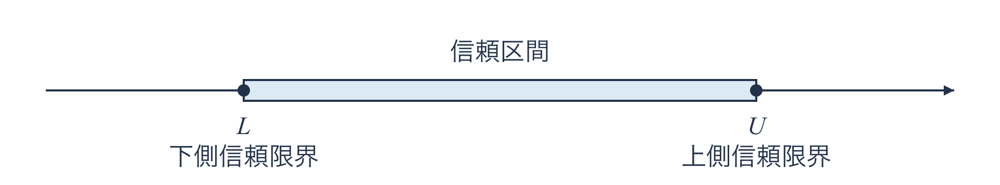
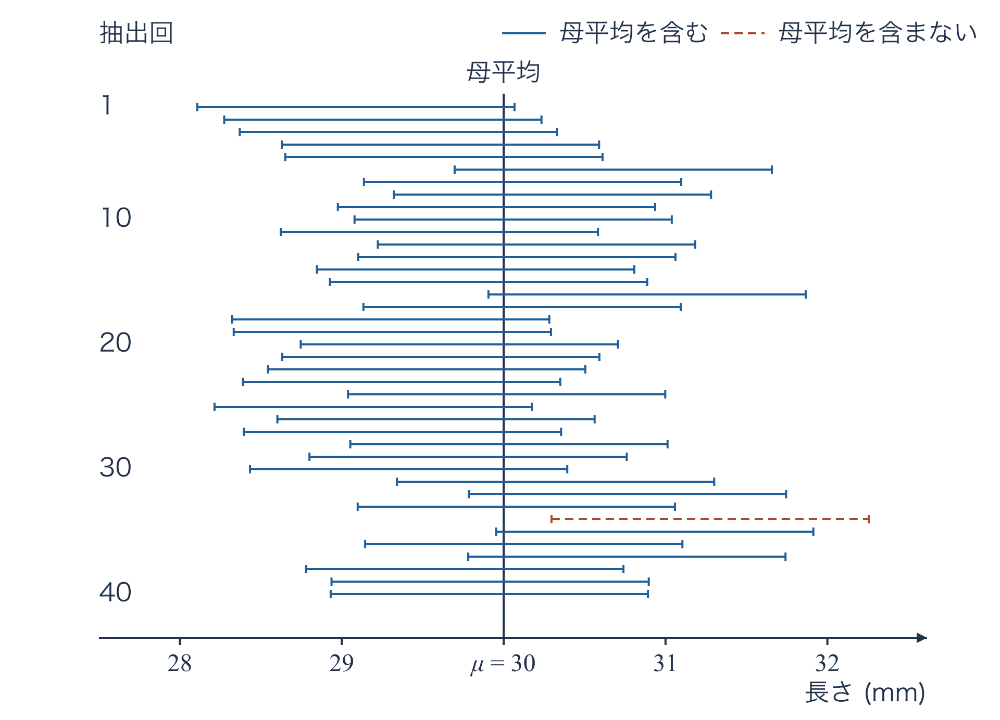
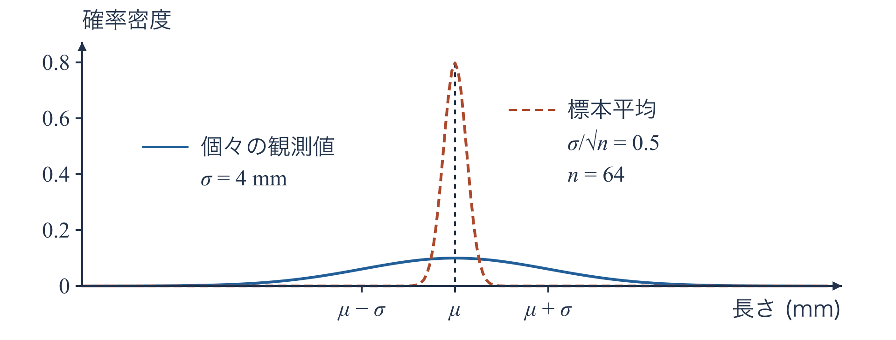
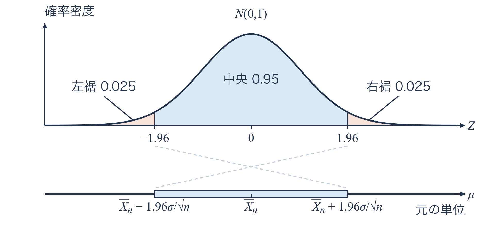

[点推定](block:inf-point#unbiased-estimation)では, 標本平均などを使って母数を一つの数で推定しました. 同じ母集団から標本を取り直すと標本平均も変わるので, そのばらつきを考慮して母数を区間で推定できます. 区間を作る手順の性質を定めてから, 母平均, 母分散, 比率や回数の分布の母数について信頼区間を求めます.

| 記号 | 意味 |
| --- | --- |
| $\theta$ | 推定したい母数 |
| $L$, $U$ | 標本から計算する下側信頼限界と上側信頼限界 |
| $1-\alpha$ | 信頼係数. $0<\alpha<1$ で, 厳密な手順では $\alpha$ は区間が母数を含まない確率の上限 |
| $\bar x_n$ | 標本平均 $\bar X_n$ の観測値 |
| $S$, $u$ | 標本分散 $S^2$ と不偏分散 $u^2$ のそれぞれの平方根 |
| $z_{\alpha/2}$ | 標準正規分布の上側確率が $\alpha/2$ となる分位点 |
| $t_{\alpha/2}(n-1)$ | 自由度 $n-1$ の $t$ 分布の上側確率が $\alpha/2$ となる分位点 |

# 信頼区間の意味 {#confidence-interval}

標本から計算する下限 $L$ と上限 $U$ を, それぞれ**下側信頼限界**, **上側信頼限界**と呼びます. 観測前には両端が確率変数です. 母数 $\theta$ を固定したとき, 両端が

$$
P(L\leq\theta\leq U)\geq 1-\alpha
$$

を満たすように定めます. $1-\alpha$ を**信頼係数**, $[L,U]$ を **$100(1-\alpha)\%$ 信頼区間**と呼びます. 例えば, $\alpha=0.05$ なら $95\%$, $\alpha=0.01$ なら $99\%$ の信頼区間です. 区間が母数を含む確率を**被覆確率**と呼びます. 以下の厳密な手順では被覆確率を $1-\alpha$ に等しくします. 近似信頼区間では, $1-\alpha$ は被覆確率の目標値です. 次の模式図では, 下側信頼限界 $L$ から上側信頼限界 $U$ までを帯で示します. 両端の点も信頼区間に含まれます.

{.wide}

被覆確率が $0.95$ の手順を使い, 同じ母集団から同じ大きさの標本を独立に取り直すと, 標本ごとに区間の位置が変わります. 次の模式図では, 固定された母平均 $\mu$ の位置を縦線で示し, 1 回の抽出から得た区間を 1 本の横線で示します. 抽出を何度も繰り返すと, 縦線と交わる区間の割合は $0.95$ に近づきます. 100 回の抽出で母平均を含む区間の本数にもばらつきがあり, その期待値は 95 本です.

{.wide}

::: warn
**注意. 観測後の区間の解釈**

実際の観測値を代入すると, 区間の両端は数値に決まります. 母数も固定されているので, 得られた区間は母数を含むか, 含まないかのいずれかです. $95\%$ は抽出前の手順についての確率です.
:::

母集団, 母数, 標本抽出の用語は [Exercise INF-INTERVAL-1](#exercise-inf-interval-1) で確認できます. 母平均の信頼区間を作るには, 区間の中心に使う標本平均のばらつきを確率で表す必要があります.

# 母分散が既知のときの母平均 {#mean-known-variance}

母平均 $\mu$ と有限な母分散 $\sigma^2>0$ を持つ母集団分布から, $X_1,\ldots,X_n$ を独立に抽出します. [標本平均の分布と中心極限定理](block:prob-clt#central-limit-theorem)で求めたように, $E(\bar X_n)=\mu$, $V(\bar X_n)=\sigma^2/n$ です. 母集団が正規分布 $N(\mu,\sigma^2)$ なら, 独立な正規変数の和も正規分布に従うという再生性により, $\bar X_n$ は任意の $n$ で厳密に $N(\mu,\sigma^2/n)$ に従います. 母集団が非正規の場合は, 標本サイズが十分大きいときに中心極限定理を使って同じ正規分布で近似します. 個々の観測値と標本平均は同じ測定単位を持ちますが, 標準偏差はそれぞれ $\sigma$ と $\sigma/\sqrt n$ です. 次の模式図では, 正規分布でモデル化した部品の長さについて, $\sigma=4\,\mathrm{mm}$, $n=64$ の場合を比べます. 二つの曲線は同じ $\mu$ を中心とし, 標本平均の密度は個々の観測値の密度よりも $\mu$ の近くに集中しています.

{.wide}

ここでは母集団が正規分布に従い, 母標準偏差 $\sigma$ が既知とします. 標本平均から $\mu$ を引き, その標準偏差 $\sigma/\sqrt n$ で割ると, 測定単位を持たない標準正規変数 $Z$ が得られます.

$$
Z=\frac{\bar X_n-\mu}{\sigma/\sqrt n}\sim N(0,1).
$$

$Z$ の分布が左右対称なので, 中央の確率を $0.95$ にするには左右の裾に $0.025$ ずつ残します. 標準正規分布の分布関数を $\Phi(z)=P(Z\leq z)$ とすると, [標準正規分布の数値表](block:prob-normal#normal-probabilities)が載せるのは, $0$ から正の値 $z$ までの確率 $\Phi(z)-0.5$ です. 右半分の確率 $0.5$ から右の裾の $0.025$ を引き, 表の中で $0.4750$ を探します. 行の $1.9$ と列の $0.06$ を足すと $1.96$ です. したがって $z_{0.025}\approx 1.96$ で, $P(-1.96\leq Z\leq 1.96)\approx 0.95$ となります.

左の裾にも同じ確率があるため, 一般の信頼係数では $P(-z_{\alpha/2}\leq Z\leq z_{\alpha/2})=1-\alpha$ です. この不等式に $Z$ の式を入れ, 3 項に正の数 $\sigma/\sqrt n$ を掛けます. 次に不等式を $\mu$ について解くと, $\mu$ の係数が $-1$ なので両端の順序が入れ替わります.

$$
\begin{aligned}
-z_{\alpha/2}\frac{\sigma}{\sqrt n}
&\leq \bar X_n-\mu
\leq z_{\alpha/2}\frac{\sigma}{\sqrt n} \\
\Longleftrightarrow\quad
\bar X_n-z_{\alpha/2}\frac{\sigma}{\sqrt n}
&\leq \mu
\leq \bar X_n+z_{\alpha/2}\frac{\sigma}{\sqrt n}.
\end{aligned}
$$

上段は標準化した量 $Z$ が中央に入る事象を元の測定単位で表し, 下段は同じ事象を, 母平均が標本から計算した区間に入る形で表しています. 次の模式図では, $\mu$ について不等式を解いたときの端点の対応を破線で示します. $Z$ の右端 $1.96$ からは下側信頼限界が, 左端 $-1.96$ からは上側信頼限界が得られます.

{.wide}

観測後は, 両端の式に実際の標本平均 $\bar x_n$ を代入します. 例えば工場で作る部品の長さを, 平均が未知, 母標準偏差が $4\,\mathrm{mm}$ の正規分布でモデル化します. 独立に抽出した 64 個の部品で標本平均が $30\,\mathrm{mm}$ なら, 標本平均の標準偏差は $4/\sqrt{64}=0.5\,\mathrm{mm}$ です. $95\%$ 信頼区間の半幅は $1.96(0.5)=0.98\,\mathrm{mm}$ で, 区間は $[29.02,30.98]\,\mathrm{mm}$ になります. 母標準偏差が分からない場合は, この計算に必要な標準偏差も標本から推定します.

# 母分散が未知のときの正規母集団の母平均 {#mean-unknown-normal}

母集団が $N(\mu,\sigma^2)$ に従い $\sigma$ が未知なら, 独立な $n\geq 2$ 個の観測から計算する不偏分散の平方根 $u$ を使います. $u$ は標本ごとに変わるので, 分母に $u/\sqrt n$ を使った**$t$ 統計量**は次の分布に従います.

$$
T=\frac{\bar X_n-\mu}{u/\sqrt n}\sim t(n-1).
$$

自由度が $n-1$ になるのは, 各観測値と標本平均の差を足すと $0$ になり, $n$ 個の差のうち $n-1$ 個が決まれば残りの 1 個も決まるためです. 分布の定義は [$t$ 分布](block:prob-sampling#t-distribution), 標本平均と不偏分散からの導出は[正規標本から得られる $t$ 分布](block:prob-sampling#t-from-normal-sample)にあります.

$95\%$ 信頼区間には, 左右の裾に $0.025$ ずつ残す分位点を使います. [片側 $t$ 分布表](block:prob-sampling#one-sided-t-table)の自由度 $n-1$ の行と, 上側確率 $0.025$ の列の交点を読みます. 例えば $n=20$ では, 自由度 $19$ の行から $t_{0.025}(19)\approx 2.093$ と読めます. $u/\sqrt{20}$ が同じなら, この分位点で得られる区間の半幅は $1.96$ を使った場合より約 $6.8\%$ 大きくなります. 自由度ごとの分位点と正規近似の差は[自由度と $t$ 分布の上側確率](block:prob-sampling#t-quantiles)に示されています.

一般に $t_{\alpha/2}(n-1)$ の左右に対称な値を取り,

$$
P\bigl(-t_{\alpha/2}(n-1)\leq T\leq t_{\alpha/2}(n-1)\bigr)=1-\alpha
$$

とします. [母分散が既知のときの母平均](#mean-known-variance)と同じ変形で $\mu$ について解くと, 次の不等式が得られます.

$$
\bar X_n-t_{\alpha/2}(n-1)\frac{u}{\sqrt n}
\leq \mu \leq
\bar X_n+t_{\alpha/2}(n-1)\frac{u}{\sqrt n}.
$$

観測後は $\bar X_n$ と $u$ に実際の値を入れます. $n=20$ の $95\%$ 信頼区間なら, 両端は $\bar x_{20}\pm 2.093\,u/\sqrt{20}$ です. 正規標本に基づく $t$ 区間は, $n$ が大きい場合にも同じ手順で求められます.

::: note
**補足. 二つの分母による標準偏差の換算**

[標本平均と不偏分散](block:inf-point#unbiased-estimation)で示した $S^2=(n-1)u^2/n$ から, $u=\sqrt{n/(n-1)}\,S$ です. 報告値が分母 $n$ で計算した $S$ なら, この式で $u$ を求めます. 分母 $n-1$ で計算した分散の平方根が報告されていれば, その値を $u$ として使えます.
:::

例えば, 工場で加工した木材の長さは正規分布に従うと仮定し, 母分散は未知とします. 独立に抽出した木材 10 本の標本平均が $500\,\mathrm{cm}$, 分母 $n$ で計算した標本標準偏差が $3\,\mathrm{cm}$ なら, $u=\sqrt{10/9}\,(3\,\mathrm{cm})$ です. したがって $u/\sqrt{10}=1\,\mathrm{cm}$ です. 自由度 $9$ の上側 $0.025$ 点は $2.262$ なので, $95\%$ 信頼区間は $[497.738,502.262]\,\mathrm{cm}$ です. 同じ換算を使う [Exercise INF-INTERVAL-3](#exercise-inf-interval-3) では, 標本サイズが大きいときの正規近似と $t$ 区間も比べます.

# 母平均の区間推定に使う分布の選び方 {#mean-methods}

母平均の区間推定では, 母集団の形, 母分散が既知かどうか, 標本サイズによって, 標本平均を標準化する式と参照する分布が決まります. 下の表は, これらの条件を組み合わせ, 正規分布や $t$ 分布を使える場合を厳密な場合と近似の場合に分けて整理したものです. いずれの行も, 同じ母集団分布から独立に抽出し, 母分散は正で有限とします.

| 母集団分布 | 母分散 | 標本サイズ | 区間の半幅と参照する分布 |
| --- | --- | --- | --- |
| 正規 | 既知 | 任意の $n$ | $z_{\alpha/2}\sigma/\sqrt n$ (標準正規分布, 厳密) |
| 正規 | 未知 | 小さい ($n\geq 2$) | $t_{\alpha/2}(n-1)u/\sqrt n$ ($t$ 分布, 厳密) |
| 正規 | 未知 | 大きい | $t_{\alpha/2}(n-1)u/\sqrt n$ ($t$ 分布, 厳密). $z_{\alpha/2}u/\sqrt n$ でも近似できます. |
| 非正規 | 既知 | 大きい | $z_{\alpha/2}\sigma/\sqrt n$ (標準正規分布, 近似) |
| 非正規 | 未知 | 大きい | $z_{\alpha/2}u/\sqrt n$ (標準正規分布, 近似) |
| 非正規 | 既知 | 小さい | 標本平均から作る量に, この表の分布を適用する根拠がありません. |
| 非正規 | 未知 | 小さい | 標本平均から作る量に, この表の分布を適用する根拠がありません. |

母集団が非正規で母分散が未知の場合は, [中心極限定理](block:prob-clt#central-limit-theorem)により $(\bar X_n-\mu)/(\sigma/\sqrt n)$ が標準正規分布に近づきます. $u$ は標本サイズが大きいときに $\sigma$ に近づくので, 分母を $u/\sqrt n$ に替えても, 標準化した量は分布として標準正規分布に近づきます. 近似区間の両端は $\bar x_n\pm z_{\alpha/2}u/\sqrt n$ です.

::: warn
**注意. 正規近似に必要な標本サイズ**

$n\geq 30$ は授業で使う目安です. 非正規の母集団では, 歪みや裾の重さによって標本平均の正規近似に必要なサイズは変わります. 表で標準正規分布や $t$ 分布を適用する根拠がない場合でも, 母集団分布について別の仮定を置けば, その仮定に基づく区間推定を検討できます.
:::

母集団分布と母分散の条件に応じて分布を選ぶ練習は [Exercise INF-INTERVAL-2](#exercise-inf-interval-2) で行います. 母分散自体を推定するときは, 標本平均のばらつきに代えて不偏分散のばらつきを使います.

# 母分散と母分散の比 {#variance-intervals}

正規母集団から独立に抽出した標本では, 母分散を含む量の分布が分かるので, その分布の分位点から区間を作れます. 一つの母集団なら不偏分散を, 二つの母集団なら不偏分散の比を使います.

| 推定の対象 | 区間を作るのに使う標本の量 | 参照する分布 |
| --- | --- | --- |
| 一つの正規母集団の母分散 | 不偏分散 $u^2$ | カイ二乗分布 |
| 二つの正規母集団の母分散の比 | 独立な標本の不偏分散の比 $u_1^2/u_2^2$ | $F$ 分布 |

## 一つの母分散 {#population-variance}

母分散 $\sigma^2>0$ の正規母集団から得た独立な $n\geq 2$ 個の観測について, [正規標本の不偏分散の分布](block:prob-sampling#t-from-normal-sample)で得た量を使います. $Q=(n-1)u^2/\sigma^2$ は自由度 $n-1$ の[カイ二乗分布](block:prob-sampling#chi-square) $\chi^2_{n-1}$ に従います.

$Q$ の下側に確率 $\alpha/2$ を残す小さい点を $q_{\mathrm{L}}$, 上側に確率 $\alpha/2$ を残す大きい点を $q_{\mathrm{U}}$ とします. $P(q_{\mathrm{L}}\leq Q\leq q_{\mathrm{U}})=1-\alpha$ です. 不等式に $\sigma^2>0$ を掛け, 正の分位点で割って $\sigma^2$ の範囲を求めます.

$$
q_{\mathrm{L}}\leq\frac{(n-1)u^2}{\sigma^2}\leq q_{\mathrm{U}}
\quad\Longleftrightarrow\quad
\frac{(n-1)u^2}{q_{\mathrm{U}}}\leq \sigma^2\leq
\frac{(n-1)u^2}{q_{\mathrm{L}}}.
$$

不偏分散の観測値を代入すると, 母分散の信頼区間が得られます. 大きい分位点 $q_{\mathrm{U}}$ で割った値が下側信頼限界で, 小さい分位点 $q_{\mathrm{L}}$ で割った値が上側信頼限界です.

## 二つの母分散の比 {#variance-ratio}

母分散 $\sigma_1^2,\sigma_2^2>0$ を持つ二つの正規母集団から, 互いに独立な標本を得たとします. 各標本内の観測も独立とし, 標本サイズを $n_1,n_2\geq 2$, 不偏分散を $u_1^2,u_2^2$ とします. 不偏分散を対応する母分散で割った量は, カイ二乗変数をそれぞれの自由度で割った量です. この二つの量の比は, [$F$ 分布の定義](block:prob-sampling#f-distribution)から

$$
R=\frac{u_1^2/\sigma_1^2}{u_2^2/\sigma_2^2}
=\frac{u_1^2/u_2^2}{\sigma_1^2/\sigma_2^2}
\sim F(n_1-1,n_2-1)
$$

となります. これが母分散の比を推定するのに使う標本分布です. $R$ の下側と上側にそれぞれ確率 $\alpha/2$ を残す点を $f_{\mathrm{L}}$, $f_{\mathrm{U}}$ とすると, $P(f_{\mathrm{L}}\leq R\leq f_{\mathrm{U}})=1-\alpha$ です. 母分散の場合と同様に不等式を解くと, 母分散比の信頼区間の両端は $(u_1^2/u_2^2)/f_{\mathrm{U}}$ と $(u_1^2/u_2^2)/f_{\mathrm{L}}$ です. 下限と上限の計算では, 標本 1 を分子, 標本 2 を分母にした順序に従って分位点を選びます.

# 母比率とポアソン分布の平均 {#count-intervals}

観測結果が成功・失敗なら, 知りたい母数は成功の確率です. 一定時間内の発生回数を観測する場合は, その時間当たりの平均回数が母数になります. どちらも標本平均を使って推定できますが, 標準誤差 (推定量の標準偏差) の式は元の観測値の分散で決まります.

| 観測値のモデル | 推定する母数 | 標準誤差の推定値 |
| --- | --- | --- |
| 独立なベルヌーイ試行 | 成功確率 $p$ | $\sqrt{\hat p(1-\hat p)/n}$ |
| 独立なポアソン変数 | 同じ長さの観測期間当たりの平均回数 $\lambda$ | $\sqrt{\bar X_n/n}$ |

## 母比率の区間 {#population-proportion}

成功確率が共通して $0<p<1$ である独立な試行を $n$ 回行い, 成功回数を $n$ で割った[標本比率](block:inf-point#sample-proportion) $\hat p$ を求めます. $\hat p$ の平均は $p$, 分散は $p(1-p)/n$ です. [二項分布の正規近似](block:prob-clt#binomial-normal-approximation)により, $n$ が十分大きいときはこの平均と分散を持つ正規分布で $\hat p$ の分布を近似できます. 未知の $p$ を標準誤差の式の中で $\hat p$ に替えると, 母比率の近似信頼区間は

$$
\left[
\hat p-z_{\alpha/2}\sqrt{\frac{\hat p(1-\hat p)}{n}},
\ \hat p+z_{\alpha/2}\sqrt{\frac{\hat p(1-\hat p)}{n}}
\right]
$$

となります. 実際の区間を計算するときは, $\hat p$ に観測した標本比率を代入します.

## 平均発生回数の区間 {#poisson-mean}

同じ長さの観測期間ごとの発生回数 $X_1,\ldots,X_n$ が, 互いに独立に平均 $\lambda>0$ の[ポアソン分布](block:prob-discrete#poisson-distribution) $\mathrm{Po}(\lambda)$ に従うとします. ポアソン分布の分散は平均と同じ $\lambda$ なので, 標本平均 $\bar X_n$ の標準偏差は $\sqrt{\lambda/n}$ です. 標本サイズが十分大きいとき, 中心極限定理を使い, 標準偏差の式の中の $\lambda$ を $\bar X_n$ に替えます. 観測した標本平均が $\bar x_n$ なら, 両端が $\bar x_n\pm z_{\alpha/2}\sqrt{\bar x_n/n}$ の近似信頼区間が得られます.

::: warn
**注意. 回数が少ない場合の正規近似**

成功か失敗のどちらかが少ない場合や, ポアソン変数の合計が小さい場合は, 正規近似による被覆確率が信頼係数から大きくずれることがあります. 例えば成功回数や発生回数が $0$ なら, 上の式の区間の幅は $0$ になります. そのような標本では, 二項分布やポアソン分布の確率を直接使う方法を検討します.
:::

# 演習 {#exercises}

集団と標本に関する用語を確かめ, 母平均を区間で推定する手法を選びます.

## Exercise INF-INTERVAL-1 {#exercise-inf-interval-1}

**母集団と標本抽出の用語**

図書館が所蔵する本のページ数について調べます. 次の文の (1) から (7) に当てはまる用語を答えてください.

調べたい本の全体を (1), 全冊を調べることを (2) と呼びます. 全冊の平均ページ数など, 集団の性質を表す値は (3) です. 集めた本のページ数をグラフや数値で要約するのは (4) 統計の役割で, その記録から全冊の平均ページ数を推定するのは (5) 統計の役割です. 司書が蔵書についての知識に基づいて調べる本を選ぶ方法を (6), 乱数などを使って確率の規則に従って選ぶ方法を (7) と呼びます.

回答

(1) 母集団, (2) 全数調査 (悉皆調査), (3) 母数, (4) 記述, (5) 推測, (6) 有意抽出, (7) 無作為抽出です. 抽出方法の違いは[母集団分布と標本抽出](block:inf-population#population-and-sampling)で確認できます.

## Exercise INF-INTERVAL-2 {#exercise-inf-interval-2}

**母平均の信頼区間で参照する分布**

次の条件ごとに, 標本平均から母平均の信頼区間を求めるときに使う分布を答えてください. 区間が厳密か近似か, 分母に $\sigma/\sqrt n$ と $u/\sqrt n$ のどちらを使うかも答えてください. どの場合も独立な標本で, 母分散は正で有限とします.

| 条件 | 母集団分布 | 母分散 | 標本サイズ |
| --- | --- | --- | --- |
| A | 正規 | 未知 | 小さい ($n\geq 2$) |
| B | 正規 | 既知 | 任意 |
| C | 非正規 | 既知 | 正規近似に十分な大きさ |
| D | 非正規 | 未知 | 正規近似に十分な大きさ |

回答

A は自由度 $n-1$ の $t$ 分布を使います. 分母は $u/\sqrt n$ で, 区間は厳密です. B は標本平均が正規分布に従うので, 分母を $\sigma/\sqrt n$ として標準正規分布を使います. 区間は厳密です. C と D は中心極限定理に基づく正規近似を使うため, いずれも近似区間です. 母標準偏差が分かっている C では $\sigma/\sqrt n$, 未知の D では $u/\sqrt n$ を使います.

## Exercise INF-INTERVAL-3 {#exercise-inf-interval-3}

**小学一年生の平均身長**

ある年度の日本の小学一年生を対象とする仮想の調査で, 身長の母集団分布を正規分布と仮定します. 37 人の身長を独立に観測し, 標本平均は $150\,\mathrm{cm}$, 分母を $n$ として計算した標本標準偏差は $3\,\mathrm{cm}$ でした. 母分散は未知です. $t$ 分布を使って母平均の $95\%$ 信頼区間を求め, 標準正規分布を使った近似区間と比べてください.

回答

$\bar x_{37}=150\,\mathrm{cm}$, $S=3\,\mathrm{cm}$ なので, $u=\sqrt{37/36}\,(3\,\mathrm{cm})$, $u/\sqrt{37}=0.5\,\mathrm{cm}$ です. [片側 $t$ 分布表](block:prob-sampling#one-sided-t-table)で自由度 $36$ の行の上側 $0.025$ の列を読むと $t_{0.025}(36)\approx 2.028$ です. $t$ 分布を使う区間は

$$
[150-2.028(0.5),\ 150+2.028(0.5)]
=[148.986,\ 151.014]\quad(\mathrm{cm})
$$

です. 標準正規分布の上側 $0.025$ 点を $1.96$ とすると, 近似区間は $[149.02,150.98]\,\mathrm{cm}$ です. $t$ 分布を使った区間は, 近似区間よりも両端が約 $0.034\,\mathrm{cm}$ ずつ外に広がります.

