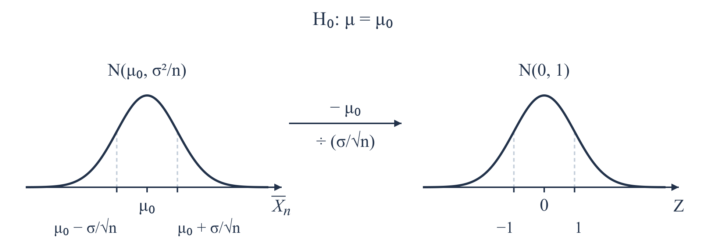
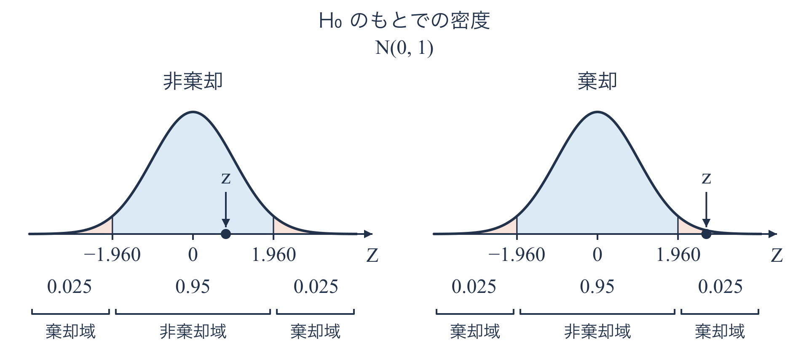
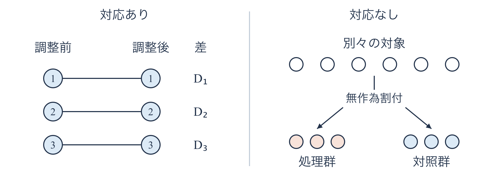

[仮説検定の論理](block:inf-testing#hypotheses)では, 紅茶を見分けた回数を使い, 帰無仮説のもとでの分布と比べました. 母平均の検定では標本平均を, 母分散の検定では不偏分散を使って検定統計量を作ります. 参照する分布は, 標本の取り方や, 母分散が既知かどうかによって変わります.

| 記号 | 意味 |
| --- | --- |
| $\mu_0$, $\sigma_0^2$ | 帰無仮説で指定する母平均と母分散 |
| $Z$, $z$ | 標準正規分布を参照する検定統計量とその観測値 |
| $z_a$, $t_a(\nu)$ | 標準正規分布と自由度 $\nu$ の $t$ 分布で, 上側確率が $a$ となる分位点 |
| 添字 $j=1,2$ | 2 標本の群. $n_j$, $\mu_j$, $\sigma_j^2$, $\bar X_{n_j,j}$, $u_j^2$ は群 $j$ の標本サイズ, 母平均, 母分散, 標本平均, 不偏分散 |
| $D_i$, $\bar D_n$, $u_D^2$, $\mu_D$ | 対応する 2 観測の差, 差の標本平均, 差の不偏分散, 差の母平均 |
| $u_{\mathrm{p}}^2$ | 共通の母分散を推定するために 2 群の不偏分散を合併した量 |
| $Q$, $R$ | 一つの母分散と二つの母分散の比を調べる検定統計量 |
| $q_{\mathrm{L}},q_{\mathrm{U}}$, $f_{\mathrm{L}},f_{\mathrm{U}}$ | カイ二乗分布と $F$ 分布で, 下側と上側にそれぞれ $\alpha/2$ の確率を残す分位点 |

# 母平均の検定手法を選ぶ条件 {#mean-test-methods}

一つの母集団の母平均を設定値と比べるときは **1 標本検定**, 二つの母集団の母平均を比べるときは **2 標本検定**を使います. 同じ対象を 2 回測った場合は, 対象ごとに差を取り, 差の母平均を 1 標本検定で調べられます.

母平均を検定するための分布は, [母平均の区間推定](block:inf-interval#mean-methods)で使ったものと対応します. 次の表は, 観測の対応, 母集団分布, 母分散について分かっていることを基準に, 本稿で使う検定を整理したものです. 対応のない 2 標本は群同士が独立とし, 1 標本, 各群, または対応ごとの差の中では観測が独立とします.

| 標本の構成 | 分布と母分散の条件 | 検定 |
| --- | --- | --- |
| 1 標本 | 正規母集団で分散が既知 | [1 標本 $Z$ 検定](#one-sample-z) |
| 1 標本 | 正規母集団で分散が未知 | [1 標本 $t$ 検定](#one-sample-t) |
| 1 標本 | 有限で正の母分散があり, 標本サイズが十分大きい | [正規近似による検定](#large-sample-mean) |
| 対応のある 2 標本 | 対応ごとの差が正規分布に従う | [対応のある $t$ 検定](#paired-t-test) |
| 独立な 2 標本 | 正規母集団で両群とも母分散が既知 | [2 標本 $Z$ 検定](#independent-z-test) |
| 独立な 2 標本 | 正規母集団で未知の共通分散を仮定する | [Student の $t$ 検定](#student-t-test) |
| 独立な 2 標本 | 正規母集団で母分散が未知, 共通分散を仮定しない | [Welch の $t$ 検定](#welch-t-test) |
| 独立な 2 標本 | 両群とも有限で正の母分散があり, 両標本サイズが十分大きい | [正規近似による 2 標本検定](#independent-z-test) |

正規母集団からの 1 標本では, 母分散が既知なら任意の $n$ で $Z$ 検定が使え, 未知なら $n\geq 2$ で $t$ 検定が使えます. 非正規で標本サイズが小さい場合は, 表の正規近似を適用する根拠を別に確かめる必要があります. 検定の手順は 1 標本から, 発展として 2 標本と母分散の検定へ進めます.

# 母分散が既知のときの 1 標本 Z 検定 {#one-sample-z}

母分散 $\sigma^2>0$ が既知の場合は, 標本平均の標準偏差も分かります. $X_1,\ldots,X_n$ は正規母集団 $N(\mu,\sigma^2)$ からの独立な標本とします. [母平均の区間推定](block:inf-interval#mean-known-variance)で使った標本平均の分布 $\bar X_n\sim N(\mu,\sigma^2/n)$ に, $H_0:\mu=\mu_0$ を当てはめます. 標本平均から $\mu_0$ を引き, 標準偏差 $\sigma/\sqrt n$ で割ると,
$$
Z=\frac{\bar X_n-\mu_0}{\sigma/\sqrt n}
\sim N(0,1) \qquad (H_0\text{ のもと})
$$
となります. 標本からは $\bar X_n$ に観測値 $\bar x_n$ を入れて $z$ を計算します.

標本平均を標準化する図では, $\bar X_n$ の分布の中心 $\mu_0$ が $Z$ の分布の $0$ に対応します. 元の尺度で中心から標準偏差 $\sigma/\sqrt n$ だけ離れた点は, 標準化後は $-1$ と $1$ になります.

{.wide}

分布が決まると, [検定の手順と p 値](block:inf-testing#p-value)に従い, 対立仮説の方向に合わせて境界を選べます. 棄却域の境界を**臨界値**と呼びます. $z_a$ は上側確率が $a$ となる分位点なので, [標準正規分布の数値表](block:prob-normal#normal-probabilities)で $0$ から正の $z_a$ までを読むときは $0.5-a$ を探します. $\alpha=0.05$ の両側検定では左右に $0.025$ ずつ残し, 中央の確率は $0.95$ です.

| 対立仮説 | 棄却域 | $\alpha=0.05$ の臨界値 | p 値 |
| --- | --- | --- | --- |
| $\mu\ne\mu_0$ | $\lvert z\rvert\geq z_{\alpha/2}$ | $\pm 1.960$ | $2[1-\Phi(\lvert z\rvert)]$ |
| $\mu>\mu_0$ | $z\geq z_\alpha$ | $1.645$ | $1-\Phi(z)$ |
| $\mu<\mu_0$ | $z\leq -z_\alpha$ | $-1.645$ | $\Phi(z)$ |

$\Phi$ は標準正規分布の分布関数です. 表の棄却域は丸める前の分位点で定めます. 片側検定で $H_0$ に $\mu\leq\mu_0$ または $\mu\geq\mu_0$ を含めても, 対応する裾の確率が最大になる境界 $\mu=\mu_0$ を使います. 両側検定で $z$ が正の臨界値を越えたとき, 帰無仮説のもとでそれ以上に極端な値を得る両側の確率は $\alpha$ より小さくなります.

両側 $Z$ 検定の図では, $z$ が中央の非棄却域にある例と右の棄却域にある例を比べています. 二つの例で臨界値は共通で, $z$ の位置によって判断が変わります.

{.wide}

$\mu>\mu_0$ の場合, 同じ統計量の分布の中心は $(\mu-\mu_0)/(\sigma/\sqrt n)>0$ になります. 中心が右に移るため, 右側の棄却域に入る確率は $\mu=\mu_0$ の場合より高くなります.

例えば, 照明器具の照度が基準値 $200\,\mathrm{lx}$ を上回るかを調べます. 照度は正規分布に従い, 母標準偏差は $10\,\mathrm{lx}$ と分かっているとします. $H_0:\mu\leq 200$, $H_1:\mu>200$ とし, 独立に選んだ 25 台の平均が $203.6\,\mathrm{lx}$ なら, $z=(203.6-200)/(10/\sqrt{25})=1.8$ です. 右片側の p 値は $1-\Phi(1.8)\approx 0.0359$ で, $z$ は上側 $0.05$ 点 $1.645$ も上回ります. 有意水準 $5\%$ で $H_0$ を棄却し, 母平均が基準値を上回ると判断します.

# 母分散が未知のときの 1 標本 t 検定 {#one-sample-t}

正規母集団でも母分散が未知なら, 標本平均の標準偏差 $\sigma/\sqrt n$ を直接計算できません. $n\geq 2$ の独立な正規標本から, 不偏分散 $u^2$ の平方根 $u$ を求めます. 母平均が $\mu_0$ であるという帰無仮説のもとで,
$$
T=\frac{\bar X_n-\mu_0}{u/\sqrt n}\sim t(n-1)
$$
です. [$t$ 分布の定義](block:prob-sampling#t-distribution)と[正規標本からの導出](block:prob-sampling#t-from-normal-sample)を参照してください. 分母 $n$ で計算した標本標準偏差 $S$ が与えられた場合は, [標準偏差の換算](block:inf-interval#mean-unknown-normal)で $u$ を求めます.

有意水準 $\alpha$ の両側検定では, $\lvert t\rvert\geq t_{\alpha/2}(n-1)$ なら $H_0$ を棄却します. 右片側と左片側に使う臨界値は, それぞれ $t_\alpha(n-1)$ と $-t_\alpha(n-1)$ です. [片側 $t$ 分布表](block:prob-sampling#one-sided-t-table)では同じ自由度の行で, 両側なら $\alpha/2$, 片側なら $\alpha$ の列を読みます. 有意水準を固定しても, 自由度が変わると臨界値が変わります.

例えば, 飲料の果汁含有率が $50\%$ と異なるかを調べます. 含有率が正規分布に従うと仮定し, 独立に選んだ 26 本の標本平均は $47.2\%$, 標本標準偏差 $S$ は 5 パーセントポイントとします. $H_0:\mu=50\%$, $H_1:\mu\ne 50\%$ です. 換算後の標準誤差は $u/\sqrt{26}=1$ パーセントポイントなので, $t=(47.2-50)/1=-2.8$ です. $t_{0.025}(25)\approx 2.060$ で, 両側の p 値は約 $0.00971$ です. 有意水準 $5\%$ で $H_0$ を棄却し, 母平均が $50\%$ と異なると判断します. 同じ換算と検定を [Exercise INF-MEAN-VARIANCE-TESTS-2](#exercise-inf-mean-variance-tests-2) で使います.

## 標本サイズが大きいときの正規近似 {#large-sample-mean}

$t(n-1)$ の分位点は, 自由度が大きくなると[標準正規分布の分位点](block:prob-sampling#t-quantiles)に近づきます. 正規母集団の母分散が未知なら, $n$ が大きい場合も厳密な参照分布は $t(n-1)$ です. 同じ統計量 $(\bar X_n-\mu_0)/(u/\sqrt n)$ を標準正規分布と比べれば, 近似的な検定ができます.

非正規母集団でも, 母分散が有限で正で, 標本サイズが十分大きければ, [母平均の区間推定に使う正規近似](block:inf-interval#mean-methods)と同じ条件で標準正規分布を参照できます. 母分散が既知なら分母は $\sigma/\sqrt n$, 未知なら $u/\sqrt n$ です. $n\geq 30$ は近似の目安です. 母集団の歪みや裾の重さによって必要な標本サイズは変わります. 両側検定で正規近似と $t$ 分布の臨界値を比べる例は [Exercise INF-MEAN-VARIANCE-TESTS-1](#exercise-inf-mean-variance-tests-1) にあります.

# 対応の有無と 2 標本の母平均 {#two-sample-design}

二つの平均を比べるときは, 測定の計画から観測に対応があるかを確認します. 同じ機器を調整前と調整後に測ると, 2 回の測定は機器ごとに対応します. 別々の対象を無作為に処理群と対照群へ割り付け, 各対象を 1 回測る計画では, 一方の群の観測に結び付く相手が決まっていません. **無作為割付**は乱数などで各対象の所属群を決める方法です. 対応の有無は観測の組を定める計画で決まり, 各群の標本サイズが等しいかどうかとは独立した条件です.

測定計画を比べた図では, 両方の計画で群ごとの観測数をそろえています. 左の計画では線で結んだ同じ対象の 2 観測から, 対象ごとに差を計算できます.

{.wide}

## 対応のある t 検定 {#paired-t-test}

対応がある場合, 組 $i$ の群 1 と群 2 の観測を $X_{1i},X_{2i}$ と書き, 差を $D_i=X_{1i}-X_{2i}$ とします. 母平均の差を $\mu_D=E(D_i)$ とすると, 両側検定の仮説は $H_0:\mu_D=0$, $H_1:\mu_D\ne 0$ です. 発展として, $n\geq 2$ 組の差 $D_1,\ldots,D_n$ が互いに独立で共通の正規分布に従う場合を考えます. 差の標本平均を $\bar D_n$, 不偏分散を $u_D^2$ とすると,
$$
T=\frac{\bar D_n}{u_D/\sqrt n}\sim t(n-1) \qquad (H_0\text{ のもと})
$$
です. これが差を 1 標本とする**対応のある $t$ 検定**です. $n$ は組の数です. 同じ対象の 2 観測に共通する個体差があれば, 差を取ることでその成分を取り除けます.

## 独立な 2 標本の Z 検定 {#independent-z-test}

対応がなく独立に得た 2 標本では, 標本平均の差 $\bar X_{n_1,1}-\bar X_{n_2,2}$ を使います. 両側検定の仮説は $H_0:\mu_1=\mu_2$, $H_1:\mu_1\ne\mu_2$ です. 以下の独立 2 標本の式は発展です.

各群の母集団が正規分布に従い, 母分散 $\sigma_1^2,\sigma_2^2$ が既知とします. 標本平均の差も正規分布に従い, 独立性によりその分散は $\sigma_1^2/n_1+\sigma_2^2/n_2$ です. $H_0$ のもとで平均の差は $0$ なので,
$$
Z=\frac{\bar X_{n_1,1}-\bar X_{n_2,2}}
        {\sqrt{\sigma_1^2/n_1+\sigma_2^2/n_2}}
\sim N(0,1)
$$
です. 共通の既知分散 $\sigma^2$ を仮定する場合は, 分母を $\sigma\sqrt{1/n_1+1/n_2}$ と書けます. この統計量の観測値を [1 標本 $Z$ 検定](#one-sample-z)と同じ分位点と比べます.

母分散が未知でも, 両群で有限で正の母分散を持ち, 両標本サイズが十分大きければ, 中心極限定理と不偏分散の一致性を使えます. 分母の $\sigma_1^2,\sigma_2^2$ を $u_1^2,u_2^2$ で置き換え, 統計量の分布を標準正規分布で近似します. 群ごとの分散を推定して使うため, 共通分散は仮定しなくてもかまいません.

## Student の t 検定 {#student-t-test}

両群の母集団が正規分布に従い, 未知の母分散が等しいと仮定します. 各群の標本サイズは 2 以上とします. 共通分散を推定するため, 2 群の偏差平方和を足して合計の自由度で割ります. 得られる**合併分散**は
$$
u_{\mathrm{p}}^2=
\frac{(n_1-1)u_1^2+(n_2-1)u_2^2}{n_1+n_2-2}
$$
です. 各群の平均の推定に自由度を 1 ずつ使うので, 合計の自由度は $n_1+n_2-2$ です. [正規標本からの導出](block:prob-sampling#t-from-normal-sample)と同じく, 平均の差と合併分散は独立です. 共通の母分散を $\sigma^2$ とすると, $(n_1+n_2-2)u_{\mathrm{p}}^2/\sigma^2$ は各群の独立なカイ二乗変数の和です. 母平均が等しいときは, この和を使って
$$
T=\frac{\bar X_{n_1,1}-\bar X_{n_2,2}}
        {u_{\mathrm{p}}\sqrt{1/n_1+1/n_2}}
\sim t(n_1+n_2-2)
$$
となります. これを独立 2 標本の **Student の $t$ 検定**と呼びます.

## Welch の t 検定 {#welch-t-test}

母分散の等しさを仮定しない場合は, 群ごとに標本平均の分散を推定し, 足し合わせます. 両群が正規母集団からの独立な標本であるとして, **Welch の $t$ 検定**では
$$
T=\frac{\bar X_{n_1,1}-\bar X_{n_2,2}}
        {\sqrt{u_1^2/n_1+u_2^2/n_2}},
\qquad
\nu=
\frac{\left(u_1^2/n_1+u_2^2/n_2\right)^2}
     {\dfrac{(u_1^2/n_1)^2}{n_1-1}
      +\dfrac{(u_2^2/n_2)^2}{n_2-1}}
$$
を使います. $H_0:\mu_1=\mu_2$ のもとで, 統計量の分布を自由度 $\nu$ の $t(\nu)$ で近似します. 自由度は整数に丸めずに使えます. Student と Welch のいずれも, 両側検定では, 観測値の絶対値を使う分位点 $t_{\alpha/2}(\nu)$ と比べます.

::: warn
**注意. 共通分散の仮定**

無作為割付は処理を受ける前の群の違いを抑えるための設計です. 処理後の母分散は, 処理によって変わる場合があります. また, [母分散の比の検定](#variance-ratio-test)で等分散性を棄却しなかった場合も, 等分散が確かめられたという意味にはなりません. 同じデータで $F$ 検定を行い, 結果に従って Student と Welch を切り替えると, 手順全体の第一種の過誤の確率が変わりえます.
:::

実験の計画から対応の有無と検定を選ぶ練習は [Exercise INF-MEAN-VARIANCE-TESTS-3](#exercise-inf-mean-variance-tests-3) で行います. ばらつきそのものを調べる場合は, 母分散や母分散の比を帰無仮説で指定します.

# 母分散と母分散の比の検定 {#variance-tests}

母分散を調べるときは不偏分散を使います. 発展として, 正規母集団の母分散を基準値と比べる場合と, 正規母集団 2 群の母分散を比べる場合を考えます. 表の統計量は, 各標本のサイズが 2 以上で, 標本内の観測が独立だと仮定して求めます. 2 標本を使う場合は標本同士も独立とします.

| 問い | 帰無仮説 | 検定統計量 | 帰無仮説のもとでの分布 |
| --- | --- | --- | --- |
| 母分散は基準値と異なるか | $\sigma^2=\sigma_0^2$ | $Q=(n-1)u^2/\sigma_0^2$ | $\chi^2_{n-1}$ |
| 2 群の母分散は異なるか | $\sigma_1^2/\sigma_2^2=1$ | $R=u_1^2/u_2^2$ | $F(n_1-1,n_2-1)$ |

## 一つの母分散のカイ二乗検定 {#population-variance-test}

[母分散の区間推定](block:inf-interval#population-variance)で使った量 $(n-1)u^2/\sigma^2$ に, $H_0:\sigma^2=\sigma_0^2$ を代入すると $Q$ が得られます. 参照する[カイ二乗分布](block:prob-sampling#chi-square)の自由度は $n-1$ です. 対立仮説が $\sigma^2\ne\sigma_0^2$ なら, 下側と上側にそれぞれ確率 $\alpha/2$ が残る分位点 $q_{\mathrm{L}},q_{\mathrm{U}}$ を求めます. 観測値が $q_{\mathrm{L}}$ 以下または $q_{\mathrm{U}}$ 以上なら $H_0$ を棄却します. これを母分散の**カイ二乗検定**と呼びます.

::: note
**補足. カイ二乗分布とガンマ分布**

自由度 $n$ のカイ二乗分布は, 形状 $n/2$, 率 $1/2$ のガンマ分布です. 密度とモーメントは[指数分布とガンマ分布](block:prob-continuous#waiting-time-distributions)で確認できます. 正規標本の不偏分散で自由度が $n-1$ になる理由は[正規標本からの導出](block:prob-sampling#t-from-normal-sample)にあります.
:::

## 母分散の比の F 検定 {#variance-ratio-test}

[母分散の比の区間推定](block:inf-interval#variance-ratio)では, 不偏分散の比を母分散の比で割った量が [$F$ 分布](block:prob-sampling#f-distribution)に従うことを使いました. 等分散性, すなわち $H_0:\sigma_1^2=\sigma_2^2$ のもとでは, 母分散の比が $1$ なので, 統計量は $R=u_1^2/u_2^2$ です. 分子が群 1, 分母が群 2 なので, 参照する自由度は順に $n_1-1,n_2-1$ です.

対立仮説が $\sigma_1^2\ne\sigma_2^2$ なら, 下側と上側にそれぞれ確率 $\alpha/2$ が残る分位点 $f_{\mathrm{L}},f_{\mathrm{U}}$ を求めます. 観測値が $f_{\mathrm{L}}$ 以下または $f_{\mathrm{U}}$ 以上なら $H_0$ を棄却します. これを母分散の比の **$F$ 検定**と呼びます. 群の順序は観測の前に定め, その順序で統計量と分位点を計算します.

# 演習 {#exercises}

## Exercise INF-MEAN-VARIANCE-TESTS-1 {#exercise-inf-mean-variance-tests-1}

**製品の平均重量と正規近似**

製品の平均重量は $355\,\mathrm{g}$ とされています. 独立に抽出した 82 個の製品の標本平均は $357\,\mathrm{g}$, 分母を $n$ とする標本標準偏差 $S$ は $18\,\mathrm{g}$ でした. 母集団を正規分布と仮定し, 有意水準 $5\%$ で平均重量が $355\,\mathrm{g}$ と異なるかを検定してください. 正規近似を使った判定を, $t$ 分布を使った判定と比べてください.

回答

$H_0:\mu=355\,\mathrm{g}$, $H_1:\mu\ne 355\,\mathrm{g}$ です. 標準偏差を換算すると $u=2\sqrt{82}\,\mathrm{g}$ なので, $t=(357-355)/2=1$ です. 正規近似では $z_{0.025}\approx 1.960$ で, p 値は $2[1-\Phi(1)]\approx 0.3173$ です. $t$ 分布では $t_{0.025}(81)\approx 1.990$ で, p 値は約 $0.3203$ です. どちらでも $H_0$ を棄却せず, 母平均が $355\,\mathrm{g}$ と異なると判断するには証拠が不足しています.

## Exercise INF-MEAN-VARIANCE-TESTS-2 {#exercise-inf-mean-variance-tests-2}

**塩分濃度の 1 標本 t 検定**

ある工場で製造された調味料から, 19 本を独立に抽出します. 塩分濃度の標本平均は $10.5\%$, 分母を $n$ とする標本標準偏差 $S$ は $\sqrt{2}$ パーセントポイントでした. 塩分濃度の母集団分布は正規分布と仮定し, 母分散は未知とします. 有意水準 $5\%$ で, 母平均が $10\%$ と異なるかを検定してください.

回答

$H_0:\mu=10\%$, $H_1:\mu\ne 10\%$ です. 標準偏差を換算すると $u/\sqrt{19}=S/\sqrt{18}=1/3$ パーセントポイントなので, $t=(10.5-10)/(1/3)=1.5$ です. 自由度は $18$ で, $t_{0.025}(18)\approx 2.101$, 両側の p 値は約 $0.1510$ です. $H_0$ を棄却するには証拠が不足しています.

## Exercise INF-MEAN-VARIANCE-TESTS-3 {#exercise-inf-mean-variance-tests-3}

**測定の対応と母平均の比較**

同じ機器を調整前後に 1 回ずつ測る計画と, 機器を乱数で 2 群に分け, 一方だけを調整して各機器を 1 回測る計画を比べます. (1) どちらに対応があり, その 2 観測はどのような関係にありますか. (2) 後者の 2 群と, 群を決める方法を何と呼びますか. (3) 母分散の等しさを調べる検定を挙げてください. (4) 各母集団が正規分布に従うとして, 母平均を比較する検定を, 対応がある場合と, 対応がなく母分散が既知, 未知かつ共通, 未知かつ共通を仮定しない場合について答えてください.

回答

(1) 前後を測る計画に対応があります. 同じ機器の 2 観測は組をなし, 機器に由来する共通の変動を持ちえます. (2) 調整する群が処理群, 調整しない群が対照群です. 群を乱数で決めることは無作為割付です. (3) 独立な正規標本の母分散の等しさは $F$ 検定で調べられます. (4) 対応があり差を正規と仮定するなら対応のある $t$ 検定です. 対応がなく母分散が既知なら $Z$ 検定, 未知で共通分散を仮定するなら Student の $t$ 検定, 共通分散を仮定しないなら Welch の $t$ 検定を使えます.

