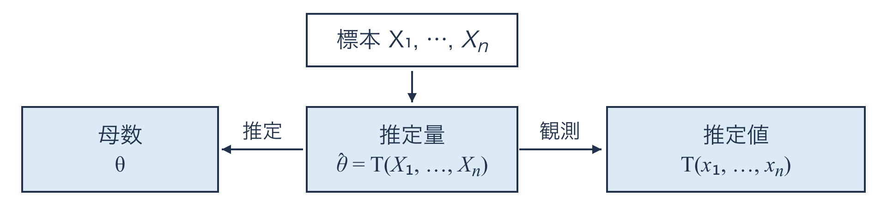
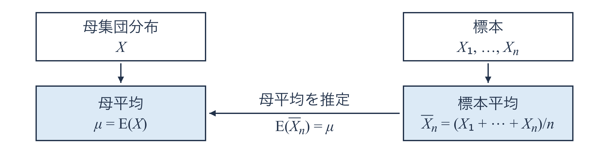
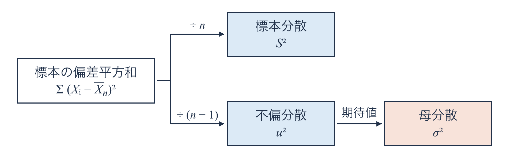
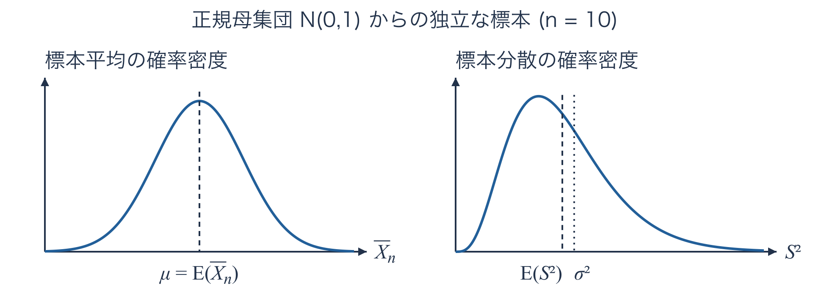
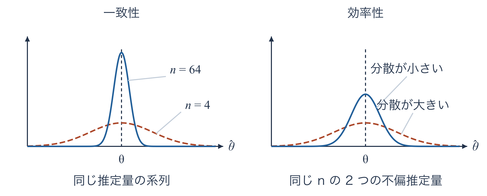

森から抽出したウサギの体重の標本を使うと, 森全体の体重の平均や分散を一つの数で推定できます. 同じ母集団から標本を取り直すと推定した数も変わるため, 計算方法を選ぶときは, 繰り返し抽出したときの推定結果の分布を調べます. 母平均と母分散を推定する例から, 推定量の性質と, 分布のモデルを使って推定量を求める方法が分かります.

| 記号 | 意味 |
| --- | --- |
| $T$ | 標本から数値を計算する関数 |
| $\hat\theta=T(X_1,\ldots,X_n)$ | 母数 $\theta$ の推定量 |
| $x_1,\ldots,x_n$ | 標本の実際の観測値 |
| $p$ | 母比率 (1 回のベルヌーイ試行の成功確率) |
| $\hat p$ | 標本比率 (標本中の成功回数を標本サイズで割った量) |
| $\Theta$ | 母数の候補の集合 (母数空間) |
| $L(\theta)$, $\ell(\theta)$ | 観測した標本を固定したときの尤度関数と対数尤度関数 |

# 母平均と母分散の点推定 {#unbiased-estimation}

[母集団分布と標本抽出](block:inf-population#population-and-sampling)で, 母集団の性質を標本から推し量る場面を考えました. 森のウサギの体重の母平均を推定するなら, 例えば抽出した個体の体重の平均を使えます. 母数を一つの数で推定する方法を**点推定**と呼びます.

## 推定量と推定値

標本 $X_1,\ldots,X_n$ に関数 $T$ を適用して得られる確率変数 $\hat\theta=T(X_1,\ldots,X_n)$ を, 母数 $\theta$ の**推定量**と呼びます. $T$ に実際の観測値 $x_1,\ldots,x_n$ を入れて得た数値 $T(x_1,\ldots,x_n)$ は, その標本での**推定値**です. 母数 $\theta$ は母集団の値であり, 推定量がどの値を取るかは抽出された標本によって決まります. このように抽出を繰り返したときに統計量が取る値の確率分布を**標本分布**と呼びます.

図では, 標本が決まる前の式 $T(X_1,\ldots,X_n)$ と, 一組の観測値を代入して得る数 $T(x_1,\ldots,x_n)$ を並べています. 推定の対象である $\theta$ は, どの標本を観測しても同じです.

{.wide}

推定量の期待値が母数に一致する性質を**不偏性**と呼びます. どの母数 $\theta$ のもとでも $E(\hat\theta)=\theta$ が成り立つとき, $\hat\theta$ は $\theta$ の**不偏推定量**です. 標本を取り直して推定値を計算すると, 一つ一つの値は変わります. 不偏性はこれらの推定値が従う分布の平均についての性質です.

## 標本平均と不偏分散

共通の母集団分布から独立に得た $X_1,\ldots,X_n$ に対して, [標本平均の期待値と分散](block:prob-clt#central-limit-theorem)で求めたとおり $E(\bar X_n)=\mu$ です. したがって $\bar X_n$ は母平均 $\mu$ の不偏推定量です.

図では, $\mu$ を母集団分布に, $\bar X_n$ を標本に対応させています. 標本から計算する平均は抽出ごとに変わりますが, その期待値は母平均に一致します.

{.wide}

母分散 $\sigma^2$ を推定するには, 各観測値と標本平均のずれの 2 乗を使います. [分散と標準偏差](block:prob-variable#variance)の補足で定義したように, **標本分散** $S^2$ は分母を $n$ とし, **不偏分散** $u^2$ は同じ偏差平方和を $n-1$ で割ります. $n\geq 2$ なら $S^2=\frac{n-1}{n}u^2$ です. 標本平均からの偏差の和は $0$ なので, $n-1$ 個の偏差が決まると最後の偏差も決まります. このとき自由に値を取りうる偏差の個数 $n-1$ を**自由度**と呼びます.

図の分岐は, 同じ偏差平方和を $n$ で割るか, $n-1$ で割るかを表します. $n-1$ で割って得る $u^2$ の期待値は, 母分散 $\sigma^2$ に一致します.

{.wide}

有限な母分散のもとで $E(S^2)=\frac{n-1}{n}\sigma^2$ となるため, $E(u^2)=\sigma^2$ です. 例えば $n=10$ では, $S^2$ の期待値は母分散の $0.9$ 倍です. 実際に得た標本での平均と分散は [Exercise INF-POINT-1](#exercise-inf-point-1) で計算します.

::: note
**補足. 不偏分散の不偏性の証明**

$X_i-\bar X_n=(X_i-\mu)-(\bar X_n-\mu)$ と書いて偏差平方和を展開します. 交差項の和には $\sum_{i=1}^n(X_i-\mu)=n(\bar X_n-\mu)$ を使えます.

$$
\begin{aligned}
\sum_{i=1}^n(X_i-\bar X_n)^2
&=\sum_{i=1}^n(X_i-\mu)^2
   -2(\bar X_n-\mu)\sum_{i=1}^n(X_i-\mu)
   +n(\bar X_n-\mu)^2\\
&=\sum_{i=1}^n(X_i-\mu)^2-n(\bar X_n-\mu)^2.
\end{aligned}
$$

両辺を $n$ で割り, 期待値を取ります. $E(X_i)=E(\bar X_n)=\mu$ なので, 差の 2 乗の期待値はそれぞれの分散です. $V(\bar X_n)=\sigma^2/n$ は[標本平均の期待値と分散](block:prob-clt#central-limit-theorem)で求めました.

$$
\begin{aligned}
E(S^2)
&=\frac{1}{n}\sum_{i=1}^n E((X_i-\mu)^2)-E((\bar X_n-\mu)^2)\\
&=\frac{1}{n}\sum_{i=1}^n V(X_i)-V(\bar X_n)\\
&=\sigma^2-\frac{\sigma^2}{n}
 =\frac{n-1}{n}\sigma^2.
\end{aligned}
$$

$u^2=\frac{n}{n-1}S^2$ の両辺の期待値を取ると, $E(u^2)=\frac{n}{n-1}E(S^2)=\sigma^2$ を得ます.
:::

標本平均と標本分散の標本分布を比べるには, 同じ大きさの標本を取り直し, 1 組につき $\bar X_n$ と $S^2$ を 1 個ずつ計算します. それぞれの値でヒストグラムを作ると, 母平均や母分散に対するずれとばらつきを見比べられます.

図は同じ正規母集団から独立に $n=10$ 個を抽出する場合の密度です. 左では標本平均の期待値が母平均に一致し, 右では標本分散の期待値が母分散の左にあります.

{.wide}

::: note
**補足. 正規母集団での標本分散の分布**

共通の正規分布から独立に抽出し, $n\geq 2$, $\sigma^2>0$ のとき, $\frac{nS^2}{\sigma^2}=\frac{(n-1)u^2}{\sigma^2}$ は自由度 $n-1$ の[カイ二乗分布](block:prob-sampling#chi-square) $\chi^2_{n-1}$ に従います. 導出は[正規標本の平均と不偏分散から得られる t 分布](block:prob-sampling#t-from-normal-sample)にあります.
:::

## 一致性と効率性

不偏性は標本サイズを固定したときの期待値の性質です. 標本サイズを増やしたときの性質を表すため, $n$ 個の観測値を使う推定量を $\hat\theta_n$ と書きます. 任意の $\varepsilon>0$ に対して $P(|\hat\theta_n-\theta|\geq\varepsilon)\to 0$ ($n\to\infty$) なら, $\hat\theta_n$ は $\theta$ に対して**一致性**を持ちます. $\bar X_n$ の一致性は[大数の法則](block:inf-population#law-of-large-numbers)から従います. $u^2$ も独立同分布で有限な母分散のもとで一致性を持ちます.

::: note
**補足. 不偏分散の一致性**

独立同分布で期待値が有限な確率変数の標本平均にも, 弱大数の法則が成り立ちます. $X_i$ と $X_i^2$ の期待値はともに有限なので, それぞれの標本平均は $E(X_i)$ と $E(X_i^2)$ に確率収束します. 確率収束は和, 積, 差で保たれるので, $u^2=\frac{n}{n-1}(\frac{1}{n}\sum_{i=1}^nX_i^2-\bar X_n^2)$ は $E(X_i^2)-E(X_i)^2=\sigma^2$ に確率収束します.
:::

同じ標本サイズで同じ母数の不偏推定量を比べる場合, 分散の小さい方が母数のまわりのばらつきが小さく, この意味で**効率性**が高いといいます. 比較する不偏推定量の中で, どの母数の値でも分散が最小になるものを**最小分散不偏推定量**と呼びます.

左の図は, 同じ推定量の系列で $n$ を増やすと分布が $\theta$ のまわりに集まる例です. 右の図では $n$ を固定し, 期待値がともに $\theta$ である 2 つの推定量の分散を比べています.

{.wide}

::: note
**補足. 点推定と区間推定**

**区間推定**では, 標本から計算した下端と上端で母平均の範囲を推定します. 信頼水準を $1-\alpha$ とし, 標本から決まる下端を $L_n$, 上端を $U_n$ とすると, 信頼区間は $P(L_n\leq\mu\leq U_n)\geq 1-\alpha$ を満たすように作ります. この確率は, 固定された母平均 $\mu$ に対して, 標本を取り直すたびに変わる区間が $\mu$ を含む確率です. 区間の求め方は, 区間推定の資料で扱います.
:::

# 標本比率の標本分布 {#sample-proportion}

平均を推定する考え方は, 結果が $0$ または $1$ のときには比率の推定に使えます. 各試行で成功を $1$, 失敗を $0$ として記録した値を $X_i$ とします. 試行が互いに独立で, 母比率 $p$ が各回の成功確率であるとき, 成功回数 $S_n=\sum_{i=1}^n X_i$ は[二項分布](block:prob-discrete#binomial-distribution) $\mathrm{Bi}(n,p)$ に従います. **標本比率**は $\hat p=S_n/n=\bar X_n$ です.

$\hat p$ が $k/n$ となるのは, $S_n$ がちょうど $k$ となるときです. したがって $0<p<1$ では

$$
P\left(\hat p=\frac{k}{n}\right)
=P(S_n=k)=\binom{n}{k}p^k(1-p)^{n-k},
\qquad k=0,1,\ldots,n.
$$

例えば $n=2$, $p=1/2$ のとき, 標本比率の分布は次の表になります.

| 標本比率 $\hat p$ | $0$ | $1/2$ | $1$ |
| --- | --- | --- | --- |
| 確率 | $1/4$ | $1/2$ | $1/4$ |

二項分布の期待値 $np$ と分散 $np(1-p)$ を使うと, $\hat p$ の期待値と分散は次のとおりです.

$$
E(\hat p)=p,\qquad V(\hat p)=\frac{p(1-p)}{n}.
$$

したがって $\hat p$ は $p$ の不偏推定量です. [ラプラスの定理](block:prob-clt#binomial-normal-approximation)により, $0<p<1$ を固定して $n$ を大きくすると, $\hat p$ を平均 $p$, 分散 $p(1-p)/n$ の正規分布で近似できます. $p=0$ と $p=1$ では $\hat p=p$ が確率 $1$ で成り立ちます.

# 尤度とモーメントによる点推定 {#likelihood-and-moments}

ベルヌーイ試行の成功確率を推定する値として, 標本比率が得られました. 分布の形を仮定したうえで観測結果から母数の候補を選ぶ**最尤法**でも, 同じ推定量が得られます.

## 最尤法と対数尤度

成功確率 $p$ の[ベルヌーイ試行](block:prob-discrete#bernoulli-distribution)を独立に 5 回行い, 順に $1,1,1,1,0$ を観測したとします. $p$ の候補となる値の集合 $\Theta=[0,1]$ を**母数空間**と呼びます. 観測された順序まで固定したときに, 各候補 $p$ のもとでこの列を得る確率は, 独立性から

$$
L(p)=p^4(1-p)
$$

です. 観測した列を固定して母数の関数とみた $L(p)$ を**尤度関数**と呼びます. 例えば $L(0.2)=0.00128$, $L(0.8)=0.08192$ です. 最尤法では, 観測した結果に対して尤度を最大にする母数を選びます. 観測後に得られる値を**最尤推定値**, 観測前に標本の関数として表したものを**最尤推定量**と呼びます.

尤度が正の範囲では, 自然対数が単調増加なので, 尤度を最大にする母数と**対数尤度** $\ell(p)=\log L(p)$ を最大にする母数は一致します. 尤度を求めるときの積は, 対数を取ると和に変わります.

::: note
**補足. 最尤推定量の導出**

5 回の例を, $n$ 回のうち $k$ 回が成功した場合に広げます. $0<k<n$ とします. 観測した順序を固定した尤度は $L(p)=p^k(1-p)^{n-k}$ です. 成功回数だけを観測した場合は $\binom{n}{k}$ が掛かります. この係数は $p$ を変えても同じなので, どちらからも同じ最尤推定値が得られます.

順序を固定した場合の対数尤度とその微分は, $0<p<1$ で次のようになります.

$$
\ell(p)=k\log p+(n-k)\log(1-p),\qquad
\ell'(p)=\frac{k}{p}-\frac{n-k}{1-p}
        =\frac{k-np}{p(1-p)}.
$$

分母は正で, 分子は $p=k/n$ を境に正から負に変わります. $p=0,1$ で尤度は $0$ なので, $\Theta$ 全体で尤度を最大にする点は $k/n$ です. 5 回の例では $p=4/5=0.8$ で最大になります. 尤度を直接微分しても $L'(p)=p^3(4-5p)$ となり, 同じ増減が得られます.

成功が 0 回のときは $L(p)=(1-p)^n$ が $p=0$ で最大になり, 全回成功のときは $L(p)=p^n$ が $p=1$ で最大になります. 観測前の成功回数を $S_n$ とすると, 最尤推定量はどの場合も $S_n/n$ です.
:::

成功回数から最尤推定値を求める例は [Exercise INF-POINT-2](#exercise-inf-point-2) で計算します.

## モーメント法

ベルヌーイ分布では, 1 回の記録の期待値が $p$ です. 期待値に対応する標本平均を使い, $p=\bar X_n$ という式を $p$ について解くと, 最尤法で求めた推定量と同じ $\hat p=\bar X_n$ が得られます. ベルヌーイ分布の期待値のような分布の[モーメント](block:prob-continuous#moments)を $E(X^r)$ と書くと, 対応する標本の量は $X_i^r$ の平均です. これらを等しいと置いた式から母数を求める方法を**モーメント法**と呼びます.

# 演習 {#exercises}

観測値から母平均と母分散の推定値を求め, 成功回数から母比率を最尤法で推定します.

## Exercise INF-POINT-1 {#exercise-inf-point-1}

**母平均と母分散の不偏推定**

独立に抽出した標本の観測値が $7,13,10,4,16$ でした. 母平均と母分散の不偏推定量を用いて, それぞれの推定値を求めてください.

回答

合計は $50$ で, 標本平均は $50/5=10$ です. 標本平均からの偏差とその 2 乗は次のとおりです.

| 観測値 | 偏差 | 偏差の 2 乗 |
| --- | --- | --- |
| $7$ | $-3$ | $9$ |
| $13$ | $3$ | $9$ |
| $10$ | $0$ | $0$ |
| $4$ | $-6$ | $36$ |
| $16$ | $6$ | $36$ |
| 合計 | $0$ | $90$ |

標本分散は $90/5=18$ です. 母分散の不偏推定量である $u^2$ による推定値は $90/(5-1)=22.5$ です. 母平均の推定値には, 標本平均の $10$ を使います.

## Exercise INF-POINT-2 {#exercise-inf-point-2}

**苗が発芽する確率の最尤推定**

同じ条件で種を 24 粒まき, 15 粒が発芽しました. 各粒の発芽が互いに独立で, 発芽確率が共通して $p$ であると仮定します. 発芽した粒の数を観測したときの尤度を式で表し, $p$ の最尤推定値を求めてください.

回答

発芽した粒の数は $\mathrm{Bi}(24,p)$ に従うので, 尤度は $L(p)=\binom{24}{15}p^{15}(1-p)^9$ です. $0<p<1$ での対数尤度の導関数は

$$
\ell'(p)=\frac{15}{p}-\frac{9}{1-p}=\frac{15-24p}{p(1-p)}
$$

です. $p=15/24$ を境に導関数の符号は正から負に変わり, $p=0,1$ で尤度は $0$ です. よって最尤推定値は $15/24=5/8=0.625$ です.

