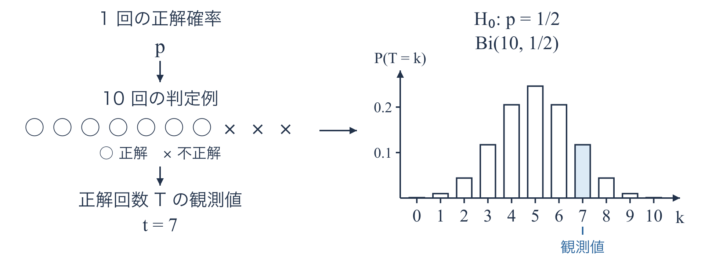
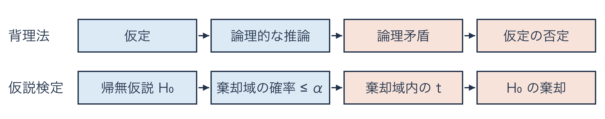
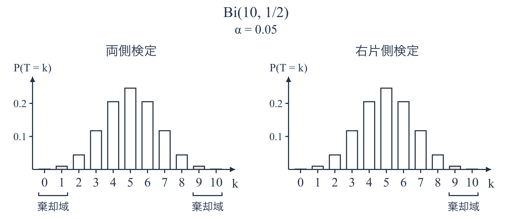
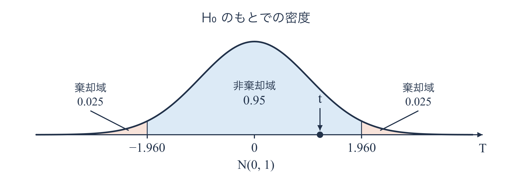
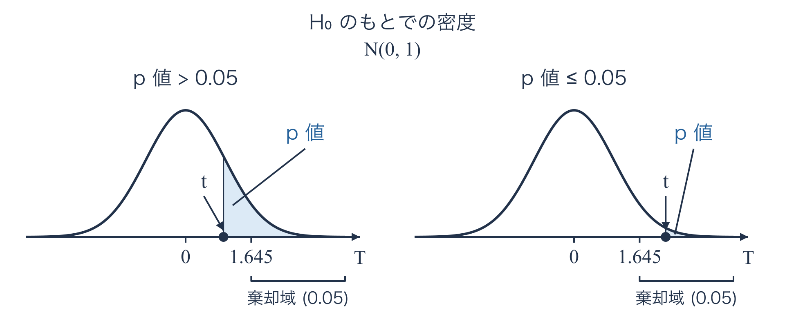

[区間推定](block:inf-interval#confidence-interval)では, 標本を取り直すと推定値が変わることを考慮して, 母数の候補となる値の範囲を求めました. 母数について調べたい主張が先にある場合は, その主張に照らして標本から判断する手順を定めます. この手順を**統計的仮説検定**と呼びます.

| 記号 | 意味 |
| --- | --- |
| $H_0$, $H_1$ | 帰無仮説と対立仮説 |
| $T$, $t$ | 検定統計量とその観測値 |
| $\alpha$ | 有意水準. 第一種の過誤の確率の上限として事前に定める値 |
| $\beta$ | 対立仮説のもとで母数の値を指定したときの第二種の過誤の確率 |
| $p$ 値 | 帰無仮説のもとで, 観測値と同程度か, それ以上に極端な検定統計量を得る確率. 帰無仮説に複数の母数の値が含まれる場合は, その確率の上限 |
| $p$ | 紅茶の例で 1 回の判定が正解する確率 |

# 紅茶の実験と二つの仮説 {#hypotheses}

紅茶とミルクを注ぐ順序を味で見分けられるか, 実験で調べます. 各回で紅茶を先に入れるかミルクを先に入れるかを独立に, 同じ確率で決めます. 飲む人には入れ方を知らせず, 各回の判定が正しかったかも途中では伝えません. 10 回試して正解の回数を記録します.

判定が入れ方に関する情報を持たず, 各回の正誤が独立なら, 1 回の正解確率は $p=1/2$ です. この $H_0:p=1/2$ を, 結果を比べる基準となる**帰無仮説**とします. 例えば, 偶然より多く正解できるかが問いなら, 調べたい方向を示す**対立仮説**を $H_1:p>1/2$ とします. この問いでは $H_0:p\leq 1/2$ と置くと, 二つの仮説が $p$ の範囲を分けます. 後で上側確率を計算するときは, 帰無仮説の境界の $p=1/2$ を使います.

標本から計算し, 仮説の判断に使う量を**検定統計量**と呼びます. 紅茶の実験では正解回数 $T$ を使います. 10 回分の記録をすべて集めても, 観測した正解率は今後も繰り返せる実験の正解確率 $p$ の推定値です. 一方, 例えば工場の特定の一日の生産分だけが対象で, 全品の重量を測れば, その生産分の平均は直接計算できます.

紅茶の実験の図では, 10 回中 7 回正解した例を使い, 観測値 $t=7$ を $H_0$ のもとでの $T$ の分布に重ねています. 棒の位置は正解回数を表し, 1 回の正解確率 $p$ は棒の高さを計算するのに使います.

{.wide}

帰無仮説のもとで起こりにくい範囲をあらかじめ決め, 検定統計量の観測値がそこに入れば $H_0$ を**棄却**します. 棄却は, 仮定したモデルのもとで対立仮説を支持する判断です. 起こりにくい範囲に入らなければ, 今回の標本では $H_0$ を退ける証拠が不足しています. 例えば, 偶然よりわずかに正解しやすくても, 10 回の試行では偶然と区別しにくい正解数が出ます.

# 過誤と棄却域 {#errors-and-rejection}

帰無仮説のもとで起こりにくい範囲に観測値が入ることもあります. 検定が取り違える場面を, 母数の真の値と標本からの判断に分けます.

| 真の値 | $H_0$ を棄却しない | $H_0$ を棄却する |
| --- | --- | --- |
| $H_0$ の範囲にある | 正しい判断 | 第一種の過誤 |
| $H_1$ の範囲にある | 第二種の過誤 | 正しい判断 |

$H_0$ が成り立つときの棄却を**第一種の過誤**, $H_1$ が成り立つときの非棄却を**第二種の過誤**と呼びます. 例えば, 規格を満たす製品を検査で除くことと, 規格を満たさない製品を通すことでは, 判断を誤ったときの影響が異なります. 何を $H_0$ に置くかによって, どちらが第一種の過誤になるかが決まります.

::: note
**補足. 検査における生産者危険と消費者危険**

規格を満たすことを $H_0$ とする検査では, 規格を満たす品を除く確率が生産者危険, 満たさない品を通す確率が消費者危険です. この設定では順に第一種, 第二種の過誤の確率にあたります.
:::

**有意水準** $\alpha$ は, 第一種の過誤の確率に事前に設ける上限です. 例えば $0.05$ や $0.01$ を使います. $H_0$ に含まれるどの母数の値でも, 棄却の確率が $\alpha$ 以下になるように検定統計量の**棄却域**を決めます. 連続分布では尾の面積を $\alpha$ に合わせられる場合があります. 離散分布では値ごとの確率を足すため, 合計が $\alpha$ 未満になる場合があります.

棄却域の外は**非棄却域**と呼びます. 採択域という呼び方もあります. 非棄却は標本に基づく判断であり, 真の母数がどちらの仮説の範囲にあるかは表の別の項目です. 対立仮説のもとで母数の値を指定したとき, 非棄却となる確率を $\beta$, 棄却となる確率 $1-\beta$ を**検出力**と呼びます. 標本サイズと検定統計量を固定したまま棄却域を狭めると, 第一種の過誤の確率は小さくなりますが, 検出力も小さくなり, 第二種の過誤の確率は大きくなります (離散分布では変わらない場合もあります). 二つの過誤の確率を同時に小さくするには, 標本サイズを増やすなど, 標本の側を変える必要があります.

仮定したときの帰結を調べる点で, 検定の出発点は背理法に似ています. 背理法では論理矛盾が出れば仮定を退けられます. 検定で棄却域に入る事象には帰無仮説のもとでも確率があり, 有意水準で制御するのは同じ手順を繰り返したときの誤った棄却です.

背理法と仮説検定を並べた図では, 論理矛盾と棄却域内の観測値を同じ段階に置いています. 下段の $\alpha$ は, 帰無仮説が成り立つときに棄却へ進む確率の上限です.

{.wide}

[信頼区間](block:inf-interval#confidence-interval)を併せて求めると, 判断に加えて母数の候補の範囲も示せます. 用語と過誤の関係は [Exercise INF-TESTING-1](#exercise-inf-testing-1) で確認できます.

# 二項検定の片側と両側 {#binomial-test}

紅茶の実験で正解確率が $1/2$ より高いかを調べる場合, 正解数が大きい方に棄却域を置きます. 片方の端に棄却域を置く検定を**片側検定**と呼びます. 正解数の多さと少なさの両方を問題にして $H_1:p\ne 1/2$ とする場合は, 両端に棄却域を置く**両側検定**を使います. 正解数が極端に少ない場合も, 入れ方の情報と判定に何らかの関係がある可能性を調べる対象になります.

[二項分布](block:prob-discrete#binomial-distribution)の式によると, 正解確率が $1/2$ で試行が独立なら, $T\sim\mathrm{Bi}(10,1/2)$ で $P(T=k)=\binom{10}{k}/2^{10}$ です. 両側検定で $\alpha=0.05$ とし, 左右に同じ確率を割り当てます. $T\leq 1$ または $T\geq 9$ となる確率は
$$
P(T\leq 1)+P(T\geq 9)
=\frac{1+10+10+1}{1024}
\approx 0.02148
$$
です. 両端に 2 回と 8 回を加えると合計は $112/1024\approx 0.10938$ となるので, 棄却域は $\{0,1,9,10\}$, 非棄却域は $\{2,\ldots,8\}$ です. 同じ棄却域で実際の正解確率が $0.8$ の場合, 第二種の過誤の確率は $T$ が 2 回から 8 回に入る確率で, 約 $0.3222$ です. 検出力は約 $0.6778$ になります.

右片側検定では, $p\leq 1/2$ の範囲で正解数が一定以上になる確率は $p=1/2$ のときに最大です. この境界で $P(T\geq 8)=56/1024\approx 0.05469$ となるため, $\alpha=0.05$ の右片側検定でも棄却域は $\{9,10\}$ です. 左片側検定なら, $H_0:p\geq 1/2$, $H_1:p<1/2$ とし, 対称性から棄却域は $\{0,1\}$ です. 例えば, 製品の平均重量が目標から上下どちらにずれても問題なら両側, 最低限必要な水準を下回ることが問題なら左片側を選びます.

二項分布の図では, 両側検定と右片側検定で棒の高さは共通です. 右端の 9 回と 10 回は両方の検定で棄却域に入り, 左端の 0 回と 1 回は両側検定で棄却域に入ります.

{.wide}

::: note
**補足. 2 点嗜好法と 2 点識別法**

2 点嗜好法では, 二つの試料を提示し, どちらを好むかを 1 人につき 1 回選んでもらいます. 提示順を無作為に決め, $n$ 人の回答が独立で選択確率が共通だと仮定します. 二つの試料が同じ確率で好まれるという仮説のもとでは, 一方の試料を好むと答えた人数は二項分布 $\mathrm{Bi}(n,1/2)$ に従います. どちらの試料に好みが偏っても調べたい場合は両側検定を使います.

2 点識別法の一例では, 糖度だけを変えた二つの試料のどちらが甘いかを選んでもらいます. 糖度の高い試料を選んだ人数を数え, その選択の確率が $1/2$ を上回るかを問うなら, 紅茶の例と同じ右片側検定を使えます. いずれの例でも, 二項分布を使う条件は判定の独立性と共通の確率です. 同じ人が繰り返し答えた場合は, 回答同士が独立かを別に考える必要があります.
:::

# 検定の手順と p 値 {#p-value}

紅茶の実験では, 正解数を得る前に, 調べる方向と棄却の条件を決めました. 他の検定でも, 仮説から観測値を使う判断までを次の順で進めます.

1. $H_0$ と $H_1$ を設定し, 検定の方向を決めます.
2. 標本から計算する検定統計量 $T$ を決めます.
3. $H_0$ のもとでの $T$ の分布を求めます.
4. 有意水準 $\alpha$ を定めます.
5. その有意水準に対応する棄却域を求めます.
6. 事前に定めた抽出方法や実験計画に従って標本を得ます.
7. 観測値 $t$ を求め, 棄却域に入れば $H_0$ を棄却します.

両側検定の密度の図では, 左右の棄却域に確率を $0.025$ ずつ配分しています. 図の観測値 $t$ は二つの境界の間にあるため, $H_0$ は非棄却です.

{.wide}

同じ判断は, 棄却域を先に計算する代わりに **p 値**を求めて行えます. $H_0$ のもとで, 観測値と同程度かそれ以上に対立仮説の方向に離れた値を得る確率です. 例えば, 統計量の分布が密度 $f$ を持つ右片側検定では $P_{H_0}(T\geq t)=\int_t^\infty f(s)\,ds$ です. 左片側検定では観測値までの左の確率を求めます. 左右対称で中心が $0$ の分布を使い, 対称な両側の棄却域を置くなら $P_{H_0}(|T|\geq |t|)$ です. この場合は $|t|>0$ で右側の確率を 2 倍できます. 非対称な分布では, どの値を観測値以上に極端と扱うかを検定の規則で定めます.

右片側検定の図では, 観測値 $t$ から右の面積が p 値です. $t$ が棄却域の境界以上のときは, その面積が棄却域の面積 $0.05$ 以下になります.

{.wide}

p 値が $\alpha$ 以下なら $H_0$ を棄却します. 紅茶の右片側検定で 10 回中 7 回正解したときは, $p=1/2$ における上側確率が
$$
P(T\geq 7)
=\frac{120+45+10+1}{1024}
=0.171875
$$
です. p 値は $0.05$ より大きいので $H_0$ を棄却せず, 正解確率が $1/2$ を上回ると判断するには証拠が不足しています. 観測値を変えた場合の判定は [Exercise INF-TESTING-2](#exercise-inf-testing-2) で確認できます.

::: note
**補足. 帰無仮説に複数の母数の値を含む場合**

母数を $\theta$, $H_0$ に含まれる値の集合を $\Theta_0$ とします. 大きな値を極端とする統計量を $T$ と定めると, p 値は $\sup_{\theta\in\Theta_0}P_\theta(T\geq t)$ です. $\sup$ は, 母数を $\Theta_0$ の範囲で動かして得られる確率の上限を表します. 紅茶の右片側検定では正解確率 $p$ が上がると $P(T\geq t)$ も大きくなるので, $p\leq 1/2$ での上限を $p=1/2$ で求められます.
:::

::: warn
**注意. p 値の条件**

確率を計算するときには $H_0$ を仮定しています. p 値の対象は検定統計量であり, $H_0$ が真である確率には別のモデルが必要です. また, 標本を見た後で小さい p 値を与える方向を選ぶと, 事前に方向を決めた片側検定の有意水準は保てません.
:::

# 演習 {#exercises}

## Exercise INF-TESTING-1 {#exercise-inf-testing-1}

**仮説検定の用語と判断**

(1) 母集団の確率分布を指定する平均や分散などの量を何と呼びますか. (2) その量について, 標本から仮説を判断する手続きは何ですか. (3), (4) $H_0$, $H_1$ はそれぞれ何と呼ばれますか. (5) $H_0$ が成り立つのに棄却する誤り, (6) その誤りの確率に事前に定める上限, (7) 棄却しない観測値の範囲, (8) 棄却する観測値の範囲を順に答えてください.

回答

(1) 母数, (2) 統計的仮説検定, (3) 帰無仮説, (4) 対立仮説, (5) 第一種の過誤, (6) 有意水準, (7) 非棄却域 (採択域), (8) 棄却域です. $H_0$ のもとで (8) に入る確率は $\alpha$ 以下, (7) に入る確率は $1-\alpha$ 以上です.

## Exercise INF-TESTING-2 {#exercise-inf-testing-2}

**紅茶の実験で 9 回正解した場合の判断**

紅茶の実験で 10 回中 9 回正解したとします. 有意水準 $5\%$ で, $H_1:p>1/2$ とした場合と $H_1:p\ne 1/2$ とした場合について, p 値を求めて判断してください. いずれも実験前に方向を決めたとします.

回答

右片側検定の p 値は $(10+1)/1024\approx 0.01074$ です. 両側検定では左右の対称な確率を足すので $22/1024\approx 0.02148$ です. どちらも $0.05$ 以下なので $H_0$ を棄却します.

