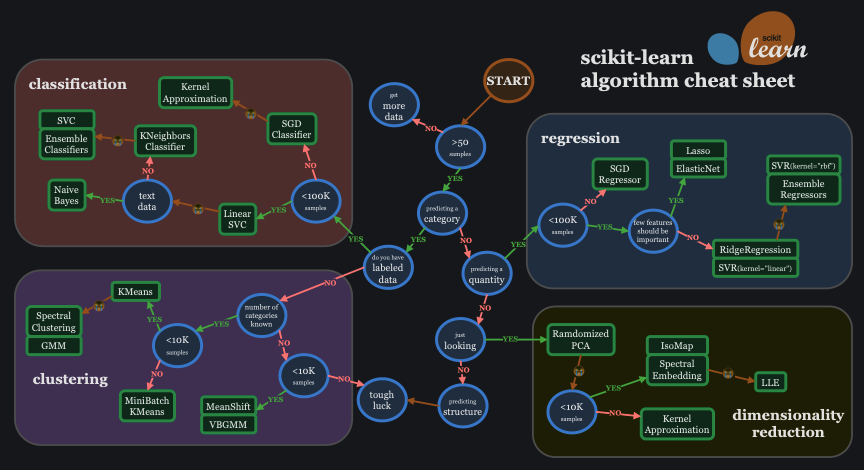
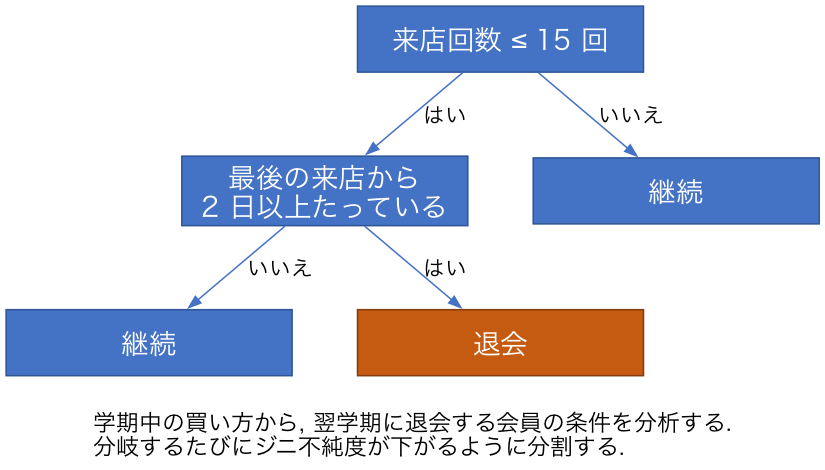
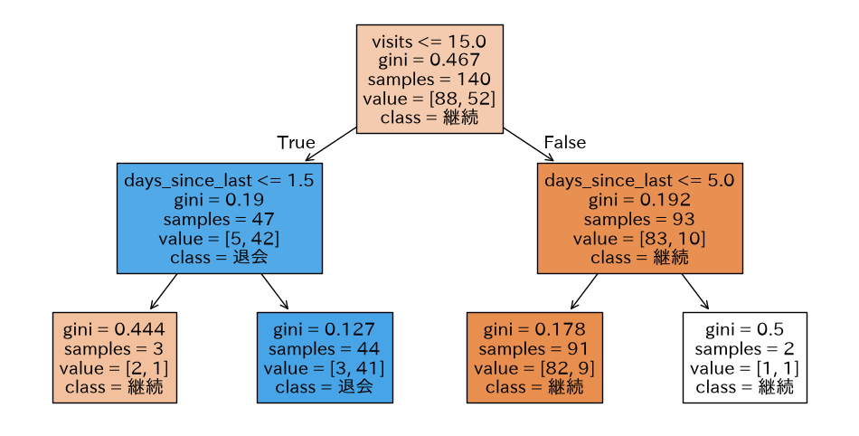
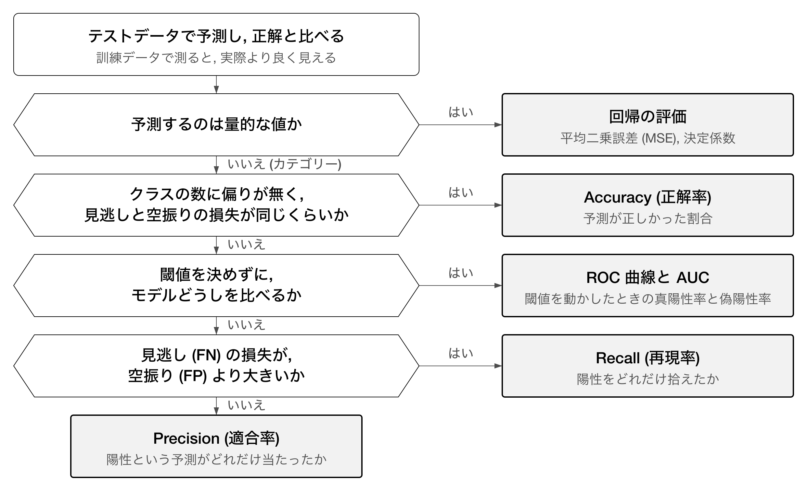
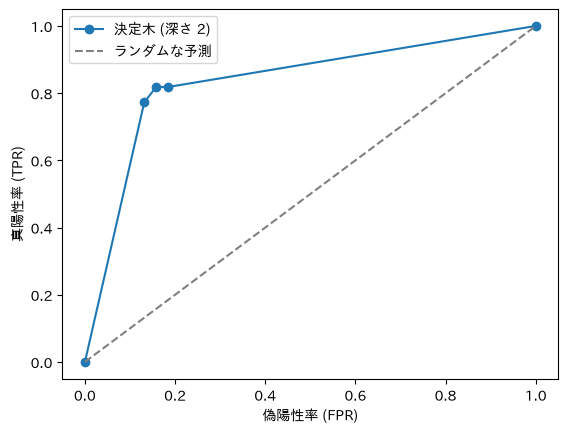

## 教師あり学習 {#教師あり学習-1}

教師あり学習には多くの手法があり, 目的とデータの種類によって使い分けます. 次の図は, 機械学習用のライブラリ `scikit-learn` の開発者が示している手法の選び方です.

(出典: [scikit-learn, Choosing the right estimator](https://scikit-learn.org/stable/machine_learning_map.html)). データが 50 件以上あるか, 予測するのがカテゴリか数値か, といった問いに順に答えていくと, 使う手法の候補にたどり着く図です.

::: warn
本章では次のライブラリを使います. `uv add` しておいてください (`scikit-learn` は, `import` するときには `sklearn` と書きます).

~~~ sh
uv add pandas matplotlib matplotlib-fontja scikit-learn
~~~

:::

# []{#予測技術の活用事例と現象のモデル化}予測技術の活用事例と現象のモデル化 {#predictive-modeling}

教師あり学習による予測は, 身近なところで多く使われています.

| 分野 | 予測するもの | 予測に使うデータ |
|---|---|---|
| 小売 | 翌週の商品の売れ行き | 過去の売上, 曜日, 天気 |
| 会員サービス | 会員が退会しそうか | 利用の頻度, 最後の利用日 |
| 金融 | 貸したお金が返ってくるか | 収入, 過去の返済の記録 |
| 製造 | 機械が故障しそうか | センサーの値, 稼働時間 |
| メール | 迷惑メールかどうか | 本文の単語, 送信元 |

どの事例も, 予測したい結果 (目的変数) と, 結果に関係しそうな観測できる値 (説明変数) の組を過去のデータから集め, 両者の関係を学習して, 結果がまだ分からない新しいデータに当てはめています. 目的変数が数値なら**回帰** ([第5章](/lectures/dsp5.html)), カテゴリなら**分類**です.

このように, 複雑な現象を「どの値が結果にどう影響するか」という入力と出力の関係に単純化して表すことを, **現象のモデル化**といいます. 会員の退会は, 実際には卒業, 引っ越し, 店の品ぞろえへの不満など多くの事情で起こります. それらをすべて観測することはできないので, 観測できる値 (来店の頻度など) だけで退会のしやすさを表すモデルを作ります. モデルは現象そのものではなく, 目的に必要な部分だけを取り出した近似です. どの値を説明変数に選ぶかは, 分析の目的と, 現象についての知識 ([第2章](/lectures/dsp2.html)の分析設計) で決まります.

# []{#例題のデータ-売店の会員の退会}例題のデータ: 売店の会員の退会 {#member-churn-data}

[こちら](https://github.com/yakagika/yakagika.github.io/blob/main/slds_data/dsp6/member_churn.csv)のデータは, ある大学の売店の会員 200 人について, 1 学期分 (4 月から 7 月) の購買記録を集計した値と, 翌学期に会員を退会したかどうかをまとめたものです (練習用に作成した架空のデータです). 同じ売店の購買記録は, [第7章](/lectures/dsp7.html)でも使います.

| 列 | 内容 |
|---|---|
| `member_id` | 会員番号 |
| `visits` | 来店回数 |
| `amount_per_visit` | 1 回あたりの購入額 (円) |
| `days_since_last` | 最後に来店した日から学期末 (7 月 24 日) までの日数 |
| `share_meal`, `share_drink`, `share_snack`, `share_stationery` | 購入額のうち, 食事, 飲料, 菓子, 文具が占める割合 |
| `churned` | 翌学期に退会したら 1, 続けたら 0 (目的変数) |

~~~ py
import pandas as pd

df = pd.read_csv('data/member_churn.csv', encoding='utf-8-sig')
print(df[['member_id', 'visits', 'amount_per_visit', 'days_since_last', 'churned']].head())
"""
   member_id  visits  amount_per_visit  days_since_last  churned
0       1001      27             468.5                0        0
1       1002      38             438.4                0        0
2       1003      32             451.2                0        0
3       1004      32             415.0                0        0
4       1005      28             440.4                0        0
"""
print(df['churned'].value_counts())
"""
churned
0    126
1     74
"""
~~~

200 人のうち 74 人 (37%) が退会しています. 目的変数は `churned`, 説明変数は会員番号を除く残りの 7 列です.

# []{#決定木分析}決定木分析 {#decision-trees}

データの各項目についての「はい/いいえ」の分岐を木の形に重ねて, 目的の値を予測する手法を**決定木分析**といいます. 目的変数がカテゴリの場合は**分類木**, 数値の場合は**回帰木**と呼びます.

上の図は, この後で売店の会員のデータから学習させる決定木を, 分岐の条件だけ残して描いたものです. 一番上の条件から順に「はい/いいえ」で進み, 行き着いた箱がその会員についての予測になります.

決定木は, 分類の性能では他の手法に劣ることが多いものの, 予測の根拠を図で示せて, 人が読んで理解しやすいという長所があります.

代表的なアルゴリズムに, **CART** (Classification and Regression Trees) があります. CART は, データを 2 つに分ける分岐を繰り返して木を作ります. 分岐の先にある箱をさらに分けていき, それ以上分けない末端の箱を**葉**といいます. 分岐の良さは, 分けた後のそれぞれのグループがどれだけ 1 つのクラスに揃っているかで測ります. その尺度が**ジニ不純度**です.

::: note
- **ジニ不純度 (Gini impurity)**

$$ I_G = 1 - \sum_{i=1}^{c} \left( \frac{n_i}{N} \right)^2 $$

$c$: クラスの数, $N$: そのグループのデータの数, $n_i$: そのうちクラス $i$ に属するデータの数.

:::

グループがすべて同じクラスなら $I_G = 0$ で, 2 クラスが半々のときに最大の $0.5$ になります. 例えば, 退会 41 人と継続 3 人の 44 人のグループなら,

$$ I_G = 1 - \left( \frac{41}{44} \right)^2 - \left( \frac{3}{44} \right)^2 \approx 1 - 0.868 - 0.005 = 0.127 $$

となり, ほぼ退会した会員だけのグループであることを表します. CART は, すべての説明変数とすべての分け目の候補について, 分けた後のジニ不純度 (2 つのグループのジニ不純度を人数で重み付けした平均) を計算し, それが最も小さくなる分岐を選びます. 分けたそれぞれのグループで同じことを繰り返し, グループが 1 つのクラスだけになるか, 指定した深さに達するまで木を伸ばします.

`scikit-learn` の `DecisionTreeClassifier` で, 退会を予測する決定木を作ります. モデルの性能を確かめるために, データを学習用 (訓練データ) と評価用 (テストデータ) に分けてから学習します (分ける理由は[分類の評価](#分類の評価)で説明します).

~~~ py
import matplotlib.pyplot as plt
import matplotlib_fontja
from sklearn.model_selection import train_test_split
from sklearn.tree import DecisionTreeClassifier, plot_tree

X = df.drop(columns=['member_id', 'churned'])  # 説明変数
y = df['churned']                              # 目的変数

# 7割を訓練データ, 3割をテストデータにする (退会の割合を両方で揃える)
X_train, X_test, y_train, y_test = train_test_split(
    X, y, test_size=0.3, random_state=0, stratify=y)

# 深さ2までの決定木を学習する
tree = DecisionTreeClassifier(max_depth=2, random_state=0)
tree.fit(X_train, y_train)

# 決定木を図にする
plt.figure(figsize=(12, 6))
plot_tree(tree, feature_names=X.columns, class_names=['継続', '退会'],
          filled=True, impurity=True)
plt.show()
plt.close()
~~~

各箱の 1 行目が分岐の条件, `gini` がジニ不純度, `samples` がその箱に来た訓練データの人数, `value` が [継続, 退会] の人数, `class` が多い方のクラス (その箱に来たデータの予測) です. 条件を満たすデータは左へ, 満たさないデータは右へ進みます.

最初の分岐は来店回数 (`visits <= 15`) です. 来店回数が 15 回以下の会員 (左) は 47 人中 42 人が退会し, 16 回以上の会員 (右) は 93 人中 83 人が継続しています. 左側はさらに最後の来店からの日数で分かれ, 来店が少なく, 最後の来店から 2 日以上たっている会員は 44 人中 41 人が退会しています. この木からは, 「あまり来ない会員が, 学期末に向けて来なくなると退会しやすい」と読めます. 説明変数はほかに 5 つありますが, 深さ 2 の木ではこの 2 つだけが使われました.

学習したモデルでテストデータの退会を予測し, 正解と比べます.

~~~ py
pred = tree.predict(X_test)  # テストデータの予測 (0 か 1)
print((pred == y_test).mean())  # 正解率
"""
0.8333333333333334
"""
~~~

テストデータ 60 人のうち, 83% の会員について退会するかどうかを正しく予測できました.

この節に対応する演習は, 章末の[Exercise DSP6-1](#exercise-dsp6-1)と[Exercise DSP6-3](#exercise-dsp6-3)です.

# []{#分類の評価}分類の評価 {#classification-evaluation}

## 評価指標の選び方 {#choose-metric}

モデルの予測の良さを測る指標は, 予測する値の種類と, 予測を何に使うかで選びます. 次の図を上からたどって指標を選んでください. 「はい」なら右の指標へ, 「いいえ」なら下の問いへ進みます.

図の各箱は, 次の節で説明します.

- テストデータで予測し, 正解と比べる: [訓練データとテストデータ](#訓練データとテストデータ)
- 回帰の評価: [第5章](/lectures/dsp5.html)の[回帰の評価](/lectures/dsp5.html#regression-evaluation)
- Accuracy, Recall, Precision: [Accuracy, Precision, Recall](#accuracy-precision-recall)
- ROC 曲線と AUC: [ROC 曲線と AUC](#roc-曲線と-auc)

分類の指標はどれも, [混同行列](#混同行列)の 4 つの数から計算します. 図の FN (見逃し) と FP (空振り) は混同行列のマスの名前で, 閾値は [ROC 曲線と AUC](#roc-曲線と-auc) で定義します. クラスの数が偏っているときに Accuracy で判断しない理由と, 見逃しと空振りの損失の比べ方は, [Accuracy, Precision, Recall](#accuracy-precision-recall) で例を使って説明します.

## 訓練データとテストデータ {#訓練データとテストデータ}

モデルの性能を学習に使ったデータで測ると, 実際より良く見えることがあります ([第5章](/lectures/dsp5.html#regression-train-test)の回帰の評価と同じ理由です). 決定木の深さを制限せずに学習させると, この違いを確かめられます.

~~~ py
for depth in [2, None]:  # None は深さを制限しない
    t = DecisionTreeClassifier(max_depth=depth, random_state=0).fit(X_train, y_train)
    print(depth, t.score(X_train, y_train), t.score(X_test, y_test))
"""
2 0.9 0.8333333333333334
None 1.0 0.7833333333333333
"""
~~~

深さを制限しない木は, 訓練データを 1 人残らず正しく分類しています (正解率 1.0). しかしテストデータの正解率は 0.78 で, 深さ 2 の木 (0.83) より下がっています. 深い木は, 訓練データにたまたま含まれていた細かい違いまで分岐として覚え込むので, 新しいデータには役立たない分岐が増えます. 訓練データでは性能が高いのに, 新しいデータでは性能が上がらない (あるいは下がる) 状態を**過学習**といいます.

モデルの目的は, 結果がまだ分からない新しいデータを予測することです. そのため, 学習には使わずに取っておいたテストデータで性能を測ります. `train_test_split` はデータをランダムに分けるので, `random_state` で乱数を固定しておくと, 何度実行しても同じ分け方になります.

この節に対応する演習は, 章末の[Exercise DSP6-1](#exercise-dsp6-1)です.

## 混同行列 {#混同行列}

正解率だけでは, どんな誤り方をしているかが分かりません. 分類の結果は, 正解と予測の組み合わせごとにデータの数を数えた表で確かめます. この表を**混同行列**といいます.

見つけたいクラス (ここでは退会) を**陽性**, もう一方 (継続) を**陰性**と呼ぶと, 2 クラスの混同行列は次の 4 つのマスからなります.

| 正解 \\ 予測 | 陰性 (継続と予測) | 陽性 (退会と予測) |
|---|---|---|
| 陰性 (実際は継続) | **TN** (真陰性) | **FP** (偽陽性) |
| 陽性 (実際は退会) | **FN** (偽陰性) | **TP** (真陽性) |

T (True) と F (False) は予測が正しいかどうか, P (Positive) と N (Negative) は予測したクラスを表します. 例えば FN は「陰性と予測したが, それは誤りだった」, つまり退会を見逃した会員です.

~~~ py
from sklearn.metrics import confusion_matrix

print(confusion_matrix(y_test, pred))
"""
[[33  5]
 [ 5 17]]
"""
~~~

`confusion_matrix` の出力は上の表と同じ並びで, TN = 33, FP = 5, FN = 5, TP = 17 です. 実際に退会した 22 人のうち 17 人を退会と予測し, 5 人を見逃しました. 継続した 38 人のうち 5 人を, 誤って退会と予測しています.

この節に対応する演習は, 章末の[Exercise DSP6-2](#exercise-dsp6-2)です.

## Accuracy, Precision, Recall {#accuracy-precision-recall}

混同行列の 4 つの数から, 目的に応じた指標を計算します.

::: note
- **Accuracy (正解率)**: 全体のうち, 予測が正しかった割合.

$$ \text{Accuracy} = \frac{TP + TN}{TP + TN + FP + FN} $$

- **Precision (適合率)**: 陽性と予測したもののうち, 実際に陽性だった割合. 陽性という予測がどれだけ信頼できるかを表す.

$$ \text{Precision} = \frac{TP}{TP + FP} $$

- **Recall (再現率)**: 実際に陽性だったもののうち, 陽性と予測できた割合. 陽性をどれだけ見逃さずに拾えたかを表す.

$$ \text{Recall} = \frac{TP}{TP + FN} $$

:::

決定木の予測では, 次のようになります.

- Accuracy: $(17 + 33) / 60 \approx 0.833$
- Precision: $17 / (17 + 5) \approx 0.773$
- Recall: $17 / (17 + 5) \approx 0.773$

~~~ py
from sklearn.metrics import accuracy_score, precision_score, recall_score

print(accuracy_score(y_test, pred), precision_score(y_test, pred), recall_score(y_test, pred))
"""
0.8333333333333334 0.7727272727272727 0.7727272727272727
"""
~~~

Accuracy だけで判断しない理由は, クラスの数に偏りがあるときに分かります. 例えば, 退会する会員が全体の 5% しかいない店で「全員が継続する」と予測するモデルは, Accuracy が 0.95 になります. しかし退会する会員を 1 人も見つけられないので, Recall は 0 です.

Precision と Recall のどちらを重く見るかは, 予測を何に使うかで決まります. 退会しそうな会員に割引券を送るなら, 見逃し (FN) は会員を失うことに, 空振り (FP) は割引券 1 枚分の費用につながります. 会員を失う損失の方が大きければ, 空振りが増えても Recall を上げたいと考えます. 逆に, 1 件ずつ担当者が電話をかけるような費用の大きい対応なら, Precision を重く見ます.

この節に対応する演習は, 章末の[Exercise DSP6-2](#exercise-dsp6-2)です.

## ROC 曲線と AUC {#roc-曲線と-auc}

決定木は, 各データについて陽性である確率を出し, その確率が 0.5 を超えるなら陽性と予測しています (ちょうど 0.5 のときは陰性). この 0.5 を**閾値**といいます. 閾値を下げると陽性と予測する会員が増え, Recall は上がりますが, 空振り (FP) も増えます. 閾値を変えたときのこの関係をまとめて見るのが ROC 曲線です.

::: note
- **真陽性率 (TPR, True Positive Rate)**: Recall と同じ. 実際の陽性のうち, 陽性と予測できた割合.

$$ \text{TPR} = \frac{TP}{TP + FN} $$

- **偽陽性率 (FPR, False Positive Rate)**: 実際の陰性のうち, 誤って陽性と予測した割合.

$$ \text{FPR} = \frac{FP}{FP + TN} $$

:::

閾値を 1 から 0 まで下げていくと, 陽性と予測する会員が増え, TPR と FPR はどちらも 0 から 1 へ増えていきます. 横軸に FPR, 縦軸に TPR をとり, 閾値ごとの点を結んだ曲線を **ROC 曲線** (Receiver Operating Characteristic curve) といいます.

~~~ py
from sklearn.metrics import roc_curve, roc_auc_score

prob = tree.predict_proba(X_test)[:, 1]  # 退会である確率
fpr, tpr, thresholds = roc_curve(y_test, prob)
print(roc_auc_score(y_test, prob))
"""
0.8349282296650719
"""

plt.plot(fpr, tpr, marker='o', label='決定木 (深さ 2)')
plt.plot([0, 1], [0, 1], linestyle='--', color='gray', label='ランダムな予測')
plt.xlabel('偽陽性率 (FPR)')
plt.ylabel('真陽性率 (TPR)')
plt.legend()
plt.show()
plt.close()
~~~

曲線が左上に寄るほど, 空振りを増やさずに陽性を拾えている良いモデルです. 左上の角 (FPR = 0, TPR = 1) は, すべての陽性を空振りなしで拾える完全な予測にあたります. 灰色の対角線は, 確率をでたらめに付けた場合 (どの閾値でも TPR と FPR が等しい) です.

ROC 曲線の下側の面積を **AUC** (Area Under the Curve) といいます. AUC は 0 から 1 の値をとり, 完全な予測なら 1, でたらめな予測なら 0.5 です. AUC は「退会した会員と継続した会員を 1 人ずつ選んだとき, 退会した会員の方に高い確率を付けている割合」とも解釈できます. 閾値を 1 つに決めなくてもモデルの良さを比べられるのが, AUC の利点です. この決定木の AUC は 0.835 です.

決定木の ROC 曲線は, 数個の点を結んだ折れ線になっています. 決定木が出す確率は, データが最後に行き着いた箱 (葉) の中の退会の割合なので, 深さ 2 の木では 4 通りの値しかとらないためです. 閾値の候補が少ないので, 閾値を細かく調整することはできません.

この節に対応する演習は, 章末の[Exercise DSP6-3](#exercise-dsp6-3)です.

# []{#演習}演習 {#exercises}

## Exercise DSP6-1 {#exercise-dsp6-1}

**決定木の深さと過学習**

対応する節: [決定木分析](#決定木分析), [訓練データとテストデータ](#訓練データとテストデータ)

本文のデータと分け方 (`test_size=0.3, random_state=0, stratify=y`) で, 決定木の深さ `max_depth` を 1 から 8 まで変えて学習し, 訓練データとテストデータでの正解率を求めて折れ線グラフにしてください. グラフから, 過学習が起き始める深さを読み取ってください.

提出ファイル名: `dsp6-1.py`

    
 回答例 

~~~ py
import pandas as pd
import matplotlib.pyplot as plt
import matplotlib_fontja
from sklearn.model_selection import train_test_split
from sklearn.tree import DecisionTreeClassifier

df = pd.read_csv('data/member_churn.csv', encoding='utf-8-sig')
X = df.drop(columns=['member_id', 'churned'])
y = df['churned']
X_train, X_test, y_train, y_test = train_test_split(
    X, y, test_size=0.3, random_state=0, stratify=y)

depths = range(1, 9)
train_acc, test_acc = [], []
for d in depths:
    t = DecisionTreeClassifier(max_depth=d, random_state=0).fit(X_train, y_train)
    train_acc.append(t.score(X_train, y_train))
    test_acc.append(t.score(X_test, y_test))
    print(d, round(train_acc[-1], 3), round(test_acc[-1], 3))

plt.plot(depths, train_acc, marker='o', label='訓練データ')
plt.plot(depths, test_acc, marker='o', label='テストデータ')
plt.xlabel('決定木の深さ')
plt.ylabel('正解率')
plt.legend()
plt.show()
plt.close()
~~~

~~~ sh
1 0.893 0.817
2 0.9 0.833
3 0.914 0.833
4 0.943 0.817
5 0.95 0.817
6 0.979 0.783
7 0.986 0.783
8 0.993 0.767
~~~

訓練データの正解率は深さとともに上がり続けますが, テストデータの正解率は深さ 2 と 3 で最大 (0.833) になり, 深さ 4 から下がり始めます. 深さ 4 以降は, 訓練データにだけ当てはまる分岐を増やす過学習が起きています.

## Exercise DSP6-2 {#exercise-dsp6-2}

**閾値を下げたときの Precision と Recall**

対応する節: [混同行列](#混同行列), [Accuracy, Precision, Recall](#accuracy-precision-recall)

本文の深さ 2 の決定木について, 退会と予測する閾値を「0.5 を超える」(`predict` の既定) から「0.3 以上」に下げると, 混同行列, Precision, Recall はどう変わるかを求めてください. 退会しそうな会員に割引券を送る目的では, どちらの閾値が望ましいかを, 理由とともに答えてください.

ヒント: `tree.predict_proba(X_test)[:, 1] >= 0.3` で, 閾値 0.3 での予測 (True/False) が得られます.

提出ファイル名: `dsp6-2.py`

    
 回答例 

~~~ py
import pandas as pd
from sklearn.model_selection import train_test_split
from sklearn.tree import DecisionTreeClassifier
from sklearn.metrics import confusion_matrix, accuracy_score, precision_score, recall_score, roc_auc_score

df = pd.read_csv('data/member_churn.csv', encoding='utf-8-sig')
X = df.drop(columns=['member_id', 'churned'])
y = df['churned']
X_train, X_test, y_train, y_test = train_test_split(
    X, y, test_size=0.3, random_state=0, stratify=y)

tree = DecisionTreeClassifier(max_depth=2, random_state=0).fit(X_train, y_train)
prob = tree.predict_proba(X_test)[:, 1]

for name, pred in [('0.5 を超える', tree.predict(X_test)), ('0.3 以上', (prob >= 0.3).astype(int))]:
    print(name)
    print(confusion_matrix(y_test, pred))
    print(precision_score(y_test, pred), recall_score(y_test, pred))
~~~

~~~ sh
0.5 を超える
[[33  5]
 [ 5 17]]
0.7727272727272727 0.7727272727272727
0.3 以上
[[31  7]
 [ 4 18]]
0.72 0.8181818181818182
~~~

閾値を 0.3 に下げると, 退会と予測する会員が 22 人から 25 人に増えます. 見逃し (FN) が 5 人から 4 人に減って Recall は 0.773 から 0.818 に上がり, 空振り (FP) が 5 人から 7 人に増えて Precision は 0.773 から 0.720 に下がります. 割引券を送る目的では, 退会する会員を 1 人失う損失が割引券 2 枚分の費用より大きいなら, 閾値 0.3 の方が望ましいと言えます. どちらが良いかは, 見逃しと空振りの損失の大きさを比べて決めます.

## Exercise DSP6-3 {#exercise-dsp6-3}

**説明変数を絞った決定木**

対応する節: [決定木分析](#決定木分析), [ROC 曲線と AUC](#roc-曲線と-auc)

来店回数 (`visits`) と最後の来店からの日数 (`days_since_last`) の 2 つだけを説明変数にして, 深さ 2 の決定木を学習してください. テストデータでの Accuracy, Precision, Recall, AUC を求め, 7 つの説明変数を使った本文の木と比べて, 何が言えるかを答えてください.

提出ファイル名: `dsp6-3.py`

    
 回答例 

~~~ py
import pandas as pd
from sklearn.model_selection import train_test_split
from sklearn.tree import DecisionTreeClassifier
from sklearn.metrics import confusion_matrix, accuracy_score, precision_score, recall_score, roc_auc_score

df = pd.read_csv('data/member_churn.csv', encoding='utf-8-sig')
X = df.drop(columns=['member_id', 'churned'])
y = df['churned']
X_train, X_test, y_train, y_test = train_test_split(
    X, y, test_size=0.3, random_state=0, stratify=y)

X2 = X[['visits', 'days_since_last']]
t2 = DecisionTreeClassifier(max_depth=2, random_state=0)
t2.fit(X2.loc[X_train.index], y_train)
pred2 = t2.predict(X2.loc[X_test.index])
prob2 = t2.predict_proba(X2.loc[X_test.index])[:, 1]
print(accuracy_score(y_test, pred2), precision_score(y_test, pred2),
      recall_score(y_test, pred2), roc_auc_score(y_test, prob2))
~~~

~~~ sh
0.8333333333333334 0.7727272727272727 0.7727272727272727 0.8349282296650719
~~~

4 つの指標は, 7 つの説明変数を使った本文の木とすべて同じです. 本文の深さ 2 の木も, 分岐に使ったのは来店回数と最後の来店からの日数の 2 つだけだったので, 同じ木ができています. このデータでは, 退会の予測に必要な情報はこの 2 つの変数にほぼ含まれています. 説明変数が少ないモデルは, 予測の根拠を説明しやすく, 集めるデータも少なくて済むので, 性能が同じなら少ない方を選ぶのが一般的です.

