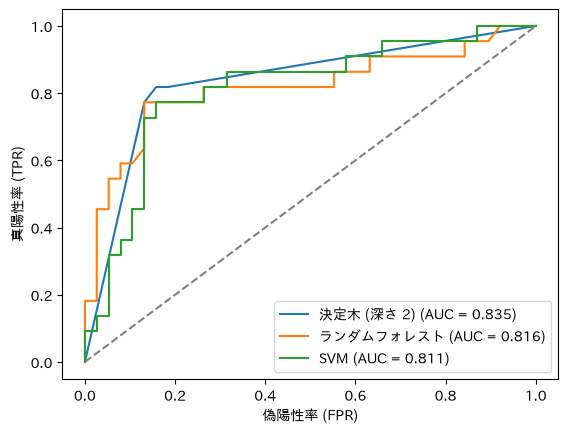
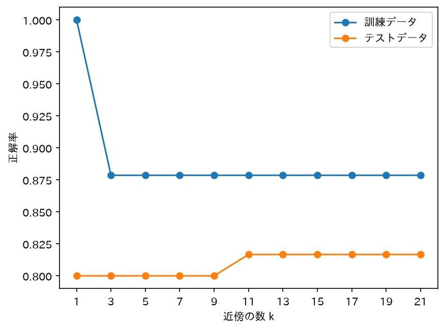
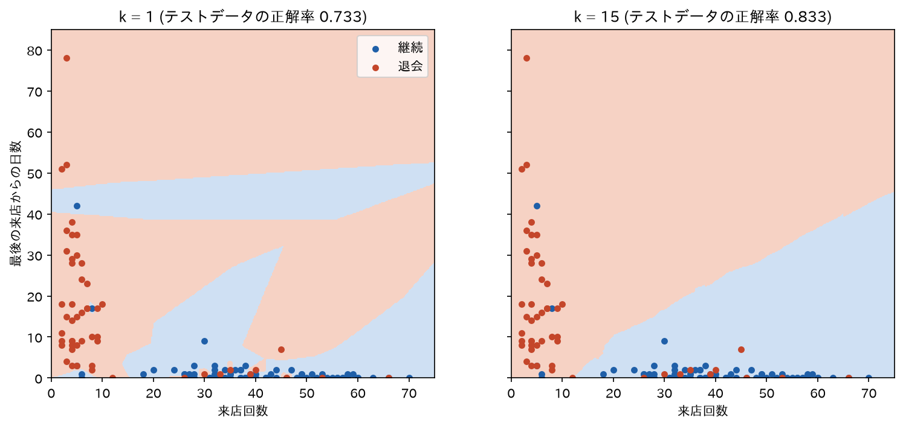

## ランダムフォレスト {#ランダムフォレスト}

ランダムフォレスト, サポートベクターマシン, k 近傍法は, 本文と同じデータと分け方で, 決定木と比べます.

**ランダムフォレスト**は, 少しずつ異なる決定木をたくさん作り, それらの予測を多数決 (確率なら平均) でまとめる手法です. 各木は, 訓練データから重複を許してランダムに選び直したデータで学習し, 分岐のたびに説明変数の一部だけをランダムに候補にします. 1 本の決定木は訓練データの細かい違いに引きずられやすいのですが, 違う誤り方をする木を多数まとめると, 誤りが打ち消し合って予測が安定します.

~~~ py
from sklearn.ensemble import RandomForestClassifier

rf = RandomForestClassifier(n_estimators=200, random_state=0)  # 200本の木
rf.fit(X_train, y_train)
rf_prob = rf.predict_proba(X_test)[:, 1]
print(rf.score(X_test, y_test), roc_auc_score(y_test, rf_prob))
"""
0.8166666666666667 0.8157894736842106
"""
# 説明変数の重要度 (分岐でジニ不純度をどれだけ下げたか)
print(pd.Series(rf.feature_importances_, index=X.columns).sort_values(ascending=False).round(3))
"""
visits              0.246
days_since_last     0.222
share_stationery    0.178
share_meal          0.103
share_drink         0.097
amount_per_visit    0.081
share_snack         0.073
"""
~~~

テストデータでの正解率は 0.817, AUC は 0.816 で, 深さ 2 の決定木 (0.833, 0.835) をわずかに下回りました. 説明変数の重要度は, 各変数による分岐がジニ不純度をどれだけ下げたかを, 全部の木で平均した値です. 来店回数と最後の来店からの日数が上位に来ており, 決定木の分岐と一致します. 3 番目の文具の割合は, 文具を中心に買う会員の来店回数が少ないことを反映していると考えられます.

# []{#サポートベクターマシン}サポートベクターマシン {#support-vector-machine}

**サポートベクターマシン** (SVM) は, 2 つのクラスを分ける境界を, 境界に最も近いデータ (**サポートベクター**) からの距離 (**マージン**) が最大になるように決める手法です. マージンを大きくとると, 新しいデータが境界の近くに来ても分類が揺らぎにくくなります. 直線で分けられないデータには, **カーネル**と呼ばれる関数でデータを曲がった境界で分けられるようにします (`scikit-learn` の既定は RBF カーネル). SVM は距離を使うので, [第4章](block:num-distance#標準化)と同じく説明変数を標準化してから使います.

~~~ py
from sklearn.svm import SVC
from sklearn.preprocessing import StandardScaler
from sklearn.pipeline import make_pipeline

# 標準化と SVM をつなげて1つのモデルにする
svm = make_pipeline(StandardScaler(), SVC(probability=True, random_state=0))
svm.fit(X_train, y_train)
svm_prob = svm.predict_proba(X_test)[:, 1]
print(svm.score(X_test, y_test), roc_auc_score(y_test, svm_prob))
"""
0.8 0.8110047846889952
"""
~~~

`make_pipeline` は, 標準化 (`StandardScaler`) と SVM を順につなげて 1 つのモデルとして扱う関数です. 標準化の平均と標準偏差は訓練データから計算され, テストデータにも同じ値が使われます.

3 つのモデルの ROC 曲線を重ねて比べます.

~~~ py
for name, p in [('決定木 (深さ 2)', prob), ('ランダムフォレスト', rf_prob), ('SVM', svm_prob)]:
    f, t, _ = roc_curve(y_test, p)
    plt.plot(f, t, label=f'{name} (AUC = {roc_auc_score(y_test, p):.3f})')
plt.plot([0, 1], [0, 1], linestyle='--', color='gray')
plt.xlabel('偽陽性率 (FPR)')
plt.ylabel('真陽性率 (TPR)')
plt.legend()
plt.show()
plt.close()
~~~

ランダムフォレストと SVM は, 会員ごとに細かく異なる確率を出すので, ROC 曲線が多くの点を通る細かい階段になります. 閾値を細かく調整したいときは, こうしたモデルが使いやすくなります.

一方で, このデータでは AUC は決定木が最も高く, ランダムフォレスト (0.816) と SVM (0.811) は少し下回りました. このデータの退会は, 来店回数と最後の来店からの日数という 2 つの変数の単純な条件でほぼ決まっているので, 深さ 2 の決定木でも十分に表せたと考えられます. 複雑な手法がいつも良い結果を出すとは限りません. また, テストデータは 60 人しかいないので, AUC の 0.02 程度の差は, データの分け方 (`random_state`) を変えると入れ替わりうる大きさです. 手法を比べるときは, 分け方を変えて何度か評価し, 差が安定しているかも確かめます.

# k 近傍法 {#k-nn}

**k 近傍法** (k-NN, k-Nearest Neighbor) は, 予測したい会員に説明変数の値が近い会員を訓練データから $k$ 人選び, その $k$ 人の多数決でクラスを決める手法です. 退会の確率は, $k$ 人のうち退会した人の割合になります. 学習の段階では訓練データを覚えておくだけで, 計算は予測のときに行います. SVM と同じく距離を使うので, 説明変数を標準化してから使います.

$k$ を 1 から 21 まで変えて, 訓練データとテストデータでの正解率を比べます.

~~~ py
from sklearn.neighbors import KNeighborsClassifier

ks = range(1, 22, 2)  # k = 1, 3, 5, ..., 21
train_acc, test_acc = [], []
for k in ks:
    knn = make_pipeline(StandardScaler(), KNeighborsClassifier(n_neighbors=k))
    knn.fit(X_train, y_train)
    train_acc.append(knn.score(X_train, y_train))
    test_acc.append(knn.score(X_test, y_test))

fig, ax = plt.subplots()
ax.plot(ks, train_acc, marker='o', label='訓練データ')
ax.plot(ks, test_acc, marker='o', label='テストデータ')
ax.set_xlabel('近傍の数 k')
ax.set_ylabel('正解率')
ax.set_xticks(list(ks))
ax.legend()
plt.show()
plt.close(fig)
~~~

$k = 1$ では訓練データの正解率が 1.000 になります. 訓練データの会員にとって最も近い会員は自分自身なので, 必ず正解するためです. 一方でテストデータの正解率は 0.800 にとどまります. $k$ を 11 以上にすると, 訓練データの正解率は 0.879 に下がり, テストデータの正解率は 0.817 に上がります. $k$ が小さいほど訓練データの 1 人ずつに合わせた予測になり, [訓練データとテストデータ](block:ml-classification#訓練データとテストデータ)で説明した過学習が起きます. $k = 15$ のときの AUC は 0.849 です.

標準化が要ることも確かめます. 標準化せずに $k = 15$ で学習すると, テストデータの正解率は 0.767 で, 標準化したとき (0.817) より下がります. 標準化しないと, 値の幅が大きい来店回数や 1 回あたりの購入額が距離の大半を占め, 購入額の割合の違いがほとんど距離に表れないためです.

~~~ py
knn_raw = KNeighborsClassifier(n_neighbors=15)  # 標準化しない
knn_raw.fit(X_train, y_train)
print(knn_raw.score(X_test, y_test))
"""
0.7666666666666667
"""
~~~

過学習の様子は, 説明変数を来店回数と最後の来店からの日数の 2 つに絞ると図で見られます. 次の図は, $k = 1$ と $k = 15$ のそれぞれについて, 平面上の各点で k 近傍法が予測するクラスを色で塗り, 訓練データの会員を点で重ねたものです.

~~~ py
import numpy as np

cols = ['visits', 'days_since_last']
# 図を塗るための格子点 (来店回数 0〜75 回, 日数 0〜85 日)
gx, gy = np.meshgrid(np.linspace(0, 75, 300), np.linspace(0, 85, 300))
grid = pd.DataFrame({'visits': gx.ravel(), 'days_since_last': gy.ravel()})

fig, axes = plt.subplots(1, 2, figsize=(12, 5), sharey=True)
for ax, k in zip(axes, [1, 15]):
    model = make_pipeline(StandardScaler(), KNeighborsClassifier(n_neighbors=k))
    model.fit(X_train[cols], y_train)
    pred = model.predict(grid).reshape(gx.shape)
    ax.contourf(gx, gy, pred, levels=[-0.5, 0.5, 1.5], colors=['#cfe0f3', '#f6d2c4'])
    for v, color, label in [(0, '#1f5fa8', '継続'), (1, '#c4462a', '退会')]:
        d = X_train[y_train == v]
        ax.scatter(d['visits'], d['days_since_last'], s=18, color=color, label=label)
    acc = model.score(X_test[cols], y_test)
    ax.set_title(f'k = {k} (テストデータの正解率 {acc:.3f})')
    ax.set_xlabel('来店回数')
axes[0].set_ylabel('最後の来店からの日数')
axes[0].legend()
plt.show()
plt.close(fig)
~~~

青の領域は継続, 赤の領域は退会と予測される範囲です. $k = 1$ では, 来店回数が多いのに退会した数人の会員のまわりにも赤の領域ができ, 境界が入り組んでいます. 訓練データの 1 人ずつに合わせた境界なので, テストデータの正解率は 0.733 にとどまります. $k = 15$ では境界がなめらかになり, 「来店回数が少ないか, しばらく来店していない会員は退会する」という, 決定木の分岐と同じ傾向が表れます. テストデータの正解率も 0.833 に上がります.

