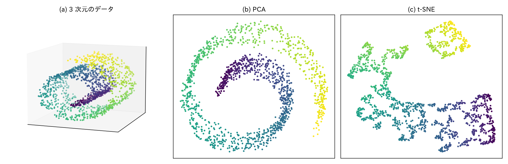
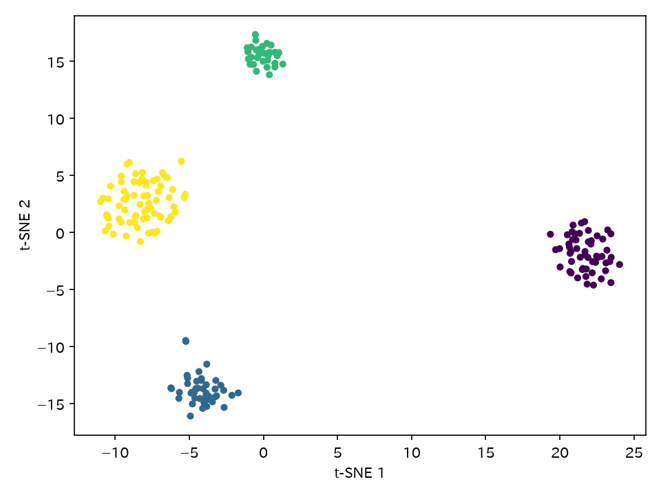
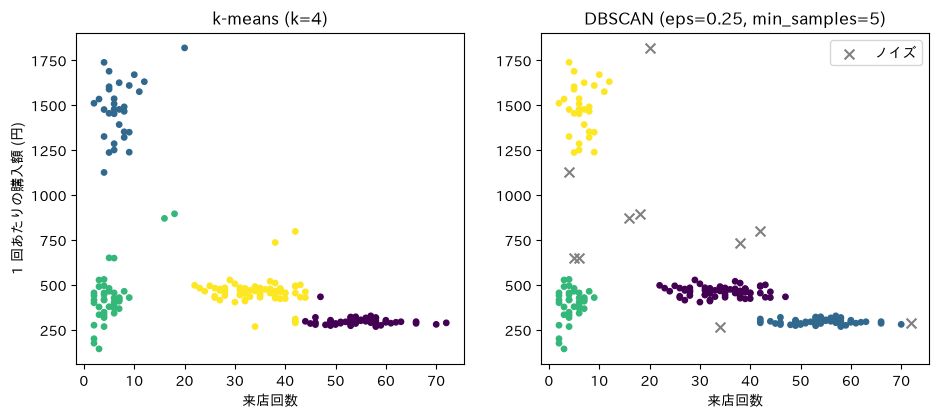
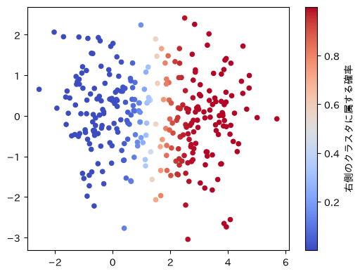

## 非線形の次元削減: t-SNE {#t-sne}

主成分分析の主成分得点は, 各項目に係数を掛けて足した値 (線形な式) です. そのため, データが曲がった面の上に並んでいるときは, 2 次元に射影すると面の離れた部分が重なります. 次の図の (a) は, 巻いた布のような面の上に並べた 3 次元の点で, 色は面に沿った位置を表します. (b) の主成分分析では, 巻いた形のまま平面に映るので, 面に沿って遠い点 (色が大きく違う点) 同士が, 巻きの内側と外側で近くに並びます. (c) の t-SNE では, 色の近い点同士が近くに集まります. ただし, 面を 1 枚の帯に広げるのでなく, いくつかの塊に分けて並べています.

{.wide}

**t-SNE (t-distributed Stochastic Neighbor Embedding)** は, 高い次元で近くにある点同士が, 低い次元でも近くに来るように点を配置する手法です. 手順は次のとおりです.

1. 高い次元での点 $i$ と点 $j$ の近さを, 確率 $p_{ij}$ で表します. 点 $i$ を中心とする正規分布の密度を使うので, 近い点ほど確率が大きくなります. 正規分布の幅は点ごとに決め, その目安を **perplexity** (近くの点として扱うおおよその個数) で指定します.
2. 低い次元 (2 次元) での点の近さを, 確率 $q_{ij}$ で表します. ここでは正規分布の代わりに, 裾の広い t 分布 (自由度 1) の密度を使います. 裾が広いので, 高い次元で少し離れた点同士を, 2 次元ではより遠くに置けます. 2 次元の狭い平面に点が押し込まれて塊が潰れることを, これで防ぎます.
3. 2 つの確率の違いを **KL ダイバージェンス** $\sum_{i \ne j} p_{ij} \log (p_{ij} / q_{ij})$ で測り, これが小さくなるように 2 次元の点の位置を少しずつ動かします.

KL ダイバージェンスは, $p_{ij}$ が大きい組 (高い次元で近い組) を 2 次元で離すと大きな値になります. 一方, $p_{ij}$ が小さい組 (高い次元で遠い組) を 2 次元で近くに置いても, 値はあまり増えません. そのため t-SNE は近くの点同士の関係 (局所的な構造) を保ちますが, 離れた塊同士の距離や位置関係は保ちません. t-SNE の図では, 塊の間の距離や塊の広がりを比べても意味がなく, 軸にも主成分のような意味はありません.

| | 主成分分析 | t-SNE |
|---|---|---|
| 変換 | 線形 (係数を掛けて足す) | 非線形 |
| 保つ構造 | 全体のばらつき (大局的な構造) | 近くの点同士の関係 (局所的な構造) |
| 軸の意味 | 係数から読み取れる | 無い |
| 結果の再現 | 同じデータなら同じ結果 | 乱数と perplexity で変わる |
| 新しいデータ | 同じ係数で得点を計算できる | 全体を配置し直す |

データ全体の構造を見るには主成分分析を, まとまり (クラスタ) があるかを見るには t-SNE を使います. 売店の会員の 17 項目を t-SNE で 2 次元に配置し, その座標をウォード法で 4 つのクラスタに切ります.

~~~ py
from sklearn.manifold import TSNE

# 標準化した17項目を2次元に配置する (乱数を固定する. perplexity は既定値の30)
emb = TSNE(n_components=2, random_state=0).fit_transform(z17)
tcluster = fcluster(linkage(emb, method='ward'), t=4, criterion='maxclust')
print(pd.crosstab(member['cluster'], tcluster))
"""
col_0     1   2   3   4
cluster
0        51   0   0   1
1         0   0  31   0
2         0  42   0   0
3         4   0   0  71
"""

fig, ax = plt.subplots()
ax.scatter(emb[:, 0], emb[:, 1], c=tcluster, cmap='viridis', s=15)
ax.set_xlabel('t-SNE 1')
ax.set_ylabel('t-SNE 2')
plt.show()
plt.close(fig)
~~~

2 次元の配置に 4 つの塊がはっきり分かれ, ウォード法で 4 つに切ったクラスタも k-means 法の結果とほぼ一致します. 主成分分析では, まとめ買いと昼食の会員を分けるのに第 3 主成分まで要りました. t-SNE では 2 次元でこの 2 つが分かれています. ただし, 図の塊同士の距離 (たとえばカフェ利用の会員の塊が右に離れていること) は, 会員同士の違いの大きさを表しません. perplexity を 5 や 50 に変えても, 同じ 4 つのクラスタが得られます (k-means 法と所属が違う会員は 5 人から 7 人). 結果が乱数と perplexity に左右されるので, t-SNE の図から結論を出すときは, 値を変えても同じ塊が現れるかを確かめます.

[文章ベクトルの可視化](block:nlp-embedding#自然言語ベクトル抽出によるデータ可視化と類似度評価)では文章のベクトルを, [画像の特徴量の可視化](block:img-more#feature-embedding)では画像認識のモデルが出力した特徴量を, 主成分分析と t-SNE で 2 次元にして比べます.

# []{#密度と確率モデルに基づくクラスタリング}密度と確率モデルに基づくクラスタリング {#density-and-model-based-clustering}

k-means 法には 2 つの制約があります. 1 つは, 各データを最も近い重心のクラスタに割り当てるので, 重心のまわりに丸くまとまったクラスタしか取り出せないことです. もう 1 つは, 各データがどれか 1 つのクラスタに必ず属し, どの塊にも当てはまらないデータや, 塊と塊の境界にあるデータも, どこかのクラスタに割り当てられることです. DBSCAN はどちらの制約も持たず, 混合ガウスモデルは各データの所属を確率で表すことで 2 つ目の制約を緩めます.

## DBSCAN {#dbscan}

**DBSCAN** (Density-Based Spatial Clustering of Applications with Noise) は, データが密に集まっている領域をクラスタとみなす手法です. 半径 `eps` と個数 `min_samples` を決め, 次のようにクラスタを作ります.

1. 半径 `eps` の範囲に (自分を含めて) `min_samples` 個以上のデータがある点を**コア点**とします.
2. 互いに `eps` 以内にあるコア点をつなぎ, つながったコア点とその `eps` 以内にあるデータを 1 つのクラスタとします.
3. どのコア点からも `eps` 以内にないデータは, どのクラスタにも属さない**ノイズ**とします.

密な領域がつながっている限り 1 つのクラスタになるので, 形が丸くないクラスタも見つけられます. クラスタの数を先に決める必要もありません.

売店の会員のデータに DBSCAN を適用し, k-means 法の結果と比べます.

~~~ py
from sklearn.cluster import DBSCAN

# 標準化した2項目に適用する. ノイズのクラスタ番号は -1
member['db'] = DBSCAN(eps=0.25, min_samples=5).fit_predict(z[['visits', 'amount_per_visit']])
print(member['db'].value_counts().sort_index())
"""
db
-1    10
 0    70
 1    53
 2    38
 3    29
"""

fig, axes = plt.subplots(1, 2, figsize=(11, 4.3))
axes[0].scatter(member['visits'], member['amount_per_visit'], c=member['cluster'], cmap='viridis', s=15)
axes[0].set_title('k-means (k=4)')
ok = member['db'] != -1  # ノイズでない会員
axes[1].scatter(member.loc[ok, 'visits'], member.loc[ok, 'amount_per_visit'],
                c=member.loc[ok, 'db'], cmap='viridis', s=15)
axes[1].scatter(member.loc[~ok, 'visits'], member.loc[~ok, 'amount_per_visit'],
                c='gray', marker='x', s=50, label='ノイズ')
axes[1].set_title('DBSCAN (eps=0.25, min_samples=5)')
axes[1].legend()
plt.show()
plt.close()
~~~

DBSCAN も 4 つの塊を 4 つのクラスタとして取り出しましたが, 10 人の会員をノイズとして, どのクラスタにも入れていません. ノイズになったのは, 塊と塊の間のまばらな位置にいる会員と, 塊の端にいる会員です. k-means 法ではこれらの会員もいずれかのクラスタに入り, そのクラスタの平均を動かします. どの層にも当てはまらない会員を別に扱いたいときは, DBSCAN が向いています.

ただし, 結果は `eps` と `min_samples` に大きく左右されます. このデータで `eps` を 0.3 に広げると, 昼食の会員とカフェ利用の会員の塊が, 間にいる会員を伝って 1 つのクラスタにつながります. 逆に `eps` を小さくしすぎると, ノイズになる会員が増えます.

## 混合ガウスモデル {#混合ガウスモデル}

**混合ガウスモデル** (Gaussian Mixture Model) は, データが $K$ 個の正規分布を重ね合わせた分布から生成されたと考え, 各正規分布の平均, 広がり (分散と共分散), 混ざり具合 (混合比) をデータから推定する手法です. 推定した分布を使うと, 各データがそれぞれのクラスタ (正規分布) から生成された確率を計算できます. k-means 法が各データを 1 つのクラスタに割り当てるのに対し, 混合ガウスモデルはどのクラスタにどれだけの確率で属するかを出力します.

売店の会員のデータに適用し, 所属の確率が最も低い会員を見てみます.

~~~ py
from sklearn.mixture import GaussianMixture

X = z[['visits', 'amount_per_visit']]
gm = GaussianMixture(n_components=4, random_state=0).fit(X)
prob = gm.predict_proba(X)            # 会員ごとの, 各クラスタに属する確率
member['max_prob'] = prob.max(axis=1)  # 最も確率の高いクラスタの確率
print(member.sort_values('max_prob').head(3)[['visits', 'amount_per_visit', 'cluster', 'max_prob']].round(2))
"""
           visits  amount_per_visit  cluster  max_prob
member_id
1074           34            267.35        3      0.85
1096           42            309.76        3      0.98
1117           46            318.70        0      0.99
"""
~~~

ほとんどの会員は, いずれか 1 つのクラスタに確率 0.99 以上で属します. このデータでは 4 つの塊が互いに離れているためです. 最も確率が低いのは会員 1074 で, カフェ利用の会員のクラスタに 0.85, 昼食の会員のクラスタに 0.15 の確率で属します. 来店回数 (34 回) は昼食の会員に近く, 1 回あたりの購入額 (267 円) はカフェ利用の会員に近い会員です. [k-means 法の例](block:ml-clustering#非階層クラスタリング-k-means-法)ではこの会員を昼食のクラスタ (3) に割り当てました. 混合ガウスモデルはどちらとも言い切れないことを確率で表しています.

塊同士が重なり合っているデータでは, 各データを 1 つのクラスタに決める k-means 法と, 所属を確率で表す混合ガウスモデルの違いがはっきり現れます. 次の例は, 中心が (0, 0) と (3, 0) の 2 つの塊を, 重なるように生成したデータです.

~~~ py
from sklearn.datasets import make_blobs

# 中心が (0, 0) と (3, 0) の2つの塊を, 重なるように生成する
Xb, _ = make_blobs(n_samples=300, centers=[[0, 0], [3, 0]], cluster_std=1.0, random_state=0)

gb = GaussianMixture(n_components=2, random_state=0).fit(Xb)
print(gb.means_.round(2))  # 推定した正規分布の平均
"""
[[-0.09  0.08]
 [ 2.91 -0.13]]
"""
pb = gb.predict_proba(Xb)

sc = plt.scatter(Xb[:, 0], Xb[:, 1], c=pb[:, 1], cmap='coolwarm', s=20)
plt.colorbar(sc, label='右側のクラスタに属する確率')
plt.show()
plt.close()
~~~

推定した 2 つの平均は, データを生成したときの中心 (0, 0) と (3, 0) に近い値です. 塊から離れた点の確率は 0 か 1 に近く, 2 つの塊の間にある点は 0.5 前後になります. 境界付近のデータを無理にどちらかへ割り当てず, 所属の不確かさとして扱えます.

