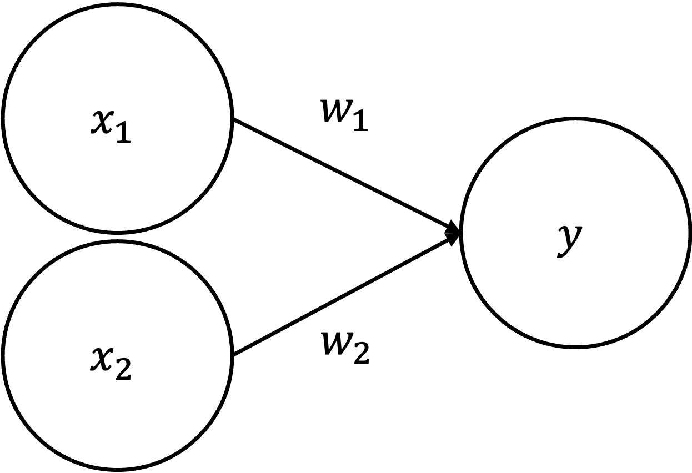
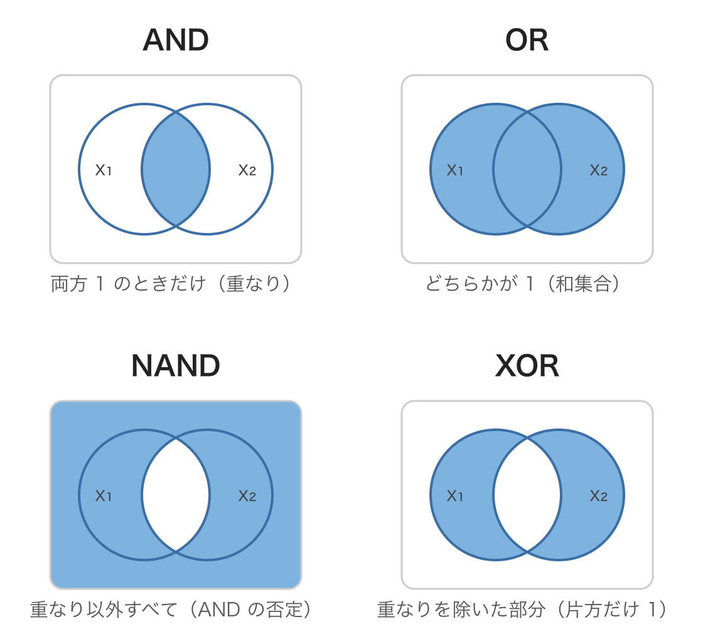
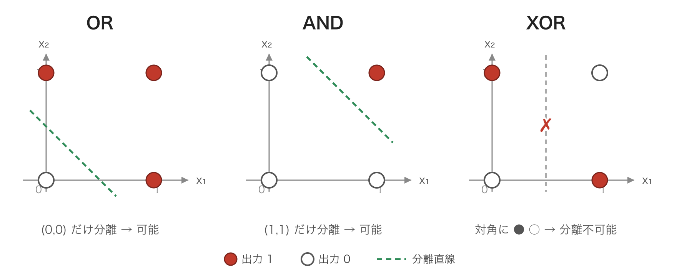
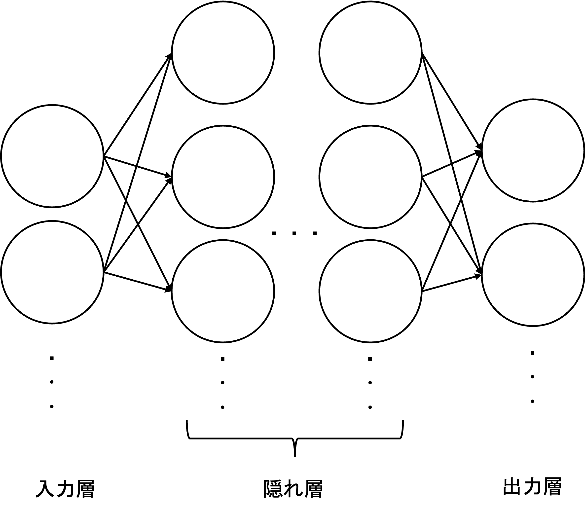
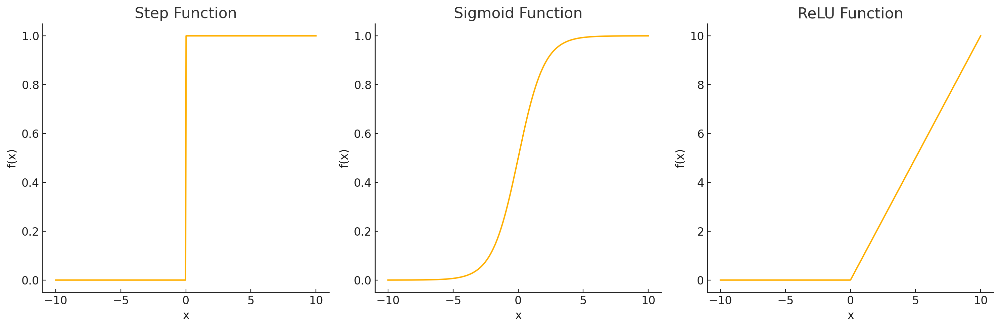
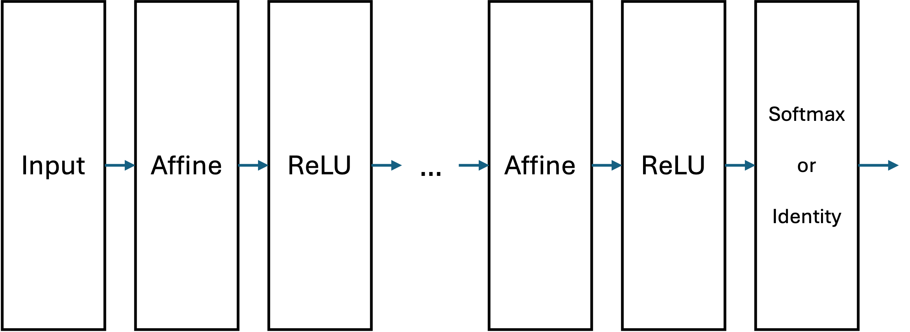
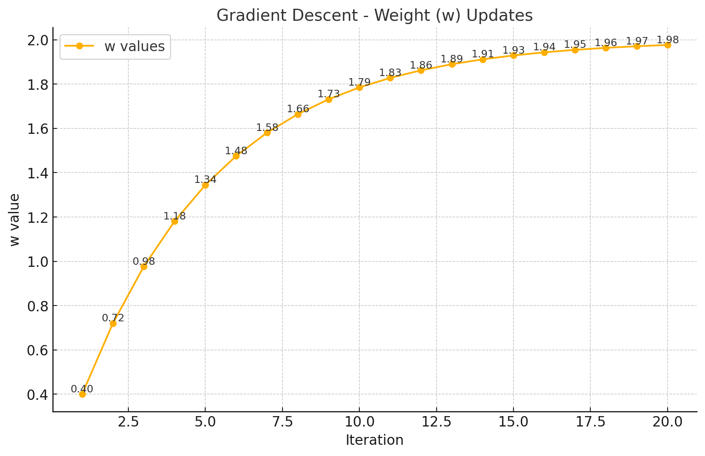
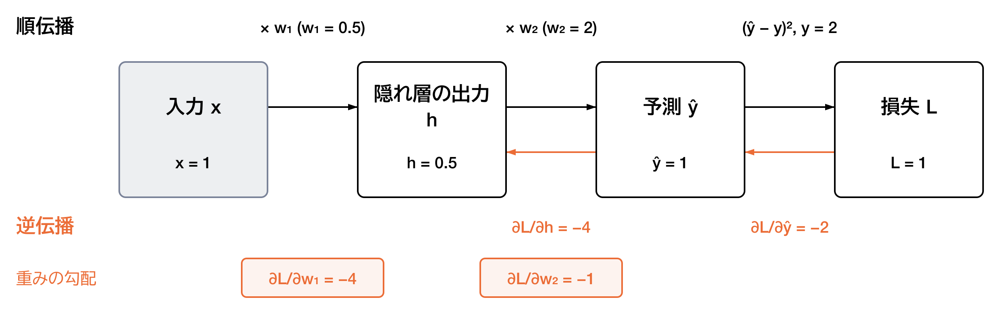
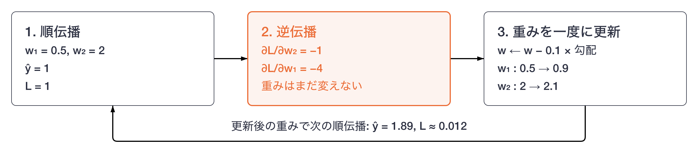

## ニューラルネットワーク概要 {#ニューラルネットワーク概要}

この章から第11章までは, ニューラルネットワークを使って文章や画像などの非構造化データを扱います. 本章ではその土台として, ニューラルネットワークの構成と学習, 文章のような並びを扱う [Transformer と注意機構](block:dl-transformer), 正解を人手で付けずに学ぶ自己教師あり学習を扱います. 学習したモデルを使い続けるための評価と再学習は, [第10章](/lectures/dsp10.html)の[AI の学習と推論, 評価, 再学習](block:dl-lifecycle#ai-の学習と推論-評価-再学習)で扱います (第 8 回の授業で本章とあわせて扱う範囲です).

この講義では, ニューラルネットワークを自分で開発して学習させることはしません. そのため本章ではプログラムを書かず, 図と手計算で仕組みを説明します. 例として, 手書きの数字の認識と, 「猫が鳴く」という短い文の 2 つを使います. 授業でモデルを動かす例は, [第9章](/lectures/dsp9.html) (自然言語処理) と [第11章](/lectures/dsp11.html) (画像認識) にあります. [第10章の発展の事例](block:dl-training-case#事例-品目名から製造業の中分類を当てる)でも, BERT を追加学習して動かします.

# []{#パーセプトロン}パーセプトロン {#perceptron}

**ニューラルネットワーク (Neural Network)** は, 人間の脳の神経回路を模倣した数学モデルです. 脳は 1000 億個のニューロン (神経細胞) が軸索を通じて結合したネットワークです. あるニューロンが受け取った電気信号が一定の閾値を超えると, そのニューロンも電気信号を発し, つながっている先のニューロンへ伝えます. この仕組みを数学的に模倣したものが**パーセプトロン**です.

上図のパーセプトロンでは, 2 つのニューロンから発せられた信号 ($x_1, x_2 = 0, 1$) が, それぞれ重み ($w_1, w_2$) を掛けられて $y$ に伝わります. 重みは, それぞれのニューロンからの信号の重要性を表します. 例えば, $y$を以下のように定めると, $y$は重み付けされた$x_1,x_2$が特定の閾値$\theta$を超えると$1$, 超えなかった場合は$0$を発するという意味になります.

$$
y = \begin{cases}
1 & (w_1x_1 + w_2x_2 > \theta) \\
0 & (w_1x_1 + w_2x_2 \leq \theta)
\end{cases}
$$

パーセプトロンはコンピュータの計算における論理演算との関連が深く, 論理演算を実装することができます.
例えば, `AND演算`と`OR演算`を考えてみましょう. `TRUE`を`1`, `FALSE`を`0`とした場合のそれぞれの真偽値表は, 以下のようになります.

- AND

|$x_1$|$x_2$| $~y~$ |
|:---:|:---:|:---:|
| 0   |  0  |  0  |
| 1   |  0  |  0  |
| 0   |  1  |  0  |
| 1   |  1  |  1  |

- OR

|$x_1$|$x_2$| $~y~$ |
|:---:|:---:|:---:|
| 0   |  0  |  0  |
| 1   |  0  |  1  |
| 0   |  1  |  1  |
| 1   |  1  |  1  |

論理ゲートは AND・OR だけではありません. **AND の否定**である `NAND` (両方が 1 のときだけ 0) や, **片方だけが 1** のときに 1 になる `XOR` (排他的論理和) など, いくつかの基本的なゲートがあります. それぞれが「どんな入力のときに 1 を出すか」は, 2 つの集合の重なりとして描くと直感的に理解できます. 円 $A$ を「$x_1 = 1$」, 円 $B$ を「$x_2 = 1$」とし, **塗りつぶした領域が出力 1** になる入力の組み合わせを表します (重なり=両方 1, 外側=両方 0).

- **AND**: 両方が 1 のときだけ 1 = 2 つの円の **重なり** だけを塗る.
- **OR**: どちらかが 1 なら 1 = 2 つの円の **和集合** を塗る.
- **NAND**: AND の否定 = **重なり以外すべて** (外側も含む) を塗る.
- **XOR**: 片方だけが 1 のとき 1 = 重なりを除いた **左右の三日月** を塗る.

まずはこの図で各ゲートが「何をする演算なのか」を掴んでおきましょう.

このような演算は例えば以下のように$w_1,w_2,\theta$を定めると実現できます.

- `AND`

$$
y = \begin{cases}
1 & (x_1 + x_2 > 1) \\
0 & (x_1 + x_2 \leq 1)
\end{cases}
$$

- `OR`

$$
y = \begin{cases}
1 & (0.5x_1 + 0.5x_2 > 0.2) \\
0 & (0.5x_1 + 0.5x_2 \leq 0.2)
\end{cases}
$$

このとき, 例えばOR演算を実装する$y$を, $y = f(w_1x_1+w_2x_2)$ として,

$$
f(x) = \begin{cases}
1 & (x > 0.2) \\
0 & (x \leq 0.2)
\end{cases}
$$

のように表すことができます. このような特定のニューロンの発火の有無を決める関数を**活性化関数 (activation function)** と呼びます.

パーセプトロンでは, 活性化関数として, 特定の閾値に重み付け入力合計値が達するか否かによって出力が0か1のいずれかになります. このような, 0/1が特定の閾値で極端に切り替わる関数を**ステップ関数**, **階段関数**などと呼びます.

## 重みとバイアスでゲートを切り替える {#重みとバイアスでゲートを切り替える}

上の AND・OR は, いずれも「重み付き入力の合計がある閾値を超えたら発火する」という**同じ仕組み**を使っており, 違うのは重み $w_1,w_2$ と閾値だけでした. 閾値 $\theta$ を左辺に移して**バイアス** $b = -\theta$ と書き直すと, どのゲートも

$$
y = \begin{cases}
1 & (w_1 x_1 + w_2 x_2 + b > 0) \\
0 & (\text{otherwise})
\end{cases}
$$

という一つの式で表せます. つまり**重み $w_1,w_2$ とバイアス $b$ という3つのパラメータを変えるだけ**で, 同じパーセプトロンが別の論理ゲートに変わります. 代表的なゲートのパラメータ例は以下の通りです.

| ゲート | $w_1$ | $w_2$ | $b$  | 意味 |
|:------:|:-----:|:-----:|:----:|:-----|
| AND    | 0.5   | 0.5   | -0.7 | 両方 1 のときだけ発火 |
| OR     | 0.5   | 0.5   | -0.2 | どちらか 1 なら発火 |
| NAND   | -0.5  | -0.5  | 0.7  | AND の否定 (両方 1 のときだけ 0) |

`NAND` (Not AND) は重みとバイアスの符号を AND と反転させたもので, 両方の入力が 1 のときだけ 0 を, それ以外では 1 を出力します.

## 単層では作れないゲート: XOR と線形分離可能性 {#単層では作れないゲート-xor-と線形分離可能性}

ところが, **XOR (排他的論理和)** だけは, 上のように重みとバイアスを選んでも**1個のパーセプトロンでは絶対に表現できません**.

|$x_1$|$x_2$| $~y~$ |
|:---:|:---:|:---:|
| 0   |  0  |  0  |
| 1   |  0  |  1  |
| 0   |  1  |  1  |
| 1   |  1  |  0  |

なぜ作れないのかは, 入力平面 $(x_1, x_2)$ に 4 通りの入力を点として打ってみると分かります. パーセプトロンの発火条件 $w_1 x_1 + w_2 x_2 + b > 0$ は, 境界 $w_1 x_1 + w_2 x_2 + b = 0$ という **1 本の直線で「出力 1 の点」と「出力 0 の点」を分ける** ことに対応します. このように直線で分離できることを **線形分離可能 (linearly separable)** といいます.

上図のように, **OR** は出力 0 の $(0,0)$ だけを, **AND** は出力 1 の $(1,1)$ だけを, それぞれ 1 本の直線で切り離せます. ところが **XOR** は, 出力 1 の $(1,0), (0,1)$ と出力 0 の $(0,0), (1,1)$ が **対角に交互** に並ぶため, どんな直線を引いても必ず片側に 1 と 0 が混ざり, 分離できません. これが, 単一のパーセプトロンで XOR を表現できない理由です.

そこで, XOR は **複数のゲートを組み合わせる (層を重ねる)** ことで実現します. 例えば

$$
\text{XOR}(x_1, x_2) = \text{AND}\bigl(\text{NAND}(x_1, x_2),\ \text{OR}(x_1, x_2)\bigr)
$$

と書けます. 1段目で `NAND` と `OR` を並列に計算し, その2つの出力を2段目の `AND` に入力する **2層構成** です. このように, **単層では表せない関数も層を重ねれば表せる**という事実が, 次節で述べる多層ニューラルネットワークの出発点になります.

> なお, ここで挙げた AND・OR・NAND・XOR は, 関数型言語の演習として実際に Haskell で実装できます. 「同じ `perceptron` 関数の部分適用で各ゲートを作り, それらを合成して XOR を組む」例は [関数型プログラミング講義 fp5 の Exercise CH5-6](/lectures/fp5.html#exercise-ch5-6) を参照してください.

この節に対応する演習は, 章末の[Exercise DSP8-1](#exercise-dsp8-1)です.

# []{#ニューラルネットワークの構成}ニューラルネットワークの構成 {#network-architecture}

これまでに説明してきたパーセプトロンは, 入力 $x_1, x_2$ の層と, 入力を受け取る $y$ の層の 2 層からなります. ニューロンの数や層の数を増やすと, より複雑な条件を表現できます.

基本的なニューラルネットワークではネットワークを入力層, 隠れ層, 出力層の3層に分類します.

ここで隠れ層において n 個の入力ニューロン$(x_1,x_2,...,x_n)$からm個の出力ニューロン$(y_1,y_2,...,y_m)$に入力がある場合, 各出力ニューロンの発火条件は以下のように行列形式で表現されます.

$$
\begin{align*}
&Y = f(WX + B) \\
&W: 重み行列 ; (m \times n) \\
&X: 入力ベクトル ; (n \times 1) \\
&B: バイアスベクトル ; (m \times 1) \\
&f: 活性化関数 (要素ごとに適用される非線形関数) \\
&Y: 出力ベクトル ; (m \times 1) \\
\end{align*}
$$

具体的には, 重み行列 $W$, 入力ベクトル $X$, バイアスベクトル $B$ を以下のように定義します.

各入力ニューロン $x_j$  から出力ニューロン  $y_i$  への接続には重みが存在し, それを  $w_{ij}$  とします. このとき, 重み行列  $W$  は次のように表されます:

$$
W =
\begin{bmatrix}
w_{11} & w_{12} & \cdots & w_{1n} \\
w_{21} & w_{22} & \cdots & w_{2n} \\
\vdots & \vdots & \ddots & \vdots \\
w_{m1} & w_{m2} & \cdots & w_{mn}
\end{bmatrix}
$$

入力ベクトル  X :
$$
X =
\begin{bmatrix}
x_1 \\
x_2 \\
\vdots \\
x_n
\end{bmatrix}
$$

バイアスベクトル  B :
$$
B =
\begin{bmatrix}
b_1 \\
b_2 \\
\vdots \\
b_m
\end{bmatrix}
$$

出力ベクトル  Y :
$$
Y =
\begin{bmatrix}
y_1 \\
y_2 \\
\vdots \\
y_m
\end{bmatrix}
$$

このとき, 発火条件は活性化関数を利用して以下のように計算されます.

$$
Y = f(WX + B)
$$

単純なニューラルネットワークでは, 隠れ層において, 全てのニューロンが結合している**全結合層 (Affine Layer)** が使用されています. 全結合層は, 行列演算を用いて入力データを重み付けし, バイアスを加算する操作を行います. これにより, ネットワークが入力データの全体的な特徴を学習することが可能になります.

パーセプトロンでは, 活性化関数としてステップ関数が利用されており, その出力は必ず0か1でした.

ニューラルネットワークでは, 通常, 非線形の**シグモイド関数**や**ReLU 関数 (Rectified Linear Unit function)**
などが利用され出力が0,1以外の値を取ります.

- `シグモイド関数`

$$
f(x) = \frac{1}{1+\exp(-x)}
$$

出力を 0 から 1 の範囲に変換するため, 確率を表現する場面で使われることがあります.

- `ReLU`

$$
f(x) = \begin{cases}
x & (x > 0) \\
0 & (x \leq 0)
\end{cases}
$$

ReLUは計算が効率的で, 学習を早める効果があるため, 現在最も広く利用されている活性化関数です.

出力層では, 解きたい問題の性質に応じて適切な活性化関数が選択されます.

::: note

1. 回帰問題 (数値を予測する場合):

出力層には**恒等関数 (Identity Function)** が使用されます. この場合, 出力はそのまま数値として扱われます.

$$
f(x) = x
$$

2. 分類問題 (カテゴリを予測する場合):

出力層には softmax 関数が使用されることが一般的です. softmax 関数は, 出力を確率分布に変換します.

$$
f(x_i) = \frac{e^{x_i}}{\sum_{j} e^{x_j}} \\
$$

$x_i$ : i番目の出力ニューロンの値, $f(x_i)$ : i 番目のカテゴリの確率, $\sum_j f(x_j)$ = 1 : 全てのカテゴリの確率の総和が1になる.

softmax 関数は, 手書き文字認識や画像分類タスクのように, 複数のクラスを予測する場面で広く使われています.

:::

これらの層を組み合わせると, 一般的なニューラルネットワークは次の構造になります.

この節に対応する演習は, 章末の[Exercise DSP8-1](#exercise-dsp8-1)です.

# []{#ニューラルネットワークの学習}ニューラルネットワークの学習 {#network-training}

パーセプトロンはそれぞれの重みを人間が設定する必要がありました. しかし, 複雑な条件を満たすネットワークの重みを人間が設定するのは現実的ではありません. そこで, **それぞれの重みを機械学習によってデータから自動で学ぶようにしたものがニューラルネットワークです**.

ニューラルネットワークの学習では, ネットワーク内の重み $(w_1, w_2, \dots, w_n)$ とバイアス ($b$) の値を適切に調整することで, モデルが入力データから期待される出力を生成できるようにします. このプロセスは次の手順で進行します.

::: note

- ### 順伝播と損失関数の計算 {#順伝播と損失関数の計算}

入力データをネットワークに通し, 各層のニューロンで計算が行われ, 最終的な出力が生成されます. この出力は予測値として解釈されます. このようなデータに基づく計算の過程を**順伝播 (Forward Propagation)** といいます.

例えば, 手書きの 0 から 9 の数字を認識するタスクでは, $m \times n$ ピクセルの画像データが入力され, 最終出力層で 0 から 9 のいずれかを予測します.

学習のためにはネットワークの予測値と実際の正解データとの差を数値化して, より良い重みを発見する必要があります. その際の予測値と正解データとの差を数値化するための関数を損失関数と呼びます. この損失関数は, ネットワークがどれだけ誤った予測をしているかを示す指標となります.

一般的な損失関数の例:

- 平均二乗誤差 (Mean Squared Error, MSE): 回帰タスクで使用
$$
L = \frac{1}{N} \sum_{i=1}^{N} (y_i - \hat{y}_i)^2
$$

- 交差エントロピー損失 (Cross-Entropy Loss): 分類タスクで使用

$$
L = -\sum_{k=1}^{K} y_k \log(\hat{y}_k)
$$

平均二乗誤差の $N$ はデータの数, $y_i$ は正解の値, $\hat{y}_i$ は予測値です. 交差エントロピー損失は 1 つのデータについての式で, $K$ はクラスの数, $y_k$ は正解のクラスなら 1, それ以外なら 0, $\hat{y}_k$ はモデルがクラス $k$ に付けた確率です. $y_k$ は正解のクラスでだけ 1 なので, 和の中で残るのは正解のクラスの項だけになり, 損失は「正解のクラスに付けた確率の対数に負号を付けたもの」になります.
:::

::: note

- ### 逆伝播と重みの修正 {#逆伝播と重みの修正}

- 勾配降下法 (Gradient Descent)

損失 $L$ を小さくするには, 各重みを, その重みを少し増やしたときに損失が増える向きとは逆へ動かします. その向きと大きさを表すのが, 損失を重みで偏微分した値 $\frac{\partial L}{\partial w}$ です. すべての重みとバイアスについての偏微分をまとめたものを**勾配 (gradient)** といいます. 勾配を用いて重みとバイアスを更新する最も基本的な方法が勾配降下法です.

$$
W_{new} = W_{old} - \eta \frac{\partial L}{\partial W}
$$

ここで, $L$ は損失関数, $\frac{\partial L}{\partial W}$ は重み $W$ に関する損失関数の勾配, $\eta$ は重みの更新量を決める定数 (学習率, learning rate) です.

例として, シンプルな1次元関数の最小化を考えます.
$$L(w) = (w - 2)^2$$
ここで, 最小値は  $w = 2$  です.

1.  初期値を  $w = 0$ , 学習率を  $\eta = 0.1$  とします.
2.  勾配を計算します.

$$\frac{\partial L}{\partial w} = 2(w - 2)$$
初期値  $w = 0$  のとき,
$$\frac{\partial L}{\partial w} = -4 $$

3.  重みを更新します.
$$w_{new} = w_{old} - \eta \cdot \frac{\partial L}{\partial w} $$
$$w_{new} = 0 - 0.1 \cdot (-4) = 0.4 $$

この処理を繰り返していくと重みは理論的な最小値の2に近づいていきます.

ニューラルネットワークの層 $Y = f(WX + B)$ では, $\frac{\partial L}{\partial W}$ は $W$ と同じ形の行列で, 各成分は対応する重みについての偏微分です. 上の例では $L$ を $w$ で直接微分できました. しかし, ニューラルネットワークの重みは層ごとに多数あり, 損失はそれより出力側の層の計算を通してしか重みに依存しません. すべての重みとバイアスについて偏微分を効率よく求める方法が, 次の誤差逆伝播法です.

- 誤差逆伝播法 (Backpropagation)

誤差逆伝播法で出力層から入力層へ逆向きに伝わるのは, **損失を各層の出力で偏微分した値** (その層の出力が少し変わったときに損失がどれだけ変わるか) です. 誤差逆伝播法の「誤差」はこの値を指します.

重みが 2 個だけのネットワークで計算してみます. 入力 $x$ に重み $w_1$ を掛けたものが隠れ層の出力 $h = w_1 x$, それに重み $w_2$ を掛けたものが予測 $\hat{y} = w_2 h$ で, 損失は $L = (\hat{y} - y)^2$ とします. 活性化関数とバイアスは省きます.

次の図は, このネットワークと, 以下で計算する値をまとめたものです. 上段の黒の矢印が順伝播で, 左から右へ各層の値を求めます. 下段の色付きの矢印が逆伝播で, 右から左へ損失の偏微分を渡し, その途中で 2 つの重みの勾配が求まります.

順伝播: $x = 1, w_1 = 0.5, w_2 = 2$, 正解 $y = 2$ とすると, $h = 0.5$, $\hat{y} = 1$, $L = (1 - 2)^2 = 1$ です.

逆伝播では, 出力側から順に偏微分を求めます.

1. 予測についての偏微分: $\frac{\partial L}{\partial \hat{y}} = 2(\hat{y} - y) = -2$
2. 出力層の重みの勾配は $\frac{\partial L}{\partial w_2} = \frac{\partial L}{\partial \hat{y}} \cdot h = -2 \times 0.5 = -1$ です. 隠れ層へは $\frac{\partial L}{\partial h} = \frac{\partial L}{\partial \hat{y}} \cdot w_2 = -2 \times 2 = -4$ を渡します.
3. 隠れ層の重みの勾配は, 受け取った値を使って $\frac{\partial L}{\partial w_1} = \frac{\partial L}{\partial h} \cdot x = -4 \times 1 = -4$ です.

どの段でも, 1 つ出力側の層から受け取った値に, その層の計算の微分を掛けています. これは合成関数の微分 (連鎖律) で, 層が何十あっても同じ掛け算を入力側へ向かって繰り返します. 活性化関数 $f$ がある層では, その導関数 $f'$ も掛けます. 手順 2 で $h$ を使っているように, 逆伝播には順伝播で求めた各層の出力が要るので, 順伝播の途中の値は保存しておきます.

すべての重みの勾配が求まってから, 勾配降下法で全部の重みを一度に更新します. 学習率を $\eta = 0.1$ とすると,

$$
w_2 = 2 - 0.1 \times (-1) = 2.1, \quad w_1 = 0.5 - 0.1 \times (-4) = 0.9
$$

です. 更新後の重みで順伝播すると $\hat{y} = 0.9 \times 2.1 = 1.89$, $L = (1.89 - 2)^2 \approx 0.012$ となり, 損失は 1 から小さくなります.

更新を最後にまとめて行うのは, 手順 2 で $\frac{\partial L}{\partial h}$ を更新前の $w_2 = 2$ で計算しているからです. 先に $w_2$ を $2.1$ に書き換えてから $\frac{\partial L}{\partial h}$ を求めると $-4.2$ になり, 更新前の重みでの勾配とは違う値になります.

まとめると, 1 回の学習は次の手順です.

1. 順伝播で予測と損失を求める (各層の出力を保存する).
2. 逆伝播で, 出力層から入力層の順にすべての重みとバイアスの勾配を求める. この間, 重みは変えない.
3. 勾配降下法で, すべての重みとバイアスを一度に更新する.

重みが 2 個の例でこの 3 つの手順をたどると, 次の図のようになります. 手順 2 の逆伝播では重みを変えずに 2 つの勾配を求め, 手順 3 で 2 つの重みを同時に更新します. 更新後の重みで次の順伝播を行うと, 損失は 1 から約 0.012 に下がります.

:::

::: note

- ### 繰り返し学習 {#繰り返し学習}

順伝播, 損失の計算, 逆伝播, 重みの更新を繰り返し, ネットワークが徐々にデータの特徴を学習します. 訓練データ全体を 1 回使い切るまでの単位を**エポック (Epoch)** と呼びます. 十分なエポックを実行することで, モデルは訓練データに対して高い精度を達成することが期待されます.

学習では, 全てのデータを一度に処理するのではなく, **バッチ処理 (Batch Processing)** と呼ばれる手法を使用するのが一般的です. データセットをいくつかの小さなグループ (バッチ) に分割し, 各バッチごとに順伝播と逆伝播を実行し, 重みを 1 回更新します.

データセットをいくつかの小さなバッチに分割して処理する手法を**ミニバッチ学習 (mini-batch learning)** といいます. 一度に計算するデータが少ないのでメモリの使用量を抑えられ, バッチ内のデータを GPU で並列に計算できます. また, 1 つのデータごとに重みを更新するより, 勾配のばらつきが抑えられます.

例えば, データセットが10,000個のサンプルで構成されている場合, バッチサイズを100に設定すると, モデルは100個のデータを1つのバッチとして扱い, 全部で100のバッチを処理することになります. 1エポックでは100回の更新が行われ, これを複数回繰り返して学習が進行します.

ミニバッチ学習はモデルの効率的な学習とメモリ使用量のバランスを取るため, 実務で最も一般的に使われています. 例えば, バッチサイズを32や64に設定することが多いです.

:::

この節に対応する演習は, 章末の[Exercise DSP8-1](#exercise-dsp8-1)です.

# []{#演習}演習 {#exercises}

以下の問いは計算を求めません. 本文の説明を読み返しながら答えてください.

## Exercise DSP8-1 {#exercise-dsp8-1}

**ニューラルネットワークの構成と学習**

対応する節: [パーセプトロン](#パーセプトロン), [ニューラルネットワークの構成](#ニューラルネットワークの構成), [ニューラルネットワークの学習](#ニューラルネットワークの学習)

1. 1 個のパーセプトロンで XOR を表現できない理由を, 「直線」という語を使って説明してください.
2. 活性化関数に, 入力をそのまま出力する関数 ($f(x) = x$) しか使わないと, 層をいくら重ねても 1 層と同じ表現力しか得られません. 隠れ層に非線形の活性化関数 (ReLU など) を使う理由を, この事実を踏まえて説明してください.
3. 次の文のうち, 誤っているものを 1 つ選び, 正しく直してください.
    - (a) 損失関数は, モデルの予測と正解のずれを数値にしたものである.
    - (b) 誤差逆伝播法は, 損失を小さくするために各重みをどちらへ動かせばよいか (勾配) を計算する方法である.
    - (c) 学習率を大きくするほど, 学習は必ず速く正確に進む.

    
 回答例 

1. パーセプトロンは, 入力の平面を 1 本の直線で「出力 1」の領域と「出力 0」の領域に分けます. XOR では出力 1 の点 $(1, 0), (0, 1)$ と出力 0 の点 $(0, 0), (1, 1)$ が対角に並ぶので, どんな直線を引いても片側に 1 と 0 が混ざり, 分けられません.
2. $f(x) = x$ だと各層の計算は $WX + B$ だけになり, 2 層を重ねても $W_2 (W_1 X + B_1) + B_2 = (W_2 W_1) X + (W_2 B_1 + B_2)$ のように 1 層の式にまとまります. 非線形の活性化関数を挟むとこのまとめができなくなり, 層を重ねるほど複雑な関係 (XOR のように直線で分けられない関係) を表せるようになります.
3. (c) が誤りです. 学習率が大きすぎると, 1 回の更新で損失の最小値を飛び越え, 損失が小さくならなかったり, かえって大きくなったりします. 学習率は, 小さすぎると学習が遅く, 大きすぎると不安定になるので, 適度な大きさを選びます.

