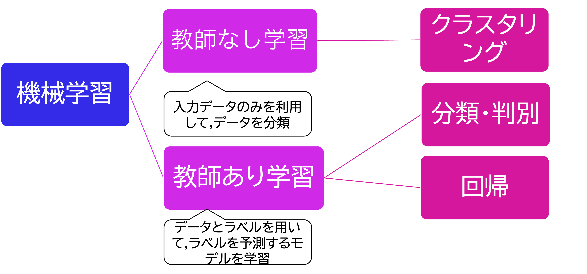
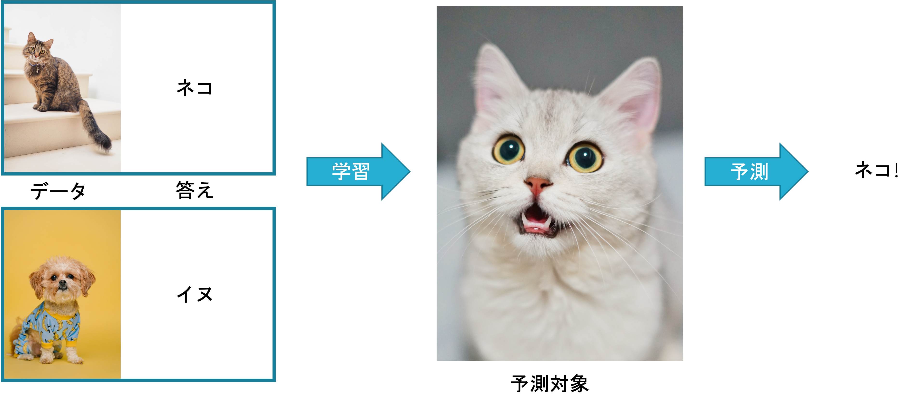
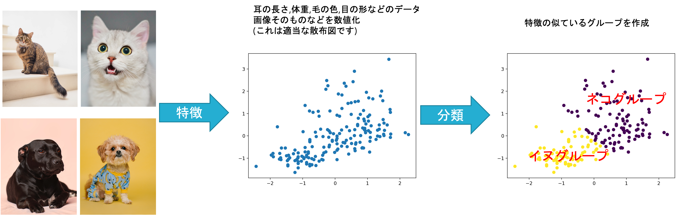

## 人工知能の歴史 {#人工知能の歴史}

統計, 機械学習, AI, データサイエンスなどの違いはそれほどはっきりしていません. このことは[データサイエンスとは](block:design-process#data-science)でも扱いました.

AI は *Artificial Intelligence (人工知能)* の略語です. 世の中では, 様々なものが AI と呼ばれており,

::: note
- Automated Instruments (自動化されたなにか)
- Anything IT-related (IT に関連したなんでも)
:::

などの AI という用語の濫用を揶揄する言葉もあります.

AI が研究の課題として最初に提起された 1956 年のダートマス会議の[提案書](https://ojs.aaai.org/aimagazine/index.php/aimagazine/article/view/1904)では AI の研究を以下のように定義しています.

> この研究は, 学習のあらゆる側面, あるいは知能のその他の特徴は原則として, 機械がそれをシミュレートできるほど正確に記述できるという推測に基づいて進められる.
>
> 機械に言語を使わせ, 抽象や概念を形成させ, 現在人間にしかできないような種類の問題を解決させ, 自らを向上させる方法を見つける試みがなされる.
>
> 注意深く選ばれた科学者たちがひと夏の間, 一緒にこの問題に取り組めば, これらの問題のひとつやふたつに大きな進歩がもたらされると, 私たちは考えている.

このように当初の AI の定義によれば, AI は,

1. 抽象や概念を形成する
2. 現在人間にしかできないような種類の問題を解決し
3. 自らを向上させる方法を見つける

ことができる機械であるとされています.

当初の AI 研究では, 特に 2 番目の問題解決に焦点を当てていました.

例えば, ノーベル経済学賞を受賞した, ハーバート・A・サイモンらが人間の問題解決の手法を模倣して作った最初期の AI である**GPS (General Problem Solver) 一般問題解決器**が有名です.

GPS では, 「問題」を「現在と目標との差異」と定義して, 目標と現状の差を小さな差に分解し, それを順に解消していけば, おおよそすべての問題を解決できるとしました.

::: note
- 目標: 対象 A を対象 B に変換せよ
  - 対象 A と対象 B を照合し差 D を見つけよ
  - サブゴール D を縮小せよ
  - サブゴール A'を B に変換せよ

- 目標: 対象 A と対象 B との間の差 D を縮小せよ
  - D を縮小するのに適した作用子 Q を探せ
  - 実行可能かどうかテストせよ
  - サブゴール A に Q を適用して A'を作る

- 目標: 対象 A に作用子 Q を適用せよ
  - Q の条件を A と照合し差を見つけよ
  - サブゴール D を縮小せよ
  - サブゴール A'に Q を適用せよ

(cf. Newell, Allen, and Herbert A. Simon: "GPS, A Program that Simulates Human Thought,"Lernende Automaten, Munchen (R. Oldenbourg, ed.) (1961), Reprinted in Computers and Thought(Feigenbaum and Feldman, eds.) (1963) )
:::

しかしこの手法は, 目標と現状を明確に記述でき, 両者の差を測ることができ, その差を埋める手段が定まっている問題 (チェスや迷路など) にしか適用できませんでした.

その他にも, 基本的には当時の AI は, 「問題の解決の仕方」を人間が定義して, それを直接的にプログラムするという手法で開発されています.

その後, AI の発展は以下の年表のような歴史を辿ります.

::: note
| AI ブーム              | 内容                                                                                                       |
|-----------------------|------------------------------------------------------------------------------------------------------------|
| 第1次 AI ブーム         | • 1956年: ダートマス会議でスタート • 一般問題解決器 (現状と目標との差異) • 一般的な問題解決の手順を, 人間が条件分岐などで直接プログラム • 1960年代はじめ: 機械翻訳の失敗で収束 |
| 第2次 AI ブーム         | • 1980年代はじめ: エキスパートシステム, 機械翻訳 • 知識の活用を目指す (辞書などの知識をデータベースとして整理して利用) • 1980年代はじめ: 第5世代コンピュータープロジェクト • 1990年代はじめ: 知識導入・商業性で収束 |
| 第3次 AI ブーム         | • 2010年から現在: ANN (Artificial Neural Network) の復活 • 検索エンジン研究で発達 • ゲームでの成功 (チェス, 将棋, 囲碁) • パターン認識での成功例 (音声解析, 画像解析など) |
| 第4次 AI ブーム         | • 現在: 生成系 AI • 画像・動画・音声                                                                                  |

(cf. 寺野隆雄, 生成系AIの歴史・原理・現状, 千葉商科大学 2023年 第1回FD 「生成系AIに関するFD」 ,2023/05/18)
:::

この歴史のすべては扱いませんが, 第3次以降の AI ブームは, ダートマス会議の提案にある「3. 自らを向上させる方法を見つける」に関わる技術の発展によるものです.

この解説では, まず大規模言語モデルの歴史と, 大規模言語モデルがあっても機械学習が使われる理由を確かめます. 次に, この「自らを向上させる」機械である**機械学習**の概要と, 教師あり学習の手法の 1 つである[決定木](block:ml-classification#決定木分析), [分類の評価](block:ml-classification#分類の評価)の方法を扱います.
機械学習に関連する手法は, [クラスタリング](block:ml-clustering#クラスタリング), [ニューラルネットワーク](block:ml-network#ニューラルネットワーク概要), [自然言語処理](block:nlp-processing#自然言語処理), [画像認識](block:img-recognition#画像認識)の解説を参照してください.

## 大規模言語モデルの歴史 {#llm-history}

上の年表で第 4 次 AI ブームに挙げた生成系 AI のうち, 文章を扱うものの中心にあるのが**大規模言語モデル (LLM; Large Language Model)** です. LLM は, 大量の文章から言葉の並びの出やすさを学習したニューラルネットワークで, 文章の続きを 1 トークンずつ作ることで, 質問への回答, 要約, 翻訳, プログラムの作成などを行います. 普及までの流れは次のとおりです.

| 年 | 出来事 |
|---|---|
| 2017 | Google の研究者らが Transformer を提案する ([Transformer と注意機構](block:dl-transformer#transformer-と注意機構)). 文章の全体を並列に処理できるので, 大量のデータで大きなモデルを学習しやすい |
| 2018 | Google が BERT, OpenAI が GPT を発表する. 大量の文章で事前学習したモデルに, 課題ごとの追加学習をする方法が自然言語処理で広がる ([事前学習と生成](block:nlp-generation#pretraining-and-generation)) |
| 2020 | OpenAI が GPT-3 を発表する. パラメータの数は 1750 億で, 課題の例を数個, 入力 (プロンプト) に書くだけで課題を解けることを示した |
| 2022 | 11 月に OpenAI が ChatGPT を公開する. 指示に従うための追加学習をしたモデルを対話の形で誰でも使えるようにし, 利用者が急速に増えた |

その後は多くの企業や研究機関が同様のモデルを公開し, 公開されたモデルを自分の計算機で動かすこともできるようになりました. 事前学習, 指示に従うための追加学習, 生成の 3 段階の仕組みは, [事前学習と生成](block:nlp-generation#pretraining-and-generation)で扱います.

## 大規模言語モデルと機械学習の用途の違い {#llm-vs-ml}

決定木, 回帰, 分類器などの機械学習は, 課題ごとに入力と出力の形が決まっている点で, LLM と用途が分かれます.

| | 決定木, 回帰, 分類器 | LLM |
|---|---|---|
| 入力 | 課題ごとに決めた説明変数 (表形式のデータなど) | 自然言語の文章 (指示と資料) |
| 出力 | あらかじめ決めた形式の値 (クラス, 確率, 数値) | 文章 (形式は指示で変わる) |
| 学習 | 課題ごとに, 正解付きのデータで学習する | 大量の文章で事前学習したモデルを, 多くの課題に使い回す |
| 向く用途 | 会員の退会予測のように, 決まった項目から決まった値を大量に求める | 問い合わせへの返信の下書き, 要約, 翻訳のように, 文章を作る |

LLM に文章の感情の分類を頼むこともでき, 同じ課題を[BERT のファインチューニング](block:nlp-bert#マルチラベル分類)で解くこともできます. どちらでも解ける課題での使い分けは, [計算の費用](#計算の費用と応答の速さ), [決定性](#決定性-同じ入力に同じ出力を返す性質), [説明可能性](#予測の根拠を読めること)で決まります.

# 機械学習がまだ使われる理由 {#why-ml-still-used}

LLM で多くの課題を解けるようになった後も, 決定木や回帰のような機械学習は使われ続けています. 計算の費用と速さ, 同じ入力に同じ出力を返す性質, 予測の根拠を読めることの 3 点で, 小さなモデルのほうが向く課題があるからです.

## 計算の費用と応答の速さ {#計算の費用と応答の速さ}

LLM は数十億個以上のパラメータをもち, 学習にも推論にも GPU などの大きな計算資源を使います. LLM の API は一般に, 処理したトークンの数に応じて料金がかかり, 出力は 1 トークンずつ作るので, 回答が長いほど時間がかかります. [決定木](block:ml-classification#決定木分析)は, 深さ 2 なら予測が 2 回の比較で終わります. 退会予測のように, 項目の決まった表から 1 件ずつ値を求め, それを毎日何万件も繰り返す課題では, 小さなモデルで足りることが多く, 1 件あたりの費用と時間の差が件数に比例して積み上がります.

## 決定性: 同じ入力に同じ出力を返す性質 {#決定性-同じ入力に同じ出力を返す性質}

学習を終えた決定木や[線形回帰](/lectures/dsp5.html)は, 分岐の条件や係数が固定されているので, 同じ入力には毎回同じ出力を返します. この性質を**決定性**といいます. 決定性があれば結果を再現でき, 判定を後から検査しやすくなります.

LLM では, [生成時の温度](block:nlp-generation#pretraining-and-generation)を下げて確率が最大のトークンを毎回選ぶ設定にしても, 同じ出力が返るとは限りません. Horace He らの記事 ([Defeating Nondeterminism in LLM Inference](https://thinkingmachines.ai/blog/defeating-nondeterminism-in-llm-inference/), Thinking Machines Lab, 2025 年 9 月 10 日) は, オープンな LLM の 1 つ (Qwen3-235B-A22B-Instruct-2507) に同じ質問を温度 0 で 1000 回尋ねたところ, 1000 トークンの回答が 80 通りに分かれ, 最も多い回答でも 78 回だったと報告しています. 原因として記事が挙げるのは, サーバの負荷によって, 一緒に処理される要求の数 (バッチの大きさ) が変わることです. 計算の実装がバッチの大きさに応じて足し算の順序を変えると, 浮動小数点の丸めのために結果がわずかに違ってきます. その差で確率の近いトークンの順位が入れ替わると, 以降の文が変わります. 利用者は他の利用者の要求の数を制御できないので, 利用者から見ると出力が決まらないことになります. 同じ記事は, 計算をバッチの大きさに依存しない実装に替えると 1000 回とも同じ回答になったと報告していますが, その分処理に時間がかかります.

## 予測の根拠を読めること {#予測の根拠を読めること}

決定木では, 予測に使われた分岐の条件がそのまま根拠になります ([決定木分析](block:ml-classification#決定木分析)). LLM は理由を文章で答えられますが, その文章が, 実際に答えを導いた計算を表しているとは限りません.

## 出力の形を限った新しいモデル: TypeSafe の Jev {#出力の形を限った新しいモデル-typesafe-の-jev}

LLM とは別に, 文章を生成せず, 決まった形の判断だけを返すモデルも出てきました. TypeSafe 社の **Jev** は, 同社が **System One モデル**と呼ぶ種類の最初のモデルです. 公式の文書 ([System One](https://docs.typesafe.ai/concepts/system-one)) によると, Jev は LLM と同じく自然言語の入力を理解しますが, 文章は書かず, 利用者が決めた選択肢のどれか (たとえば問い合わせの担当を billing, technical, account から選ぶ) と, その確率を返します. クラスとその確率を返す形は, [分類器](block:ml-classification#分類の評価)と同じです. 値の型が決まっているので, プログラムがその値で分岐でき, 文書は, Jev の答えをコードによる決定的な検査と組み合わせる使い方を挙げています. 同じ文書は, 確率が多数の予測をまとめて見たときの不確かさを反映するよう調整されているが, 個々の答えが正しいことの保証ではないとも述べています.

同社は, 繰り返しの評価で安定した答えを返すことと, 速さ, 低い費用を設計の目標に掲げています ([How to build with TypeSafe](https://docs.typesafe.ai/concepts/how-to-build-with-system-one)). 文書に書かれているのは安定を目指す設計であって, 同じ確率値が毎回返るという保証ではありません. 2026 年に公開された新しい製品なので, 仕様や性能は今後変わりえます.

# []{#機械学習}機械学習 {#machine-learning}

回帰などの手法によって, データを用いた**予測**や**判別**を行います. **機械学習**も予測や判別を行うための手法です.

例として, 以下の犬と猫の画像について考えてみましょう.

人間であれば, どれが犬でどれが猫であるかを簡単に判別できます. しかし, **どのようにして判別しているか**を人に説明できるでしょうか?

例えば, 上の画像であれば,

- 猫は鼻が赤く, 犬は黒い
- 猫は耳が立っており, 犬は耳が下がっている

などの違いがあるようにも思えますが, 鼻が黒い猫も, 耳が立っている犬もいます.
初期の AI 開発ではこのようなルールを人間が発見し, プログラムしていました. しかし, 画像から犬と猫を見分けるルールを明確に定義するのはなかなか難しい作業です.

そこで, AI の開発は, 「機械自体が判別のためのルールを発見する」ための学習方法をプログラムする方向に進み始めます. そのような手法全般を**機械学習**といいます.

機械学習の定義は様々ありますが, 有名なものに以下があります.

> "Field of study that gives computers the ability to learn without being explicitly programmed"
> ((機械学習とは)コンピュータに, 明示的にプログラムされなくても学習する能力を与える学問分野)
>
> Arthur Samuel (1959)

統計学の主な目的には次のようなものがあります.

- 記述統計学
  - 集めたデータの特徴を代表値やグラフなどを用いて記述する

- 推測統計学
  - データを利用してその背景 (母集団) を推測する.

いずれも, 得られたデータの特徴を知ることを目的としています.

一方で機械学習は, 得られたデータを利用して, 要約・予測・判別などの「判断」を機械に行わせることが目的であり, どのようにデータを利用して判断するか自体は機械が自ら学習します.

機械学習には大きく分けて「**教師あり学習 (Supervised Learning)**」と「**教師なし学習 (Unsupervised Learning)**」の2種類が存在します.

::: note
- ### 教師あり学習 {#教師あり学習}

訓練データ (データと答えのペア) を学習して, 未知のデータから答えを正しく予測する.

教師あり学習の例を挙げます.

- 回帰
  - [線形回帰](/lectures/dsp5.html)
  - [一般化線形モデル](block:bayes-modeling#一般化線形モデル-glm)
- [決定木分析](block:ml-classification#決定木分析)
- [ランダムフォレスト](block:ml-classifiers#ランダムフォレスト), [サポートベクターマシン](block:ml-classifiers#サポートベクターマシン)
- [ニューラルネットワーク](block:ml-network#ニューラルネットワーク概要)
  - [自然言語処理](block:nlp-processing)
  - [画像認識](block:img-recognition)
:::

::: note
- ### 教師なし学習 {#教師なし学習}

データの特徴 (ベクトル) をもとに, 似たものをグループ分け (クラスタリング) します.

教師なし学習の例を挙げます.

- [クラスタリング](block:ml-clustering#クラスタリング)
  - 階層クラスタリング
  - 非階層クラスタリング
- 主成分分析 ([画像の特徴量の可視化](block:img-more#feature-embedding), [質問紙の次元削減](block:survey-analysis#次元削減))

:::

