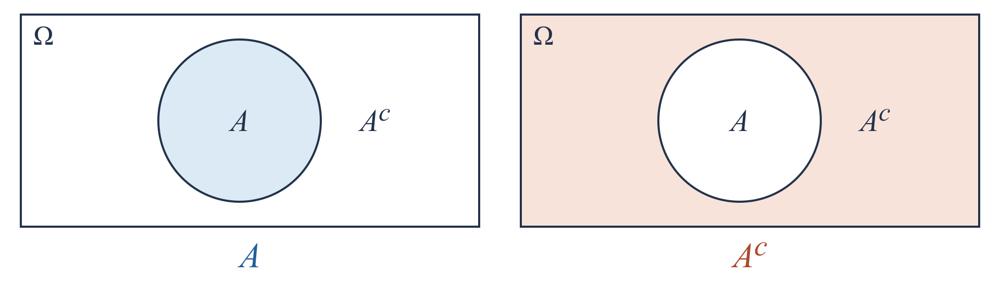
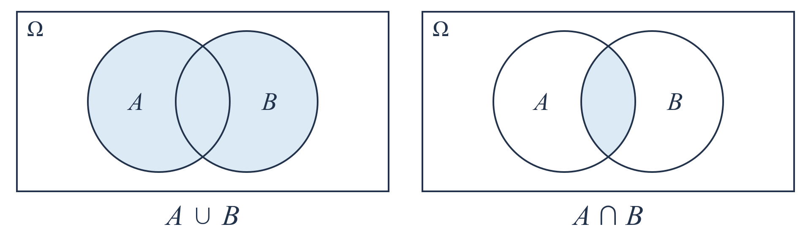
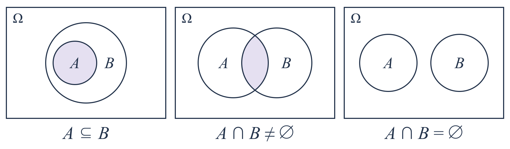
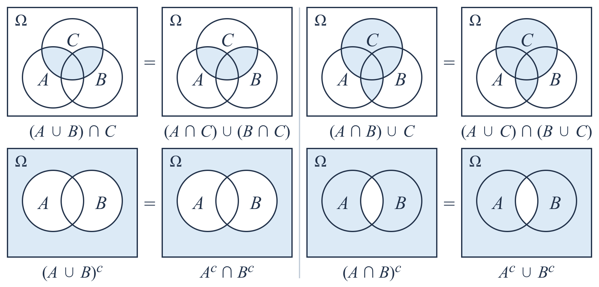
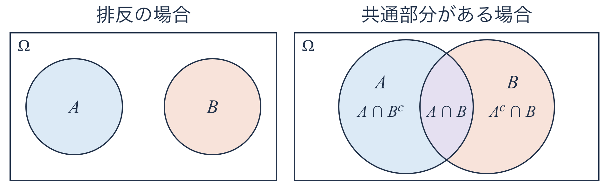
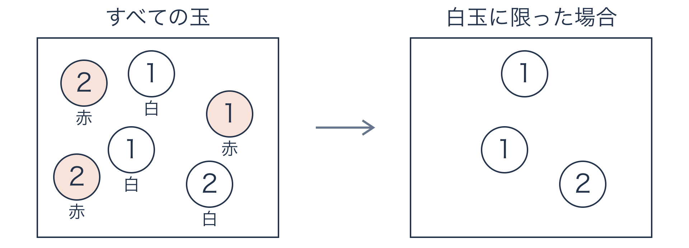
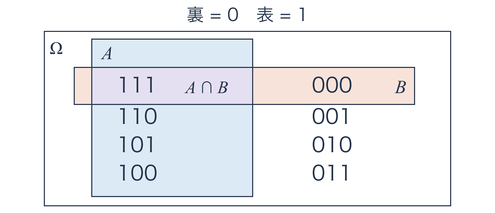

サイコロを振ったときに奇数が出る確率は, 各目が等確率なら, 奇数の目が何通りあるかを数えて求められます.
試行の結果がある条件を満たすことを**事象**と呼び, 条件を満たすすべての結果を集めた集合で表します.
事象を集合で表すと, 少なくとも一方が起こる確率や, 一方が起こったと分かっているときのもう一方の確率を計算できます.

確率と確率分布, 推測統計で使う事象と確率の記号を表に示します.

| 記号 | 意味 |
| --- | --- |
| $\omega$ | 試行で起こりうる個々の結果 (標本点) |
| $\Omega$ | 起こりうる結果すべての集合 (標本空間) |
| $A$, $B$ | 事象 |
| $\varnothing$ | 標本点を一つも含まない事象 (空事象) |
| $A^c$ | $A$ が起こらない事象 |
| $A\cup B$ | $A$ と $B$ のうち少なくとも一方が起こる事象 |
| $A\cap B$ | $A$ と $B$ の両方が起こる事象 |
| $P(A)$ | 事象 $A$ が起こる確率 |
| $P(A\mid B)$ | $B$ が起こったと分かっているときの $A$ の確率 (条件付き確率) |

# 事象と確率の定義 {#probability}

サイコロを 1 回振るという**試行**では, 目の一つ一つが**標本点**です. 標本点を全部集めた**標本空間**は
$\Omega=\{1,2,3,4,5,6\}$ です. 一般に, $n$ 個の標本点 $\omega_1,\ldots,\omega_n$ があるとき,
$\Omega=\{\omega_1,\ldots,\omega_n\}$ と書けます.

奇数が出る事象は, 標本空間の部分集合 $A=\{1,3,5\}$ です. 実際に出た目が $A$ に含まれるとき, $A$ が起こったといいます.
標本点を 1 つだけ含む事象は**根元事象**です. 奇数が出る事象に含まれる根元事象は, $\{1\}$, $\{3\}$, $\{5\}$ です.
標本点を一つも含まない**空事象** $\varnothing$ は, どの目が出ても起こりません.

## 場合の数, 相対度数, 公理

奇数が出る確率を求めるとき, どの目も同様に確からしいとみなせるなら, 6 通りのうち奇数の 3 通りを数えて $3/6=1/2$ と計算できます.
有限個の標本点が等確率であると仮定し, 場合の数の比で確率を求めるのが**古典的定義**です.
標本点が全部で $N$ 個あり, そのうち事象 $A$ に含まれる標本点が $R$ 個なら, $P(A)=R/N$ です.

**頻度による解釈**では, 同じ条件で試行を繰り返したとき, ある事象が起こる割合 (相対度数) が長期的に近づく値を確率とみなします.
例えば, コインを繰り返し投げるときの表の相対度数は, 表が出た回数を投げた回数で割った値です.
相対度数と確率の関係は, 推測統計で扱う大数の法則に結びつきます.

**公理主義的定義**では, 事象に実数を割り当てる関数 $P$ が満たす条件を公理として定めます.
例えば, 確率を場合の数から求める場合にも, 標本空間全体の確率は $1$ です.

1. どの事象 $A$ についても, $P(A)\geq 0$ です.
2. 標本空間全体の確率は $P(\Omega)=1$ です.
3. どの 2 つも共通の標本点を持たない事象 $A_1,A_2,\ldots$ を合わせた事象の確率は, 個々の確率の和です.

$$
P\left(\bigcup_{i=1}^{\infty}A_i\right)=\sum_{i=1}^{\infty}P(A_i).
$$

3 番目の公理を**可算加法性**と呼びます. $\Omega$ に空事象をいくつ合わせても $\Omega$ であり, 確率の和は $1$ です.
各項は非負なので, $P(\varnothing)=0$ になります.
有限個の事象についても, その後に空事象を並べれば同じ加法性を使えます.
事象 $A$ と $A$ に含まれない標本点を集めた事象は, 共通の標本点を持たず, 合わせると $\Omega$ になります.
したがって, 両方の確率の和は $1$ で, $0\leq P(A)\leq 1$ です.

::: note

一般の標本空間では, 確率を割り当てる部分集合の族も指定します.
この族には標本空間が属し, その族に属する集合の補集合や可算個の和集合も属します.
このような族を**可測集合族**といいます. 本稿の有限の例では, 標本空間のすべての部分集合を事象として扱います.

:::

[サイコロを 2 回振る演習](#exercise-prob-basics-1)では, 2 回の目の組を標本点として数えます.
事象どうしに共通の標本点があるか調べるときは, 集合の演算を使います.

# 事象と集合の演算 {#event-operations}

標本空間を一つの領域で表すと, 各事象はその内側の領域として描けます.
集合の包含や重なりを領域で示す模式図を**ベン図**と呼びます.

## 補事象, 和事象, 積事象

事象 $A$ の**補事象** $A^c$ は, $\Omega$ に属し, $A$ には属さない標本点の集合です.
サイコロを 1 回振る例では, $A=\{1,2,3\}$ なら $A^c=\{4,5,6\}$ です.
補事象を取ると $\Omega$ の内側で領域が入れ替わるので, $\Omega^c=\varnothing$ となり, $\varnothing^c=\Omega$ です.
補事象のベン図では, 枠が標本空間 $\Omega$ で, 円の外側から枠の内側までが $A^c$ にあたります.

事象 $A$ と $B$ のうち少なくとも一方が起こる事象を**和事象** $A\cup B$ と呼びます.
両方が起こる事象は**積事象** $A\cap B$ です.
$A=\{1,2,3\}$ に対し $B=\{2,4,5\}$ とすると, 少なくとも一方の集合に含まれる目は $A\cup B=\{1,2,3,4,5\}$,
両方の集合に含まれる目は $A\cap B=\{2\}$ です.
2 枚のベン図を比べると, 円の重なりはどちらにも含まれ, 円の重なり以外が含まれるのは和事象だけです.

## 包含, 重なり, 排反

$A$ のすべての標本点が $B$ に含まれるとき, $A$ は $B$ の**部分集合**であり, $A\subseteq B$ と書きます.
例えば, $B=\{1,3,5\}$ なら, $\{1,3\}$ も $B$ 自身も $B$ の部分集合です.
$A$ と $B$ が共通の標本点を持つときは $A\cap B\ne\varnothing$ です.
共通の標本点が一つもなく $A\cap B=\varnothing$ のとき, $A$ と $B$ は互いに**排反**です.
3 枚のベン図のうち, 円が離れた右端だけが排反です. 左端では小さい円全体が共通部分になります.

{.wide}

[カードの事象を組み合わせる演習](#exercise-prob-basics-2)と[部分集合と排反を判定する演習](#exercise-prob-basics-3)では,
どの標本点が各事象に属するかを調べます.

## 分配法則とド・モルガンの法則

3 つの事象 $A$, $B$, $C$ を組み合わせるときは, 和事象と積事象の**分配法則**を使えます.
$(A\cup B)\cap C$ に属する条件は, $C$ に属し, かつ $A$ または $B$ に属することです.
これは, $A\cap C$ または $B\cap C$ に属する条件と同じです.
和と積を入れ替えた式も, 標本点が属する条件を両辺で比べると確かめられます.

$$
\begin{aligned}
(A\cup B)\cap C &= (A\cap C)\cup(B\cap C), \\
(A\cap B)\cup C &= (A\cup C)\cap(B\cup C).
\end{aligned}
$$

和事象や積事象の補事象は, **ド・モルガンの法則**によって, 個々の事象の補事象で表せます.
$A\cup B$ が起こらないのは, $A$ も $B$ も起こらない場合です.
$A\cap B$ が起こらないのは, $A$ と $B$ のうち少なくとも一方が起こらない場合です.

$$
\begin{aligned}
(A\cup B)^c &= A^c\cap B^c, \\
(A\cap B)^c &= A^c\cup B^c.
\end{aligned}
$$

{.wide}

図では, 各等式の左辺と右辺のベン図で同じ領域が塗られています.
和事象の確率を計算するときも, 2 つの事象の領域がどこで重なるかが手がかりになります.

# 加法定理 {#addition-rule}

和事象 $A\cup B$ が起こる確率を求めるには, $A$ と $B$ が共有する標本点を考えます.
$A$ と $B$ が排反なら, [確率の公理](#probability)の加法性から $P(A\cup B)=P(A)+P(B)$ です.
共通部分がある場合は, 和事象を次の 3 つの互いに排反な部分に分けられます.

| 和事象の部分 | そこに含まれる標本点 |
| --- | --- |
| $A\cap B^c$ | $A$ だけに属する標本点 |
| $A\cap B$ | $A$ と $B$ の両方に属する標本点 |
| $A^c\cap B$ | $B$ だけに属する標本点 |

左のベン図では重なりがなく, 右のベン図では中央の領域が $A$ と $B$ の両方に含まれます.

$P(A)$ と $P(B)$ を足すと, 共通部分の確率だけを 2 回足すことになります.
共通部分の確率を 1 回引くと, **加法定理**が得られます.

$$
P(A\cup B)=P(A)+P(B)-P(A\cap B).
$$

各目が等確率の 6 面サイコロを 1 回振り, 奇数が出る事象を $A=\{1,3,5\}$,
3 以下の目が出る事象を $B=\{1,2,3\}$ とします.
目を直接数えると, $A\cup B=\{1,2,3,5\}$ なので $P(A\cup B)=4/6=2/3$ です.
加法定理では, $P(A)=P(B)=1/2$ を足し, 共通部分 $A\cap B=\{1,3\}$ の確率 $1/3$ を引いて, 同じ $2/3$ を得ます.

補事象の確率も加法性で求められます. $A$ と $A^c$ は排反で, 合わせると $\Omega$ になるので, $P(A^c)=1-P(A)$ です.
[少なくとも 1 問正解する確率](#exercise-prob-basics-4)と[コインの和事象と補事象](#exercise-prob-basics-9)では,
各事象の確率から和事象や補事象の確率を求めます.
標本点が等確率で, 事象に含まれる標本点を一つずつ並べにくい場合は, 場合の数の計算を使います.

# 順列と組合せ {#counting}

カードを何枚か選ぶとき, 選んだカードの並び順を区別するかで, 場合の数が変わります.
異なる 4 枚のカードから 2 枚を選んで並べる場合は, 1 枚目に 4 通り,
2 枚目に残りの 3 通りがあるので, 並べ方は $4\times 3=12$ 通りです.

一般に, 正の整数 $n$ から 1 までを掛け合わせた数を $n$ の**階乗**と呼び, $n!$ と書きます.
例えば, $5!=5\times4\times3\times2\times1=120$ で, $7!=7\times6\times5!=5040$ です.
$0$ 枚を並べる方法は空の並びの 1 通りなので, $0!=1$ とします.

$n$ 個の異なるものから $r$ 個を重複なく選んで並べたものを**順列**と呼びます.
$0\leq r\leq n$ のとき, $n$ 個から $r$ 個を取る順列の数を $\mathord{}_nP_r$ と書きます.
$1\leq r\leq n$ なら, 並べる位置ごとの選択肢を掛けて次の式を得ます.

$$
{}_nP_r=n(n-1)\cdots(n-r+1)=\frac{n!}{(n-r)!}.
$$

$r=0$ の場合にも, 右端の式は空の並び 1 通りを表します.
4 枚から 2 枚を並べる例では, $\mathord{}_4P_2=4!/2!=12$ です.

選んだ $r$ 個の並び順を区別しないときは**組合せ**を数えます.
選んだ $r$ 個に対して $r!$ 通りの順列があるため, 組合せの数 $\mathord{}_nC_r$ は次の式で求められます.

$$
{}_nC_r=\frac{{}_nP_r}{r!}=\frac{n!}{r!(n-r)!}.
$$

異なる 5 枚のカードから 3 枚を取る場合, 並び順まで区別すると $5\times4\times3=60$ 通りです.
組合せだけを区別すると, 同じ 3 枚の並べ方 6 通りを一つにまとめるので $60/6=10$ 通りです.

| 選んだカードの扱い | 5 枚から 3 枚を取る場合の数 |
| --- | --- |
| 並び順まで区別する | $\mathord{}_5P_3=60$ |
| 選んだ 3 枚の集合を区別する | $\mathord{}_5C_3=10$ |

[カードの選び方と確率](#exercise-prob-basics-5), [上映順と作品の選び方](#exercise-prob-basics-7),
[コインの表の回数](#exercise-prob-basics-8)では, 何を 1 通りと数えるかを決めてから計算します.

# 条件付き確率と独立性 {#conditional-probability}

試行の結果を数えるとき, 結果について情報を得ると, 数える範囲が変わることがあります.
壺に白玉と赤玉が 3 個ずつ入っているとします. 白玉の番号は $1,1,2$, 赤玉の番号は $1,2,2$ です.
どの玉も等確率で 1 個引くとき, 引いた玉が白だと分かれば, 候補は白玉 3 個に絞られます.
そのうち番号が 1 の玉は 2 個なので, 白玉を引いたという条件のもとで番号が 1 である確率は $2/3$ です.
玉の模式図では, 条件に該当する白玉を取り出して並べているので, 白玉だけを分母として割合を読めます.

一般に, 事象 $B$ が起こったと分かっているときの事象 $A$ の確率を, $B$ を条件とする $A$ の**条件付き確率**と呼びます.
$B$ のうち $A$ も起こる部分は $A\cap B$ なので, $P(B)>0$ のとき, 次の比で定義します.

$$
P(A\mid B)=\frac{P(A\cap B)}{P(B)}.
$$

玉の例で, $A$ を番号が 1 の玉を引く事象, $B$ を白玉を引く事象とすると,
$P(A\cap B)=2/6$ で $P(B)=3/6$ です. この比は $(2/6)/(3/6)=2/3$ です.
[専攻ごとの条件付き確率](#exercise-prob-basics-6)でも, 条件事象が表す集団を分母にします.

## 乗法定理

条件付き確率の式の両辺に $P(B)$ を掛けると, 積事象の確率を計算する**乗法定理**が得られます.
$P(B)>0$ なら, 次の式が成り立ちます.

$$
P(A\cap B)=P(B)P(A\mid B).
$$

条件とする事象を $A$ に変えても, 求める積事象は $A\cap B=B\cap A$ です.
$P(A)>0$ なら, 同じ積事象の確率を $P(A)P(B\mid A)$ で求められます.
[二つの部活動の演習](#exercise-prob-basics-10)では, 与えられた条件付き確率から積事象の確率を求め, その値を使って別の条件付き確率を計算します.

## 独立性

条件付き確率 $P(A\mid B)$ が $P(A)$ と等しいとき, $B$ が起こったという情報を得ても $A$ の確率は変わりません.
$P(B)>0$ なら, 乗法定理により $P(A\mid B)=P(A)$ と次の積の等式は同値です.

$$
P(A\cap B)=P(A)P(B).
$$

この積の等式が成り立つとき, $A$ と $B$ は**独立**であると定義します.
積の等式は $A$ と $B$ を入れ替えても同じで, いずれかの確率が 0 のときにも定義として使えます.

サイコロを 2 回振り, 36 通りの目の組をすべて等確率とします.
1 回目に 1 が出る事象を $A$, 2 回目に 1 が出る事象を $B$ とすると,
$P(A)=P(B)=6/36=1/6$ です.
$A\cap B$ に含まれるのは目の組 $(1,1)$ だけなので, $P(A\cap B)=1/36=P(A)P(B)$ です.
この試行で $A$ と $B$ は独立です.

::: warn

排反かどうかは $A\cap B=\varnothing$ で, 独立かどうかは $P(A\cap B)=P(A)P(B)$ で判定します.
排反な 2 つの事象がどちらも正の確率を持つ場合, 共通部分の確率は 0 で, 個々の確率の積は正です.
この場合, 2 つの事象は独立の等式を満たしません.

:::

# 演習 {#exercises}

サイコロやカードの例では, 標本点を列挙するか, 順列や組合せで数えます.
事象の確率や集計表が与えられた例では, 和事象や積事象を特定してから式に当てはめてください.

## Exercise PROB-BASICS-1 {#exercise-prob-basics-1}

**サイコロを 2 回振る**

6 面のサイコロを 2 回振ります. 1 回目と 2 回目の目を順に並べた 36 通りの組は, いずれも等確率とします.
2 回とも同じ目が出る事象 $F$ と, 目の和が奇数になる事象 $G$ の確率を求めてください.

回答

$F$ では 1 回目の目ごとに, 2 回目に同じ目が出る 1 通りがあるので $P(F)=6/36=1/6$ です.
$G$ では一方が偶数, 他方が奇数になります. 偶数の後に奇数が出る組が $3\times3=9$ 通りあり,
奇数の後に偶数が出る組も 9 通りあります. したがって $P(G)=18/36=1/2$ です.

## Exercise PROB-BASICS-2 {#exercise-prob-basics-2}

**カードの事象を組み合わせる**

1 から 10 までの整数が 1 枚ずつ書かれたカードから, 1 枚を等確率で引きます.
3 の倍数を引く事象を $A=\{3,6,9\}$, 5 以下を引く事象を $B=\{1,2,3,4,5\}$ とします.

1. $A\cup B$ を求めてください.
2. $A\cap B$ を求めてください.
3. $A^c\cap B$ を求めてください.
4. 引いた数が 3 の倍数でなく, かつ 5 以下である確率を求めてください.

回答

1. 少なくとも一方に属する数を集めると, $A\cup B=\{1,2,3,4,5,6,9\}$ です.
2. 両方に属する数は 3 なので, $A\cap B=\{3\}$ です.
3. $A^c=\{1,2,4,5,7,8,10\}$ のうち $B$ に属する数を取ると, $A^c\cap B=\{1,2,4,5\}$ です.
4. 求める事象は $A^c\cap B$ です. 等確率の 10 枚のうち該当するのは 4 枚なので, 確率は $4/10=2/5$ です.

## Exercise PROB-BASICS-3 {#exercise-prob-basics-3}

**部分集合と排反を判定する**

$B=\{1,3,5\}$ の部分集合をすべて挙げてください.
次に, $A=\{2,3,4\}$ と $B$ が排反かどうかを, 積事象を求めて判定してください.

回答

$B$ の部分集合は, $\varnothing$, $\{1\}$, $\{3\}$, $\{5\}$, $\{1,3\}$, $\{1,5\}$, $\{3,5\}$, $\{1,3,5\}$ です.
どの集合にも $B$ の外の要素は含まれません.

$A\cap B=\{3\}$ です. 共通の標本点があるので, $A$ と $B$ は排反ではありません.

## Exercise PROB-BASICS-4 {#exercise-prob-basics-4}

**少なくとも 1 問正解する確率**

全 2 問のテストを受けたクラスから, 1 人を等確率で選びます.
その人が第 1 問に正解した事象を $A$, 第 2 問に正解した事象を $B$ とします.
$P(A)=0.40$, $P(B)=0.30$, $P(A\cap B)=0.15$ のとき, 少なくとも 1 問に正解している確率を求めてください.

回答

少なくとも 1 問に正解している事象は $A\cup B$ です.
加法定理より $P(A\cup B)=0.40+0.30-0.15=0.55$ です.

## Exercise PROB-BASICS-5 {#exercise-prob-basics-5}

**カードの選び方と確率**

1 から 6 までの整数が 1 枚ずつ書かれたカードを使います.

1. 6 枚すべてを一列に並べる方法の数 $6!$ を求めてください.
2. 3 枚を選んで左から右へ並べる方法は何通りありますか.
3. 並べる順番を区別せず 3 枚を選ぶ方法は何通りありますか.
4. 3 枚の組合せを等確率で選ぶとき, 3 枚とも偶数である確率を求めてください.

回答

1. $6!=6\times5\times4\times3\times2\times1=720$ 通りです.
2. 左から順に選択肢を数えると, $\mathord{}_6P_3=6\times5\times4=120$ 通りです.
3. 同じ 3 枚の並び順 $3!=6$ 通りを一つにまとめると, $\mathord{}_6C_3=120/6=20$ 通りです.
4. 3 枚とも偶数になるのは $\{2,4,6\}$ の 1 通りなので, 確率は $1/20$ です.

## Exercise PROB-BASICS-6 {#exercise-prob-basics-6}

**専攻ごとの条件付き確率**

ある大学の学生 1,000 人を, 表の人数のように分類したとします.

| 学生 | 工学専攻 | 文系専攻 | 計 |
| --- | ---: | ---: | ---: |
| 男性 | 400 | 200 | 600 |
| 女性 | 100 | 300 | 400 |
| 計 | 500 | 500 | 1,000 |

学生全体から 1 人を等確率で選びます. 次の確率を約分した分数で求めてください.

1. 選んだ学生が男性である確率.
2. 選んだ学生が工学専攻である確率.
3. 選んだ学生が男性であるという条件のもとで, 工学専攻である確率.
4. 選んだ学生が文系専攻であるという条件のもとで, 女性である確率.

回答

1. 男性は学生全体のうち 600 人なので, $600/1000=3/5$ です.
2. 工学専攻は学生全体のうち 500 人なので, $500/1000=1/2$ です.
3. 男性 600 人のうち工学専攻は 400 人なので, $400/600=2/3$ です.
4. 文系専攻 500 人のうち女性は 300 人なので, $300/500=3/5$ です.

## Exercise PROB-BASICS-7 {#exercise-prob-basics-7}

**上映順と作品の選び方**

映画祭の候補に異なる短編映画が 7 本あり, そのうち 4 本を上映します.
上映する作品の選び方は何通りありますか.
選んだ作品の上映順まで区別すると, 上映プログラムは何通りありますか.

回答

上映する 4 本の組合せは $\mathord{}_7C_4=35$ 通りです.
各組合せについて $4!=24$ 通りの上映順があるので, 上映プログラムは $35\times24=840$ 通りです.

## Exercise PROB-BASICS-8 {#exercise-prob-basics-8}

**コインの表の回数**

表と裏が等確率で出るコインを, 各回が独立になるように 3 回投げます.
表が 0 回, 1 回, 2 回, 3 回出る事象の確率をそれぞれ求めてください.

回答

表を 1, 裏を 0 と書くと, 標本空間は $\Omega=\{000,001,010,011,100,101,110,111\}$ です.
8 通りの結果はいずれも確率 $1/8$ です.
表が 0 回の結果は $000$, 3 回の結果は $111$ だけなので, 確率はそれぞれ $1/8$ です.

表が 2 回出る結果は, 表になる回を選ぶ組合せ $\mathord{}_3C_2=3$ 通りです.
表が 1 回出る結果も $\mathord{}_3C_1=3$ 通りなので, どちらの確率も $3/8$ です.

## Exercise PROB-BASICS-9 {#exercise-prob-basics-9}

**コインの和事象と補事象**

表と裏が等確率で出るコインを, 各回が独立になるように 3 回投げます.
1 回目が表である事象を $A$, 3 回とも同じ面が出る事象を $B$ とするとき,
$P(A\cup B)$, $P(A^c)$, $P(B^c)$ をそれぞれ求めてください.

回答

8 通りの結果のうち, $A$ には 1 回目が表である 4 通り, $B$ には表が 3 回続く場合と裏が 3 回続く場合の 2 通りが含まれます.
$A\cap B$ に含まれるのは表が 3 回続く 1 通りです.
図で 2 つの囲みが重なるのは, 表が 3 回続く結果 $111$ だけです.

加法定理より $P(A\cup B)=4/8+2/8-1/8=5/8$ です.
補事象については, $P(A^c)=1-4/8=1/2$, $P(B^c)=1-2/8=3/4$ です.

## Exercise PROB-BASICS-10 {#exercise-prob-basics-10}

**サッカー部員がバスケットボール部にも所属する確率**

ある学校で, 全学生の 20% がバスケットボール部に, 30% がサッカー部に所属しているとします.
バスケットボール部の学生のうち 40% はサッカー部にも所属しています.
学生全体から 1 人を等確率で選びます. その学生がサッカー部に所属していると分かったとき,
バスケットボール部にも所属している確率を求めてください.

回答

選んだ学生がバスケットボール部に所属する事象を $A$, サッカー部に所属する事象を $B$ とします.
乗法定理で, 両方に所属する確率を求めます.

$$
P(A\cap B)=P(A)P(B\mid A)=0.20\times 0.40=0.08.
$$

求める確率は, 条件付き確率の定義から次のように計算できます.

$$
P(A\mid B)=\frac{P(A\cap B)}{P(B)}=\frac{0.08}{0.30}=\frac{4}{15}.
$$

条件の向きを入れ替える計算は[ベイズ統計学](block:bayes-intro)で扱います.

