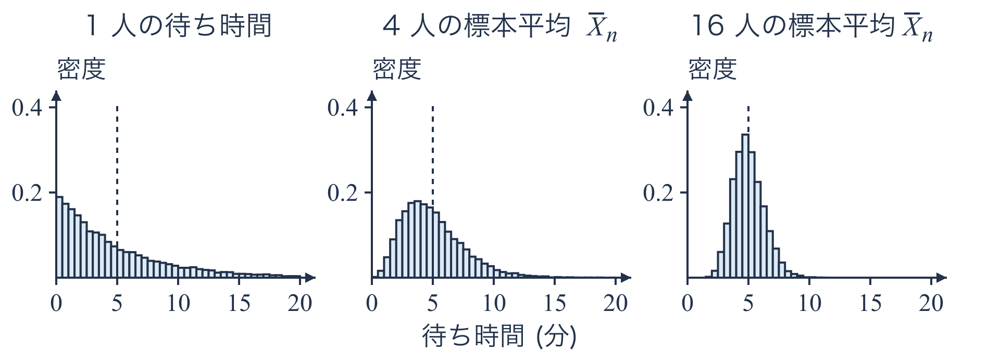
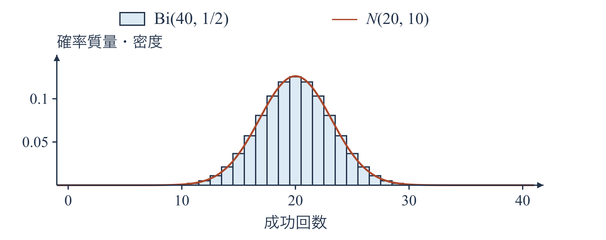
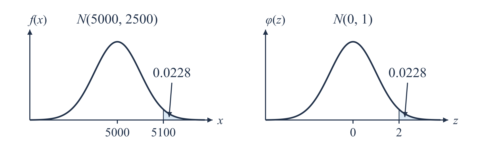

同じ条件で測定を繰り返すと, 観測値は測定ごとに変わります. 一定の個数の観測値から平均を求める操作を繰り返すと, 平均にも確率分布ができます. 中心極限定理を使うと, 条件を満たす多数の観測値の平均や和の確率を, 正規分布で近似できます.

| 記号 | 意味 |
| --- | --- |
| $X_1,\ldots,X_n$ | 同じ分布から独立に得た $n$ 個の確率変数 |
| $\bar X_n$ | $n$ 個の確率変数の平均 (標本平均) |
| $S_n$ | $n$ 個の確率変数の和 |
| $Z_n$ | 標本平均 (または和) を標準化した確率変数 |
| $Y_i$ | 個々の $X_i$ を標準化した確率変数 |
| $\xrightarrow{d}$ | 分布収束. 極限の分布関数が連続な点で, 分布関数の値が近づくこと |
| $\mathrm{Bi}(n,p)$ | 独立な $n$ 回の試行で成功確率が共通して $p$ のときの成功回数の分布 |

# 標本平均の分布と中心極限定理 {#central-limit-theorem}

窓口の待ち時間を例にします. 多くの来訪者はすぐに案内され, 一部の来訪者は長く待つと仮定します. この例では, 1 人の待ち時間の分布は右に裾を引きます. 毎回同じ条件で $n$ 人分の待ち時間を独立に得て, 1 組から平均を 1 個求めます. 同じ人数で組を作り直すと, 組に含まれる待ち時間が変わるため, 平均も変わります. このように標本を抽出するたびに変わる平均を**標本平均**と呼びます.

1 組あたりの人数 $n$ を増やすと, 標本平均の分布は幅が狭まります. 標本平均からその期待値を引き, 標準偏差を単位にして測った値の分布は, $n$ を増やすと標準正規分布に近づきます. 同じ $n$ で組を作る回数を増やす操作は, その $n$ における標本平均の分布をヒストグラムで詳しく見るために役立ちます.
図は平均 $5$ 分の指数分布から乱数で作った待ち時間を使っています. 人数を $4$, $16$ と増やすと, 組ごとの平均が $5$ 分付近に集まります.

{.wide}

::: warn
標本平均の分布を確かめるときは, 各組の平均だけを集めたヒストグラムを作ります. 各組の待ち時間をすべて一つにまとめると, 1 人の待ち時間の分布を見ていることになります.
:::

## 標本平均の期待値と分散

待ち時間の例を一般化し, $X_1,\ldots,X_n$ が互いに独立で同じ分布に従うとします. 1 個あたりの期待値を $\mu$ とし, 分散を $0<\sigma^2<\infty$ とします. 和 $S_n=\sum_{i=1}^n X_i$ を $n$ で割ったものが標本平均 $\bar X_n=S_n/n$ です.

期待値は加法性により足し合わせられます. 一方, 和の分散には一般に異なる確率変数のずれの積が現れます. $X_i$ と $X_j$ が独立なら, $i\ne j$ について
$E((X_i-\mu)(X_j-\mu))=E(X_i-\mu)E(X_j-\mu)=0$ です.
したがって, 和の分散は $n\sigma^2$ になります. 平均を取ると, 期待値には $1/n$, 分散には $(1/n)^2$ が掛かります.

$$
E(S_n)=n\mu,\qquad V(S_n)=n\sigma^2,\qquad
E(\bar X_n)=\mu,\qquad V(\bar X_n)=\frac{\sigma^2}{n}.
$$

## 標準化した標本平均の極限

$\bar X_n$ から期待値 $\mu$ を引き, 標準偏差 $\sigma/\sqrt n$ で割ると, **中心極限定理**により次の分布収束が成り立ちます.

$$
Z_n=\frac{\bar X_n-\mu}{\sigma/\sqrt n}
=\frac{S_n-n\mu}{\sigma\sqrt n}
\xrightarrow{d} N(0,1).
$$

[標準正規分布の数値表と確率計算](block:prob-normal#normal-probabilities)で使った分布関数を $\Phi$ とすると, 固定した $a<b$ について
$P(a\leq Z_n\leq b)\to\Phi(b)-\Phi(a)=\int_a^b\phi(u)\,du$ です. したがって $n$ が大きいとき, $\bar X_n$ は $N(\mu,\sigma^2/n)$, $S_n$ は $N(n\mu,n\sigma^2)$ で近似できます. 各 $X_i$ の分布が正規分布であれば, この 2 つはどの $n$ でも正確な分布です.

::: note
**補足. モーメント母関数を使う証明**

この証明では, 共通の分布の[モーメント母関数](block:prob-continuous#moments)が $0$ の近くで有限と仮定します. 定理そのものは, 独立同分布かつ有限な正の分散という条件で成り立ちます.

各 $X_i$ を $Y_i=(X_i-\mu)/\sigma$ と標準化すると, $E(Y_i)=0$, $V(Y_i)=1$ です. $Z_n=n^{-1/2}\sum_{i=1}^n Y_i$ であり, すべての $Y_i$ に共通するモーメント母関数を $M_Y$ とします. $M_Y(0)=1$, $M_Y'(0)=0$, $M_Y''(0)=E(Y_i^2)=1$ を使って $0$ のまわりでテイラー展開すると, $M_Y(s)=1+s^2/2+O(s^3)$ です. $O(s^3)$ は, $s$ が $0$ に近いとき絶対値が定数倍の $|s|^3$ 以下となる項を表します.

独立な確率変数の積の期待値は, それぞれの期待値の積です. 離散型の $U,V$ に対し, $p(u)=P(U=u)$, $q(v)=P(V=v)$ と置けば, 独立性から同時確率は $p(u)q(v)$ です. したがって, 期待値が絶対収束するとき,

$$
E(UV)=\sum_u\sum_v uv\,p(u)q(v)
=\left(\sum_u u p(u)\right)\left(\sum_v v q(v)\right)
=E(U)E(V).
$$

連続型で密度がある場合も, 同時密度が密度の積になるので二重積分を同様に分けられます. 一般の場合も, 独立な変数の同時分布が個々の分布の積になる性質から成り立ちます. この積の性質を独立な $e^{tY_i/\sqrt n}$ に使うと, 固定した $t$ について,

$$
M_{Z_n}(t)=\prod_{i=1}^n E(e^{tY_i/\sqrt n})
           =M_Y(t/\sqrt n)^n
           =\left(1+\frac{t^2}{2n}+O(n^{-3/2})\right)^n.
$$

括弧の中の $1$ からの差を $v_n$ とすると, $nv_n\to t^2/2$ で $nv_n^2\to 0$ です. $\log(1+v_n)=v_n+O(v_n^2)$ なので, $n\log(1+v_n)\to t^2/2$ です. 指数関数を取ると $M_{Z_n}(t)\to e^{t^2/2}$ となります.

極限を正規分布のモーメント母関数と照合するには, $X\sim N(\mu,\sigma^2)$ の密度に $e^{tx}$ を掛けます. 指数の中を平方完成すると,

$$
-\frac{(x-\mu)^2}{2\sigma^2}+tx
=-\frac{(x-(\mu+\sigma^2t))^2}{2\sigma^2}+\mu t+\frac{\sigma^2t^2}{2}.
$$

$x$ に依存する部分は, 平均を $\mu+\sigma^2t$ にずらした正規密度として実数全体で積分すると $1$ です. よって $M_X(t)=e^{\mu t+\sigma^2t^2/2}$ であり, $N(0,1)$ では $e^{t^2/2}$ です. $0$ を含む開区間で母関数が極限の分布の母関数に収束すると, 分布も収束するという**モーメント母関数の収束定理**により, $Z_n\xrightarrow{d}N(0,1)$ が従います.
:::

## 多数の要因が加わる測定誤差

和の正規近似は, 測定誤差を複数の小さな誤差の和として扱う理由の一つです. 例えば, 同じような条件で生じる光路の揺れが少しずつ測定値に加わり, 各寄与を独立で同じ分布に従うとみなせるなら, 寄与の総和は正規分布で近似できます. 実際の測定にこの近似を使うには, 要因の依存や一つの大きな誤差の影響を調べます.

# ラプラスの定理と二項分布の正規近似 {#binomial-normal-approximation}

標本平均を $n$ 倍すると和になるので, 中心極限定理を成功回数にも使えます. [ベルヌーイ試行とベルヌーイ分布](block:prob-discrete#bernoulli-distribution)で定めたように, 成功なら $X_i=1$, 失敗なら $X_i=0$ とします. 各試行を独立に行い, 成功確率を共通の $p$ ($0<p<1$) とすると, $E(X_i)=p$, $V(X_i)=p(1-p)$ です.

$n$ 回の成功回数 $S_n=\sum_{i=1}^n X_i$ は[二項分布](block:prob-discrete#binomial-distribution) $\mathrm{Bi}(n,p)$ に従います. 平均は $np$, 分散は $np(1-p)$ です. $p$ を固定して $n$ を増やすと,

$$
\frac{S_n-np}{\sqrt{np(1-p)}}\xrightarrow{d}N(0,1)
$$

が成り立ちます. この二項分布に対する中心極限定理を**ラプラスの定理**と呼びます. $n$ が大きいときに $N(np,np(1-p))$ の面積で二項確率を近似できます. $np>10$ かつ $np(1-p)>9$ は近似を試す目安です. $np(1-p)>9$ なら, 平均失敗回数 $n(1-p)$ も $9$ を超えます. 近似誤差は $p$ や求める区間にもよります.
図では $n=40$, $p=1/2$ を作図例とし, $N(20,10)$ の密度を二項分布の幅 $1$ の棒に重ねています. 平均付近では, 整数のまわりの棒の面積と, 同じ幅で区切った曲線の下の面積が近いことが分かります.

左右に分かれる試行を繰り返すときに, 行き先にどのような分布が現れるかを[ラプラスの定理の動画](https://www.youtube.com/watch?v=zeJD6dqJ5lo)で見られます.

例えば「$k$ 回以上」の正確な確率は, $k$ から $n$ までの二項確率の和です. 二項分布は整数に確率を割り当てるので, 正規分布で近似する際に整数 $k$ に幅 $1$ の区間 $[k-0.5,k+0.5)$ を対応させる方法があります. $k$ 回以上なら下限を $k-0.5$ とするこの調整を**連続性補正**と呼びます. 近似と正確な値を比較する問題は, [Exercise PROB-CLT-1](#exercise-prob-clt-1) と [Exercise PROB-CLT-2](#exercise-prob-clt-2) です.

# 演習 {#exercises}

成功回数を二項分布で表し, 正規分布による近似と二項確率の和を比較します.

## Exercise PROB-CLT-1 {#exercise-prob-clt-1}

**表が出る回数の上側確率**

公平なコインを独立に $10000$ 回投げるとき, 表が $5100$ 回以上出る確率を正規分布で近似してください.

回答

表の回数 $S_{10000}$ は $\mathrm{Bi}(10000,1/2)$ に従います. 平均は $5000$, 分散は $2500$, 標準偏差は $50$ です. $5100$ に対応する標準得点は $(5100-5000)/50=2$ なので, 上側確率を $P(Z\geq2)\approx0.0228$ と近似できます.
図では, $5100$ と $2$ の右にある領域が同じ確率を表します. 左の曲線は, 表の回数を近似する正規密度です.

{.wide}

連続性補正を使うと, 境界は $(5099.5-5000)/50=1.99$ で, 近似値は約 $0.023295$ です. 二項確率を直接足すと $\sum_{k=5100}^{10000}\binom{10000}{k}(1/2)^{10000}\approx0.023293$ です.

## Exercise PROB-CLT-2 {#exercise-prob-clt-2}

**シュートが決まる回数の上側確率**

選手が 3 点シュートを $1800$ 回打ちます. 各回の結果は独立で, 決まる確率は毎回 $2/3$ とします. シュートが $1260$ 回以上決まる確率を正規分布で近似してください.

回答

成功回数 $S_{1800}$ は $\mathrm{Bi}(1800,2/3)$ に従います. 平均は $1800(2/3)=1200$, 分散は $1800(2/3)(1/3)=400$, 標準偏差は $20$ です. $1260$ に対応する標準得点は $(1260-1200)/20=3$ なので, 上側確率は $P(Z\geq3)\approx0.00135$ です.

連続性補正を使うと, 境界は $(1259.5-1200)/20=2.975$ で, 近似値は約 $0.001465$ です. 二項確率を直接足すと $\sum_{k=1260}^{1800}\binom{1800}{k}(2/3)^k(1/3)^{1800-k}\approx0.001357$ です.

