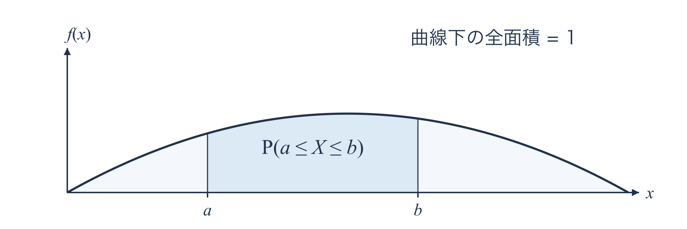
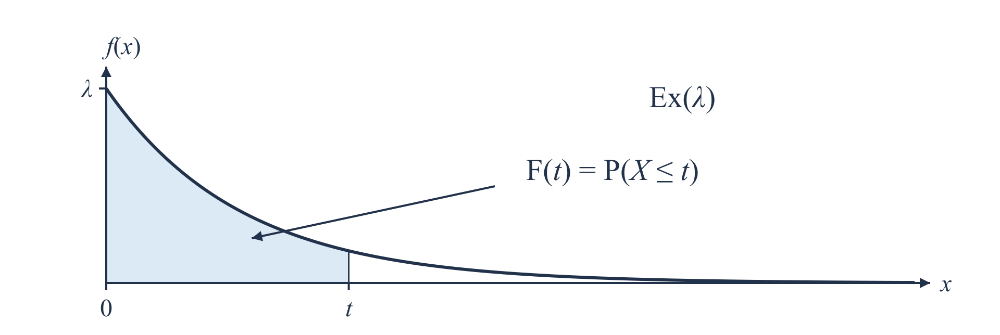
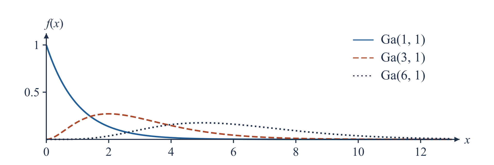
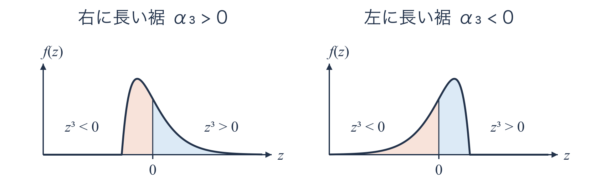
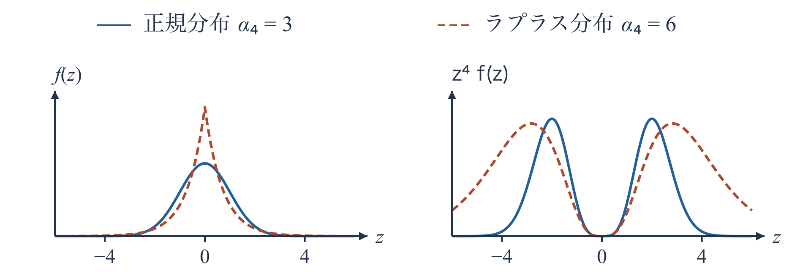
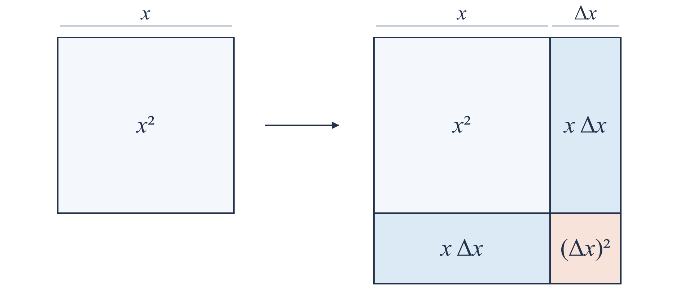

機器が次に故障するまでの時間は, 連続した範囲の値を取ります. 待ち時間がある範囲に入る確率は, 確率密度の曲線の下の面積で求めます. 分布の中心やばらつき, 左右の非対称性は, 値のべき乗や平均からの差のべき乗の期待値を使って表せます.

| 記号 | 意味 |
| --- | --- |
| $f(x)$ | 確率密度関数 |
| $F(x)$ | 値が $x$ 以下となる確率を返す分布関数 |
| $\mu_r$, $\mu_r'$ | 原点まわり, 期待値まわりの $r$ 次モーメント |
| $\alpha_r$ | $r$ 次の標準化モーメント |
| $M_X(t)$ | 確率変数 $X$ のモーメント母関数 |
| $\mathrm{Ex}(\lambda)$ | 発生率 $\lambda$ の指数分布 |
| $\mathrm{Ga}(\alpha,\lambda)$, $\Gamma(\alpha)$ | 形状 $\alpha$, 率 $\lambda$ のガンマ分布と, 密度の積分を $1$ にするために使うガンマ関数 |
| $\chi^2_n$ | 自由度 $n$ のカイ二乗分布 |

# 確率密度と区間の確率 {#density}

[確率分布と確率質量関数](block:prob-variable#probability-distribution)では, 離散型の確率変数 $X$ が値 $x$ を取る確率を $p(x)$ で表しました. 待ち時間のように, 区間の確率を非負の関数 $f$ の積分で与えられる分布を, ここでは**連続型確率分布**として扱います. $f$ を**確率密度関数**と呼びます.

$$
P(a\leq X\leq b)=\int_a^b f(x)\,dx,\qquad
f(x)\geq 0,\qquad \int_{-\infty}^{\infty}f(x)\,dx=1.
$$

横軸に取りうる値 $x$, 縦軸に密度 $f(x)$ を取ると, 区間 $[a,b]$ の確率はその区間での曲線の下の面積です. 幅が $0$ の区間の面積は $0$ なので, $P(X=a)=0$ です. 区間の端点を含めても確率は同じです.
図で濃く塗った部分が区間 $[a,b]$ の確率にあたり, 淡い部分まで含めた全体の面積は $1$ です.

$X$ が $x$ 以下となる確率は, **分布関数** $F(x)=P(X\leq x)$ で表します. 連続型の場合は $F(x)=\int_{-\infty}^x f(u)\,du$ なので, 区間の確率は $F(b)-F(a)$ でも求められます.

分布を選ぶときは, 測る量が回数のように離散的か, 待ち時間や測定誤差のように連続量として扱えるかを確かめます. 待ち時間を表す指数分布とガンマ分布, 測定誤差を表すことがある正規分布は, いずれも密度から区間の確率を求める例です.

## 期待値と分散

[期待値](block:prob-variable#distribution-center)と[分散](block:prob-variable#variance)は, 値や平均からの差の 2 乗を, それぞれの値が現れる確率で重み付けした平均です. 連続型でも, 細かい区間ごとにその区間の確率を重みとして使い, 区間の幅を小さくしていくと積分になります.

$$
E(X)=\int_{-\infty}^{\infty}x f(x)\,dx,\qquad
V(X)=\int_{-\infty}^{\infty}(x-\mu)^2 f(x)\,dx,\qquad \mu=E(X).
$$

期待値には $\int_{-\infty}^{\infty}|x| f(x)\,dx<\infty$ を仮定します. $E(X^2)$ が有限なら, 連続型でも $V(X)=E(X^2)-E(X)^2$ を使えます. 中心の指標には中央値もあり, 連続型の中央値 $m$ は $F(m)=1/2$ を満たします. 密度が最大になる値は最頻値です.

# 指数分布とガンマ分布 {#waiting-time-distributions}

区間の確率を密度の積分で求める例として, 機器の故障までの待ち時間を考えます. 単位時間あたりの平均発生回数を $\lambda>0$ とします. 長さ $h$ の区間の発生回数が平均 $\lambda h$ のポアソン分布に従い, 互いに重ならない区間の発生回数が独立となるモデルを**ポアソン過程**と呼びます. このとき, 次の事象までの待ち時間 $X$ は**指数分布** $\mathrm{Ex}(\lambda)$ に従います.
図では, 待ち時間が $t$ 以内となる確率を $0$ から $t$ までの面積で示しています.

$$
f(x)=
\begin{cases}
\lambda e^{-\lambda x} & (x\geq 0),\\
0 & (x<0).
\end{cases}
$$

$e$ は自然対数の底です. 待ち時間が $t\geq 0$ 以内となる確率は, $0$ から $t$ までの面積にあたります.

$$
P(X\leq t)=\int_0^t\lambda e^{-\lambda x}\,dx
=[-e^{-\lambda x}]_0^t=1-e^{-\lambda t}.
$$

$t$ を長くすると, この確率は $1$ に近づきます. 平均待ち時間から $\lambda$ を求めて確率を計算する問題は, [Exercise PROB-CONTINUOUS-1](#exercise-prob-continuous-1)です.

指数分布の期待値と分散は, $e^{-\lambda x}$ の微分を利用して求められます. 積の微分公式 $(uv)'=u'v+uv'$ を積分して一方の積分を移項する方法を**部分積分**と呼びます. $x e^{-\lambda x}$ と $x^2e^{-\lambda x}$ は $x=0$ で $0$ となり, $x\to\infty$ でも $0$ に近づきます. したがって, 境界の項を取り除くと次の式が残ります.

$$
\begin{aligned}
E(X)
&=[-x e^{-\lambda x}]_0^\infty+\int_0^\infty e^{-\lambda x}\,dx=\frac{1}{\lambda},\\
E(X^2)
&=[-x^2e^{-\lambda x}]_0^\infty+2\int_0^\infty x e^{-\lambda x}\,dx=\frac{2}{\lambda}E(X)=\frac{2}{\lambda^2},\\
V(X)&=\frac{2}{\lambda^2}-\left(\frac{1}{\lambda}\right)^2=\frac{1}{\lambda^2}.
\end{aligned}
$$

## ガンマ分布とカイ二乗分布

同じポアソン過程で $k$ 回目の事象まで待つ場合, 待ち時間は $k$ 個の独立な指数分布の確率変数の和になります. その分布は**ガンマ分布** $\mathrm{Ga}(k,\lambda)$ です. 形状を正の実数 $\alpha$ に広げると, $\mathrm{Ga}(\alpha,\lambda)$ の密度は $x>0$ で次の式になり, $x<0$ では $0$ です. $x=0$ の一点の値は区間の確率に影響しません.

$$
f(x)=\frac{\lambda^\alpha}{\Gamma(\alpha)}x^{\alpha-1}e^{-\lambda x},\qquad
\Gamma(\alpha)=\int_0^\infty u^{\alpha-1}e^{-u}\,du,\qquad \alpha,\lambda>0.
$$

$u=\lambda x$ と置くと, 密度の積分が $1$ になります. **ガンマ関数** $\Gamma$ は階乗を広げた関数で, 正の整数 $k$ について $\Gamma(k)=(k-1)!$ です. この関係は $\Gamma(1)=1$ と, 部分積分で得る $\Gamma(\alpha+1)=\alpha\Gamma(\alpha)$ から従います.
図では率 $\lambda=1$ を固定しています. 形状 $\alpha$ を $1$, $3$, $6$ と大きくすると, 密度が最大になる位置は右へ移ります.

ガンマ分布の $E(X^r)$ は, $r=1,2$ について, 密度に $x^r$ を掛けて $u=\lambda x$ と置くと $\Gamma(\alpha+r)/(\lambda^r\Gamma(\alpha))$ になります. したがって $E(X)=\alpha/\lambda$, $E(X^2)=\alpha(\alpha+1)/\lambda^2$ で, $V(X)=\alpha/\lambda^2$ です. $\alpha=1$ を代入すると指数分布の密度, 期待値, 分散が得られます. $\alpha=n/2$, $\lambda=1/2$ とした $\mathrm{Ga}(n/2,1/2)$ は, 正の整数 $n$ を自由度とする**カイ二乗分布** $\chi^2_n$ です.

::: note
**補足. 区間が限られる分布**

区間 $[a,b]$ ($a<b$) の中でどの位置でも密度が等しい分布を**連続一様分布**と呼びます. 幅が $b-a$ の区間で全体の面積が $1$ になるので, 密度はその区間内で $1/(b-a)$, 区間外で $0$ です. 区間 $[0,1]$ 上の密度の形を変えられる分布には, ベータ分布があります.
:::

# モーメントと分布の形 {#moments}

密度が分かれば, 期待値と分散に加え, 平均からの差の 3 乗や 4 乗の期待値も求められます. 値のべき乗の期待値を**モーメント** (積率) と呼びます. 正の整数 $r$ について, $r$ 次のモーメントを取るには $E(|X|^r)<\infty$ を仮定します.

| モーメント | 定義と読み方 |
| --- | --- |
| 原点まわり | $\mu_r=E(X^r)$. $\mu_1=E(X)$ です. |
| 期待値まわり | $\mu_r'=E((X-\mu)^r)$. $\mu_2'=V(X)$ です. |
| 標準化 | $\alpha_r=E(((X-\mu)/\sigma)^r)=\mu_r'/\sigma^r$. $\sigma=\sqrt{V(X)}>0$ を使い, 元の測定単位を取り除きます. |

離散型では $\mu_r=\sum_x x^r p(x)$, 連続型では $\mu_r=\int_{-\infty}^{\infty} x^r f(x)\,dx$ です. 期待値まわりでは, 各式で $x^r$ を $(x-\mu)^r$ に置き換えます. 標準化モーメントは, その結果を $\sigma^r$ で割って求めます.

**歪度**は $\alpha_3$ です. 3 乗すると符号が残るので, 平均から右への大きなずれは正の項, 左への大きなずれは負の項として寄与します. 右に長い裾を持つ典型的な分布では歪度が正になり, 左に長い裾を持つ場合は負になります. 例えば指数分布は右に裾を引きます.
図の横軸 $z$ は, 平均からのずれを標準偏差の単位で表した値です. 分布を左右に反転させると, ずれの 3 乗の符号が入れ替わり, 歪度も符号が逆になります.

{.wide}

4 乗したずれは左右ともに正の項として加わり, 中心から大きく離れた値に敏感です. $\alpha_4$ を**尖度**と呼び, 正規分布の値 $3$ を差し引いた $\alpha_4-3$ を**超過尖度**と呼びます. 超過尖度の正負は, 標準化したずれの 4 乗の期待値が正規分布の値より大きいか小さいかを表します.
図の右では, 正規分布と, 裾が指数関数的に減る左右対称なラプラス分布の密度に, 標準化したずれの 4 乗を掛けています. 両分布とも平均での寄与は $0$ で, 遠い裾ではラプラス分布の寄与が正規分布より大きくなります.

{.wide}

3 次と 4 次の期待値まわりのモーメントは, べき乗を展開して $E(X)=\mu$ を代入すると求められます.

$$
\begin{aligned}
\mu_3'&=E(X^3)-3\mu E(X^2)+2\mu^3,\\
\mu_4'&=E(X^4)-4\mu E(X^3)+6\mu^2E(X^2)-3\mu^4.
\end{aligned}
$$

## モーメント母関数

各次数の原点まわりのモーメントをまとめて取り出すには, 指数関数を使います. **モーメント母関数**は $M_X(t)=E(e^{tX})$ です. $0$ を含む開区間でこの期待値が有限な場合, 離散型と連続型それぞれで次の式を使えます.

$$
M_X(t)=
\begin{cases}
\displaystyle\sum_x e^{tx}p(x) & \text{(離散型)},\\[4pt]
\displaystyle\int_{-\infty}^{\infty}e^{tx}f(x)\,dx & \text{(連続型)}.
\end{cases}
$$

$e^{tX}$ を $t$ で $r$ 回微分すると $X^r e^{tX}$ になります. 上の有限性の条件のもとでは微分を期待値の中に入れられるので, $t=0$ を代入すると $M_X^{(r)}(0)=E(X^r)=\mu_r$ です. $0$ の近くでモーメント母関数が有限で, そこで 2 つのモーメント母関数が一致するなら, 対応する分布も一致します.

::: note
**補足. 正方形の面積の微分**

一辺が $x$ の正方形で, 一辺を $\Delta x$ だけ増やすと, 面積 $y=x^2$ は $2x\Delta x+(\Delta x)^2$ 増えます. 面積の増分を一辺の増分で割ると $\Delta y/\Delta x=2x+\Delta x$ です. $\Delta x$ を $0$ に近づけたときの比 $2x$ を $y$ の $x$ による微分と呼び, $dy/dx$ と書きます.
図で増えた面積のうち, 2 辺に沿う長方形はそれぞれ $x\Delta x$ で, 隅の正方形は $(\Delta x)^2$ です.

面積を定数 $a$ 倍した $y=ax^2$ では, 比も $a$ 倍されて $dy/dx=2ax$ になります. $y=x^3$ では $(x+\Delta x)^3$ を展開し, 増分を $\Delta x$ で割ると $3x^2+3x\Delta x+(\Delta x)^2$ です. したがって $dy/dx=3x^2$ です.
:::

# 演習 {#exercises}

待ち時間の平均から, 指定した期限までに事象が起こる確率を求めます.

## Exercise PROB-CONTINUOUS-1 {#exercise-prob-continuous-1}

**平均待ち時間と期限内の確率**

次に機器が故障するまでの待ち時間 $X$ が, 平均 $5$ 年の指数分布に従うとします. $5$ 年以内に故障する確率を $e$ を使って表してください.

回答

平均が $1/\lambda=5$ 年なので $\lambda=1/5$ です. 分布関数に $t=5$ を代入すると, $P(X\leq 5)=1-e^{-(1/5)5}=1-e^{-1}\approx 0.6321$ です.

