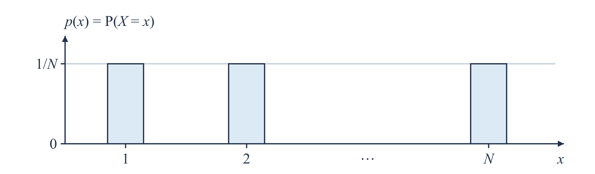
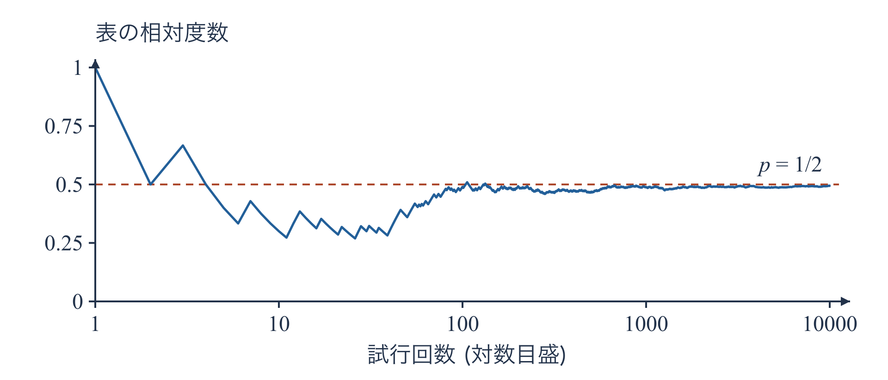
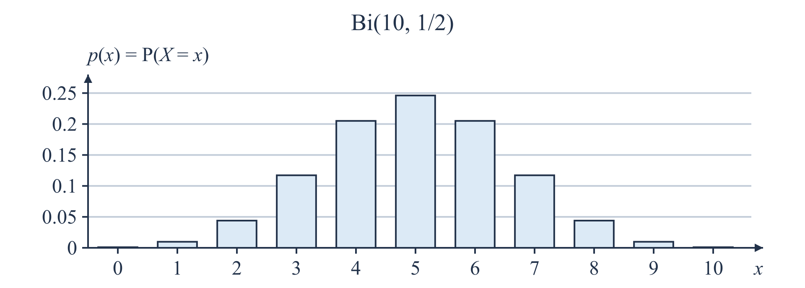
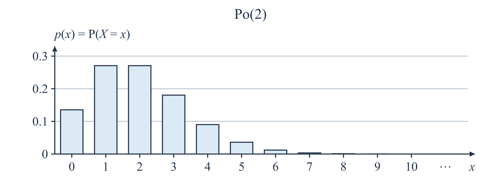

[確率分布と確率質量関数](block:prob-variable#probability-distribution)では, 離散型の確率変数が値ごとに確率を持つことを示しました.
各目が等確率のサイコロでは, どの目にも同じ確率を割り当てます. コインの表が出た回数を扱うときは, 各回の表の確率と試行の回数から, 表の回数ごとの確率を求めます.
値が生じる仕組みに合わせて, 離散一様分布, ベルヌーイ分布, 二項分布, ポアソン分布を使い分けます.

# 離散一様分布 {#uniform-distribution}

値を一つずつ列挙でき, どの値も等確率で現れるとき, その分布を**離散一様分布**と呼びます. 取りうる値が $1,2,\ldots,N$ の $N$ 個なら, 各値の確率は $p(x)=1/N$ です. それ以外の値では $p(x)=0$ です.

期待値と分散を求めるには, 値の和と 2 乗の和を計算します. $\sum$ は, 指定した範囲の添字を順に代入して各項を足す記号です. 正の整数 $n$ に対し, 1 乗から 3 乗までの和には次の公式があります.

$$
\begin{aligned}
\sum_{k=1}^{n} k &= 1+2+\cdots+n = \frac{n(n+1)}{2},\\
\sum_{k=1}^{n} k^2 &= 1^2+2^2+\cdots+n^2 = \frac{n(n+1)(2n+1)}{6},\\
\sum_{k=1}^{n} k^3 &= 1^3+2^3+\cdots+n^3 = \left(\frac{n(n+1)}{2}\right)^2.
\end{aligned}
$$

$X$ が $1$ から $N$ までの値を等確率で取るときは, 1 乗と 2 乗の和の公式に $n=N$ を代入します.

$$
\begin{aligned}
E(X) &= \frac{1}{N}\sum_{k=1}^N k = \frac{N+1}{2},\\
V(X) &= \frac{1}{N}\sum_{k=1}^N k^2-\left(\frac{N+1}{2}\right)^2\\
     &= \frac{(N+1)(2N+1)}{6}-\frac{(N+1)^2}{4}=\frac{N^2-1}{12}.
\end{aligned}
$$

各目が等確率のサイコロなら $N=6$ なので, 目の期待値は $7/2$, 分散は $35/12$ です.

::: warn

期待値 $(N+1)/2$ と分散 $(N^2-1)/12$ の式は, 値が $1$ から $N$ までの連続した整数のときにだけ使えます. 等確率で値の個数が同じでも, 値そのものが違えば期待値と分散は変わります. 例えば, 同じ 3 個の値でも, $1,2,3$ と $0,2,4$ では値どうしの間隔が異なります.

:::

[同じ期待値を持つ賞金を比べる演習](#exercise-prob-discrete-1)では, どちらの賞金も等確率で決まるときに, 間隔の違いが分散にどう表れるかを計算します.

# ベルヌーイ試行とベルヌーイ分布 {#bernoulli-distribution}

サイコロでは 6 種類の目を区別しました. 調べたい事象が「表が出た」「シュートが入った」のように起きたかどうかであれば, 結果を 2 通りに分けます. 一方を成功, 他方を失敗と呼び, 成功の確率を $p$, 失敗の確率を $1-p$ とする 1 回の実験が**ベルヌーイ試行**です. ベルヌーイ実験とも呼びます.

成功を $1$, 失敗を $0$ とする確率変数 $X$ の分布を**ベルヌーイ分布** (Bernoulli distribution) と呼びます. $P(X=1)=p$, $P(X=0)=1-p$ なので, $E(X)=p$ です. $X$ は $0$ か $1$ を取り, $X^2=X$ となるため, 分散は $V(X)=p-p^2=p(1-p)$ です.

独立なベルヌーイ試行を成功確率 $p$ が同じ条件で繰り返すと, 試行回数に占める成功の割合 (相対度数) が $p$ に近づきます. この関係を**ベルヌーイの大数の法則**と呼びます. 例えばコインでは, 何回投げたかに対する表の回数の割合です.

{.wide}

[ベルヌーイ分布の分散を比べる演習](#exercise-prob-discrete-4)では, $p$ を変えたときに $0$ と $1$ のばらつきが最も大きくなる条件を調べます. [試行を繰り返すときの用語の演習](#exercise-prob-discrete-6)では, 成功の相対度数と, 次に扱う成功回数の分布を区別します.

# 二項分布 {#binomial-distribution}

ベルヌーイ試行を $n$ 回独立に繰り返し, どの回も成功確率が $p$ であるとします. 成功回数 $X$ の分布が**二項分布** (Binomial distribution) です. $X\sim\mathrm{Bi}(n,p)$ と書きます. 1 回だけ試行すると, $\mathrm{Bi}(1,p)$ はベルヌーイ分布になります.

$0<p<1$ として, $X=x$ となる確率を求めます. 成功した回を指定すると, 各回が独立なので, その順序でちょうど $x$ 回成功する確率は $p^x(1-p)^{n-x}$ です. $n$ 回から成功した $x$ 回を選ぶ方法は $\binom nx$ 通りです. 異なる選び方に対応する事象は排反なので, [組合せ](block:prob-basics#counting)の数を掛けます.

$$
P(X=x)=\binom nx p^x(1-p)^{n-x},\qquad x=0,1,\ldots,n.
$$

$p=0$ なら $X=0$, $p=1$ なら $X=n$ が確率 $1$ で起こります.

例えば, 表が出る確率が $1/3$ のコインを独立に 3 回投げます. 表が 2 回出る並びは「表・表・裏」「表・裏・表」「裏・表・表」の 3 通りで, 各並びの確率は $(1/3)^2(2/3)=2/27$ です. したがって, 表が 2 回出る確率は $3(2/27)=2/9$ です.

[少なくとも 1 回成功する確率を求める演習](#exercise-prob-discrete-2)と[シュートの演習](#exercise-prob-discrete-8)では, 1 回も成功しない事象の補事象から確率を求めます.

## 二項分布の期待値と分散

$n$ 回の試行で得られる成功回数 $X$ の期待値と分散は次のとおりです.

$$
E(X)=np,\qquad V(X)=np(1-p).
$$

[成功回数から総重量を求める演習](#exercise-prob-discrete-3)では, 成功回数を定数倍してから定数を足したときの期待値と標準偏差を計算します.

::: note

期待値は, 成功回数 $x$ を確率で重み付けして足すと得られます. $n\geq 1$ かつ $0<p<1$ とします. $x\geq 1$ では $x\binom nx=n\binom {n-1}{x-1}$ なので, $y=x-1$ と置くと次の式になります.

$$
\begin{aligned}
E(X)
&=\sum_{x=1}^n x\binom nx p^x(1-p)^{n-x}\\
&=np\sum_{y=0}^{n-1}\binom{n-1}{y}p^y(1-p)^{(n-1)-y}=np.
\end{aligned}
$$

最後の和は, $n-1$ 回の試行の成功回数についての確率をすべて足した値なので $1$ です. 試行回数が $0$ の場合, 成功回数は $0$ に定まります.

分散を求めるには, $x^2=x(x-1)+x$ と分けて $E(X^2)=E(X(X-1))+E(X)$ を使います. $n\geq 2$ のとき, $x(x-1)$ が $0$ になる $x=0,1$ を除いて足します. $x(x-1)\binom nx=n(n-1)\binom{n-2}{x-2}$ を使い, $y=x-2$ と置きます.

$$
\begin{aligned}
E(X(X-1))
&=\sum_{x=2}^n x(x-1)\binom nx p^x(1-p)^{n-x}\\
&=n(n-1)p^2\sum_{y=0}^{n-2}\binom{n-2}{y}p^y(1-p)^{(n-2)-y}\\
&=n(n-1)p^2.
\end{aligned}
$$

二項定理によって, 最後の和は $(p+(1-p))^{n-2}=1$ です. $n=1$ の場合には $X(X-1)=0$ なので, $E(X(X-1))=n(n-1)p^2$ が直接成り立ちます. したがって, $V(X)=n(n-1)p^2+np-(np)^2=np(1-p)$ です. $p=0$ または $p=1$ の場合も, 成功回数が定数になるので, 期待値と分散の式が成り立ちます.

:::

# ポアソン分布 {#poisson-distribution}

二項分布は, 試行回数 $n$ と各回の成功確率 $p$ から成功回数の確率を求めます. $n$ が大きく $p$ が小さいときは, 平均成功回数 $\lambda=np$ を使って**ポアソン分布** (Poisson distribution) で近似できます. 例えば $X\sim\mathrm{Bi}(1000,0.002)$ のとき, 3 回成功する確率は $\binom{1000}{3}(0.002)^3(0.998)^{997}$ です. 近似に使うポアソン分布の平均は $\lambda=1000(0.002)=2$ です.

$\lambda>0$ をパラメータとするポアソン分布を $\mathrm{Po}(\lambda)$ と書きます. $e$ を自然対数の底とすると, $X\sim\mathrm{Po}(\lambda)$ の確率質量関数は次の式です.

$$
P(X=x)=e^{-\lambda}\frac{\lambda^x}{x!},\qquad x=0,1,2,\ldots.
$$

取りうる値の上限はなく, まれな出来事を一定期間に何回観測するかを表すモデルに使えます. 二項分布では成功回数の上限は試行回数 $n$ です.

$\lambda$ を一定に保って $p=\lambda/n$ と置くと, $n$ を増やすにつれて, 二項分布の各 $x$ に対する確率はポアソン分布の確率に近づきます. この関係を**少数の法則**と呼びます. [ポアソン分布で近似する演習](#exercise-prob-discrete-5)では, 3 回成功する確率について二項分布の値と近似値を比べます.

::: note

$\lambda>0$ と $0$ 以上の整数 $x$ を固定し, $n\geq x$ かつ $n>\lambda$ とします. $\prod$ は, 指定範囲の添字を代入して各項を掛ける記号です. 掛ける項がない場合の積は $1$ とします. $p=\lambda/n$ を二項分布の式に代入して整理すると, 次のようになります.

$$
\binom nx\left(\frac{\lambda}{n}\right)^x
  \left(1-\frac{\lambda}{n}\right)^{n-x}
=\frac{\lambda^x}{x!}
 \prod_{j=0}^{x-1}\left(1-\frac{j}{n}\right)
 \left(1-\frac{\lambda}{n}\right)^n
 \left(1-\frac{\lambda}{n}\right)^{-x}.
$$

$n\to\infty$ のとき, $x$ が固定されているので積と最後の因子はともに $1$ に近づきます. 指数関数の極限 $\lim_{n\to\infty}(1-\lambda/n)^n=e^{-\lambda}$ を用いると, 全体は $e^{-\lambda}\lambda^x/x!$ に収束します.

:::

## ポアソン分布の期待値と分散

$X\sim\mathrm{Po}(\lambda)$ の期待値と分散はともに $\lambda$ です. この結果は, 二項分布で $p=\lambda/n$ としたとき, 期待値が $np=\lambda$, 分散が $\lambda(1-\lambda/n)$ となることと対応します.

::: note

期待値と分散は, ポアソン分布の確率質量関数から直接求められます. $x\geq 1$ では $x/x!=1/(x-1)!$ なので, $y=x-1$ と置くと次の式になります.

$$
E(X)=\sum_{x=1}^{\infty}xe^{-\lambda}\frac{\lambda^x}{x!}
=\lambda\sum_{y=0}^{\infty}e^{-\lambda}\frac{\lambda^y}{y!}
=\lambda.
$$

最後の和は, 指数関数の級数 $\sum_{y=0}^{\infty}\lambda^y/y!=e^\lambda$ に $e^{-\lambda}$ を掛けたものなので $1$ です. 同じく, $x\geq 2$ で $x(x-1)/x!=1/(x-2)!$ を使うと, $E(X(X-1))=\lambda^2$ です. したがって, $V(X)=E(X(X-1))+E(X)-E(X)^2=\lambda$ となります.

:::

# 分布を選ぶ条件 {#distribution-summary}

何を値として記録するかと, その値がどう生じると仮定するかで, 使う分布が決まります. 表は, 取りうる値と確率を割り当てる条件を基準に, 各分布を比べたものです.

| 分布 | 値と適用条件 | $p(x)$ | $E(X)$ | $V(X)$ |
| --- | --- | --- | --- | --- |
| 離散一様分布 | 等確率で出るサイコロの目のように, $1$ から $N$ の整数を等確率で取る | $1/N$ | $(N+1)/2$ | $(N^2-1)/12$ |
| ベルヌーイ分布 | 1 回の試行の結果を, 成功なら $1$, 失敗なら $0$ と記録する | $p(0)=1-p$, $p(1)=p$ | $p$ | $p(1-p)$ |
| 二項分布 | 成功確率が $p$ で共通する独立な $n$ 回の試行で, 成功回数 $x$ を数える | $\binom nx p^x(1-p)^{n-x}$ | $np$ | $np(1-p)$ |
| ポアソン分布 | $0$ 以上の整数の回数を扱う. 例えば, 多数の独立な試行で成功確率が小さい場合に二項分布を近似する | $e^{-\lambda}\lambda^x/x!$ | $\lambda$ | $\lambda$ |

出た目と受け取る賞金の関係によっては, 出た目が一様分布に従っても, 賞金は別の分布に従います. [出た目から賞金の分布を求める演習](#exercise-prob-discrete-7)では, 複数の目が同じ賞金に対応するときの計算を扱います.

# 演習 {#exercises}

試行の条件から分布を選び, 成功回数や賞金の確率, 期待値, 分散を求めます.

## Exercise PROB-DISCRETE-1 {#exercise-prob-discrete-1}

**同じ期待値を持つ賞金の分散**

$1,2,3$ と書かれたカードから等確率で 1 枚引きます. ゲーム A とゲーム B の賞金は表のとおりです. それぞれの賞金の期待値と分散を求めてください.

| カードの数 | 1 | 2 | 3 |
| --- | ---: | ---: | ---: |
| ゲーム A の賞金 | 1 | 2 | 3 |
| ゲーム B の賞金 | 0 | 2 | 4 |

回答

ゲーム A の賞金を $X$, ゲーム B の賞金を $Y$ とします. $E(X)=(1+2+3)/3=2$, $E(Y)=(0+2+4)/3=2$ です. 期待値との差の 2 乗を確率で平均すると, $V(X)=(1+0+1)/3=2/3$, $V(Y)=(4+0+4)/3=8/3$ です.

別の計算では, $E(X^2)-E(X)^2=(1+4+9)/3-4=2/3$, $E(Y^2)-E(Y)^2=(0+4+16)/3-4=8/3$ です. ゲーム A には $1$ から $3$ までの一様分布の公式も使えます. ゲーム B は $Y=2X-2$ なので, $V(Y)=4V(X)$ からも同じ結果を得られます.

## Exercise PROB-DISCRETE-2 {#exercise-prob-discrete-2}

**少なくとも 1 回成功する確率**

各回の成功確率が $1/4$ の試行を独立に 4 回行います. 少なくとも 1 回成功する確率を求めてください.

回答

成功回数を $X$ とすると, $X\sim\mathrm{Bi}(4,1/4)$ です. 一度も成功しない確率は $P(X=0)=(3/4)^4=81/256$ なので, $P(X\geq 1)=1-81/256=175/256$ です.

## Exercise PROB-DISCRETE-3 {#exercise-prob-discrete-3}

**部品を加えた箱の重量**

空の箱は $3$ kg あります. 検査した 16 個の部品のうち, 合格した部品を全て箱に入れます. 部品は 1 個 $2$ kg で, 各部品が合格する確率は $3/4$ とし, 部品ごとの合否は独立とします. 箱と部品を合わせた重量の期待値と標準偏差を求めてください.

回答

合格した部品の数を $X$ とすると, $X\sim\mathrm{Bi}(16,3/4)$ です. よって $E(X)=16(3/4)=12$, $V(X)=16(3/4)(1/4)=3$ です.

箱を含む重量を $Y$ kg とすれば $Y=3+2X$ なので, $E(Y)=3+2E(X)=27$ kg です. 分散は $V(Y)=4V(X)=12$ なので, 標準偏差は $D(Y)=\sqrt{12}=2\sqrt{3}$ kg です.

## Exercise PROB-DISCRETE-4 {#exercise-prob-discrete-4}

**ベルヌーイ分布の分散を最大にする確率**

$X\sim\mathrm{Bi}(1,p)$ とします. $E(X)$ と $V(X)$ を求め, $0\leq p\leq 1$ の範囲で分散が最大になる $p$ を求めてください.

回答

$n=1$ を二項分布の式に代入すると, $E(X)=p$, $V(X)=p(1-p)$ です. $p(1-p)=1/4-(p-1/2)^2$ なので, $p=1/2$ のとき最大値 $1/4$ を取ります. $p$ で微分しても, 導関数 $1-2p$ が $p=1/2$ の前後で正から負に変わることから, 同じ最大値を確かめられます.

## Exercise PROB-DISCRETE-5 {#exercise-prob-discrete-5}

**ポアソン分布で 3 回成功する確率を近似する**

成功確率が $0.002$ の試行を独立に 1,000 回行います. ちょうど 3 回成功する確率をポアソン分布で近似し, 二項分布で求めた確率と比べてください.

回答

成功回数は $\mathrm{Bi}(1000,0.002)$ に従います. $\lambda=1000(0.002)=2$ なので, $\mathrm{Po}(2)$ で近似すると $e^{-2}2^3/3!\approx 0.18045$ です. 二項分布の式では $\binom{1000}{3}(0.002)^3(0.998)^{997}\approx 0.18063$ です.

## Exercise PROB-DISCRETE-6 {#exercise-prob-discrete-6}

**試行を繰り返すときの用語と分布**

1. 成功と失敗の 2 通りの結果が, それぞれ確率 $p$ と $1-p$ で起こる試行を何と呼びますか.
2. この試行を同じ成功確率で独立に繰り返すとき, 成功の割合を何と呼びますか. また, 試行回数を増やすとその割合が $p$ に近づくことを表す法則の名前を答えてください.
3. $n$ 回の試行での成功回数 $X$ はどの分布に従いますか. $P(X=x)$ の式も書いてください.

回答

1. ベルヌーイ試行 (ベルヌーイ実験) と呼びます.
2. 成功の相対度数です. ベルヌーイの大数の法則により, 試行回数が増えると $p$ に近づきます.
3. $\mathrm{Bi}(n,p)$ に従います. $0<p<1$ のとき, $x=0,\ldots,n$ に対して $P(X=x)=\binom nx p^x(1-p)^{n-x}$ です.

## Exercise PROB-DISCRETE-7 {#exercise-prob-discrete-7}

**サイコロの目で決まる賞金の分布**

各目が等確率で出るサイコロを 1 回振ります. 出た目が 3 の倍数なら 9 万円, それ以外なら 0 円を受け取ります. 賞金を $X$ 万円とし, $E(X)$ と $V(X)$ を求めてください.

回答

3 と 6 が 3 の倍数なので, $P(X=9)=2/6=1/3$ です. 残る 4 通りでは $X=0$ なので, $P(X=0)=2/3$ です. $E(X)=9(1/3)=3$ 万円で, $E(X^2)=81(1/3)=27$ です. したがって, $V(X)=27-3^2=18$ です.

## Exercise PROB-DISCRETE-8 {#exercise-prob-discrete-8}

**3 ポイントシュートが入る確率**

バスケットボールの選手が 3 ポイントシュートを 4 回打ちます. 各シュートの成功確率は $1/3$ で, 4 回の結果は独立とします. 少なくとも 1 回成功する確率を求めてください.

回答

成功回数を $X$ とすると, $X\sim\mathrm{Bi}(4,1/3)$ です. 全て外す確率は $P(X=0)=(2/3)^4=16/81$ なので, $P(X\geq 1)=1-16/81=65/81$ です.

