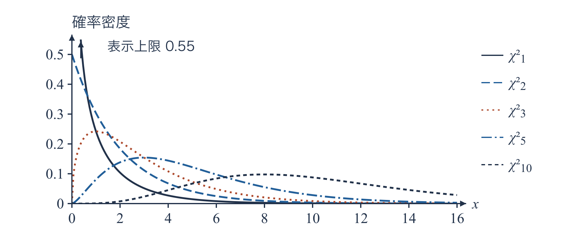
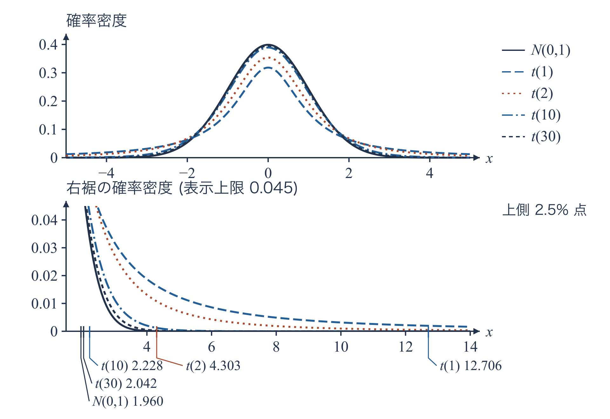
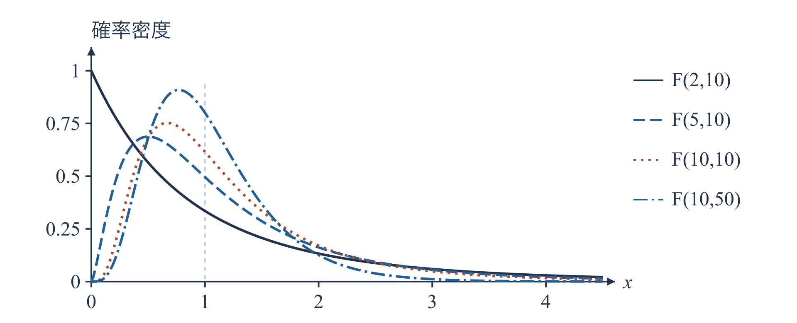
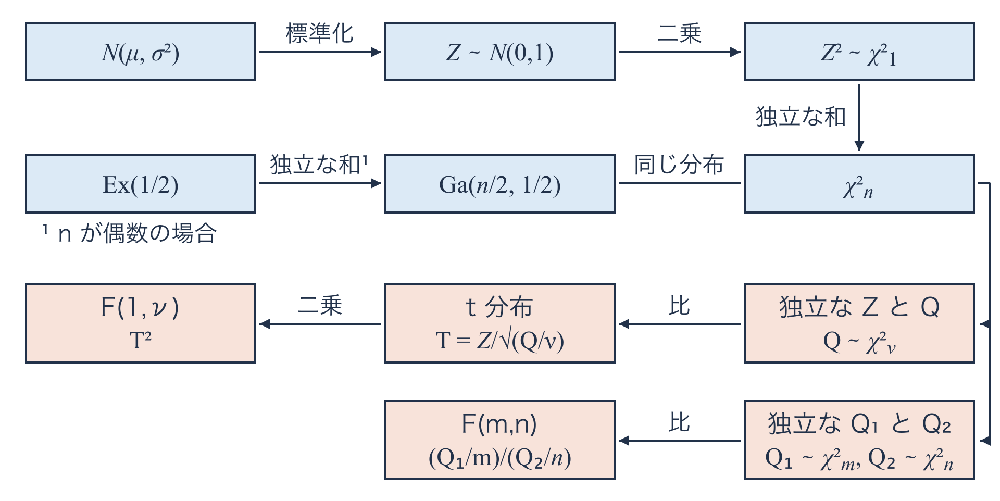
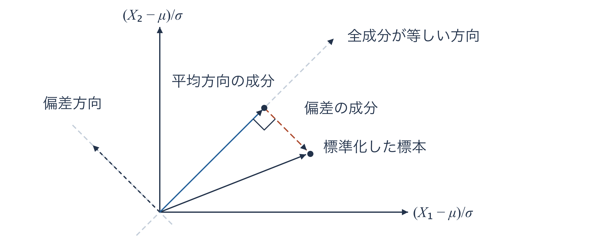

正規分布に従う母集団から標本を抽出すると, 標本平均や不偏分散は抽出するたびに変わります. 標本平均の標準化に使う母分散を不偏分散に替えると, 得られる量はどの分布に従うのでしょうか. 独立な標準正規変数の二乗和からカイ二乗分布を作り, その二乗和を使って $t$ 分布と $F$ 分布を組み立てると, 標本平均や不偏分散を含む量の分布が分かります.

| 記号 | 意味 |
| --- | --- |
| $t(\nu)$ | 自由度 $\nu$ の $t$ 分布 |
| $F(m,n)$ | 分子の自由度が $m$, 分母の自由度が $n$ の $F$ 分布 |
| $Z_1,\ldots,Z_n$ | 互いに独立な標準正規変数 |
| $Q$, $Q_1$, $Q_2$ | カイ二乗分布に従う確率変数 |
| $T$ | $t$ 分布に従う確率変数 |
| $R$ | $F$ 分布に従う確率変数 |
| $u$ | 不偏分散 $u^2$ の平方根 |
| $t_p(\nu)$ | $t(\nu)$ の上側確率が $p$ となる分位点 |

# 標準正規変数の二乗和とカイ二乗分布 {#chi-square}

[標準化と偏差値](block:prob-normal#standardization)では, 正規分布に従う変数から平均を引き, 標準偏差で割ることで, 標準正規分布に従う変数が得られました. 標準正規変数 $Z$ を二乗した $Z^2$ の分布は自由度 $1$ のカイ二乗分布 $\chi^2_1$ です. 互いに独立な標準正規変数 $Z_1,\ldots,Z_n$ の二乗を足すと, 自由度 $n$ の**カイ二乗分布**になります.

$$
Q=\sum_{i=1}^n Z_i^2\sim\chi^2_n.
$$

この構成での**自由度** $n$ は, 二乗和を作る独立な標準正規変数の個数です. [指数分布とガンマ分布](block:prob-continuous#waiting-time-distributions)では, $\chi^2_n$ をガンマ分布 $\mathrm{Ga}(n/2,1/2)$ として導入しました. その節の密度とモーメントの式に形状 $n/2$ と率 $1/2$ を代入すると, $x>0$ での密度と, $Q$ の期待値・分散が得られます. $x<0$ で密度は $0$ です.

$$
f_Q(x)=\frac{x^{n/2-1}e^{-x/2}}{2^{n/2}\Gamma(n/2)},\qquad
E(Q)=n,\qquad V(Q)=2n.
$$

自由度が $1$ または $2$ のとき, 密度は $x>0$ で減少します. 自由度が $2$ より大きいときは, 正の位置 $x=n-2$ に密度の山ができます.

図では, 自由度が $3$, $5$, $10$ と増えるにつれて密度の山が右へ移ります. 自由度 $1$ の曲線は, $0$ に近づく途中で縦軸の表示上限を超えます.

{.wide}

::: note
**補足. 二乗和とガンマ分布の対応**

標準正規分布の密度を $\phi$, 分布関数を $\Phi$ とします. $x>0$ について, $Z^2\leq x$ は $-\sqrt{x}\leq Z\leq\sqrt{x}$ と同じ事象です. 標準正規分布の対称性からその確率は $2\Phi(\sqrt{x})-1$ です. この式を $x$ で微分すると, $Z^2$ の密度になります.

$$
f_{Z^2}(x)=\frac{\phi(\sqrt{x})}{\sqrt{x}}
=\frac{e^{-x/2}}{\sqrt{2\pi x}}.
$$

$\Gamma(1/2)=\sqrt{\pi}$ なので, この密度は $\mathrm{Ga}(1/2,1/2)$ の密度と一致します. 同じ率 $\lambda$ を持つ独立なガンマ変数の和は, 各変数の形状を足した形状のガンマ分布に従います. 実際, ガンマ分布の密度を積分すると, $s<\lambda$ でのモーメント母関数は $(1-s/\lambda)^{-\alpha}$ です. 独立な変数の和を取ると[モーメント母関数](block:prob-continuous#moments)が掛け合わされ, 指数に入る形状が足し合わされます. したがって $Z_i^2$ を $n$ 個足すと $\mathrm{Ga}(n/2,1/2)$ になります.
:::

カイ二乗分布は, 正規母集団の母分散を推定・検定するときに使います. 標準正規変数と独立な二乗和を比の分母に使うと, 母平均の推測に用いる分布も作れます.

# 標準正規変数とカイ二乗変数から作る t 分布 {#t-distribution}

正の整数 $\nu$ に対し, 標準正規変数 $Z$ と自由度 $\nu$ のカイ二乗変数 $Q$ を独立に取ります. $Q$ をその自由度で割り, 平方根を取った量で $Z$ を割ります. この比が従う分布を, 自由度 $\nu$ の **$t$ 分布**と呼びます.

$$
T=\frac{Z}{\sqrt{Q/\nu}}\sim t(\nu).
$$

密度はすべての実数 $x$ で次の式になります.

$$
f_T(x)=\frac{\Gamma((\nu+1)/2)}{\sqrt{\nu\pi}\,\Gamma(\nu/2)}
       \left(1+\frac{x^2}{\nu}\right)^{-(\nu+1)/2}.
$$

密度は左右対称で, $x=0$ に一つの山があります. 正規分布より左右の裾が厚く, 自由度が小さいほど大きな絶対値を取る確率が高くなります. 期待値は $\nu>1$ で $E(T)=0$, 分散は $\nu>2$ で $V(T)=\nu/(\nu-2)$ です. 自由度 $1$ では有限の期待値が存在せず, 自由度 $2$ では期待値は $0$ で分散は無限大です.

右裾の拡大図では, 曲線の右側に面積の $2.5\%$ が残る境界を横軸に記しています. 自由度 $1$ では境界が $12.706$ にあり, 自由度 $30$ では標準正規分布の $1.960$ に近づきます.

{.wide}

$t$ 分布は, 母標準偏差が未知の正規母集団の母平均を推定・検定するときに使います. 分母を別のカイ二乗変数から作るという考え方は, 2 つの分散を比べる場合にも使えます.

# 2 つのカイ二乗変数から作る F 分布 {#f-distribution}

独立な $Q_1\sim\chi^2_m$ と $Q_2\sim\chi^2_n$ を取り, それぞれを自由度で割ります. 得られた量の比 $R$ が従う分布を, 分子の自由度が $m$, 分母の自由度が $n$ の **$F$ 分布**と呼びます.

$$
R=\frac{Q_1/m}{Q_2/n}\sim F(m,n).
$$

密度は $x>0$ で次の式になり, $x<0$ で $0$ です.

$$
f_R(x)=
\frac{\Gamma((m+n)/2)}{\Gamma(m/2)\Gamma(n/2)}
\left(\frac{m}{n}\right)^{m/2}
\frac{x^{m/2-1}}{(1+mx/n)^{(m+n)/2}}.
$$

$F$ 分布の密度は右に裾を引きます. 自由度 $m,n$ がともに大きいと, $Q_1/m$ と $Q_2/n$ の分散がともに小さくなり, 比は $1$ の近くに集まります. 期待値は $n>2$ で有限になり, 分散が有限になるには $n>4$ が必要です.

$$
E(R)=\frac{n}{n-2}\quad(n>2),\qquad
V(R)=\frac{2n^2(m+n-2)}{m(n-2)^2(n-4)}\quad(n>4).
$$

図で $F(10,10)$ と $F(10,50)$ を比べると, 分母の自由度を増やした方が $1$ のまわりに密度が集まります.

{.wide}

$F$ 分布は, 独立な 2 組の正規標本から母分散の比を推定したり, 2 つの母分散が等しいかを検定したりするときに使います. 複数の群の平均を比較する分散分析でも使います.

# カイ二乗分布を介した分布の関係 {#distribution-relationships}

$F$ 分布の分子に使うカイ二乗変数は, 自由度が $1$ なら標準正規変数 1 個の二乗で作れます. $T=Z/\sqrt{Q/\nu}$ を二乗すると, 分子の $Z^2$ は $\chi^2_1$ に従い, $Z$ と $Q$ が独立なので $Z^2$ と $Q$ も独立です. したがって

$$
T^2=\frac{Z^2/1}{Q/\nu}\sim F(1,\nu)
$$

となります.

$t$ 分布と $F$ 分布の構成に共通するカイ二乗分布は, 待ち時間の分布にも結び付きます. 独立で率の等しい指数変数の和は[ガンマ分布](block:prob-continuous#waiting-time-distributions)に従います. [標準正規変数の二乗和](#chi-square)に対応するガンマ分布は $\mathrm{Ga}(n/2,1/2)$ です. $n=2$ の場合は形状が $1$ となり, $\chi^2_2=\mathrm{Ga}(1,1/2)=\mathrm{Ex}(1/2)$ です.

図の矢印は, 標準化や二乗, 比を取る操作を表します. $T$ を二乗する経路を追うと, 分子の $Z^2$ が自由度 $1$ のカイ二乗変数になるため, $F(1,\nu)$ が得られます.

{.wide}

# 正規標本の平均と不偏分散から得られる t 分布 {#t-from-normal-sample}

標本平均から母平均を引いた量は, 母標準偏差 $\sigma$ が分かれば標準正規変数にできます. $\sigma$ を不偏分散の平方根 $u$ に替えたときの分布を求めるには, $u^2$ の分布と, $u^2$ が標本平均とどう関係するかが必要です.

標本サイズを $n\geq2$ とし, $X_1,\ldots,X_n$ は互いに独立に同じ正規分布 $N(\mu,\sigma^2)$ ($\sigma>0$) に従うとします. [標本平均](block:prob-clt#central-limit-theorem)と[不偏分散](block:prob-variable#variance)を次のように表します.

$$
\bar X_n=\frac{1}{n}\sum_{i=1}^n X_i,\qquad
u^2=\frac{1}{n-1}\sum_{i=1}^n(X_i-\bar X_n)^2.
$$

独立な正規変数の和も正規分布に従うので, $\bar X_n\sim N(\mu,\sigma^2/n)$ です. したがって $Z=(\bar X_n-\mu)/(\sigma/\sqrt n)$ は, 任意の標本サイズ $n\geq2$ で厳密に標準正規分布に従います.

## 不偏分散の分布と標本平均からの独立性

偏差 $X_i-\bar X_n$ の和は $0$ です. この制約があるので, $n$ 個の偏差が自由に動ける空間は $n-1$ 次元です. 正規標本では, 偏差を $\sigma$ で割ったベクトルを, その空間で互いに直交する $n-1$ 本の単位ベクトルに沿って分けると, 各方向の座標は独立な標準正規変数になります. したがって

$$
Q=\frac{(n-1)u^2}{\sigma^2}
 =\sum_{i=1}^n\left(\frac{X_i-\bar X_n}{\sigma}\right)^2
 \sim\chi^2_{n-1}
$$

です. 標本平均を標準化した $Z$ は, すべての成分を等しく動かす方向の成分です. この方向は偏差の $n-1$ 個の方向と直交し, 正規標本ではこれらの成分が独立です. したがって, 正規標本の $\bar X_n$ と $u^2$ は独立です.

図は $n=2$ の場合です. 標準化した標本を全成分が等しい直線へ射影すると平均方向の成分が得られ, 射影した点から標本までの成分が偏差を表します.

{.wide}

::: note
**補足. 直交座標による二乗和と独立性の証明**

$Y_i=(X_i-\mu)/\sigma$ と置き, ベクトル $Y=(Y_1,\ldots,Y_n)$ を考えます. 各 $Y_i$ は独立な標準正規変数なので, 同時密度は $(2\pi)^{-n/2}\exp(-\|y\|^2/2)$ です. ここで $\|y\|^2$ は各成分の二乗和です. 単位ベクトル $e_1=(1,\ldots,1)/\sqrt n$ を取り, $e_1$ に直交する $n-1$ 本の単位ベクトル $e_2,\ldots,e_n$ を互いに直交するように選びます.

$W_j=e_j\cdot Y$ を新しい座標とします. 直交変換は長さと体積を保つので, $W_1,\ldots,W_n$ の同時密度は再び $(2\pi)^{-n/2}\exp(-\sum_j w_j^2/2)=\prod_j\phi(w_j)$ です. 同時密度が標準正規密度の積に分かれるため, $W_1,\ldots,W_n$ は互いに独立な標準正規変数です.

$W_1=Z$ であり, 平均方向の成分 $W_1e_1$ を $Y$ から引くと, 残りのベクトルの第 $i$ 成分は $(X_i-\bar X_n)/\sigma$ です. その長さの二乗は $Q=\sum_{j=2}^n W_j^2$ です. $Q$ は独立な標準正規変数 $n-1$ 個の二乗和であり, $W_1$ と独立です. $\bar X_n$ は $W_1$ の関数で, $u^2$ は $Q$ の定数倍なので, $\bar X_n$ と $u^2$ も独立です.
:::

## 母標準偏差を u に替えたときの分布

母標準偏差の代わりに $u$ を使うと, 分母 $u/\sqrt n$ は標本ごとに変わります. 分子と分母をともに $\sigma/\sqrt n$ で割ると, 標準正規変数 $Z$ と, それとは独立なカイ二乗変数 $Q$ を使って次のように書けます.

$$
\frac{\bar X_n-\mu}{u/\sqrt n}
=\frac{(\bar X_n-\mu)/(\sigma/\sqrt n)}{u/\sigma}
=\frac{Z}{\sqrt{Q/(n-1)}}\sim t(n-1).
$$

分母の $u/\sigma$ が小さい標本では, 同じ $Z$ の値でも比の絶対値が大きくなります. この分母の変動が, $t$ 分布の厚い裾に現れます.

::: warn
**注意. t 分布が厳密に成り立つ条件**

上の導出では, 標本を構成する各 $X_i$ が独立に同じ正規分布に従うと仮定しています. 母集団が正規分布以外の場合は, 標本平均と不偏分散の独立性や, 不偏分散を定数倍した量のカイ二乗分布が一般には成り立ちません.
:::

# 自由度と t 分布の上側確率 {#t-quantiles}

$t$ 分布の分母に現れる $Q/\nu$ の期待値は $1$, 分散は $2/\nu$ です. 自由度が大きくなると $Q/\nu$ は確率的に $1$ に近づき, $Z/\sqrt{Q/\nu}$ の分布は標準正規分布に近づきます. 正規標本の場合は $\nu=n-1$ なので, 標本サイズが大きくなるにつれ, $Q/\nu=u^2/\sigma^2$ の変動は小さくなります.

$t(\nu)$ に従う $T$ について $P(T>t_p(\nu))=p$ を満たす値を**上側 $p$ 点**と呼びます. 上側 $2.5\%$ 点を比べると, 自由度 $10$ では $2.228$, 自由度 $30$ でも $2.042$ です. 次の表の差は, 各点が標準正規分布の上側 $2.5\%$ 点の近似値 $1.96$ を基準に何パーセント大きいかを表します. 差は丸める前の $t$ 分布の分位点から計算しています.

| 自由度 $\nu$ | 上側 $2.5\%$ 点 | $1.96$ を基準とした差 |
| ---: | ---: | ---: |
| 10 | 2.228 | 13.7% |
| 20 | 2.086 | 6.4% |
| 30 | 2.042 | 4.2% |
| 60 | 2.000 | 2.1% |
| 120 | 1.980 | 1.0% |
| $\infty$ (標準正規分布) | 1.960 | 0.0% |

## 片側 t 分布表 {#one-sided-t-table}

上側確率 $p$ が決まっているときは, 自由度 $\nu$ の行と上側確率 $p$ の列の交点から $t_p(\nu)$ を読みます. 例えば, 自由度 $10$ の行の $0.05$ の列は $1.812$ です. したがって $T\sim t(10)$ なら $P(T>1.812)\approx 0.05$ です. 分布は左右対称なので, $P(T<-1.812)\approx 0.05$ でもあります.

::: warn
**注意. 表の行は自由度**

標本平均と不偏分散から作る $t$ 統計量の自由度は $n-1$ です. 例えば, 標本サイズが $30$ なら自由度 $29$ の行を読みます. 正規近似とどれだけの差があるかは, 自由度に加えて, どの上側確率の列を使うかにもよります.
:::

| 自由度 $\nu$ | $p=0.05$ | $p=0.025$ |
| ---: | ---: | ---: |
| 1 | 6.314 | 12.706 |
| 2 | 2.920 | 4.303 |
| 3 | 2.353 | 3.182 |
| 4 | 2.132 | 2.776 |
| 5 | 2.015 | 2.571 |
| 6 | 1.943 | 2.447 |
| 7 | 1.895 | 2.365 |
| 8 | 1.860 | 2.306 |
| 9 | 1.833 | 2.262 |
| 10 | 1.812 | 2.228 |
| 11 | 1.796 | 2.201 |
| 12 | 1.782 | 2.179 |
| 13 | 1.771 | 2.160 |
| 14 | 1.761 | 2.145 |
| 15 | 1.753 | 2.131 |
| 16 | 1.746 | 2.120 |
| 17 | 1.740 | 2.110 |
| 18 | 1.734 | 2.101 |
| 19 | 1.729 | 2.093 |
| 20 | 1.725 | 2.086 |
| 21 | 1.721 | 2.080 |
| 22 | 1.717 | 2.074 |
| 23 | 1.714 | 2.069 |
| 24 | 1.711 | 2.064 |
| 25 | 1.708 | 2.060 |
| 26 | 1.706 | 2.056 |
| 27 | 1.703 | 2.052 |
| 28 | 1.701 | 2.048 |
| 29 | 1.699 | 2.045 |
| 30 | 1.697 | 2.042 |
| 31 | 1.696 | 2.040 |
| 32 | 1.694 | 2.037 |
| 33 | 1.692 | 2.035 |
| 34 | 1.691 | 2.032 |
| 35 | 1.690 | 2.030 |
| 36 | 1.688 | 2.028 |
| $\infty$ | 1.645 | 1.960 |

# 演習 {#exercises}

上側確率と分位点の対応を読み取り, 独立な標準正規変数から各分布を作る操作を確かめます.

## Exercise PROB-SAMPLING-1 {#exercise-prob-sampling-1}

**t 分布表から両側の確率を読む**

$T\sim t(14)$ とします. [片側 t 分布表](#one-sided-t-table)から $P(T>c)=0.025$ を満たす $c$ の近似値を読み取り, $P(-c\leq T\leq c)$ を求めてください.

回答

自由度 $14$ の行と上側確率 $0.025$ の列から $c\approx 2.145$ と読み取れます. 対称性から $P(T<-c)=P(T>c)=0.025$ なので, 中央の区間の確率は $1-2\cdot0.025=0.95$ です.

## Exercise PROB-SAMPLING-2 {#exercise-prob-sampling-2}

**t 分布に従う変数の二乗が従う分布**

$Z\sim N(0,1)$ と $Q\sim\chi^2_8$ は独立とします. $T=Z/\sqrt{Q/8}$ とおくとき, $T^2$ の分布と自由度を答えてください.

回答

$T^2=(Z^2/1)/(Q/8)$ です. $Z^2$ は $\chi^2_1$ に従い, $Q$ と独立です. したがって $T^2\sim F(1,8)$ です.

## Exercise PROB-SAMPLING-3 {#exercise-prob-sampling-3}

**独立な標準正規変数の二乗和の期待値と分散**

$Z_1,\ldots,Z_7$ は互いに独立な標準正規変数とします. $Q=Z_1^2+\cdots+Z_7^2$ の分布, 期待値, 分散を求めてください.

回答

二乗和に含まれる独立な標準正規変数は $7$ 個なので, $Q\sim\chi^2_7$ です. 各 $Z_i^2$ の期待値は $1$, 分散は $2$ です. 期待値の線形性と独立な変数の分散の加法性から, $E(Q)=7$, $V(Q)=14$ です.

