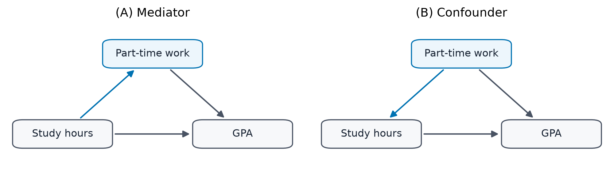

[GPA のデータから問えること](block:reg-intro#regression-goals)の表の (c) では,
勉強時間を週 1 時間増やす介入を行うと, 平均 GPA がどう変わるかを問いました.
GPA についての**因果推論**では, 同じ母集団で介入した場合としなかった場合の平均 GPA の差を求めます.

勉強時間の回帰係数は, 他の説明変数が同じで, 勉強時間が週 1 時間違う学生どうしの,
回帰式が表す平均 GPA の差です.
この比較から介入の効果を求めるには, 勉強時間や GPA が決まる仕組みについて仮定を置きます.
どの変数をそろえて比べるかは, 介入でその変数が変わるかどうかにもよります.

# 実際の世界と介入した世界 {#potential-outcomes}

ある学生について, 学期中の勉強時間をふだんより毎週 1 時間増やした場合と,
ふだんどおりにした場合を考えます.
それぞれの場合の学期末の GPA を**潜在的結果**と呼びます.
勉強時間を増やすことを処置とすると, その学生にとっての介入の効果は,
処置を受けた場合の GPA から, 受けなかった場合の GPA を引いた値です.

一人の学生が同じ学期に経験するのは, 処置を受けるか受けないかの一方です.
実際に勉強時間を増やした学生については, ふだんどおりに勉強した場合の GPA を観測できません.
一人について両方の結果を同時に観測できないことを, 因果推論の根本問題と呼びます.
同じ母集団について, 全員が処置を受けた場合の平均 GPA から,
全員が処置を受けなかった場合の平均 GPA を引いた値が**平均処置効果 (ATE)** です [@hernan2020causal, chap. 1].

合成データの[潜在得点](block:reg-ols#population-model)は, GPA を 0 から 4 の範囲に収める前の値です.
例えば介入で潜在得点が 0.25 上がるとき, 介入なしの潜在得点が 3.90 の学生の GPA は 4.00 までの 0.10 上がり,
3.00 の学生の GPA は 3.25 までの 0.25 上がります.
もとの潜在得点によって観測 GPA の増え方が違うため, 介入の結果は学生ごとの差を平均して表します.

# アルバイト時間が決まる仕組み {#causal-structure}

[偏回帰係数とそろえる条件](block:reg-multiple#partial-coefficients)では,
アルバイト時間を式に入れると勉強時間の係数は 0.219, 入れないと 0.272 でした.
前者は奨学生区分とアルバイト時間が同じ学生どうしの比較で,
後者は奨学生区分をそろえ, アルバイト時間には条件を付けない比較です.
勉強時間への介入の効果を考えるときは, アルバイト時間がどう決まるかを仮定します.

**因果グラフ (DAG)** では, 仮定した因果関係を原因から結果への矢印で表します.
矢印の向きに進んで出発点へ戻る経路を含まないので, 有向非巡回グラフと呼びます.
図の左右で向きが変わるのは, 勉強時間とアルバイト時間を結ぶ青い矢印です.
奨学生区分が GPA に関わる点は両方の構造で共通です.
図には勉強時間, アルバイト時間, GPA の間の矢印を示します.

{.wide}

## 勉強時間がアルバイト時間を変える場合

図 (A) では, 勉強時間を増やすと GPA が上がる経路と,
勉強時間を増やすとアルバイト時間が減り, その結果として GPA が上がる経路を仮定します.
勉強時間から GPA に至る途中にあるアルバイト時間は, **中間の変数 (媒介変数)** です.
この仮定のもとで介入の効果を両方の経路について調べるには, アルバイト時間も介入に応じて変わると考えます.
アルバイト時間をそろえた比較では, アルバイト時間を経由する経路を捉えられません [@cinelli2024crash].

## アルバイト時間が勉強時間を決める場合

図 (B) では, アルバイト時間が長いと勉強時間が減り, それとは別の経路で GPA も下がると仮定します.
このように, 介入で変える変数と結果の共通の原因になる変数を**交絡因子**と呼びます.
アルバイト時間の異なる学生を一緒に比べると, GPA の平均差にはアルバイト時間の違いも含まれます.
この例ではアルバイト時間をそろえると, 共通の原因を経由する関連を取り除けます [@cinelli2024crash].
勉強時間を増やす介入をしても, 介入前に決まったアルバイト時間はそのままです.

## 観測できる分布と介入の平均差

合成データでは, 勉強時間とアルバイト時間の組が両方の構造で同じ分布に従うように作りました.
勉強時間, アルバイト時間, 奨学生区分が与えられたときの GPA の作り方も共通です.
このため, 観測した変数の分布から求める母集団の回帰係数は同じになります.
標本で係数を正確に推定できたとしても, 観測データだけで図 (A) と図 (B) を区別することはできません.
実際の学生について矢印の向きを仮定するときは, 学期のどの時点で勤務予定や勉強時間が決まるかなどを調べます.

各構造で架空の学生を 20 万人生成し, 観測 GPA に切片つきの最小二乗法で回帰式を当てはめました.
どちらの式にも奨学生区分と勉強時間を入れ, アルバイト時間を追加するかだけを変えました.
表の係数は勉強時間が週 1 時間違うときの, 式が表す平均 GPA の差です.
介入の列では, 同じ学生一人ひとりの勉強時間を週 1 時間増やす前後で得点を計算し, 差を平均しました.

| アルバイト時間の役割 | 入れた式の係数 | 入れない式の係数 | 介入の平均差 (潜在得点) | 介入の平均差 (観測 GPA) |
|---|---:|---:|---:|---:|
| 中間の変数 | 0.219 | 0.272 | 0.310 | 0.272 |
| 交絡因子 | 0.219 | 0.271 | 0.250 | 0.219 |

母集団の係数を近似するために使った 20 万人の標本は構造ごとに生成したため,
アルバイト時間を入れない式の係数には標本による小さな差が出ています.

潜在得点の生成式では, 勉強時間が週 1 時間増える分として 0.25 が加わります.
図 (A) の構造では, それに伴ってアルバイト時間が週 0.6 時間減ります.
アルバイト時間が週 1 時間長くなる分として潜在得点から 0.1 を引く生成式なので,
介入に伴う週 0.6 時間の減少は潜在得点を 0.060 上げます.
介入による潜在得点の差は合計で 0.310 です.
図 (B) の構造では, アルバイト時間がそのままなので, 潜在得点の差は 0.250 です.

観測 GPA は 0 と 4 で打ち切るため, 介入の平均差は両方の構造で潜在得点の差より小さくなります.
小数第 3 位までで比べると, 図 (A) ではアルバイト時間を入れない式の係数が介入の平均差と一致し,
図 (B) ではアルバイト時間を入れた式の係数が一致します.
この数値の一致は合成データで得た近似です.
線形式の係数は観測 GPA の平均の関係を直線で近似した値で,
介入の平均差には勉強時間を週 1 時間増やしたときの打ち切りが学生ごとに反映されます.

# 観測データから介入の平均差を求める条件 {#identification}

母集団の観測データの分布と, 明示した仮定から, 求めたい因果効果が一つに定まることを**識別**と呼びます.
観測データで自習時間を設けた場合と設けなかった場合を比べるときは, 次の条件を検討します [@hernan2020causal, chap. 3].

1. **無視可能性 (条件付き独立)**. 適切な介入前の変数をそろえると,
   自習時間を設けるかどうかが, 設けた場合の GPA と設けなかった場合の GPA のどちらとも無関係に決まることです.
   この条件が成り立てば, 変数をそろえた範囲では, 処置を受けた人の結果から,
   同じ条件にいる人が処置を受けた場合の平均 GPA を求められます.
2. **共通サポート**. 比較の対象とする各条件で, 自習時間を設ける場合と設けない場合の両方があり得ることです.
   例えばある学科で全員に自習時間を設けていれば, その学科では処置を受けなかった学生の GPA が得られず,
   学科内の観測データから処置の有無で平均を比べることができません.
3. **処置の定義と観測結果の対応**. 例えば学期中に週 1 時間の自習枠を設ける, と処置を具体的に定めます.
   観測した GPA を, その学生が受けた処置について定義した潜在的結果に対応させます (一致性).
   一人の学生の処置がほかの学生の GPA を変えないという仮定も置きます.
   他の学生からの干渉がなく, 処置の各水準に対応する潜在的結果が一つに定まるという仮定を SUTVA と呼びます.

これらの条件のもとでは, そろえた変数の値ごとに処置ありと処置なしの平均 GPA を比べ,
対象の母集団で各条件が占める割合を使って差を平均できます.
識別は, 母集団でどの量を計算すれば求めたい差になるかという問いです.
標本からその量を推定するときには, 標本のばらつきも考慮します.

## そろえると比較が変わる変数

勉強時間への介入が GPA に及ぼす効果をすべての経路について求めるときは,
図 (A) のアルバイト時間のような中間の変数をそろえません.
中間の変数を経由して生じる差も, 求めたい平均差に含まれるためです.

ある経路で両側から矢印が入る変数を**合流点 (コライダー)** と呼びます.
例えば学内表彰の候補になる条件が, 勉強時間が長いか, 入学前の数学の得点が高いかのいずれかだとします.
候補者に限ると, 勉強時間の短い学生は, 数学の得点が高いという条件で選ばれた人です.
候補かどうかをそろえることで, もとは無関係だった勉強時間と数学の得点にも関連が生じます.
数学の得点が GPA にも関わるなら, 表彰候補かどうかをそろえた比較には,
数学の得点を経由する関連が入り得ます [@cinelli2024crash].

ある介入について調整に使った変数でも, その変数自体への介入を問えば, 必要な調整は変わり得ます.
同じ式に入れた変数すべての係数を介入の効果と読む問題は[モデル選択](block:reg-selection)で扱います [@westreich2013table].

# 自習時間の無作為な割り付け {#random-assignment}

[Exercise REG-INTRO-1](block:reg-intro#exercise-reg-intro-1) の問い 3 は,
学期中に自習時間を週 1 時間設けると, 同じ学生集団の学期末の平均 GPA がどう変わるかを尋ねています.
例えば対象の学生を, 自習枠を設ける処置群と, ふだんどおりに過ごす対照群に,
学生の事前の成績や生活時間に関係なく無作為に割り付けます.

学生を半数ずつ無作為に割り付けると, どちらの群に入るかは, その学生の潜在的結果と独立に決まります.
割り付けが処置の実施を決め, 他の学生への干渉がないとき,
各群の平均 GPA は, 対象の学生全員がその群の処置を受けたときの平均 GPA を推定します.
したがって, 処置群の平均から対照群の平均を引くと, 自習枠を設ける介入の平均処置効果を推定できます.
一度の割り付けでは, 偶然に処置群と対照群の事前の成績などが偏ることもあり, 平均差にはばらつきがあります [@hernan2020causal, chap. 2].

この実験が直接調べるのは, 自習枠を設けた場合の GPA の差です.
自習枠を設けたときに実際の勉強時間がどれだけ増えるかは, もとから行っていた自習を続けるかなどにもよります.
一人ひとりの勉強時間を週 1 時間増やす合成データの介入と対応づけるには,
自習枠によって各学生の勉強時間がどのように変わったかを確かめる必要があります.

# 感度分析と別の大学への移転 {#sensitivity-and-transportability}

**感度分析**では, 記録されていない交絡因子を仮定し, その変数と処置や結果との関係がどの程度強ければ,
介入についての結論が変わるかを調べます.
例えば学期前の学習習慣を記録していないときは, 学習習慣と自習枠への参加, 学習習慣と GPA の関係を仮定します.
ある強さを仮定すると効果の推定値が 0 になるなら,
その強さが実際の学生集団であり得るかを, 学習習慣についての知識に照らして検討します.

ある大学で求めた介入の効果を別の大学にも適用できるかという問いを, **移転可能性**の問いと呼びます.
例えば自習枠の効果が従来の自習時間によって異なり,
自習時間の長い学生の割合が大学間で違えば, 同じ方法で自習枠を設けても大学全体の平均差は変わり得ます.
自習枠の運用と GPA の測り方が対応していて, 同じ自習時間の学生には大学が変わっても同じ効果が見込めるなら,
移転先の学生の割合に合わせて条件ごとの効果を平均する考え方があります [@hernan2020causal, chap. 4].

傾向スコア, 差の差などの推定の手法と感度分析は[データサイエンス実践 第16章](/lectures/dsp16.html)で扱います.

# 国の間の出生率の比較と国内での介入 {#fertility-intervention}

[出生率の単回帰](block:reg-simple#oecd-ols)の傾きは,
男性の仕事時間に占める家事・育児時間の割合が異なる国どうしの出生率の比較を表します.
例えば保育制度が男性の家事・育児時間と出生率の両方に関わるなら, 制度の違いによる交絡があり得ます.
日本で男性の無償労働時間を増やす介入の効果を求めるには,
介入の内容を定め, 国内での介入に対応する比較がどの前提で可能かを調べます.

# 演習 {#exercises}

## Exercise REG-CAUSAL-1 {#exercise-reg-causal-1}

**通学時間と表彰候補のどちらをそろえるか**

勉強時間と GPA の両方が通学時間によって変わるとします.
入学前の数学の得点は, 通学時間や勉強時間と無関係ですが, GPA には関わります.
表彰候補に選ばれるのは, 勉強時間と入学前の数学の得点のうち少なくとも一方が基準を満たした学生です.
変数の関係を矢印で表すと次のようになります.

- 勉強時間 ← 通学時間 → GPA
- 勉強時間 → 表彰候補 ← 入学前の数学の得点 → GPA
- 勉強時間 → GPA

勉強時間への介入の効果を求めるとき, 通学時間と表彰候補かどうかのうちどちらをそろえますか.
判断の理由を, それぞれの変数に出入りする矢印を使って説明してください.

回答

通学時間をそろえます. 通学時間は勉強時間と GPA の共通の原因なので, 通学時間で条件をそろえると,
通学時間の違いによる GPA の差を比較から取り除けます.
表彰候補は勉強時間と入学前の数学の得点の合流点なので, そろえる条件から外します.
候補になった学生に限ると, 勉強時間が基準に達しなかった学生は全員, 数学の得点が基準を満たします.
勉強時間が基準を満たした学生は数学の得点の基準を満たしているとは限りません.
候補者だけで GPA を比べると, 数学の得点の違いによる GPA の差も比較に加わり得ます.

## Exercise REG-CAUSAL-2 {#exercise-reg-causal-2}

**勉強時間を増やす介入と 2 つの回帰係数**

[アルバイト時間が決まる仕組み](#causal-structure)の表を使います.
図 (A) と図 (B) のそれぞれで, 勉強時間を週 1 時間増やしたときの観測 GPA の平均差に,
小数第 3 位までで一致するのは, どちらの式の勉強時間の係数ですか.
各構造について, アルバイト時間を経由する矢印の向きと結び付けて理由を説明してください.

回答

1. 図 (A) ではアルバイト時間を入れない式です. 係数は 0.272 で, 観測 GPA の介入の平均差も 0.272 です.
   勉強時間を増やすとアルバイト時間も変わり, GPA はその経路でも変わります.
   この経路を含めて効果を求めるので, アルバイト時間をそろえません.
2. 図 (B) ではアルバイト時間を入れた式です. 係数は 0.219 で, 観測 GPA の介入の平均差も 0.219 です.
   アルバイト時間は勉強時間と GPA の両方の原因です.
   勉強時間に介入した場合の比較に対応させるために, アルバイト時間の異なる学生を比べたときに生じる関連を調整します.

