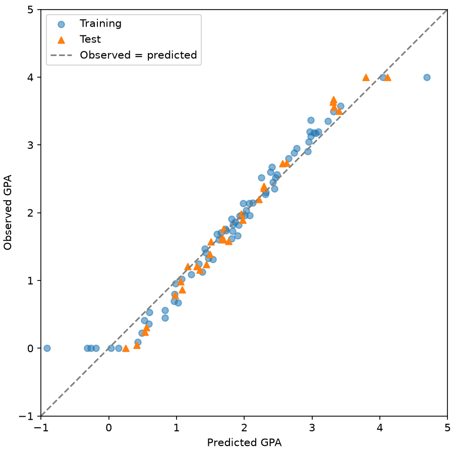
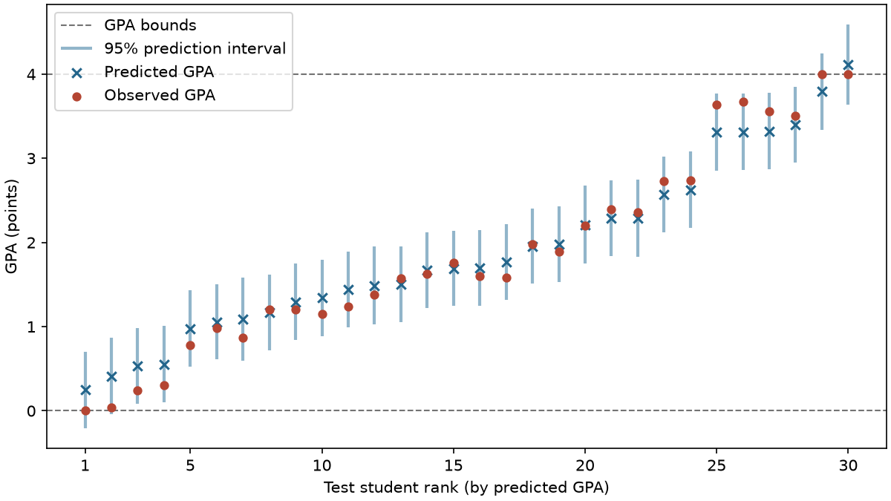

[予測とは何か](block:reg-prediction)では, 回帰式を求めるのに使わなかったデータで予測の誤差を測る理由を考えました. 誤差の指標として MSE と RMSE を導入し, 平均の信頼区間と個人の予測区間を求めました.

奨学生区分, 勉強時間, アルバイト時間から, 新しい学生の GPA をどれくらい正確に予測できるでしょうか.
100 人の合成データを読み込んだら, [重回帰分析](block:reg-gpa)と同じ分け方で, 先に最終評価用の 30 人を取り分けます.
残りの 70 人で回帰式を当てはめ, 取り分けた学生について予測の誤差と区間を調べます.

式に入れる変数はデータを見る前に問いから決めたので, ここで測るのは, 決めた式の予測の誤差です.
変数の選び方まで含めて評価するときは, 変数を選ぶ前にテストデータを取り分けます. その手順は[予測: 交差検証で選び, テストデータで 1 回だけ評価する](block:reg-selection-gpa#selection-prediction)で扱います.

# 合成 GPA の読み込みと分割 {#regression-train-test}

[`multiple_regression.csv`](https://github.com/yakagika/yakagika.github.io/blob/main/slds_data/ch11/multiple_regression.csv) には, 合成した 100 人分のデータが入っています.
CSV をダウンロードしてコードと同じフォルダに置き, そのフォルダからコードを実行してください.
先頭列は CSV の保存時に書き出された行番号です.
`index_col=0` で行のインデックスとして読み込みます.
読み込みから作図まで, 各節のコードを同じ Python セッションで順に実行します.

~~~ python
import matplotlib.pyplot as plt
import numpy as np
import pandas as pd
import statsmodels.formula.api as smf
from sklearn.metrics import mean_squared_error
from sklearn.model_selection import train_test_split

df = pd.read_csv("multiple_regression.csv", index_col=0)
train, test = train_test_split(df, test_size=0.3, random_state=0)
print(f"Training: {len(train)}, held out: {len(test)}")
~~~

~~~ text
Training: 70, held out: 30
~~~

`test_size=0.3` は 3 割をテストデータに取る指定で, `random_state=0` は分割を再現するための指定です.
この例では説明変数を先に定め, 係数を求めるのに訓練データの 70 人を使います.
テストデータは, その式の評価に使います.

| 列 | 内容 |
|---|---|
| `GPA` | GPA (0〜4 点) |
| `Scholarship` | 奨学生かどうか (`True` または `False`) |
| `Study_Hours` | 週あたりの勉強時間 (時間) |
| `Part_time_Work` | 週あたりのアルバイト時間 (時間) |
| `Sports_hours` | 週あたりの運動時間 (時間, 演習で使用) |

# scikit-learn による MSE と RMSE の計算 {#mse-sklearn}

[GPA の重回帰分析](block:reg-gpa#gpa-coefficients)と同じ式を使います.
`statsmodels` の `smf.ols(...).fit()` で係数を求めると,
同じ当てはめ結果から予測値と予測区間を計算できます.
誤差の集計には, 回帰式の作り方にかかわらず実測値と予測値から MSE を計算できる
`scikit-learn` の `mean_squared_error` を使います.

~~~ python
formula = "GPA ~ Scholarship + Study_Hours + Part_time_Work"
result = smf.ols(formula, data=train).fit()

pred_train = result.predict(train)
pred_test = result.predict(test)

mse_train = mean_squared_error(train["GPA"], pred_train)
mse_test = mean_squared_error(test["GPA"], pred_test)

print(f"Training: MSE = {mse_train:.4f}, RMSE = {np.sqrt(mse_train):.4f}")
print(f"Test:     MSE = {mse_test:.4f}, RMSE = {np.sqrt(mse_test):.4f}")
~~~

~~~ text
Training: MSE = 0.0459, RMSE = 0.2142
Test:     MSE = 0.0336, RMSE = 0.1834
~~~

`predict` は渡されたデータの説明変数を, 訓練データで求めた式に代入します.
訓練用とテスト用のそれぞれで, `mean_squared_error` に実測値, 予測値の順で渡します.
MSE の平方根を取ると, 誤差の大きさを元の GPA と同じ単位で読めます.

テストデータでの誤差の大きさは RMSE で約 0.18 GPA 点です.
訓練 MSE は 0.0459, テスト MSE は 0.0336 です. 大きな開きはなく, 訓練データにだけよく当てはまる過学習は, この比較からは見られません.
この分割でテスト MSE が小さかったのは, どの 30 人がテストデータに入ったかによる偶然です.
別の分割では差の向きが変わることもあります. 評価では, テストデータでの誤差の大きさと, 訓練データとの間に大きな開きがあるかを確かめます.

訓練用とテスト用の学生について, 同じ回帰式から求めた予測値と実測値を図で比べます.

~~~ python
fig, ax = plt.subplots(figsize=(6, 6), layout="constrained")
ax.scatter(pred_train, train["GPA"], alpha=0.55, label="Training")
ax.scatter(pred_test, test["GPA"], marker="^", color="tab:orange", label="Test")
limits = (-1, 5)
ax.plot(limits, limits, color="gray", linestyle="--", label="Observed = predicted")
ax.set(
    xlabel="Predicted GPA",
    ylabel="Observed GPA",
    xlim=limits,
    ylim=limits,
    aspect="equal",
)
ax.legend()
plt.show()
plt.close(fig)
~~~

図の 1 点が学生 1 人にあたります. 横軸は予測値, 縦軸は実測値で, 破線は両者が等しい位置です. 訓練用の 70 人を丸, テスト用の 30 人を三角で示します.
テストデータの三角も訓練データの丸と同じように破線のまわりに集まっています. 点が集中する中央付近では, 散らばりの幅に大きな違いは見えません.

横軸で予測値を一つ選ぶと, 破線の高さがその予測値, 点の高さが実測値です.
右端の三角は予測値が約 4.11 点で, 実測値は 4 点です. 点が破線より約 0.11 点下にあるので, この学生ではそれだけ高く予測しました.
テスト MSE は, 三角の点それぞれについてこの縦の差を二乗し, 30 人で平均した値です.

# テストデータの平均の信頼区間と予測区間 {#test-prediction-intervals}

テストデータの各行について, その学生と同じ条件の母集団平均を推定する区間と,
その条件での学生 1 人の GPA を予測する区間を作ります.
`get_prediction(test).summary_frame(alpha=0.05)` は,
テストデータの 30 人の説明変数を使い, 両方の区間を表にします.
`alpha=0.05` は区間の水準を 95% にする指定です.

~~~ python
intervals = result.get_prediction(test).summary_frame(alpha=0.05)
observed = test["GPA"]

highest = intervals.loc[intervals["mean"].idxmax()]
print(f"Highest prediction: {highest['mean']:.3f}")
print(f"95% mean CI: [{highest['mean_ci_lower']:.3f}, {highest['mean_ci_upper']:.3f}]")
print(
    f"95% prediction interval: "
    f"[{highest['obs_ci_lower']:.3f}, {highest['obs_ci_upper']:.3f}]"
)
print(f"Observed GPA in that row: {observed.loc[highest.name]:.3f}")
~~~

~~~ text
Highest prediction: 4.112
95% mean CI: [3.937, 4.287]
95% prediction interval: [3.638, 4.586]
Observed GPA in that row: 4.000
~~~

| 列 | 内容 |
|---|---|
| `mean` | 回帰式による平均の推定値. 個人の点予測にも使います. |
| `mean_ci_lower`, `mean_ci_upper` | 同じ条件の母集団平均に対する 95% 信頼区間の下端と上端. |
| `obs_ci_lower`, `obs_ci_upper` | 同じ条件の学生 1 人に対する 95% 予測区間の下端と上端. |

予測値が最も高い学生の行では, 平均の信頼区間より予測区間の方が広くなりました.
予測区間は, [平均の信頼区間と個人の予測区間](block:reg-prediction#prediction-intervals)で見たように,
平均の推定の誤差に加え, 同じ条件の学生どうしの個体差を含めて計算するためです.

## 実測 GPA を含んだ人数

各学生の GPA が予測区間の下端と上端の間にあるかを `between` で調べます.
返された `True` を足すと, 実測 GPA を含んだ区間の本数が分かります.
あわせて下端が 0 点未満の区間, 上端が 4 点超の区間, 4 点を超えた予測値を数えます.

~~~ python
covered = observed.between(intervals["obs_ci_lower"], intervals["obs_ci_upper"])
below_zero = (intervals["obs_ci_lower"] < 0).sum()
above_four = (intervals["obs_ci_upper"] > 4).sum()
predicted_above_four = (intervals["mean"] > 4).sum()

print(f"Covered: {covered.sum()}/{len(test)}")
print(f"Prediction intervals below 0: {below_zero}")
print(f"Prediction intervals above 4: {above_four}")
print(f"Predicted GPA above 4: {predicted_above_four}")
~~~

~~~ text
Covered: 30/30
Prediction intervals below 0: 2
Prediction intervals above 4: 2
Predicted GPA above 4: 1
~~~

この分割では, 30 人全員の実測 GPA が予測区間に入りました.
30 人では 1 人が区間を外れるだけで, 含まれる割合は約 3.3 パーセントポイント変わります.
予測区間の 95% は仮定が成り立つ場合に同じ手順を繰り返したときの水準です.
この 30 人の結果だけで, 次の学生に対する被覆率は決まりません.

## GPA の範囲を越える予測

図では, テストデータの 30 人を予測値の低い順に並べます.
`intervals` を並べ替えた後, `observed` も同じ行番号順にそろえます.

~~~ python
ordered = intervals.sort_values("mean")
ordered_observed = observed.loc[ordered.index]
ranks = range(1, len(ordered) + 1)

fig, ax = plt.subplots(figsize=(8, 4.5), layout="constrained")
ax.axhline(0, color="0.45", linestyle="--", linewidth=1)
ax.axhline(4, color="0.45", linestyle="--", linewidth=1, label="GPA bounds")
ax.vlines(
    ranks,
    ordered["obs_ci_lower"],
    ordered["obs_ci_upper"],
    color="#91b5ca",
    linewidth=2,
    label="95% prediction interval",
    zorder=1,
)
ax.scatter(
    ranks,
    ordered["mean"],
    marker="x",
    color="#23658b",
    label="Predicted GPA",
    zorder=3,
)
ax.scatter(ranks, ordered_observed, s=24, color="#b44532", label="Observed GPA", zorder=3)
ax.set(
    xlabel="Test student rank (by predicted GPA)",
    ylabel="GPA (points)",
    xticks=[1, 5, 10, 15, 20, 25, 30],
)
ax.legend(loc="upper left")
plt.show()
plt.close(fig)
~~~

{.wide}

青い交差印が予測値, 赤い丸が実測値, 縦線が予測区間です.
右端では予測値も区間の上端も, 4 点を示す破線を上回ります.
左端では予測区間の下端が 0 点を下回る学生もいます.
合成データでは, 奨学生区分, 勉強時間, アルバイト時間と乱数から求めた[潜在得点](block:reg-multiple#partial-coefficients)を 0〜4 点で打ち切って GPA を作っています.
一次式で当てはめた予測値と, その周りに置く区間には同じ上限と下限がないため, 観測 GPA の範囲を越えます.
打ち切りのため, 上限や下限に実測値が集まる条件では誤差のばらつき方が変わり, 区間の計算で仮定した等分散性が崩れます.

予測では, 説明変数の値が分かっている新しい学生の GPA を当てました.
学生の勉強時間を増やす介入を行うと平均 GPA はどう変わるでしょうか.
[因果推論とは何か](block:reg-causal)では, 回帰係数から介入の効果を求めるにはどのような仮定が要るかを考えます.

# 演習 {#exercises}

## Exercise REG-EVALUATE-1 {#exercise-reg-evaluate-1}

**運動時間を加えた式の訓練 MSE とテスト MSE**

本文と同じ分割 (`test_size=0.3, random_state=0`) で, 次の 2 つの式を訓練データに当てはめてください.

- A は `GPA ~ Scholarship + Study_Hours + Part_time_Work` とします.
- B は A に `Sports_hours` を足します.

A と B の訓練 MSE とテスト MSE をそれぞれ求め, 運動時間を足したときの違いを記述してください.
このテストデータの MSE を見て使う式を選ぶと, 選んだ式のテスト MSE が新しいデータでの誤差より小さめに出やすい理由も説明してください.

回答

~~~ python
import pandas as pd
import statsmodels.formula.api as smf
from sklearn.metrics import mean_squared_error
from sklearn.model_selection import train_test_split

df = pd.read_csv("multiple_regression.csv", index_col=0)
train, test = train_test_split(df, test_size=0.3, random_state=0)

formula_a = "GPA ~ Scholarship + Study_Hours + Part_time_Work"
formulas = {"A": formula_a, "B": formula_a + " + Sports_hours"}

for name, formula in formulas.items():
    result = smf.ols(formula, data=train).fit()
    mse_train = mean_squared_error(train["GPA"], result.predict(train))
    mse_test = mean_squared_error(test["GPA"], result.predict(test))
    print(f"{name}: training MSE = {mse_train:.6f}, test MSE = {mse_test:.6f}")
~~~

~~~ text
A: training MSE = 0.045889, test MSE = 0.033627
B: training MSE = 0.045865, test MSE = 0.034113
~~~

運動時間を足すと, 訓練 MSE は約 0.000024 下がり, テスト MSE は約 0.000486 上がりました.
どちらも小さな変化です. 訓練 MSE の下がり方だけでは, 新しい学生の予測が改善するかは分かりません.

テスト MSE を比べて小さい方を採用すると, その 30 人では偶然誤差が小さかった式も選ばれやすくなります.
たまたま小さく出た値を評価にも使うことになるため, 新しい学生での誤差を過小に見積もりがちです.
実際に候補から式を選ぶときは, [訓練データ・検証データ・テストデータ](block:reg-prediction#training-validation-test)の手順で,
検証データか交差検証で式を選び, テストデータを最後の評価に 1 回だけ使います.

