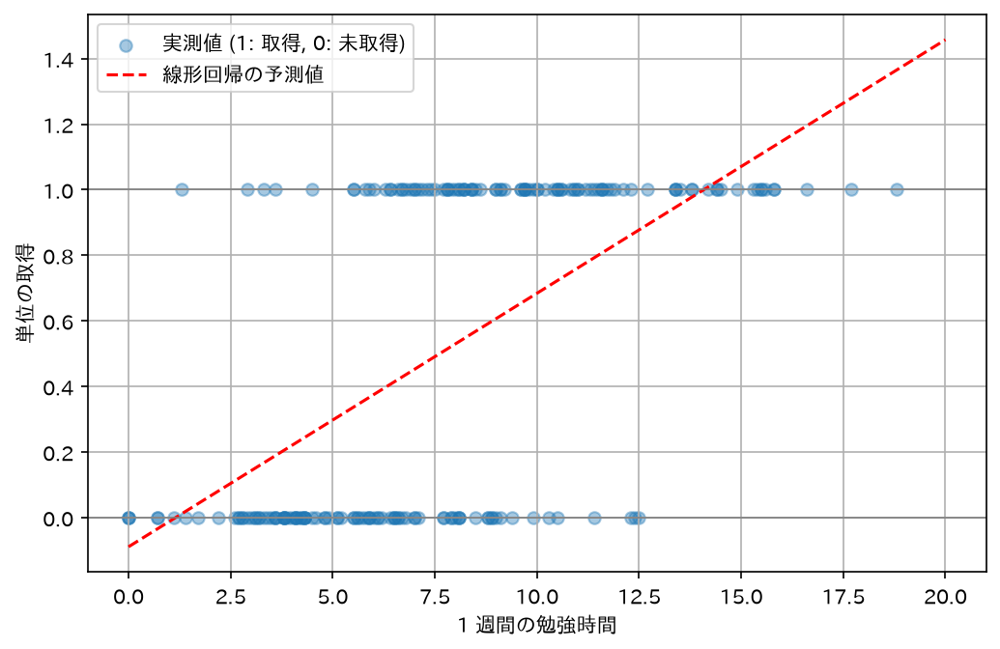
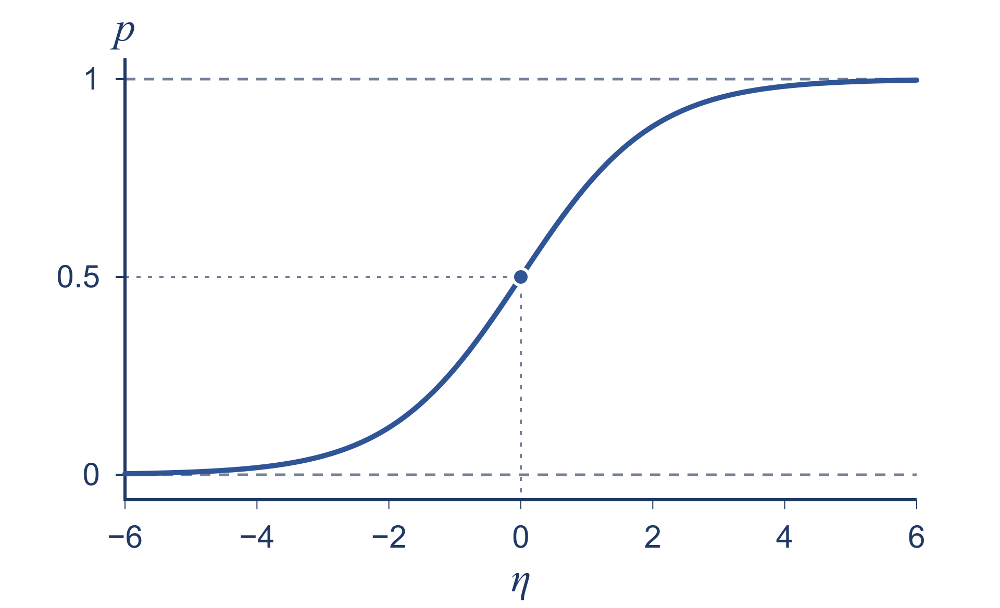

目的変数が「単位を取得した (1), 取得しなかった (0)」のような 2 値のとき, 知りたいのは説明変数の値ごとに 1 になる確率です.
確率は 0 から 1 の範囲に収まりますが, 線形回帰の当てはめ値には上限も下限もありません.
当てはめ値が 0 から 1 の範囲に収まるように回帰式を作り直したものが**ロジスティック回帰**で, 線形回帰を含む**一般化線形モデル**の一つです.

同じ時間だけ勉強し, 同じ時間だけアルバイトをする学生のうち, どれくらいの割合で単位を取得するのでしょうか.
単位を取得した学生を 1, 取得しなかった学生を 0 と記録すると, 単位を取得した割合を 0 と 1 の平均として計算できます.
ロジスティック回帰では, 勉強時間とアルバイト時間が同じ学生について, この平均を推定します.

# 二値の応答の平均と確率 {#binary-response}

## 同じ条件の学生の平均

学生の勉強時間とアルバイト時間をまとめて $X$ と書きます.
単位を取得したかどうかを表す目的変数を $Y$ とし, 取得したときは $Y=1$, 取得しなかったときは $Y=0$ とします.
例えば, 勉強時間とアルバイト時間がそれぞれ同じ学生 10 人のうち, 4 人が単位を取得したとします.
10 人の $Y$ の平均は $(4 \times 1 + 6 \times 0)/10 = 0.4$ で, この 10 人の取得割合に等しくなります.

母集団でも, 条件 $X$ をそろえて考えます.
$Y$ が 1 と 0 をとる確率でそれぞれの値を重み付けすると, 条件つき期待値は次のようになります.

$$
\begin{aligned}
E(Y \mid X)
&= 1 \times P(Y=1 \mid X) + 0 \times P(Y=0 \mid X) \\
&= P(Y=1 \mid X).
\end{aligned}
$$

したがって, 勉強時間とアルバイト時間が同じ学生の母集団での平均を推定することは,
その条件の学生が単位を取得する確率を推定することです.

## 線形回帰の当てはめ値の範囲

上限が 4 点の GPA を一次式で予測すると, 予測値が 4 点を超えることがあります.
[GPA を予測した例](block:reg-evaluate#test-prediction-intervals)では, テストデータの 1 人でこのような値が出ました.
単位の取得を 0 と 1 で記録したとき, 同じように一次式の値が範囲を外れると, その値を取得確率として読めるでしょうか.

確率は 0 から 1 の間の値をとります.
一方, 勉強時間の一次式で取得確率を表すと, 傾きが 0 でない限り, 式の値をあらゆる勉強時間について
0 から 1 の間に収める仕組みはありません.

練習用の架空のデータには, 学生 200 人について, 週あたりの勉強時間とアルバイト時間, ある科目の単位を取得したかどうかを記録しています.
次の図には, このデータに勉強時間だけを説明変数とする線形回帰を当てはめた結果を示します.

観測値は縦軸の 0 と 1 の 2 本の線の上にだけあり, 勉強時間が長い学生ほど 1 の線の上に多くいます.
回帰直線の傾きは週 1 時間あたり約 0.077 です.
当てはめ値は観測した 200 人のうち 6 人で 0 未満, 15 人で 1 を超えます.
直線が 0 と交わるのは週約 1.15 時間, 1 と交わるのは週約 14.09 時間で, 6 人は 0 との交点より左側に, 15 人は 1 との交点より右側にいます.

観測された勉強時間の範囲内でも確率として読めない値が出るため,
単位の取得を扱うモデルでは, 勉強時間の一次式と取得確率を結び付ける関数を使います.

# ロジスティック回帰と一般化線形モデル {#glm-components}

## 応答の分布・線形予測子・リンク関数

一次式の値と取得確率をどう結び付けるかは, 応答の分布と平均の表し方で決まります.
一般化線形モデルでは, 説明変数の値を条件とした応答の分布と, その分布の平均を求める式を指定します.
回帰式を応答の分布, 線形予測子, リンク関数の 3 つの要素に分けて考えます.

| 要素 | 役割 |
|---|---|
| 応答の分布 | 説明変数の値が与えられたときに, 目的変数がどの分布に従うかを定めます. |
| **線形予測子** | 説明変数の一次式で条件ごとの値 $\eta_i$ を表します. |
| **リンク関数** | 条件つき平均 $\mu_i$ を線形予測子に結び付ける関数 $g$ です. $g(\mu_i)=\eta_i$ と置きます. |

ロジスティック回帰と正規分布を仮定した線形回帰は, 線形予測子が共通で, 応答の分布とリンク関数が異なります.
学生 $i$ の週あたりの勉強時間を $x_{i1}$, アルバイト時間を $x_{i2}$ とし, その条件での取得確率を $p_i$ と書きます.

| 要素 | ロジスティック回帰 | 正規分布を仮定した線形回帰 |
|---|---|---|
| 目的変数 | 2 値 (単位の取得 1/0) | 量的変数 |
| 応答の分布 | **ベルヌーイ分布** (確率 $p_i$ で 1, 確率 $1-p_i$ で 0) | 正規分布 |
| 線形予測子 | $\beta_0+\beta_1x_{i1}+\beta_2x_{i2}$ | $\beta_0+\beta_1x_{i1}+\beta_2x_{i2}$ |
| リンク関数 | **ロジット** $g(p_i)=\log\{p_i/(1-p_i)\}$ | **恒等リンク** $g(\mu_i)=\mu_i$ |

[二値の応答の平均と確率](#binary-response)で確かめたように, ベルヌーイ分布の条件つき平均 $\mu_i$ は取得確率 $p_i$ に等しくなります.

::: note
正規分布を仮定した線形回帰では, 応答の条件つき分布を平均 $\mu_i$, 共通の分散 $\sigma^2$ の正規分布とします.
恒等リンクでは, 条件つき平均が線形予測子 $\eta_i$ に等しくなります.
:::

## オッズとロジット

ロジスティック回帰では, 取得確率をロジットで変換してから線形予測子と結び付けます.
取得確率を $p$ とすると, 未取得の確率は $1-p$ です.
$0 < p < 1$ のとき, 取得の確率が未取得の確率の何倍かを表す $p/(1-p)$ を**オッズ**といいます.
例えば $p=0.8$ なら, 取得のオッズは $0.8/0.2=4$ です.
$p=0.5$ なら取得と未取得の確率が等しく, オッズは 1 です.

ロジットはオッズの自然対数をとる関数で, その値 $\log(p/(1-p))$ を**対数オッズ**といいます.
確率が 0 から 1 までの間で動くと, オッズは 0 から無限大に向かって動きます.
対数オッズは確率が 0 に近づくと負の無限大に, 1 に近づくと正の無限大に向かいます.
こうして上限も下限もない尺度に移すと, 対数オッズを線形予測子に等しいと置けます.

## 線形予測子から取得確率への変換

勉強時間とアルバイト時間を説明変数にすると, 対数オッズは次の一次式で表せます.

$$
\log\frac{p_i}{1-p_i}
= \beta_0 + \beta_1 x_{i1} + \beta_2 x_{i2}.
$$

右辺の一次式が線形予測子 $\eta_i$ です.
線形予測子から取得確率を求めるには, 式の両辺を指数関数に通してから $p_i$ について解きます.

$$
\begin{aligned}
\frac{p_i}{1-p_i} &= \exp(\eta_i), \\
p_i &= \frac{\exp(\eta_i)}{1+\exp(\eta_i)}
     = \frac{1}{1+\exp(-\eta_i)}.
\end{aligned}
$$

この逆変換を**ロジスティック関数**といいます.
有限の $\eta_i$ に対して分母は 1 より大きいので, 取得確率は 0 より大きく 1 より小さくなります.

下の模式図は, 線形予測子から取得確率への変換を曲線で表したものです.

S 字の曲線は $\eta_i=0$ で $p_i=0.5$ を通り, $\eta_i$ が大きくなるほど 1 に, 小さくなるほど 0 に近づきます.

[回帰式と回帰係数](block:reg-intro#regression-equation)でロジスティック回帰を非線形回帰の例に挙げたのは, 確率 $p_i$ が説明変数の非線形な関数だからです.
リンク関数を通した対数オッズは説明変数の一次式です.
このように, リンク関数を通すと条件つき平均を線形予測子に結び付けられるモデルを, 一般化線形モデルと呼びます.

# ロジスティック回帰の係数とオッズ比 {#odds-ratio}

## アルバイト時間をそろえた比較

複数の説明変数が入った回帰式では, ある変数の係数を, ほかの説明変数の値が同じ個体どうしの比較として読みます.
勉強時間の係数 $\beta_1$ を読むときは, アルバイト時間が等しく, 勉強時間が週 1 時間違う学生どうしを比べます.
複数の変数をそろえる考え方は[重回帰分析と偏回帰係数](block:reg-multiple)でも使います.

アルバイト時間がともに $w$ 時間で, 勉強時間が $s$ 時間と $s+1$ 時間の学生を比べます.
それぞれのオッズを $o_s$, $o_{s+1}$ と書くと, 対数オッズの差は次のようになります.

$$
\begin{aligned}
\log o_{s+1} - \log o_s
&= \{\beta_0 + \beta_1(s+1) + \beta_2w\}
 - \{\beta_0 + \beta_1s + \beta_2w\} \\
&= \beta_1.
\end{aligned}
$$

差を指数関数に通すとオッズの比になります.

$$
\frac{o_{s+1}}{o_s} = \exp(\beta_1).
$$

この **オッズ比** は, アルバイト時間が同じ学生どうしで, 勉強時間が週 1 時間長い学生の取得オッズが
短い学生の何倍かを表します.
$\beta_1=0$ ならオッズ比は 1 で, $\beta_1>0$ なら 1 より大きくなります.

## 同じオッズ比に対応する確率の差

同じ週 1 時間の差を比べると, モデル上のオッズ比はどの勉強時間でも一定です.
確率はオッズ $o$ を $o/(1+o)$ に変換して求めるため, 確率の差はどの勉強時間を比べるかによって変わります.
S 字の曲線は確率が 0.5 付近で傾きが大きく, 0 や 1 に近いところでは緩やかです.
この曲線では, アルバイト時間が同じ学生どうしの勉強時間に週 1 時間の差があっても, 取得確率の差は比べる位置ごとに異なります.

例えば, オッズ比が 2 のモデルで, 勉強時間が短い方の学生の取得確率が 0.20 なら,
オッズは 0.25 です. 勉強時間が週 1 時間長い方のオッズは 0.50 で, 確率は約 0.333 です.
確率の差は約 13.3 パーセントポイントです.
別の時間帯で, 短い方の取得確率が 0.80 なら, オッズは 4 です.
長い方のオッズは 8 で, 確率は約 0.889 です. このときの差は約 8.9 パーセントポイントです.

## 標本から係数を推定する方法

係数の値を決めると, 学生ごとの条件から取得確率 $p_i$ が定まります.
単位を取得した学生の観測値が出る確率は $p_i$, 取得しなかった学生の観測値が出る確率は $1-p_i$ です.
説明変数の値を与えたときに学生どうしの応答が独立だと仮定すると,
観測された応答の組み合わせが出る確率を, 学生ごとの確率の積で表せます.

この積を係数の関数として見たものを **尤度** といいます.
尤度を最大にする係数 $\hat\beta_j$ を求める方法が **最尤法** です.
推定したオッズ比は $\exp(\hat\beta_j)$ で計算します.
観測値を固定して母数を動かす考え方は[尤度](block:bayes-intro#尤度-likelihood)で,
その値が最大になる母数を選ぶ手順は[最尤推定](block:bayes-intro#最尤推定-maximum-likelihood-estimation)で, 確率の積を対数の和に直して計算する方法とともに説明しています.

[ロジスティック回帰分析](block:reg-logit)では, 架空の学生 200 人のデータで係数を最尤法で推定し, オッズ比と取得確率を求めます.

# 演習 {#exercises}

## Exercise REG-GLM-1 {#exercise-reg-glm-1}

**二値の観測値の平均とリンク関数**

勉強時間とアルバイト時間がそれぞれ同じ学生 20 人のうち, 15 人が単位を取得しました.
取得を 1, 未取得を 0 とした観測値の平均を求めてください.
次に, その平均を取得確率として使い, オッズと対数オッズを求めてください.

回答

観測値の平均は $(15\times 1+5\times 0)/20=0.75$ です.
取得確率を $0.75$ と置くと, オッズは $0.75/0.25=3$ です.
対数オッズは $\log 3 \simeq 1.099$ です.

## Exercise REG-GLM-2 {#exercise-reg-glm-2}

**週 1 時間の差をオッズ比で読む**

あるロジスティック回帰モデルで勉強時間の係数が $\log(1.5)$ でした.
アルバイト時間が等しく, 勉強時間が週 1 時間違う学生どうしについて,
勉強時間が長い方の取得オッズを短い方の取得オッズで割った値を求めてください.
短い方の取得確率が 0.5 の場合, 長い方の取得確率はいくつですか.

回答

勉強時間が週 1 時間長い学生の取得オッズは, アルバイト時間の等しい短い方の学生の
$\exp(\log(1.5))=1.5$ 倍です.

短い方の取得確率が 0.5 なら, オッズは $0.5/(1-0.5)=1$ です.
したがって, 長い方のオッズは $1.5$ で, 取得確率は $1.5/(1+1.5)=0.60$ です.

