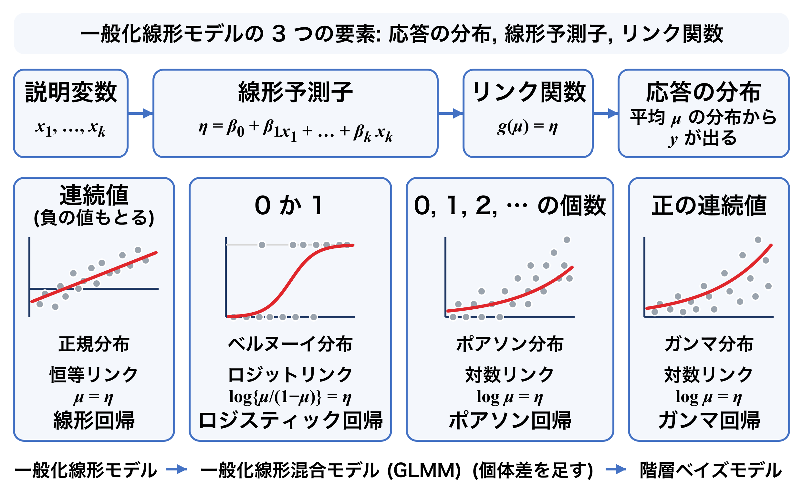
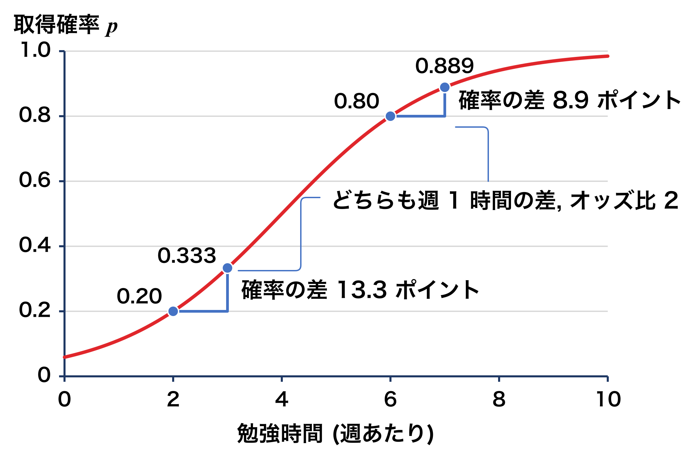

目的変数には, GPA のような量的な値のほかに, 単位を取得したかどうかのような 0 か 1 の値, 1 学期の欠席回数のような 0 以上の整数 (個数), 通学時間のような正の連続値があります.
[母回帰式と誤差](block:reg-ols#population-model)で扱った線形回帰では, 説明変数の値が同じ観測の目的変数は, 回帰式の一次式の値を平均とする正規分布に従い, その分散は説明変数の値によらず等しいと仮定しました.
この仮定のまま欠席回数や単位の取得を表すと, 一次式の値が負になったり 1 を超えたりして, 個数や確率として読めない平均が出ます.
欠席回数のように平均が大きいほどばらつきも大きい目的変数では, 分散が等しいという仮定も成り立ちません.

**一般化線形モデル** (generalized linear model, GLM) では, 目的変数の種類に合わせて確率分布を選び, その分布の平均を説明変数の一次式と関数で結び付けます.
@kubo2012mcmc [p. 6] は, データのばらつきを等分散の正規分布で表す線形モデルを, 正規分布以外の確率分布も扱えるように拡張したものとして一般化線形モデルを位置付けています.
同じ頁で, 線形モデルは確率分布を等分散の正規分布とした一般化線形モデルの一部だと述べています.

本稿では, まず 0 か 1 の目的変数で, 線形回帰の当てはめ値が確率として読めないことを確かめます.
そのうえで一般化線形モデルを構成する 3 つの要素を説明し, 個数や正の連続値を含めて, 目的変数の種類ごとに使う分布の一覧を示します.
最後に, 0 か 1 の目的変数に使うロジスティック回帰と, その係数の読み方を扱います.

# 二値の応答の平均と確率 {#binary-response}

最初に, 目的変数が 0 か 1 の 2 値をとる場合を考えます.
同じ時間だけ勉強し, 同じ時間だけアルバイトをする学生のうち, どれくらいの割合で単位を取得するのでしょうか.

## 同じ条件の学生の平均

学生の勉強時間とアルバイト時間をまとめて $X$ と書きます.
単位を取得したかどうかを表す目的変数を $Y$ とし, 取得したときは $Y=1$, 取得しなかったときは $Y=0$ とします.
例えば, 勉強時間とアルバイト時間がそれぞれ同じ学生 10 人のうち, 4 人が単位を取得したとします.
10 人の $Y$ の平均は $(4 \times 1 + 6 \times 0)/10 = 0.4$ で, この 10 人の取得割合に等しくなります.

母集団でも, 条件 $X$ をそろえて考えます.
$Y$ が 1 と 0 をとる確率でそれぞれの値を重み付けすると, 条件つき期待値は次のようになります.

$$
\begin{aligned}
E(Y \mid X)
&= 1 \times P(Y=1 \mid X) + 0 \times P(Y=0 \mid X) \\
&= P(Y=1 \mid X).
\end{aligned}
$$

したがって, 勉強時間とアルバイト時間が同じ学生の母集団での平均を推定することは,
その条件の学生が単位を取得する確率を推定することです.

## 線形回帰の当てはめ値の範囲

上限が 4 点の GPA を一次式で予測すると, 予測値が 4 点を超えることがあります.
[GPA を予測した例](block:reg-evaluate#test-prediction-intervals)では, テストデータの 1 人でこのような値が出ました.
単位の取得を 0 と 1 で記録したとき, 同じように一次式の値が範囲を外れると, その値を取得確率として読めるでしょうか.

確率は 0 から 1 の間の値をとります.
一方, 勉強時間の一次式で取得確率を表すと, 傾きが 0 でない限り, 式の値をあらゆる勉強時間について
0 から 1 の間に収める仕組みはありません.

練習用の架空のデータには, 学生 200 人について, 週あたりの勉強時間とアルバイト時間, ある科目の単位を取得したかどうかを記録しています.
次の図には, このデータに勉強時間だけを説明変数とする線形回帰を当てはめた結果を示します.

観測値は縦軸の 0 と 1 の 2 本の線の上にだけあり, 勉強時間が長い学生ほど 1 の線の上に多くいます.
回帰直線の傾きは週 1 時間あたり約 0.077 です.
当てはめ値は観測した 200 人のうち 6 人で 0 未満, 15 人で 1 を超えます.
直線が 0 と交わるのは週約 1.15 時間, 1 と交わるのは週約 14.09 時間で, 6 人は 0 との交点より左側に, 15 人は 1 との交点より右側にいます.

観測された勉強時間の範囲内でも確率として読めない値が出るため,
単位の取得を扱うモデルでは, 勉強時間の一次式と取得確率を, 値が 0 から 1 に収まる関数で結び付けます.
どの関数を使うかは, 目的変数がどの分布に従うと考えるかによって決まります.

# 一般化線形モデルの 3 つの要素 {#glm-components}

[二値の応答の平均と確率](#binary-response)では, 取得確率を勉強時間の一次式で直接表すと, 確率の範囲を外れる値が出ることを確かめました.
一般化線形モデルでは, 目的変数が従う分布と, その分布の平均を一次式に結び付ける関数を分けて指定します.
@kubo2012mcmc [pp. 47, 64] は, 一般化線形モデルを, 確率分布, 線形予測子, リンク関数の 3 つを指定して作る統計モデルとして説明しています.
本稿では, 確率分布を応答の分布と呼びます.

| 要素 | 役割 |
|---|---|
| **応答の分布** | 説明変数の値が与えられたときに, 目的変数 $Y_i$ がどの確率分布に従うかを定めます. その分布の平均 (条件つき平均) を $\mu_i=E(Y_i\mid x_i)$ と書きます. |
| **線形予測子** | 説明変数の一次式 $\eta_i=\beta_0+\beta_1x_{i1}+\cdots+\beta_kx_{ik}$ です. |
| **リンク関数** | 条件つき平均 $\mu_i$ を線形予測子に結び付ける関数 $g$ です. $g(\mu_i)=\eta_i$ と置きます. |

線形予測子の「線形」は, 係数について一次式であることを指します.
@kubo2012mcmc [p. 47] は, $\beta_1+\beta_2x_i+\beta_3x_i^2$ のように説明変数の 2 乗を含む式も, 係数 $\beta_1, \beta_2, \beta_3$ の線形結合なので線形予測子になると説明しています.

リンク関数の逆関数 $g^{-1}$ を使うと, 平均は $\mu_i=g^{-1}(\eta_i)$ で求まります.
線形予測子は係数と説明変数の値によって, 負の値も大きな正の値もとります.
リンク関数は, 線形予測子がどんな値をとっても, 平均が目的変数の範囲 (確率なら 0 から 1, 個数なら 0 以上) に収まるように選びます.

正規分布を仮定した線形回帰も, 一般化線形モデルの一つです.
応答の分布を正規分布とし, リンク関数を $g(\mu_i)=\mu_i$ (**恒等リンク**) とすると, 条件つき平均が線形予測子に等しくなり, 線形回帰の式になります [@kubo2012mcmc, pp. 61-62].

::: note
正規分布を仮定した線形回帰では, 応答の条件つき分布を平均 $\mu_i$, 共通の分散 $\sigma^2$ の正規分布とします.
恒等リンクでは $\mu_i=\eta_i$ なので, 平均は一次式の値そのもので, 範囲の制約はありません.
:::

係数は, 選んだ分布のもとで観測値が出る確率 (連続値なら確率密度) を観測ごとに掛け合わせた**尤度**を最大にする**最尤法**で推定します.
正規分布で分散が一定のときは, 尤度を最大にする係数は残差の二乗和を最小にする係数と一致し, 最尤法と最小二乗法は同じ推定値を与えます [@kubo2012mcmc, p. 137].
観測値を固定して母数を動かす尤度の考え方は[尤度](block:bayes-intro#尤度-likelihood)で, その値が最大になる母数を選ぶ手順は[最尤推定](block:bayes-intro#最尤推定-maximum-likelihood-estimation)で説明しています.
ロジスティック回帰の尤度の形は, [ロジスティック回帰の係数とオッズ比](#odds-ratio)で具体的に書きます.

# 一般化線形モデルの全体像 {#glm-family}

[一般化線形モデルの 3 つの要素](#glm-components)のうち, 線形予測子は目的変数の種類によらず同じ形です.
目的変数に合わせて選ぶのは, 応答の分布とリンク関数の組です.
@kubo2012mcmc [p. 34] は, 分布を選ぶときにデータで確かめる点として, 説明したい量が離散か連続か, 値の範囲, 標本分散と標本平均の関係の 3 つを挙げています.
例えば, 欠席回数は離散 (0 以上の整数) で上限が決まっておらず, 通学時間は連続で 0 より大きい値だけをとります.

次の図は, 3 つの要素の関係と, 目的変数の種類ごとに選ぶ分布とリンク関数を並べた模式図です.
下段の 4 つの小さな図は, 説明変数と平均の関係の形 (赤の線) と観測値の散らばり方 (灰色の点) を描いたもので, 実データではありません.

{.wide}

図に挙げた組と, 個数のばらつきが大きいときに使う負の二項分布をまとめると, 次の表になります.
表は, @kubo2012mcmc の分布の一覧 [p. 34] と, 分布ごとによく使うリンク関数の表 [表 6.1, p. 114] をもとに, 目的変数の例と呼び名を本稿で加えたものです.

| 目的変数の例 | 値の種類と範囲 | 応答の分布 | 分散と平均の関係 | よく使うリンク関数 | 呼び名 |
|---|---|---|---|---|---|
| テストの点数の前回との差 | 連続値. 負の値もとる | 正規分布 | 分散は平均と関係なく決まる | 恒等 $g(\mu)=\mu$ | 線形回帰 |
| 単位を取得したか (n 回のうちの成功回数) | 0 か 1 (0 から n の整数) | 二項分布 (n=1 のときはベルヌーイ分布) | 分散は平均で決まる | ロジット $g(p)=\log\{p/(1-p)\}$ ($p$ は成功の確率) | ロジスティック回帰 |
| 1 学期の欠席回数 | 0 以上の整数. 上限は決まっていない | ポアソン分布 | 分散は平均に等しい | 対数 $g(\mu)=\log\mu$ | ポアソン回帰 |
| 欠席回数で, ばらつきがポアソン分布より大きいとき | 0 以上の整数 | 負の二項分布 | 分散は平均より大きい | 対数 | 負の二項回帰 |
| 通学時間 | 正の連続値 | ガンマ分布 | 平均が大きいほど分散も大きい | 対数 | ガンマ回帰 |

表のどの行でも線形予測子は同じ形で, 応答の分布とリンク関数が異なります.
例えば, 勉強時間 $x_{i1}$ とアルバイト時間 $x_{i2}$ を説明変数にすると, ロジスティック回帰と線形回帰はどちらも線形予測子 $\beta_0+\beta_1x_{i1}+\beta_2x_{i2}$ を使います.
前者はベルヌーイ分布とロジット, 後者は正規分布と恒等リンクを使います.

::: note
**正準リンク関数**

分布ごとに, 推定の計算で扱いやすいリンク関数が 1 つ決まっていて, **正準リンク関数**と呼ばれます.
@kubo2012mcmc [pp. 48, 114] によると, 二項分布ではロジット, ポアソン分布では対数, 正規分布では恒等が正準リンク関数で, 表のリンク関数もこれに一致します.
ガンマ分布の正準リンク関数は逆数 $g(\mu)=1/\mu$ ですが, 同書は対数リンクほど使いやすくないとして, よく使うリンク関数に対数を挙げています.
:::

## 対数リンクと掛け算で表れる効果 {#log-link-effects}

ポアソン回帰, 負の二項回帰, ガンマ回帰で使う対数リンクでは, 平均は線形予測子を指数関数に通した値です.

$$
\mu_i=\exp(\beta_0+\beta_1x_{i1}+\beta_2x_{i2})
=\exp(\beta_0)\times\exp(\beta_1x_{i1})\times\exp(\beta_2x_{i2}).
$$

指数関数の値は正なので, 係数がどんな値でも平均は 0 より大きくなります.
$x_{i2}$ が同じで $x_{i1}$ だけが 1 大きい観測を比べると, 平均は $\exp(\beta_1)$ 倍になります.
線形回帰の係数が平均の差を表すのに対し, 対数リンクの係数は平均の比を表します.
@kubo2012mcmc [pp. 48, 58-60] は, 植物の体の大きさが 1 増えると種子数の平均が約 1.08 倍になる例で, 対数リンクでは要因の効果が掛け算で平均に及ぶことを示しています.
同じデータに恒等リンクを使うと, 効果は足し算になり, 平均が負になりうる別のモデルになることも示しています.
ロジスティック回帰では, 同じ読み方がオッズについて成り立ちます. 読み方は[ロジスティック回帰の係数とオッズ比](#odds-ratio)で扱います.

::: warn
目的変数を対数変換してから線形回帰を当てはめることは, 対数リンクの一般化線形モデルとは別のモデルです [@kubo2012mcmc, pp. 63, 114-115].
対数変換した線形回帰は $\log Y$ の平均を一次式で表し, 対数リンクは $Y$ の平均の対数を一次式で表します.
個数のように 0 をとる目的変数は, 対数変換そのものができません.
:::

::: note
**割合を目的変数にしないためのオフセット項**

調べた面積や時間の長さ $A_i$ が観測ごとに違うとき, 個数 $y_i$ を $A_i$ で割った密度を目的変数にしたくなります.
@kubo2012mcmc [pp. 130-131] は, このような割り算の値を使うと, 1000 打数 300 安打と 10 打数 3 安打を同じ 3 割として扱うように情報が失われ, 割り算の値がどの分布に従うかも分からなくなると述べています.
代わりに, 平均の個数を面積と単位面積あたりの平均の積で表します [@kubo2012mcmc, pp. 132-133].

$$
\mu_i=A_i\exp(\beta_0+\beta_1x_i)=\exp(\beta_0+\beta_1x_i+\log A_i).
$$

この式は対数リンクのポアソン回帰で, 線形予測子に係数の付かない項 $\log A_i$ が加わります.
この項を**オフセット項**と呼びます.
:::

## 一般化線形モデルで表せないばらつき

一般化線形モデルでは, 説明変数の値が同じ観測は同じ分布に従うと考えます.
@kubo2012mcmc [pp. 148-151] は, 二項分布で期待されるより大きなばらつきを**過分散**と呼び, その原因を, データとして測っていない個体差に求めています.
同書は, 個体ごとの差 $r_i$ を線形予測子に加え, $r_i$ が平均 0 の正規分布に従うとしたモデルを**一般化線形混合モデル** (GLMM) として説明しています [@kubo2012mcmc, pp. 151-152].
また, 線形モデルから一般化線形モデル, 一般化線形混合モデル, 階層ベイズモデルへと順に拡張する道筋を示しています [@kubo2012mcmc, p. 6].
学生ごとの差を加えたモデルの例は, [過分散と個体差](block:bayes-modeling#overdispersion)と[個体差のモデリング](block:bayes-modeling#modeling-individual-variation)にあります.

全体像の表のうち, 次の節では 0 か 1 の目的変数に使うロジスティック回帰を詳しく扱います.
架空の学生 200 人のデータで係数を推定する手順は[ロジスティック回帰分析](block:reg-logit)にあります.

# ロジスティック回帰 {#logistic-regression}

[一般化線形モデルの全体像](#glm-family)の表のうち, 目的変数が 0 か 1 のときに使う組が**ロジスティック回帰**です.
応答の分布にベルヌーイ分布を, リンク関数にロジットを使います [@kubo2012mcmc, p. 119].
学生 $i$ の週あたりの勉強時間を $x_{i1}$, アルバイト時間を $x_{i2}$ とし, その条件での取得確率を $p_i$ と書きます.

| 要素 | ロジスティック回帰 |
|---|---|
| 目的変数 | 2 値 (単位の取得 1/0) |
| 応答の分布 | **ベルヌーイ分布** (確率 $p_i$ で 1, 確率 $1-p_i$ で 0) |
| 線形予測子 | $\eta_i=\beta_0+\beta_1x_{i1}+\beta_2x_{i2}$ |
| リンク関数 | **ロジット** $g(p_i)=\log\{p_i/(1-p_i)\}$ |

[二値の応答の平均と確率](#binary-response)で確かめたように, ベルヌーイ分布の条件つき平均 $\mu_i$ は取得確率 $p_i$ に等しくなります.

## オッズとロジット

ロジスティック回帰では, 取得確率をロジットで変換してから線形予測子と結び付けます.
取得確率を $p$ とすると, 未取得の確率は $1-p$ です.
$0 < p < 1$ のとき, 取得の確率が未取得の確率の何倍かを表す $p/(1-p)$ を**オッズ**といいます.
例えば $p=0.8$ なら, 取得のオッズは $0.8/0.2=4$ です.
$p=0.5$ なら取得と未取得の確率が等しく, オッズは 1 です.

ロジットはオッズの自然対数をとる関数で, その値 $\log(p/(1-p))$ を**対数オッズ**といいます.
確率が 0 から 1 までの間で動くと, オッズは 0 から無限大に向かって動きます.
対数オッズは確率が 0 に近づくと負の無限大に, 1 に近づくと正の無限大に向かいます.
こうして上限も下限もない尺度に移すと, 対数オッズを線形予測子に等しいと置けます.

## 線形予測子から取得確率への変換

勉強時間とアルバイト時間を説明変数にすると, 対数オッズは次の一次式で表せます.

$$
\log\frac{p_i}{1-p_i}
= \beta_0 + \beta_1 x_{i1} + \beta_2 x_{i2}.
$$

右辺の一次式が線形予測子 $\eta_i$ です.
線形予測子から取得確率を求めるには, 式の両辺を指数関数に通してから $p_i$ について解きます.

$$
\begin{aligned}
\frac{p_i}{1-p_i} &= \exp(\eta_i), \\
p_i &= \frac{\exp(\eta_i)}{1+\exp(\eta_i)}
     = \frac{1}{1+\exp(-\eta_i)}.
\end{aligned}
$$

この逆変換を**ロジスティック関数**といいます [@kubo2012mcmc, pp. 120-121].
有限の $\eta_i$ に対して分母は 1 より大きいので, 取得確率は 0 より大きく 1 より小さくなります.

下の模式図は, 線形予測子から取得確率への変換を曲線で表したものです.

S 字の曲線は $\eta_i=0$ で $p_i=0.5$ を通り, $\eta_i$ が大きくなるほど 1 に, 小さくなるほど 0 に近づきます.

[回帰式と回帰係数](block:reg-intro#regression-equation)でロジスティック回帰を非線形回帰の例に挙げたのは, 確率 $p_i$ が説明変数の非線形な関数だからです.
リンク関数を通した対数オッズは説明変数の一次式なので, ロジスティック回帰は一般化線形モデルに含まれます.

# ロジスティック回帰の係数とオッズ比 {#odds-ratio}

## アルバイト時間をそろえた比較

複数の説明変数が入った回帰式では, ある変数の係数を, ほかの説明変数の値が同じ個体どうしの比較として読みます.
勉強時間の係数 $\beta_1$ を読むときは, アルバイト時間が等しく, 勉強時間が週 1 時間違う学生どうしを比べます.
複数の変数をそろえる考え方は[重回帰分析と偏回帰係数](block:reg-multiple)でも使います.

アルバイト時間がともに $w$ 時間で, 勉強時間が $s$ 時間と $s+1$ 時間の学生を比べます.
それぞれのオッズを $o_s$, $o_{s+1}$ と書くと, 対数オッズの差は次のようになります.

$$
\begin{aligned}
\log o_{s+1} - \log o_s
&= \{\beta_0 + \beta_1(s+1) + \beta_2w\}
 - \{\beta_0 + \beta_1s + \beta_2w\} \\
&= \beta_1.
\end{aligned}
$$

差を指数関数に通すとオッズの比になります.

$$
\frac{o_{s+1}}{o_s} = \exp(\beta_1).
$$

この **オッズ比** は, アルバイト時間が同じ学生どうしで, 勉強時間が週 1 時間長い学生の取得オッズが
短い学生の何倍かを表します.
$\beta_1=0$ ならオッズ比は 1 で, $\beta_1>0$ なら 1 より大きくなります.
[対数リンクと掛け算で表れる効果](#log-link-effects)で平均が $\exp(\beta_1)$ 倍になったのと同じく, ロジスティック回帰ではオッズが $\exp(\beta_1)$ 倍になります [@kubo2012mcmc, pp. 124-125].

## 同じオッズ比に対応する確率の差

同じ週 1 時間の差を比べると, モデル上のオッズ比はどの勉強時間でも一定です.
確率はオッズ $o$ を $o/(1+o)$ に変換して求めるため, 確率の差はどの勉強時間を比べるかによって変わります.
S 字の曲線は確率が 0.5 付近で傾きが大きく, 0 や 1 に近いところでは緩やかです.
この曲線では, アルバイト時間が同じ学生どうしの勉強時間に週 1 時間の差があっても, 取得確率の差は比べる位置ごとに異なります.

例えば, オッズ比が 2 のモデルで, 勉強時間が短い方の学生の取得確率が 0.20 なら,
オッズは 0.25 です. 勉強時間が週 1 時間長い方のオッズは 0.50 で, 確率は約 0.333 です.
確率の差は約 13.3 パーセントポイントです.
別の時間帯で, 短い方の取得確率が 0.80 なら, オッズは 4 です.
長い方のオッズは 8 で, 確率は約 0.889 です. このときの差は約 8.9 パーセントポイントです.

次の図は, この 2 つの比較を, オッズ比が 2 のモデルの取得確率の曲線の上に描いた模式図です (実データではありません).
横幅はどちらも週 1 時間ですが, 縦の差は確率が 0.5 に近い左の比較の方が大きくなります.

## 標本から係数を推定する方法

係数の値を決めると, 学生ごとの条件から取得確率 $p_i$ が定まります.
単位を取得した学生の観測値が出る確率は $p_i$, 取得しなかった学生の観測値が出る確率は $1-p_i$ です.
説明変数の値を与えたときに学生どうしの応答が独立だと仮定すると,
観測された応答の組み合わせが出る確率を, 学生ごとの確率の積で表せます.

この積を係数の関数として見たものが, [一般化線形モデルの 3 つの要素](#glm-components)で述べた尤度です.
尤度を最大にする係数 $\hat\beta_j$ を最尤法で求め, 推定したオッズ比を $\exp(\hat\beta_j)$ で計算します.
確率の積を対数の和に直して計算する方法は[最尤推定](block:bayes-intro#最尤推定-maximum-likelihood-estimation)で説明しています.

[ロジスティック回帰分析](block:reg-logit)では, 架空の学生 200 人のデータで係数を最尤法で推定し, オッズ比と取得確率を求めます.

# 演習 {#exercises}

## Exercise REG-GLM-1 {#exercise-reg-glm-1}

**二値の観測値の平均とリンク関数**

勉強時間とアルバイト時間がそれぞれ同じ学生 20 人のうち, 15 人が単位を取得しました.
取得を 1, 未取得を 0 とした観測値の平均を求めてください.
次に, その平均を取得確率として使い, オッズと対数オッズを求めてください.

回答

観測値の平均は $(15\times 1+5\times 0)/20=0.75$ です.
取得確率を $0.75$ と置くと, オッズは $0.75/0.25=3$ です.
対数オッズは $\log 3 \simeq 1.099$ です.

## Exercise REG-GLM-2 {#exercise-reg-glm-2}

**週 1 時間の差をオッズ比で読む**

あるロジスティック回帰モデルで勉強時間の係数が $\log(1.5)$ でした.
アルバイト時間が等しく, 勉強時間が週 1 時間違う学生どうしについて,
勉強時間が長い方の取得オッズを短い方の取得オッズで割った値を求めてください.
短い方の取得確率が 0.5 の場合, 長い方の取得確率はいくつですか.

回答

勉強時間が週 1 時間長い学生の取得オッズは, アルバイト時間の等しい短い方の学生の
$\exp(\log(1.5))=1.5$ 倍です.

短い方の取得確率が 0.5 なら, オッズは $0.5/(1-0.5)=1$ です.
したがって, 長い方のオッズは $1.5$ で, 取得確率は $1.5/(1+1.5)=0.60$ です.

## Exercise REG-GLM-3 {#exercise-reg-glm-3}

**目的変数に合う分布とリンク関数を選ぶ**

学生について, 週あたりの勉強時間とアルバイト時間を説明変数とし, 次の 4 つの目的変数をそれぞれ一般化線形モデルで表します.
それぞれ, 応答の分布とリンク関数を選び, 値の種類と範囲から理由を述べてください.

1. 期末試験の点数の, 中間試験の点数との差 (負の値もとる)
2. 就職の内定を得たかどうか
3. 1 学期の欠席回数
4. 自宅から大学までの通学時間 (分)

3 で, 同じ説明変数の値の学生どうしの欠席回数の分散が平均よりかなり大きいときは, 分布をどう選び直しますか.

回答

1. 負の値もとる連続値なので, 正規分布と恒等リンク (線形回帰) です.
2. 0 か 1 の値なので, ベルヌーイ分布とロジットリンク (ロジスティック回帰) です. 平均が内定を得る確率で, 0 から 1 に収まります.
3. 0 以上の整数で上限が決まっていないので, ポアソン分布と対数リンク (ポアソン回帰) です. 平均は 0 より大きくなります.
4. 正の連続値で, 平均が長いほどばらつきも大きいと考えられるので, ガンマ分布と対数リンクです.

3 で分散が平均よりかなり大きいときは, ポアソン分布の「分散は平均に等しい」という性質と合いません.
分散が平均より大きくなれる負の二項分布 (対数リンク) を使うか, 学生ごとの差を線形予測子に加えた一般化線形混合モデルを考えます.

