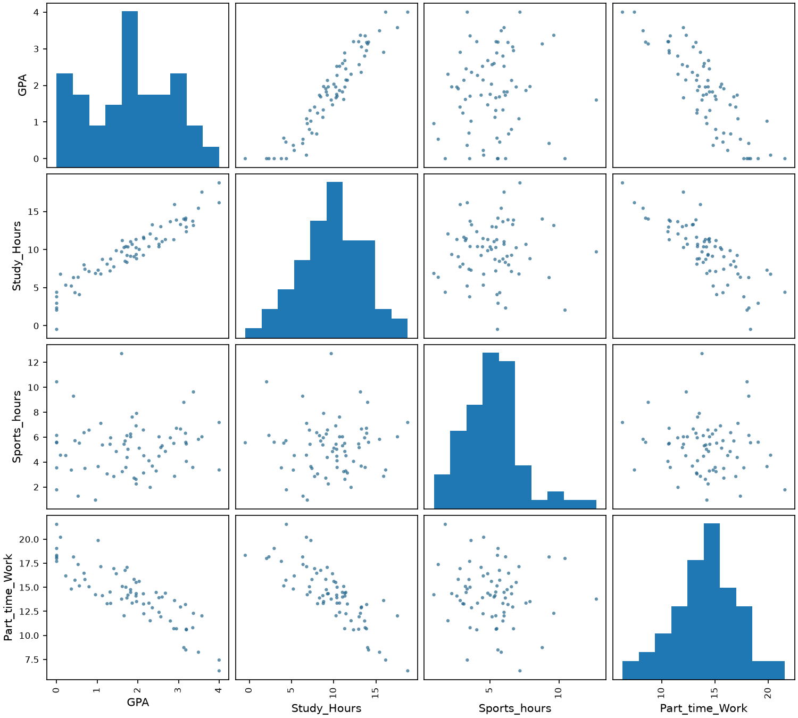
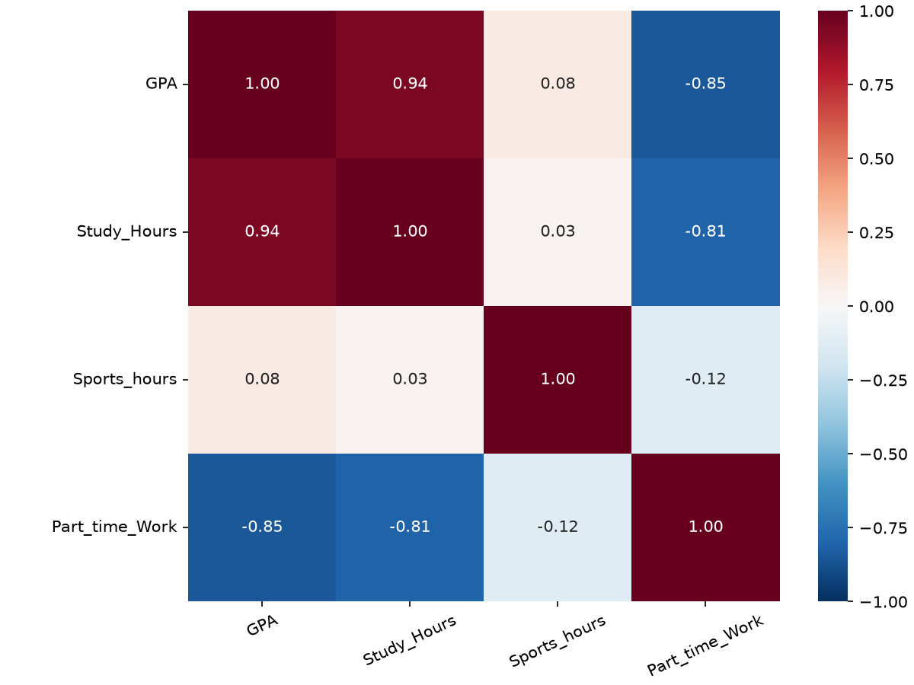
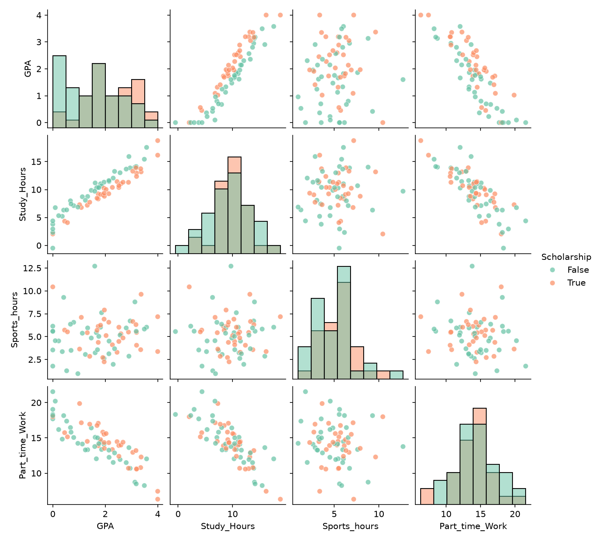
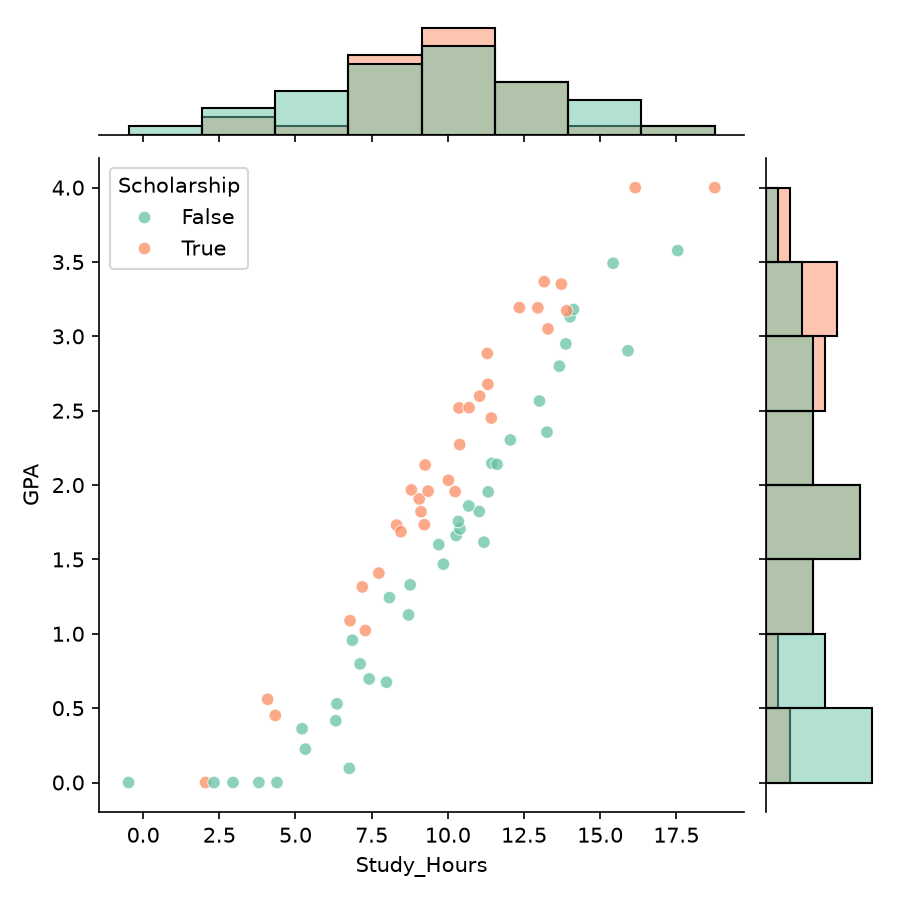
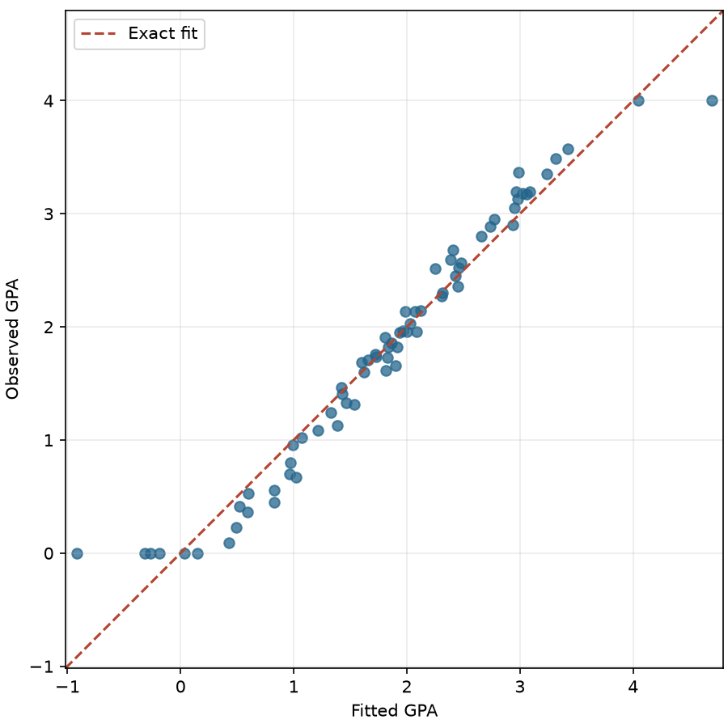
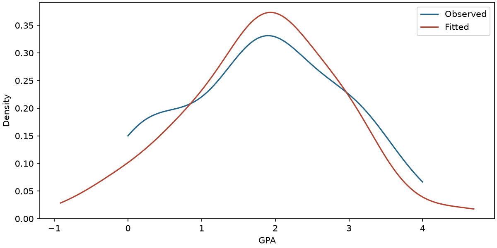
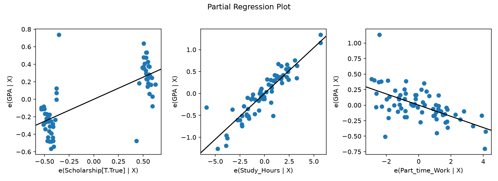

奨学生かどうかと週あたりのアルバイト時間が同じ学生どうしで, 週あたりの勉強時間が 1 時間違うと, 平均 GPA はどれだけ違うでしょうか.

比べる条件を式に入れ, `GPA ~ Scholarship + Study_Hours + Part_time_Work` とします.
運動時間もデータに記録されていますが, 問いでそろえる条件に含めていないため, 式には入れません.
データを見て変数を選ぶ手順は [モデル選択](block:reg-selection) で扱います.

# 合成 GPA の学習用データ {#gpa-data}

[`multiple_regression.csv`](https://github.com/yakagika/yakagika.github.io/blob/main/slds_data/ch11/multiple_regression.csv) には, 合成した 100 人分のデータが入っています.
CSV をダウンロードしてコードと同じフォルダに置き, そのフォルダからコードを実行してください.
先頭列は CSV の保存時に書き出された行番号です.
`index_col=0` で行のインデックスとして読み込みます.

~~~ python
import matplotlib.pyplot as plt
import pandas as pd
import seaborn as sns
import statsmodels.formula.api as smf
from sklearn.model_selection import train_test_split
from sklearn.preprocessing import StandardScaler
from statsmodels.graphics.regressionplots import plot_partregress_grid
from statsmodels.stats.outliers_influence import variance_inflation_factor

df = pd.read_csv("multiple_regression.csv", index_col=0)
train, test = train_test_split(df, test_size=0.3, random_state=0)
print(f"Training: {len(train)}, held out: {len(test)}")
~~~

~~~ text
Training: 70, held out: 30
~~~

読み込んだ直後に最終評価用の 30 人を取り分けます.
`random_state=0` は分割を再現するための指定です.
残った 70 人 (`train`) で図と表を作り, 回帰式を求めます.
取り分けたデータの使い方は [未使用のデータで予測誤差を測る](block:reg-evaluate) で扱います.

| 列 | 内容 |
|---|---|
| `GPA` | GPA (0〜4 点) |
| `Scholarship` | 奨学生かどうか (`True` または `False`) |
| `Study_Hours` | 週あたりの勉強時間 (時間) |
| `Part_time_Work` | 週あたりのアルバイト時間 (時間) |
| `Sports_hours` | 週あたりの運動時間 (時間) |

# 学習用データの散布図と相関 {#gpa-exploration}

散布図行列では, 行の変数が縦軸, 列の変数が横軸です.
対角線上のヒストグラムには, 各変数の分布が出ます.

~~~ python
numeric_columns = ["GPA", "Study_Hours", "Sports_hours", "Part_time_Work"]
fig, axes = plt.subplots(4, 4, figsize=(10, 9), layout="constrained")
pd.plotting.scatter_matrix(
    train[numeric_columns],
    ax=axes,
    diagonal="hist",
    range_padding=0.12,
    color="#23658b",
    alpha=0.7,
)
plt.show()
plt.close(fig)
~~~

{.wide}

勉強時間の長い学生ほど GPA が高く, アルバイト時間の長い学生ほど GPA が低い傾向があります.
勉強時間とアルバイト時間の散布図では, 勉強時間の長い学生ほどアルバイト時間が短い傾向があります.
勉強時間を正規分布から生成したため, 学習用データには勉強時間が約 -0.48 時間の架空の学生が 1 人います.
図と回帰では配布版の値をそのまま使います.

`corr()` で数値変数の Pearson の相関係数を求めます.
ヒートマップでは負の相関を青, 正の相関を赤で表します.

~~~ python
correlations = train[numeric_columns].corr()
fig, ax = plt.subplots(figsize=(8, 6), layout="constrained")
sns.heatmap(
    correlations,
    ax=ax,
    vmin=-1,
    vmax=1,
    center=0,
    cmap="RdBu_r",
    annot=True,
    fmt=".2f",
    square=True,
)
ax.tick_params(axis="x", labelrotation=25)
ax.tick_params(axis="y", labelrotation=0)
plt.show()
plt.close(fig)
~~~

勉強時間とアルバイト時間の相関係数は約 -0.81 です.
この相関係数は学習用データ全体での関係を表します.
重回帰式では, アルバイト時間をそろえた場合の勉強時間と GPA の関係を求めます.

## 奨学生かどうかで層別した分布 {#gpa-stratified}

同じ 70 人を奨学生かどうかで色分けします.
ペアプロットの対角線では, 2 群それぞれのヒストグラムを重ねます.

~~~ python
groups = sns.pairplot(
    train[[*numeric_columns, "Scholarship"]],
    hue="Scholarship",
    diag_kind="hist",
    palette="Set2",
    diag_kws={"bins": 8},
    plot_kws={"alpha": 0.7},
    height=2.2,
)
plt.show()
plt.close(groups.figure)
~~~

{.wide}

GPA と勉強時間に絞ったジョイントプロットでは, 中央に散布図,
上に勉強時間のヒストグラム, 右に GPA のヒストグラムを表示します.

~~~ python
joint = sns.JointGrid(
    data=train,
    x="Study_Hours",
    y="GPA",
    hue="Scholarship",
    palette="Set2",
    height=6,
)
joint.plot_joint(sns.scatterplot, alpha=0.75)
joint.plot_marginals(sns.histplot, bins=8)
plt.show()
plt.close(joint.figure)
~~~

勉強時間の範囲は 2 群で重なり, 図ではどちらの群でも勉強時間の長い学生ほど GPA が高い傾向があります.
この図ではアルバイト時間をそろえていないため, 図に見える傾きと重回帰で求める勉強時間の係数は異なる比較を表します.

# 重回帰の係数と信頼区間 {#gpa-coefficients}

奨学生かどうかは, 奨学生なら 1, それ以外なら 0 の**ダミー変数**で表せます.
`get_dummies` で変換を確かめます.
`drop_first=True` にすると, 基準の `False` の列が省かれます.

~~~ python
scholarship_indicator = pd.get_dummies(
    train["Scholarship"],
    prefix="Scholarship",
    drop_first=True,
    dtype=int,
)
print(scholarship_indicator["Scholarship_True"].value_counts().sort_index().to_string())
~~~

~~~ text
Scholarship_True
0    38
1    32
~~~

式を渡す `smf.ols` も, 配布データの真偽値の列をカテゴリとして扱い, `False` を基準にします.
係数表ではダミー変数の行が `Scholarship[T.True]` になります.
`fit()` で係数を求め, `conf_int(alpha=0.05)` で各係数の 95% 信頼区間を取り出します.

~~~ python
formula = "GPA ~ Scholarship + Study_Hours + Part_time_Work"
result = smf.ols(formula, data=train).fit()

intervals = result.conf_int(alpha=0.05)
coefficient_table = pd.DataFrame(
    {
        "estimate": result.params,
        "lower": intervals[0],
        "upper": intervals[1],
    }
)
print(coefficient_table.to_string(float_format=lambda value: f"{value:.3f}"))
~~~

~~~ text
                     estimate  lower  upper
Intercept               0.836  0.194  1.479
Scholarship[T.True]     0.504  0.398  0.610
Study_Hours             0.209  0.185  0.233
Part_time_Work         -0.090 -0.121 -0.060
~~~

- `Study_Hours` は約 0.209 です. 奨学生かどうかとアルバイト時間が同じ学生どうしでは, 週あたりの勉強時間が 1 時間長い学生の平均 GPA が約 0.209 点高いと推定されます.
- `Part_time_Work` は -0.090 です. 奨学生かどうかと勉強時間が同じ学生どうしでは, 週あたりのアルバイト時間が 1 時間長い学生の平均 GPA が約 0.090 点低いと推定されます.
- `Scholarship[T.True]` は 0.504 です. 勉強時間とアルバイト時間が同じ学生どうしで, 奨学生の平均 GPA から奨学生でない学生の平均 GPA を引いた差を表します.
- `Intercept` は 0.836 です. 奨学生でなく, 週あたりの勉強時間とアルバイト時間がともに 0 時間のときの式の値です. 学習用データにはこの条件に該当する学生がいないため, この値は式を観測範囲外に延ばした値です.

表の 95% 信頼区間はいずれも 0 を含みません.
推定値と区間を一緒に報告すると, 差の向きと大きさにどの程度の不確かさがあるかを伝えられます.
母集団に相当するのは, 配布データと同じ仕組みから作られる学生です.
同じ仕組みから別の標本を取れば, 係数と区間も変わります.
区間の読み方と前提は [回帰係数の区間と検定](block:reg-ols) を参照してください.

## アルバイト時間を式から外した比較 {#gpa-model-comparison}

アルバイト時間を含まない式を, 同じ学習用の 70 人で当てはめます.

~~~ python
reduced = smf.ols("GPA ~ Scholarship + Study_Hours", data=train).fit()
study_comparison = pd.DataFrame(
    {
        "With part-time work": coefficient_table.loc["Study_Hours"],
        "Without part-time work": {
            "estimate": reduced.params["Study_Hours"],
            "lower": reduced.conf_int(alpha=0.05).loc["Study_Hours", 0],
            "upper": reduced.conf_int(alpha=0.05).loc["Study_Hours", 1],
        },
    }
).T
print(study_comparison.to_string(float_format=lambda value: f"{value:.3f}"))
~~~

~~~ text
                        estimate  lower  upper
With part-time work        0.209  0.185  0.233
Without part-time work     0.267  0.249  0.284
~~~

アルバイト時間を入れた式の約 0.209 点は, 奨学生かどうかとアルバイト時間をそろえた比較です.
アルバイト時間を外した式の約 0.267 点では, 奨学生かどうかだけをそろえるので,
勉強時間が異なる学生の間でアルバイト時間も異なりえます.
どの変数をそろえた比較になるかは [重回帰分析と偏回帰係数](block:reg-multiple) で扱います.

## VIF と係数の区間 {#gpa-vif}

`result.model.exog` は, 切片用の定数列と説明変数を並べた行列です.
各説明変数の**分散拡大係数** (VIF) を計算します.

~~~ python
design = result.model.exog
predictor_names = result.model.exog_names
for column, name in enumerate(predictor_names):
    if name != "Intercept":
        vif = variance_inflation_factor(design, column)
        print(f"{name:20s} {vif:.2f}")
~~~

~~~ text
Scholarship[T.True]  1.01
Study_Hours          2.92
Part_time_Work       2.92
~~~

勉強時間とアルバイト時間の VIF はどちらも約 2.92 です.
他の条件を一定とすると, VIF が大きいほど係数の標準誤差が大きくなり, 信頼区間も広がります.

# 学習用データへの当てはまり {#multiple-regression-plots}

70 人の実測の GPA と, 同じ 70 人を使って求めた式による当てはめ値を比べます.
実測値と当てはめ値が一致する場所を破線で描きます.
軸は同じ尺度にし, 式の値が 0〜4 の範囲から出る場合も表示します.

~~~ python
observed = train["GPA"]
fitted = result.fittedvalues
limits = (
    min(0, fitted.min()) - 0.1,
    max(4, fitted.max()) + 0.1,
)

fig, ax = plt.subplots(figsize=(6, 6), layout="constrained")
ax.scatter(fitted, observed, color="#23658b", alpha=0.75)
ax.plot(limits, limits, color="#b44532", linestyle="--", label="Exact fit")
ax.set(
    xlabel="Fitted GPA",
    ylabel="Observed GPA",
    xlim=limits,
    ylim=limits,
    aspect="equal",
)
ax.legend()
ax.grid(alpha=0.25)
plt.show()
plt.close(fig)
~~~

{.small}

破線からの縦のずれが, 各学生の実測値と当てはめ値の差です.
実測 GPA は 0〜4 点です. 一次式の当てはめ値には範囲の制約がなく, 図には 0 点未満と 4 点超の当てはめ値も現れます.

密度図では, 実測値と当てはめ値がそれぞれどのあたりに集まっているかを比べます.
実測値の曲線は 0〜4 点の範囲で描きます.

~~~ python
fig, ax = plt.subplots(figsize=(8, 4), layout="constrained")
sns.kdeplot(observed, ax=ax, clip=(0, 4), cut=0, label="Observed", color="#23658b")
sns.kdeplot(fitted, ax=ax, cut=0, label="Fitted", color="#b44532")
ax.set(xlabel="GPA", ylabel="Density")
ax.legend()
plt.show()
plt.close(fig)
~~~

2 本の曲線はいずれも 2 点付近に山があります.
密度図は分布全体の比較に使い, 学生ごとのずれは直前の散布図で読みます.

偏回帰プロットでは, ある説明変数を選び, 他の変数への回帰で得た残差を使います.
横軸は選んだ説明変数の残差, 縦軸は GPA の残差です.
図の直線の傾きは, 重回帰式での各説明変数の係数になります.

~~~ python
fig = plt.figure(figsize=(11, 4))
plot_partregress_grid(
    result,
    exog_idx=["Scholarship[T.True]", "Study_Hours", "Part_time_Work"],
    grid=(1, 3),
    fig=fig,
)
fig.subplots_adjust(top=0.84)
plt.show()
plt.close(fig)
~~~

{.wide}

中央の勉強時間の直線は右上がりで, 右のアルバイト時間の直線は右下がりです.
係数の数値と区間は [重回帰の係数と信頼区間](#gpa-coefficients) の表で確認できます.

# 勉強時間とアルバイト時間の標準化 {#gpa-standardization}

勉強時間とアルバイト時間の係数を, それぞれの時間のばらつきを基準に比べたいときは,
学習用データで 2 列を標準化できます.
`StandardScaler` は学習用データの平均を引き, 標準偏差で割ります.
奨学生かどうかと GPA は元の尺度で残します.

~~~ python
hours = ["Study_Hours", "Part_time_Work"]
standardized = train.copy()
standardized[hours] = StandardScaler().fit_transform(train[hours])
standardized_result = smf.ols(formula, data=standardized).fit()
print(standardized_result.params.loc[hours].to_string(float_format=lambda value: f"{value:.3f}"))
~~~

~~~ text
Study_Hours       0.780
Part_time_Work   -0.266
~~~

標準化した係数は, 他の説明変数をそろえ, 対象の時間が学習用データの 1 標準偏差だけ違う学生どうしの,
平均 GPA の差を表します. GPA は標準化していないので, 差の単位は GPA の点です.

# 演習 {#exercises}

## Exercise REG-GPA-1 {#exercise-reg-gpa-1}

**アルバイト時間をそろえる場合とそろえない場合**

学習用データを使い, アルバイト時間を式に入れた場合と外した場合の勉強時間の係数を求めてください.
それぞれ, どの条件が同じ学生どうしの平均 GPA を比べているかを書いてください.

回答

~~~ python
with_work = smf.ols("GPA ~ Scholarship + Study_Hours + Part_time_Work", data=train).fit()
without_work = smf.ols("GPA ~ Scholarship + Study_Hours", data=train).fit()
print(f"With part-time work: {with_work.params['Study_Hours']:.3f}")
print(f"Without part-time work: {without_work.params['Study_Hours']:.3f}")
~~~

~~~ text
With part-time work: 0.209
Without part-time work: 0.267
~~~

どちらも週あたりの勉強時間が 1 時間異なる学生どうしの比較です.
アルバイト時間を式に入れた場合は奨学生かどうかとアルバイト時間が同じ学生どうしで, 平均 GPA の差は約 0.209 点です.
外した場合は奨学生かどうかが同じ学生どうしで, 平均 GPA の差は約 0.267 点です.

