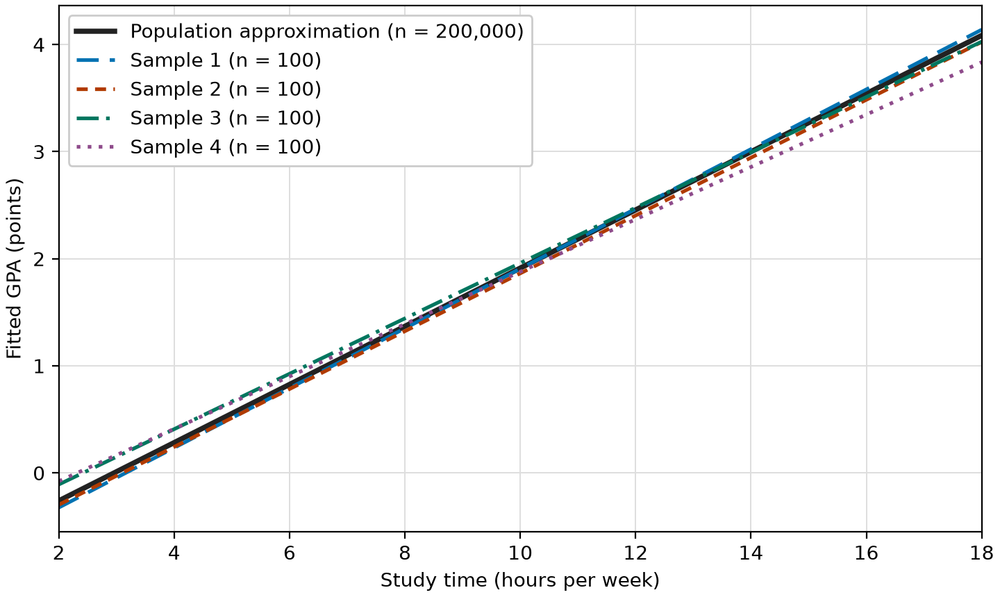

勉強時間が長い学生と短い学生では, 平均 GPA はどれだけ違うでしょうか.
**回帰分析**では, 勉強時間が同じ学生の GPA の平均を式で表し,
勉強時間の異なる学生どうしで平均を比べます.
標本から求めた平均の差を, どの学生の集団について述べられるかも考えます.

この分野の本体は, **関係の定量化と母集団への推測**です.
同じ GPA のデータを, 新しく入学する学生の成績を予測したり,
勉強時間を増やす取り組みについて因果を問うたりする場合にも使います.
答えたい問いによって, 前提と結果の確かめ方が変わります.

# 回帰式と回帰係数 {#regression-equation}

架空の学生のデータで, 週あたりの勉強時間を $x$ とします.
勉強時間が $x$ の学生の平均 GPA を直線で表すと, 式は次の形になります.

$$
m(x) = \beta_0 + \beta_1 x
$$

$m(x)$ は回帰式が表す平均です.
勉強時間が同じ学生でも, 1 人ずつの GPA はその平均の周りにばらつきます.

- GPA は平均を求めたい変数なので, **目的変数** (被説明変数) と呼びます.
- 勉強時間 $x$ は平均を比べる条件に使うので, **説明変数**と呼びます.
- $m(x) = \beta_0 + \beta_1 x$ のように関係を表す式を**回帰式** (回帰方程式) と呼びます.
- $\beta_0$ は**切片**です. 勉強時間が週 0 時間のときの, 式の上での平均 GPA を表します.
  週 0 時間に近い観測が少なければ, 切片は観測の少ない範囲での式の値です.
- $\beta_1$ は回帰直線の**傾き**です. 週あたりの勉強時間が 1 時間違う学生を比べたときの,
  式の上での平均 GPA の差です.
- 切片と傾きを合わせて**回帰係数**と呼びます.

例えば, 傾きが 0.27 の直線では,
週 11 時間勉強する学生の平均 GPA は週 10 時間の学生より 0.27 高いと読みます.
同じ直線上で, 週 12 時間と週 10 時間の学生の平均を比べると, 差は $2 \times 0.27 = 0.54$ です.

## 単回帰と重回帰

説明変数が勉強時間の 1 つなら, **単回帰分析**です.
奨学生かどうかやアルバイト時間も含め, 説明変数を 2 つ以上使う場合を**重回帰分析**と呼びます.
線形の重回帰では, 説明変数ごとに係数を求めます.
その係数を読むときは, 残りの説明変数が同じ条件の学生を比べます.
勉強時間とアルバイト時間を例にした読み方は[重回帰分析と偏回帰係数](block:reg-multiple)にあります.

## 線形回帰と非線形回帰

説明変数を 1 つにしたとき, 平均を直線で表す回帰は**線形回帰**の一例です.
説明変数を 2 つにして, それぞれに係数を掛けて足す式も線形回帰です.
線形回帰では, どの係数も, 説明変数から作った項に掛けて足し合わせます.

**非線形回帰**の一例は, 勉強時間 $x$ が長くなるにつれて平均 GPA が上限に近づく式です.

$$
m(x) = \beta_0\{1 - \exp(-\beta_1 x)\}
$$

$\beta_0,\beta_1$ がともに正のとき, $\beta_0$ は上限を表し,
$\beta_1$ が大きいほど平均は短い勉強時間で上限に近づきます.
$\beta_1$ が指数関数の中に入るため, 式は係数について非線形です.
なお, $x^2$ を項として足す回帰では,
$x$ に対して曲線を描いても, 係数については線形です.

# GPA のデータから問えること {#regression-goals}

ある大学の学生について GPA, 週あたりの勉強時間とアルバイト時間, 奨学生かどうかを記録したとします.
この記録から出発して, 次の問いを立てられます.
**母集団**は, 推測や予測について述べたい学生の集団です.

| 問い | 誰について何を述べるか | 何を前提にするか | 何で確かめるか |
|---|---|---|---|
| (a) [関係の定量化と母集団への推測](block:reg-multiple). 他の条件が同じで, 勉強時間だけ週 1 時間違う学生を比べると, 平均 GPA はどれだけ違うか | 標本を取った母集団での, 条件をそろえた平均の差 | 母集団からの抽出に偏りがなく, 比べる条件を先に決めていること. 比較する条件の範囲で, 回帰式が平均の差を表せること | 係数と信頼区間を示し, 必要なら検定する. 同じ母集団の別の標本でも差を調べる |
| (b) [予測](block:reg-prediction). 次に入学する学生の GPA をどれだけ正確に当てられるか | 同じ母集団の新しい学生 1 人ずつの GPA と, 予測の誤差 | 新しい学生が標本と同じ分布から来て, 予測に使う変数を予測時に得られること | 回帰式を決めるときに使わなかったデータで, 予測値と実際の値の差を測る |
| (c) [因果推論](block:reg-causal). 勉強時間を増やす介入を行うと, 平均 GPA はどう変わるか | 同じ母集団で, 介入する場合としない場合の平均 GPA の差 | 介入内容を定め, 観測した結果と介入した場合の結果を結び付ける因果の構造を仮定すること. 無作為な割り付けで比較できる場合もある | 観測データから目的の差を求められる条件を調べ, 仮定を変えた場合や, 別の設計で得た結果を検討する |

## 平均と一人ひとりの GPA

関係の定量化では, 例えば同じ奨学生区分とアルバイト時間の学生に絞って,
勉強時間が異なる学生の平均 GPA を比べます.
標本に現れた差を母集団の差として推定するときは, 標本の選び方が根拠になります.

予測では, 同じ勉強時間の学生の平均 GPA を, 新しい学生の予測値として使えます.
予測には, 手元の標本で平均を推定する誤差と, 同じ勉強時間の学生に残る個人差が含まれます.
新しい学生の成績が予測からどのくらい外れるかは, 未使用のデータで測ります.
その手順と, 平均の区間と個人の予測区間の読み方は[予測](block:reg-prediction)にあります.

## 観測した比較と介入した場合の比較

因果推論で比べるのは, 同じ学生の集団が勉強時間を増やす取り組みを受けた場合と,
受けなかった場合の平均です.
観測データで勉強時間の異なる学生を並べると, 勉強時間以外の条件も異なることがあります.
介入した場合の平均差を求められるかは,
勉強時間と GPA がどう決まるかについて置く仮定や, データを集めた設計によって変わります.

## 探索と対象にする母集団

**探索**は, 例えば勉強時間, アルバイト時間, 運動時間の散布図を見ながら,
どの変数と GPA の関係を調べるかを決める作業です.
探索で見つけた関係は仮説として扱い, 別のデータを集めて確かめます.
変数の選び方は[モデル選択](block:reg-selection)で扱います.

同じ大学の別の年度や, 別の大学の学生まで対象にするときは,
学習環境や GPA の付け方が元の集団とどの程度共通するかを調べます.
母集団を広げるための前提は, 平均の差を推測する場合にも,
新しい学生を予測する場合にも, 介入の結果を考える場合にも加わります.

## 回帰の目的を分ける文献

@hernan2019second は, データ分析を記述, 予測, 反事実の予測に分けています.
反事実の予測には, 介入した場合を問う因果推論が含まれます.
@leek2015what は, 仮説をつくる探索と, 標本をもとに推測する分析を区別しています.

@shmueli2010explain の「説明」は, 理論から導いた因果の仮説を検証することを指します.
表の (a) で求めるのは, 観測した条件をそろえた学生どうしの平均の差です.
@gelman2020regression は, 回帰の用途として予測, 関連の探索,
標本から母集団への外挿, 因果推論を挙げています.

# 標本が変われば推定値も変わる {#sampling-variation}

架空の学生を作る同じ仕組みから, 100 人ずつの独立な標本を 4 つ取りました.
各標本で, 勉強時間だけを説明変数にして GPA の回帰直線を求めます.
同じ仕組みから別に生成した 20 万人についても直線を求め, 母集団の回帰直線の近似とします.

横軸は週あたりの勉強時間, 縦軸は直線が与える GPA です.
黒い実線が 20 万人から求めた直線で, その傾きは約 0.272 です.
色の付いた線を左右にたどると, 同じ生成の仕組みでも,
標本によって傾きと切片が異なることが分かります.
4 標本の傾きは約 0.245 から 0.279 でした.
例えば週 6 時間と週 16 時間の位置で直線を見比べると, 線の並び順が変わります.

観測した GPA の範囲は 0 から 4 です.
当てはめた直線には上下限がないため, 図の横軸の両端ではその範囲を外れる値も出ます.
GPA の上下限と回帰式の関係は[母回帰式と誤差](block:reg-ols#population-model)にあります.

1 つの標本の傾きには, その標本にどの学生が入ったかによるばらつきがあります.
**信頼区間**は, 標本を取り直したときに推定値がどれだけばらつくかをもとに,
母集団の係数について値の範囲を示します.
**検定**では, 例えば母集団の傾きが 0 だと仮定したときに,
標本で得た傾きと同じ程度か, それ以上に 0 から離れた傾きがどれほど起こりやすいかを調べます.
計算と区間の読み方は[回帰係数の分布・信頼区間・検定](block:reg-ols#coefficient-test)にあります.

# 頻度論とベイズ統計学 {#inference}

この分野では**頻度論**の枠組みで母集団への推測を行います.
母集団の係数のような, 母集団を特徴付ける値を**母数**と呼びます.
頻度論では母数を固定した値とみなし,
同じ手順で標本を取り直したときのばらつきから区間と検定を作ります.

**ベイズ統計学**では, 母数の不確かさを確率分布で表します.
データを観測する前の不確かさを表す事前分布と,
データの出方を表すモデルを組み合わせ, 観測後の事後分布を求めます.
事後分布は, 例えば GPA の傾きがどの範囲にあるかを述べるのに使えます.

頻度論とベイズ統計学の違いは, 不確かさをどう表すかにあります.
どちらの枠組みでも, 関係の定量化, 予測, 因果推論の問いを扱えます.
ベイズの考え方と実例は[統計モデリングとベイズ統計学の基礎](block:bayes-intro)にあります.

# 結果が 0 か 1 のとき {#binary-response}

単位を取得した学生を 1, 取得しなかった学生を 0 とします.
同じ勉強時間の学生に絞ると, 0 と 1 の平均は 1 の割合です.
例えば 10 人のうち 7 人が単位を取得したとき, 平均は $7/10 = 0.7$ です.
母集団では, 条件をそろえたときの 0 と 1 の平均が, 単位を取得する確率になります.

**一般化線形モデル**では, 目的変数の取りうる値に応じて分布と平均の表し方を選びます.
例えば**ロジスティック回帰**では,
説明変数の線形式を 0 と 1 の間の確率に変換して使います.
変換の式と確率の求め方は[一般化線形モデルと二値の応答](block:reg-glm)にあります.

# 演習 {#exercises}

## Exercise REG-INTRO-1 {#exercise-reg-intro-1}

**GPA についての 3 つの問い**

次の問いを, 関係の定量化と母集団への推測, 予測, 因果推論, 探索のいずれかに分類してください.
それぞれ, 誰について述べるかと, 結果を得るために必要な前提を 1 つずつ挙げてください.

1. 今年度の学生で, 奨学生区分とアルバイト時間が同じ場合に,
   勉強時間が週 1 時間長い学生の平均 GPA はどれだけ高いか.
2. 来年度, 入学後 1 か月の勉強時間の記録を使うと, 新入生の学期末 GPA をどれだけ正確に当てられるか.
3. 学期中に自習時間を週 1 時間設けると, 同じ学生集団の学期末の平均 GPA はどう変わるか.

回答

1. 関係の定量化と母集団への推測です.
   対象は今年度の学生の母集団です. 母集団から偏りなく標本を取ることが前提です.
2. 予測です. 対象は次に入学する学生一人ひとりです.
   例えば, 回帰式を作った標本と来年度の新入生の分布が同じという前提を置きます.
   来年度と同様の条件をもつ未使用の学生データで誤差を測ります.
3. 因果推論です. 対象は自習時間を設ける場合と設けない場合の, 同じ学生集団の平均の差です.
   例えば, 自習時間を設けるかどうかを無作為に割り付けて, 群の比較ができるようにします.

## Exercise REG-INTRO-2 {#exercise-reg-intro-2}

**データを見てから見つけた関係**

担当者は, 勉強時間・運動時間・アルバイト時間と GPA の散布図を作り,
関係が目立った運動時間について詳しく調べることにしました.
この時点の作業を分類してください.
同じ大学の母集団でも関係が成り立つかを確かめるには, 次にどのような標本を使いますか.

回答

関係を探しながら変数を選んでいるので探索です.
運動時間と GPA に関係があるという仮説を立て,
同じ大学の対象学生から新しく偏りなく取った標本で確かめます.
新しい標本を見る前に, どの条件をそろえ, どの回帰係数を調べるかを決めます.

