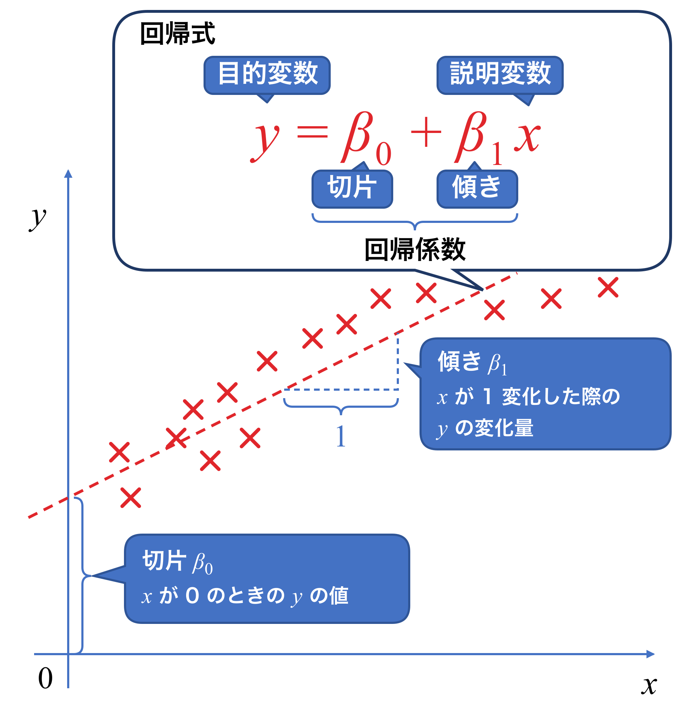

2 つの量的変数に関係があるかないかは, まず[散布図](block:vis-relation#scatter)で点の並びを見て判断します.
その関係の向きと直線的な強さを数値で表したものが[ピアソンの相関係数](block:num-correlation#correlation)です.
点が右上がりに並ぶと相関係数は正, 右下がりに並ぶと負になり, 直線に近く並ぶほど絶対値が 1 に近づきます.

しかし, 相関係数からは, 一方が 1 違うときに他方が平均でどれだけ違うか (関係の大きさ) は分かりません.
図は, 横軸と縦軸の目盛りをそろえた 2 組の合成データです.
相関係数はどちらも 0.80 ですが, 横軸の値が 1 違うとき, 直線の高さの差は左で 0.30, 右で 0.80 です.

{.wide}

**回帰分析**では, 例えば横軸の値ごとに, 縦軸の変数の平均を式で表します.
直線で表すと, 傾きから横軸の値が 1 違うときの平均の差が分かります.

手元のデータ (標本) から求めた式は, 同じ母集団から標本を取り直しても, 含まれる観測が変わるため変わります.
母集団について平均の差を述べるには, 標本の取り方を踏まえ, 推定値のばらつきも考える必要があります.
標本ごとの違いは「[標本が変われば推定値も変わる](#sampling-variation)」の図で確認できます.
ばらつきの測り方は[回帰係数の分布・信頼区間・検定](block:reg-ols#coefficient-test)にあります.

この分野の本体は, **関係の定量化と母集団への推測**です.
まず回帰式の形と各部の名前を確かめ, そのうえで回帰分析を何に使うかを整理します.

# 回帰式と回帰係数 {#regression-equation}

::: note
回帰分析では, データ

$$
y = \beta_0 + \beta_1 x
$$

のような式で変数 y と x の関係を説明し, この式を**回帰式, 回帰方程式**と呼びます. このとき,

- 説明される変数 y を **被説明変数**, **目的変数**などと呼びます.

- 説明する変数 x を**説明変数**, **独立変数**などと呼びます.

- 回帰式における **$\beta_0$**のような変数に乗じられていない値を**切片**といいます.

    切片は, $x = 0$ のときの y の値を意味しています.

- 変数に乗じられている**$\beta_1$**のような値を**傾き**といい, $\beta_0,\beta_1$ などを併せて**回帰係数**といいます.

    傾きは, x が 1 変化した際の y の変化量を表しています.

- 説明変数が一つの回帰式を求める分析を**単回帰分析**, 2 つ以上の説明変数を用いる場合を**重回帰分析**といいます.

- y が x の線形関数である場合を **線形回帰 (Linear regression)**, それ以外のものを**非線形回帰 (non-linear regression)**といいます.

{.wide}

:::

# 回帰分析の目的 {#regression-goals}

回帰式と回帰係数は, どのような問いに答えるために使うのでしょうか.
関係の定量化と母集団への推測に加えて, 回帰分析は予測や因果推論にも使われます.
一組の学生の記録から, 目的ごとに異なる問いを立てられます.

ある大学の学生について, GPA, 週あたりの勉強時間とアルバイト時間, 奨学生かどうかを記録したとします.
推測や予測の対象とする学生の集団を**母集団**と呼びます.
これは架空の例で, 実際の分析には[合成 GPA の学習用データ](block:reg-gpa#gpa-data)を使います.
次の表では, この記録から立てられる問いを回帰分析の用途ごとに並べ, それぞれの前提と確かめ方を比べます.

| 問い | 誰について何を述べるか | 何を前提にするか | 何で確かめるか |
|---|---|---|---|
| (a) [関係の定量化と母集団への推測](block:reg-multiple). 他の条件が同じで, 勉強時間だけ週 1 時間違う学生を比べると, 平均 GPA はどれだけ違うか | 標本を取った母集団での, 条件をそろえた平均の差 | 母集団からの抽出に偏りがなく, 比べる条件を先に決めていること. 比較する条件の範囲で, 回帰式が平均の差を表せること | 係数と信頼区間を示し, 必要なら検定する. 同じ母集団の別の標本でも差を調べる |
| (b) [予測](block:reg-prediction). 次に入学する学生の GPA をどれだけ正確に当てられるか | 同じ母集団の新しい学生 1 人ずつの GPA と, 予測の誤差 | 新しい学生が標本と同じ分布から来て, 予測に使う変数を予測時に得られること | 回帰式を決めるときに使わなかったデータで, 予測値と実際の値の差を測る |
| (c) [因果推論](block:reg-causal). 勉強時間を増やす介入を行うと, 平均 GPA はどう変わるか | 同じ母集団で, 介入する場合としない場合の平均 GPA の差 | 介入内容を定め, 観測した結果と介入した場合の結果を結び付ける因果の構造を仮定すること. 無作為な割り付けで比較できる場合もある | 観測データから目的の差を求められる条件を調べ, 仮定を変えた場合や, 別の設計で得た結果を検討する |

目的によって, 何を前提にし, どの変数を回帰式に入れ, 結果をどう確かめるかが変わります.
例えば, 奨学生区分とアルバイト時間を式に入れると, 両方の条件が同じ学生どうしで, 勉強時間が異なるときの平均 GPA の差を求められます.
標本から母集団での平均の差を推定するときは, 標本の選び方が根拠になります.

新しく入学した学生の GPA を予測するときは, 例えば同じ勉強時間の学生の平均 GPA を予測値として使えます.
予測の誤差には, 手元の標本から平均を推定するときの誤差と, 勉強時間が同じでも残る個人差が含まれます.
新しい学生の成績が予測値からどれだけ外れるかは, 回帰式を決めるときに使わなかったデータで測ります.
誤差を測る手順と, 平均についての区間と個人についての予測区間の読み方は[予測](block:reg-prediction)にあります.

勉強時間を増やす取り組みの効果を知りたい場合は, 同じ学生集団が取り組みを受けた場合と受けなかった場合の平均 GPA を比べます.
観測データで勉強時間の異なる学生を比べると, 勉強時間以外の条件も異なることがあります.
観測データから介入した場合としなかった場合の平均の差を求められるかは, 勉強時間と GPA がどう決まるかについての仮定や, データを集めた設計によって変わります.

いずれの目的でも, 別の年度や別の大学の学生まで対象を広げるときは, 学習環境や GPA の付け方が元の学生集団とどの程度共通するかを調べます.
平均の差の推測, 新しい学生の予測, 介入の効果のいずれについても, 元の集団で求めた結果を広げた先の集団に当てはめるには, 追加の前提が要ります.

表に挙げたどの目的でも, 問いを立てる前にデータを見て, 調べる関係を決めることがあります. この作業を**探索**と呼びます.
例えば運動時間も記録していれば, 勉強時間, アルバイト時間, 運動時間をそれぞれ GPA と組み合わせた散布図を描き, どの関係を詳しく調べるかを考えます.
探索で見つけた関係は仮説として扱い, 別のデータを集めて確かめます.
データを見て回帰式に入れる変数を選ぶ方法は[モデル選択](block:reg-selection)にあります.

仮説をつくる探索と, 標本をもとに推測する分析は, @leek2015what でも区別されています.
@hernan2019second はデータ分析を記述, 予測, 反事実の予測に分け, 反事実の予測に介入した場合を問う因果推論を含めています.
@shmueli2010explain の「説明」は, 理論から導いた因果の仮説を検証することです. 表の (a) で求めるのは, 観測した条件をそろえた学生どうしの平均の差です.
@gelman2020regression は, 回帰の用途として予測, 関連の探索, 標本から母集団への外挿, 因果推論を挙げています.

回帰をどの目的に使い, 分析のどの点を重視するかは, 統計学, 計量経済学, 疫学, 機械学習, 心理学などの分野によって異なります.
分野ごとにどのような問題が調べられ, どのような方法が使われてきたかは, [学問分野ごとの手法の違いと経緯](block:reg-selection-more#model-selection-history)にあります.

関係の定量化と母集団への推測から始めます.
まず [OECD の出生率のデータで行う単回帰分析](block:reg-simple)で, 関係の大きさを傾きで表します.
[重回帰分析](block:reg-multiple)では, 条件をそろえたときの平均の差を考え, [合成 GPA のデータ](block:reg-gpa)で実際に回帰係数を求めます.
次に, 予測と因果推論でそれぞれ注意する点を順に確かめます.
[予測](block:reg-prediction)では[未使用のデータで予測の誤差を測り](block:reg-evaluate), [因果推論](block:reg-causal)では介入した場合の平均の差を求めるための条件を考えます.
最後に, [データを見て回帰式に入れる変数を選ぶ場合](block:reg-selection)に, 選んだ式で何を確かめられるかを考えます.

# 標本が変われば推定値も変わる {#sampling-variation}

[回帰分析の目的](#regression-goals)で挙げた学生の記録を模して, 架空の学生の GPA や勉強時間を生成する仕組みを作り, そこから 100 人ずつの独立な標本を 4 つ取りました.
各標本で, 勉強時間だけを説明変数にして GPA の回帰直線を求めます.
同じ仕組みから別に生成した 20 万人についても直線を求め, 母集団の回帰直線の近似とします.

横軸は週あたりの勉強時間, 縦軸は直線が与える GPA です.
黒い実線が 20 万人から求めた直線で, その傾きは約 0.272 です.
色の付いた線を左右にたどると, 同じ生成の仕組みでも,
標本によって傾きと切片が異なることが分かります.
4 標本の傾きは約 0.245 から 0.279 でした.
例えば週 6 時間と週 16 時間の位置で直線を見比べると, 線の並び順が変わります.

観測した GPA の範囲は 0 から 4 です.
当てはめた直線には上下限がないため, 図の横軸の両端ではその範囲を外れる値も出ます.
GPA の上下限と回帰式の関係は[母回帰式と誤差](block:reg-ols#population-model)にあります.

1 つの標本の傾きには, その標本にどの学生が入ったかによるばらつきがあります.
**信頼区間**は, 標本を取り直したときに推定値がどれだけばらつくかをもとに,
母集団の係数について値の範囲を示します.
**検定**では, 例えば母集団の傾きが 0 だと仮定したときに,
標本で得た傾きと同じ程度か, それ以上に 0 から離れた傾きがどれほど起こりやすいかを調べます.
計算と区間の読み方は[回帰係数の分布・信頼区間・検定](block:reg-ols#coefficient-test)にあります.

# 頻度論とベイズ統計学 {#inference}

この分野では**頻度論**の枠組みで母集団への推測を行います.
母集団の係数のような, 母集団を特徴付ける値を**母数**と呼びます.
頻度論では母数を固定した値とみなし,
同じ手順で標本を取り直したときのばらつきから区間と検定を作ります.

**ベイズ統計学**では, 母数の不確かさを確率分布で表します.
データを観測する前の不確かさを表す事前分布と,
データの出方を表すモデルを組み合わせ, 観測後の事後分布を求めます.
事後分布は, 例えば GPA の傾きがどの範囲にあるかを述べるのに使えます.

頻度論とベイズ統計学の違いは, 不確かさをどう表すかにあります.
どちらの枠組みでも, 関係の定量化, 予測, 因果推論の問いを扱えます.
ベイズの考え方と実例は[統計モデリングとベイズ統計学の基礎](block:bayes-intro)にあります.

# 結果が 0 か 1 のとき {#binary-response}

単位を取得した学生を 1, 取得しなかった学生を 0 とします.
同じ勉強時間の学生に絞ると, 0 と 1 の平均は 1 の割合です.
例えば 10 人のうち 7 人が単位を取得したとき, 平均は $7/10 = 0.7$ です.
母集団では, 条件をそろえたときの 0 と 1 の平均が, 単位を取得する確率になります.

**一般化線形モデル**では, 目的変数の取りうる値に応じて分布と平均の表し方を選びます.
例えば**ロジスティック回帰**では,
説明変数の線形式を 0 と 1 の間の確率に変換して使います.
変換の式と確率の求め方は[一般化線形モデルと二値の応答](block:reg-glm)にあります.

# 演習 {#exercises}

## Exercise REG-INTRO-1 {#exercise-reg-intro-1}

**GPA についての 3 つの問い**

次の問いを, 関係の定量化と母集団への推測, 予測, 因果推論, 探索のいずれかに分類してください.
それぞれ, 誰について述べるかと, 結果を得るために必要な前提を 1 つずつ挙げてください.

1. 今年度の学生で, 奨学生区分とアルバイト時間が同じ場合に,
   勉強時間が週 1 時間長い学生の平均 GPA はどれだけ高いか.
2. 来年度, 入学後 1 か月の勉強時間の記録を使うと, 新入生の学期末 GPA をどれだけ正確に当てられるか.
3. 学期中に自習時間を週 1 時間設けると, 同じ学生集団の学期末の平均 GPA はどう変わるか.

回答

1. 関係の定量化と母集団への推測です.
   対象は今年度の学生の母集団です. 母集団から偏りなく標本を取ることが前提です.
2. 予測です. 対象は次に入学する学生一人ひとりです.
   例えば, 回帰式を作った標本と来年度の新入生の分布が同じという前提を置きます.
   来年度と同様の条件をもつ未使用の学生データで誤差を測ります.
3. 因果推論です. 対象は自習時間を設ける場合と設けない場合の, 同じ学生集団の平均の差です.
   例えば, 自習時間を設けるかどうかを無作為に割り付けて, 群の比較ができるようにします.

## Exercise REG-INTRO-2 {#exercise-reg-intro-2}

**データを見てから見つけた関係**

担当者は, 勉強時間・運動時間・アルバイト時間と GPA の散布図を作り,
関係が目立った運動時間について詳しく調べることにしました.
この時点の作業を分類してください.
同じ大学の母集団でも関係が成り立つかを確かめるには, 次にどのような標本を使いますか.

回答

関係を探しながら変数を選んでいるので探索です.
運動時間と GPA に関係があるという仮説を立て,
同じ大学の対象学生から新しく偏りなく取った標本で確かめます.
新しい標本を見る前に, どの条件をそろえ, どの回帰係数を調べるかを決めます.

